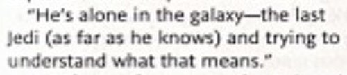

# Owner Material 038 — Star Wars Insider #1–153 plus specials (with The Lucasfilm Fan Club Magazine #1–22): Star Wars Insider #107 (2009)

- **Source:** *Star Wars Insider* magazine (issues 23–153, 1994–2014) and its predecessor *The Lucasfilm Fan Club Magazine* (issues 1–22, 1987–1994), plus seven special editions: articles, interviews, comics and short fiction Secondary source (licensed Legends reference). Scan OCR'd on the box; the scan stays box-only and is **not** published.
- **Method:** every scanned page was OCR'd and machine-screened sentence by sentence for power-relevant statements (fights, kills, defeats, Force feats, rankings, superweapons) that name a character on our roster; each kept sentence is quoted verbatim from the OCR text and has a crop of the printed passage directly under it. Pages with nothing power-relevant are still listed with what is on them.
- **Citation:** "*Star Wars Insider #107* (2009), p.X" by printed page ("scan p.X" where no printed number applies). **Weight:** Licensed magazine: a secondary source. Its short fiction and comics are Legends stories; its articles and interviews sum up or discuss lore and rank below the novels, comics and games they describe.

## scan p.1 (scan page 1)

Page contents: Cover: Mercenaries; Rob Coleman and David Acord; Action Stations! action figure feature; Anthony Daniels on C-3PO and The Clone Wars; Ewok Adventure; Blaster. (hand-read)

## scan p.2 (scan page 2)

Page contents: Cover variant/contents strip: Interview: Anthony Daniels, the longest serving actor, on life as the golden droid. (hand-read)

## scan p.3 (scan page 3)

Page contents: Contents: Editor's Welcome, Launch Pad, Versus (Zam Wesell vs Aurra Sing), A Long Time Ago...1984 (Ewoks), Books, Comics, Collecting (C-3PO), Bounty Hunters, Bantha Tracks, Classic Moment (death of Mara Jade Skywalker); special edition cover note. (hand-read)

## scan p.4 (scan page 4)

Page contents: Editor's Welcome (Jonathan Wilkins): Kenner toy memories from 1984, Hasbro figure feature, Anthony Daniels, Rob Coleman and David Acord; correction on the Cloak of Darkness director credit in issue 106. Out-of-universe. (hand-read)

## scan p.5 (scan page 5)

Page contents: Launch Pad: Art Directors Guild Cinematic Imagery Award and Lincoln Medal for George Lucas; Darth Vader toaster. Out-of-universe. (hand-read)

## scan p.6 (scan page 6)

Page contents: Launch Pad: Your Diary (Fan Days III), Samuel L. Jackson receives the American Cinematheque Award. Out-of-universe. (hand-read)

## scan p.7 (scan page 7)

Page contents: Launch Pad: Star Wars: A Musical Journey at The O2 (Royal Philharmonic Orchestra); Top 10 Musical Moments list. Out-of-universe. (hand-read)

## scan p.8 (scan page 8)

Page contents: Launch Pad: Star Wars: Where Science Meets Imagination exhibition in Australia; Top 10 continued (Skiff Battle, Solo and the Princess, Binary Sunset). Out-of-universe. (hand-read)

## scan p.9 (scan page 9)

Page contents: Launch Pad: StarWars.com C-3PO/Justin Timberlake photo; Reader Review of a LEGOLAND Windsor fireworks display (reader name omitted). Out-of-universe. (hand-read)

## scan p.10 (scan page 10)

Page contents: Launch Pad: "Yoda's Incredible Herb Stew" (rootleaf) recipe by Craig Claiborne for the 1983 NPR Empire Strikes Back radio drama. Out-of-universe. (hand-read)

## scan p.11 (scan page 11)

Page contents: Launch Pad: "Unseen Galaxy Finally Revealed" — Topps Star Wars Galaxy 4 revisits rejected New Visions art. Out-of-universe. (hand-read)

## scan p.12 (scan page 12)

Page contents: Hasbro: "Action Stations!" (Words: Jason Fry) — Derryl DePriest on the line plan for 2010 figures. Out-of-universe. (hand-read)

## scan p.13 (scan page 13)

Page contents: Making the A List: waves, refreshes and carry-forwards; A/B/C grading (only 12 A characters; Luke in Jedi or pilot gear, Boba and Jango, clone troopers and stormtroopers; R2-D2 but not C-3PO, Han or Leia). Captions: Yuuzhan Vong warrior, Anakin pieces, Kyle Katarn. Out-of-universe. (hand-read)

## scan p.14 (scan page 14)

Page contents: Making a Wave: draft-day trading, Willrow Hood, ROTJ wave (black-garb Luke A+, Slave Leia, Paploo and NoApakk, Klaatu, Nikto, Malakili, Major Panno, Ten Numb, biker scout); input drawings for T'ra Saa; Lumiya ("a cyborg first encountered in the classic Marvel Comics series") alternate head. Out-of-universe. (hand-read)

## scan p.15 (scan page 15)

Page contents: Input drawing diagram; Dave Vennemeyer sculpts wax prototypes at production scale (Lumiya, Luke "the Dark Lady's opponent in a two-pack", Darth Krayt); Build-a-Droid 1 box. Out-of-universe. (hand-read)

## scan p.16 (scan page 16)

Page contents: Articulation design (Luke wrist joints, Ewok ankles, Darth Krayt ponytail, Slave Leia) and the Lumiya head revisions. Out-of-universe. (hand-read)

## scan p.17 (scan page 17)

Page contents: Model shop, hardcopies, first shots, paint masters and tampos. Out-of-universe. (hand-read)

## scan p.18 (scan page 18)

Page contents: Final stages, packaging; Build-a-Droid 2 (R5-H6 seen with Gardulla the Hutt, clear-domed R3-O1, HK-47, YVH-1); DePriest's Kenner Droid Factory. Out-of-universe. (hand-read)

## scan p.19 (scan page 19)

Page contents: Interview opener: Anthony Daniels (Words: Dave Mendonca). (hand-read)

## scan p.20 (scan page 20)

Page contents: Full-page photo of Anthony Daniels with the C-3PO head. (hand-read)

## scan p.21 (scan page 21)

Page contents: Daniels interview: almost didn't take the role, Ralph McQuarrie painting, plaster body mold, Threepio Goes Global (Muppet Show, Star Tours, Droids, The Clone Wars); Did You Know: French Star Tours dialogue. Out-of-universe. (hand-read)

## scan p.22 (scan page 22)

Page contents: Did You Know boxes: C-3PO first and last character to speak in the saga; Italian name D-3BO, French Z-6PO; "What Do You Mean, Naked?" box on Daniels cameo as Lieutenant Danni Faytonni (AOTC Outlander club, ROTS Galaxies Opera House). Out-of-universe. (hand-read)

## scan p.23 (scan page 23)

Page contents: Daniels interview continued: recording The Clone Wars from London; Kid Encounters; Droid Science (Where Science Meets Imagination); Did You Know on his writings (Wonder Column, The Protocol Offensive). Out-of-universe. (hand-read)

### Stat block notes (game mechanics, not feats)

- Classic Threepio one-liners box: "Sir, the possibility of successfully navigating an asteroid field is approximately three thousand, seven hundred and twenty to one!" —C-3PO informs Han Solo, to which the captain replies in The Empire Strikes Back, "Never tell me the odds!" (Shut Him Up or Shut Him Down! box, Star Wars Insider 107, p. 23) (Source: *Star Wars Insider #107* (2009), scan p.23)

## scan p.24 (scan page 24)

Page contents: Interview photo page (no text). (hand-read)

## scan p.25 (scan page 25)

Page contents: A Droid's Journey: list of Anthony Daniels' C-3PO credits 1977-2008 and TV guest appearances. Out-of-universe. (hand-read)

## scan p.26 (scan page 26)

Page contents: 341 words, 20 paragraphs | headings/entries: DATABANK; PROFILE; AFFILIATION: BOUNTY HUNTER (FORMER JEDI TRAINEE); SKILLS; STRENGTH 80; SPEED ~ 80; POWER 30; LEADERSHIP ;

### Stat block notes (game mechanics, not feats)

- Versus: Aurra Sing databank: "Aurra Sing had a tough life. Discovered to have Force-potential while still an infant, a mysterious Jedi known only as the "Dark Woman" raised her, hoping to tame her wayward instincts. Kidnapped by star pirates, Sing turned her back on the Jedi, joining the pirates and developing her skills while learning to survive. Apprenticed to a Hutt, Sing completed her transformation into a deadly assassin, becoming a cold, remorseless killer. As a bounty hunter, Sing specialized in Jedi hunts, taking advantage of the crumbling Republic and collecting the lightsabers of the fallen. The chaos of the Clone Wars saw her working for Count Dooku, encountering the Fetts and finally getting her revenge on the "Dark Woman" who attempted to set her on the path to the light." (Versus, Star Wars Insider 107, p. 26) (Source: *Star Wars Insider #107* (2009), scan p.26)
- Versus: Aurra Sing profile, skills and ratings: "HOMEWORLD: NAR SHADDAA SPECIES: UNKNOWN GENDER: FEMALE HEIGHT: 1.74 METERS WEAPON: LIGHTSABER, BLASTERS, PROJECTILE RIFLE VEHICLE: MODIFIED SWOOP AFFILIATION: BOUNTY HUNTER (FORMER JEDI TRAINEE)" … "Aurra Sing's lack of emotions helped her keep her head in battle. Headstrong and cunning, Sing developed the sharp instincts and deadly reflexes necessary to ensure her survival in a hostile universe. She ultimately lacked the control needed to fully master the Force, instead using her Force skills for evil. Her aggression often worked in her favor, although sometimes it would put her into danger unnecessarily." STRENGTH 80, SPEED 80, POWER 30, LEADERSHIP 40, MOBILITY 90, LOYALTY 40, SPECIAL ABILITY 60, BONUS SKILL 70 (Versus, Star Wars Insider 107, p. 26) (Source: *Star Wars Insider #107* (2009), scan p.26)
- Versus: matchup analysis: "They may have both been bounty hunters, but Zam Wesell and Aurra Sing were very different in their practices and as people. The level-headed Wesell narrowly focused on how much money she could make on each job, and approached each case accordingly. In contrast, the emotionally damaged Aurra Sing suffered from a chaotic background that turned her into a purely instinctive killer. But she was able to use this to her benefit when she fell under the influence of the evil Count Dooku. Both spent their formative years fighting to survive and pitting them against each other in a pitched battle would be spectacular. Skilled in close combat, they would be closely matched in strength and agility. Sing's ruthless nature, cunning, and skill with a lightsaber would be countered by Wesell's martial arts skills and her array of defensive and deadly weaponry. Sing would perhaps be a little over confident, while Wesell would be too reliant on her gadgetry rather than her instincts. While strong in instinct, Sing lacks control of her abilities and is prone to letting her aggression get the better of her. The outcome of their battle would come down to uncontrollable factors like the environment and unpredictable elements, such as accidents or carelessness. The smallest thing could offer a victory to one over the other in two such evenly matched warriors!" (Versus, Star Wars Insider 107, pp. 26-27) (Source: *Star Wars Insider #107* (2009), scan p.26)

## scan p.27 (scan page 27)

Page contents: 308 words, 15 paragraphs | headings/entries: DATABANK; SKILLS; SPECIAL ABILITY BONUS SKILL; INSIDER

### Stat block notes (game mechanics, not feats)

- Versus: Zam Wesell databank: "A master of deception, Clawdite bounty hunter Zam Wesell hid her true face beneath that of a beautiful human female. Wesell moved from planet to planet, struggling to make a living from her trade in death. She slowly made a name for herself in corporate security, a role that allowed her to display her ruthlessness. Preferring to work alone, she moved on to a career in bounty hunting. Tasked by Jango Fett to assassinate Senator Amidala, she failed in her first attempt, which destroyed the Senator's Naboo cruiser. A second attempt was more up-close and personal, using a pair of kouhuns, poisonous centipede-like creatures. The Senator escaped, thanks to her Jedi protectors, but Wesell was killed, assassinated herself by Fett in an attempt to prevent her from providing the Jedi with information." (Versus, Star Wars Insider 107, p. 27) (Source: *Star Wars Insider #107* (2009), scan p.27)
- Versus: Zam Wesell profile, skills and ratings: "HOMEWORLD: ZOLAN SPECIES: CLAWDITE GENDER: FEMALE HEIGHT: 1.68 METERS WEAPONS: BLASTER PISTOL, EXPLOSIVES, PROJECTILE RIFLE, KOUHUNS VEHICLE: KORO-2 AIRSPEEDER AFFILIATION: BOUNTY HUNTER" … "Besides her skill in disguise, Wesell was a mistress of gadgets, happy to use all manner of advanced gear and accessories if it helped her to track her prey and get the job done efficiently. Her legendary capture rate attested to her unerring marksmanship and unflagging dedication. In her travels, Wesell achieved third-level mastery in Mabari martial arts, helpful in hand-to-hand combat." STRENGTH 80, SPEED 90, POWER 30, LEADERSHIP 60, MOBILITY 90, LOYALTY 60, SPECIAL ABILITY 80, BONUS SKILL 70 (Versus, Star Wars Insider 107, p. 27) (Source: *Star Wars Insider #107* (2009), scan p.27)

## scan p.28 (scan page 28)

Page contents: Photo page (Insider folio only). (hand-read)

## scan p.29 (scan page 29)

Page contents: Interview opener: Rob Coleman, animation consultant and director on Star Wars: The Clone Wars (Words: Jonathan Wilkins). (hand-read)

## scan p.30 (scan page 30)

Page contents: Coleman interview: setting up Lucasfilm Animation Singapore (2005), working with Dave Filoni and Catherine Winder, East-meets-West anime style, McQuarrie influence vs Supermarionation. Out-of-universe. (hand-read)

## scan p.31 (scan page 31)

Page contents: Coleman interview: training Singapore animators; Yoda in the prequels had to be photo-real; coaching directors to study the original film. Out-of-universe. (hand-read)

## scan p.32 (scan page 32)

Page contents: Coleman interview: "fluent in George Lucas"; directing Downfall of a Droid and Duel of the Droids; Selected Credits box. Out-of-universe. (hand-read)

## scan p.33 (scan page 33)

Page contents: Coleman interview: how an episode is put together (synopses, storyboards, animatics, packaging the show). Out-of-universe. (hand-read)

## scan p.34 (scan page 34)

Page contents: Coleman interview: Ron Perlman as Gha Nachkt (never met), Frank Oz friendship; IG-88 vertical fight inspired by Home Depot aisles; Anakin medical-bay lighting (Andrew Harris). Out-of-universe. (hand-read)

## scan p.35 (scan page 35)

Page contents: Coleman interview end: cinematic "shooting" approach, ROTS opening space battle, a Mace Windu episode he directed chosen as season finale; cameo list (ROTS opera house patron, TPM podrace spectator in Jabba's box). Out-of-universe. (hand-read)

### Stat block notes (game mechanics, not feats)

- Spotting Coleman? box: "Coleman Trebor, one of the many Jedi slain by Count Dooku in Attack of the Clones, is named after Rob Coleman." (Spotting Coleman? box, Star Wars Insider 107, p. 35) (Source: *Star Wars Insider #107* (2009), scan p.35)

## scan p.36 (scan page 36)

Page contents: Reader survey with Forbidden Planet prize (Coruscant Guard maquette, Galactic Marine bust). Out-of-universe. (hand-read)

## scan p.37 (scan page 37)

Page contents: USPS Statement of Ownership and Circulation. Out-of-universe. (hand-read)

## scan p.38 (scan page 38)

Page contents: A Long Time Ago... 1984 (Words: Daniel Wallace): world news timeline. Out-of-universe. (hand-read)

## scan p.39 (scan page 39)

Page contents: 1984: The Ewok Adventure debuts (Nov 25, ABC; Wicket, Mace and Cindel Towani; John Korty); month-by-month (newspaper strip cancelled, Marvel #86 "The Alderaan Factor" on Yinchorr by Randy Stradley, Kenner ROTJ figures, C-3PO's cereal); trivia: The Ewok Adventure set shortly before ROTJ, grown-up Cindel Towani is a galactic journalist in Tyrant's Test. Out-of-universe framing. (hand-read)

## scan p.40 (scan page 40)

Page contents: "Sounding Out the Troops" opener art (Captain Rex and clones). (hand-read)

## scan p.41 (scan page 41)

Page contents: Opener: sound designer David Acord interview (Words: Jonathan Wilkins); art of Obi-Wan, Jedi and battle droids. (hand-read)

## scan p.42 (scan page 42)

Page contents: Acord interview: final mix before Cartoon Network delivery, 5.1 surround "mini-feature" treatment, mixer Juan Peralta, Raiders of the Lost Ark influence. Out-of-universe. (hand-read)

## scan p.43 (scan page 43)

Page contents: Acord interview: favorite sound the Millennium Falcon; the three-legged orb droids' motor sounds from walrus and sea lion, laser from a .50 caliber Desert Eagle plus a scream. Out-of-universe. (hand-read)

## scan p.44 (scan page 44)

Page contents: Acord interview: Wilhelm scream twice in The Clone Wars movie (Christophsis, the monastery); a vibrating toy on a 78 record became the Malevolence's sound. Out-of-universe. (hand-read)

## scan p.45 (scan page 45)

Page contents: Acord interview end: Ben Burtt's advice, Acord voiced Rotta; favorite episodes Rookies (commando droids) and Lair of Grievous. Out-of-universe. (hand-read)

## scan p.46 (scan page 46)

Page contents: Section opener (Toys, Books, Collecting, Classic Scene, Ask Lobot); epigraph "There's nothing like a good blaster at your side, kid" (crop-verified; no attribution printed). (hand-read)

## scan p.47 (scan page 47)

Page contents: 698 words, 26 paragraphs | headings/entries: ULLAL; LEARNING THE WAYS OF REBEL FORCE; Watson—Scholastic has chronicled; BOOKS i: i

- **Luke Skywalker** — entry/section: Wheeler on Luke in Rebel Force: ""He's alone in the galaxy—the last Jedi (as far as he knows) and trying to understand what that means." —Alex Wheeler, Star Wars Insider 107, p. 47" Source: *Star Wars Insider #107* (2009), scan p.47
  

### Stat block notes (game mechanics, not feats)

- Rebel Force: Target premise: "In Target, the Death Star has been destroyed, but the Alliance faces a credit flow problem: Grand Moff Tarkin vaporized a substantial portion of Rebel funds when he destroyed Alderaan. General Dodonna dispatches Luke, Leia, and a somewhat-reluctant Han to Muunilinst, the financial hub of the galaxy, to meet with Rebel contacts. Along the way, they rescue a space pilot who quickly becomes a new confidante for Luke and Leia. But their new friend isn't quite what he seems. In reality he's X-7, an assassin seeking to uncover the Alliance's greatest secret—the identity of the pilot who destroyed the Death Star." (Books, Star Wars Insider 107, p. 47) (Source: *Star Wars Insider #107* (2009), scan p.47)

## scan p.48 (scan page 48)

Page contents: Characters to watch in the Dac arc: Sith scientist Vul Isen and lightsaber-wielding Imperial Knight Treis Sinde (crop-verified); Francia draws Imperial sea troopers and demonsquids. (hand-read)

### Stat block notes (game mechanics, not feats)

- Legacy: Krayt targets the Mon Calamari: "Star Wars Legacy villain Darth Krayt has no love for the fishy fighters, and his plans for their extermination will make the seas of their homeworld red with blood. "Krayt wants to wipe out the Mon Cals as an example of the price of collaboration with the Jedi or the Alliance, and the situation is dire," explains writer John Ostrander. Despite the threat, the Mon Calamari homeworld—known as Dac by the natives—isn't about to go under without a fight. A resistance group, the Mon Calamari Rangers, leads the counter-attack" (Comics, Star Wars Insider 107, p. 48) (Source: *Star Wars Insider #107* (2009), scan p.48)

## scan p.49 (scan page 49)

Page contents: Francia on new submersibles: krakana (fish-like battleship with four tentacle arms), acklay mobile fortress (six crab-like limbs), "sharks" like underwater TIEs, AT-AT swimmer; 3-D models; redesigning Mon Cal faces. Out-of-universe art process. (hand-read)

## scan p.50 (scan page 50)

Page contents: Omnibus contents: Aurorient Express (Qui-Gon and Obi-Wan save a luxury liner), Last Stand on Ord Mantell, "Aurra's Song" (Aurra Sing's origin), Jedi Council: Acts of War (Yinchorri uprising), Prelude to Rebellion (Ki-Adi-Mundi), Darth Maul. (hand-read)

### Stat block notes (game mechanics, not feats)

- Omnibus: Rise of the Sith box: "For many years leading up to that event, Darth Sidious plotted the overthrow of the Republic and the annihilation of the Jedi Order." … "Darth Maul is a one-man wrecking crew as he chops his way through the Black Sun criminal syndicate." (Bad Moon Rising box, Star Wars Insider 107, p. 50) (Source: *Star Wars Insider #107* (2009), scan p.50)

## scan p.51 (scan page 51)

Page contents: Collecting C-3PO (Gus Lopez): C-3PO's cereal (1984), Kel-Bowl-Pac, Sigma ceramics and tape dispenser. Out-of-universe. (hand-read)

## scan p.52 (scan page 52)

Page contents: Collecting C-3PO cont.: Roman Ceramics cookie jar and bank, Topps error card, Takara UFO-catcher plush. Out-of-universe. (hand-read)

### Stat block notes (game mechanics, not feats)

- Ask Lobot: Battle of Taanab: "As described in Star Wars Adventure Journal No. 5, in the year preceding the Battle of Yavin, Lando was at Taanab's Pandath spaceport when pirates from the planet Norulac arrived to pillage the planet. After they damaged his ship, Calrissian, on a bet, agreed to attack the raiders. He hid his ship in the ice ring surrounding Taanab's moon, and when the pirates made their run, he ejected hundreds of conner nets into the center of the attacking fleet. As the pirates struggled to untangle themselves, Calrissian hit them with ice blocks from the moon's ring, causing even further damage. Finally, Calrissian led the Taanab defense fleet in a cleanup operation and single-handedly accounted for 19 kills." (Ask Lobot, Star Wars Insider 107, p. 52) (Source: *Star Wars Insider #107* (2009), scan p.52)

## scan p.53 (scan page 53)

Page contents: Collecting C-3PO end: Profiles in History auction of costume C-3PO hands, Don Post life-size mannikin and Sideshow full-scale C-3PO, Brazilian Glasslite Power of the Force/Droids figures. Out-of-universe. (hand-read)

## scan p.54 (scan page 54)

Page contents: Toys (Gus Lopez): Funko bobble-heads of Jango Fett, 4-LOM, Darth Maul and Luke, plus the Luke X-wing "Bobble Ship." Out-of-universe. (hand-read)

## scan p.55 (scan page 55)

Page contents: Toys cont.: Medicom Real Action Heroes Han Solo and Revenge of the Sith Anakin figures, clone captain, Jawa vinyl doll; Master Replicas Ahsoka Tano lightsaber. Out-of-universe. (hand-read)

## scan p.56 (scan page 56)

Page contents: Toys: eFX clone trooper helmet and Red Five X-wing model. Ask Lobot: Jawa eyes are polished orange durindfire gemstones in their facial coverings (they are not cyborgs); blue milk comes from eopies. (hand-read)

### Stat block notes (game mechanics, not feats)

- Ask Lobot: the Executor's construction: "The Executor is several years from completion at the time of The Force Unleashed. Initially built in complete secrecy by droids in a secure facility not far from Fondor, the ship was transferred to the Fondor shipyards for its final stages of construction." (Ask Lobot, Star Wars Insider 107, p. 56) (Source: *Star Wars Insider #107* (2009), scan p.56)

## scan p.57 (scan page 57)

Page contents: Bounty Hunter (reader photos; names omitted): reader photo with Cully Fredricksen, the voice of General Rahm Kota, at The Force Unleashed launch. Out-of-universe. (hand-read)

## scan p.58 (scan page 58)

Page contents: Bounty Hunter cont. (reader photos; names omitted): meeting Mark Hamill, Bonnie Piesse, Temuera Morrison, William Hootkins, Ray Park. Out-of-universe. (hand-read)

## scan p.59 (scan page 59)

Page contents: Bantha Tracks: Clone Wars celebrations by fans (Taiwan and Philippine 501st outposts); submission guidelines. Out-of-universe. (hand-read)

## scan p.60 (scan page 60)

Page contents: Bantha Tracks cont.: fan art (Asajj Ventress, clone commander, General Grievous), Paris midnight madness, Clone Wars party contest with voice cast. Contest and fan names omitted. Out-of-universe. (hand-read)

## scan p.61 (scan page 61)

Page contents: Bantha Tracks: Mary Franklin editorial "Everything Old Is New Again"; costumers. Out-of-universe. (hand-read)

## scan p.62 (scan page 62)

Page contents: Classic Moment (Jonathan Wilkins): Essential Trivia on Mara Jade (1998 reader poll Top 20, Dark Horse comics, Shannon McRandle, playable in TFU duel mode); Did You Know on voice actresses; Why It's a Classic: Karen Traviss chose to have Mara die and wrote the scene herself. (hand-read)

### Stat block notes (game mechanics, not feats)

- Classic Moment: Mara Jade vs. Jacen Solo on Kavan: "Mara Jade Skywalker confronts her nephew, Jacen Solo, who has joined the dark side. Pursuing him to the planet Kavan in the Hapes Cluster, Mara engages Jacen's StealthX starfighter in an encounter that causes them both to land on the planet. Aware he would triumph in a duel, she takes refuge in narrow underground tunnels where a lightsaber would be ineffective in close combat. After ambushing her foe, the fight turns into an uncivilized, brutal physical skirmish. Bringing the roof of a cave down, Mara inflicts heavy wounds on Jacen. She fires off a blaster shot, but the young Jedi dismisses the projectile with a Force wave. Wounded and increasingly desperate, Jacen loses his advantage. However, he knows that even during a brutal fight to the death Mara's thoughts would be of her beloved son, Ben Skywalker. Force-projecting Ben's face onto his own, Jacen makes Mara hesitate for a fraction of a second, all he needs to stab her with a poison dart, which slowly but surely kills her. Elsewhere in the galaxy, Ben Skywalker hears his name repeated as he cries out for his mom, while Mara's husband Luke Skywalker felt a hand delicately brush his hair and realizes that his world has been changed forever. In the aftermath Jacen takes a new name, one more befitting a Dark Lord of the Sith—Darth Caedus." (Classic Moment: "Goodnight, Aunt Mara," Legacy of the Force: Sacrifice, Star Wars Insider 107, p. 62) (Source: *Star Wars Insider #107* (2009), scan p.62)

## scan p.63 (scan page 63)

Page contents: Next issue: Matt Lanter (Anakin), Ashley Eckstein (Ahsoka), Dave Prowse, Jabba's slave girls. US newsstands March 17, UK April 2. (hand-read)

### Stat block notes (game mechanics, not feats)

- Versus result: Zam Wesell vs. Aurra Sing: "Clawdite changeling Zam Wesell just had the edge over dark side warrior Aurra Sing, who was let down by her careless aggression. Wesell preserved her energy, efficiently besting her opponent while retaining her icy demeanor." (Versus: Who Wins?, Star Wars Insider 107, p. 63) (Source: *Star Wars Insider #107* (2009), scan p.63)
