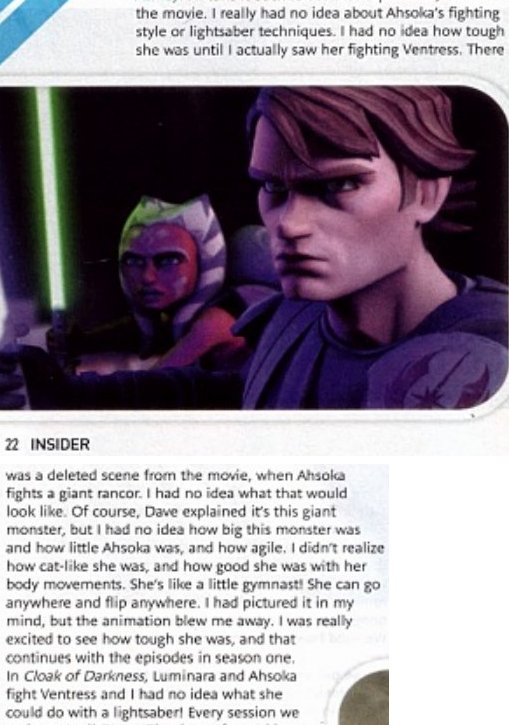
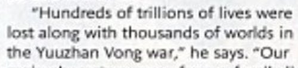
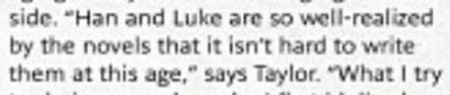

# Owner Material 038 — Star Wars Insider #1–153 plus specials (with The Lucasfilm Fan Club Magazine #1–22): Star Wars Insider #108 (2009)

- **Source:** *Star Wars Insider* magazine (issues 23–153, 1994–2014) and its predecessor *The Lucasfilm Fan Club Magazine* (issues 1–22, 1987–1994), plus seven special editions: articles, interviews, comics and short fiction Secondary source (licensed Legends reference). Scan OCR'd on the box; the scan stays box-only and is **not** published.
- **Method:** every scanned page was OCR'd and machine-screened sentence by sentence for power-relevant statements (fights, kills, defeats, Force feats, rankings, superweapons) that name a character on our roster; each kept sentence is quoted verbatim from the OCR text and has a crop of the printed passage directly under it. Pages with nothing power-relevant are still listed with what is on them.
- **Citation:** "*Star Wars Insider #108* (2009), p.X" by printed page ("scan p.X" where no printed number applies). **Weight:** Licensed magazine: a secondary source. Its short fiction and comics are Legends stories; its articles and interviews sum up or discuss lore and rank below the novels, comics and games they describe.

## scan p.1 (scan page 1)

Page contents: Cover: Darth Vader; David Prowse interview, Star Wars tattoos, Versus MagnaGuard vs. Imperial (Royal) Guard, Jason Tucker, Matt Lanter and Ashley Eckstein, Oola actress Femi Taylor. No in-universe text. (hand-read)

## scan p.2 (scan page 2)

Page contents: Contents: Double Trouble (Lanter/Eckstein) p16, David Prowse p26, Force in the Flesh (tattoos) p34, Jason Tucker p40, Oola/Femi Taylor. (hand-read)

## scan p.3 (scan page 3)

Page contents: Contents cont.: Launch Pad, A Long Time Ago 1997, Versus (Emperor's Royal Guard vs. MagnaGuard), Books (C-3PO and R2-D2's literary moments), Comics (Yuuzhan Vong), Collecting (Darth Vader), Toys, Bounty Hunters, Bantha Tracks, Classic Moment (Vader becomes Anakin again, ROTJ). (hand-read)

## scan p.4 (scan page 4)

Page contents: Editor's Welcome (Jonathan Wilkins): The Clone Wars shows Anakin as the hero Obi-Wan described; Lanter and Eckstein; Prowse's car once belonged to Kenny Baker; Femi Taylor; Versus Royal Guard vs. MagnaGuard ("electrostaff or the force pike"); Jason Tucker; upcoming 100-page 1999/Episode I salute. (hand-read)

## scan p.5 (scan page 5)

Page contents: Launch Pad: The Clone Wars "A Galaxy Divided" DVD (March 24, 2009): Ambush (Yoda vs. Asajj Ventress) and the Malevolence arc (Anakin, Ahsoka and Obi-Wan against General Grievous' warship); quotes from Lucasfilm's Doug Yates; Season One boxed set planned. Episode listing, out-of-universe. (hand-read)

## scan p.6 (scan page 6)

Page contents: Launch Pad: Katie Lucas wrote the TCW episode Jedi Crash ("a very poignant episode about the pursuit of peace during wartime"); her cameos as Amee, Lunae Minx and Chi Eekway. (hand-read)

## scan p.7 (scan page 7)

Page contents: Launch Pad: George Takei voices Clone Wars villain Lok Durd ("immensely obese"); Ben Burtt on J.J. Abrams' Star Trek; THQ announces a new mobile Star Wars Battlefront game with Count Dooku, the Emperor, Yoda and Princess Leia. (hand-read)

## scan p.8 (scan page 8)

Page contents: Launch Pad: The Force Unleashed nominated for 2008 Writers Guild of America videogame writing (Haden Blackman, Shawn Pitman, John Stafford, Cameron Suey); Shaak Ti render. Time Frame photos: Lucas with Peter Cushing, Carrie Fisher, David Prowse and Irvin Kershner. (hand-read)

## scan p.9 (scan page 9)

Page contents: Star Wars Books timeline 2009: FotJ: Outcast (Allston): two years after Darth Caedus' death, Chief of State Daala considers the Jedi "rogue soldiers too dangerous and unstable to leave unfettered"; Luke and Ben retrace Jacen's journey to find which Force-using groups influenced him. The Clone Wars: No Prisoners (Traviss): Ahsoka, Rex and the 501st on a shakedown cruise aboard Captain Gilad Pellaeon's assault ship become caught in a hostage situation. Also Omen, Abyss, Imperial Commando: 501st, Deathtroopers, the third Darth Bane novel (Bane and Zannah). Crop-verified. (hand-read)

## scan p.10 (scan page 10)

Page contents: Books timeline cont.: Red Harvest-era list to 2011 (Blood Oath? with Zekk leaving in his StealthX after Invincible; Crosscurrent with Jaden Korr; Alex Irvine novel starring Nomi Sunrider; Traviss novel featuring Boba Fett; Reaves/Bohnhoff holostar novel). Sidebar: a young reader's top 10 lightsaber battles (name omitted). Out-of-universe. (hand-read)

## scan p.11 (scan page 11)

Page contents: Launch Pad: Uncle Milton Force Trainer (EEG headset, 15 training levels with Yoda's cues) and Science line; masthead. Out-of-universe. (hand-read)

## scan p.12 (scan page 12)

Page contents: "Double Trouble" opener: Matt Lanter (Anakin) and Ashley Eckstein (Ahsoka) interview (Words: Jonathan Wilkins). (hand-read)

## scan p.13 (scan page 13)

Page contents: Opener art: Ahsoka Tano with lightsaber. (hand-read)

## scan p.14 (scan page 14)

Page contents: Lanter/Eckstein interview: Lanter auditioned for "Deak Starkaller" and was told to play a Han/Luke mix; Eckstein auditioned for Padmé, was too young, then found Ahsoka with her own voice. (hand-read)

## scan p.15 (scan page 15)

Page contents: Interview cont.: Filoni, Winder and Gilroy creating Ahsoka; both on being Star Wars fans; Eckstein calls herself "Dave Filoni's Padawan." (hand-read)

## scan p.16 (scan page 16)

Page contents: Interview cont.: Lanter on Hayden Christensen's Anakin; in The Clone Wars Anakin is "a hero and a mentor ... this great warrior that we always heard about," with flashes of the dark side; Eckstein says Filoni keeps Ahsoka's full backstory to himself. (hand-read)

## scan p.17 (scan page 17)

Page contents: Interview cont.: Ahsoka modeled on Carrie Fisher's Leia mannerisms; recording together with James Arnold Taylor; Lanter beat Eckstein at Clone Wars: Lightsaber Duels; Topps cards. Out-of-universe. (hand-read)

## scan p.18 (scan page 18)

Page contents: Interview cont.: scripts collected after sessions; Eckstein on the movie; season-one episode where Ahsoka learns a lesson; Lanter likes the banter. (hand-read)

- **Ahsoka Tano; Asajj Ventress; Luminara Unduli** — entry/section: Eckstein on Ahsoka's fighting style: ""I really had no idea about Ahsoka's fighting style or lightsaber techniques. I had no idea how tough she was until I actually saw her fighting Ventress. There was a deleted scene from the movie, when Ahsoka fights a giant rancor. I had no idea what that would look like. Of course, Dave explained it's this giant monster, but I had no idea how big this monster was and how little Ahsoka was, and how agile. I didn't realize how cat-like she was, and how good she was with her body movements. She's like a little gymnast! She can go anywhere and flip anywhere. ... In Cloak of Darkness, Luminara and Ahsoka fight Ventress and I had no idea what she could do with a lightsaber!" —Ashley Eckstein, Star Wars Insider 108, p. 18" Source: *Star Wars Insider #108* (2009), scan p.18
  

## scan p.19 (scan page 19)

Page contents: Interview cont.: Eckstein on Cloak of Darkness ("female Jedi power!") and Ahsoka as a role model for girls. (hand-read)

## scan p.20 (scan page 20)

Page contents: Interview end: action figure, nieces and nephews ("Hey Skyguy"), season two; Lanter: Anakin is "like the Titanic—we know he's a sinking ship," flashes of the dark side to come. (hand-read)

## scan p.21 (scan page 21)

Page contents: "Dealing with Darth" opener art: Darth Vader. (hand-read)

## scan p.22 (scan page 22)

Page contents: Opener: David Prowse interview (Words: Jonathan Wilkins), "first captured audiences' imaginations back in 1977 when he strode aboard the Tantive IV." (hand-read)

## scan p.23 (scan page 23)

Page contents: Prowse interview: Lucas offered Chewbacca or Darth Vader, Prowse chose the villain; Vader costume of about 15 pieces (quilted leather, fiberglass, two capes) that fogged in the heat; he accidentally knocked Alec Guinness over while filming the Obi-Wan duel (choreographed by Peter Diamond). Out-of-universe. (hand-read)

## scan p.24 (scan page 24)

Page contents: Prowse interview cont.: 20 minutes to suit up; amber lenses and black makeup; costume about 40 pounds; Vader's brisk stride (everyone subservient except Grand Moff Tarkin, "Vader's boss"); Russ Meyer's cable about the over-dubbed voice; the bald-cap for the ESB unmasking; did not know Vader was Luke's father until the premiere. Out-of-universe. (hand-read)

## scan p.25 (scan page 25)

Page contents: Prowse interview end: Mark Hamill at Celebration Europe; conventions; last wore the suit about 1997 for Rebel Assault II; never met James Earl Jones. Box: Alec Guinness' diary line about Prowse ("I fear he is not an actor!"). Out-of-universe. (hand-read)

## scan p.26 (scan page 26)

Page contents: 333 words, 21 paragraphs | headings/entries: DATABANK; SKILLS; STRENGTH 85 SPEED; POWER; IMPERIA ROYAL GUARD; LF Emperor Palpatine, while the; MapnaGuards' affiliation lies with the; Separatist commander, General Grievous; Underneath thei distinctive scarlet robes,

### Stat block notes (game mechanics, not feats)

- Versus databank: Imperial Royal Guard: "The Royal Guard are soldiers hand-picked from the best of the best stormtroopers. Each recruit is selected according to strength, intelligence, and loyalty, as well as whether they have any latent Force sensitivity. The names of these deadly warriors are never mentioned by anyone outside their own ranks. Guards are trained in the art of fencing and fighting during a year-long training program, which includes Echani hand-to-hand combat. Casualties are high; a class of 42 might see only two reach full Guardsman status—with other candidates killed during the brutal training process. During their final test, trainees fight each other to the death before Palpatine himself. During training, the Guards are educated to believe that Palpatine, and his every order, are beyond fault or question." (Versus databank, Star Wars Insider 108, p. 26) (Source: *Star Wars Insider #108* (2009), scan p.26)
- Versus profile/skills/ratings: Imperial Royal Guard: "HOMEWORLD: VARIOUS SPECIES: VARIOUS GENDER: MALE HEIGHT: 1.83 METERS WEAPON: FORCE PIKE VEHICLE: TIE/IN STARFIGHTER AFFILIATION: EMPIRE" … "An immovable force, sworn to protect by any means necessary, a Royal Guard is part of an elite fighting squad that will win by any means. Strong and determined, the guard's single-mindedness and extensive training ensures that he is not easily bested in combat. While no match for a Jedi, the guards—chosen from non-clone military units—are formidable warriors utilizing force pikes that, when set to maximum strength, can tear steel bulkheads and easily kill organic lifeforms." … "STRENGTH 85 SPEED 80 POWER 30 LEADERSHIP 20 MOBILITY 80 LOYALTY 100 SPECIAL ABILITY 80 BONUS SKILL 90" (Versus, Star Wars Insider 108, p. 26) (Source: *Star Wars Insider #108* (2009), scan p.26)
- Versus intro: the bodyguards: "The Emperor's Royal Guards, also called Imperial Royal Guards, are unswervingly loyal to Emperor Palpatine, while the MagnaGuards' affiliation lies with the Separatist commander, General Grievous. Underneath their distinctive scarlet robes, the Royal Guards are clad in working ceremonial armor and each brandishes a deadly force pike. Trained in various forms of combat, they are the last line of defense should an enemy get too close to the Emperor. The MagnaGuards serve as the personal bodyguards of the feared Kaleesh cyborg, General Grievous. Almost unstoppable, these droid warriors carry electrostaffs fashioned from lightsaber-resistant phrik metal, and wear cloaks similar to those worn by Grievous' old Izvoshra elite during his time as a warlord." (Versus, Star Wars Insider 108, pp. 26-27) (Source: *Star Wars Insider #108* (2009), scan p.26)

## scan p.27 (scan page 27)

Page contents: 340 words, 16 paragraphs | headings/entries: DATABANK; PROFILE; SKILLS; INSIDER

### Stat block notes (game mechanics, not feats)

- Versus intro: MagnaGuard equipment: "Various MagnaGuard models were created to specialize in different weapons such as grenades, Bulldog rifles, RD-4 grenade launchers, and anti-vehicle missile launchers. They use other devices and equipment such as a built-in tow-cables, personal cloaking devices, or magnetized limbs. These droids are remarkably resilient, and capable of fighting even when decapitated." (Versus, Star Wars Insider 108, p. 27) (Source: *Star Wars Insider #108* (2009), scan p.27)
- Versus databank: IG-100 MagnaGuard: "The IG-100 MagnaGuard, otherwise known as a Self-Motivating Heuristically Programmed Combat Droid, is an advanced battledroid created by Holowan Mechanicals. They are designed to work as General Grievous' personal bodyguards, although they occasionally serve Count Dooku. They were commissioned after the Intergalactic Banking Clan refused to hire Grievous' Kaleesh elite when they brought aboard the cyborg warrior as an enforcer. He demanded a battalion of "more intelligent battle droids" to serve him. The MagnaGuards first fought during the Battle of Parein II 4. One of droids killed the Jedi Sannen with its powerful electrostaff. This provided evidence to all who saw that these droids are more than a match for the Jedi." (Versus databank, Star Wars Insider 108, p. 27) (Source: *Star Wars Insider #108* (2009), scan p.27)
- Versus profile/skills/ratings: IG-100 MagnaGuard: "MANUFACTURER: HOLOWAN MECHANICALS SPECIES: DROID GENDER: MASCULINE PROGRAMMING HEIGHT: 1.95 METERS WEAPONS: ELECTROSTAFF, BULLDOG ROCKET LAUNCHER, NEURO POISON, INTEGRATED MISSILE LAUNCHER VEHICLE: MAGNAGUARD STARFIGHTER AFFILIATION: C.I.S." … "Programmed to protect General Grievous, the MagnaGuard is quite literally a killing machine. Skilled in a variety of combat techniques, this droid cannot be stopped, even when an enemy lands what might seem to be a killing blow. Personally trained by General Grievous in the seven classic styles of lightsaber combat, the droids are left in disrepair by their master, who believes their battle-scarred bodies make them look even more intimidating to their foes." … "STRENGTH 90 SPEED 90 POWER 10 LEADERSHIP 30 MOBILITY 90 LOYALTY 100 SPECIAL ABILITY 70 BONUS SKILL 70" (Versus, Star Wars Insider 108, p. 27) (Source: *Star Wars Insider #108* (2009), scan p.27)

## scan p.28 (scan page 28)

Page contents: "Skin Wars: The Force in the Flesh" opener: author Shane Turgeon on Star Wars tattoos. (hand-read)

## scan p.29 (scan page 29)

Page contents: Opener art (tattoo photo spread). (hand-read)

## scan p.30 (scan page 30)

Page contents: Turgeon interview: first tattoo "sXe" in Aurebesh, inspired by the Star Wars Monopoly instructions; Yoda calf piece and Empire Strikes Back leg tribute; Power Droid foot tattoo. Out-of-universe. (hand-read)

## scan p.31 (scan page 31)

Page contents: Turgeon interview cont.: family and cast reactions, tattoosandtoys.com, Celebration tattoo events, tattoo industry support. Out-of-universe. (hand-read)

## scan p.32 (scan page 32)

Page contents: Tattoo photo: Vader/Slave I/Yoda leg pieces (artist credits). Out-of-universe. (hand-read)

## scan p.33 (scan page 33)

Page contents: Turgeon interview end: self-publishing The Force in the Flesh, tattoo process and advice; photos of fans' tattoos (names omitted). Out-of-universe. (hand-read)

## scan p.34 (scan page 34)

Page contents: "Final Cut!" opener (Asajj Ventress art with red lightsabers): Clone Wars editor Jason Tucker interview by Jonathan Wilkins. (hand-read)

## scan p.35 (scan page 35)

Page contents: "Final Cut!" opener cont.: intro deck (Tucker's credits incl. CSI: Miami, Looney Tunes: Back in Action). (hand-read)

## scan p.36 (scan page 36)

Page contents: Tucker interview: hired via Catherine Winder/Dave Filoni; George Lucas as teacher ("faster and more intense"); editing rhythm of ESB/ROTJ/ANH. Out-of-universe. (hand-read)

## scan p.37 (scan page 37)

Page contents: Tucker interview cont.: Kurosawa, WWII films and Saving Private Ryan influences; 22-minute episodes; animation vs. live-action editing; about a month to six weeks per episode. Out-of-universe. (hand-read)

## scan p.38 (scan page 38)

Page contents: Tucker interview end: action vs. character scenes; favorite episodes Lair of Grievous, the Ryloth episodes, Trespass, Rookies. Out-of-universe. (hand-read)

## scan p.39 (scan page 39)

Page contents: A Long Time Ago... 1997 by Daniel Wallace: month-by-month (Special Editions, Galaxy of Fear, Soldier for the Empire, X-Wing vs. TIE Fighter, Delusions of Grandeur reintroduces IG-88, Hutt Gambit, Fall of the Sith Empire, Masters of Teras Kasi, Essential Guide to Weapons and Technology); Special Edition changes sidebar (Greedo shot first, Luke's scream, Jedi Rocks). Out-of-universe. (hand-read)

## scan p.40 (scan page 40)

Page contents: 1997 cont.: real-life world and entertainment news; Lucas quote on Episode I set. Out-of-universe. (hand-read)

## scan p.41 (scan page 41)

Page contents: "Oola La!" opener: Femi Taylor (Oola) photo. (hand-read)

## scan p.42 (scan page 42)

Page contents: "Oola La!" opener cont.: intro deck, words by Pat Jankiewicz. (hand-read)

## scan p.43 (scan page 43)

Page contents: "Oola La!" Femi Taylor interview: Cats background; dancing in the slave collar on a leash attached to a full-sized Jabba operated by four puppeteers; heavy head-tails; little backstory given. Out-of-universe. (hand-read)

## scan p.44 (scan page 44)

Page contents: Taylor interview cont.: three hours of green body paint; working with Richard Marquand; returning 16 years later for the Return of the Jedi Special Edition, directed by George Lucas; Rick McCallum proposed extending Oola's death scene. Out-of-universe. (hand-read)

## scan p.45 (scan page 45)

Page contents: Taylor interview end: two days building the new rancor-pit set; blue-screen work; memory of Jabba ("so real and huge"). Out-of-universe. (hand-read)

## scan p.46 (scan page 46)

Page contents: Section divider: "Packed full with all the latest stuff" (Toys, Collecting, Ask Lobot, Books; Invasion comic teaser). (hand-read)

## scan p.47 (scan page 47)

Page contents: 558 words, 23 paragraphs | headings/entries: LLL,; BOOKS; ARTOO AND THREEPIO'S; GREATEST HITS! (i; THREEPIO 1, BUREAUCRATS 0; LICENSE REVOKED; BOOKS; LOVE BUZZ; A LAST MEAL; INSIDER ey

### Stat block notes (game mechanics, not feats)

- Books: Artoo and Threepio's Greatest Hits — Threepio 1, Bureaucrats 0: "In Kristine Kathryn Rusch's The New Rebellion (1996), Threepio and Artoo must discover who's sabotaging the New Republic's X-wings—a mystery that gets Artoo shot and Threepio buried in rubble. And that's before they tackle a receptionist droid charged with keeping petitioners away from Mon Mothma." (Books, Star Wars Insider 108, p. 47) (Source: *Star Wars Insider #108* (2009), scan p.47)
- Books: Greatest Hits — License Revoked (Shadows of the Empire): "Luke and Lando leave the droids on the Millennium Falcon while they infiltrate Xizor's castle. When the Falcon's hiding place is discovered, Threepio has to take the wheel—and as Luke listens in horror via comlink, the protocol droid crunches through a billboard and a broadcasting tower. But he also manages to arrive just in time to save his friends—which is more than good enough, under the circumstances." (Books, Star Wars Insider 108, p. 47) (Source: *Star Wars Insider #108* (2009), scan p.47)
- Books: Greatest Hits — Love Buzz (The Clone Wars novel): "Karen Traviss explains that the can-cells are attracted by the engine sounds of the Republic's gunships, which they think are mating calls. Can Artoo mimic the sound of a gunship? The little droid responds that he can mimic the full range of Republic vessels—and Separatist ones too, if he's asked nicely!" (Books, Star Wars Insider 108, p. 47) (Source: *Star Wars Insider #108* (2009), scan p.47)
- Books: Greatest Hits — A Last Meal (Rebel Stand): "Artoo discovers a loophole in the prison computers' routines for prisoner care. After a bit of messing with images in a database, Threepio is able to walk a lightsaber and blaster right through security and have them brought to Han and Leia. Thanks to Artoo, the prison computers recognize them as various Corellian foods." (Books, Star Wars Insider 108, p. 47) (Source: *Star Wars Insider #108* (2009), scan p.47)

## scan p.48 (scan page 48)

Page contents: Books cont.: Questions of Mortality (Threepio and YVH 1-1A in Rebel Stand), A Corellian's Cyrano (Courtship of Princess Leia song "The Virtues of King Han Solo"). Ask Lobot: why Owen and Beru didn't recognize the droids (junior novelization explanation; C-3PO's memory wipe); Wioslea is a used landspeeder salesperson, not a Jedi (Hasbro Q&A; lightsaber figure image in error). Questioner names omitted. (hand-read)

### Stat block notes (game mechanics, not feats)

- Books: Greatest Hits — Take That! (Dark Force Rising): "Mara Jade breaks the dark side's hold, but she and Luke then face C'baoth's fury. It's a short fight—Artoo, sitting ignored in Luke's X-wing, opens up with the starfighter's cannons, knocking C'baoth out. "Artoo," an impressed Luke muses, "wasn't shooting to kill."" (Books, Star Wars Insider 108, p. 48) (Source: *Star Wars Insider #108* (2009), scan p.48)
- Books: Greatest Hits — How Clumsy of Me! (Star by Star): "Threepio isn't a warrior, unless you mean that skirmish with "Jedi dogs" long ago on Geonosis. (Don't ask him, he doesn't remember.) But he proves an effective adversary when the traitorous Vigi Shesh and a squad of Yuuzhan Vong infiltrators come to kidnap baby Ben Skywalker in Troy Denning's Star by Star (2001). One offer of refreshments and one dropped glass ball later, the commandos are down and Shesh is running for her life." (Books, Star Wars Insider 108, p. 48) (Source: *Star Wars Insider #108* (2009), scan p.48)
- Books: Greatest Hits — Old Memories (Dark Nest): "In Denning's Dark Nest trilogy, Luke stumbles across a recording of Anakin and Padmé discussing his dream that she will die in childbirth—only to have Artoo refuse to show more. When Luke finally unlocks Artoo's memory, the two trilogies are knit together by the little droid who witnessed it all." (Books, Star Wars Insider 108, p. 48) (Source: *Star Wars Insider #108* (2009), scan p.48)
- Books: Greatest Hits — Anakin's Orders (Shadows of Mindor): "When Han, Leia, and Chewie are dragged deep into the planet Mindor and assaulted by Melters, we watch Artoo monitor things with a computer's precision, until an old subroutine activates—and it's time for the little droid to go to war." (Books, Star Wars Insider 108, p. 48) (Source: *Star Wars Insider #108* (2009), scan p.48)

## scan p.49 (scan page 49)

Page contents: Comics: Invasion (Dark Horse; Tom Taylor writer, Colin Wilson artist; Randy Stradley) replaces Rebellion, alternating with Dark Times; new refugee family protagonists; series begins 21 years after Return of the Jedi; Wilson on drawing the Yuuzhan Vong's organic technology. (hand-read)

- **none** — entry/section: Invasion: scale of the Yuuzhan Vong war: ""Hundreds of trillions of lives were lost along with thousands of worlds in the Yuuzhan Vong war." —Tom Taylor, Star Wars Insider 108, p. 49" Source: *Star Wars Insider #108* (2009), scan p.49
  
- **Luke Skywalker; Han Solo** — entry/section: Invasion: Luke and Han at this age: ""Han and Luke are so well-realized by the novels that it isn't hard to write them at this age," —Tom Taylor, Star Wars Insider 108, p. 49" Source: *Star Wars Insider #108* (2009), scan p.49
  

### Stat block notes (game mechanics, not feats)

- Comics: "Space Invaders" (Invasion series preview) — Yuuzhan Vong: "Darth Vader was nothing compared to the Yuuzhan Vong! In the New Jedi Order book series published from 1999-2003, these extra-galactic aggressors conquered Coruscant, annihilated peaceful worlds like Ithor, turned trillions into refugees—and, perhaps worst of all, killed Chewbacca!" (Comics, Star Wars Insider 108, p. 49) (Source: *Star Wars Insider #108* (2009), scan p.49)

## scan p.50 (scan page 50)

Page contents: Comics cont.: Taylor on Luke as his childhood hero, main character Finn Galfridian; Wilson drawing aged heroes. "Online Invasion!" box: two free online episodes on starwars.com, May-June 2009. (hand-read)

### Stat block notes (game mechanics, not feats)

- Ask Lobot: power couplings vs. Podracer energy binders: "Comparison to real-world electrical shock might help to clarify the issue. The extent of the effect of electrical shock is dependent on the voltage and the duration of exposure. The potential effect of Podracer energy binders on organic tissue is numbness for several hours. On the other hand, the power couplings in Attack of the Clones are strong enough to power an entire refinery and therefore the effect is much more intense to the point of inducing a heart attack in those not trained in the Force. So while Jar Jar experienced numbness, Anakin and Obi-Wan were thrust into convulsions." (Ask Lobot, Star Wars Insider 108, p. 50) (Source: *Star Wars Insider #108* (2009), scan p.50)

## scan p.51 (scan page 51)

Page contents: Collecting: "Dark Lord of the Stuff!" by Gus Lopez — Vader collectibles (about 4,830 Vader-specific products; Kenner 3 3/4" figure with telescoping and double-telescoping lightsaber; international licensees; large-size figure). Out-of-universe. (hand-read)

## scan p.52 (scan page 52)

Page contents: Collecting cont.: Vader fuzzy slippers, Rubies Vader dog costume, Darth Tater. (hand-read)

### Stat block notes (game mechanics, not feats)

- Ask Lobot: path of the stolen Death Star plans: "Chronologically, here's a brief summary of what has been said so far. In Dark Forces, Kyle Katarn steals a set of plans from the planet Danuta with a little help from the Twi'lek agent Rianna Saren as seen in the game Lethal Alliance. In The Lost Jedi Adventure Game Books published in the U.K., Havet Storm steals plans for the Death Star's superlaser. Those plans, along with another portion of the plans en route to Toprawa, make up the full set of plans necessary for determining a weakness in the Death Star. Operation Skyhook, depicted in the Star Wars Radio Drama and the X-wing video games, is the code-name for the secret Alliance operation that sent the Tantive IV to retrieve the plans at Toprawa. In the novel Rebel Dream, Bria Tharen and her Red Hand Squadron take over the Toprawa relay station in order to transfer the combined plans to Leia aboard the Tantive IV." (Ask Lobot, Star Wars Insider 108, p. 52) (Source: *Star Wars Insider #108* (2009), scan p.52)

## scan p.53 (scan page 53)

Page contents: Collecting cont.: Osaka Tin Toy Institute wind-up Vader, Gentle Giant black-and-white statue, Vader fishing kit, Ariel balloon pack, Mexican Revenge of the Sith bootlegs (marionette, piñata). Out-of-universe. (hand-read)

## scan p.54 (scan page 54)

Page contents: Toys: Sideshow 12-inch Admiral Piett ($69.99) and sandtrooper ($109.99). Out-of-universe. (hand-read)

## scan p.55 (scan page 55)

Page contents: Toys cont.: Funko Bobble Heads Series Three (Cantina Band, Wicket, slave Leia); Hallmark party line. Ask Lobot: clone troopers renamed stormtroopers almost immediately after Palpatine declared himself Emperor (Battlefront II; Episode III production notes call the red shock troopers stormtroopers). Questioner names omitted. (hand-read)

## scan p.56 (scan page 56)

Page contents: Toys cont.: Rubies costumes (Boba Fett, shadow stormtrooper, Jabba). Ask Lobot: how the rancor got into the pit — Inside the Worlds of the Star Wars Trilogy adds a heavy-duty doorway to a secondary pen for creatures like Caridan combat arachnids pitted against the rancor (Tales from Jabba's Palace); Malakili could walk the rancor outside. Questioner names omitted. (hand-read)

## scan p.57 (scan page 57)

Page contents: Bounty Hunters: reader photo with George Lucas at the 2007 Long Beach Grand Prix (reader/winner names omitted). Out-of-universe. (hand-read)

## scan p.58 (scan page 58)

Page contents: Bounty Hunters cont.: reader photos with Warwick Davis, Michael Sheard, Daniel Logan, Amy Allen (reader names omitted). Out-of-universe. (hand-read)

## scan p.59 (scan page 59)

Page contents: Bantha Tracks: fan charity work; 501st/Rebel Legion Midwest bases raised over $2,000 for Autism Speaks (fan names omitted). Out-of-universe. (hand-read)

## scan p.60 (scan page 60)

Page contents: Bantha Tracks cont.: veterans' hospital troop, San Diego Fan Force at Pottery Barn, 501st Midwest Garrison toy drive for kids with cancer (fan names omitted). Out-of-universe. (hand-read)

## scan p.61 (scan page 61)

Page contents: Bantha Tracks cont.: Star Wars homecoming at a Michigan high school with the 501st; Imperial Funland event (names omitted). Out-of-universe. (hand-read)

## scan p.62 (scan page 62)

Page contents: Bantha Tracks: "Return on Investment" editorial by Mary Franklin; 501st and a Guadalajara fan club at the Teletón. Out-of-universe. (hand-read)

## scan p.63 (scan page 63)

Page contents: Classic Moment cont.: Sebastian Shaw (Starlog #120) on the secrecy of playing the unmasked Anakin and the life mask; "Why It's a Classic" essay (the downfall and redemption of Darth Vader). Next time: the Jedi Council. (hand-read)

### Stat block notes (game mechanics, not feats)

- Classic Moment: Unmasking Vader (Return of the Jedi script): "[Having defeated the Emperor] Luke is trying to carry the enormous deadweight of his father's weakened body toward an Imperial shuttle. Finally, Luke collapses from the strain. The explosions grow louder as Vader draws him closer. VADER: Luke, help me take this mask off. LUKE: But you'll die. VADER: Nothing can stop that now. Just for once let me look on you with my own eyes." … "ANAKIN: You already have, Luke. You were right. You were right about me. Tell your sister... You were right. LUKE: Father, I won't leave you. Darth Vader, Anakin Skywalker... Luke's father dies." (Classic Moment, Star Wars Insider 108, p. 63) (Source: *Star Wars Insider #108* (2009), scan p.63)

## scan p.64 (scan page 64)

Page contents: Next issue: 100-page Phantom Menace special (cast and crew, Podracing guide, expanded media, Jake Lloyd); on sale April 28 (US) / May 14 (UK). (hand-read)

### Stat block notes (game mechanics, not feats)

- Versus: Who Wins? (Royal Guard vs. MagnaGuard): "The human aspect wins again as the Emperor's Royal Guard triumphs! The MagnaGuard might be a formidable warrior, but this time, one of the Emperor's elite makes him eat force pike!" (Versus: Who Wins?, Star Wars Insider 108, p. 64) (Source: *Star Wars Insider #108* (2009), scan p.64)
