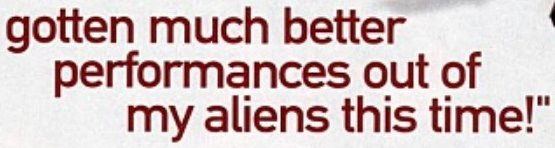
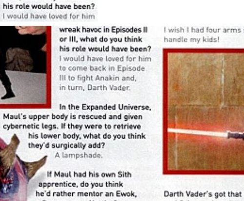
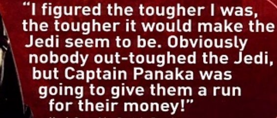
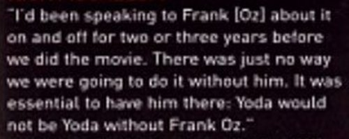
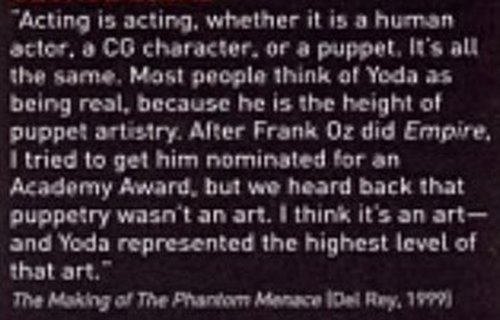

# Owner Material 038 — Star Wars Insider #1–153 plus specials (with The Lucasfilm Fan Club Magazine #1–22): Star Wars Insider #109 (2009)

- **Source:** *Star Wars Insider* magazine (issues 23–153, 1994–2014) and its predecessor *The Lucasfilm Fan Club Magazine* (issues 1–22, 1987–1994), plus seven special editions: articles, interviews, comics and short fiction Secondary source (licensed Legends reference). Scan OCR'd on the box; the scan stays box-only and is **not** published.
- **Method:** every scanned page was OCR'd and machine-screened sentence by sentence for power-relevant statements (fights, kills, defeats, Force feats, rankings, superweapons) that name a character on our roster; each kept sentence is quoted verbatim from the OCR text and has a crop of the printed passage directly under it. Pages with nothing power-relevant are still listed with what is on them.
- **Citation:** "*Star Wars Insider #109* (2009), p.X" by printed page ("scan p.X" where no printed number applies). **Weight:** Licensed magazine: a secondary source. Its short fiction and comics are Legends stories; its articles and interviews sum up or discuss lore and rank below the novels, comics and games they describe.

## scan p.1 (scan page 1)

Page contents: Cover: Special 100-page edition celebrating 10 years of The Phantom Menace (Jar Jar Binks / Ahmed Best, Ralph Brown, Versus Maul vs. Dooku, the Expanded Universe of Episode I, departments). (hand-read)

## scan p.2 (scan page 2)

Page contents: "This Issue": Phantom Menace visual guide, Ahmed Best, Ralph Brown, Expanded Menace, Rob Coleman creature feature. (hand-read)

## scan p.3 (scan page 3)

Page contents: Contents: Launch Pad, Versus (Darth Maul vs. Count Dooku), special edition cover, Taster (Allston on Fate of the Jedi: Outcast; Han and Chewie comics; collecting Maul; toys; LEGO 10th anniversary; Bounty Hunters; Bantha Tracks; Classic Moment: Anakin before the Jedi Council). (hand-read)

## scan p.4 (scan page 4)

Page contents: Advertorial: Cinemaquette (George Sohn interview). Out-of-universe. (hand-read)

## scan p.5 (scan page 5)

Page contents: Editor's Welcome (Jonathan Wilkins): Episode I at 10; contact details. (hand-read)

- **none** — entry/section: Lucas on alien performances: ""I've gotten much better performances out of my aliens this time!" —George Lucas (Vanity Fair, 1999), Star Wars Insider 109, p. 5" Source: *Star Wars Insider #109* (2009), scan p.5
  

## scan p.6 (scan page 6)

Page contents: Launch Pad: live-action TV casting at earliest stages (no production before 2010); Obama gives Gordon Brown A New Hope DVDs; Star Wars: A Musical Journey world tour (Howard Roffman quote). Out-of-universe. (hand-read)

## scan p.7 (scan page 7)

Page contents: Launch Pad: The Force Unleashed wins the 2009 WGA Videogame Writing Award (Haden Blackman, Shawn Pitman, John Stafford, Cameron Suey); Time Frame photos (Ray Park, Ahmed Best, Jake Lloyd). Out-of-universe. (hand-read)

## scan p.8 (scan page 8)

Page contents: Comlink letters: commando astromech idea, collective term for Force users, Force Unleashed praise, C-3PO model memories (letter-writer names omitted). Masthead. (hand-read)

## scan p.9 (scan page 9)

Page contents: Interrogation Droid: Ray Park (Darth Maul) Q&A by Chris Spitale — jokey answers (Maul vs. Snake Eyes: "Ray Park would win!"; four arms to handle his kids; a lampshade for Maul's lower body; Maul "a solo guy"; "Bad gas"; would get full-body Maul tattoos). (hand-read)

- **Darth Maul; Darth Vader (Anakin Skywalker); General Grievous** — entry/section: Ray Park: Maul surviving into Episode III; dream duels: ""I would have loved for him to come back in Episode III to fight Anakin and, in turn, Darth Vader." … [If Maul could duel anyone:] "General Grievous or Darth Vader." —Ray Park, Star Wars Insider 109, p. 9" Source: *Star Wars Insider #109* (2009), scan p.9
  

## scan p.10 (scan page 10)

Page contents: Full-page photo: young Anakin (Jake Lloyd) on Tatooine. (hand-read)

## scan p.11 (scan page 11)

Page contents: "Saluting 10 Years of Episode I": release hype, Internet rumors, prequel trend, Jar Jar as the first CG main character, Dolby Digital Surround EX, box office. Out-of-universe. (hand-read)

## scan p.12 (scan page 12)

Page contents: "Back to the Beginning": cast recollections (Ewan McGregor, Liam Neeson, Natalie Portman, Jake Lloyd, Ray Park on showing his martial arts, Samuel L. Jackson). Out-of-universe. (hand-read)

## scan p.13 (scan page 13)

Page contents: Cast recollections cont. (Natalie Portman on the Queen's look, Pernilla August, Ian McDiarmid on playing Palpatine younger, lightsaber-noise anecdote). Out-of-universe. (hand-read)

## scan p.14 (scan page 14)

Page contents: Cast recollections cont. (McDiarmid, Frank Oz on Yoda puppetry rehearsal, McGregor on playing young Alec Guinness, Neeson meeting Lucas, Terence Stamp bluescreen). Out-of-universe. (hand-read)

## scan p.15 (scan page 15)

Page contents: Cast recollections cont. (Lewis MacLeod/Sebulba, Portman, Andy Secombe/Watto, McGregor on the voice, Steven Spiers/Tarpals). Out-of-universe. (hand-read)

## scan p.16 (scan page 16)

Page contents: Cast recollections cont.: McGregor meeting R2-D2, Portman on hair and makeup and KFC boxes, Jake Lloyd ("Anakin is one mechanical kid!"), Hugh Quarshie (Panaka). (hand-read)

- **Captain Panaka** — entry/section: Quarshie on Panaka's toughness: ""I figured the tougher I was, the tougher it would make the Jedi seem to be. Obviously nobody out-toughed the Jedi, but Captain Panaka was going to give them a run for their money!" —Hugh Quarshie, Star Wars Insider 109, p. 16" Source: *Star Wars Insider #109* (2009), scan p.16
  

## scan p.17 (scan page 17)

Page contents: 281 words, 20 paragraphs | headings/entries: Dooku, He assisted in Doolcu's combat; Ey insiver

### Stat block notes (game mechanics, not feats)

- Versus databank: Count Dooku: "Count Dooku was born into wealth and nobility. Displaying Force abilities at an early age, his parents were proud to see him taken into the Jedi Order. Yoda took a keen interest in the young Dooku. He assisted in Dooku's combat training and as a result, the Padawan became especially proficient with a lightsaber. Only Masters Yoda and Mace Windu were considered to be on equal terms with him. After discovering that Senator Palpatine was a Sith Lord, Dooku turned to the dark side and became a Dark Lord of the Sith himself. As Darth Sidious' new apprentice, he was given the Sith name Darth Tyranus." (Versus databank, Star Wars Insider 109, p. 17) (Source: *Star Wars Insider #109* (2009), scan p.17)
- Versus profile/skills/ratings: Count Dooku: "HOMEWORLD: SERENNO SPECIES: HUMAN GENDER: MALE HEIGHT: 1.93 METERS WEAPONS: LIGHTSABER VEHICLE: SOLAR SAILER AFFILIATION: SITH, C.I.S." … "With a near unrivalled knowledge of the Force combined with formidable skill with a lightsaber, Dooku was virtually indomitable. A natural leader, able to rally others to a cause that wasn't necessarily just, the charismatic former Jedi was also an able teacher who passed on his skills to Asajj Ventress and also coached the droid leader, General Grievous, in the Jedi arts. He was able to use the dark side of the Force to channel deadly lightning bolts and was skilled in the Sith art of Dun Möch, or disrupting an opponent's concentration by the use of taunts." … "STRENGTH 80 SPEED 80 POWER 90 LEADERSHIP 100 MOBILITY 80 LOYALTY 100 SPECIAL ABILITY 95 BONUS SKILL 95" (Versus, Star Wars Insider 109, p. 17) (Source: *Star Wars Insider #109* (2009), scan p.17)
- Versus intro: Maul vs. Dooku: "The Sith: enemies of the Jedi who were thought to be extinct until their order returned to galactic prominence when the evil Darth Sidious brought down the Republic and instigated the Jedi purge. Darth Maul—Sidious' first apprentice—challenged the Jedi during the Trade Federation's attack on Naboo. He was dispatched on countless missions, murdering various prominent figures across the galaxy. Maul's tattooed visage struck fear into the hearts of his foes, but his ultimate desire was to destroy the Jedi. Maul was dispatched to Tatooine to capture Queen Amidala. There he had a short, but intense duel with the Jedi Master Qui-Gon Jinn. Later, Maul was sent to Naboo, where he fought Jinn and his apprentice Obi-Wan Kenobi. Though he killed the Jedi Master he underestimated Kenobi's skill, and was slain by the Padawan." … "Two Sith warriors, deadly and skilled in causing death and anarchy. But will the younger, more animalistic rage of Darth Maul triumph or does the measured evil of the Separatist leader mean that Dooku has the upper hand?" (Versus, Star Wars Insider 109, pp. 17-18) (Source: *Star Wars Insider #109* (2009), scan p.17)

## scan p.18 (scan page 18)

Page contents: 119 words, 5 paragraphs | headings/entries: 

### Stat block notes (game mechanics, not feats)

- Versus databank: Darth Maul: "A master of various disciplines, including Juyo, Jar'Kai, and Teräs Käsi, Darth Maul chose to use a red double-bladed lightsaber for combat. He rarely spoke, instead preferring to intimidate his foes with his terrifying visage and flamboyant fighting skills. Maul used martial arts and hand-to-hand combat skills—a powerful combination that was at odds with the more civilized skills of his Jedi foes. Maul built his lightsaber himself, following ancient plans stored within a Sith holocron. His Master, Darth Sidious, gave Maul a powerful Sith Infiltrator called Scimitar which contained a cloaking shield generator that allowed him to carry out his evil missions undetected." (Versus databank, Star Wars Insider 109, p. 18) (Source: *Star Wars Insider #109* (2009), scan p.18)
- Versus profile/skills/ratings: Darth Maul: "HOMEWORLD: IRIDONIA SPECIES: ZABRAK GENDER: MALE HEIGHT: 1.75 METERS WEAPON: LIGHTSABER VEHICLE: SITH INFILTRATOR AFFILIATION: SITH" … "As well as boasting great strength, speed and almost animal-like levels of aggression, Darth Maul used aggressive Force grip and Force choke abilities to kill his foes. Darth Maul was also skilled in combining his Force talents with mechanics. With Sidious providing the funds required and a secret facility on Coruscant where he could work undetected by the Jedi, Maul was able to construct his deadly arsenal including his signature speeder bike Bloodfin and the Dark Eye seeker droids." … "STRENGTH 90 SPEED 95 POWER 85 LEADERSHIP 20 MOBILITY 100 LOYALTY 95 SPECIAL ABILITY 80 BONUS SKILL 90" (Versus, Star Wars Insider 109, p. 18) (Source: *Star Wars Insider #109* (2009), scan p.18)

## scan p.19 (scan page 19)

Page contents: Visual guide opener: Episode I "Ten Years of The Phantom Menace" frame-by-frame trivia spread. (hand-read)

## scan p.20 (scan page 20)

Page contents: Visual guide: Republic cruiser Radiant VII and Trade Federation battleship Profiteer (Saak'ak); TC-14 protocol droid (TranLang III module, millions of languages); Obi-Wan casting (top-50 photos beside Alec Guinness); McGregor/Denis Lawson relation. (hand-read)

## scan p.21 (scan page 21)

Page contents: Visual guide: Jar Jar's color change, Otoh Gunga Art Nouveau design (Doug Chiang), sando aqua monster 200 meters long, Amidala's wardrobe (Iain McCaig), Portman's two voices. (hand-read)

## scan p.22 (scan page 22)

Page contents: Visual guide: Queen's J-type 327 Nubian ship, duality theme, Watto's broken tusk and design (Whitlatch, Knoll). (hand-read)

## scan p.23 (scan page 23)

Page contents: Visual guide: Gragra the gorgmonger (Swokes Swokes), 2001 space pod cameo, 1997 Tunisia sandstorm, Anakin's age revised from 12 to 9, Anakin and Shmi formerly owned by Gardulla the Hutt (lost in a bet when Anakin was three) and Shmi by Pi-Lippa, "laser sword" line, Qui-Gon/Shmi subtle romance. (hand-read)

## scan p.24 (scan page 24)

Page contents: Visual guide: first scene shot June 26, 1997; Maul's lines dubbed by Peter Serafinowicz. (hand-read)

### Stat block notes (game mechanics, not feats)

- Visual guide: Anakin's midi-chlorian count: "Anakin has a midi-chlorian count of over 20,000 according to Qui-Gon, ranking him even higher than Yoda. Expanded Universe sources have revealed that Force-sensitive beings might typically score in the 5,000 range." (Episode I visual guide, Star Wars Insider 109, p. 24) (Source: *Star Wars Insider #109* (2009), scan p.24)

## scan p.25 (scan page 25)

Page contents: Visual guide: Podrace arena carved into rock, cotton-bud crowd model, 49ers crowd audio, Anakin's helmet by Taieb, Warwick Davis as Weazel, R5-X2 calculating odds for Jabba. (hand-read)

## scan p.26 (scan page 26)

Page contents: Visual guide: NASCAR crash reference, Ben Burtt's 25-minute first cut, $60,000 of aircraft surplus, Troig announcer (saprin/sopriah heads), Boonta Classic line. (hand-read)

### Stat block notes (game mechanics, not feats)

- Visual guide: Sebulba's Podracer speed: "There's a reason why they say that no human can pilot Podracers—Sebulba's machine can reach 829 kilometers per hour (515 mph)." (Episode I visual guide, Star Wars Insider 109, p. 26) (Source: *Star Wars Insider #109* (2009), scan p.26)

## scan p.27 (scan page 27)

Page contents: Visual guide: Wookiee senators in the original Chewbacca costume; Coruscant conceived by McQuarrie and named by Timothy Zahn; Mace Windu name origin; Plo Koon name origin. (hand-read)

### Stat block notes (game mechanics, not feats)

- Visual guide: Oppo Rancisis' death: "Though it isn't clear in this scene, Oppo Rancisis' lower body consists of a thick, snaky tail. It is seen best in issue #75 of the comic Star Wars Republic, which depicts Master Rancisis' death during the Siege of Saleucami." (Episode I visual guide, Star Wars Insider 109, p. 27) (Source: *Star Wars Insider #109* (2009), scan p.27)

## scan p.28 (scan page 28)

Page contents: Visual guide: Whippendell Wood swamp exteriors, Boss Nass' Ankura heritage, kaadu origin, Security S-5 blaster developed by Captain Panaka, Nick Gillard's hybrid saber style, ~300 stunt blades. (hand-read)

### Stat block notes (game mechanics, not feats)

- Visual guide: first double-bladed lightsaber: "A double-bladed lightsaber first appeared in The Sith War, a comic book series set 4000 years before the movies. It was wielded by fallen Jedi Exar Kun." (Episode I visual guide, Star Wars Insider 109, p. 28) (Source: *Star Wars Insider #109* (2009), scan p.28)

## scan p.29 (scan page 29)

Page contents: Visual guide: THX 1138 droid number, "try spinning" referenced in TCW "Destroy Malevolence", McCallum and Knoll cameos, parade music reworks the Emperor's Theme, Senate Guards' blue armor resembles the Royal Guards who replaced them. (hand-read)

## scan p.30 (scan page 30)

Page contents: Ahmed Best feature opener (Scott Chernoff): Annie Award for playing Jar Jar Binks. Out-of-universe. (hand-read)

## scan p.31 (scan page 31)

Page contents: Ahmed Best: Annie Award for Robot Chicken Jar Jar sketch; childhood Star Wars fandom. Out-of-universe. (hand-read)

## scan p.32 (scan page 32)

Page contents: Ahmed Best: cast from Stomp; motion-capture reference suit; first all-digital main character; Jar Jar merchandise. Out-of-universe. (hand-read)

## scan p.33 (scan page 33)

Page contents: Ahmed Best: Jar Jar saturation, praise for Liam Neeson's understated acting, bongo submarine shoot. Out-of-universe. (hand-read)

## scan p.34 (scan page 34)

Page contents: Ahmed Best: fan backlash ("Jar Jar was never for 35-year-olds"), Jar Jar's Senate storyline in Episode II, Robot Chicken fans. Out-of-universe. (hand-read)

## scan p.35 (scan page 35)

Page contents: Ahmed Best: reduced suit in Episodes II/III, cameo as Achk Med-Beq in the Outlander Club, The Clone Wars, Mother and Child with Samuel L. Jackson. Out-of-universe. (hand-read)

## scan p.36 (scan page 36)

Page contents: Ahmed Best: producing/directing, The Nebula sci-fi project, music, gratitude for Jar Jar. Out-of-universe. (hand-read)

## scan p.37 (scan page 37)

Page contents: Ralph Brown (Ric Olié) interview opener (photo page). (hand-read)

## scan p.38 (scan page 38)

Page contents: Ralph Brown interview: auditioning, costume and hair, set atmosphere, Lucas vs. Spielberg as directors. Out-of-universe. (hand-read)

## scan p.39 (scan page 39)

Page contents: Ralph Brown interview: Lucas as an actors' director, delivering genre lines with conviction. Out-of-universe. (hand-read)

## scan p.40 (scan page 40)

Page contents: Ralph Brown interview: teaching young Anakin to fly ("I guess I gave Darth Vader his first flying lesson!"), action figure, Mountain Dew can, interest in TV/Clone Wars appearances; Expanded Universe plug (Brighton Beach Boys, The Boat That Rocked). (hand-read)

### Stat block notes (game mechanics, not feats)

- Whatever Happened To…: Ric Olié: "Following the victory at the Battle of Naboo, Ric Olié gained considerable fame with Bravo Flight. His whereabouts during the Clone Wars are unknown, but young Anakin Skywalker, who got his first taste of flying under the guidance of the kindly starpilot went on to become a great hero of the conflict." (Whatever Happened To…, Star Wars Insider 109, p. 40) (Source: *Star Wars Insider #109* (2009), scan p.40)

## scan p.41 (scan page 41)

Page contents: Photo page (Ralph Brown feature / ad). (hand-read)

## scan p.42 (scan page 42)

Page contents: "Expanded Menace" (Jason Fry): how Episode I opened a new era for the EU — Padawans, the Senate, two new Sith, "Darth" as a title. Out-of-universe survey. (hand-read)

## scan p.43 (scan page 43)

Page contents: Expanded Menace: Terry Brooks novelization extras (Anakin vs. Sebulba in earlier Podraces, nursing a Tusken; origin of the Sith hiding), Scholastic journals, DK readers, Dark Horse Episode I Adventures, The Queen's Amulet. (hand-read)

## scan p.44 (scan page 44)

Page contents: Expanded Menace: More Maul (Scholastic diary, Dark Horse Darth Maul vs. Black Sun, Reaves' Shadow Hunter, Maul paired with C-3PX); Jedi Apprentice/Jedi Quest/Last of the Jedi (Jude Watson ~50 books); Ki-Adi-Mundi comics. (hand-read)

## scan p.45 (scan page 45)

Page contents: Expanded Menace: Emissaries to Malastare, Quinlan Vos and Aayla Secura, Stark Hyperspace War, Jedi Council: Acts of War (Saesee Tiin flying), Star Wars Tales ("Yaddle's Tale"); Aurra Sing as failed Padawan turned assassin, later teaming with young Boba Fett, hunting Jedi post-ROTS and bedeviling Han and Leia in Legacy of the Force. (hand-read)

## scan p.46 (scan page 46)

Page contents: Expanded Menace: Queen in Disguise, "A Summer's Dream", "The Death of Captain Tarpals", Jar Jar Episode I Adventures; Rogue Planet (Anakin, Obi-Wan, Tarkin on Zonama Sekot); Cloak of Deception as bridge novel. (hand-read)

## scan p.47 (scan page 47)

Page contents: Rob Coleman (animation director) interview: joining ILM, 10-day interview with Lucas, insomnia, Lucas: "You have one person to make happy—me!"; animation director role. Out-of-universe. (hand-read)

## scan p.48 (scan page 48)

Page contents: Photo page (Rob Coleman feature). (hand-read)

## scan p.49 (scan page 49)

Page contents: Rob Coleman interview: 2,000 shots vs. Men in Black's 200, breaking ILM tools, marathon analogy, early talk of a digital Yoda in TPM. Out-of-universe. (hand-read)

## scan p.50 (scan page 50)

Page contents: Rob Coleman interview: Jar Jar backlash and Lucas' reassurance; Jar Jar fully animated over Ahmed Best's suit; ILM on-set match-move team and light spheres. Out-of-universe. (hand-read)

## scan p.51 (scan page 51)

Page contents: Rob Coleman interview: actors' reactions, battle droid walk born of a tracking mistake ("These things are just being cranked out; they're not very smart"), Watto's wings and helium belly joke, Sebulba's walk inspired by Johnny Eck in Freaks, Gungan army shot. Out-of-universe. (hand-read)

## scan p.52 (scan page 52)

Page contents: Rob Coleman interview: Gungan battle software, characters resembling voice actors (Brian Blessed's jowls for Boss Nass). Out-of-universe. (hand-read)

## scan p.53 (scan page 53)

Page contents: Taster contents page: Meet the Jedi, Books (Allston/Fate of the Jedi), Comics, Ask Lobot, LEGO extra, Maul collectibles, Kotobukiya, Bantha Tracks. (hand-read)

## scan p.54 (scan page 54)

Page contents: Books (Jason Fry): Aaron Allston on Fate of the Jedi: Outcast — post-Legacy of the Force setting (Caedus died at Jaina's hands, Daala leads the GA), Valin Horn's madness, Luke's exile with Ben, Odyssey echoes, Kel Dor order on Dorin, Han on Kessel with Rogue and Wraith Squadrons. (hand-read)

## scan p.55 (scan page 55)

Page contents: Books cont.: Allston on Wraith/Rogue cast, Wedge, Jaina/Kenth Hamner; relay-race handoffs to Christie Golden (Omen) and Troy Denning. Ask Lobot (Leland Chee): hooded Utapauns behind Tion Medon's aides are "ground crew"; clone troopers called stormtroopers right after Palpatine declared himself Emperor; red shock troopers identified as stormtroopers in Episode III production notes (reader names omitted). (hand-read)

## scan p.56 (scan page 56)

Page contents: Comics (Daniel Wallace): Star Wars Adventures "Han Solo and the Hollow Moon of Khorya" (Jeremy Barlow, Rick Lacy). Out-of-universe. (hand-read)

## scan p.57 (scan page 57)

Page contents: Comics cont.: Princess Leia and the Royal Ransom; Dark Times "Blue Harvest" (Dass Jennir); Omnibus Emissaries and Assassins (Episode I Adventures, Emissaries to Malastare, Jango Fett: Open Seasons, Outlander with Aurra Sing hunting a lost Jedi among the Tusken Raiders). (hand-read)

## scan p.58 (scan page 58)

Page contents: Collecting (Gus Lopez): Darth Maul around the world (Kellogg's cereal premiums), "Bark Mole" Fantom Meanies parody plush. Out-of-universe. (hand-read)

## scan p.59 (scan page 59)

Page contents: Collecting: Pepsi life-size Maul statue, Hasbro 12-inch Maul with Sith speeder, Master Replicas and Force FX Maul sabers. Out-of-universe. (hand-read)

## scan p.60 (scan page 60)

Page contents: Collecting: Taco Bell Maul cup topper (top half only, as after his duel with Obi-Wan), Mighty Muggs Maul, four TPM novelization covers. Ask Lobot: "heroes on both sides" — to the Confederacy, Dooku and Grievous are heroes and Anakin and Obi-Wan villains; Whorm Loathsom; Mon Calamari Commander Merai (Republic #50) saw secession as just (reader name omitted). (hand-read)

## scan p.61 (scan page 61)

Page contents: Toys (Chris Spitale): Kotobukiya ARTFX+ Clone Wars statues (Anakin, Ahsoka with Rotta, Obi-Wan; Yoda build). Out-of-universe. (hand-read)

## scan p.62 (scan page 62)

Page contents: Toys: Hasbro Build-a-Droid waves (ESB: U-3PO; AOTC: Owen and Beru, Captain Typho, Tarados Gon, HK-47). Out-of-universe. (hand-read)

## scan p.63 (scan page 63)

Page contents: Toys: Acme Archives Tsuneo Sanda prints; Diamond Select quarter-scale Mace Windu and Anakin. Out-of-universe. (hand-read)

## scan p.64 (scan page 64)

Page contents: Toys: Basic Fun key chains (Han, Biker Scout, Death Star, Dooku, MagnaGuard, Plo Koon; Cody/Rex/Fox Stack-Ems). Out-of-universe. (hand-read)

## scan p.65 (scan page 65)

Page contents: Toys Extra (Jeremy Beckett): 10 years of LEGO Star Wars; 10th Anniversary line; Vader's TIE fighter set. Out-of-universe. (hand-read)

## scan p.66 (scan page 66)

Page contents: LEGO: Echo Base, Battle of Endor (12 minifigs), fan-choice Home One Mon Calamari Star Cruiser (Ackbar, Mon Mothma, Lando, Madine), top-10 LEGO sets. Out-of-universe. (hand-read)

## scan p.67 (scan page 67)

Page contents: Bounty Hunters: fan celebrity-encounter photos (Hayden Christensen at the airport); winner names omitted. (hand-read)

## scan p.68 (scan page 68)

Page contents: Bounty Hunters cont.: fan photos with Peter Mayhew, Shannon McRandle (Mara Jade model), Doug Wangler (Quinlan Vos model), Ray Park, Mark Hamill (fan names omitted). (hand-read)

## scan p.69 (scan page 69)

Page contents: Bantha Tracks (Mary Franklin): "By the fans, for the fans" — 10th anniversary of fan community; kidney-donation story introduction; submission rules. (hand-read)

## scan p.70 (scan page 70)

Page contents: Bantha Tracks: 501st member donates a kidney to a fellow collector met on a fan forum (fan names omitted). Out-of-universe. (hand-read)

## scan p.71 (scan page 71)

Page contents: Bantha Tracks: Squad 7 landspeeder red-wagon parade entry for a children's hospital; Lucasfilm archive registrar profile (Joanne Honour). Out-of-universe. (hand-read)

## scan p.72 (scan page 72)

Page contents: Bantha Tracks: editorial on Jar Jar collectors (fan names omitted). Out-of-universe. (hand-read)

## scan p.73 (scan page 73)

Page contents: 325 words, 23 paragraphs | headings/entries: BRIAN J. ROBB; THE PHANTOM MENACE

- **Yoda** — entry/section: McCallum: Yoda needs Frank Oz: ""I'd been speaking to Frank [Oz] about it on and off for two or three years before we did the movie. There was just no way we were going to do it without him. It was essential to have him there: Yoda would not be Yoda without Frank Oz." —Rick McCallum (The Making of The Phantom Menace, Del Rey, 1999), Star Wars Insider 109, p. 73" Source: *Star Wars Insider #109* (2009), scan p.73
  
- **Yoda** — entry/section: Lucas: Yoda puppetry: ""Acting is acting, whether it is a human actor, a CG character, or a puppet. It's all the same. Most people think of Yoda as being real, because he is the height of puppet artistry. After Frank Oz did Empire, I tried to get him nominated for an Academy Award, but we heard back that puppetry wasn't an art. I think it's an art—and Yoda represented the highest level of that art." —George Lucas (The Making of The Phantom Menace, Del Rey, 1999), Star Wars Insider 109, p. 73" Source: *Star Wars Insider #109* (2009), scan p.73
  

### Stat block notes (game mechanics, not feats)

- Classic Moment: Anakin before the Jedi Council (TPM script, deleted dialogue in brackets): "ANAKIN: A ship. ... A cup. ... A ship... A speeder. … YODA: [Good, good, young one.] How feel you? ANAKIN: Cold, sir. YODA: Afraid, are you? ANAKIN: No, sir. [MACE WINDU: Afraid to give up your life?] [ANAKIN: I don't think so.] [ANAKIN hesitates for a moment.] YODA: See through you, we can. MACE WINDU: Be mindful of your feelings... KI-ADI: Your thoughts dwell on your mother. ANAKIN: I miss her. YODA: Afraid to lose her... I think. ANAKIN: (a little angry) What's that got to do with anything? YODA: Everything. Fear is the path to the dark side... fear leads to anger... anger leads to hate... hate leads to suffering. [ANAKIN: (angrily) I am not afraid.] [YODA: A Jedi must have the deepest commitment, the most serious mind.] I sense much fear in you. [ANAKIN: (quietly) I'm not afraid.] [YODA: Then continue, we will.]" (Classic Moment, Star Wars Insider 109, p. 73) (Source: *Star Wars Insider #109* (2009), scan p.73)

## scan p.74 (scan page 74)

Page contents: Classic Moment "Why it's a classic": Anakin's first experience of the wider Jedi world; first hints of his attachment to his mother. Next time: Vader at Cloud City. Lucas pull quote on Yoda puppetry. (hand-read)

### Stat block notes (game mechanics, not feats)

- Classic Moment: Who's Who in the Jedi Council: "Yarael Poof: Adept at Jedi mind tricks, the Quermian Poof uses Force suggestion to end conflicts by using enemies' fears against them. Saesee Tiin: This Iktotchi has the ability to concentrate at high speeds, ideal for an accomplished pilot. Oppo Rancisis: Giving up the throne on his home planet, Rancisis dedicated himself to the Jedi and serving the galaxy through his highly developed military tactics. Eeth Koth: From the same species as Darth Maul, Koth is on the side of the good guys. Ki-Adi-Mundi: From the paradise world of Cerea, Ki-Adi-Mundi could accurately be nicknamed "two brains" thanks to his binary brain structure. Even Piell: Piell won his distinctive scar defeating terrorists who had underestimated the diminutive Jedi Master. Yaddle: A youthful 477, Jedi Master Yaddle looks up to Master Yoda, and offers her counsel while mastering ways of the Jedi. Adi Gallia: A skilled diplomat, Gallia knows her way around the political machine of Coruscant. Plo Koon: Master Plo's face mask protects his sensitive eyes and nostrils from the oxygen-rich atmosphere of Coruscant. Depa Billaba: Bringing order to chaos, Billaba is a voice of calm and organization. Yoda: An ancient Jedi Master well into his 800's, Yoda is deeply perceptive and is highly experienced in galactic affairs. Mace Windu: A senior member of the Council, Windu is a calm negotiator and a man of action ready to reinforce his words with strength." (Classic Moment, Star Wars Insider 109, p. 74) (Source: *Star Wars Insider #109* (2009), scan p.74)

## scan p.75 (scan page 75)

Page contents: Next issue: Carrie Fisher interview, Clone Wars season one guide, Tom Kane, Warwick Davis/Ewoks, survey results; Leia line "I don't know who you are or where you came from, but from now on you'll do exactly as I say." (hand-read)

### Stat block notes (game mechanics, not feats)

- Versus result: Maul vs. Dooku: "VERSUS: WHO WINS? Count Dooku would have to use his vast knowledge of the Force [Maul's major weakness] in order to triumph. Maul's animalistic side gives him an advantage over the weak, but against Dooku's measured skills? No contest." (Versus, Star Wars Insider 109, p. 75) (Source: *Star Wars Insider #109* (2009), scan p.75)
