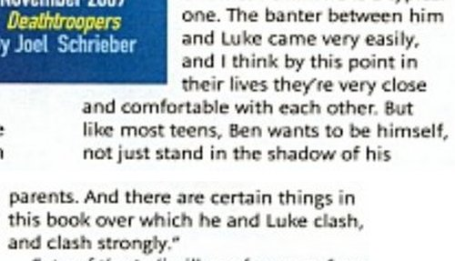
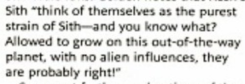
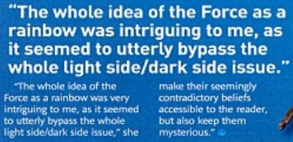
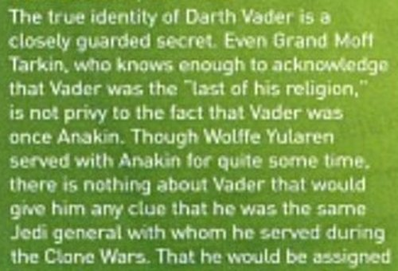
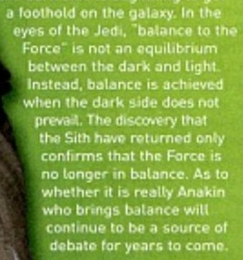
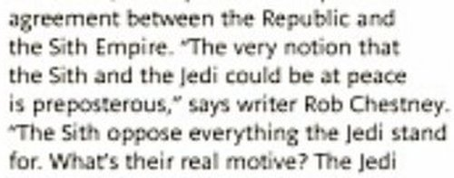

# Owner Material 038 — Star Wars Insider #1–153 plus specials (with The Lucasfilm Fan Club Magazine #1–22): Star Wars Insider #110 (2009)

- **Source:** *Star Wars Insider* magazine (issues 23–153, 1994–2014) and its predecessor *The Lucasfilm Fan Club Magazine* (issues 1–22, 1987–1994), plus seven special editions: articles, interviews, comics and short fiction Secondary source (licensed Legends reference). Scan OCR'd on the box; the scan stays box-only and is **not** published.
- **Method:** every scanned page was OCR'd and machine-screened sentence by sentence for power-relevant statements (fights, kills, defeats, Force feats, rankings, superweapons) that name a character on our roster; each kept sentence is quoted verbatim from the OCR text and has a crop of the printed passage directly under it. Pages with nothing power-relevant are still listed with what is on them.
- **Citation:** "*Star Wars Insider #110* (2009), p.X" by printed page ("scan p.X" where no printed number applies). **Weight:** Licensed magazine: a secondary source. Its short fiction and comics are Legends stories; its articles and interviews sum up or discuss lore and rank below the novels, comics and games they describe.

## scan p.1 (scan page 1)

Page contents: Cover: Carrie Fisher, Clone Wars episode guide, Lando vs. Han, Tom Kane, Wicket/Warwick Davis; issue #110, Jul/Aug 2009. (hand-read)

## scan p.2 (scan page 2)

Page contents: Heroes magazine advertisement. (hand-read)

## scan p.3 (scan page 3)

Page contents: Heroes magazine subscription advertisement. (hand-read)

## scan p.4 (scan page 4)

Page contents: Contents: Tom Kane, Warwick Davis, Endor Warriors, Season One episode guide part 2, Mimobots, readers' survey results; Han Solo quote header. (hand-read)

## scan p.5 (scan page 5)

Page contents: Contents cont.: departments (Books: Christie Golden on Omen; Carrie Fisher; Comics; Incoming; Retro; Bounty Hunters; Bantha Tracks; Classic Moment "Han shoots first"); Launch Pad; Interrogation Droid; Versus Han vs. Lando. (hand-read)

## scan p.6 (scan page 6)

Page contents: Editor's Welcome: TCW season one complete; Tom Kane; Ewok tribute; Star Wars: A Musical Journey at the O2; Ben Burtt event at the National Film Theatre — John Wayne's processed voice provided the sounds of Garindan. Out-of-universe. (hand-read)

### Stat block notes (game mechanics, not feats)

- Editor's Welcome epigraph (TCW "Ambush"): "Smaller in number are we, but larger in mind." —Yoda, Star Wars: The Clone Wars, "Ambush" (Editor's Welcome, Star Wars Insider 110, p. 6) (Source: *Star Wars Insider #110* (2009), scan p.6)

## scan p.7 (scan page 7)

Page contents: Topps Star Wars Galaxy trading card advertisement. (hand-read)

## scan p.8 (scan page 8)

Page contents: Launch Pad: Star Wars: A Musical Journey narrated by Anthony Daniels, 40,000 fans over two nights at London's O2 (April 10-11); Howard Roffman on its origin. (hand-read)

## scan p.9 (scan page 9)

Page contents: Launch Pad cont.: John Williams' suite; Roffman on structure and London; cover-strip teasers. (hand-read)

## scan p.10 (scan page 10)

Page contents: Launch Pad cont.: Anthony Daniels on narrating live; rehearsals at Elstree; costume exhibition (Plo Koon, Kit Fisto first time displayed). (hand-read)

## scan p.11 (scan page 11)

Page contents: Launch Pad cont.: George Lucas in attendance; The Art of Star Wars: The Clone Wars book (Frank Parisi, Gary Scheppke; Chronicle Books, Aug 1). (hand-read)

## scan p.12 (scan page 12)

Page contents: Official Pix metallic photographs advertisement. (hand-read)

## scan p.13 (scan page 13)

Page contents: Interrogation Droid: Carrie Fisher — title "Your Royal Holiness"; memoir "The Empire Strikes Wishful Drinking"; Leia on Prozac; Mos Eisley cocktail "A smoking mynock!"; karaoke "Billie Jean"; recasting (Ellen Page, Mary-Louise Parker); wanted dialogue with Jabba ("Don't worry about me, I'll be fine... Seriously."). (hand-read)

## scan p.14 (scan page 14)

Page contents: Brian's Toys advertisement. (hand-read)

## scan p.15 (scan page 15)

Page contents: Tom Kane feature opener "Voice of the Force" (words: Scott Chernoff): Kane commands The Clone Wars as the voice of Yoda. (hand-read)

## scan p.16 (scan page 16)

Page contents: Tom Kane feature: taking over Yoda from Frank Oz after goofing around in a LucasArts session; Yoda in Jedi Power Battles, Galactic Battlegrounds, Battlefront I/II, ROTS game, Clone Wars micro-series; other Star Wars voices (Lobot, Ackbar, C-3PO, Nien Nunb, Bib Fortuna, Boba Fett, Tarkin); non-Star Wars voice work. (hand-read)

## scan p.17 (scan page 17)

Page contents: Tom Kane feature cont.: announcer work; home studio in Kansas City; childhood mimicry. (hand-read)

## scan p.18 (scan page 18)

Page contents: Tom Kane feature cont.: first ad job at 15; moved to LA 1985; seeing Star Wars 12 times in 1977. Sidebar: Tom Kane's 11 greatest Star Wars voices (Ackbar, Bib Fortuna, Boba Fett, Leebo, Lobot, Madine, TCW narrator, Nien Nunb, Vandar Tokare, Yoda, Wullf Yularen). (hand-read)

## scan p.19 (scan page 19)

Page contents: Tom Kane feature cont.: first Star Wars job; first-ever voice for previously silent Lobot. (hand-read)

## scan p.20 (scan page 20)

Page contents: Tom Kane feature cont.: filling in for Anthony Daniels as C-3PO in some games; inheriting Yoda from Frank Oz. Sidebar "Beyond Star Wars": Kane's non-Star Wars voice credits. (hand-read)

## scan p.21 (scan page 21)

Page contents: Tom Kane feature cont.: also voices Admiral Wullf Yularen and the TCW narration; says his Vader "is OK for a line or two"; Yoda is number one; TCW cast photo with George Lucas. (hand-read)

## scan p.22 (scan page 22)

Page contents: Gus and Duncan's Comprehensive Guide to Star Wars Collectibles advertisement (Steve Sansweet blurb). (hand-read)

## scan p.23 (scan page 23)

Page contents: Warwick Davis interview opener "Wicket's World" (words: Calum Waddell). (hand-read)

## scan p.24 (scan page 24)

Page contents: Warwick Davis interview: cast as Wicket after his grandmother heard a radio spot; aged 11 on ROTJ; Carrie Fisher's milk and cookies; Mark Hamill bought him toys; the Wicket head (his own tongue on screen); Ewok TV movies. (hand-read)

## scan p.25 (scan page 25)

Page contents: Warwick Davis interview cont.: Ewok haters who shoot Ewoks in Battlefront. (hand-read)

## scan p.26 (scan page 26)

Page contents: Warwick Davis interview cont.: Jar Jar replacing Ewoks as controversy; working with Lucas; Wald cameo in TPM Podrace crowd. (hand-read)

## scan p.27 (scan page 27)

Page contents: Warwick Davis interview cont.: Lucas comfortable in post-production; Bring Back Star Wars TV special; Ewok merchandise (Wicket cookie jar); would like to play a bounty hunter in the TV series. (hand-read)

## scan p.28 (scan page 28)

Page contents: 303 words, 24 paragraphs | headings/entries: CKET; HEROIC MOMENTS; Leia Organa when scout troopers captured; WEAPONS/GADGETS; Ey insiver; ENEMIES; Wicket

### Stat block notes (game mechanics, not feats)

- Warriors of Endor: Wicket: "HEROIC MOMENTS The most famous Ewok, Wicket Wystri Warrick, played an instrumental role in the battle against the Galactic Empire, thereby adding to the storied history of his tribe's home, Bright Tree Village. His quick thinking and bold actions saved Princess Leia Organa when scout troopers captured her on the Forest Moon of Endor. Wicket also played a crucial role in rescuing Jeremitt and Catarine Towani after a monstrous Gorax kidnapped them. A tough little warrior, he delivered the killing blow to the cruel King Terak of the Sanyassan Marauders who had enslaved Wicket's friends. WEAPONS/GADGETS Ewoks' weapons were primitive but effective. Wicket's favorite was his trusty spear, which doubled as a walking stick. Not always as adept with weapons as other Ewoks, his amateur use of a sling was in evidence during the tense Battle of Endor. TRIVIA Wicket tried his hand as a pupil of the medicine man Logray. Sadly, he lacked the patience and skill necessary to become a shaman. ... ENEMIES Morag the Tulgah witch was a fearsome enemy of the Ewoks for over 200 years. Her attempts to destroy Bright Tree Village led her to use beings such as the Phlogs and the Duloks to aid her evil cause. Wicket and his friends helped prevent her from succeeding, until the Ewok shaman Logray finally froze her into stone." (Warriors of Endor, Star Wars Insider 110, p. 28) (Source: *Star Wars Insider #110* (2009), scan p.28)

## scan p.29 (scan page 29)

Page contents: 371 words, 29 paragraphs | headings/entries: HEROIC MOMENTS; HEROIC MOMENTS; WEAPONS/GADGETS; TRIVIA Chukha-Trok wore an tory tooth around; ENEMIES; ALLIES; ENEMIES; INSIDER [Ey

### Stat block notes (game mechanics, not feats)

- Warriors of Endor: Paploo: "HEROIC MOMENTS Paploo risked his life when he helped the Rebels gain entry to the Imperial control bunker by distracting the guards, stealing a speeder bike, and leading them deep into the forest. Hanging on for all he was worth, he finally swung up into the trees to safety. WEAPONS/GADGETS One of the most effective weapons used against the Ewok's larger enemies was the tek swee, literally "head hitter." Put to use against the Imperial AT-STs during the Battle of Endor, this destructive weapon used logs suspended high up in the trees. Released at just the right moment, they smashed through whatever got in their way! TRIVIA The nephew of Chief Chirpa and one of Wicket's closest friends, Paploo was one of Logray's apprentices. He was appointed medicine man of Bright Tree Village following Logray's exile and his placing of a curse on the village. ALLIES Among the many allies of the Ewoks were the wisties—otherwise known as the "firefolk." Extremely small—in fact, no larger than an Ewok's hand—these creatures helped protect Bright Tree Village from destruction when Morag tried to burn it down. ENEMIES Condor dragons were large, flying reptavians ... whose carnivorous habits led them to hunt small creatures." (Warriors of Endor, Star Wars Insider 110, p. 29) (Source: *Star Wars Insider #110* (2009), scan p.29)
- Warriors of Endor: Chukha-Trok: "HEROIC MOMENTS Chukha-Trok was a valiant woodsman who eagerly joined Deej Warrick on the expedition to rescue the Towani family. He charged after Cindel when her flighty horse whisked her off into the woods, and he gave his life battling a Gorax to save the strangers' lives. WEAPONS/GADGETS As a woodsman, Chukha-Trok's primary weapon was his stone ax, expertly wielded during his battle with a Gorax. As a gesture of honor and respect, he bestowed this icon of Ewok bravery on Mace Towani just before he died. ... ENEMIES The Gorax were among the most threatening of all the Ewoks' enemies on the Endor moon. These sentient omnivores stood at least six meters high and often raided villages to capture Ewoks as pets or to devour them!" (Warriors of Endor, Star Wars Insider 110, p. 29) (Source: *Star Wars Insider #110* (2009), scan p.29)

## scan p.30 (scan page 30)

Page contents: 497 words, 21 paragraphs | headings/entries: LOGRAY'; Pie) hy Re a aa

### Stat block notes (game mechanics, not feats)

- Warriors of Endor: Logray: "HEROIC MOMENTS Logray played a prominent role in Ewok culture as the shaman and medicine man of Bright Tree Village. He fended off the vile witch Morag on numerous occasions. But he later was exposed as a bully and banished from the village. WEAPONS/GADGETS Logray's most powerful weapon was his "magic." Having been a slave to the evil Morag in his youth, Logray was able to learn her secrets, becoming a strong magic user in the process. These skills helped Chief Chirpa protect Bright Tree Village and its inhabitants. ... ALLIES Logray had many apprentices over the course of his life. The first was named Zarrak. Sadly, he turned to the dark arts, and was later expelled from the village. His greatest student was Teebo. ENEMIES A group of Sanyassan Marauders from the planet Sanyassa crashed on Endor's moon around 100 years before the battle of Yavin and set up a base. Fearsome space pirates, they frequently raided settlements and captured and killed many Ewoks." (Warriors of Endor, Star Wars Insider 110, p. 30) (Source: *Star Wars Insider #110* (2009), scan p.30)
- Warriors of Endor: Deej Warrick: "HEROIC MOMENTS It takes a brave soul to lead his son and friends into certain danger—and that's exactly what Deej Warrick (Wicket's father) did when he went after a Gorax. Venturing into a place from which no Ewok had returned, Deej risked his life to rescue Cindel Towani's parents and proved that Ewoks are braver than their small stature might indicate. WEAPONS/GADGETS Deej was known for his proficient use of the hang-glider ... TRIVIA Deej had three sons: Weechee, Widdle (also known as Willy) and Wicket. He also had a daughter, Winda. ALLIES Noa Briqualon was a scout who had become stranded on Endor early in his career. ... Noa helped the Ewoks fight the Marauders, ridding Endor of this terrifying foe. ENEMIES Standing over three meters tall and baring two great tusks, boar-wolves (or "borra") were a huge threat to the Ewoks. Deej and his sons fought valiantly against one borra attacking Cindel and Mace Towani before Wicket felled it with a poisoned dart." (Warriors of Endor, Star Wars Insider 110, p. 30) (Source: *Star Wars Insider #110* (2009), scan p.30)

## scan p.31 (scan page 31)

Page contents: Hawthorne Village Star Wars Galactic Village Collection advertisement (Mos Eisley Cantina). (hand-read)

## scan p.32 (scan page 32)

Page contents: Season One Episode Guide part two opener (compiled by Sarah Herman). (hand-read)

## scan p.33 (scan page 33)

Page contents: Episode guide 1.11 "Dooku Captured" (written by Julie Siege, directed by Jesse Yeh); Insider Info: script originally had a Sabaoth starfighter from Jedi Starfighter; Hondo Ohnaka, Turk Falso, Pilf Mukmuk. (hand-read)

### Stat block notes (game mechanics, not feats)

- TCW Episode Guide 1.11 "Dooku Captured": "MISSION BRIEF Anakin Skywalker has allowed himself to be kidnapped to get close to Count Dooku. When Obi-Wan Kenobi joins him on the Separatist cruiser where he's being held, they accidentally let the Count slip through their fingers. After chasing him to Vanqor he escapes again, this time with a band of pirates who imprison Dooku on Florrum. ... SEPARATIST SPEAK COUNT DOOKU: I am more powerful than any Jedi. CLONE CHATTER OBI-WAN KENOBI: Look how the mighty Sith Lord has fallen." (Season One Episode Guide, Star Wars Insider 110, p. 33) (Source: *Star Wars Insider #110* (2009), scan p.33)

## scan p.34 (scan page 34)

Page contents: Episode guide 1.12 (Julie Siege/Justin Ridge) and 1.13 (Katie Lucas/Rob Coleman); Kharrus' staff resembles the Staff of Ra headpiece from Raiders of the Lost Ark. (hand-read)

### Stat block notes (game mechanics, not feats)

- TCW Episode Guide 1.12 "The Gungan General": "SEPARATIST SPEAK COUNT DOOKU: [To Obi-Wan and Anakin] I would kill you both right now, if I did not have to drag your bodies. COUNT DOOKU: [To Obi-Wan and Anakin] My capture was due to uncontrollable circumstances. Yours was sheer stupidity. MISSION BRIEF Obi-Wan and Anakin awake in a Florrum prison cell, tethered to the villain they were supposed to be apprehending, Count Dooku. Senator Kharrus and Jar Jar Binks are on their way to deliver the spices the Republic has promised the pirates in return for Dooku, but when Kharrus is killed, Jar Jar must lead the clone forces and fend off the greedy pirates. Meanwhile, Anakin, Obi-Wan, and Dooku must work together to escape despite their differences." (Season One Episode Guide, Star Wars Insider 110, p. 34) (Source: *Star Wars Insider #110* (2009), scan p.34)
- TCW Episode Guide 1.13 "Jedi Crash": "MISSION BRIEF When our heroes find themselves under heavy droid fire, Anakin is injured protecting his friends from the attack. Desperate to save her Master from death, Ahsoka learns from Jedi General Aayla Secura that the Jedi philosophy demands she let go of her emotional attachment to Anakin. ... CLONE CHATTER ADMIRAL YULAREN: Are all Jedi so reckless? AAYLA SECURA: Just the good ones. INSIDER INFO Aayla Secura never names her Master, but she's referring to Quinlan Vos, who appears to abandon the Jedi path when he goes on an undercover mission for the Republic. He was featured in the comic series Star Wars: Republic." (Season One Episode Guide, Star Wars Insider 110, p. 34) (Source: *Star Wars Insider #110* (2009), scan p.34)

## scan p.35 (scan page 35)

Page contents: Episode guide 1.14 (Bill Canterbury/Steward Lee): General Lok Durd ("Help! I'll be defoliated!") voiced by George Takei, first big-name Star Trek actor to cross over to Star Wars. (hand-read)

### Stat block notes (game mechanics, not feats)

- TCW Episode Guide 1.14 "Defenders of Peace": "MISSION BRIEF After being treated by the peaceful Lurmen colonists on the remote planet of Maridun, Anakin needs rest. Unfortunately the Separatists have other ideas and show up to raid the village in search of the Jedi. ... CLONE CHATTER ANAKIN SKYWALKER: [To Ahsoka] There's a difference between pulling innocents into a war, and leaving them to extinction. AAYLA SECURA: [To Ahsoka] Don't underestimate their resolve. A strong belief can be more powerful than any army." (Season One Episode Guide, Star Wars Insider 110, p. 35) (Source: *Star Wars Insider #110* (2009), scan p.35)

## scan p.36 (scan page 36)

Page contents: Episode guide 1.15 "Trespass" (Steve Melching/Brian Kalin O'Connell): Orto Plutonia, Pantorans vs. Talz; Senator Riyo Chuchi: "To die for one's people is a great sacrifice. To live for one's people, an even greater sacrifice."; Talz totem poles made of ice. (hand-read)

## scan p.37 (scan page 37)

Page contents: Episode guide 1.16 (Drew Z. Greenberg/Steward Lee): Cody to Slick; Rex "you take the west corridor". (hand-read)

### Stat block notes (game mechanics, not feats)

- TCW Episode Guide 1.16 "The Hidden Enemy": "MISSION BRIEF Brutal and evil, the Separatist force descends on the peaceful world of Christophsis. ... Obi-Wan and Anakin Skywalker prepare for a daring ambush, which they believe could turn the tide, giving them the edge in the fight for this star system. But first, they must deal with a traitor amongst the clones! SEPARATIST SPEAK ASAJJ VENTRESS: Poor Obi-Wan. You've been betrayed. And now we're about to take control of this world. ASAJJ VENTRESS: [To Anakin and Obi-Wan] So hard to know whom to trust these days, isn't it?" (Season One Episode Guide, Star Wars Insider 110, p. 37) (Source: *Star Wars Insider #110* (2009), scan p.37)

## scan p.38 (scan page 38)

Page contents: Episode guide 1.17 "Blue Shadow Virus" (Craig Titley/Giancarlo Volpe) and 1.18 "Mystery of a Thousand Moons" (Brian Larsen/Jesse Yeh): Dr. Nuvo Vindi's bio-weapons lab on Naboo; Obi-Wan: "If those bombs get delivered, we'll be facing a galaxy-wide plague."; Cliffhold based on Doug Chiang TPM concept art; "disco hallways". (hand-read)

## scan p.39 (scan page 39)

Page contents: Episode guide 1.19 (George Krstic/Brian Kalin O'Connell): R2-KT named after a six-year-old who died of brain cancer; Kit Fisto pictured. (hand-read)

### Stat block notes (game mechanics, not feats)

- TCW Episode Guide 1.19 "Storm Over Ryloth": "SEPARATIST SPEAK MAR TUUK: I am certain this Skywalker will return. His ultimate defeat shall be my greatest victory. WAT TAMBOR: You admire this Skywalker? MAR TUUK: As a general, yes. His record shows he is a great warrior, and I want him to know it is I who has beaten him. ... MISSION BRIEF Planet Ryloth has been invaded ... Commanding a squadron for the first time, Ahsoka engages the blockade, but gets caught in a trap. Her refusal to obey orders from Admiral Yularen and Anakin and retreat immediately results in the annihilation of almost all of her team." (Season One Episode Guide, Star Wars Insider 110, p. 39) (Source: *Star Wars Insider #110* (2009), scan p.39)

## scan p.40 (scan page 40)

Page contents: Episode guides 1.20 and 1.21 (Henry Gilroy; Justin Ridge/Rob Coleman): "COMIC RELIEF" in Aurebesh; Wat Tambor's Ark of the Covenant prize; Orn Free Taa and Cham Syndulla. (hand-read)

### Stat block notes (game mechanics, not feats)

- TCW Episode Guide 1.20 "Innocents of Ryloth" / 1.21 "Liberty on Ryloth": "MISSION BRIEF After defeating the space blockade guarding Ryloth and imprisoning its people, Jedi Generals Mace Windu and Obi-Wan Kenobi land in Nabat and lead a ground assault to free the Twi'leks living there. Using the Twi'lek people as living shields to protect the Separatist weapons, Wat Tambor believes a ground assault won't be risked by the Republic; however, he underestimates the skill and determination of the Jedi! SEPARATIST SPEAK COMMANDER TX-20: I calculate the remaining clones are attempting a desperate final offensive. Their chances of success against us are seven hundred and forty-two to one. ... MISSION BRIEF While Anakin Skywalker holds the Republic position in the skies above Ryloth, Mace Windu and Obi-Wan Kenobi seize control from the droid troops on the ground, village by village. ... But with defeat looking likely, Count Dooku orders Tambor to steal what he can, retreat, and destroy everything in his wake! SEPARATIST SPEAK COUNT DOOKU: [To Wat Tambor] You are no match for Master Windu. Do not get greedy, Emir Tambor. Take what valuables you can and destroy everything else." (Season One Episode Guide, Star Wars Insider 110, p. 40) (Source: *Star Wars Insider #110* (2009), scan p.40)

## scan p.41 (scan page 41)

Page contents: Episode guide 1.22 (Eoghan Mahony/Giancarlo Volpe): earlier script had Mas Amedda trapped with Palpatine instead of Orn Free Taa; Aurra Sing, Robonino, Shahan Alama pictured. (hand-read)

### Stat block notes (game mechanics, not feats)

- TCW Episode Guide 1.22 "Hostage Crisis": "MISSION BRIEF Despite recent successes in the Outer Rim, the Republic heart is struck hard when bounty hunter Cad Bane and his posse land on Coruscant and head straight for the Senate building. Taking Senators hostage, and trapping everyone else inside, Bane aims to negotiate the release of Ziro the Hutt from the Republic's detention center in exchange for the safety of his prisoners. But Anakin Skywalker is also in the building, visiting his wife Padmé Amidala, who is taken hostage. Palpatine tells him he must save the day, but that'd be a lot easier if he had his lightsaber. If only he hadn't left it with Padmé! SEPARATIST SPEAK CAD BANE: [To Senate Guard Captain] Son, I wouldn't be so hasty if I were you. CAD BANE: [To Chancellor Palpatine] I'm in control. I make the rules now. CLONE CHATTER PADMÉ AMIDALA: [Holding Anakin's lightsaber] Wow. It's heavier than I thought." (Season One Episode Guide, Star Wars Insider 110, p. 41) (Source: *Star Wars Insider #110* (2009), scan p.41)

## scan p.42 (scan page 42)

Page contents: Mimobots feature "Meet the Maker" (words: Chris Spitale): Mimoco founder Evan Blaustein and Scott Seraydarian on the Mimobot USB drive; Lucasfilm approached them after Toy Fair 2006. (hand-read)

## scan p.43 (scan page 43)

Page contents: Mimobots cont.: first licensed Mimobots Vader, stormtrooper, R2-D2, Chewbacca; difficulty capturing human faces. (hand-read)

## scan p.44 (scan page 44)

Page contents: Mimobots cont.: series two/three; wave four with Darth Maul for TPM 10th anniversary (May 19); revamped Vader. (hand-read)

## scan p.45 (scan page 45)

Page contents: Mimobots cont.: Vader chase variant with ROTJ Anakin face; Captain Rex; electroplated C-3PO best-seller. Out-of-universe. (hand-read)

## scan p.46 (scan page 46)

Page contents: 274 words, 20 paragraphs | headings/entries: BONUS SKILL 90; CAPTAIN ~ HAN SOLO; Bath comparable in their vanous; Han Solo might seem arrogant, brash,

### Stat block notes (game mechanics, not feats)

- Versus: Captain Han Solo databank: "DATABANK Smuggler, pilot, and charming rogue, Han Solo was capable of surprising even himself at times. He certainly never expected to find himself as one of the greatest heroes of the Galactic Rebellion against the Empire and playing such an instrumental role in its defeat. ... PROFILE HOMEWORLD: CORELLIA SPECIES: HUMAN GENDER: MALE HEIGHT: 1.80 METERS WEAPON: HEAVY BLASTER PISTOL VEHICLE: MILLENNIUM FALCON AFFILIATION: REBELLION SKILLS Preferring a "straight fight to sneaking around," Han Solo was a useful ally in a fight. A sure shot with a blaster, he exhibited a death-defying style of combat, preferring to face danger head-on, showing little evidence of fear. Whether charging at startled stormtroopers aboard the first Death Star or deliberately plunging the Millennium Falcon into a perilous asteroid field (perhaps partially to impress Princess Leia), it's a trait that led him into grave danger on numerous occasions. Yet somehow, Solo's luck held out. His abilities as a pilot, mechanic, and card player were all excellent. STRENGTH 75 SPEED 80 POWER 50 LEADERSHIP 80 MOBILITY 80 LOYALTY 85 SPECIAL ABILITY 90 BONUS SKILL 90" (Versus, Star Wars Insider 110, p. 46) (Source: *Star Wars Insider #110* (2009), scan p.46)
- Versus intro: Han vs. Lando (pp. 46-47): "Two rivals with immense pride in their achievements and abilities. Both comparable in their various skills and abilities. But what if this friendly rivalry wasn't quite so friendly? Who would emerge the victor? Han Solo might seem arrogant, brash, cocky, and too keen to ride his own luck, but his attitude was well-placed. His confidence with a blaster, willingness to shoot first and ask questions later, and faith in his Wookiee sidekick, Chewbacca, all helped him escape assorted dangers that would have felled men with lesser abilities and confidence. ... There can't be many administrators who could boast the piloting skills and precision with a blaster that Lando Calrissian demonstrated throughout his numerous battles with the Empire. Not only did he help Leia, Chewbacca, and the droids escape from Cloud City, but he was also one of only two men who could claim to have destroyed one of the Empire's dreaded Death Stars—and the other was a Jedi! Arguably he knew the Millennium Falcon just as well as Solo (give or take a main sensor antenna)!" (Versus, Star Wars Insider 110, pp. 46-47) (Source: *Star Wars Insider #110* (2009), scan p.46)

## scan p.47 (scan page 47)

Page contents: 337 words, 15 paragraphs | headings/entries: PROFILE; HOMEWORLD, UNKNOWN SPECIES: HUMAN GENDER: MALE; LADY LucK; AFFILIATION: REBELLION; SKILLS; STRENGTH SPEED; SaAsSSsssa

### Stat block notes (game mechanics, not feats)

- Versus: Lando Calrissian databank: "DATABANK Suave, sophisticated, and devastatingly smooth, Lando Calrissian, the former Baron Administrator of Cloud City, exuded a dashing sense of cool, but beneath this was a cunning warrior. Willing to play along with the enemy until the odds were more firmly stacked in his favor, Calrissian was a man deemed to be lucky although he suffered a considerable amount of misfortune. ... PROFILE HOMEWORLD: UNKNOWN SPECIES: HUMAN GENDER: MALE HEIGHT: 1.77 METERS WEAPONS: BLASTER VEHICLE: MILLENNIUM FALCON, LADY LUCK AFFILIATION: REBELLION SKILLS Adept with a blaster, skilled at strategic manuevers such as his fabled victory at the Battle of Tanaab, and a daring pilot, Lando Calrissian's strengths afforded him many victories and earned him a promotion to the rank of general of the Rebel forces. A respected leader with natural authority, he took charge during the Battle of Endor, placing his faith in his friends on the surface of the forest moon when those higher in command were calling for a retreat. STRENGTH 75 SPEED 80 POWER 60 LEADERSHIP 90 MOBILITY 80 LOYALTY 50 SPECIAL ABILITY 75 BONUS SKILL 80" (Versus, Star Wars Insider 110, p. 47) (Source: *Star Wars Insider #110* (2009), scan p.47)

## scan p.48 (scan page 48)

Page contents: Readers' survey results (from issue 107): Greatest hero Luke Skywalker (runners-up Han Solo, Anakin Skywalker, Obi-Wan Kenobi, Yoda); Best villain Darth Vader (runners-up Darth Sidious, Boba Fett, General Grievous, Jabba the Hutt). Out-of-universe poll. (hand-read)

## scan p.49 (scan page 49)

Page contents: Survey results cont.: favorite movie The Empire Strikes Back (runners-up ROTS, ANH, ROTJ, TPM, AOTC); favorite videogame The Force Unleashed. Out-of-universe poll. (hand-read)

## scan p.50 (scan page 50)

Page contents: Survey results cont.: favorite moment Order 66 (runners-up "I love you."/"I know.", Battle of Hoth, Darth Maul takes on the Jedi, Assault on the Death Star); non-fiction book The Complete Star Wars Encyclopedia; fiction book Death Star (Reeves/Perry); merchandise Hasbro 3 3/4" figure line. (hand-read)

## scan p.51 (scan page 51)

Page contents: Survey results cont.: favorite Insider issue 107; feature Toy Wars; interview Anthony Daniels; most wanted life-sized Han in carbonite; most wanted interview George Lucas; regular department Toys. (hand-read)

## scan p.52 (scan page 52)

Page contents: Ad: Star Trek magazine (Titan). Out-of-universe. (hand-read)

## scan p.53 (scan page 53)

Page contents: Contents/section opener for back half (Books, Time Frame Carrie Fisher, Ask Lobot, Bantha Tracks, Retro, Comics). (hand-read)

## scan p.54 (scan page 54)

Page contents: Ad: Terminator Salvation souvenir magazine. Out-of-universe. (hand-read)

## scan p.55 (scan page 55)

Page contents: Books: "A Good Omen" (words: Jason Fry) — Christie Golden on Fate of the Jedi: Omen; Luke and Ben follow Jacen's trail to the Aing-Tii; Vestara and the Sith of Kesh; Future Reads list (Abyss, LEGO Visual Dictionary, Imperial Commando: 501st, 1,000 Collectibles, The Complete Vader, Deathtroopers). (hand-read)

- **Luke Skywalker** — entry/section: Golden on Ben and Luke in Omen: ""The banter between him and Luke came very easily, and I think by this point in their lives they're very close and comfortable with each other. But like most teens, Ben wants to be himself, not just stand in the shadow of his parents. And there are certain things in this book over which he and Luke clash, and clash strongly." —Christie Golden, Star Wars Insider 110, p. 55" Source: *Star Wars Insider #110* (2009), scan p.55
  
- **none** — entry/section: Golden on the Kesh Sith: ""think of themselves as the purest strain of Sith—and you know what? Allowed to grow on this out-of-the-way planet, with no alien influences, they are probably right!" —Christie Golden (on the Sith of Kesh), Star Wars Insider 110, p. 55" Source: *Star Wars Insider #110* (2009), scan p.55
  

## scan p.56 (scan page 56)

Page contents: Books cont.: Golden on the Coruscant Livestock Exchange melee (psychotic Jedi, nexu loose); Aing-Tii origins (West End Games DarkStryder, Zahn's Vision of the Future); Golden's other novels. (hand-read)

- **none** — entry/section: Golden on the Aing-Tii rainbow Force: ""The whole idea of the Force as a rainbow was very intriguing to me, as it seemed to utterly bypass the whole light side/dark side issue." —Christie Golden, Star Wars Insider 110, p. 56" Source: *Star Wars Insider #110* (2009), scan p.56
  
- **Darth Vader (Anakin Skywalker); Wullf Yularen; Grand Moff Tarkin** — entry/section: Ask Lobot: Does Yularen know Vader is Anakin?: ""The true identity of Darth Vader is a closely guarded secret. Even Grand Moff Tarkin, who knows enough to acknowledge that Vader was the "last of his religion," is not privy to the fact that Vader was once Anakin. Though Wolffe Yularen served with Anakin for quite some time, there is nothing about Vader that would give him any clue that he was the same Jedi general with whom he served during the Clone Wars." —Leland Y. Chee (Ask Lobot), Star Wars Insider 110, p. 56" Source: *Star Wars Insider #110* (2009), scan p.56
  
- **Mace Windu; Darth Vader (Anakin Skywalker)** — entry/section: Ask Lobot: Jedi losing their mastery of the Force (AOTC): ""In the eyes of the Jedi, "balance to the Force" is not an equilibrium between the dark and light. Instead, balance is achieved when the dark side does not prevail. The discovery that the Sith have returned only confirms that the Force is no longer in balance. As to whether it is really Anakin who brings balance will continue to be a source of debate for years to come." —Leland Y. Chee (Ask Lobot), Star Wars Insider 110, p. 56" Source: *Star Wars Insider #110* (2009), scan p.56
  

## scan p.57 (scan page 57)

Page contents: Time Frame: "Checking Out with Carrie" (words: Chris Spitale) — Carrie Fisher's Wishful Drinking book/stage show; shooting lessons for Star Wars; Hamill bursting a blood vessel in the trash compactor scene; Broadway run at Studio 54. Out-of-universe. (hand-read)

## scan p.58 (scan page 58)

Page contents: Comics: "The Sith Return!" (words: Daniel Wallace) — The Old Republic online comic "Threat of Peace" (writer Rob Chestney, artist Alex Sanchez); Treaty of Coruscant; Satele Shan, Orgus Din, Master Zym, Angral, Lord Baras; set 3,600+ years BBY. Cameo-for-a-cause box (charity winner name omitted): KOTOR #42 Republic captain Telettoh. (hand-read)

- **none** — entry/section: Chestney on the Treaty of Coruscant: ""The very notion that the Sith and the Jedi could be at peace is preposterous. The Sith oppose everything the Jedi stand for." —Rob Chestney, Star Wars Insider 110, p. 58" Source: *Star Wars Insider #110* (2009), scan p.58
  

## scan p.59 (scan page 59)

Page contents: Ask Lobot: Hostage Crisis building error (Senate Office Building vs Executive Annex) — acknowledged production mistake. Out-of-universe. (hand-read)

### Stat block notes (game mechanics, not feats)

- Revan Revealed (KOTOR comic #42 "Masks"): "In the game Knights of the Old Republic, Darth Revan and Darth Malak battle to the death over the fate of the Sith Empire. In the comic of the same name, set seven years earlier, the two are emerging as heroes of the Mandalorian Wars." (Comics, Star Wars Insider 110, p. 59) (Source: *Star Wars Insider #110* (2009), scan p.59)

## scan p.60 (scan page 60)

Page contents: Incoming (words: Chris Spitale): Hasbro EU comic two-packs — Luke vs. Lumiya (with lightwhip), Darth Krayt & Sigel Dare (Legacy #22), Kyle Katarn & Yuuzhan Vong warrior (Tales #21). Out-of-universe merchandise. (hand-read)

## scan p.61 (scan page 61)

Page contents: Incoming cont.: Kotobukiya Clone Wars ARTFX+ clone troopers (Rex, Cody, Gree); Hallmark 2009 ornaments incl. "A Deadly Duel" (Qui-Gon/Obi-Wan vs. Maul); Ensky R2-D2 toilet paper holder and astromech magnets (R5-Q5). (hand-read)

## scan p.62 (scan page 62)

Page contents: Incoming cont.: Sideshow 12-inch Lando (Baron Administrator), Scout Trooper Premium Format, life-size Admiral Ackbar bust. (hand-read)

## scan p.63 (scan page 63)

Page contents: Incoming cont.: Acme Archives art prints (Waggoner "Stormtrooper", Sanda "Jango & Boba Fett", Silvers "Destiny Awaits", Vader's TIE); F-toys 1/144 vehicles wave two (secret Y-wing with coverings). (hand-read)

## scan p.64 (scan page 64)

Page contents: Ad: Supernatural magazine (Titan). Out-of-universe. (hand-read)

## scan p.65 (scan page 65)

Page contents: Ad: Supernatural magazine cont. Out-of-universe. (hand-read)

## scan p.66 (scan page 66)

Page contents: Ad: Lost official magazine (Titan). Out-of-universe. (hand-read)

## scan p.67 (scan page 67)

Page contents: Retro: "Treasures Fit for a Princess!" (words & pictures: Gus Lopez) — Princess Leia merchandise; 1978 Kenner Leia doll with hairbrush; canceled outfits. Out-of-universe. (hand-read)

## scan p.68 (scan page 68)

Page contents: Retro cont.: Ben Cooper Leia costume; Disney parks Leia fashion set (Wicket sidekick); Leia coins (Kenner POTF, Hasbro Millennium Mint, Nestlé Spain, California Lottery 2005). Out-of-universe. (hand-read)

## scan p.69 (scan page 69)

Page contents: Retro cont.: Gentle Giant life-size animated Leia statue (Fisher stage show); Hasbro "Princess Tater" Mr. Potato Head; Leia Underoos. Out-of-universe. (hand-read)

## scan p.70 (scan page 70)

Page contents: Bounty Hunters: reader photos with Star Wars actors (Carrie Fisher, Samuel L. Jackson, James Earl Jones). Reader names omitted. (hand-read)

## scan p.71 (scan page 71)

Page contents: Bounty Hunters cont.: reader photos with Richard Le Parmentier (Motti), Jake Lloyd, producer Robert Watts. Reader names omitted. (hand-read)

## scan p.72 (scan page 72)

Page contents: Bantha Tracks: "By the fans, for the fans" — fan activity; Chewbacca/Peter Mayhew medal photo; submission guidelines. Fan names omitted. (hand-read)

## scan p.73 (scan page 73)

Page contents: Bantha Tracks cont.: family trip to Lucasfilm Letterman Digital Arts Center / Yoda Fountain; collector photos. Fan names omitted. (hand-read)

## scan p.74 (scan page 74)

Page contents: Bantha Tracks cont.: Millennium Falcon wedding cake; 501st family photos; Where Science Meets Imagination exhibit visit; a fan's Dragon*Con costume after cancer treatment (names and medical details omitted). (hand-read)

## scan p.75 (scan page 75)

Page contents: Bantha Tracks: "The Friends of Our Lives, Part II" — a kidney donation between two 501st Legion members; 501st raised travel funds (names and medical details omitted). (hand-read)

## scan p.76 (scan page 76)

Page contents: Classic Moment (words: Brian J. Robb): Who's Who notes on Han (shoots first 1977 / retaliates 1997 / simultaneous 2004) and Greedo; Han Solo at Stars' End "I happen to like to shoot first, Rekkon"; next time "Execute Order 66!". (hand-read)

### Stat block notes (game mechanics, not feats)

- Classic Moment: Han Shoots First (ANH 1977 script): "GREEDO: [It's too late.] You should have paid him when you had the chance. Jabba's put a price on your head so large that every bounty hunter in the galaxy will be looking for you. I'm lucky I found you first. ... HAN: Even I get boarded sometimes. Do you think I had a choice? Han Solo reaches for his gun under the table. ... GREEDO: That's the idea. I've been looking forward to this for a long time. HAN: Yes, I'll bet you have. Suddenly the slimy alien disappears in a blinding flash of light. Han pulls his smoking gun from beneath the table as the other patrons look on in bemused amazement. ... HAN: Sorry about the mess." (Classic Moment, Star Wars Insider 110, p. 76) (Source: *Star Wars Insider #110* (2009), scan p.76)
- Classic Moment: Why It's a Classic: "The ruthless character of Solo plays right into this: He's a survivor, willing to shoot first in self-preservation." (Classic Moment, Star Wars Insider 110, p. 76) (Source: *Star Wars Insider #110* (2009), scan p.76)

## scan p.77 (scan page 77)

Page contents: Ad: Smallville magazine (Titan). Out-of-universe. (hand-read)

## scan p.78 (scan page 78)

Page contents: Subscription / back-issues offer. Out-of-universe. (hand-read)

## scan p.79 (scan page 79)

Page contents: Next issue: Kenny Baker, Corey Burton, Kevin Kiner, classic props, Versus Cad Bane vs. Boba Fett. (hand-read)

### Stat block notes (game mechanics, not feats)

- Versus result: Han vs. Lando: "VERSUS: WHO WINS? Sure Lando is cool, calm and collected, but against the smoothest dude in the galaxy? It's Han Solo Solo all the way! Besides, you would never forgive us if Calrissian came out on top!" (Versus, Star Wars Insider 110, p. 79) (Source: *Star Wars Insider #110* (2009), scan p.79)

## scan p.80 (scan page 80)

Page contents: StarWarsShop: Clone Wars retro McQuarrie triangle-logo T-shirt. Out-of-universe. (hand-read)

## scan p.81 (scan page 81)

Page contents: StarWarsShop exclusives (lightsaber USB lamp, Vader toaster, clone captain helmet, R2-D2 alarm clock, Sanda giclée). Out-of-universe. (hand-read)

## scan p.82 (scan page 82)

Page contents: StarWarsShop: Gentle Giant Darth Talon mini bust, chess set, Rebel/Imperial seal rings. Out-of-universe. (hand-read)

## scan p.83 (scan page 83)

Page contents: Ad: Jakks Marbs series 02. Out-of-universe. (hand-read)

## scan p.84 (scan page 84)

Page contents: Ad: Robot Chicken: Star Wars Episode II DVD. Out-of-universe. (hand-read)

## scan p.85 (scan page 85)

Page contents: Ad: Vague Prophet (Ming-style art). Out-of-universe, non-Star Wars. (hand-read)

