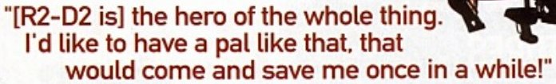
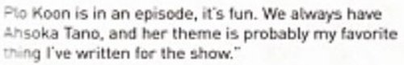
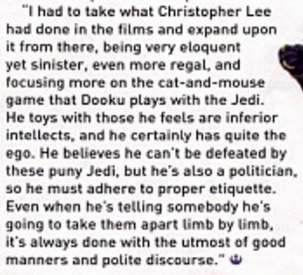
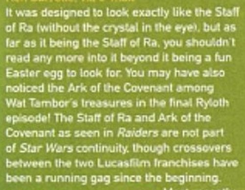
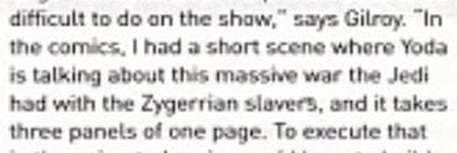
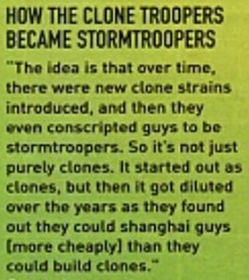

# Owner Material 038 — Star Wars Insider #1–153 plus specials (with The Lucasfilm Fan Club Magazine #1–22): Star Wars Insider #111 (2009)

- **Source:** *Star Wars Insider* magazine (issues 23–153, 1994–2014) and its predecessor *The Lucasfilm Fan Club Magazine* (issues 1–22, 1987–1994), plus seven special editions: articles, interviews, comics and short fiction Secondary source (licensed Legends reference). Scan OCR'd on the box; the scan stays box-only and is **not** published.
- **Method:** every scanned page was OCR'd and machine-screened sentence by sentence for power-relevant statements (fights, kills, defeats, Force feats, rankings, superweapons) that name a character on our roster; each kept sentence is quoted verbatim from the OCR text and has a crop of the printed passage directly under it. Pages with nothing power-relevant are still listed with what is on them.
- **Citation:** "*Star Wars Insider #111* (2009), p.X" by printed page ("scan p.X" where no printed number applies). **Weight:** Licensed magazine: a secondary source. Its short fiction and comics are Legends stories; its articles and interviews sum up or discuss lore and rank below the novels, comics and games they describe.

## scan p.1 (scan page 1)

Page contents: Cover: Kevin Kiner "Music Matters", Kenny Baker on life inside Artoo, Corey Burton, Robot Chicken, Jedi Archive. (hand-read)

## scan p.2 (scan page 2)

Page contents: Editor's Welcome (Jonathan Wilkins): R2-D2 as the saga's greatest enigma, "a repository of secrets"; Cad Bane/Corey Burton tease; Robot Chicken; contact details. (hand-read)

- **R2-D2** — entry/section: Lucas on R2-D2 (editor's welcome epigraph): ""[R2-D2 is] the hero of the whole thing. I'd like to have a pal like that, that would come and save me once in a while!" —George Lucas (Static Multimedia, September 10, 2005), Star Wars Insider 111, p. 2" Source: *Star Wars Insider #111* (2009), scan p.2
  

## scan p.3 (scan page 3)

Page contents: Contents: Kenny Baker, Robot Chicken, Kevin Kiner, Corey Burton, Mercedes Ngoh, Bradford Exchange. (hand-read)

## scan p.4 (scan page 4)

Page contents: Contents cont. (Bantha Tracks, Classic Moment). (hand-read)

## scan p.5 (scan page 5)

Page contents: Comlink news: Lucas on possibly shooting the live-action series outside the Czech Republic (4-7 year shoot, up to 700 jobs); Ray Park joins Heroes. (hand-read)

## scan p.6 (scan page 6)

Page contents: Comlink cont.: Gene Siskel Film Center honors Lucas (with Jon Favreau); correction re Nika Futterman (Asajj Ventress voice) photo caption in issue 110; Princess Leia named sixth most iconic sci-fi heroine (Totalscifionline). (hand-read)

## scan p.7 (scan page 7)

Page contents: Comlink cont.: Star Wars Weekends 2009 at Disney's Hollywood Studios (Jay Laga'aia, Ashley Eckstein, Ray Park, Warwick Davis, James Arnold Taylor); art credit for Aurra Sing illustration in issue 109. (hand-read)

## scan p.8 (scan page 8)

Page contents: Com-Channels letters (writer names omitted): Han vs Greedo Classic Moment; TPM memories; Ahmed Best interview; Empire Strikes Back school wallpaper. (hand-read)

## scan p.9 (scan page 9)

Page contents: Interrogation Droid: Sam Witwer (Galen Marek/Starkiller, The Force Unleashed) — joke quiz; "Tendency Tally: Overwhelmingly DARK SIDE". Out-of-universe humor. (hand-read)

## scan p.10 (scan page 10)

Page contents: Insider Interview opener: Kenny Baker (words: James Burns). (hand-read)

## scan p.11 (scan page 11)

Page contents: Kenny Baker interview: career (Burton Lester's Midgets, Billy Smart's Circus, The Minitones with Jack Purvis); insisted on a role for Purvis; Episodes I-III and Star Tours; health. Classic Artoo caption: ion blasters disabled R2-D2 on Tatooine. (hand-read)

### Stat block notes (game mechanics, not feats)

- Classic Artoo caption (ANH Jawa capture): "Ion blasters disabled most droids and R2-D2 was no exception. At the mercy of Jawas on Tatooine, the astromech short-circuited in spectacular fashion before being taken captive." (Kenny Baker interview, Star Wars Insider 111, p. 11) (Source: *Star Wars Insider #111* (2009), scan p.11)

## scan p.12 (scan page 12)

Page contents: Kenny Baker interview cont.: hospitalization; no script, Lucas directed by megaphone; couldn't hear Threepio inside Artoo; first heard Artoo "speak" at the premiere; Prowse dubbed; Time Bandits box. (hand-read)

### Stat block notes (game mechanics, not feats)

- Classic Artoo: fixing the Falcon's hyperdrive (ESB): "When the Millennium Falcon looked like it might finally fall to the Empire, Artoo came to the rescue. By fixing the hyperdrive, Artoo helped the temperamental ship outrun Darth Vader." (Kenny Baker interview, Star Wars Insider 111, p. 12) (Source: *Star Wars Insider #111* (2009), scan p.12)

## scan p.13 (scan page 13)

Page contents: Baker interview cont.: cast friendships (Bulloch, Mayhew, Prowse), Alec Guinness and wife in Tunisia, wine with Liam Neeson; took Mark Hamill to U.K. working men's clubs; harmonica; Elephant Man. (hand-read)

### Stat block notes (game mechanics, not feats)

- Classic Artoo: oil slick vs. super battle droids (AOTC): "Harassed by two predatory super battle droids, R2-D2 covered the floor in oil and set them on fire with his rockets, an ingenious move that got him out of a sticky situation!" (Kenny Baker interview, Star Wars Insider 111, p. 13) (Source: *Star Wars Insider #111* (2009), scan p.13)
- R2-D2 sidebar stats (pp. 13-15): "MANUFACTURER: INDUSTRIAL AUTOMATON TYPE: ASTROMECH DROID HOMEWORLD: NABOO WEAPON: ARC WELDER, BUZZ SAW VEHICLE: X-WING, NABOO N-1 STARFIGHTER AFFILIATION: REBEL ALLIANCE SPECIES: DROID" (Kenny Baker interview, Star Wars Insider 111, pp. 13-15) (Source: *Star Wars Insider #111* (2009), scan p.13)

## scan p.14 (scan page 14)

Page contents: Baker interview cont.: playing Paploo ("a bundle of rubber and fur"), was to play Wicket but fell ill; Labyrinth fire on set. (hand-read)

### Stat block notes (game mechanics, not feats)

- Classic Artoo: medal ceremony (ANH): "The small droid's excitable shuffle of joy as Han and Luke received their medals was one of his cutest moments, showing how proud he was of his new master!" (Kenny Baker interview, Star Wars Insider 111, p. 14) (Source: *Star Wars Insider #111* (2009), scan p.14)

## scan p.15 (scan page 15)

Page contents: 121 words, 10 paragraphs | headings/entries: Kenny mects a taméiar friend, May 2009!; CLASSIC ARTOO!; ASTROMECH OFOIO; Ey insiver

### Stat block notes (game mechanics, not feats)

- Classic Artoo: repairing the Queen's ship (TPM): "Resilient Artoo was the only droid to cling to the hull and successfully restore the shield generator that saved Queen Amidala's ship from destruction after a Trade Federation battleship had damaged it." (Kenny Baker interview, Star Wars Insider 111, p. 15) (Source: *Star Wars Insider #111* (2009), scan p.15)
- Classic Artoo: Geonosian droid factory (AOTC): "R2-D2 was full of surprises, never more so than when firing his boosters in the Geonosian droid factory and saving Padmé Amidala from a deadly shower of molten durasteel." (Kenny Baker interview, Star Wars Insider 111, p. 15) (Source: *Star Wars Insider #111* (2009), scan p.15)
- Classic Artoo: buzz droid (ROTS): "When a lethal buzz droid threatened Anakin Skywalker's Jedi starfighter, Artoo came to the rescue with a direct shot to the droid's central eye, hurtling it into oblivion and freeing Anakin to continue his rescue of Chancellor Palpatine." (Kenny Baker interview, Star Wars Insider 111, p. 15) (Source: *Star Wars Insider #111* (2009), scan p.15)

## scan p.16 (scan page 16)

Page contents: Baker interview cont.: Labyrinth fire extinguished; favorite moments (Threepio kicking Artoo; his face visible during the Podrace); memorabilia; Bring Back Star Wars TV show. (hand-read)

### Stat block notes (game mechanics, not feats)

- Classic Artoo: rescuing Threepio's head in the Geonosian arena (AOTC): "Artoo showed his caring side when he braved the carnage of the Geonosian arena to pluck Threepio's head from its battle droid body and promptly dragged it through the surrounding mayhem, reuniting it with its rightful owner." (Kenny Baker interview, Star Wars Insider 111, p. 16) (Source: *Star Wars Insider #111* (2009), scan p.16)

## scan p.17 (scan page 17)

Page contents: Baker interview cont.: would return for the live-action series health permitting; autobiography From Little Acorns... The Kenny Baker Story (ghost-written by Ken Mills); selected credits list. (hand-read)

### Stat block notes (game mechanics, not feats)

- Classic Artoo: sawing through the Ewok net (ROTJ): "Sawing through the net that strung up the Rebels when they were captured by the Ewoks might not have been to C-3PO's liking, but it certainly got the heroes out of a fix!" (Kenny Baker interview, Star Wars Insider 111, p. 17) (Source: *Star Wars Insider #111* (2009), scan p.17)

## scan p.18 (scan page 18)

Page contents: Robot Chicken Star Wars feature opener (words: Chris Spitale): interview with Seth Green and Matt Senreich. Parody, out-of-universe. (hand-read)

## scan p.19 (scan page 19)

Page contents: Robot Chicken: Star Wars Episode II DVD July 21; three Annie Awards for the first special. Out-of-universe. (hand-read)

## scan p.20 (scan page 20)

Page contents: Robot Chicken interview: all-new material; bounty hunters tableau from the Executor (4-LOM/Zuckuss sketch, IG-88, Bossk DVD exclusive); Lucasfilm only nervous about Anakin killing the younglings; casting voices; Donald Faison box (Gary the stormtrooper; helped build an Emperor's guard puppet). Parody, out-of-universe. (hand-read)

## scan p.21 (scan page 21)

Page contents: Robot Chicken interview cont.: Harrison Ford welcome; Emperor/Vader/Luke dynamic; Breckin Meyer's Boba Fett; C-3PO hardest to write; Tom Kane's Yoda singing; Abe Benrubi's Vader "a series of almosts"; Billy Dee Williams. Parody, out-of-universe. (hand-read)

## scan p.22 (scan page 22)

Page contents: Robot Chicken: Breckin Meyer box (Boba Fett, Admiral Ackbar voices; "The Emperor's Phone Call" sketch; cut Ackbar skits; Boba Fett "the coolest guy on the planet"); 15 minutes of new footage and 90 minutes of bonus features. Parody, out-of-universe. (hand-read)

## scan p.23 (scan page 23)

Page contents: Robot Chicken cont.: six commentaries incl. Frank Oz; Ugnaught short; season four; Abe Benrubi box ("Our Vader is such a sad sack"; channels Hayden Christensen's whiny defeat into James Earl Jones voice). Parody, out-of-universe. (hand-read)

## scan p.24 (scan page 24)

Page contents: Jedi Archive: behind-the-scenes photos of the ANH Massassi Temple throne-room set (crew, camera dolly; Rebel troops lined up). Out-of-universe. (hand-read)

## scan p.25 (scan page 25)

Page contents: Jedi Archive caption: Ford, Hamill and Mayhew on the Massassi Temple set on Shepperton's H stage; extras in X-wing pilot costumes and olive green U.S. Marine outfits. Out-of-universe. (hand-read)

## scan p.26 (scan page 26)

Page contents: Kevin Kiner feature photo (portrait). Out-of-universe. (hand-read)

## scan p.27 (scan page 27)

Page contents: "Score Force" (words: Scott Chernoff): Kevin Kiner, first composer of a Star Wars movie score besides John Williams; Superboy; "every planet having its own ethnic identity". (hand-read)

## scan p.28 (scan page 28)

Page contents: Kiner cont.: Ryloth West African flute theme; sci-fi credits (Stargate SG-1, Enterprise); CSI: Miami; episodes as "little mini-movies"; Luminara's theme. (hand-read)

## scan p.29 (scan page 29)

Page contents: Kiner cont.: midnight screenings; Dave Filoni dressed as Plo Koon; Lucas hands-on and wanted the show to have its own musical style. (hand-read)

- **Ahsoka Tano** — entry/section: Kiner on Ahsoka's theme: ""We always have Ahsoka Tano, and her theme is probably my favorite I've written for the show." —Kevin Kiner, Star Wars Insider 111, p. 29" Source: *Star Wars Insider #111* (2009), scan p.29
  

## scan p.30 (scan page 30)

Page contents: "More Than a Hobbie!" (words: Scott Chernoff): Corey Burton — Luke on a 1977 record, a Rebel (Hobbie) in ESB, Cad Bane/Ziro/Dooku in TCW. (hand-read)

## scan p.31 (scan page 31)

Page contents: Corey Burton feature photo spread. Out-of-universe. (hand-read)

## scan p.32 (scan page 32)

Page contents: Corey Burton cont.: Dooku, Cad Bane, Ziro voices; only new Clone Wars voice besides Anthony Daniels heard in an original film (Hobbie in ESB); Disney Read-Along Luke; Daws Butler class. Out-of-universe. (hand-read)

## scan p.33 (scan page 33)

Page contents: Corey Burton cont.: "Recording the Rebels!" — 1979 Disney Read-Along Luke; Hobbie's "I've been hit!" line in ESB; Mark Hamill had him sign the record as "Luke 2". Out-of-universe. (hand-read)

## scan p.34 (scan page 34)

Page contents: Corey Burton cont.: "Rogues Gallery" — Ziro "definitely comic relief", voice based on Truman Capote at Lucas's suggestion. Out-of-universe. (hand-read)

## scan p.35 (scan page 35)

Page contents: Corey Burton cont.: "Sounding Out the Sith" — cast as Christopher Lee's voice double for Dooku in videogames, then the Clone Wars micro-series and TCW. Out-of-universe. (hand-read)

- **Count Dooku** — entry/section: Burton on playing Dooku: ""I had to take what Christopher Lee had done in the films and expand upon it from there, being very eloquent yet sinister, even more regal, and focusing more on the cat-and-mouse game that Dooku plays with the Jedi. He toys with those he feels are inferior intellects, and he certainly has quite the ego. He believes he can't be defeated by these puny Jedi, but he's also a politician, so he must adhere to proper etiquette. Even when he's telling somebody he's going to take them apart limb by limb, it's always done with the utmost of good manners and polite discourse." —Corey Burton, Star Wars Insider 111, p. 35" Source: *Star Wars Insider #111* (2009), scan p.35
  

## scan p.36 (scan page 36)

Page contents: Feature photo: Mercedes Ngoh in Rystáll makeup. Out-of-universe. (hand-read)

## scan p.37 (scan page 37)

Page contents: "A Bounty Hunter's Babe!" (words: Pat Jankiewicz): Mercedes Ngoh as Rystáll Sant in the 1997 ROTJ Special Edition; makeup four hours; worked with Femi Taylor; Rystáll's hooves. Out-of-universe. (hand-read)

## scan p.38 (scan page 38)

Page contents: Ngoh cont.: Lucas directing the Special Edition footage; singing alien dialogue; Rystáll catches Boba Fett's attention ("Boba Fett is a ladies man"); shot over "one very long day". Out-of-universe. (hand-read)

## scan p.39 (scan page 39)

Page contents: 174 words, 9 paragraphs | headings/entries: STRENGTH 80 SPEED POWER LEADERSHIP MOBILITY LOYALTY; SSSSR

### Stat block notes (game mechanics, not feats)

- Versus databank: Boba Fett: "An unaltered clone, presented to the notorious bounty hunter Jango Fett as part of his payment for allowing himself to be cloned, Boba Fett was every bit as deadly as his father. After witnessing Jango's death by the lightsaber of Jedi Master, Mace Windu the young Boba was given guidance from an encoded message, left by his father in the event of such a tragedy. A man with a grudge against the entire galaxy, he modified his Mandalorian armor to devastating effect, and despite a tendency to disintegrate his foes, found himself employed by the Galactic Empire as a licensed law enforcer." Profile: Homeworld Kamino; Species Human; Height 1.83 meters; Weapon EE-3 blaster rifle; Vehicle Slave I; Affiliation "Whoever's paying!" (Versus databank, Star Wars Insider 111, p. 39) (Source: *Star Wars Insider #111* (2009), scan p.39)
- Versus skills: Boba Fett: "Skilled in multiple forms of combat and boasting exemplary skills as a pilot, Boba Fett's reputation as the galaxy's most fearsome bounty hunter was no exaggeration. A sure shot with his trusty EE-3 blaster rifle, he'd hunt any quarry, from Wookiees to Jedi. Fett's technical skills served him well. Able to maintain and pilot his ship alone, he was seemingly unstoppable. If Boba Fett had you in his sights, your days were numbered." Ratings: Strength 80; Speed 85; Power 80; Leadership 60; Mobility 80; Loyalty 80; Special Ability 90; Bonus Skill 100. (Versus databank, Star Wars Insider 111, p. 39) (Source: *Star Wars Insider #111* (2009), scan p.39)
- Versus intro: Boba Fett vs. Cad Bane: "A battle between bounty hunters is often a matter of honor and pride as well as cold hard credits. Skilled in the art of combat in it's various forms, Cad Bane and Boba Fett weretwo bounty hunters who dominated their chosen profession, instilling a sense of fear and dread in those unlucky enough to be targeted. The vicious Cad Bane would often turn on those who hired him. He was a ruthless, arrogant killer who was happy to cause collateral damage as a part of his work. Unlike Boba Fett, he didn't take prisoners, preferring to kill his way to his intended victims, leaving a trail of carnage in his wake. A tough guy who always kept his cool under pressure, Cad Bane had much less moral" (Versus, Star Wars Insider 111, p. 39) (Source: *Star Wars Insider #111* (2009), scan p.39)

## scan p.40 (scan page 40)

Page contents: 115 words, 5 paragraphs | headings/entries: INSIDER fy

### Stat block notes (game mechanics, not feats)

- Versus databank: Cad Bane: "Cad Bane was a bounty hunter from the planet Duros, who rose to prominence during the Clone Wars between the Galactic Republic and the Confederacy of Independent Systems. Working for whoever offered the most credits, he was considered one of the galaxy's best bounty hunters, particularly after the death of Jango Fett. He was involved in the plot to break Ziro the Hutt out of prison, an impossible mission that the bounty hunter pulled off with consummate ease. His posse included the technician Robonino, Jedi hunter Aurra Sing, and Weequay mercenary Shahan Alama." Profile: Homeworld Duros; Species Duros; Height unknown; Weapons blaster; Vehicle unknown; Affiliation "The highest bidder!" (Versus databank, Star Wars Insider 111, p. 40) (Source: *Star Wars Insider #111* (2009), scan p.40)
- Versus skills: Cad Bane: "Bane carried customized twin blasters adapted from BlasTech LL-30 pistols. He had breathing tubes imbedded in his cheekbones, directly connected to his lungs, that allowed him to work freely in the harshest atmospheres without additional protection. Bane was also equipped with rocket boots and wrist gauntlets, which had a variety of built-in tools and weapons, including a cable launcher, comlink, data uplink, and non-lethal stunners." Ratings: Strength 85; Speed 80; Power 80; Leadership 90; Mobility 80; Loyalty 20; Special Ability 80; Bonus Skill 90. (Versus databank, Star Wars Insider 111, p. 40) (Source: *Star Wars Insider #111* (2009), scan p.40)
- Versus intro cont.: "compass than his closest rival, Jango Fett. Working with his specially selected and tested posse, Cad Bane proved his skill as a leader, whose assured manner and brutal methods inspired respect from his underlings. In contrast to this, Boba Fett was something of a loner, preffering to work unaccompanied where possible. He was influenced by the teachings of his father, who passed down his own moral code to his son. While Boba Fett might have seemed infallible, he did, on occassion, make mistakes. Turning his back on the seemingly disabled Han Solo, for example.... Two deadly bounty hunters, only one possible outcome—who will you place your credits on?" (Versus, Star Wars Insider 111, p. 40) (Source: *Star Wars Insider #111* (2009), scan p.40)

## scan p.41 (scan page 41)

Page contents: "Empire Building": Bradford Exchange/Hawthorne Village Star Wars village collection — Mos Eisley cantina, Echo Base, Endor Imperial bunker (licensing manager Roxanne Lee). Out-of-universe merchandise. (hand-read)

## scan p.42 (scan page 42)

Page contents: Hawthorne Village Lars homestead diorama photo with Obi-Wan, Luke, C-3PO and R2-D2 figurines. Out-of-universe. (hand-read)

## scan p.43 (scan page 43)

Page contents: Village collection cont.: subscription-only; cantina ships August 2009. Out-of-universe. (hand-read)

## scan p.44 (scan page 44)

Page contents: Village collection cont.: Lars moisture farm and Jabba's Palace accessory villages; Dagobah planned. Out-of-universe. (hand-read)

## scan p.45 (scan page 45)

Page contents: Blaster section contents: Incoming, Books, Ask Lobot, Comics, Retro, Bounty Hunters, Bantha Tracks, Classic Moment Order 66 ("The fall of the Jedi begins!"); "There's nothing like a good blaster at your side, kid." (hand-read)

## scan p.46 (scan page 46)

Page contents: Books: "All Systems Go" — Daniel Wallace and Jason Fry interview on Star Wars: The Essential Atlas (art: Chris Trevas); mapping the galaxy since the 1990s; NJO maps. Out-of-universe. (hand-read)

## scan p.47 (scan page 47)

Page contents: Atlas interview cont.: "assembling a dinosaur skeleton" (Corellian Run, Hydian Way); quasi-official geographic consultants to Leland Chee; nearly 4,400 star systems; captions on the Shawken Spire (one of the Twenty Wonders of the Galaxy) and Bariesan, a waterworld in Yavin's Gordian Reach. (hand-read)

- **Wat Tambor; Jar Jar Binks** — entry/section: Ask Lobot: Staff of Ra / Ark of the Covenant: ""It was designed to look exactly like the Staff of Ra (without the crystal in the eye), but as far as it being the Staff of Ra, you shouldn't read any more into it beyond it being a fun Easter egg to look for. You may have also noticed the Ark of the Covenant among Wat Tambor's treasures in the final Ryloth episode! The Staff of Ra and Ark of the Covenant as seen in Raiders are not part of Star Wars continuity, though crossovers between the two Lucasfilm franchises have been a running gag since the beginning." —Leland Y. Chee, Star Wars Insider 111, p. 47" Source: *Star Wars Insider #111* (2009), scan p.47
  

## scan p.48 (scan page 48)

Page contents: Atlas interview cont.: placing systems; Modi the teenage Hungarian mapmaker and Chris Reiff; The Maverick Moon's Planetary Pioneers; mapping 3-D space on a 2-D page; online tie-in on Xim and the Tion Cluster. Caption: the Hapes Consortium's Queen Mother's Fountain Palace. (hand-read)

## scan p.49 (scan page 49)

Page contents: Comics: "As Clumsy As He Is Stupid?" (words: Daniel Wallace) — Dark Horse TCW arc "In the Service of the Republic" with Plo Koon, Kit Fisto and a young Ozzel (writers Henry Gilroy, Steven Melching; artist Scott Hepburn); next arc from the Separatists' side. Out-of-universe. (hand-read)

- **Yoda** — entry/section: Gilroy on the Zygerrian war: ""In the comics, I had a short scene where Yoda is talking about this massive war the Jedi had with the Zygerrian slavers, and it takes three panels of one page." —Henry Gilroy, Star Wars Insider 111, p. 49" Source: *Star Wars Insider #111* (2009), scan p.49
  

## scan p.50 (scan page 50)

Page contents: Comics news: Star Wars Adventures: Princess Leia and the Royal Ransom (Han, Chewie, Leia between ANH and ESB; July 29); Star Wars Omnibus: Menace Revealed (August 12) collecting rare stories — Anakin's first lightsaber and Krayn, Nym vs. the Trade Federation, Aurra Sing hunted by Jedi, Marvel #27 Yoshi Raph-Elan, Hasbro mini-comics. Out-of-universe. (hand-read)

## scan p.51 (scan page 51)

Page contents: Incoming (words: Chris Spitale): Kotobukiya TCW ARTFX+ "The Sith" series — Grievous, Asajj Ventress, Dooku; combine into a holographic Darth Sidious. Out-of-universe merchandise. (hand-read)

## scan p.52 (scan page 52)

Page contents: Incoming: Sideshow Luke and Han stormtrooper-disguise 12-inch set (Comic-Con); "The Circle Is Now Complete" Obi-Wan/Vader diorama; Mimobot USB drives (Maul, Captain Rex, Vader/Anakin). Out-of-universe merchandise. (hand-read)

## scan p.53 (scan page 53)

Page contents: Incoming: Gentle Giant McQuarrie concept Boba Fett mini-bust, pink Vader helmet charity edition, shadow stormtrooper statue, life-size Captain Rex monument, Rebel/Imperial seal rings. Out-of-universe merchandise. (hand-read)

## scan p.54 (scan page 54)

Page contents: Incoming: Gentle Giant Boba Fett with Han in carbonite statue, wampa statue, Hoth Luke/Han mini-busts, Garindan "Long Snoot" mini-bust. Out-of-universe merchandise. (hand-read)

## scan p.55 (scan page 55)

Page contents: Incoming: Cube Darth Vader and R2-D2 USB hubs; Hasbro Galactic Heroes wave (Ackbar and Nien Nunb, etc.). Out-of-universe merchandise. (hand-read)

## scan p.56 (scan page 56)

Page contents: Retro (words & pictures: Gus Lopez): R2-D2 collectibles — Kenner Early Bird figure, ESB sensorscope and POTF pop-up lightsaber versions, The Adventures of R2-D2 board game, radio-controlled R2-D2. Out-of-universe. (hand-read)

## scan p.57 (scan page 57)

Page contents: Retro cont.: Takara projectile-firing R2-D2s; Boy Scouts patches and belt buckle; 2002 "R2-D2: Beneath the Dome" mockumentary. Out-of-universe. (hand-read)

## scan p.58 (scan page 58)

Page contents: Retro cont.: R2-D2 cookie jar (Roman Ceramics), 1983 Toy Toter, Pepsi coolers, waste basket, USPS R2-D2 mailboxes (2007 stamps) and their plastic replica. Out-of-universe. (hand-read)

## scan p.59 (scan page 59)

Page contents: Bounty Hunters: reader photo with original-trilogy actors Garrick Hagon (Biggs), Derek Lyons, Richard LeParmentier (Admiral Motti) and Richard Bonehill; Kotobukiya statue prize. Reader/winner names omitted. Out-of-universe. (hand-read)

## scan p.60 (scan page 60)

Page contents: Bounty Hunters cont.: reader encounters with the actor who played Tessek, Jay Laga'aia (Typho) and Ray Park (lightsaber lesson); Houston Space Center X-wing. Reader names omitted. Out-of-universe. (hand-read)

## scan p.61 (scan page 61)

Page contents: Bantha Tracks (editor Mary Franklin): submission guidelines; an artist's charity booth at Motor City Comic Con and a 501st Legion rancor head. Private and medical details omitted. Out-of-universe. (hand-read)

## scan p.62 (scan page 62)

Page contents: Bantha Tracks crafts: reader Plasticine scene, a mural bedroom, a 100-figures school project, a Starspeeder 3000 diorama shown at Celebration IV, Valentine's boxes. Reader names omitted. Out-of-universe. (hand-read)

## scan p.63 (scan page 63)

Page contents: Bantha Tracks Art Galaxy: reader fan art (Jar Jar Binks vs. Darth Maul poster, a clone trooper). Artist names omitted. Out-of-universe. (hand-read)

## scan p.64 (scan page 64)

Page contents: Bantha Tracks Art Galaxy cont.: reader art of Obi-Wan vs. Vader and "School of Coruscant", a Star Wars take on Raphael's "School of Athens" with Ahsoka. Artist names omitted. Out-of-universe. (hand-read)

## scan p.65 (scan page 65)

Page contents: 303 words, 21 paragraphs | headings/entries: EXT. MYGEETO—DAWN

- **none** — entry/section: What They Said: clones to stormtroopers: ""The idea is that over time, there were new clone strains introduced, and then they even conscripted guys to be stormtroopers. So it's not just purely clones. It started out as clones, but then it got diluted over the years as they found out they could shanghai guys (more cheaply) than they could build clones." —George Lucas (mtv.com), Star Wars Insider 111, p. 65" Source: *Star Wars Insider #111* (2009), scan p.65
  

### Stat block notes (game mechanics, not feats)

- Insider Trivia: Order 66 as defined in Republic Commando: True Colors: "Order 66: In the event of Jedi officers acting against the interests of the Republic, and after receiving specific orders verified as coming directly from the Supreme Commander (Chancellor), Grand Army of the Republic (GAR) commanders will remove those officers by lethal force, and command of the GAR will revert to the Supreme Commander (Chancellor) until a new command structure is established." (Insider Trivia, Karen Traviss, Star Wars Insider 111, p. 65) (Source: *Star Wars Insider #111* (2009), scan p.65)
- Classic Moment: Order 66 on Mygeeto (2005 script, deleted elements in brackets): "The sky slowly awakens on the crystal world of Mygeeto. A battle rages. Clone troops battle the droid armies across a long bridge. Ki-Adi-Mundi uses his lightsaber to deflect enemy fire. [Clone Commander Bacara (1138) exits a Gunship near the entrance to the city. He rallies his troops to attack the city, then gets a message on his comlink. ...] [Darth Sidious: Commander 1138...] [Clone Commander Bacara: Yes, Sir.] [Darth Sidious: The time has come. Execute Order Sixty-Six.] [Clone Commander Bacara: It will be done, My Lord.]" (Classic Moment, Revenge of the Sith 2005 script, Star Wars Insider 111, p. 65) (Source: *Star Wars Insider #111* (2009), scan p.65)

## scan p.66 (scan page 66)

Page contents: 564 words, 40 paragraphs | headings/entries: EXT. FELUCIA—FOREST—DAY; EXT. KASHYYYK— MEETING HALL—DAY; WHO'S WHO: THE FAI; NEXT TIME: THE FACE OF GRIEVOUS!"; INT. CATO NEIMOIDIA—COCKPIT JEDI STARFIGHTER—DAY; EXT. CATO NEIMOIDIA—COCKPIT JEDI STARFIGHTER—DAY; EXT. SALEUCAMI—FOREST; Ki-Adi-Munc

### Stat block notes (game mechanics, not feats)

- Classic Moment: death of Ki-Adi-Mundi: "Ki-Adi-Mundi: Come on! The clones stop. Ki-Adi-Mundi turns around and is blasted by clone fire. He's killed before he can defend himself." (Classic Moment, Revenge of the Sith 2005 script, Star Wars Insider 111, p. 66) (Source: *Star Wars Insider #111* (2009), scan p.66)
- Classic Moment: Felucia: "[Aayla: (continuing) Do you think they're droids?] [Bly: No.] Bly blasts Aayla in the back. The other clones fire on her as she hits the ground. [Another Jedi, Barriss Offee, is cutting down a patrol of droids when a Clone Walking Tank and seven Clone Troopers round a corner and blast the Jedi away.]" (Classic Moment, Revenge of the Sith 2005 script, Star Wars Insider 111, p. 66) (Source: *Star Wars Insider #111* (2009), scan p.66)
- Classic Moment: Kashyyyk: "Yoda drops his gimer stick, clutches his chest, [and rests against a wall]. ... [A Jedi, Luminara Unduli, talks with eight Clone Officers standing in a circle around her. Suddenly they reveal their hidden pistols and blast her before she can react.] [The Jedi Quinlan Vos is riding on top of a Clone Turbo Tank. The main cannon of a second tank slowly swings to point right at him and a couple of Clones. The cannon fires, and Quinlan Vos and the Clones disappear in a huge explosion.]" (Classic Moment, Revenge of the Sith 2005 script, Star Wars Insider 111, p. 66) (Source: *Star Wars Insider #111* (2009), scan p.66)
- Classic Moment: Cato Neimoidia and Saleucami: "Plo Koon: There they are. Land on the nearest platform. ... The Four Clone Pilots with Plo Koon drop back and blast him out of the sky. ... Three Speeder Bikes race through the forest. A Jedi, Stass Allie, is in the lead. The two Clones following her drop back and blast her, causing her to crash in a huge explosion." (Classic Moment, Revenge of the Sith 2005 script, Star Wars Insider 111, p. 66) (Source: *Star Wars Insider #111* (2009), scan p.66)
- Who's Who: The Fallen Jedi (Ki-Adi-Mundi, Aayla Secura): "Ki-Adi-Mundi: A Cerean representative on the Jedi Council and a general during the Clone Wars, where he led a team of clone trooper infantry. They were responsible for his death on the Banking Clan stronghold world of Mygeeto when Order 66 was executed. Aayla Secura: Aayla Secura was part of a 200-strong task force sent to Geonosis to rescue captive Jedi, fighting in one of the first battles of the Clone Wars. She, too, served as a general and was betrayed by her clone trooper platoon on the Commerce Guild planet of Felucia." (Who's Who, Star Wars Insider 111, p. 66) (Source: *Star Wars Insider #111* (2009), scan p.66)
- Who's Who: The Fallen Jedi (Plo Koon, Stass Allie): "Plo Koon: Another member of the Jedi Council, Plo Koon was a mentor to Ahsoka Tano, later Anakin Skywalker's Padawan. Master Plo's life was snuffed out while on a mission during the Outer Rim Sieges above Cato Neimoidia when his clone wingmen enacted Order 66 and shot down his starfighter. Stass Allie: Stass Allie fought valiantly during the first skirmishes that ignited the devastating Clone Wars. After the fall of Saleucami in the Outer Rim Sieges, Allie was leading the mop-up operation with a contingent of clone troopers. Order 66 was carried out while she was on speeder bike patrol." (Who's Who, Star Wars Insider 111, p. 66) (Source: *Star Wars Insider #111* (2009), scan p.66)

## scan p.67 (scan page 67)

Page contents: Next issue: The Life and Times of Obi-Wan Kenobi; James Arnold Taylor; Star Wars newspaper strips (Echo Base, Ord Mantell); "Horror Story!"; US newsstands Sept 15, UK October 9. (hand-read)

### Stat block notes (game mechanics, not feats)

- Versus result: Boba Fett vs. Cad Bane: "Cad Bane may be making a name for himself as a tough guy, but he has a long way to go to catch up with the awesome reputation of the galaxy's greatest bounty hunter. Boba Fett wins this time." (Versus: Who Wins?, Star Wars Insider 111, p. 67) (Source: *Star Wars Insider #111* (2009), scan p.67)
