# Owner Material 038 — Star Wars Insider #1–153 plus specials (with The Lucasfilm Fan Club Magazine #1–22): Star Wars Insider #112 (2009)

- **Source:** *Star Wars Insider* magazine (issues 23–153, 1994–2014) and its predecessor *The Lucasfilm Fan Club Magazine* (issues 1–22, 1987–1994), plus seven special editions: articles, interviews, comics and short fiction Secondary source (licensed Legends reference). Scan OCR'd on the box; the scan stays box-only and is **not** published.
- **Method:** every scanned page was OCR'd and machine-screened sentence by sentence for power-relevant statements (fights, kills, defeats, Force feats, rankings, superweapons) that name a character on our roster; each kept sentence is quoted verbatim from the OCR text and has a crop of the printed passage directly under it. Pages with nothing power-relevant are still listed with what is on them.
- **Citation:** "*Star Wars Insider #112* (2009), p.X" by printed page ("scan p.X" where no printed number applies). **Weight:** Licensed magazine: a secondary source. Its short fiction and comics are Legends stories; its articles and interviews sum up or discuss lore and rank below the novels, comics and games they describe.

## scan p.1 (scan page 1)

Page contents: Cover: Obi-Wan Kenobi issue (Ewan McGregor, James Arnold Taylor, Alec Guinness); General Grievous interrogated; Star Wars newspaper strips; Death Troopers; Mandalorians in Legacy; Jedi test; Uncle Milton Force Trainer; X-wing toy. (hand-read)

## scan p.2 (scan page 2)

Page contents: Ad: Mimobot USB flash drives. Out-of-universe. (hand-read)

## scan p.3 (scan page 3)

Page contents: Editor's Welcome (Jonathan Wilkins): Obi-Wan as linchpin of the saga; "Taylor Made!" pointer to the James Arnold Taylor interview. Epigraph: "Obi-Wan is here. The Force is with him!" —Darth Vader, A New Hope. Commentary, out-of-universe. (hand-read)

## scan p.4 (scan page 4)

Page contents: Contents: Obi-Wan feature (from guardian of peace to exile); David Iskra treasure exhibit; Star Wars newspaper strips; Uncle Milton; Star Wars Challenge quiz. (hand-read)

## scan p.5 (scan page 5)

Page contents: Contents cont.: Launch Pad, Interrogation Droid, Jedi Archive, Ask Lobot, Comics (Mandalorians in Legacy), Death Troopers, Versus (Geonosian warrior), Bounty Hunters, Bantha Tracks, Classic Moment "Lair of Grievous"; Leia variant cover. (hand-read)

## scan p.6 (scan page 6)

Page contents: Launch Pad: Star Wars: In Concert tour begins October 1, 2009 at the Honda Center, Anaheim, narrated by Anthony Daniels; Lucas and John Williams quotes; exhibit of costumes and props. Out-of-universe. (hand-read)

## scan p.7 (scan page 7)

Page contents: Launch Pad: Gentle Giant Republic Commando (Delta Squad) busts for Forbidden Planet; Totalscifionline.com best-villain vote. Out-of-universe. (hand-read)

## scan p.8 (scan page 8)

Page contents: Launch Pad: The Force Unleashed Ultimate Sith Edition (Jedi Temple and Hoth levels vs. Luke) November 3; TCW Season One box set (seven director's cuts, 64-page journal); Filoni and Lucas quotes; Mac/PC versions from Aspyr. Out-of-universe. (hand-read)

## scan p.9 (scan page 9)

Page contents: Ad: Bradford Exchange Star Wars illuminating stained-glass panorama. Out-of-universe. (hand-read)

## scan p.10 (scan page 10)

Page contents: Interrogation Droid (words: Chris Spitale): comedic in-character Q&A with Matthew Wood as General Grievous (Wookiee cookies, Jedi teething rings, A4-D, Gor, "Darth Downer"). Parody, not canon; out-of-universe. (hand-read)

## scan p.11 (scan page 11)

Page contents: Ad: Brian's Toys. Out-of-universe. (hand-read)

## scan p.12 (scan page 12)

Page contents: Obi-Wan Kenobi feature opener: full-page montage art (Ewan McGregor, animated Clone Wars Kenobi, Alec Guinness). No text. (hand-read)

## scan p.13 (scan page 13)

Page contents: "Wizard of the Desert" title page: Ryder Windham examines the life of Obi-Wan Kenobi, from training at the Jedi Temple to his years as Luke Skywalker's secret guardian on Tatooine. (hand-read)

## scan p.14 (scan page 14)

Page contents: 27 words, 8 paragraphs | headings/entries: Homeworld: Born: Species: Gender: Height: Hai Eyes:; Dislikes:; Wan Kenobi

### Stat block notes (game mechanics, not feats)

- Obi-Wan's early training: "Tutored by Master Yoda and trained in lightsaber combat by Cin Drallig, Obi-Wan was considered a quick learner, skilled fighter, and dedicated pupil. However, he became increasingly anxious as his 13th birthday approached, for the Order maintained that younglings over the age of 13 years were too old to be trained to become Jedi Knights." (The Early Years, Star Wars Insider 112, p. 14) (Source: *Star Wars Insider #112* (2009), scan p.14)
- Obi-Wan Kenobi profile: "Homeworld: Unknown Born: 57 BBY Species: Human Gender: Male Height: 1.79 meters Hair: Brown Eyes: Blue-gray Likes: Dexter Jettster's cooking Dislikes: Sith Lords" (Obi-Wan Kenobi Profile, Star Wars Insider 112, p. 14) (Source: *Star Wars Insider #112* (2009), scan p.14)

## scan p.15 (scan page 15)

Page contents: Film pull quotes on pp. 15-20 (TPM "mindful of the future"/"useless lifeform"; AOTC "commitment to the Jedi Order"/"Be mindful of your thoughts"; ROTS "my allegiance is to the Republic"/"Only a Sith Lord deals in absolutes"; ANH "I haven't gone by the name of Obi-Wan") — film dialogue, logged as summary only. (hand-read)

### Stat block notes (game mechanics, not feats)

- Apprentice to Qui-Gon: "Although Qui-Gon initially rejected Obi-Wan, the wise Master Yoda—who saw great potential in the pair—arranged for them to travel together on a mission to the planet Bandomeer in the Outer Rim. After unexpected developments led Obi-Wan to attempt to bring the renegade Xanatos to justice, Qui-Gon chose Obi-Wan as his Padawan." (Apprentice to Qui-Gon Jinn, Star Wars Insider 112, p. 15) (Source: *Star Wars Insider #112* (2009), scan p.15)
- Ilum lightsaber; Dexter Jettster: "Obi-Wan went with Qui-Gon to the crystal caves of Ilum, where he constructed his own lightsaber. On one of their early missions, they journeyed to the mining world Ord Sigatt, where they befriended Dexter Jettster, a shady Besalisk who possessed an incredible wealth of knowledge and a genuine talent for cooking." (Apprentice to Qui-Gon Jinn, Star Wars Insider 112, p. 15) (Source: *Star Wars Insider #112* (2009), scan p.15)

## scan p.16 (scan page 16)

Page contents: 226 words, 15 paragraphs | headings/entries: WEB OF INTRIGUE

### Stat block notes (game mechanics, not feats)

- Maul kills Qui-Gon, slain by Kenobi: "Pursuing the two Jedi when they returned to Naboo, the Sith Lord mortally wounded Qui-Gon but was slain by Kenobi. Because Qui-Gon believed Anakin Skywalker would fulfill an ancient Jedi prophecy to bring balance to the Force, his last request was for Kenobi to train Anakin to become a Jedi." (New Friends, Old Foes, Star Wars Insider 112, p. 16) (Source: *Star Wars Insider #112* (2009), scan p.16)
- Web of Intrigue: Kamino and Geonosis: "Kenobi questioned Fett, who maintained that he'd never heard of Sifo-Dyas, but claimed a man named Tyranus had recruited him for the cloning operation. Later, on the planet Geonosis, Kenobi confronted Count Dooku, a former Jedi Master who had abandoned the Jedi Order ten years earlier and become the leader of the Separatist movement" (Web of Intrigue, Star Wars Insider 112, p. 16) (Source: *Star Wars Insider #112* (2009), scan p.16)

## scan p.17 (scan page 17)

Page contents: 133 words, 8 paragraphs | headings/entries: SITH ENCOUN; Spirt survived this encounter, thanks t; Special training with Qui-Gon Jian; INSIDER

### Stat block notes (game mechanics, not feats)

- Training Anakin: "As powerful as Anakin was with the Force, he had difficulty controlling his emotions because his years on Tatooine had not left him a stranger to love, fear, pride, and anger. On more than one occasion, Anakin bitterly accused his Master of preventing him from fulfilling his potential." (Training Anakin, Star Wars Insider 112, p. 17) (Source: *Star Wars Insider #112* (2009), scan p.17)
- Sith Encounters: "Obi-Wan Kenobi not only defeated the Sith Lord Darth Maul at Naboo, but also survived duels with Darth Tyranus—the Sith alter ego of Count Dooku—and Darth Vader, whom he severely disabled on the volcanic planet Mustafar. In his final confrontation with Vader on the Death Star battle station, Kenobi allowed Vader to strike him down, sacrificing himself so that Luke Skywalker and his allies would live. Incredibly, Kenobi's spirit survived this encounter, thanks to his special training with Qui-Gon Jinn and Yoda." (Sith Encounters, Star Wars Insider 112, p. 17) (Source: *Star Wars Insider #112* (2009), scan p.17)

## scan p.18 (scan page 18)

Page contents: 118 words, 10 paragraphs | headings/entries: Wars ch lasted thre Obi-Wan K

### Stat block notes (game mechanics, not feats)

- The Negotiator: "Kenobi's reputation for resolving disputes through diplomacy, and without ever drawing his lightsaber, earned him the moniker "The Negotiator," which also became the name of his flagship, a Venator-class Star Destroyer. The clone CC-2224, better known as Clone Commander Cody, served as Kenobi's first officer in numerous campaigns." (The Negotiator, Star Wars Insider 112, p. 18) (Source: *Star Wars Insider #112* (2009), scan p.18)
- Clone Wars foes: "Kenobi had confrontations with Count Dooku and Dooku's disciple Asajj Ventress, the bounty hunter Durge, and the cybernetic General Grievous. He revisited Tatooine when he met with Jabba the Hutt to discuss terms of safe passage for Republic ships through Hutt sectors" (The Negotiator, Star Wars Insider 112, p. 18) (Source: *Star Wars Insider #112* (2009), scan p.18)

## scan p.19 (scan page 19)

Page contents: 132 words, 8 paragraphs | headings/entries: BEN'S JOURNAL; OBL-WAN TO ANAKIN EPISODE III - ee

### Stat block notes (game mechanics, not feats)

- Ben's Journal: "The book contained detailed instructions for constructing lightsabers, but deliberately omitted information about the true identity of Luke's father. Kenobi kept the book in a locked case in his hut's cellar, where Luke discovered it not long after his confrontation with Darth Vader in Cloud City. Years later, Luke shared the journal with others when he founded his Jedi Academy." (Ben's Journal, Star Wars Insider 112, p. 19) (Source: *Star Wars Insider #112* (2009), scan p.19)
- Secret Guardian: "Kenobi initially took shelter in a nearby abandoned hovel that was within walking distance to the Lars homestead so he could check on Luke daily. ... He continued to check on the Lars homestead occasionally, albeit with greater stealth, but his connection with the Force became his main means to monitor Luke from afar." (Secret Guardian, Star Wars Insider 112, p. 19) (Source: *Star Wars Insider #112* (2009), scan p.19)

## scan p.20 (scan page 20)

Page contents: 14 words, 4 paragraphs | headings/entries: 

### Stat block notes (game mechanics, not feats)

- Reputation of a wizard: "Because of his apparently natural ability to survive alone in the desert, repel menacing creatures, and walk without fear across the most the treacherous areas, he acquired the reputation of a wizard." (Wizard of the Desert, Star Wars Insider 112, p. 20) (Source: *Star Wars Insider #112* (2009), scan p.20)
- Subdues a krayt dragon: "Luke and a friend had ridden a pet ronto into the Jundland Wastes and gotten lost. When Kenobi found them, they were under attack by a krayt dragon. He subdued the dragon and delivered the boys to the Lars homestead, but Owen was less than pleased to see Kenobi, and told him to leave immediately." (Wizard of the Desert, Star Wars Insider 112, p. 20) (Source: *Star Wars Insider #112* (2009), scan p.20)

## scan p.21 (scan page 21)

Page contents: Alec Guinness as Obi-Wan Kenobi: 1977 BBC Michael Parkinson interview excerpts (Lucas bringing costumes to London; "Mark my words, this film is going to have some distinction"; Lucas phoning the day before opening). Out-of-universe. (hand-read)

## scan p.22 (scan page 22)

Page contents: "The Voice Will Be With You, Always": Scott Chernoff interviews James Arnold Taylor on voicing Obi-Wan Kenobi in Star Wars: The Clone Wars (title spread pp. 22-23). (hand-read)

## scan p.23 (scan page 23)

Page contents: Title spread continued: photo of James Arnold Taylor. No further text. (hand-read)

## scan p.24 (scan page 24)

Page contents: Taylor's credits (Green Arrow, Harry Osborn, Ratchet, Fred Flintstone); childhood Star Wars play ("I was always Han Solo"); career setback and retraining with an opera vocal coach (health details omitted). Out-of-universe. (hand-read)

## scan p.25 (scan page 25)

Page contents: Taylor's inspirations (Mel Blanc, Daws Butler, Don Messick); starting as a stand-up comic and DJ at 14; voice-doubling for Michael J. Fox (Atlantis), Johnny Depp, Billy Bob Thornton and Ewan McGregor; voiced Obi-Wan since the 2002 Clone Wars micro-series. Out-of-universe. (hand-read)

## scan p.26 (scan page 26)

Page contents: Taylor on avoiding caricature; Filoni and Lucas giving him freedom; photo caption: Taylor with Tom Kane, Matt Lanter, Dave Filoni and Ashley Eckstein at the TCW movie premiere. Out-of-universe. (hand-read)

- **Obi-Wan Kenobi** — entry/section: Taylor on voicing Obi-Wan: ""I didn't concentrate so much on sounding like Ewan McGregor as much as I concentrated on sounding like Obi-Wan Kenobi, the character we all know. That seemed to work." —James Arnold Taylor, Star Wars Insider 112, p. 26" Source: *Star Wars Insider #112* (2009), scan p.26
  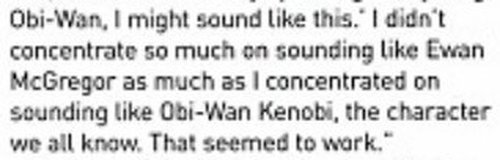
- **Obi-Wan Kenobi; Darth Vader (Anakin Skywalker); Ahsoka Tano** — entry/section: Taylor on Filoni's vision for Obi-Wan: ""Dave's vision for Obi-Wan in this series is very specific. He's trying to show Anakin the right way, but he's also the calm in the storm. I'm always the straight guy. Most of the time, I'm pulling the reins back on Anakin and Ahsoka, so I'm like the older brother. Nothing really gets to him." —James Arnold Taylor, Star Wars Insider 112, p. 26" Source: *Star Wars Insider #112* (2009), scan p.26
  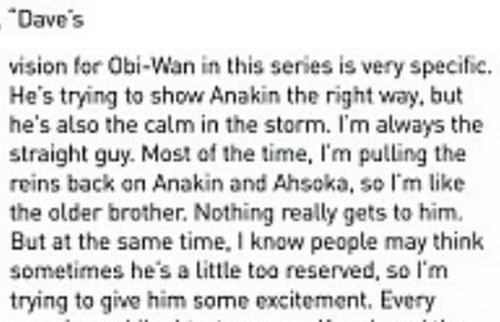

## scan p.27 (scan page 27)

Page contents: Taylor on being a fan, fan mail, and being "really involved in the Star Wars universe." Caption: Plo Koon and Obi-Wan Kenobi, two Jedi heroes voiced by one actor. Out-of-universe. (hand-read)

## scan p.28 (scan page 28)

Page contents: Ewan McGregor as Obi-Wan Kenobi: further quotes (watching the original film to prepare; wanting to play Leia; Lucas not doing 100 takes; Dutch journalist joke; loving Star Wars for kids). Out-of-universe. (hand-read)

- **Obi-Wan Kenobi** — entry/section: McGregor on playing a young Guinness: ""My challenge was to be a young Alec Guinness. People would say to me, "You sounded a bit like Alec Guinness. Did that just happen?" No! It's my job, you know?" —Ewan McGregor, Star Wars Insider 112, p. 28" Source: *Star Wars Insider #112* (2009), scan p.28
  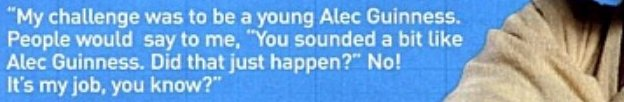
- **none** — entry/section: McGregor on lightsaber props: ""My lightsaber flew out of my hands. No one tells you they have got batteries in them! They burn your hands! I tossed my saber in the air and it ended up hitting a technician on the head!" —Ewan McGregor, Star Wars Insider 112, p. 28" Source: *Star Wars Insider #112* (2009), scan p.28
  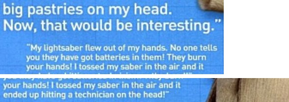

## scan p.29 (scan page 29)

Page contents: Ad: Totalscifionline.com. Out-of-universe. (hand-read)

## scan p.30 (scan page 30)

Page contents: Archive photos: Mark Hamill and Alec Guinness on location; Guinness with George Lucas; David Prowse and Guinness. No text. (hand-read)

## scan p.31 (scan page 31)

Page contents: Archive ("Rarely seen images from the Lucasfilm archives") captions: Guinness with Mark Hamill in Tunisia, discussing a scene with Lucas, leaning on an unmasked Darth Vader; on the Millennium Falcon set with Hamill, Peter Mayhew and Harrison Ford. Out-of-universe. (hand-read)

## scan p.32 (scan page 32)

Page contents: "Treasure Trove": James Burns interviews David Iskra, curator of the exhibition accompanying Star Wars: In Concert (bio: Sesame Street, Disney, Lucasfilm 30th anniversary events). Out-of-universe. (hand-read)

## scan p.33 (scan page 33)

Page contents: Treasure Trove interview cont.: London as first tour stop; challenge of transporting delicate film costumes and props. Out-of-universe. (hand-read)

## scan p.34 (scan page 34)

Page contents: Treasure Trove cont.: items flown from Lucasfilm; display cases that convert to road cases; Vader's helmet in foam cases; Plo Koon the hardest display to move. Captions: Darth Vader, Neimoidian warrior, Ewok warrior. Out-of-universe. (hand-read)

## scan p.35 (scan page 35)

Page contents: Treasure Trove cont.: costume handling (Chewbacca, Vader, Plo Koon, Kit Fisto, Amidala); setup times; Iskra's favorite piece Plo Koon, then the Royal Guards; tour resumes in October in Southern California. Out-of-universe. (hand-read)

## scan p.36 (scan page 36)

Page contents: "The Empire Strips Back": Dan Wallace on the history of the classic Star Wars newspaper strips. Strip panels (Ben Kenobi reunion; Aripus wind-runner). Out-of-universe article. (hand-read)

## scan p.37 (scan page 37)

Page contents: Newspaper strips history: L.A. Times Syndicate strip from February 1979; Russ Manning's "Gambler's World"; Archie Goodwin (as Russ Helm) and Alfredo Alcala's "Planet of Kadril" and Han Solo at Star's End; Goodwin/Williamson from 1981 ("The Bounty Hunter of Ord Mantell") with Dengar, Ackbar and Boba Fett before his film debut; cancelled 1984. Strip panels with Vader and a Ben Kenobi impostor ("actor"). Out-of-universe article. (hand-read)

## scan p.38 (scan page 38)

Page contents: Rebirth: Dark Horse's Classic Star Wars reprints (Mike Richardson, Bob Cooper, Anina Bennett); reformatting the strips to comic-book pages. Other strip panels (Luke and Artoo hiding by X-wing wreckage; Solo and Chewbacca). Out-of-universe. (hand-read)

### Stat block notes (game mechanics, not feats)

- Strip: Fett and Vader bargain: "...SO DOES MY EMPLOYER, JABBA THE HUTT! POSSIBLY IN SATISFYING HIM...I CAN SATISFY YOU ALSO!" / "A PARTICULAR REBEL INTERESTS ME, BOBA FETT... LUKE SKYWALKER!" / "A COMPANION OF THE MAN I'M AFTER... HAN SOLO! ONE MIGHT LURE THE OTHER, LORD VADER! SHOULD MY FELLOW BOUNTY HUNTERS SUCCEED..." / "AND COLLECT TWO REWARDS INSTEAD OF ONE, BOUNTY HUNTER?" / "YOU'RE ENTERPRISING, FETT! PERHAPS WE WILL MEET AGAIN... WHEN YOUR ENTERPRISE BEARS FRUIT!" (Star Wars newspaper strip panels reprinted in "The Empire Strips Back," Star Wars Insider 112, p. 38) (Source: *Star Wars Insider #112* (2009), scan p.38)

## scan p.39 (scan page 39)

Page contents: Classic Star Wars ran 20 issues; Al Williamson's involvement and cover artists. Strip Teasers box: "The Kashyyyk Depths" (Manning, never reprinted, sureggi), "Tatooine Sojourn," "Princess Leia, Imperial Servant" (undercover as slave to Grand Moff Tarkin's widow), "Bring Me the Children," "The Frozen World of Ota" (Boba Fett guest appearance), "Han Solo at Stars' End." Out-of-universe. (hand-read)

## scan p.40 (scan page 40)

Page contents: Strip Teasers cont.: "The Bounty Hunter of Ord Mantell," "Traitor's Gambit" (Aquaris, demonsquid), "Iceworld" (Luke discovers Hoth; droids disguised as humans), "Revenge of the Jedi" (Yavin evacuation; Ackbar's first chronological appearance), "Race for Survival." Genesis: Cooper's plan to reprint the Manning strips. Out-of-universe. (hand-read)

### Stat block notes (game mechanics, not feats)

- Strip Teasers: Vader's traps: ""THE RETURN OF BEN KENOBI" ... When Luke believes that Obi-Wan Kenobi has come back to life, he nearly falls prey to one of Vader's elaborate traps." / ""THE FINAL TRAP" ... R2-D2 and C-3PO are sent to investigate a messenger drone where they trigger Darth Vader's telepathic ambush. Concluding on March 11, 1984, this was the final installment of the Star Wars newspaper strip." (Strip Teasers, Star Wars Insider 112, p. 40) (Source: *Star Wars Insider #112* (2009), scan p.40)
- Strip Teasers: Showdown; Executor: ""DARTH VADER STRIKES" ... This tale uses the construction of Darth Vader's Super Star Destroyer Executor as its backdrop." / ""SHOWDOWN" ... Empire bad guys Dengar, Bossk, and Boba Fett team with Skorr (from "The Bounty Hunter of Ord Mantell") in an attempt to capture Han and Luke on—where else?—Ord Mantell." (Strip Teasers, Star Wars Insider 112, p. 40) (Source: *Star Wars Insider #112* (2009), scan p.40)

## scan p.41 (scan page 41)

Page contents: Colorist production art for Dark Horse reprints; Classic Star Wars: The Early Adventures (Rick Hoberg; nine issues); The Constancia Affair special. Strip panels (Luke vs. a tentacled creature; Tanith Shire). Out-of-universe. (hand-read)

## scan p.42 (scan page 42)

Page contents: "Science Meets... Fun!": Uncle Milton's Star Wars science and nature toys (words: Chris Spitale). Out-of-universe. (hand-read)

## scan p.43 (scan page 43)

Page contents: Uncle Milton cont.: Frank Adler on the Force Trainer (EEG-based headset moving a training sphere); Naboo Sea Creatures (triops) habitat. Out-of-universe. (hand-read)

## scan p.44 (scan page 44)

Page contents: Uncle Milton cont.: Dagobah Frog Habitat; Darth Vader Robotic Arm kit, Jedi Telescope, Optical Command Unit, LED Jedi Projector narrated by Captain Rex, and Mustafar Volcano kit. Out-of-universe. (hand-read)

## scan p.45 (scan page 45)

Page contents: Ad: Star Trek Magazine (Titan). Out-of-universe. (hand-read)

## scan p.46 (scan page 46)

Page contents: 104 words, 4 paragraphs | headings/entries: 

### Stat block notes (game mechanics, not feats)

- Versus: Tusken Raider databank: "Savage nomads whose brutality strikes terror into the hearts of the residents of Tatooine, the fearsome Tusken Raiders, otherwise known as Sandpeople, were as dangerous as they were mysterious. ... Strategically adept enough to know not to engage an enemy they could not defeat, Tusken Raiders would wait until the odds were more firmly stacked in it's favor before engaging in battle." Profile: "HOMEWORLD: TATOOINE SPECIES: HUMANOID GENDER: MALE/FEMALE HEIGHT: 1.8 TO 1.9 METERS WEAPON: GADERFFII STICK, RIFLE TRANSPORT: BANTHA AFFILIATION: NONE" (Versus, Star Wars Insider 112, p. 46) (Source: *Star Wars Insider #112* (2009), scan p.46)
- Versus: Tusken Raider skills: "Unskilled in battle and therefore dependant on rage and the element of surprise, the Tusken Raider was a formidable opponent in combat. Able to craft a gaderffii stick from salvaged scrap, and proficient in riding a bantha, these warriors were more skilled at close combat than a long range battle." STRENGTH 80 SPEED 85 POWER 80 LEADERSHIP 30 MOBILITY 85 LOYALTY 80 SPECIAL ABILITY 90 BONUS SKILL 40 (Versus, Star Wars Insider 112, p. 46) (Source: *Star Wars Insider #112* (2009), scan p.46)
- Versus intro: "The neighboring planets of Tatooine and Geonosis were the homeworlds of many forms of life, but none quite so savage as the Tusken Raiders and the Geonosians. ... Travelling single file to hide their numbers, they often surprised their enemies and, should the odds be against a single Raider, they were known to retreat in order to amass greater numbers and more confidence." (Versus, Star Wars Insider 112, pp. 46-47) (Source: *Star Wars Insider #112* (2009), scan p.46)

## scan p.47 (scan page 47)

Page contents: 162 words, 8 paragraphs | headings/entries: DATABANK

### Stat block notes (game mechanics, not feats)

- Versus: Geonosian warrior databank: "The warrior caste was divided between the elite and the regulars. The elite warriors were genetically superior and more battle savvy, while the regulars were treated as cannon fodder, equipped with less effective weapons and barely any protective armor. Geonosians were strong creatures despite their pathetic frames." Profile: "HOMEWORLD: GEONOSIS SPECIES: GEONOSIANS GENDER: UNDETERMINED HEIGHT: 1.68 TO 1.78 METERS WEAPONS: BEAM WEAPON VEHICLE: NNANTEX-CLASS STARFIGHTER AFFILIATION: C.I.S." (Versus, Star Wars Insider 112, p. 47) (Source: *Star Wars Insider #112* (2009), scan p.47)
- Versus: Geonosian warrior skills: "Thin of frame, but lithe and strong, the warriors of Geonosis were not the most intelligent creatures ever to take arms. The elite were issued beam weapons capable of cutting through armor with devastating effect." STRENGTH 85 SPEED 80 POWER 40 LEADERSHIP 45 MOBILITY 80 LOYALTY 80 SPECIAL ABILITY 80 BONUS SKILL 90 (Versus, Star Wars Insider 112, p. 47) (Source: *Star Wars Insider #112* (2009), scan p.47)
- Versus analysis: "On the face of it, the elite Geonosian warrior had the advantage of the two. Armed and armored, the Geonosian possessed the means and strength to defeat a Tusken Raider, but lacked the intelligence and guile of their opponent." (Versus, Star Wars Insider 112, p. 47) (Source: *Star Wars Insider #112* (2009), scan p.47)

## scan p.48 (scan page 48)

Page contents: "Jedi Training" Star Wars trivia test opener. Out-of-universe. (hand-read)

## scan p.49 (scan page 49)

Page contents: Quiz Section One, Behind the Scenes (questions 1-10: arcade record, Falcon cockpit olive, stormtroopers, Anthony Daniels, action figures, Han Solo based on Coppola, Greedo's language, shortest film, Tarfful growl, last voice in ANH). Contest/record-holder name omitted. Out-of-universe. (hand-read)

## scan p.50 (scan page 50)

Page contents: Quiz Sections Two-Three, Jedi vs Sith and Read All About It (questions 11-19: shaaks on Naboo, Yoda's blissl, Labyrinth of Evil, Vader on Dantooine, Heir to the Empire working titles, Timothy Zahn as Talon Karrde card model, "He was even ugly as a baby!"). Out-of-universe. (hand-read)

### Stat block notes (game mechanics, not feats)

- Quiz: Vader kills his clone on Dantooine: "15) Who did Darth Vader fight and kill on the planet Dantooine?" Answer: "15) A clone of himself (Galaxy of Fear)" (Jedi Training quiz, Star Wars Insider 112, pp. 50-51) (Source: *Star Wars Insider #112* (2009), scan p.50)

## scan p.51 (scan page 51)

Page contents: Quiz Sections Four-Six, Alien Encounters, Places and Spaces, Complete These Quotes (Ree-Yees a Gran; Voort saBinring of Wraith Squadron; Soresu as the Way of the Mynock; Plif a Hoojib; Mount Yoda; Moon of Endor; Rancor on Dathomir; Tagge, Obi-Wan, Han, and Leia quote completions incl. "Darth Vader's personal starship, the Executor"). Upside-down answer box read from a rotated crop. Out-of-universe. (hand-read)

## scan p.52 (scan page 52)

Page contents: Ad: Heroes magazine (Titan). Out-of-universe. (hand-read)

## scan p.53 (scan page 53)

Page contents: "Blaster" section opener: contents (Books: Death Troopers p55; Comics p58 Mandalorians in KOTOR; Incoming p60; Ask Lobot p62; Retro p66 X-wing toys; Bounty Hunters p70; Bantha Tracks p72; Classic Moment "The Lair of Grievous" p76). Out-of-universe. (hand-read)

## scan p.54 (scan page 54)

Page contents: Ad: Titan magazines (Stargate etc.). Out-of-universe. (hand-read)

## scan p.55 (scan page 55)

Page contents: Books, "Nightmare Fuel!" (words: Dan Wallace): Joe Schreiber's Death Troopers (Del Rey, October 13) — Imperial prison barge Purge finds a derelict Star Destroyer; a contagion kills 99 percent of passengers and turns them into something worse; Longo brothers, a medic, and sadistic guard captain Jareth Sartoris. Schreiber on Sartoris: "there's a real, tangible sense of evil and cruelty that comes along with small men in power." Forthcoming books: A New Hope: The Life of Luke Skywalker (Windham), The Clone Wars: Visual Guide Ultimate Battles (Fry), Star Wars: The Complete Vader (Vilmur/Windham). Out-of-universe. (hand-read)

## scan p.56 (scan page 56)

Page contents: Books cont.: Schreiber on horror; The Art of The Clone Wars (Chronicle; Frank Parisi and Gary Scheppke; Filoni introduction, Lucas foreword). Out-of-universe. (hand-read)

## scan p.57 (scan page 57)

Page contents: Art of The Clone Wars cont.: 10-page Season Two sneak peek; Limited Edition with Russell Chong cover. Out-of-universe. (hand-read)

## scan p.58 (scan page 58)

Page contents: Comics, "Rogue Bounty!" (words: Daniel Wallace): Star Wars Legacy #41 pits Mandalorians against Rogue Squadron 130+ years after the films; Rogue Squadron guards Mon Calamari refugees after Darth Krayt's massacre of the Mon Cal (issues 32-33); ex-stormtrooper and ex-Mandalorian Rogue Hondo Carr; return to the moons of Da Soocha (Dark Empire). Out-of-universe preview. (hand-read)

- **Hondo Karr** — entry/section: Ostrander on Hondo and the Mandos: ""Hondo is the center of the issue, alongside Rogue Squadron and more of the Galactic Alliance fleet. We'll learn how and why Hondo left the Mandos, and why one particular Mandalorian is hunting him for a very personal reason. Fair warning: not all the Rogues will return alive from this mission." —John Ostrander, Star Wars Insider 112, p. 58" Source: *Star Wars Insider #112* (2009), scan p.58
  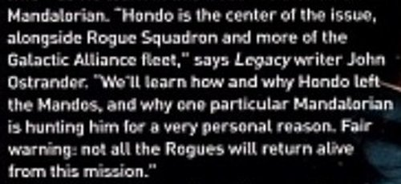

## scan p.59 (scan page 59)

Page contents: "Into the Crucible": KOTOR comic #45 "Destroyer" — Zayne Carrick tries to infiltrate the Crucible slaving cabal that once claimed Jarael, to outshine rival Malak; Golliard (Republic Navy deserter-turned-slaver who kidnapped Jarael as a child); Chantique, a contemporary of Jarael's. Out-of-universe preview. (hand-read)

- **none** — entry/section: Ostrander: Mandalorians in the Sith-Imperial War: ""They were hired by one side during the first year of the Sith-Imperial War and assigned to hold the planet Botajef until relief arrived. Let's just say the results have accounted for why the Mandos haven't been seen much in Legacy. Treachery was involved." —John Ostrander, Star Wars Insider 112, p. 59" Source: *Star Wars Insider #112* (2009), scan p.59
  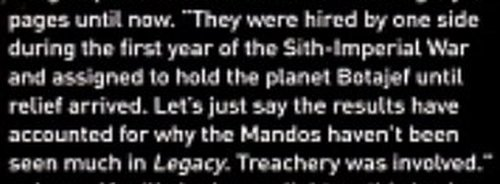
- **none** — entry/section: Ostrander: Mandalorians like Klingons: ""They're a warrior society with their own code and sense of honor, and their own language. And they look pretty cool: made to order to become a cult among some sci-fi fans." —John Ostrander, Star Wars Insider 112, p. 59" Source: *Star Wars Insider #112* (2009), scan p.59
  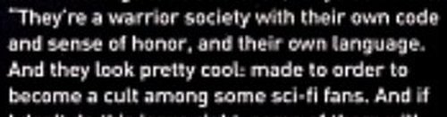
- **Zayne Carrick** — entry/section: Miller on Zayne underestimating the Crucible: ""After outsmarting Golliard [the Republic Navy deserter-turned-slaver who kidnapped Jarael as a child], Zayne underestimates the Crucible. He figures they'll be easy to deal with using his normal methods of subterfuge. He's wrong—very wrong." —John Jackson Miller, Star Wars Insider 112, p. 59" Source: *Star Wars Insider #112* (2009), scan p.59
  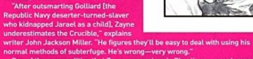
- **Jarael** — entry/section: Miller on Chantique and Jarael: ""Chantique is not Jarael's twin, but they've walked the same path in their lives and turned out quite differently. Chantique is angry, manipulative, and sadistic—all assets for someone in the Crucible. They're things that Jarael could never really be, which is part of why she fled." —John Jackson Miller, Star Wars Insider 112, p. 59" Source: *Star Wars Insider #112* (2009), scan p.59
  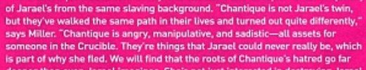
- **Zayne Carrick** — entry/section: Miller: Zayne is 19: ""But we have to remember that Zayne is still a fairly young guy, 19, and he's trying to figure out relationships in general." —John Jackson Miller, Star Wars Insider 112, p. 59" Source: *Star Wars Insider #112* (2009), scan p.59
  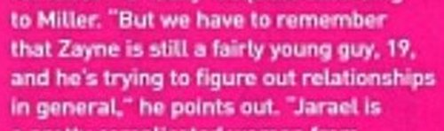

## scan p.60 (scan page 60)

Page contents: Incoming (words: Chris Spitale): Hasbro Build-A-Droid waves — Commander Cody, varactyl wrangler, Plo Koon, Agen Kolar, McQuarrie concept IG-88, build YVH 1 Yuuzhan Vong Hunter; ESB wave (X-wing pilot Luke, AT-AT Commander, Zuckuss, Bespin guard, Willrow Hood), build HK-50. Out-of-universe merchandise. (hand-read)

## scan p.61 (scan page 61)

Page contents: Hasbro exclusives: Republic gunship Crumb Bomber (Toys R Us), Octuptarra droid (Wal-Mart), Geonosis Arena two-packs (Target: Kit Fisto vs Geonosian, Coleman Trebor vs Jango Fett, Yoda vs destroyer droid, Rath-Del Masona vs super battle droid, Joclad Danva vs battle droid, Mace Windu vs battle droid commander). Toy pairings, not feats. Out-of-universe. (hand-read)

## scan p.62 (scan page 62)

Page contents: Incoming cont.: Gentle Giant mini busts — battle droid, Oola ("met with a grizzly death at the hands of the monstrous rancor"), Darth Talon. Out-of-universe merchandise. (hand-read)

## scan p.63 (scan page 63)

Page contents: Gentle Giant chess set, 4-LOM and snowtrooper mini busts. Out-of-universe merchandise. (hand-read)

## scan p.64 (scan page 64)

Page contents: Funko Yoda and Boba Fett bobble sitters; Sideshow Imperial shock trooper 12-inch figure. Out-of-universe merchandise. (hand-read)

## scan p.65 (scan page 65)

Page contents: Ad: Lost: The Official Magazine 2009 yearbook. Out-of-universe. (hand-read)

## scan p.66 (scan page 66)

Page contents: Retro Collecting (words & pictures: Gus Lopez): X-wing collectibles — Kenner 1978 action-figure X-wing and die-cast (both marked Red 3, Biggs's ship), worldwide affiliates. Out-of-universe. (hand-read)

## scan p.67 (scan page 67)

Page contents: X-wings from the East (Takara die-cast, inflatable X-wing); General Mills hang-glider premiums; Streets ice cream promotion. Out-of-universe. (hand-read)

## scan p.68 (scan page 68)

Page contents: X-wings for junior pilots (unreleased Kenner pre-school X-wing, Parker Brothers ROTJ Death Star Battle handheld), X-coins (Power of the Force coins, Just Toys Bend Ems coin, 1982 Mardi Gras coin). Out-of-universe. (hand-read)

## scan p.69 (scan page 69)

Page contents: Subscription and back-issue ad; next issue 113 villains special. Out-of-universe. (hand-read)

## scan p.70 (scan page 70)

Page contents: Bounty Hunters (sponsored by Kotobukiya): reader photos with Star Wars stars (Tom Kane signing Insider). Reader names omitted. Out-of-universe. (hand-read)

## scan p.71 (scan page 71)

Page contents: Bounty Hunters cont.: reader photos with performers (Michonne Bourriague/Aurra Sing, Anthony Forrest/Fixer sandtrooper, Richard LeParmentier/Motti, Gary Kurtz). Reader names omitted. Out-of-universe. (hand-read)

## scan p.72 (scan page 72)

Page contents: Bantha Tracks (editor Mary Franklin): 501st Southern California Garrison and Rebel Legion built The Old Republic Jedi and Sith costumes for EA's E3 event. Costumer names omitted. Out-of-universe. (hand-read)

## scan p.73 (scan page 73)

Page contents: Bantha Tracks cont.: TOR costumes on stage; Pawtucket Red Sox Star Wars Day with the New England Garrison. Fan names omitted. Out-of-universe. (hand-read)

## scan p.74 (scan page 74)

Page contents: Bantha Tracks cont.: Invasion Belfast (Gerald Home, Tessek performer); Denver St. Patrick's Day parade; submission guidelines. Fan names omitted. Out-of-universe. (hand-read)

## scan p.75 (scan page 75)

Page contents: Bantha Tracks cont.: Puerto Rico Fan Club, New Orleans Mardi Gras, Rebel Legion cruise to Cozumel, Aaron Allston's Outcast (Fate of the Jedi) signing in Oakbrook, Boston St. Patrick's parade. Fan names omitted. Out-of-universe. (hand-read)

## scan p.76 (scan page 76)

Page contents: 107 words, 11 paragraphs | headings/entries: GENERAL GRIEVOUS, Goodbye. Jedi! <chorile into cough>

### Stat block notes (game mechanics, not feats)

- Lair of Grievous script: Grievous's repair: "GENERAL GRIEVOUS: Goodbye, Jedi! <chortle into cough> Ay-Four-Dee approaches, carrying a TRAY OF SPARE GRIEVOUS PARTS; including a new mask, replacement arm, etc... AY-FOUR-DEE: Master, the armor patches are getting cold and contrary to your belief, I do have other things to do. GENERAL GRIEVOUS: Proceed with my repair. [...] AY-FOUR-DEE: Sometimes I wonder why you submitted to the changes." (Classic Moment, 2008 Episode Script, "Lair of Grievous," Star Wars Insider 112, p. 76) (Source: *Star Wars Insider #112* (2009), scan p.76)
- Why It's a Classic: Grievous chose his cybernetics: "The scene also serves to redress the incorrect notion that Grievous is some sort of tragic villain—a cyborg against his will—as indicated by some sources. [...] Crucially, this scene brings Grievous in line with George Lucas' concept for the character as a creature who, unlike Vader, willingly agreed to cybernetic enhancements!" (Classic Moment, Why It's a Classic, Star Wars Insider 112, p. 76) (Source: *Star Wars Insider #112* (2009), scan p.76)

## scan p.77 (scan page 77)

Page contents: Atsushi Takeuchi quote on working with Lucas, and "Who Is?" box on Takeuchi (Sky Crawlers, Ghost in the Shell). Out-of-universe. (hand-read)

- **General Grievous** — entry/section: Filoni on Takeuchi designing Grievous: ""One of the things we wanted to do in The Clone Wars was bring a new look; something different to Star Wars. George Lucas talked early on about having an anime influence. Well, rather than just have an influence, we flew all the way to Japan and worked with Production I.G., bringing one of their really great artists, Atsushi Takeuchi, right into The Clone Wars. I wanted Takeuchi-san to do all kinds of things. One of them was designing General Grievous. He has such an amazing ability to break something down mechanically and show all the insides and outsides and parts and places." —Dave Filoni, Star Wars Insider 112, p. 77" Source: *Star Wars Insider #112* (2009), scan p.77
  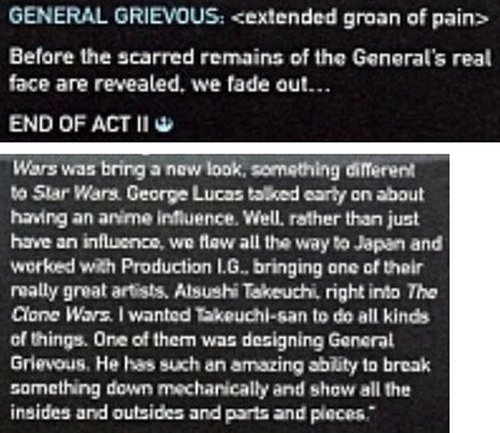

### Stat block notes (game mechanics, not feats)

- Lair of Grievous script: "I chose them": "GENERAL GRIEVOUS: Improvements! I submit to no one. I chose them. Now get on with it." (Classic Moment, 2008 Episode Script, "Lair of Grievous," Star Wars Insider 112, p. 77) (Source: *Star Wars Insider #112* (2009), scan p.77)
- Lair of Grievous script: cable darts and mask removal: "A ROBOTIC APPENDAGE grabs and tugs the CABLE DARTS out of Grievous' legs. His damaged arm is grabbed by a ROBOTIC CLAW, pulled off and replaced with a brand new arm. A small pair of claws grab Grievous' damaged mask. AY-FOUR-DEE: There may be some discomfort. The claws pull the mask off with a crunch. GENERAL GRIEVOUS: <extended groan of pain> Before the scarred remains of the General's real face are revealed, we fade out..." (Classic Moment, 2008 Episode Script, "Lair of Grievous," Star Wars Insider 112, p. 77) (Source: *Star Wars Insider #112* (2009), scan p.77)

## scan p.78 (scan page 78)

Page contents: Ad: Supernatural magazine subscriptions (Titan). Out-of-universe. (hand-read)

## scan p.79 (scan page 79)

Page contents: Ad: Supernatural magazine. Out-of-universe. (hand-read)

## scan p.80 (scan page 80)

Page contents: Ad: StarWarsShop.com, Clone Wars retro logo T-shirt after the McQuarrie triangular logo. Out-of-universe. (hand-read)

## scan p.81 (scan page 81)

Page contents: Ad: StarWarsShop.com exclusives. Out-of-universe. (hand-read)

## scan p.82 (scan page 82)

Page contents: Next issue: Villains Special (Palpatine, Dark Times, Imperial Might with Tarkin and Thrawn, Nika Futterman on Asajj Ventress). Out-of-universe. (hand-read)

### Stat block notes (game mechanics, not feats)

- Versus result: Tusken Raider beats Geonosian warrior: "VERSUS: WHO WINS? Easily startled as they may be, the savage rage of a sandperson can readily stop a Geonosian in his tracks. The well-armed Geonosians are no match for the surprise attack favored by their foe." (Versus result, Star Wars Insider 112, p. 82) (Source: *Star Wars Insider #112* (2009), scan p.82)

## scan p.83 (scan page 83)

Page contents: Ad: Uncle Milton Star Wars Science Force Trainer. Out-of-universe. (hand-read)

## scan p.84 (scan page 84)

Page contents: Ad: Jakks Marbs collectibles. Out-of-universe. (hand-read)

