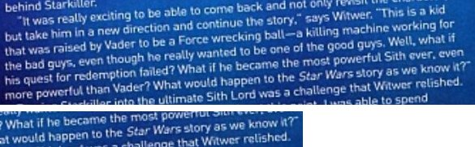
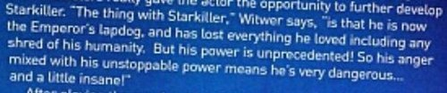
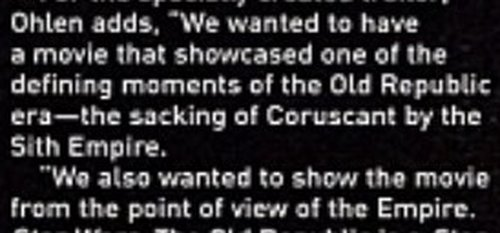
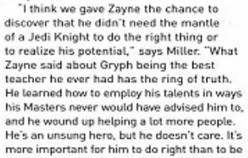

# Owner Material 038 — Star Wars Insider #1–153 plus specials (with The Lucasfilm Fan Club Magazine #1–22): Star Wars Insider #113 (2009)

- **Source:** *Star Wars Insider* magazine (issues 23–153, 1994–2014) and its predecessor *The Lucasfilm Fan Club Magazine* (issues 1–22, 1987–1994), plus seven special editions: articles, interviews, comics and short fiction Secondary source (licensed Legends reference). Scan OCR'd on the box; the scan stays box-only and is **not** published.
- **Method:** every scanned page was OCR'd and machine-screened sentence by sentence for power-relevant statements (fights, kills, defeats, Force feats, rankings, superweapons) that name a character on our roster; each kept sentence is quoted verbatim from the OCR text and has a crop of the printed passage directly under it. Pages with nothing power-relevant are still listed with what is on them.
- **Citation:** "*Star Wars Insider #113* (2009), p.X" by printed page ("scan p.X" where no printed number applies). **Weight:** Licensed magazine: a secondary source. Its short fiction and comics are Legends stories; its articles and interviews sum up or discuss lore and rank below the novels, comics and games they describe.

## scan p.1 (scan page 1)

Page contents: Cover: Villains special — Force Unleashed: Ultimate Sith Edition, Clone Wars producer Cary Silver on Season Two, Matt Lanter interviewed, Star Wars darkest moments. Out-of-universe. (hand-read)

## scan p.2 (scan page 2)

Page contents: Ad: Uncle Milton Star Wars Science (Force Trainer, Jedi telescope, Mustafar Volcano Lab, Naboo sea creatures, Jedi projector). Out-of-universe. (hand-read)

## scan p.3 (scan page 3)

Page contents: Editor's Welcome (Jonathan Wilkins): Darth Vader wins the totalscifionline.com most-popular-villain poll; villains special from Tarkin to Darth Krayt; Force Unleashed Ultimate Sith Edition preview; TOR trailer feature. Opening epigraph quotes Palpatine from Matthew Stover's ROTS novelization ("Welcome! Let me be the first to wish you Happy Empire Day!"). Out-of-universe. (hand-read)

## scan p.4 (scan page 4)

Page contents: Contents: features Cary Silver p14; Villains p22 (Palpatine p24, Tarkin p32, Thrawn p38, Darth Krayt p44, Count Dooku p54); darkest moments (OT p30, prequels p48, EU p64); Diamond Select p68. Out-of-universe. (hand-read)

## scan p.5 (scan page 5)

Page contents: Contents cont. and variant-cover notice: Launch Pad, Unleashed (Force Unleashed Ultimate Sith Edition), Interrogation Droid Matt Lanter, Jedi Archive Vader on set, The Old Republic trailer p51, Classic Moment p74 Vader boards the Tantive IV, Books, Comics (final KOTOR), Retro Jabba, Incoming. Out-of-universe. (hand-read)

## scan p.6 (scan page 6)

Page contents: Launch Pad, "Cad Bane: Back in Action!": TCW Season Two episodes so far — Holocron Heist (Cad Bane infiltrates the Jedi Temple to steal a holocron), Cargo of Doom (Anakin and Ahsoka intercept Bane's warship but underestimate his tactics), Children of the Force (Bane kidnaps Force-sensitive children for Sith training on Mustafar), Senate Spy, Landing at Point Rain. Episode synopses, out-of-universe. (hand-read)

## scan p.7 (scan page 7)

Page contents: Launch Pad: TCW Season One DVD/Blu-ray; Star Tours 3-D relaunch announced for 2011; George Lucas inducted into the California Hall of Fame. Out-of-universe. (hand-read)

## scan p.8 (scan page 8)

Page contents: Launch Pad: Mighty Muggs charity art auction for Make-A-Wish (Lucasfilm's Nicole Love and Starwars.com's Bonnie Burton interviewed; artists incl. Dave Filoni's Cad Bane and Aurra Sing Muggs, Robot Chicken artists). Out-of-universe. (hand-read)

## scan p.9 (scan page 9)

Page contents: Ad: Marc Ecko Cut & Sew Star Wars gear. Out-of-universe. (hand-read)

## scan p.10 (scan page 10)

Page contents: Launch Pad cont.: Mighty Muggs (over 40 shown at Comic-Con); Star Wars Galaxies adds Death Troopers content. Out-of-universe. (hand-read)

## scan p.11 (scan page 11)

Page contents: Ad: Brian's Toys price list. Out-of-universe. (hand-read)

## scan p.12 (scan page 12)

Page contents: Interrogation Droid (words: Chris Spitale): Matt Lanter (voice of Anakin in TCW) answers joke 90210 crossover questions about Anakin at West Beverly. Humorous parody, not in-universe feats. Out-of-universe. (hand-read)

## scan p.13 (scan page 13)

Page contents: Ad: Collectormania London (Dave Prowse, Billy Dee Williams, Irvin Kershner and other guests). Out-of-universe. (hand-read)

## scan p.14 (scan page 14)

Page contents: Cary Silver interview opener art (Obi-Wan and Anakin, TCW). Out-of-universe. (hand-read)

## scan p.15 (scan page 15)

Page contents: "Second Strike!" (Jonathan Wilkins talks to TCW producer Cary Silver about Season Two). Out-of-universe. (hand-read)

## scan p.16 (scan page 16)

Page contents: Cary Silver interview: joining TCW via Gail Currey and Rick McCallum; secrecy; producer's role ("A producer is a friend, a camp counselor, a disciplinarian and a cheerleader"). Out-of-universe. (hand-read)

## scan p.17 (scan page 17)

Page contents: Pull quote and photo of Cary Silver (photo: Tina Mills). Out-of-universe. (hand-read)

## scan p.18 (scan page 18)

Page contents: Silver interview cont.: Season One start-up challenges, Lucas's involvement, favorite Season One episodes (Trespass, Jedi Crash, Innocents of Ryloth). Out-of-universe. (hand-read)

## scan p.19 (scan page 19)

Page contents: Silver interview cont.: Filoni and directors, Lucas as storyteller, lessons from Season One. Out-of-universe. (hand-read)

## scan p.20 (scan page 20)

Page contents: Silver interview cont.: Season Two "bigger, better, and a little more intense"; show could run for years. Out-of-universe. (hand-read)

## scan p.21 (scan page 21)

Page contents: Ad: Titan villains special editions of its magazines. Out-of-universe. (hand-read)

## scan p.22 (scan page 22)

Page contents: "Dark Forces" villains section opener art (Count Dooku, Emperor Palpatine, Death Star). Out-of-universe. (hand-read)

## scan p.23 (scan page 23)

Page contents: "Dark Forces: The Villains of Star Wars" section title page. Out-of-universe. (hand-read)

## scan p.24 (scan page 24)

Page contents: Profile title page: "Palpatine / Darth Sidious," a profile by Daniel Wallace. Out-of-universe. (hand-read)

## scan p.25 (scan page 25)

Page contents: Profile opening also notes all records of Palpatine's early life were purged; pull quote of Palpatine to Anakin from ROTS ("The Sith and the Jedi are similar in almost every way..."). Film line, logged as S. (hand-read)

### Stat block notes (game mechanics, not feats)

- Palpatine profile: origins, Plagueis, Maul: "Palpatine is believed to have been born on Naboo, a quiet Mid Rim world in the Chommell sector. Apparently never trained by the Jedi despite his Force sensitivity, Palpatine instead fell under the influence of a Sith Lord, Darth Plagueis. Under the Rule of Two—one Master, one apprentice—Plagueis sought to continue the tradition through Palpatine. After receiving the Sith title Darth Sidious, Palpatine studied the secrets of the dark side, including his Master's apparent ability to generate life by influencing midi-chlorians. Plagueis may even have succeeded, given the strange circumstances surrounding the birth of Anakin Skywalker of Tatooine. This did not matter to Palpatine, who had already taken his own apprentice in secret. Knowing there could never be more than two, Palpatine murdered Plagueis in his sleep, and concentrated on teaching the Zabrak boy he called Maul to become the perfect killer." (Palpatine profile, Star Wars Insider 113, p. 25) (Source: *Star Wars Insider #113* (2009), scan p.25)

## scan p.26 (scan page 26)

Page contents: 274 words, 9 paragraphs | headings/entries: A DOUBLE LIFE; ATT; INSIDER

### Stat block notes (game mechanics, not feats)

- Palpatine profile: "A Double Life" allies: "Palpatine maintained a double life, winning an election for Senator of the Chommell sector and relocating to Coruscant. His fellow politicians believed the new provincial could be safely ignored, but Palpatine possessed a gift for forging alliances and isolating his critics. His friends included Wilhuff Tarkin and Jedi Master Jorus C'baoth, while his aides Sate Pestage and Kinman Doriana covered up any evidence of impropriety." (Palpatine profile, Star Wars Insider 113, p. 26) (Source: *Star Wars Insider #113* (2009), scan p.26)
- Palpatine profile: Naboo crisis: "Palpatine helped engineer the assassination of the Trade Federation directorate on Eriadu, and in his guise as Sidious he convinced the surviving Trade Federation leaders to blockade Naboo. The blockade and subsequent invasion brought Queen Amidala to Coruscant, where Palpatine convinced her to introduce a vote of no-confidence in Supreme Chancellor Valorum. When the crisis ended, Palpatine had lost Maul to Obi-Wan Kenobi's blade, but had gained something far more valuable—the chancellorship of the Republic. The Naboo incident also saw the public emergence of Anakin Skywalker, who Palpatine saw as a potential future apprentice." (Palpatine profile, Star Wars Insider 113, p. 26) (Source: *Star Wars Insider #113* (2009), scan p.26)
- Palpatine profile: Tyranus, Outbound Flight, Clone Wars: "Palpatine convinced the dissident Jedi Dooku to join his cause, giving him the title Darth Tyranus. While Dooku helped secure a clone army and spread the seeds of Separatism, Palpatine engineered the destruction of the Outbound Flight Project to kill the Jedi on board. The incident put him in contact with Thrawn, who would later be his greatest Grand Admiral. After winning reelection twice, Palpatine convinced the public he should remain in office to oppose the Separatist movement of Count Dooku. With Palpatine and Dooku playing the roles of opposing commanders and plotting behind the scenes, the Senate gave the Supreme Chancellor emergency war powers. Palpatine used them to requisition the clone army that Dooku had set up, and the Clone Wars began." (Palpatine profile, Star Wars Insider 113, p. 26) (Source: *Star Wars Insider #113* (2009), scan p.26)

## scan p.27 (scan page 27)

Page contents: Art: young Palpatine with red lightsaber, hooded Sith (Plagueis?) seated behind. Out-of-universe image. (hand-read)

### Stat block notes (game mechanics, not feats)

- Palpatine profile: Description—stunning fighter: "As Senator and Supreme Chancellor, Palpatine was an appealing but unremarkable politician who seemed too small for the scale of the events that surrounded him. This was by design. His fight with Mace Windu revealed a different Palpatine, one with a face twisted and scarred to match his inner spirit. As the Emperor, Palpatine wore a black robe that hid his face in shadow. Although he employed others to do his dirty work, Palpatine was a stunning fighter, able to defeat multiple Jedi Masters in lightsaber combat." (Palpatine profile, Star Wars Insider 113, p. 27) (Source: *Star Wars Insider #113* (2009), scan p.27)

## scan p.28 (scan page 28)

Page contents: Profile also covers Imperial "golden age" (Coruscant renamed Imperial Center, non-humans segregated or conscripted to Death Star project) and dissolution of the Senate. (hand-read)

### Stat block notes (game mechanics, not feats)

- Palpatine profile: "Endgame"—Clone Wars to Order 66: "Over the next three years Palpatine and Dooku kept the war carefully balanced so that neither side gained a clear advantage, but that the maximum number of Jedi perished in the crossfire. By the time of Palpatine's "kidnapping" at the hands of General Grievous, the war was at an end—and Palpatine didn't need Dooku anymore. In a lightsaber duel, Anakin Skywalker killed the Count and cleared the field for his own ascension into the ranks of the Sith. Skywalker proved his worth by assisting Palpatine in killing Mace Windu, and then led the raid on the Jedi Temple after receiving his new Sith name, Darth Vader. Not even Yoda could stop Palpatine's sinister plans, as the new Emperor exterminated most of the remaining Jedi by issuing Order 66 and announcing to the galaxy that the war's close marked the Empire's beginning." (Palpatine profile, Star Wars Insider 113, p. 28) (Source: *Star Wars Insider #113* (2009), scan p.28)
- Palpatine profile: Vader rebuilt; Starkiller: "Only one thing dimmed Palpatine's triumph. Darth Vader had lost a battle with Obi-Wan Kenobi at Mustafar, and required a cybernetic rebuild. His apprentice would now be more machine than man. Palpatine began considering replacements. ... Some citizens protested, but Palpatine moved swiftly against any hint of rebellion. He would have executed the core of the Rebel leadership if not for the interference of Starkiller, Darth Vader's secret apprentice." (Palpatine profile, Star Wars Insider 113, p. 28) (Source: *Star Wars Insider #113* (2009), scan p.28)
- Palpatine profile: Endor, Sith lightning, clones: "There, aboard the second Death Star, he tried to turn Skywalker to the dark side of the Force. Skywalker's refusal so enraged Palpatine that he shot Sith lightning from his fingertips, painfully and slowly torturing him. But Vader hurled Palpatine to his death, using the last moments of his life to save his son. In the following years Palpatine returned in a series of clone bodies, striking out at the New Republic using superweapons including the World Devastators and the Galaxy Gun, but ultimately succumbed to the deterioration of his clones and vanished into the Force forever." (Palpatine profile, Star Wars Insider 113, p. 28) (Source: *Star Wars Insider #113* (2009), scan p.28)

## scan p.29 (scan page 29)

Page contents: Ad: Total Sci-Fi Online. Out-of-universe. (hand-read)

## scan p.30 (scan page 30)

Page contents: "5 Evil Deeds!" (Original Trilogy) list: 1 Vader cuts off Luke's hand; 2 Destruction of Alderaan by Tarkin; 3 Torture of Han Solo on Cloud City (editorial speculation that torture caused ripples in the Force to lure Luke). Editorial ranking, out-of-universe. (hand-read)

## scan p.31 (scan page 31)

Page contents: "5 Evil Deeds" cont.: 4 The Emperor tricks the Rebels (taunting Luke); 5 Death of Owen and Beru. Editorial ranking, out-of-universe. (hand-read)

## scan p.32 (scan page 32)

Page contents: 1 words, 1 paragraphs | headings/entries: 

### Stat block notes (game mechanics, not feats)

- Tarkin profile: Description—not a skilled combatant, top strategist: "Grand Moff Tarkin's gaunt frame and hatchet-thin profile were evidence of a man who rarely indulged and always hungered for validation. Although not a skilled combatant, his understanding of military strengths and weaknesses made him one of the best strategists in the Empire. An able diplomat, Tarkin also knew how to get his way by exploiting his enemies' fears." (Grand Moff Tarkin profile, Star Wars Insider 113, p. 32) (Source: *Star Wars Insider #113* (2009), scan p.32)

## scan p.33 (scan page 33)

Page contents: Tarkin profile title (by Daniel Wallace), pull quote from ANH: "Fear will keep the local systems in line." Film line, logged as S. (hand-read)

### Stat block notes (game mechanics, not feats)

- Tarkin profile: no Force ability, ordered annihilation of planets: "The Empire's cruelest enforcer did not wear a mask or carry a lightsaber. Other than the Emperor and Darth Vader, the leaders of the most genocidal regime the galaxy has ever seen were normal humans with no ability to tap the dark side of the Force. Grand Moff Tarkin, the greatest monster among these bureaucrats, ordered the annihilation of entire planets." (Grand Moff Tarkin profile, Star Wars Insider 113, p. 33) (Source: *Star Wars Insider #113* (2009), scan p.33)
- Tarkin profile: Eriadu origins and Trade summit: "Born into a wealthy family on the industrial world Eriadu, Wilhuff Tarkin strove to live up to his name and to show up those who sneered at Eriadu's backwater Outer Rim location. For political convenience he married a woman of the equally powerful Motti family, and further shored up his credentials by joining the sector military and winning local elections, becoming lieutenant governor of Eriadu's Seswenna sector. He also cultivated friendships with those who might prove useful in the future, including the genius designer Raith Sienar. Other prominent Tarkins active at the time included his brother Gideon and his cousin Ranulph, whose ruthless ambition sparked the Stark Hyperspace War. Prior to the Battle of Naboo, events conspired to raise Wilhuff Tarkin's fortunes. Supreme Chancellor Valorum chose Eriadu to host an interplanetary trade summit, and Tarkin was complicit in the mass assassination of the Trade Federation ruling directorate. This left the Neimoidian Nute Gunray in charge, and precipitated a carefully planned chain of events that catapulted Naboo's Senator Palpatine into the office of chancellor." (Grand Moff Tarkin profile, Star Wars Insider 113, p. 33) (Source: *Star Wars Insider #113* (2009), scan p.33)

## scan p.34 (scan page 34)

Page contents: 0 words, 0 paragraphs | headings/entries: 

### Stat block notes (game mechanics, not feats)

- Tarkin profile: "Rising Through the Ranks"—Zonama Sekot, Battle Planetoid: "Tarkin received a promotion under the Palpatine administration and became commander of the Republic Outlands Security Force. The new Supreme Chancellor seemed to be a receptive audience for Tarkin's beliefs regarding the inferiority of alien species and the need to champion "Human High Culture." Several years into the administration, Tarkin teamed up with Raith Sienar to investigate the unique living starships produced by the planet Zonama Sekot. It was here that Tarkin had his first face-to-face encounter with Anakin Skywalker, and the mission gave Tarkin an excuse to present Palpatine with the technical plans to Sienar's newest invention—a moon-sized weapon dubbed the Expeditionary Battle Planetoid." (Grand Moff Tarkin profile, Star Wars Insider 113, p. 34) (Source: *Star Wars Insider #113* (2009), scan p.34)

## scan p.35 (scan page 35)

Page contents: 20 words, 6 paragraphs | headings/entries: 

### Stat block notes (game mechanics, not feats)

- Tarkin profile: Moff, promoted to admiral, Tarkin Doctrine: "Tarkin became one of the government's new Moffs—Imperial sector commanders—and wielded unprecedented political and military authority over Eriadu and much of surrounding space. Nothing seemed to dampen Palpatine's favor—when Tarkin crushed hundreds of protestors by landing a starship on their heads, a delighted Emperor promoted him to admiral. Tarkin's brutal actions were not rooted in sadism, but in his sincere belief that the galaxy's weak-willed commoners would never dare rebel if they lived in terror of those in authority. This philosophy, formalized as the Tarkin Doctrine, gave the Empire blanket coverage for its worst atrocities." (Grand Moff Tarkin profile, Star Wars Insider 113, p. 35) (Source: *Star Wars Insider #113* (2009), scan p.35)

## scan p.36 (scan page 36)

Page contents: Tarkin profile ends: widow erected stone monument on Phelarion; war researchers built stripped-down Death Star superlaser satellite christened Tarkin. (hand-read)

### Stat block notes (game mechanics, not feats)

- Tarkin profile: "Command of the Death Star"—Maw Installation, Daala: "The most blatant symbol of the Tarkin Doctrine was the full-scale version of Sienar's battle planetoid, now codenamed Death Star and possessing a superlaser capable of pulverizing planetary cores. As one of the key officials responsible for the Death Star's development, Tarkin coerced alien scientists into working in Maw Installation, a research facility hidden in a black hole cluster. He gave command of Maw Installation to Admiral Natasi Daala, his not-so-secret lover." (Grand Moff Tarkin profile, Star Wars Insider 113, p. 36) (Source: *Star Wars Insider #113* (2009), scan p.36)
- Tarkin profile: Grand Moff of Oversector Outer, ambitions: "Shortly before the Battle of Yavin, Tarkin's power had reached its peak. As Grand Moff of Oversector Outer, he had virtually unlimited jurisdiction over the entirety of the Outer Rim Territories. With the Death Star nearing completion in the Horuz system, and his Mon Calamari slave Ackbar to attend to his every need, Tarkin began to entertain thoughts of ascending to the greatest post of all. With the cooperation of the Death Star's senior staff, he could divert the battle station to Coruscant and hold Emperor Palpatine's life in his hands. Darth Vader challenged Tarkin's ambitions, but the notion of ruling the galaxy only grew in appeal." (Grand Moff Tarkin profile, Star Wars Insider 113, p. 36) (Source: *Star Wars Insider #113* (2009), scan p.36)
- Tarkin profile: Despayre test, Alderaan, death at Yavin: "Tarkin tested his Death Star by firing its superlaser at the planet Despayre, which had been used to mine resources for its construction. ... Determined to cut off the head of the enemy resistance, Tarkin used the Death Star to threaten Leia's homeworld of Alderaan and elicited a confession of the whereabouts of the Rebel headquarters. Pleased with himself, Tarkin ordered Alderaan's destruction anyway, extinguishing more than two billion lives in an instant. ... Before the Death Star could complete its countdown and destroy the moon of Yavin, it exploded and took Tarkin with it." (Grand Moff Tarkin profile, Star Wars Insider 113, p. 36) (Source: *Star Wars Insider #113* (2009), scan p.36)

## scan p.37 (scan page 37)

Page contents: Ad: Supernatural magazine (Titan). Out-of-universe. (hand-read)

## scan p.38 (scan page 38)

Page contents: Grand Admiral Thrawn profile opener art. Out-of-universe. (hand-read)

## scan p.39 (scan page 39)

Page contents: 284 words, 4 paragraphs | headings/entries: THRAWN; INSIDER

### Stat block notes (game mechanics, not feats)

- Thrawn profile: Chiss origins, Outbound Flight, exile: "Mitth'raw'nuruodo, better known by his core name of Thrawn, hailed from the Chiss Ascendency in the Unknown Regions. The blue-skinned, red-eyed Chiss species had built a stronghold of law and order in the otherwise chaotic region, and taught that one should attack only if one's enemy attacked first. This philosophy irritated the more pragmatic Thrawn, but he quickly rose to the rank of commander in the Chiss Expeditionary Defense Force. Some 27 years before the Battle of Yavin, he encountered a Republic mission—the Outbound Flight Project—that had entered the Unknown Regions, as well as a fleet of local Vagaari slavers. Persuaded by a third party [Palpatine's advisor Kinman Doriana] that Outbound Flight was a danger, Thrawn destroyed both groups. This impressed Palpatine but angered the Chiss. When the leaders of the Ascendency finally exiled Thrawn for violating their non-aggression laws, a Star Destroyer found him and brought him back to the newly-formed Galactic Empire." (Grand Admiral Thrawn profile, Star Wars Insider 113, p. 39) (Source: *Star Wars Insider #113* (2009), scan p.39)
- Thrawn profile: Palpatine's watchdog on Jerec and Zaarin: "Though he knew nothing of this culture, and experienced prejudice in the Imperial power structure at every turn, Thrawn proved to be a brilliant study and earned a string of naval promotions. Palpatine, who recognized that Thrawn was not a power-mad schemer like many of his underlings, used Thrawn to keep an eye on loose cannons like the Dark Jedi Jerec, or to wipe out potential threats such as the attempted coup of Grand Admiral Zaarin." (Grand Admiral Thrawn profile, Star Wars Insider 113, p. 39) (Source: *Star Wars Insider #113* (2009), scan p.39)

## scan p.40 (scan page 40)

Page contents: 321 words, 6 paragraphs | headings/entries: Pm INSIDER; THE RISE TO POWER; Thrawn selected the Star Destroyer

### Stat block notes (game mechanics, not feats)

- Thrawn profile: unofficial 13th Grand Admiral, Empire of the Hand: "The rank of Grand Admiral was one that Palpatine had created himself, and by decree it could never be held by more than 12 at a time. Thrawn, however, became the Emperor's unofficial 13th Grand Admiral, which aligned with Palpatine's wish that Thrawn carve out a seat of Imperial power in the Unknown Regions. Thrawn's efforts resulted in the construction of a data headquarters on Nirauan and the consolidation of a large sweep of stars under the name of the Empire of the Hand." (Grand Admiral Thrawn profile, Star Wars Insider 113, p. 40) (Source: *Star Wars Insider #113* (2009), scan p.40)
- Thrawn profile: Wayland, C'baoth, ysalamiri: "Thrawn selected the Star Destroyer Chimaera for his flagship, and its captain Gilad Pellaeon became his protégé. Prior to launching his campaign Thrawn retrieved several items from the Emperor's forgotten storehouse on Wayland: a cloaking device and a set of cloning cylinders, and encountered Joruus C'baoth, an insane Jedi Master. Using the late Emperor's tools he vexed the New Republic with ingenious tactics, from barricading Coruscant with cloaked asteroids to growing an army of stormtroopers in record time. Joruus C'baoth helped Thrawn coordinate fleets and soldiers, though his madness remained an ever-present threat. Thrawn protected himself with his Noghri bodyguards as well as a pet ysalamiri—a creature that could nullify the Force abilities of any Jedi. Thrawn's war pushed the New Republic to the edge of defeat, despite the opposition of Luke Skywalker, Lando Calrissian, and other heroes." (Grand Admiral Thrawn profile, Star Wars Insider 113, p. 40) (Source: *Star Wars Insider #113* (2009), scan p.40)

## scan p.41 (scan page 41)

Page contents: 109 words, 2 paragraphs | headings/entries: INSIDER

### Stat block notes (game mechanics, not feats)

- Thrawn profile: Description—analytic genius: "As one of the few Chiss in civilized space, Thrawn made an impact wherever he went. With his sleek black hair, icy skin, and eyes that burned with red luminescence, he struck many as exotic and unknowable. Thrawn's true uniqueness lay in his brain, which could analyze reams of data at a glance and make breathtaking intuitive leaps. An intensely curious person, Thrawn possessed an interest in art that gave him an outward air of sophistication but also allowed him insight into the mindset and motivations of entire species. Thrawn rejected the sadistic management styles of other Imperials, and when he died, most of his subordinates truly missed him." (Grand Admiral Thrawn profile, Star Wars Insider 113, p. 41) (Source: *Star Wars Insider #113* (2009), scan p.41)

## scan p.42 (scan page 42)

Page contents: 266 words, 11 paragraphs | headings/entries: AFTERLIFE

### Stat block notes (game mechanics, not feats)

- Thrawn profile: Bilbringi and Noghri betrayal: "After the recovery of the lost Katana fleet and a seemingly endless supply of fresh clones to fly it, Thrawn prepared to deal a death blow to his enemies at the Battle of Bilbringi. Yet he hadn't anticipated the betrayal of his own bodyguard. Thanks to the efforts of Leia Organa, the Noghri people had learned that the Empire had been holding them in forced servitude for generations, and they spread the word that the time had come for revenge." (Grand Admiral Thrawn profile, Star Wars Insider 113, p. 42) (Source: *Star Wars Insider #113* (2009), scan p.42)
- Thrawn profile: "Afterlife"—Disra hoax, Thrawn clone drowned: "On Nirauan in the Empire of the Hand, news of Thrawn's death didn't dishearten his followers. They believed Thrawn would return to them in 10 years' time. Exactly a decade later the prophecy appeared to have come true, as sightings of a blue-skinned Imperial Grand Admiral began to spread. In truth it was a ruse, perpetrated by Moff Disra, head of the shrunken remnants of the once-great Empire. Using an actor to impersonate the late Thrawn, Disra convinced many systems to surrender based solely on Thrawn's still-fearsome reputation. Pellaeon, now an admiral, revealed the deception and ended Disra's mad scheme. Back on Nirauan, Thrawn had returned... in a sense. In a cloning vat beneath the Empire of the Hand's fortress, an exact genetic copy of Thrawn had reached maturity. Whatever threat this duplicate may have posed was rendered meaningless when Luke Skywalker and Mara Jade inadvertently flooded the chamber. The Thrawn clone drowned, its life over before it began." (Grand Admiral Thrawn profile, Star Wars Insider 113, p. 42) (Source: *Star Wars Insider #113* (2009), scan p.42)
- Thrawn quote to Pellaeon: "Why, the only puzzle worth solving, of course. The complete, total, and utter destruction of the Rebellion." —Grand Admiral Thrawn to Gilad Pellaeon, Captain of the Chimaera (pull quote, Star Wars Insider 113, p. 42) (Source: *Star Wars Insider #113* (2009), scan p.42)

## scan p.43 (scan page 43)

Page contents: Ad: Heroes magazine (Titan). Out-of-universe. (hand-read)

## scan p.44 (scan page 44)

Page contents: Darth Krayt profile opener art. Out-of-universe. (hand-read)

## scan p.45 (scan page 45)

Page contents: Krayt profile intro (by Daniel Wallace): the true power of the Galactic Empire was a Sith Lord; more than a century after Palpatine's defeat before Krayt. (hand-read)

### Stat block notes (game mechanics, not feats)

- Darth Krayt quote on seizing the throne: "The galaxy writhes in chaos and disorder. It requires a man of vision. I am that man." —Darth Krayt's words upon seizing the Imperial throne (pull quote, Star Wars Insider 113, p. 45) (Source: *Star Wars Insider #113* (2009), scan p.45)
- Krayt profile: A'Sharad Hett's origins: "Born A'Sharad Hett on Tatooine, Krayt was a Jedi hero long before he felt the call of the Sith. His human mother and father lived among the Tusken Raiders and A'Sharad became part of their culture, too. Like the other Tuskens, he learned to ride a bantha, kept his body concealed behind tight wraps and a sand-filtering breath mask, and fought a ferocious krayt dragon during his trial of adulthood. Because his father Sharad Hett had once been a great Jedi, A'Sharad possessed the same ability to touch the Force. The bounty hunter Aurra Sing killed Sharad Hett while A'Sharad was still a teenager. Orphaned, A'Sharad found a new family among the Jedi Order. As the apprentice of Ki-Adi Mundi, A'Sharad wielded his father's lightsaber in defense of the Republic. He eventually found an opportunity to take his revenge on Aurra Sing, but refused to strike a killing blow after defeating her in combat." (Darth Krayt profile, Star Wars Insider 113, p. 45) (Source: *Star Wars Insider #113* (2009), scan p.45)

## scan p.46 (scan page 46)

Page contents: 489 words, 8 paragraphs | headings/entries: Nd NN|SIQavQUV; NWANAAAAAAAARAARAAARAARARARARRAS

### Stat block notes (game mechanics, not feats)

- Krayt profile: "The Clone Wars"—Dark Woman, Bhat Jul, Aargonar: "Though his restraint showed maturity, he still struggled with the violent urges of his upbringing. The Jedi Council believed that he could learn more from the Dark Woman—the Jedi who had once trained Aurra Sing—and his apprenticeship was transferred to her. In time, he took on his own Padawan, a Nikto named Bhat Jul. The Clone Wars gave A'Sharad an opportunity to deploy his combat prowess. He distinguished himself as a battlefield commander and a leader of clone soldiers, though the death of Bhat Jul saddened him. On a mission to Aargonar, A'Sharad teamed with Anakin Skywalker, who hated all Tusken Raiders due to the torture and death of his mother Shmi. In a tense reconciliation, A'Sharad learned the secret of Anakin's Tusken massacre, and Anakin became one of the few to see A'Sharad's real face beneath his mask." (Darth Krayt profile, Star Wars Insider 113, p. 46) (Source: *Star Wars Insider #113* (2009), scan p.46)
- Krayt profile: Order 66 survival, loses arm to Obi-Wan: "During the Outer Rim Sieges, A'Sharad fought at Boz Pity and Saleucami. He survived the betrayal of his clone troops during Order 66 and escaped to Tatooine, where he took up his former life as a Tusken chieftain. Obi-Wan Kenobi, now living on Tatooine as a hermit, confronted A'Sharad over Tusken aggression toward the local moisture farmers. A'Sharad lost an arm in the encounter, which shamed him in front of his clan. A bitter A'Sharad ventured out into the galaxy as a bounty hunter, journeying to the sinister world of Korriban." (Darth Krayt profile, Star Wars Insider 113, p. 46) (Source: *Star Wars Insider #113* (2009), scan p.46)
- Krayt profile: XoXaan, Yuuzhan Vong captivity, Vergere: "There he encountered the long-dead spirit of the Sith Lord XoXaan. Bereft of the guidance of his father, his Jedi mentors, or his Tusken comrades, the secrets of the dark side held particular appeal for A'Sharad. Shortly after this encounter, A'Sharad became a prisoner of the extragalactic aggressors known as the Yuuzhan Vong, who tortured him inside the agonizing restraints of the Embrace of Pain. Vergere, a fellow ex-Jedi who now lived among the Vong, seemed to reinforce the teachings of XoXaan by pointing out the folly of shutting out the totality of the Force by only focusing on its light side. By the time he left the Vong, A'Sharad vowed to reestablish the Sith Order with himself as ruler." (Darth Krayt profile, Star Wars Insider 113, p. 46) (Source: *Star Wars Insider #113* (2009), scan p.46)
- Krayt profile: One Sith; Vong enhancements extend life: "To mark the start of his plan he adopted the Sith name Darth Krayt after the proud predators of his birth world. He had no patience for the "Rule of Two" espoused by Emperor Palpatine, and promised to attract many Sith Lords under a single banner with his new One Sith philosophy, the "One Sith" being the Sith Order itself. Once organized, their sheer number would prove more than a match for the reinvigorated Jedi Order that had sprouted under Luke Skywalker's leadership. Building such a cabal would require secrecy and time, but fortunately he had both. Biological enhancements received during his Yuuzhan Vong captivity extended Krayt's life far beyond its normal span." (Darth Krayt profile, Star Wars Insider 113, p. 46) (Source: *Star Wars Insider #113* (2009), scan p.46)
- Darth Krayt quote on the Jedi Purge: "A light had gone out in the galaxy and I was alone." —Darth Krayt recalls the events of the Jedi Purge (pull quote, Star Wars Insider 113, p. 46) (Source: *Star Wars Insider #113* (2009), scan p.46)

## scan p.47 (scan page 47)

Page contents: 393 words, 16 paragraphs | headings/entries: DESCRIPTION; AMAAASLAAAAAAAAARAAARAAAARARARA; More than 100 years after

### Stat block notes (game mechanics, not feats)

- Krayt profile: Description—telekinesis and lightning outstrip any Sith of his era: "All his life, Darth Krayt kept himself hidden behind a mask. His true face bore the black lines of traditional Tusken tattooing, but he wore a Tusken Raider sand helmet even during his training sessions inside Coruscant's Jedi Temple. After his transformation into Darth Krayt, he wore a heavy covering of Yuuzhan Vong living armor that bore wicked protrusions and bony spikes and left nothing visible save his mouth and eyes. Krayt perfected his combat techniques over many decades, and his skills with telekinesis and Sith lightning far outstripped those of any Sith of his era." (Darth Krayt profile, Star Wars Insider 113, p. 47) (Source: *Star Wars Insider #113* (2009), scan p.47)
- Krayt profile: "Seizing the Throne": "More than 100 years after the fall of the Empire, Darth Krayt engineered a pact with the new Empire. He arranged for the sabotage of a joint Jedi/Yuuzhan Vong terraforming project, triggering a new Galactic Civil War. The One Sith finally emerged from the shadows as Imperial allies, but Krayt wasn't about to stop there. After the Imperial capture of Coruscant, Krayt seized the throne from Emperor Roan Fel and ordered the massacre of the Jedi. For a decade Krayt ruled known space, using agents such as Darth Talon and Darth Maladi to crush resistance and to keep Roan Fel's surviving "Empire in exile" in check. In the year 137 after the Battle of Yavin, Darth Krayt could no longer ignore the deterioration of his ancient body. He became obsessed with Cade Skywalker—the Jedi descendent of Anakin and Luke who had turned his back on his heritage—under the belief that Skywalker's Force-healing abilities could save him from death. He captured Skywalker on Coruscant and tried to recruit him to the One Sith, but the young Force-user escaped." (Darth Krayt profile, Star Wars Insider 113, p. 47) (Source: *Star Wars Insider #113* (2009), scan p.47)
- Krayt profile: Mon Cal extermination; Karness Muur outshines Krayt and Cade; killed by Wyyrlok: "Krayt found his kingdom disintegrating along with his body. Brutal strikes by Roan Fel's forces and the meddlesome Galactic Alliance Remnant led to a humiliating defeat at the Mon Calamari shipyards. As payback, Krayt ordered the near extermination of the Mon Cal species. On Had Abbadon, in the Deep Core, Krayt confronted Skywalker a second time. But a third Force-user possessed powers that outshone them both. Karness Muur, an ancient Sith spirit, blasted Krayt with overpowering energy, sending him over a cliff to the rocks below. Still alive, Krayt looked to his aide Darth Wyyrlok for help, but Wyyrlok executed his helpless Master in a Sith power grab." (Darth Krayt profile, Star Wars Insider 113, p. 47) (Source: *Star Wars Insider #113* (2009), scan p.47)

## scan p.48 (scan page 48)

Page contents: "5 Evil Deeds!" (Prequels): 1 Order 66; 2 Anakin maims and kills Dooku; 3 Dooku decrees death in the arena ("She will die"). Editorial ranking, out-of-universe. (hand-read)

## scan p.49 (scan page 49)

Page contents: "5 Evil Deeds" cont.: 4 Invasion of Naboo; 5 Sebulba sabotages Anakin's podracer. Editorial ranking, out-of-universe. (hand-read)

## scan p.50 (scan page 50)

Page contents: TFU: Ultimate Sith Edition screenshots (Sith Starkiller with lightning; Obi-Wan vs Sith Starkiller with saber). Out-of-universe. (hand-read)

## scan p.51 (scan page 51)

Page contents: "Ultimate!" — LucasArts' David W. Collins ("Proxy") on Star Wars The Force Unleashed: Ultimate Sith Edition (2009 holiday release). Out-of-universe. (hand-read)

## scan p.52 (scan page 52)

Page contents: TFU USE article: alternative timeline levels (Starkiller as Emperor's apprentice after Vader defeated; Jabba's palace; Tatooine encounter with a Jedi Master in hiding; dark side Battle of Hoth vs Luke); team led by Haden Blackman, produced by Julio Torres. Out-of-universe. (hand-read)

- **Galen Marek; Darth Vader (Anakin Skywalker)** — entry/section: Witwer on Sith Starkiller: Force wrecking ball, most powerful Sith ever: ""This is a kid that was raised by Vader to be a Force wrecking ball—a killing machine working for the bad guys, even though he really wanted to be one of the good guys. Well, what if his quest for redemption failed? What if he became the most powerful Sith ever, even more powerful than Vader? What would happen to the Star Wars story as we know it?" —Sam Witwer, Star Wars Insider 113, p. 52" Source: *Star Wars Insider #113* (2009), scan p.52
  

## scan p.53 (scan page 53)

Page contents: Witwer also voices Emperor Palpatine in USE; Witwer on playing the new levels; edition includes original missions and DLC like "Jedi Temple"; on Xbox 360, PS3, and for the first time PC and Mac. (hand-read)

- **Galen Marek; Palpatine (Darth Sidious)** — entry/section: Witwer on Sith Starkiller: unprecedented power: ""The thing with Starkiller is that he is now the Emperor's lapdog, and has lost everything he loved including any shred of his humanity. But his power is unprecedented! So his anger mixed with his unstoppable power means he's very dangerous... and a little insane!" —Sam Witwer, Star Wars Insider 113, p. 53" Source: *Star Wars Insider #113* (2009), scan p.53
  

## scan p.54 (scan page 54)

Page contents: Count Dooku profile title (by Daniel Wallace); pull quote from AOTC, Dooku to Padmé ("The democratic process in the Republic is a sham..."). Film line, logged as S. (hand-read)

## scan p.55 (scan page 55)

Page contents: 1 words, 1 paragraphs | headings/entries: INSIDER

### Stat block notes (game mechanics, not feats)

- Dooku profile: Description—outclass nearly any opponent except Yoda: "Dooku was in his 80s at the time of his death, a distinguished silver-haired elder statesman. This was the image he projected to the galaxy, one that allowed him to recruit new members into his Separatist movement. Dooku's heart was cold and remote, and his willingness to orchestrate the Clone Wars invalidated every good deed he had achieved as a Jedi. Dooku carried a lightsaber with a curved handle and practiced an elegant fencing style; he could outclass nearly any opponent except for Yoda." (Count Dooku profile, Star Wars Insider 113, p. 55) (Source: *Star Wars Insider #113* (2009), scan p.55)

## scan p.56 (scan page 56)

Page contents: 189 words, 5 paragraphs | headings/entries: E23 insiver

### Stat block notes (game mechanics, not feats)

- Dooku profile: Master on a par with Yoda; Force understanding beyond peers: "Dooku was a unique case in the history of the Jedi Order. Universally respected, he would have been a Master on a par with Yoda had he not abandoned the Order to join its greatest enemies. A study in contradiction, he was a Sith Lord with a bust of honor in the Jedi Archives, and a Clone Wars criminal who was widely considered a man of peace. Unlike most younglings brought up inside Coruscant's Jedi Temple, Dooku knew of his birthright as heir to a noble family of Serenno. The belief that he was better than the other students only seemed to gain further validation when Dooku demonstrated an understanding of the Force far beyond that of his peers. Yoda recognized Dooku's potential and spent much time instructing him in the arts of telekinesis and lightsaber combat. Naturally standoffish, Dooku did not make friends easily, a trait exacerbated when his fellow student Lorian Nod stole a Sith holocron and tried to pin the blame on Dooku. The Jedi Council expelled Nod when the truth came out, but Dooku became convinced that close relationships always ended in betrayal." (Count Dooku profile, Star Wars Insider 113, p. 56) (Source: *Star Wars Insider #113* (2009), scan p.56)

## scan p.57 (scan page 57)

Page contents: Pull quote of Yoda from AOTC ("Become unreliable Dooku has. Joined the dark side. Lies, deceit, creating mistrust are his ways now."). Film line, logged as S. (hand-read)

### Stat block notes (game mechanics, not feats)

- Dooku profile: "Jedi Hero?"—finest swordsman Cerulian had ever seen: "In adolescence Dooku became the Padawan learner of Thame Cerulian, a Jedi scholar on the Council who called Dooku the finest swordsman he had ever seen. In short order Dooku passed the trials of Knighthood, then took on his own apprentice, Qui-Gon Jinn. Though they made an effective team, Dooku couldn't understand his Padawan's reckless attachment to "lesser life forms." Following Qui-Gon's graduation to the rank of Jedi Knight, Dooku selected Komari Vosa as his second Padawan." (Count Dooku profile, Star Wars Insider 113, p. 57) (Source: *Star Wars Insider #113* (2009), scan p.57)
- Dooku profile: resignation, Lost Twenty, "Birthright": "Eventually Komari Vosa disappeared on a mission, but Dooku was not troubled, for he and his Padawan had never been close. Far more disturbing was the news that Qui-Gon Jinn had been killed on Naboo at the hands of a Sith assassin. Dooku shocked the Council by choosing that moment to resign from the Jedi Order. The Council claimed to respect his decision, and enshrined Dooku alongside other famous principled objectors as the Lost Twenty. Dooku returned to Serenno to take up his birthright as count. He also made an alliance with Darth Sidious. Though Sidious had been behind the death of Qui-Gon Jinn, Dooku understood the bigger picture and realized that only the Sith had a hope of restructuring the galaxy. Dooku became Sidious' new apprentice, and accepted the Sith title Darth Tyranus." (Count Dooku profile, Star Wars Insider 113, p. 57) (Source: *Star Wars Insider #113* (2009), scan p.57)

## scan p.58 (scan page 58)

Page contents: Dooku profile also notes building the droid army at Geonosis, false war, and Separatist movement as the Confederacy of Independent Systems. (hand-read)

### Stat block notes (game mechanics, not feats)

- Dooku profile: kills Sifo-Dyas; Jango proves worth by killing Komari Vosa: "Dooku murdered his former Jedi colleague Sifo-Dyas and took charge of a clone army that Sifo-Dyas had ordered from the geneticists of Kamino. To supply the template for the army, Dooku selected Jango Fett after the Mandalorian proved his worth by killing Dooku's rogue Padawan Komari Vosa." (Count Dooku profile, Star Wars Insider 113, p. 58) (Source: *Star Wars Insider #113* (2009), scan p.58)
- Dooku profile: Geonosis—cuts off Anakin's arm, flees Yoda: "After Obi-Wan Kenobi uncovered the clone army and the Republic Senate gave Palpatine the authority to use it, the two sides clashed in the Battle of Geonosis. Dooku cut off Anakin Skywalker's arm in a lightsaber fight, but fled when Yoda threatened to overwhelm him." (Count Dooku profile, Star Wars Insider 113, p. 58) (Source: *Star Wars Insider #113* (2009), scan p.58)
- Dooku profile: Clone Wars agents; death at Anakin's hands: "Over the next three years, Count Dooku ordered his armies into fights that devastated worlds. He relied on the loyal service of his agents Asajj Ventress and General Grievous, and enlisted the likes of Lok Durd and Pre Vizsla of Death Watch to fight for the Separatist cause. Anakin Skywalker proved to be the cause of most of Dooku's setbacks, as when he and his Padawan Ahsoka Tano exposed the plot to kidnap Jabba the Hutt's offspring. But Dooku had beaten Anakin once, and had no doubt that he could beat him again. His arrogance proved to be his doom. In orbit above Coruscant during the final battle of the Clone Wars, Dooku faced off against Skywalker with Palpatine as a witness. Skywalker, whose skills had deepened over years of warfare, chopped off Dooku's hands and prepared to remove his head. A single command from Palpatine—"Kill him!"—was all it took. Dooku lay dead, a casualty of the Sith Rule of Two." (Count Dooku profile, Star Wars Insider 113, p. 58) (Source: *Star Wars Insider #113* (2009), scan p.58)
- Dooku taunt to Kenobi (pull quote): "Your moves are clumsy Kenobi... too predictable. You'll have to do better." —Count Dooku (pull quote, Star Wars Insider 113, p. 58) (Source: *Star Wars Insider #113* (2009), scan p.58)

## scan p.59 (scan page 59)

Page contents: Ad: Titan magazines (Stargate SG-1/Atlantis etc.). Out-of-universe. (hand-read)

## scan p.60 (scan page 60)

Page contents: "Sacking of Coruscant": behind-the-scenes on the Star Wars: The Old Republic cinematic trailer (David W. Collins). Set more than 3,000 years before the films; trailer shown June 2009 depicts the sacking of Coruscant by the Sith Empire, told from the Empire's point of view. (hand-read)

- **none** — entry/section: Ohlen on the TOR trailer subject: ""We wanted to have a movie that showcased one of the defining moments of the Old Republic era—the sacking of Coruscant by the Sith Empire." —James Ohlen, Star Wars Insider 113, p. 60" Source: *Star Wars Insider #113* (2009), scan p.60
  

## scan p.61 (scan page 61)

Page contents: Full-page trailer still with Insider masthead; no text. (hand-read)

## scan p.62 (scan page 62)

Page contents: Trailer made with Blur Studios (Roger Evoy, LucasArts). Sith Lord's voice in trailer: "Our time has come. For 300 years, we prepared. We grew stronger." Voiced by Jamie Glover, son of Julian Glover (General Veers), cast by Darragh O'Farrell and Will Beckman. (hand-read)

## scan p.63 (scan page 63)

Page contents: Sound work on the "Deceived" trailer: Foley at Skywalker Ranch, ADR on Skywalker Sound scoring stage, Erik Foreman; trailer debuted first week of June, won several Best-Of awards at E3. (hand-read)

## scan p.64 (scan page 64)

Page contents: 5 Evil Deeds (EU) #1: stormtrooper throwing, The Force Unleashed—"throwing a stormtrooper around like a rag doll using the power of the Force". (hand-read)

### Stat block notes (game mechanics, not feats)

- 5 Evil Deeds (EU) #2: Bombardment of Taris: "Darth Malak's all-out assault on the tiny planet killed countless civilians and left the surface in ruins." (5 Evil Deeds: Expanded Universe, Star Wars Insider 113, p. 64) (Source: *Star Wars Insider #113* (2009), scan p.64)

## scan p.65 (scan page 65)

Page contents: 171 words, 10 paragraphs | headings/entries: Evil Jedi!; INSIDER [E

### Stat block notes (game mechanics, not feats)

- 5 Evil Deeds (EU) #3: Evil Jedi—Padawan massacre of Taris: "The Padawan massacre of Taris was carried out by five members of the Jedi Covenant—Feln, Q'Anilia, Raana Tey, Xamar, and Lucien Draay—in an attempt to halt the return of the Sith by framing Shad Jelavan, who they sensed was moving toward the dark side of Force." (5 Evil Deeds: Expanded Universe, Star Wars Insider 113, p. 65) (Source: *Star Wars Insider #113* (2009), scan p.65)
- 5 Evil Deeds (EU) #4: Hosk Trey'lis killed by Krayt: "The Bothans have a rough time in the Star Wars saga, but Jedi Hosk Trey'lis' death at the hands of Darth Krayt ranks as one of the most disturbing moments in the entire saga." (5 Evil Deeds: Expanded Universe, Star Wars Insider 113, p. 65) (Source: *Star Wars Insider #113* (2009), scan p.65)
- 5 Evil Deeds (EU) #5: Mara Jade murdered by Jacen: "Mara Jade's death at the hands of her own nephew Jacen came at the end of a bloody, violent battle that saw the young Jedi take his final step toward becoming a Sith Lord." (5 Evil Deeds: Expanded Universe, Star Wars Insider 113, p. 65) (Source: *Star Wars Insider #113* (2009), scan p.65)

## scan p.66 (scan page 66)

Page contents: Jedi Archive photo spread: Vader in TIE fighter cockpit; wardrobe team with Vader; David Prowse, Peter Cushing and Mark Hamill on set. (hand-read)

## scan p.67 (scan page 67)

Page contents: Jedi Archive: "Rarely seen images from the Lucasfilm archives"; main image Emperor, Vader and Royal Guards; caption notes Cushing's white glove protected his fingers from tobacco stains. (hand-read)

## scan p.68 (scan page 68)

Page contents: Diamond Select Toys feature (Chris Spitale): Ultimate Quarter-Scale articulated figures; Darth Maul first (holiday 2008), then Hoth Han, classic Obi-Wan, Mace Windu; Chris Schaff: "Star Wars is the holy grail of licenses"; line scaled back to four per year. (hand-read)

## scan p.69 (scan page 69)

Page contents: Figures include sound chips with interacting film dialogue (Anakin/Obi-Wan, Mace/Palpatine); Maul "only has three lines in the whole saga". (hand-read)

## scan p.70 (scan page 70)

Page contents: Upcoming: Grand Moff Tarkin and Count Dooku (announced SDCC), then armored figures—Vader, stormtroopers, clone troopers, Boba Fett; Dave Dorman packaging murals; vinyl bank line. (hand-read)

## scan p.71 (scan page 71)

Page contents: Diamond bust banks: iconic poses with variants (Vader unmasked, Maul hood up holding holographic Sidious). (hand-read)

## scan p.72 (scan page 72)

Page contents: Ad: Smallville magazine back issues. Out-of-universe. (hand-read)

## scan p.73 (scan page 73)

Page contents: Section contents page (Books, Ask Lobot, Retro, Bantha Tracks, Incoming, Classic Moment); header quote is Han's film line "There's nothing like a good blaster at your side, kid." (hand-read)

## scan p.74 (scan page 74)

Page contents: Books: Star Wars: 1,000 Collectibles (Abrams) by Steve Sansweet with Anne Neumann, a tour of Rancho Obi-Wan (5,000 sq ft former chicken barn, Sonoma County). Words: Daniel Wallace. (hand-read)

## scan p.75 (scan page 75)

Page contents: 1,000 Collectibles: chapters Play With It, Wear It, Eat It or Keep It, Look At It, Use It, Can You Believe It?; items include a signed plaster leg cast of a stuntman injured jumping off Jabba's sail skiff; Sansweet says there are a lot more than 1,000 items. (hand-read)

## scan p.76 (scan page 76)

Page contents: Knights of the Old Republic comic ends with issue 50, four-part arc "Demon" (John Jackson Miller): Demagol's trial on Coruscant, Zayne Carrick and Gryph's partnership, Jarael's secret past, Elbee returns; Miller next writes Lost Tribe of the Sith e-books and Mass Effect comics. (hand-read)

- **Zayne Carrick** — entry/section: Miller on Zayne not needing the Jedi mantle: ""I think we gave Zayne the chance to discover that he didn't need the mantle of a Jedi Knight to do the right thing or to realize his potential. What Zayne said about Gryph being the best teacher he ever had has the ring of truth. He learned how to employ his talents in ways his Masters never would have advised him to, and he wound up helping a lot more people. He's an unsung hero, but he doesn't care." —John Jackson Miller, Star Wars Insider 113, p. 76" Source: *Star Wars Insider #113* (2009), scan p.76
  

## scan p.77 (scan page 77)

Page contents: Star Wars Purge: Seconds to Die (John Ostrander), November; set largely in Coruscant's undercity; Sha Koon, niece of Plo Koon (cameo in 2001's The Stark Hyperspace War), returns, possibly toward the dark side. (hand-read)

### Stat block notes (game mechanics, not feats)

- Purge: Vader hunted surviving Jedi; wiped out the Kessel conclave: "Not all the Jedi perished during Order 66. The survivors were hunted and eliminated by Darth Vader, until their numbers had dwindled to the point that Grand Moff Tarkin could tell Vader with confidence, "You, my friend, are all that's left of their religion." The original Star Wars Purge, published in 2005, showed how Vader wiped out a conclave of Jedi on Kessel." (The Purge Continues, Star Wars Insider 113, p. 77) (Source: *Star Wars Insider #113* (2009), scan p.77)

## scan p.78 (scan page 78)

Page contents: Retro (Gus Lopez): Jabba the Hutt collectibles—vintage Kenner playset with Salacious Crumb and throne, Micro Collection prototype, POTF2 Jabba with Han (Special Edition CG likeness), TPM Jabba that spits food at a gong. (hand-read)

## scan p.79 (scan page 79)

Page contents: Retro continued: Jabba plush (Hasbro Buddies), "Slabba the Mutt" parody plush; Jabba prototypes. (hand-read)

## scan p.80 (scan page 80)

Page contents: Retro continued: Jabba ceramics—Sigma ROTJ bank, Javva the Hutt mug, Star Jars cookie jar, Pepperidge Farm Jabba cookie, Jabba Peach Melba yogurt (UK), unproduced Pepsi Jabba beanbag chair prototype. (hand-read)

## scan p.81 (scan page 81)

Page contents: Retro continued: Jabba beanbag chair, Javva mug, puppet parts ("Jabba bladders") from the ROTJ puppet, Rubies inflatable adult Jabba costume. (hand-read)

## scan p.82 (scan page 82)

Page contents: Ad: Titan Magazines holiday subscription offer. Out-of-universe. (hand-read)

## scan p.83 (scan page 83)

Page contents: Incoming (Chris Spitale): Hasbro Build-A-Droid wave six (TPM 10th anniversary)—Darth Maul, Obi-Wan, Gungan warrior, Queen Amidala, Rum Sleg, holographic Sidious, Podracers Clegg Holdfast and Ratts Tyerell. (hand-read)

## scan p.84 (scan page 84)

Page contents: Incoming: Clone Wars wave five (Cad Bane, Ahsoka, Anakin, Denal); Comic Packs wave three (Exar Kun & Ulic Qel-Droma; Tholme & T'ra Saa; black hole stormtroopers; Bogey Squad; Commander Cody's lieutenant and trooper); Target TIE fighter; Wal-Mart dewback and sandtrooper. (hand-read)

## scan p.85 (scan page 85)

Page contents: Incoming: Gentle Giant Republic Commando Delta Squad mini-busts, TFU stormtrooper commander bust, Commander Gree maquette. Ask Lobot (Leland Y. Chee) begins: Kenner mini-rigs and minivehicles are considered canon; MLC-3 mobile laser cannon in Marvel comics, Desert Sail-20 skiff, Droids cartoon minivehicles, ATL interceptor inspired the Defender starfighter (Specter of the Past). Reader name omitted. (hand-read)

## scan p.86 (scan page 86)

Page contents: Incoming: Hallmark Clone Wars ornament (Anakin, Ahsoka); Revell Clone Wars kits; Funko USB drives; Kotobukiya lightsaber chopsticks. (hand-read)

## scan p.87 (scan page 87)

Page contents: Incoming: Sideshow Clone Wars 12-inch Anakin (with Rotta the Huttlet), Commander Cody bust, life-size Darth Vader bust (Spectral Motion), "The Circle is Now Complete" diorama; Disney Vader Racer Case, Mr. Potato Head, Collector Pack #2, Hot Buttons, R2-D2 Light Chaser. (hand-read)

## scan p.88 (scan page 88)

Page contents: Bantha Tracks (by the fans, for the fans): editor Mary Franklin's essay on the allure of the dark side; Sith cheerleaders photo at SDCC 2007 Lucasfilm pavilion. Fan names omitted. (hand-read)

## scan p.89 (scan page 89)

Page contents: Bantha Tracks: "The Sith Lord: Misunderstood"—fan photos of Darth Vader costumers doing everyday things; SDCC 2009 volunteer thanks. Fan/volunteer names omitted. (hand-read)

## scan p.90 (scan page 90)

Page contents: Bantha Tracks Villain Art Galaxy: fan art of the Twi'lek Gella twins, a scout trooper, and Darth Maul; submission rules. Artist names omitted. (hand-read)

## scan p.91 (scan page 91)

Page contents: Bantha Tracks fan art and poem: Leia and Jabba, a Mythosaur skull tattoo, "Vader Grunge", a Vader poem, a Boba Fett/sarlacc cartoon. Fan names omitted. (hand-read)

## scan p.92 (scan page 92)

Page contents: Bounty Hunters (sponsored by Kotobukiya): reader photo with Dave Filoni, Ashley Eckstein and Jay Laga'aia (Captain Typho); a child's homemade Captain Rex costume. Reader names omitted. (hand-read)

## scan p.93 (scan page 93)

Page contents: Bounty Hunters: reader photos with Irvin Kershner (Adventurecon 2007), Jeremy Bulloch in Boba Fett gear, and Mark Hamill (Celebration Europe 2007). Reader names omitted. (hand-read)

## scan p.94 (scan page 94)

Page contents: Classic Moment: A New Hope—Darth Vader's first entrance on the Rebel Blockade Runner; "Why it's a classic" essay; script excerpt; George Lucas (The Making of Star Wars) on the late-added white corridor set. Film material, so logged as S. (hand-read)

## scan p.95 (scan page 95)

Page contents: Classic Moment script continued: Vader strangles the Rebel officer ("Where are those transmissions you intercepted?"; "I want her alive!"); actor anecdote that Lucas told Vader to slow down because the camera couldn't keep up. Film material, so logged as S. Next time: "It's always a pleasure to meet a Jedi!" (hand-read)

## scan p.96 (scan page 96)

Page contents: Ad: StarWarsShop.com exclusives (Clone Wars retro-style poster based on McQuarrie's 1976 logo art). Out-of-universe. (hand-read)

## scan p.97 (scan page 97)

Page contents: Ad: StarWarsShop exclusives. Out-of-universe. (hand-read)

## scan p.98 (scan page 98)

Page contents: Next issue: Clone Wars Season Two Mandalorians, Sidesteps (continuity), ESB storyboards, Dark Horse history (Dark Empire). On sale US Dec 15, UK Dec 24. (hand-read)

## scan p.99 (scan page 99)

Page contents: Ad: Star Wars MARBS Series 03 collectibles. Out-of-universe. (hand-read)

## scan p.100 (scan page 100)

Page contents: Ad: Hasbro Comic Packs coming soon—Sigel Dare/Darth Krayt (Star Wars Legacy), Lumiya/Luke Skywalker and Yuuzhan Vong/Kyle Katarn (Star Wars Tales). Out-of-universe. Note: the Ask Lobot continuation flagged on p85 ("continues next page") is not in this scan; no further Ask Lobot text is available to read. (hand-read)

