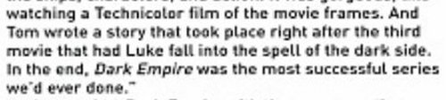
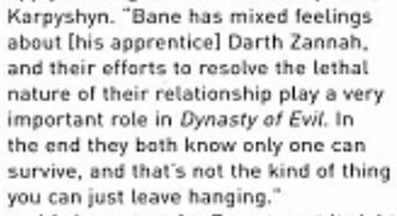
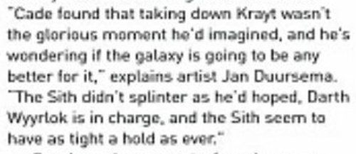
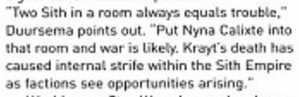
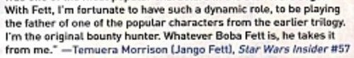

# Owner Material 038 — Star Wars Insider #1–153 plus specials (with The Lucasfilm Fan Club Magazine #1–22): Star Wars Insider #114 (2010)

- **Source:** *Star Wars Insider* magazine (issues 23–153, 1994–2014) and its predecessor *The Lucasfilm Fan Club Magazine* (issues 1–22, 1987–1994), plus seven special editions: articles, interviews, comics and short fiction Secondary source (licensed Legends reference). Scan OCR'd on the box; the scan stays box-only and is **not** published.
- **Method:** every scanned page was OCR'd and machine-screened sentence by sentence for power-relevant statements (fights, kills, defeats, Force feats, rankings, superweapons) that name a character on our roster; each kept sentence is quoted verbatim from the OCR text and has a crop of the printed passage directly under it. Pages with nothing power-relevant are still listed with what is on them.
- **Citation:** "*Star Wars Insider #114* (2010), p.X" by printed page ("scan p.X" where no printed number applies). **Weight:** Licensed magazine: a secondary source. Its short fiction and comics are Legends stories; its articles and interviews sum up or discuss lore and rank below the novels, comics and games they describe.

## scan p.1 (scan page 1)

Page contents: Cover, Star Wars Insider #114 (January/February 2010): The Old Republic, "A More Civilized Age?"; Mark Hamill loses the Force; First Strike! Empire storyboards; Darth Stewie talks Sith; The Clone Wars—Dave Filoni on the second season; False Fett? Star Wars' weirdest Sidesteps unearthed. (hand-read)

## scan p.2 (scan page 2)

Page contents: Ad: Kooky Kollectibles Star Wars pens. Out-of-universe. (hand-read)

## scan p.3 (scan page 3)

Page contents: Editor's Welcome, "Binding the galaxy together!" (Jonathan Wilkins): continuity—Vader as Anakin in the Clone Wars, Leia rescued by Vader's secret apprentice in TFU, Rebel Alliance formed as part of an Imperial plot; Infinities and Tales as alternative views; this issue revisits inconsistencies with Cad Bane opening a Jedi Holocron; Hoth storyboards; Mark Hamill. (hand-read)

## scan p.4 (scan page 4)

Page contents: Contents ("This Issue"): Dave Filoni, Dark Horse, The Old Republic, Ask Lobot Special, Darth Stewie, Hoth storyboards. Header quote is Cad Bane's TCW line "Jedi, huh? My fee just went up a lot." (Children of the Force). TV line, logged as S. (hand-read)

## scan p.5 (scan page 5)

Page contents: Contents continued: Editor's Welcome, Books (Dynasty of Evil, 2010 titles), Comics, Launch Pad, Interrogation Droid (Mark Hamill), Incoming, Retro, Star Wears, Classic Moment, Bounty Hunters, Bantha Tracks; subscription ad. (hand-read)

## scan p.6 (scan page 6)

Page contents: Launch Pad: TCW resumes January 1 with "Grievous Intrigue" (Ben Edlund; after a deadly encounter with a prominent member of the Jedi Council, the Jedi resolve to stop Grievous) and "The Deserter" (Carl Ellsworth; Obi-Wan leads clones searching for Grievous; Cut Lawquane). (hand-read)

## scan p.7 (scan page 7)

Page contents: Launch Pad: teaser panel for Dave Filoni (p. 13) and Darth Stewie (p. 38); feature list. (hand-read)

## scan p.8 (scan page 8)

Page contents: Launch Pad: Clone Wars Easter eggs (Season Two homages—Anakin's hands-behind-back exit in "Cargo of Doom" echoes Vader in ESB; Cad Bane in stormtrooper disguise; holographic crib mobile of colo claw fish, opee sea killer and sando aqua monster in "Children of the Force"; Sidious' separate Mustafar installation; Bane's wrist-launched lariat like Jango's and Boba's in "Holocron Heist"); 1,000 Collectibles giveaway; new Titan UK Clone Wars comic (Tom DeFalco, Robin Etherington, Rik Hoskin). (hand-read)

## scan p.9 (scan page 9)

Page contents: Launch Pad: a tauntaun groom's cake at a Star Wars artist's wedding; a fan-club Star Wars reading day; masthead. Personal and reader names omitted. (hand-read)

## scan p.10 (scan page 10)

Page contents: Interrogation Droid (Chris Spitale): humorous Q&A with Mark Hamill—advice to Yoda "Use moisturizer!"; Yoda harder to carry because of puppeteers; Leia's kiss "a chaste kiss"; Vader's pyre "brought me back to toasted marshmallows"; alias "Jed Eye"; Artoo over Threepio for chores. Out-of-universe humor. (hand-read)

## scan p.11 (scan page 11)

Page contents: Ad: Brian's Toys. Out-of-universe. (hand-read)

## scan p.12 (scan page 12)

Page contents: Ad: Titan magazines (Supernatural). Out-of-universe. (hand-read)

## scan p.13 (scan page 13)

Page contents: "Bringing Back the Bounty!": Dave Filoni on Season Two of The Clone Wars (Jonathan Wilkins), opener art with Cad Bane, Aurra Sing, Embo, Obi-Wan, Anakin, Ahsoka and Yoda. (hand-read)

## scan p.14 (scan page 14)

Page contents: Filoni interview: Season One's success raised expectations; the team pushed Season Two further; Season Two is technically and story-wise bigger, with more custom characters (Cad Bane, Robonino) and environments; the bounty-hunter theme came from the fans' love of the ESB bounty hunters (Boba Fett, IG-88, Bossk, 4-LOM, Zuckuss, Dengar). Image captions: Obi-Wan commands troops and takes on Grievous; Mace Windu defends the Republic. (hand-read)

## scan p.15 (scan page 15)

Page contents: Filoni on Bossk's fandom; Plo Koon's voice written three ways before settling on Basic, moving from samurai-abrupt to "more like Gandalf the Grey" (Ian McKellen inspiration), James Arnold Taylor among those tried; Lucas gave input on Kit Fisto and the Jedi voices; Obi-Wan developed more in Season Two because the prequels only did what was needed for him to meet up with A New Hope. (hand-read)

## scan p.16 (scan page 16)

Page contents: Filoni: Padmé/Anakin dynamic and expanding Padmé's role (Cat Taber); hopes for a Padmé-centered episode; biggest misconception about animation is the detail in every design; Lucas constantly improves episodes. Caption: Christmas 1983, a young Filoni with an Ewok. (hand-read)

## scan p.17 (scan page 17)

Page contents: Filoni: Season Two's massive battles, larger than the Ryloth trilogy (capital city with gunship firing and Separatist bombardments); suspending disbelief on why fleets fight; episodes more emotional with deeper layers; production staff as unsung heroes; associate producer Athena Portillo (wrote for Insider issues 32, 34 and 35). Caption: Ahsoka Tano feels the heat of battle! (hand-read)

## scan p.18 (scan page 18)

Page contents: Filoni on becoming a Star Wars celebrity and signing autographs; comparison with Peter Jackson as a fan making Lord of the Rings; Star Wars Weekends at Walt Disney World. Next issue: Mandalorians. Caption: Ahsoka and Cad Bane, fast becoming Star Wars icons. (hand-read)

## scan p.19 (scan page 19)

Page contents: Ad: Total Sci-Fi Awards voting. Out-of-universe. (hand-read)

## scan p.20 (scan page 20)

Page contents: "Dark Horse Rising" (Daniel Wallace), part one: Mike Richardson founded Dark Horse in 1986; Marvel's Star Wars comics "had giant rabbits with ray guns"; Dark Horse aimed to be cinematic and close to the films; movie-sequel strategy. (hand-read)

## scan p.21 (scan page 21)

Page contents: Full-page Dave Dorman Dark Empire art: Luke Skywalker in black before an Imperial World Devastator. Out-of-universe art. (hand-read)

## scan p.22 (scan page 22)

Page contents: Dark Horse history: Aliens (1988) and Predator sequels, Aliens vs. Predator; Richardson saw Star Wars 19 times; pitched Lucy Wilson; Tom Veitch and Cam Kennedy's Dark Empire proposal. (hand-read)

## scan p.23 (scan page 23)

Page contents: Tales of the Jedi launched as a separate Old Republic series "when the Jedi Knights numbered in the tens of thousands"; spin-offs (Dark Lords of the Sith, Freedon Nadd Uprising, Fall of the Sith Empire) paved the way for KOTOR and The Old Republic. Sidebar: collected editions of early Dark Horse Star Wars comics (Dark Empire, Classic Star Wars, Tales of the Jedi incl. Ulic Qel-Droma and Nomi Sunrider, Exar Kun's rise and fall, Droids, River of Chaos, Thrawn trilogy adaptations, X-Wing Rogue Squadron). A Dark Empire comic panel of Leia at a blaster cannon is reproduced; its lettering is too low-resolution to verify verbatim, so no quote logged. (hand-read)

- **Luke Skywalker** — entry/section: Richardson on Dark Empire's premise: ""And Tom wrote a story that took place right after the third movie that had Luke fall into the spell of the dark side. In the end, Dark Empire was the most successful series we'd ever done." —Mike Richardson, Star Wars Insider 114, p. 23" Source: *Star Wars Insider #114* (2010), scan p.23
  

## scan p.24 (scan page 24)

Page contents: Dark Horse adapted Zahn's Thrawn trilogy; recruited Michael Stackpole for X-Wing Rogue Squadron (35 issues, 1995 debut); reprinted the 1979-1984 LA Times Syndicate newspaper strips. (hand-read)

## scan p.25 (scan page 25)

Page contents: Al Williamson's strips as Classic Star Wars, Russ Manning's as The Early Adventures; Droids series (14 issues, one co-written by Anthony Daniels, Kilian Plunkett covers) aimed at younger readers. (hand-read)

## scan p.26 (scan page 26)

Page contents: "Class Wars!" (Tony A. Rowe): The Old Republic MMO preview, set more than 3,500 years before Luke and Vader, after the Great Galactic War; cold war between Republic and rebuilt Sith Empire. New classes: Jedi Consular (archetype Yoda, who "prefers to use his mind and abilities with the Force to overcome conflicts rather than enter direct combat") and Sith Inquisitor (compared to Palpatine, "who opts to use the raw, destructive power of the dark side of the Force to eliminate any resistance"). (hand-read)

## scan p.27 (scan page 27)

Page contents: Full-page TOR art: a Jedi Consular with lightsaber and Force push amid Sith troopers and broken chains. Out-of-universe art. (hand-read)

## scan p.28 (scan page 28)

Page contents: Jedi Consular starts as a Padawan at the rebuilt Jedi Temple on Tython; the Flesh Raiders plague Tython's natives and the Council declines to intervene. (hand-read)

### Stat block notes (game mechanics, not feats)

- Jedi Consular class: Force as primary weapon: "He confuses opponents with mind tricks and hurls heavy objects with telekinetic powers. He can use the Force to pull distant enemies into range for a lightsaber strike or simply toss them into the air and smash them down to the ground. Many of his other skills, such as healing, are effective at keeping himself and his allies alive." (Class Wars!, Star Wars Insider 114, p. 28) (Source: *Star Wars Insider #114* (2010), scan p.28)

## scan p.29 (scan page 29)

Page contents: After the Sith destroyed the Coruscant Jedi Temple in the Great War the Council built its new temple on Tython; Consular customization; party play (Consular paired with a Republic Trooper). (hand-read)

### Stat block notes (game mechanics, not feats)

- Tython: birthplace of the Jedi Order: "Thousands of years before, ancient sages, philosophers, and warriors first studied the ways of the Force among this world's lush forests. Eventually, a schism occurred between the students of the light and dark sides of the Force, triggering a war that nearly destroyed the planet. Survivors of that conflict founded the Jedi Order" (Class Wars!, Star Wars Insider 114, p. 29) (Source: *Star Wars Insider #114* (2010), scan p.29)

## scan p.30 (scan page 30)

Page contents: The Inquisitor begins as a human slave at the Korriban Sith Academy under true-blood Sith overseers. (hand-read)

### Stat block notes (game mechanics, not feats)

- Sith Inquisitor class: devastating Force powers: "The Sith Inquisitor is a master of devastating Force powers. He may tap the dark side to create brilliant, destructive arcs of Force lightning or even drain the life force out of his opponents. With good dueling skills and light armor, the Inquisitor is also a capable melee fighter who can rely on his blade as much as his mind." (Class Wars!, Star Wars Insider 114, p. 30) (Source: *Star Wars Insider #114* (2010), scan p.30)
- Sith Inquisitor: Overload, lightning-imbued blade, chain lightning: "Several of the Inquisitor's powers keep those enemies at a distance (such as Overload, the ability to knock back opponents in all directions around the character). With more experience, he can learn to imbue his lightsaber with Force lightning for a shocking attack or even chain arcs of lightning to strike numerous targets at once." (Class Wars!, Star Wars Insider 114, p. 30) (Source: *Star Wars Insider #114* (2010), scan p.30)

## scan p.31 (scan page 31)

Page contents: Korriban: sacred Sith homeworld, abandoned during the Sith Civil War (KOTOR), reoccupied by the rebuilt Empire during the Great War; Valley of the Dark Lords tomb expeditions for items of power and ancient Sith sorceries. (hand-read)

## scan p.32 (scan page 32)

Page contents: Full-page "Scene of the Crime" artwork by Joe Corroney: Cad Bane with a Holocron projecting holograms of classic characters (Boba Fett among them). Out-of-universe art. (hand-read)

## scan p.33 (scan page 33)

Page contents: "Ask Cad Bane" (in-character framing, Ask Lobot replaced; credited as assisted by Leland Y. Chee, p. 37): top ten irreconcilable continuity errors ("shifts in vision"). #10 Klaatu, Barada, Nikto: Kenner figure naming confusion (Klaatu vs Woof, Barada vs Kithaba, Nikto a species); four Red Nikto in ROTJ (Vizam fires the sail barge cannon, Nysad shoots at Luke, Vedain fights Lando for control of the skiff, an unnamed one in turquoise). (hand-read)

## scan p.34 (scan page 34)

Page contents: #8 Bpfasshi "Dark Jedi" on Dagobah: Dark Force Rising said the Dagobah cave shrouded Yoda in an aura of evil to hide him from Vader and the Emperor; the Rule of Two means the Bpfasshi was not a Sith Lord; the Lost Twenty make "dark Jedi" a misnomer, better "dark siders." (hand-read)

### Stat block notes (game mechanics, not feats)

- Retconned feat: Yoda killed a Bpfasshi Dark Jedi on Dagobah: "According to that story, this 'domain of evil' only came into existence after Yoda fought and killed an extremely powerful Bpfasshi Dark Jedi on the swamp planet during the Clone Wars." (Ask Cad Bane, Star Wars Insider 114, p. 34) (Source: *Star Wars Insider #114* (2010), scan p.34)
- Continuity ruling: the Bpfasshi fight was not on Dagobah and not a "Dark Jedi": "It didn't happen, since the script for Revenge of the Sith revealed that Yoda had never been to Dagobah before his self-exile. So if Yoda did in fact confront a Bpfasshi dark sider, it would not have been on Dagobah and it would not have been a so-called 'Dark Jedi.'" (Ask Cad Bane, Star Wars Insider 114, p. 34) (Source: *Star Wars Insider #114* (2010), scan p.34)

## scan p.35 (scan page 35)

Page contents: #7 Logray's look differs between ROTJ (brown fur, tan stripes) and the Ewoks TV movies (gray, charcoal stripes). #6 The death of Wes Janson: Dodonna's Goodwin/Williamson-comics death explained as captivity in Rogue Squadron; Hobbie survived crashing into Veers' walker in the ESB novelization; Janson's killing by Arns Grimraker in Marvel Star Wars #78 and a bearded Wedge's attempt to rejoin the fleet became an in-universe tall tale Wedge and Janson tell Rogue Squadron recruits. (hand-read)

## scan p.36 (scan page 36)

Page contents: #4 Tonnika sisters: Brea and Senni Tonnika: not in the films; the "Space Girls" art showed twins, explained as non-twin Mistryl Shada D'ukal and Karoly D'ulin impersonating them. #3 Han winning the Falcon from Lando told many ways; repeated sabacc trades strain credibility. #2 Vehicle sizes vs filmmaking camera tricks (Falcon cockpit gained two seats in ESB, astromech too tall for a Jedi starfighter socket, the Super Star Destroyer's first size guess wrong). (hand-read)

## scan p.37 (scan page 37)

Page contents: #1 Dates on the original Clone Wars timeline: Lucas Licensing's month-by-month EU timeline proved too confining for The Clone Wars series; a new timeline will be built when the series ends. Cad Bane signs off with the Holocron's secrets. Credit: "Cad Bane was assisted on this mission by Leland Y. Chee." (hand-read)

## scan p.38 (scan page 38)

Page contents: "A Little Short for a Stormtrooper?": Family Guy's Darth Stewie; Blue Harvest spoofed ANH, Something Something Dark Side (DVD December 22) spoofs ESB. Out-of-universe parody. (hand-read)

## scan p.39 (scan page 39)

Page contents: Humorous in-character Q&A with Darth Stewie (finger-choking, blowing up planets, the Empire's "power hierarchy" joke, Force saving on movers). Parody, not canon/Legends; no feats logged. (hand-read)

## scan p.40 (scan page 40)

Page contents: "Battle of Hoth: Early Storyboards for The Empire Strikes Back" by J. W. Rinzler, title page. (hand-read)

## scan p.41 (scan page 41)

Page contents: Rinzler: unused Joe Johnston Hoth storyboards from spring 1978 left out of The Making of The Empire Strikes Back; Rebels originally attacked walkers in tanks before snowspeeders; Luke's first attack shows blaster-proof armor leading to tow cables; Wedge designated Rogue Junior; walker count not yet fixed. (hand-read)

## scan p.42 (scan page 42)

Page contents: Johnston storyboards 12-26 with shot descriptions: speeders fly through walker legs, Luke "split your squad into pairs," three walkers firing all cannons, Luke notes the armor is too strong for blasters. Film-production material. (hand-read)

## scan p.43 (scan page 43)

Page contents: Storyboards continued: walker cockpit pilots; Luke orders "use your harpoons and tow cables. Go for the legs. It's our only hope to stop them." Film-production material. (hand-read)

## scan p.44 (scan page 44)

Page contents: Storyboards 28-41: Hobbie ("a tanned-skin vet of many battles"), Luke and Dack, laser bolts and flak, Rebel troops firing, Veers in the walker cockpit asking the range to the power generators. Film-production material. (hand-read)

## scan p.45 (scan page 45)

Page contents: Storyboards: Dack lost after the speeder is hit, Luke's POV under the walker, a speeder explodes between two walkers; note that by the fifth draft Rogue Junior became Wedge. Film-production material. (hand-read)

## scan p.46 (scan page 46)

Page contents: Storyboards 44-63: a speeder (BJ) heads for walker no. 3, harpoon fired, cable wrapped around the legs, the walker crashes into the snow. Film-production material. (hand-read)

## scan p.47 (scan page 47)

Page contents: Storyboards: harpoon embedding in the leg, "Cable out! Let her go," cable release; Wedge: "Rogue Leader... good work." To be concluded in Insider 115. (hand-read)

## scan p.48 (scan page 48)

Page contents: "The Clothes That Make the Jedi!" (Chris Spitale): Museum Replicas' film-accurate costume line; eFx stunt lightsabers for Jedi ensembles; items sold individually. (hand-read)

## scan p.49 (scan page 49)

Page contents: Museum Replicas (Atlanta Cutlery subsidiary since 1985); first wave: Luke (Jedi Knight), Anakin and Obi-Wan (Episode III), Imperial Officer (green and black), Padmé's "Packing Gown." (hand-read)

## scan p.50 (scan page 50)

Page contents: Robin Chaudhuri on the 14-month process from Lucasfilm Archives research; Padmé's handmade gown the hardest; fan reception at Comic-Con and Dragon*Con. (hand-read)

## scan p.51 (scan page 51)

Page contents: Work with the 501st Legion; a 2010 stormtrooper outfit made in Department of Defense contractor factories; sandtrooper, clone trooper, X-wing pilot, biker scout and Royal Guard outfits coming. (hand-read)

## scan p.52 (scan page 52)

Page contents: Ad: Star Wars Insider / Titan subscriptions and Star Trek magazine. Out-of-universe. (hand-read)

## scan p.53 (scan page 53)

Page contents: Contents for the back half: Books (Darth Bane: Dynasty of Evil), Comics (Cade Skywalker vs Sith science), Ask Lobot, Retro, Incoming, Bantha Tracks, Classic Moment (Obi-Wan meets Jango Fett). Pull quote "There's nothing like a good blaster at your side, kid." (hand-read)

## scan p.54 (scan page 54)

Page contents: Ad: Titan Heroes magazine and back issues. Out-of-universe. (hand-read)

## scan p.55 (scan page 55)

Page contents: "There Can Be Only Two!" (Daniel Wallace): Darth Bane trilogy (Path of Destruction, Rule of Two, Dynasty of Evil); the Rule lets the Sith endure a millennium until Sidious and Maul; Karpyshyn leaves open continuing the tale with Bane, Zannah or someone else. (hand-read)

- **Darth Zannah** — entry/section: Karpyshyn on Bane and Zannah in Dynasty of Evil: ""Bane has mixed feelings about [his apprentice] Darth Zannah, and their efforts to resolve the lethal nature of their relationship play a very important role in Dynasty of Evil. In the end they both know only one can survive, and that's not the kind of thing you can just leave hanging." —Drew Karpyshyn, Star Wars Insider 114, p. 55" Source: *Star Wars Insider #114* (2010), scan p.55
  

## scan p.56 (scan page 56)

Page contents: Ask Lobot as related to Leland Y. Chee (reader question on regrowing Anakin's and Luke's limbs; reader name omitted). Forthcoming books: Millennium Falcon (James Luceno, reprint; plot to overthrow the Emperor); Crosscurrent (Paul Kemp; time-displaced ancient Sith ship reaches Luke's era during Darth Caedus' rule, Jedi Knight Jaden Korr must stop them); The Clone Wars: Gambit: Stealth (Karen Miller; Obi-Wan and Anakin on Lanteeb); Luke Skywalker and the Shadows of Mindor (Matthew Stover reprint; Lord Shadowspawn's Black Stormtroopers trap); Fate of the Jedi: Backlash (Aaron Allston). (hand-read)

### Stat block notes (game mechanics, not feats)

- Ask Lobot: why cloning is not used to regrow limbs: "By and large, cloning technology in Star Wars involves the cloning of an entire being. Cloning for the most part is not used for individual body parts for organ harvesting or limb replacement; most cloners in Star Wars haven't even exhibited that they have this technology. And since the mechanical versions of these limbs work just as well if not better than the organic version, why wait to grow a new organic limb when a mechanical version can be constructed much more quickly?" (Ask Lobot, Star Wars Insider 114, p. 56) (Source: *Star Wars Insider #114* (2010), scan p.56)

## scan p.57 (scan page 57)

Page contents: Books: Backlash (Jedi going insane, carbonite freezing; Luke and Ben to Dathomir with Vestara); Outcast reprint; Fate of the Jedi: Allies (Christie Golden; Jedi-Sith coalition into the Maw; Ben and Vestara Khai). Penguin junior lines: The Clone Wars: Secret Missions (Breakout Squad, Ryder Windham, Cad Bane stranded with a Padawan and clones) and Decide Your Destiny. (hand-read)

## scan p.58 (scan page 58)

Page contents: "Here Be Monsters" (Daniel Wallace): Legacy "Monster" arc (#43-46) after the apparent death of Darth Krayt; Cade uncovers a Sith plot to brew a plague with Yuuzhan Vong bioengineering, and "Cade's healing powers will prove critical to stopping the plan"; Cade starts on Zeltros; flashbacks to his father and Wolf Sazen; Wayland's Vong terraforming (Ostrander: "there's a new status quo"). (hand-read)

- **Cade Skywalker** — entry/section: Duursema: Cade after Krayt's apparent death: ""Cade found that taking down Krayt wasn't the glorious moment he'd imagined, and he's wondering if the galaxy is going to be any better for it. The Sith didn't splinter as he'd hoped, Darth Wyyrlok is in charge, and the Sith seem to have as tight a hold as ever." —Jan Duursema, Star Wars Insider 114, p. 58" Source: *Star Wars Insider #114* (2010), scan p.58
  

## scan p.59 (scan page 59)

Page contents: Wyyrlok is reigning Sith Lord after Krayt's demise; Moff Nyna Calixte seeks absolute power; Legacy cosplay (Darth Talon, Imperial Knights); Ostrander: "This is a promise—or a threat!" Sidebar: Star Wars: The Thrawn Trilogy hardcover (December 23, Dark Horse; Mike Baron, Olivier Vatine, Terry Dodson, Edvin Biukovic; 420 pages, $34.99). (hand-read)

- **Darth Wyyrlok III; Nyna Calixte** — entry/section: Duursema: Sith infighting after Krayt's death: ""Two Sith in a room always equals trouble. Put Nyna Calixte into that room and war is likely. Krayt's death has caused internal strife within the Sith Empire as factions see opportunities arising." —Jan Duursema, Star Wars Insider 114, p. 59" Source: *Star Wars Insider #114* (2010), scan p.59
  

### Stat block notes (game mechanics, not feats)

- Chrom-wrones of the "Monster" arc: "Among the bizarre lifeforms designed for the 'Monster' story-arc are chrom-wrones, 100-meter worms that drill through rock and convert it to plasma." (Comics, Star Wars Insider 114, p. 59) (Source: *Star Wars Insider #114* (2010), scan p.59)

## scan p.60 (scan page 60)

Page contents: Incoming (Chris Spitale): Hasbro Clone Wars Y-wing bomber, Toys R Us Imperial V-wing, Target Clone Wars Battle Pack, Wal-Mart AT-ST with driver. Out-of-universe merchandise. (hand-read)

## scan p.61 (scan page 61)

Page contents: Incoming: Clone Wars figure wave (Padmé, IG-86, Matchstick, tank gunner), Resurgence of the Jedi Battle Pack, Galactic Heroes Cinema Scenes (Slave I with Boba Fett, Endor Attack). Out-of-universe merchandise. (hand-read)

## scan p.62 (scan page 62)

Page contents: Acme Archives "Greedo" giclée by Christian Waggoner (editions $125/$375/$1,250). Ask Lobot (anonymous question): the Clone Wars and the Galactic Civil War are separate; the GCW lasted six years if counted from the Alliance's founding in The Force Unleashed, or 23 (19 + 4) from Palpatine's declaration as Emperor. (hand-read)

### Stat block notes (game mechanics, not feats)

- Ask Lobot: Clone Wars vs Galactic Civil War timeline: "The Clone Wars has a distinct beginning and end, starting with the Battle of Geonosis and the moment Palpatine/Sidious shuts down the droid armies. The conflict lasts three years. The Galactic Civil War does not have a definite beginning. We know that it ends with the Battle of Endor, four years after the events of A New Hope" (Ask Lobot, Star Wars Insider 114, p. 62) (Source: *Star Wars Insider #114* (2010), scan p.62)

## scan p.63 (scan page 63)

Page contents: Incoming: Funko holiday bobble-heads; Sideshow Gamorrean Guard life-size bust, Darth Talon Premium Format Figure ("the beautiful but deadly Darth Talon"), sandtrooper squad leader 12" figure. Out-of-universe merchandise. (hand-read)

## scan p.64 (scan page 64)

Page contents: Incoming: Uncle Milton Mini Lightsaber Tech Lab and Clone Trooper Recon Kit; Fine Molds 1/48 snowspeeder; LeapFrog Jedi Math, Jedi Reading, Jedi Trials (stop Count Dooku's plot), Clone Wars custom game, Tag storybook Rescue in the Sky (Grievous captures R2-D2). Out-of-universe merchandise. (hand-read)

## scan p.65 (scan page 65)

Page contents: Ad: Titan Stargate magazine. Out-of-universe. (hand-read)

## scan p.66 (scan page 66)

Page contents: Retro "Merry Sithmas!" (Gus Lopez): Kenner's 1977 Early Bird Certificate Package; Ralph McQuarrie Lucasfilm holiday cards (1979 Santa C-3PO and antlered R2-D2, 1980 Santa's workshop, 1981-82 Santa Yoda). (hand-read)

## scan p.67 (scan page 67)

Page contents: Retro: 1983-85 Ewok cards, 1994 Jawas opening presents, 1995 cantina band snow globe, 1999 caroling Podracers; Hasbro holiday figures (2002-2004); Steinbach Darth Vader nutcracker; Kurt Adler Fabriché ornaments. (hand-read)

## scan p.68 (scan page 68)

Page contents: Retro: Kurt Adler stockings; Comic Images plush Santa Yoda; the "What Can You Get a Wookiee for Christmas (When He Already Owns a Comb)" single; the 1977 Lionel Season's Greetings train car with R2-D2. Out-of-universe collectibles. (hand-read)

## scan p.69 (scan page 69)

Page contents: Ad: Titan Lost magazine. Out-of-universe. (hand-read)

## scan p.70 (scan page 70)

Page contents: Bounty Hunters (reader photos with Star Wars personalities, sponsored by Kotobukiya): David Prowse; Dave Filoni at Star Wars Weekends signing a Captain Rex helmet. Reader names omitted. (hand-read)

## scan p.71 (scan page 71)

Page contents: Bounty Hunters: reader encounters with Richard LeParmentier (Admiral Motti), Anthony Forrest (Fixer, sandtrooper) and Daniel Logan at Dragon*Con. Reader names omitted. (hand-read)

## scan p.72 (scan page 72)

Page contents: Bantha Tracks (Mary Franklin), "The Best of My Year: Revenge of the Clones": young kids obsessed with The Clone Wars; costumed 501st clones at an Orlando event. Fan names omitted. (hand-read)

## scan p.73 (scan page 73)

Page contents: Bantha Tracks Best of 2009: The Clone Wars as boys' number one TV show; Cad Bane threw out a first pitch at a Dodgers game; a found stormtrooper figure; Mandalorian Mercs popcorn; 501st Philippine Outpost hospital visit. Fan names omitted. (hand-read)

## scan p.74 (scan page 74)

Page contents: Best of 2009: 501st Midwest Garrison parade floats (Endor, Death Star); two gifts of life by 501st members to fellow fans. Fan names and medical details omitted. (hand-read)

## scan p.75 (scan page 75)

Page contents: Best of 2009: Seth Green's Robot Chicken skate party with Rebel Legion and 501st; Taiwan Outpost on Car Free Day; Bantha Tracks submission guidelines. Fan names omitted. (hand-read)

## scan p.76 (scan page 76)

Page contents: Best of Bantha Tracks Art Galaxy: fan art (Leia, camouflage, Ahsoka, Jedi and Sith skateboarding, a strip). Artist names omitted. (hand-read)

## scan p.77 (scan page 77)

Page contents: Ad: Titan holiday subscription offer. Out-of-universe. (hand-read)

## scan p.78 (scan page 78)

Page contents: Classic Moment: AOTC Scene 076, Obi-Wan meets Jango Fett in his Tipoca City apartment; Jango as unaltered-clone "father" of Boba and progenitor of the clone army; Obi-Wan investigating Sifo-Dyas; "hissing politeness." George Lucas (LA Daily News, May 2002) on Episode II descending into "the evil of the Empire and Anakin's struggle to maintain his goodness." Film script material. (hand-read)

## scan p.79 (scan page 79)

Page contents: Classic Moment script continued: Jango "just a simple man, trying to make my way in the universe"; recruited by "a man called [Darth] Tyranus on one of the moons of Bogden"; "They'll do their job well, I'll guarantee that"; "Pack your things. We're leaving." Film script, logged as summary. Next time: "There's something alive in here!" (hand-read)

- **Jango Fett** — entry/section: Temuera Morrison: "I'm the original bounty hunter": ""With Fett, I'm fortunate to have such a dynamic role, to be playing the father of one of the popular characters from the earlier trilogy. I'm the original bounty hunter. Whatever Boba Fett is, he takes it from me." —Temuera Morrison (Jango Fett), quoted from Star Wars Insider #57, Star Wars Insider 114, p. 79" Source: *Star Wars Insider #114* (2010), scan p.79
  

## scan p.80 (scan page 80)

Page contents: StarWarsShop: Clone Wars retro logo T-shirt adapted from McQuarrie's 1976 triangular logo. Out-of-universe. (hand-read)

## scan p.81 (scan page 81)

Page contents: StarWarsShop exclusives: lightsaber USB glow lamp, Kowakian T-shirt, Darth Vader toaster, R2-D2 projection alarm clock. Out-of-universe. (hand-read)

## scan p.82 (scan page 82)

Page contents: Next issue (115): Meet the Mandalorians of Clone Wars Season Two; Dave Filoni; Star Wars Infinities and Dark Horse prequel adaptations; Battle of Hoth storyboards part two. On sale January 26 (US) / February 4 (UK). (hand-read)

## scan p.83 (scan page 83)

Page contents: Ad: Marc Ecko limited-edition Star Wars gear. Out-of-universe. (hand-read)

## scan p.84 (scan page 84)

Page contents: Back cover ad: Family Guy "Something, Something, Something Dark Side" on Blu-ray and DVD 12/22. Out-of-universe. (hand-read)

