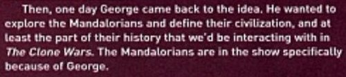
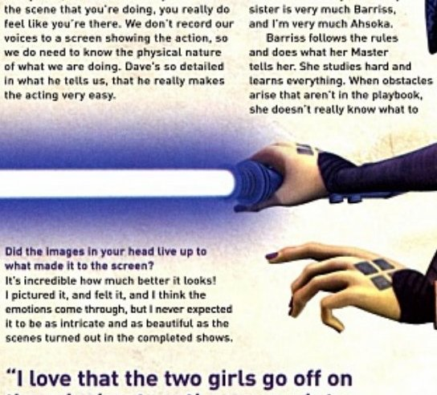
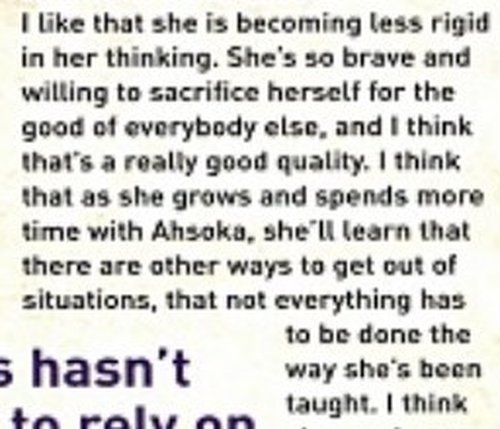
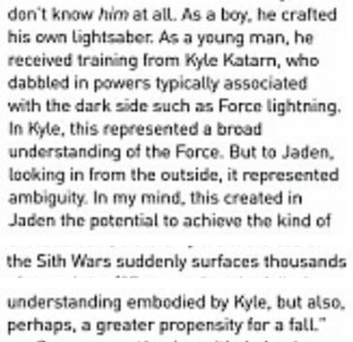
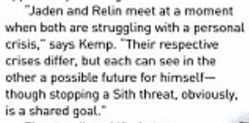
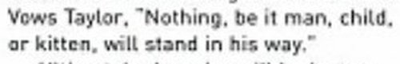

# Owner Material 038 — Star Wars Insider #1–153 plus specials (with The Lucasfilm Fan Club Magazine #1–22): Star Wars Insider #115 (2010)

- **Source:** *Star Wars Insider* magazine (issues 23–153, 1994–2014) and its predecessor *The Lucasfilm Fan Club Magazine* (issues 1–22, 1987–1994), plus seven special editions: articles, interviews, comics and short fiction Secondary source (licensed Legends reference). Scan OCR'd on the box; the scan stays box-only and is **not** published.
- **Method:** every scanned page was OCR'd and machine-screened sentence by sentence for power-relevant statements (fights, kills, defeats, Force feats, rankings, superweapons) that name a character on our roster; each kept sentence is quoted verbatim from the OCR text and has a crop of the printed passage directly under it. Pages with nothing power-relevant are still listed with what is on them.
- **Citation:** "*Star Wars Insider #115* (2010), p.X" by printed page ("scan p.X" where no printed number applies). **Weight:** Licensed magazine: a secondary source. Its short fiction and comics are Legends stories; its articles and interviews sum up or discuss lore and rank below the novels, comics and games they describe.

## scan p.1 (scan page 1)

Page contents: Cover (Insider 115, March 2010): Barriss Offee speaks out; Mandalorians; exclusive Empire storyboards; Dave Filoni, Ashley Eckstein, Anthony Daniels; Dark Horse Comics. (hand-read)

## scan p.2 (scan page 2)

Page contents: Ad: Hardware Wars 30th Anniversary Special Edition DVD (parody; Fluke Starbucker, Darph Nader). Out-of-universe parody. (hand-read)

## scan p.3 (scan page 3)

Page contents: Editor's Welcome (Jonathan Wilkins): the Mandalorians' long-awaited debut in The Clone Wars; Leland Y. Chee charts their history; Dave Filoni on the Mandos; Barriss Offee (Meredith Salenger); Empire storyboards; Star Wars: In Concert; Celebration V. (hand-read)

### Stat block notes (game mechanics, not feats)

- Mandalorian armor described in the Empire novelization: "He was dressed in a weapon-covered, armored spacesuit, the kind worn by a group of evil warriors defeated by the Jedi Knights during the Clone Wars." (The Empire Strikes Back novelization by Donald F. Glut, 1980, quoted in Editor's Welcome, Star Wars Insider 115, p. 3) (Source: *Star Wars Insider #115* (2010), scan p.3)

## scan p.4 (scan page 4)

Page contents: Contents (features): Mandalorians p13, Dave Filoni p20, Barriss Offee p26, Dark Horse p32, Retro (Boba Fett collectibles) p38, Hoth storyboards p40, Jedi Archive p48, In Concert/Anthony Daniels p50. Epigraph "War is the Mandalorian way of life." attributed to Gnost-Dural. (hand-read)

## scan p.5 (scan page 5)

Page contents: Contents (departments): Launch Pad, Interrogation Droid (Ashley Eckstein), Books (Crosscurrent extract by Paul S. Kemp), Comics (Invasion; Luke's Dagobah training), Incoming, Bounty Hunters, Bantha Tracks, Classic Moment (Han's rescue mission trash talk). Subscriber variant cover note. (hand-read)

## scan p.6 (scan page 6)

Page contents: Launch Pad: Clone Wars Season Two episodes "The Mandalore Plot" (dir. Kyle Dunlevy), "Voyage of Temptation" and "Duchess of Mandalore" (dir. Brian Kalin O'Connell): Obi-Wan investigates conspiracy around Duchess Satine of Mandalore; Anakin discovers Obi-Wan and the Duchess share a history; Satine framed on Coruscant for creating a Mandalorian terrorist group. Episode guide, out-of-universe. (hand-read)

## scan p.7 (scan page 7)

Page contents: Launch Pad: "Senate Murders" (Padme investigates a Senator's suspicious death); Celebration V announced for August 12-15, 2010, Orange County Convention Center, Orlando; ticket prices. (hand-read)

## scan p.8 (scan page 8)

Page contents: Launch Pad: The Old Republic, Destination Alderaan screenshots (Leia's adoptive homeworld before its destruction). (hand-read)

## scan p.9 (scan page 9)

Page contents: Insider Loves: caricature artist Jake (first memories, Boba Fett favorite, "Wookiee Season" print); erratum crediting the tauntaun cake; Hardware Wars director Ernie Fosselius interview (spoofed it "because it was there"; 16mm pre-digital production); The Force Unleashed II announced for 2010 (Starkiller, Vader's secret apprentice; TFU fastest-selling Star Wars game at nearly seven million units); masthead. (hand-read)

## scan p.10 (scan page 10)

Page contents: Interrogation Droid: Ashley Eckstein (Ahsoka Tano) humorous Q&A (no robes for agility; Spice Girls; would choose Plo Koon as new master because she considers Dave Filoni her Jedi Master; Jedi mind trick on husband's at-bat). Light-hearted, logged as summary. (hand-read)

## scan p.11 (scan page 11)

Page contents: Ad: Marc Ecko limited-edition Star Wars gear. (hand-read)

## scan p.12 (scan page 12)

Page contents: Ad: Brian's Toys catalogue. (hand-read)

## scan p.13 (scan page 13)

Page contents: Mandalorians feature opener: Leland Y. Chee traces the history of the warrior race making its animated debut in Clone Wars Season Two. (hand-read)

## scan p.14 (scan page 14)

Page contents: Mandalorian timeline: Empire Strikes Back Sketchbook (June 1980) first use of "Mandalore" (Boba Fett costume originally intended for a squad of supercommandos from the Mandalore system with weapons built into their suits); Joe Johnston helmet concepts; The Art of The Empire Strikes Back. Out-of-universe history. (hand-read)

## scan p.15 (scan page 15)

Page contents: Editorial note: Attack of the Clones (May 2002) revealed Boba Fett as Jango Fett's clone, negating the possibility of Boba having fought in the Clone Wars alongside the Mandalorians as depicted in the Marvel comics; Lucasfilm created a Mandalorian alphabet for Slave I displays. (hand-read)

### Stat block notes (game mechanics, not feats)

- Marvel: three survivors of 212 Mandalorian Protectors: "She met up with Fenn Shysa and Tobbi Dala, two warriors in Mandalorian armor who, along with Boba Fett, were the only three survivors of a force of 212 Mandalorian Protectors who went into battle against the enemies of the Emperor." (Mandalorians, Star Wars Insider 115, p. 15) (Source: *Star Wars Insider #115* (2010), scan p.15)
- Ulic Qel-Droma defeats Mandalore in a duel: "In that series, the Dark Lord of the Sith Ulic Qel-Droma went to the planet Kuar, which was occupied by Mandalorians led by the warrior known as Mandalore. Qel-Droma defeated Mandalore in a duel and as a result Mandalore pledged fealty of the Mandalorian clans to the Dark Lord. When the Sith and Mandalorians were defeated by the combined forces of the Jedi and the Republic, Mandalore fell in battle. Another Mandalorian warrior picked up the helmet of the fallen leader, and then claimed the title of Mandalore for himself." (Mandalorians, Star Wars Insider 115, p. 15) (Source: *Star Wars Insider #115* (2010), scan p.15)
- Jango Fett backstory (Bounty Hunter / Open Seasons): "Jaster Mereel, a name previously attributed to Boba Fett, became the Mandalorian who adopted Jango Fett into the Mandalorian culture. Also in these stories, we began to see rivalries within the ranks of the Mandalorians themselves, first with the betrayal by the Mandalorian known as Montross, who would become a rival to Jango Fett, and later by a Mandalorian named Vizsla, who formed a splinter group known as Death Watch. A showdown between a Mandalorian army led by Jango against a Jedi strike force led by Count Dooku left the Mandalorian warriors decimated. Though he continued to wear the armor, Jango all but abandoned his Mandalorian past for his new life as a bounty hunter." (Mandalorians, Star Wars Insider 115, p. 15) (Source: *Star Wars Insider #115* (2010), scan p.15)

## scan p.16 (scan page 16)

Page contents: KOTOR (June 2003) established the Mandalorian Wars against the Republic; Star Wars Tales #18 "Revenants" (Dec 2003) showed Boba Fett leading a resurgent Mandalorian army in the NJO era pursuing Han Solo. (hand-read)

### Stat block notes (game mechanics, not feats)

- Durge's centuries-long grudge against the Mandalorians: "Blackman gave Durge a centuries-long grudge against the Mandalorians, thus fueling his contempt of the clone troopers who bore the face of Jango Fett." (Mandalorians, Star Wars Insider 115, p. 16) (Source: *Star Wars Insider #115* (2010), scan p.16)
- Boba Fett leads the Mandalorians against the Yuuzhan Vong: "The Unifying Force by James Luceno, the final novel of the New Jedi Order series, included a surprise appearance by Boba Fett who continued his father's legacy by becoming the new leader of the regrouped Mandalorians. At this late stage in the war, Fett and the Mandalorians fought against the Yuuzhan Vong, even coming to the aid of Han and Leia Organa Solo in the middle of a firefight." (Mandalorians, Star Wars Insider 115, p. 16) (Source: *Star Wars Insider #115* (2010), scan p.16)
- Canderous Ordo reunites the clans as Mandalore: "The 2005 release of Knights of the Old Republic II: The Sith Lords, featured Ordo clad in full Mandalorian armor; in between the events of the games, he had reunited the warrior clans and declared himself to be the new Mandalore." (Mandalorians, Star Wars Insider 115, p. 16) (Source: *Star Wars Insider #115* (2010), scan p.16)

## scan p.17 (scan page 17)

Page contents: Timeline continued: Republic Commando: Hard Target (Karen Traviss) Mandalorian training sergeants; Insider #30 Abel G. Pena "History of the Mandalorians"; Clone Wars micro-series ARC pilot helmet symbol; Star Wars Visionaries (Robert Barnes); Insider #86 Traviss on Mandalorian culture and Mando'a; Captain Rex's "jaig eyes"; KOTOR comics (Miller) "Flashpoint!" #7-9 and the Mandalorian Wars; TOR marketing. (hand-read)

### Stat block notes (game mechanics, not feats)

- Durge's skull symbol honors the fallen Jaing: "The skull resembled the face of an alien Mandalorian named Jaing whom Durge had once fought alongside. Again, the concept of betrayal within the Mandalorian ranks surfaced with Jaing falling in battle and Durge wearing the skull symbol on his armor to honor him." (Mandalorians, Star Wars Insider 115, p. 17) (Source: *Star Wars Insider #115* (2010), scan p.17)

## scan p.18 (scan page 18)

Page contents: The Art of The Clone Wars: Sundari concept art; Essential Atlas / Complete Encyclopedia portrayal of Satine as pacifist leader of the Mandalorian government; Comic-Con Season Two footage of Mandalorians poised against the Jedi. (hand-read)

### Stat block notes (game mechanics, not feats)

- Hondo Karr revealed as a Mandalorian (Legacy #41): "In that story, Hondo Karr, a former member of an Imperial stormtrooper unit known as Joker Squad and later a member of the Galactic Alliance's famed Rogue Squadron, revealed himself to be a former Mandalorian. The issue concluded with Karr leaving Rogue Squadron, donning his armor to once again fight alongside the Mandalorians." (Mandalorians, Star Wars Insider 115, p. 18) (Source: *Star Wars Insider #115* (2010), scan p.18)

## scan p.19 (scan page 19)

Page contents: Ad: Write Brothers Movie Magic Screenwriter 6 / Dramatica Pro. (hand-read)

## scan p.20 (scan page 20)

Page contents: Dave Filoni interview "Ready for Battle" opener (words: Jonathan Wilkins): why the time is right for the Mandalorians to join The Clone Wars. (hand-read)

## scan p.21 (scan page 21)

Page contents: 154 words, 6 paragraphs | headings/entries: WAALS Za LAE (3

- **none** — entry/section: Filoni: the Mandalorians are in the show because of George Lucas: ""Then, one day George came back to the idea. He wanted to explore the Mandalorians and define their civilization, and at least the part of their history that we'd be interacting with in The Clone Wars. The Mandalorians are in the show specifically because of George." —Dave Filoni, Star Wars Insider 115, p. 21" Source: *Star Wars Insider #115* (2010), scan p.21
  

## scan p.22 (scan page 22)

Page contents: 113 words, 2 paragraphs | headings/entries: 

## scan p.23 (scan page 23)

Page contents: Filoni: episode proverbs come from writers and Henry Gilroy's book of proverbs from George; Cad Bane inspired by Sergio Leone westerns; plunk droid named for designer Kilian Plunkett. (hand-read)

## scan p.24 (scan page 24)

Page contents: Filoni: improving Coruscant's look; Lucas "you've got to let it go"; capes shortened due to cloth-animation budget (Plo Koon's outfit); Mustafar in "Children of the Force" and Joel Aron's effects team; in-jokes pulled back after Season One. (hand-read)

## scan p.25 (scan page 25)

Page contents: Filoni: Palpatine dismissing Ahsoka at his office door in "Children of the Force" as tongue-in-cheek; he has a plan for Ahsoka's (and Rex's) fate; "What happens to his relationship with Ahsoka is a bigger question." (hand-read)

## scan p.26 (scan page 26)

Page contents: Barriss Offee feature art (full-page portrait of Barriss with lightsaber). (hand-read)

## scan p.27 (scan page 27)

Page contents: Barriss Offee feature opener: the Padawan is voiced by American actress Meredith Salenger (words: Jonathan Wilkins). (hand-read)

## scan p.28 (scan page 28)

Page contents: Meredith Salenger interview: childhood Star Wars memories; voice acting for about three years; Filoni gave her Expanded Universe books on Barriss; English accent; Olivia d'Abo (Luminara Unduli) "She's my Master!"; full-cast recording day. (hand-read)

## scan p.29 (scan page 29)

Page contents: Salenger on Filoni's direction ("he knows everything about Star Wars") and the "Weapons Factory" episode. (hand-read)

- **Barriss Offee; Ahsoka Tano** — entry/section: Salenger on Barriss versus Ahsoka: ""Barriss follows the rules and does what her Master tells her. She studies hard and learns everything. When obstacles arise that aren't in the playbook, she doesn't really know what to do because she hasn't learned to rely on her instincts the way Ahsoka has. I think they really do complement each other, because she's learning so much from Ahsoka." —Meredith Salenger, Star Wars Insider 115, pp. 29-30" Source: *Star Wars Insider #115* (2010), scan p.29
  

## scan p.30 (scan page 30)

Page contents: Salenger: girls as role models; "they still have to be rescued by their Masters...but they would have gotten out somehow!"; looking forward to a Barriss action figure. (hand-read)

- **Barriss Offee** — entry/section: Salenger on Barriss' self-sacrifice and growth: ""I like that she is becoming less rigid in her thinking. She's so brave and willing to sacrifice herself for the good of everybody else, and I think that's a really good quality. I think that as she grows and spends more time with Ahsoka, she'll learn that there are other ways to get out of situations, that not everything has to be done the way she's been taught." —Meredith Salenger, Star Wars Insider 115, p. 30" Source: *Star Wars Insider #115* (2010), scan p.30
  

## scan p.31 (scan page 31)

Page contents: Ad: TotalSciFiOnline.com. (hand-read)

## scan p.32 (scan page 32)

Page contents: Dark Horse history Phase Two (Dan Wallace): the 1999 prequel hype; Randy Stradley on the sales drop after The Phantom Menace until after Revenge of the Sith ("fan appetite for all things Star Wars being temporarily sated"); "Prelude to Rebellion" launched the ongoing Star Wars series and introduced Ki-Adi-Mundi. (hand-read)

## scan p.33 (scan page 33)

Page contents: Full-page art: Aurra Sing-style bounty hunter on a speeder (Star Wars, Darth Maul and General Grievous covers across the top). No text. (hand-read)

## scan p.34 (scan page 34)

Page contents: Dark Horse history: Jan Strnad pitted Ki-Adi-Mundi against Jabba the Hutt in "Prelude to Rebellion"; morally-dubious Jedi Master Quinlan Vos takes a starring role; Vader's Quest (Dave Gibbons); Star Wars Tales and the "Infinities" label (editor Dave Land; Garth Ennis stories incl. how Lando lost the Falcon); Union (Luke/Mara wedding); Chewbacca memorial series after Vector Prime. (hand-read)

## scan p.35 (scan page 35)

Page contents: Reading guide: Star Wars/Republic (1998-2006, Quinlan Vos and Aayla Secura, renamed Republic with #46, ended #83, 18 TPBs); Vader's Quest (Vader hunts the pilot who destroyed the Death Star); Star Wars Tales (24 issues); Union; Chewbacca. (hand-read)

## scan p.36 (scan page 36)

Page contents: Dark Horse history: Stradley on Padme and Panaka being off-limits and lightsaber fatigue; Underworld: The Yavin Vassilika (Mike Kennedy); Empire series; Darth Maul four-issue series; Jedi Council: Acts of War put Mace Windu, Plo Koon and other Jedi Masters "through the wringer" against alien aggressors; Attack of the Clones unlocked the Clone Wars, serialized in Republic, which "established Asajj Ventress as a villain to be reckoned with." (hand-read)

## scan p.37 (scan page 37)

Page contents: Dark Horse history: Stradley's Empire directive to show Luke, Leia and Han through other characters' eyes; post-ROTS Dark Times; "Dark Horse's job is not to reinvent Star Wars." Reading guide: Jedi Council: Acts of War (Jedi Order's greatest fighters vs an army of Yinchorri warriors), Underworld, Jedi vs. Sith (first to flesh out Darth Bane), Infinities, Empire ("Betrayal" Moff plot to kill Palpatine). (hand-read)

### Stat block notes (game mechanics, not feats)

- Darth Maul single-handedly wipes out a Black Sun group: "The action is fast and furious as Darth Maul single-handedly wipes out a Black Sun criminal syndicate group in this brutal adventure." (Dark Horse reading guide, Star Wars Insider 115, p. 37) (Source: *Star Wars Insider #115* (2010), scan p.37)
- Grievous plots to make Jedi younglings into cyborgs: "Originally printed as a four-issue limited series, this tale of Grievous' plot to transform Jedi younglings into his personal cyborgs is available as a standalone trade paperback." (Dark Horse reading guide, Star Wars Insider 115, p. 37) (Source: *Star Wars Insider #115* (2010), scan p.37)

## scan p.38 (scan page 38)

Page contents: Retro: Boba Fett collectibles (Gus Lopez): Joe Johnston white-armored concept lithographs (wrist flamethrower later used by Jango); Ben Cooper costume; Holiday Special animated segment (Fett befriends Luke while secretly working for the Empire); Gentle Giant animated maquette; Kenner rocket-firing prototype. (hand-read)

## scan p.39 (scan page 39)

Page contents: Retro continued: large-size Fett; bobblehead, Wilton cake pan, "Spuda Fett"; Underoos; Riddell helmet; POTF coin; Reunion III medallion; Don Post life-size statue. (hand-read)

## scan p.40 (scan page 40)

Page contents: Battle of Hoth Continues (J. W. Rinzler), Empire 30th anniversary storyboards part two: recap of Luke's desperate attempt to hold off the AT-ATs. (hand-read)

## scan p.41 (scan page 41)

Page contents: Hoth storyboards 67-71 (Rebel troops, speeders over a fallen walker, Luke and Rogue Two in formation; "Steady, Rogue Two, I'll cover for you."). Film pre-production material. (hand-read)

## scan p.42 (scan page 42)

Page contents: Hoth storyboards 72-81: Rogue Two wounded in the face (by the fifth draft Rogue Two became Dak) and killed; Luke's speeder crashes in front of a walker. Film pre-production material. (hand-read)

## scan p.43 (scan page 43)

Page contents: Hoth storyboards 74-83: Rogue Two's cockpit explodes; Luke climbs out of the speeder as the walker's shadow falls over him. Film pre-production material. (hand-read)

## scan p.44 (scan page 44)

Page contents: Hoth storyboards 84-92: Luke retrieves a climbing gun and a landmine before the walker crushes his speeder; magnetic cable to the walker's underbelly. Film pre-production material. (hand-read)

## scan p.45 (scan page 45)

Page contents: Hoth storyboards 86-94: Luke fires the cable gun and climbs toward the walker's underbelly. Film pre-production material. (hand-read)

## scan p.46 (scan page 46)

Page contents: Hoth storyboards 95-106: Luke cuts the hatch with his "laser-sword" (storyboard wording); the walker explodes from within; Veers' walker targets the generators. Film pre-production material, not a Legends feat entry. (hand-read)

## scan p.47 (scan page 47)

Page contents: Hoth storyboards 97-107: Luke plants the landmine and slides down the cable; Veers: "Good, we have them now. Prepare to target the main generator." (hand-read)

## scan p.48 (scan page 48)

Page contents: Jedi Archive (Boba Fett): Fett's gauntlet and glove, Gary Kurtz with a Boba Fett toy, Boba's helmet; George Lucas with Temuera Morrison on the AOTC set. (hand-read)

## scan p.49 (scan page 49)

Page contents: Jedi Archive continued: rarely seen Lucasfilm archive images (Daniel Logan as young Boba, Temuera Morrison). (hand-read)

## scan p.50 (scan page 50)

Page contents: Star Wars: In Concert report (Scott Chernoff): 100-foot HD screen, 86-piece orchestra and 40-voice choir at the Nokia Theater; new James Earl Jones Darth Vader introduction (first since ROTS); digitally-animated Yoda replacing the Episode I puppet in a montage. (hand-read)

## scan p.51 (scan page 51)

Page contents: In Concert: fireballs during the Mustafar duel; John Williams re-orchestrated his score into new montages ("a singular and unique Star Wars experience has been born"). (hand-read)

## scan p.52 (scan page 52)

Page contents: In Concert: George Lucas press-release on themes cut to images; Anthony Daniels as host ("I'm not very good at telling stories... well, boy, I am now"); director Steve Cohen; conductor Dirk Brosse. (hand-read)

## scan p.53 (scan page 53)

Page contents: In Concert: Daniels on hearing individual instruments; Lucas visited Daniels' dressing room at intermission of the London O2 premiere; European tour in March. (hand-read)

## scan p.54 (scan page 54)

Page contents: Subscription and back-issue ad. (hand-read)

## scan p.55 (scan page 55)

Page contents: Expanded Universe section contents: Books (Crosscurrent), Ask Lobot, Comics (Luke Skywalker's Jedi training revealed), Incoming (Topps Galaxy cards), Bantha Tracks, Classic Moment. Epigraph "There's nothing like a good blaster at your side, kid." (hand-read)

## scan p.56 (scan page 56)

Page contents: Books: Crosscurrent (Dan Wallace): a Sith War-era starship (Harbinger) appears 37 years after Palpatine's fall via failed relativity shielding and time dilation, carrying a full force of Sith and weapons-grade ore; set after Legacy of the Force and Darth Caedus' downfall; ties to Golden Age of the Sith, Fall of the Sith Empire and Lost Tribe of the Sith: Precipice (sister ship Omen). (hand-read)

- **Jaden Korr; Kyle Katarn** — entry/section: Kemp on Jaden Korr and Kyle Katarn's influence: ""As a boy, he crafted his own lightsaber. As a young man, he received training from Kyle Katarn, who dabbled in powers typically associated with the dark side such as Force lightning. In Kyle, this represented a broad understanding of the Force. But to Jaden, looking in from the outside, it represented ambiguity. In my mind, this created in Jaden the potential to achieve the kind of understanding embodied by Kyle, but also, perhaps, a greater propensity for a fall." —Paul S. Kemp, Star Wars Insider 115, p. 56" Source: *Star Wars Insider #115* (2010), scan p.56
  
- **Jaden Korr; Relin Druur** — entry/section: Kemp on Jaden and Relin: ""Jaden and Relin meet at a moment when both are struggling with a personal crisis. Their respective crises differ, but each can see in the other a possible future for himself—though stopping a Sith threat, obviously, is a shared goal." —Paul S. Kemp, Star Wars Insider 115, p. 56" Source: *Star Wars Insider #115* (2010), scan p.56
  

## scan p.57 (scan page 57)

Page contents: Books: Galaxy of Intrigue RPG sourcebook (Rodney Thompson): espionage, skill challenges, Imperial Intelligence, Tapani nobles, planet Nyriaan; on sale January 19. (hand-read)

### Stat block notes (game mechanics, not feats)

- Ask Lobot: female Twi'lek head cones: "The cones coming out of the sides replace the ears of the female Twi'leks. They are part of their head, not an attachment to the headpiece." / "Some older images from the EU depicted female Twi'leks with human-like ears. We originally considered this as non-continuity, but there is the possibility that they are partially human. (Yes, you heard right. Twi'leks and humans can interbreed.)" (Ask Lobot, as related to Leland Y. Chee, Star Wars Insider 115, p. 57) (Source: *Star Wars Insider #115* (2010), scan p.57)

## scan p.58 (scan page 58)

Page contents: Crosscurrent excerpt context (5,000 BBY): Relin and his Padawan Drev infiltrate the Sith dreadnoughts Harbinger and Omen near Phaegon III; ten Blade-class fighters; Lignan ore that enhances a dark side user's connection to the Force (recalled from a time with Saes, then still a Jedi). Released January 26 by Del Rey, $7.99. (hand-read)

### Stat block notes (game mechanics, not feats)

- Relin rides a transport in his telekinetic grasp: "Remaining focused, holding the ship in his telekinetic grasp, he steered his descent and reeled himself in. He could not afford to slow himself with the Force, so he hit the surface of the ship hard, thumping his helmet on the hull and for a moment scrambling the HUD." (Crosscurrent excerpt by Paul S. Kemp, Star Wars Insider 115, p. 58) (Source: *Star Wars Insider #115* (2010), scan p.58)
- Relin erases himself from ten minds and covers a hundred meters: "Relin discerned ten or so beings nearby, none a Force-user, all weak-minded. Six... five... four... Using the Force, he entered their minds and erased himself from their perception. Three... two... He leapt from the ship, hit the floor in a roll, found his feet, and ran. Augmenting his speed with the Force, he covered a hundred meters in the tick of a chrono. Zero." (Crosscurrent excerpt by Paul S. Kemp, Star Wars Insider 115, p. 58) (Source: *Star Wars Insider #115* (2010), scan p.58)

## scan p.59 (scan page 59)

Page contents: Paul S. Kemp mini-interview: came to write Star Wars via Dave Gross and Shelly Shapiro; book took about eight months; favorite sequence is when Harbinger appears, Relin gets aboard Junker "and all hell breaks loose"; a sequel to Crosscurrent is on the way. (hand-read)

## scan p.60 (scan page 60)

Page contents: Comics: Star Wars: Invasion (Dark Horse; Daniel Wallace article): writer Tom Taylor and artist Colin Wilson; Finn Galfridian, a Force-sensitive member of the Artorias royal family, trains at Luke Skywalker's Jedi academy; sister Kaye "stranger and far more capable than she should be"; Wilson based Vong ship interiors on the Great Barrier Reef. (hand-read)

## scan p.61 (scan page 61)

Page contents: Invasion: Taylor: "We won't be avoiding big events that relate to our characters, like the attack on Yavin 4... The Yuuzhan Vong will know the name Galfridian." (hand-read)

- **none** — entry/section: Taylor on the Yuuzhan Vong warrior Tsalok: ""Nothing, be it man, child, or kitten, will stand in his way." —Tom Taylor, Star Wars Insider 115, p. 61" Source: *Star Wars Insider #115* (2010), scan p.61
  

## scan p.62 (scan page 62)

Page contents: Comics: Star Wars Adventures: Luke Skywalker and the Treasure of the Dragonsnakes (Tom Taylor, art by Daxiong; out January 20) fills gaps in Luke's Dagobah training; next volume The Will of Darth Vader. (hand-read)

## scan p.63 (scan page 63)

Page contents: Comics: Star Wars Omnibus: Shadows of the Empire (400 pages) collects Shadows of the Empire (Wagner/Plunkett), Evolution (Perry/Randall; Guri tries to rewire her programming as gangsters vie to be the new kingpin) and Mara Jade: By the Emperor's Hand (Zahn/Stackpole/Ezquerra). (hand-read)

## scan p.64 (scan page 64)

Page contents: Incoming (Chris Spitale): Hasbro Build a Droid wave ($7.99): Jacen Solo, Jaina Solo, Shaak Ti, Whiphid Jedi Knight K'Kruhk, dark trooper, spacetrooper, Luke, Darth Maul, Episode I Obi-Wan, R2-D2, Chewbacca, Bespin wing guard. (hand-read)

## scan p.65 (scan page 65)

Page contents: Incoming: The Clone Wars figures 2010 wave (Rex, Anakin, Obi-Wan, Yoda, Matchstick, Dooku, Thire's trooper, Bly, Hondo Ohnaka, Aayla Secura); Galactic Heroes two-packs. (hand-read)

## scan p.66 (scan page 66)

Page contents: Incoming: Sideshow Jedi Knight Luke Skywalker 1/4-scale Premium Format figure (ROTJ) and 41st Elite Corps Coruscant Clone Trooper 12-inch figure, both Q2 2010. (hand-read)

## scan p.67 (scan page 67)

Page contents: Incoming: LEGO ARC-170 Starfighter (396 pieces, Kit Fisto and R4-P44 minifigs, $59.99); Acme Archives "Out of the Shadows" (William Silvers, Oola) and "Wanted" (JAKe, ESB bounty hunters). (hand-read)

### Stat block notes (game mechanics, not feats)

- Ask Lobot: tauntaun diet and the two wampas: "A tauntaun's diet consists of lichens and moss, as well as a fungal growth found just beneath Hoth's frost layer." / "To explain the discrepancy between the look of the wampa that attacks Luke and his tauntaun, and the look of the wampa Luke fights in the cave, Inside the Worlds of Star Wars Trilogy explains that the first wampa was a male and the second was a female. In the novel Darksaber, Luke has another encounter with that wampa from the cave, dubbed "One-Arm."" (Ask Lobot, Star Wars Insider 115, p. 67) (Source: *Star Wars Insider #115* (2010), scan p.67)

## scan p.68 (scan page 68)

Page contents: Ask Lobot: Obi-Wan adopted "Ben" as a hermit on a planet Anakin hates; Owen and Beru named Luke Skywalker in reverence to Shmi. (hand-read)

### Stat block notes (game mechanics, not feats)

- Ask Lobot: why the Skywalker name stayed hidden on Tatooine: "Granted, Anakin Skywalker made a name for himself throughout the galaxy as a hero of the Clone Wars, though he also made a name for himself on Tatooine, as the only human to compete in and win the Boonta Eve Podrace. And yet, throughout his childhood, Luke never knew anything about a Skywalker being a great Jedi or a famous Podracer." (Ask Lobot, Star Wars Insider 115, p. 68) (Source: *Star Wars Insider #115* (2010), scan p.68)

## scan p.69 (scan page 69)

Page contents: Incoming: eFX stunt lightsabers ($99: Luke ROTJ, Obi-Wan, Anakin, Dooku ROTS); Nintendo DS Lite armor case with buildable LEGO platforms. (hand-read)

## scan p.70 (scan page 70)

Page contents: Topps Star Wars Galaxy Series 5 interview with Topps editor David Waldeck (Chris Spitale): Galaxy began for the 15th anniversary in the early 1990s; 120-card set shipping February 2010. (hand-read)

## scan p.71 (scan page 71)

Page contents: Galaxy 5: themed New Visions subsets (Battle of Hoth, Women of Star Wars); Waldeck: "The point of Star Wars Galaxy is to show what's happening between the lines"; 54 new commissioned pieces; artist list; Galaxy 6 expected 2011. (hand-read)

## scan p.72 (scan page 72)

Page contents: Bounty Hunters reader celebrity photos (sponsored by Kotobukiya): Dee Bradley Baker (Captain Rex/clones; Perry the Platypus) and George Lucas at the 2007 Jules Verne Adventure Awards. Reader names omitted. (hand-read)

## scan p.73 (scan page 73)

Page contents: Bounty Hunters: Peter Mayhew and Jeremy Bulloch at the Screaming Tiki con (Rebel Legion Midwest Base honorary awards); Bulloch at Collectormania Glasgow; James Earl Jones at a wedding. Reader names omitted. (hand-read)

## scan p.74 (scan page 74)

Page contents: Bantha Tracks (Mary Franklin editorial): "The Galaxy Next Door" on fan good works; an elementary-school Star Wars Book Club. Fan names omitted. (hand-read)

## scan p.75 (scan page 75)

Page contents: Bantha Tracks: school book club celebration with a visit from the 501st Central California Garrison; Darth Vader and an R2-D2 at the event. Fan names omitted. (hand-read)

## scan p.76 (scan page 76)

Page contents: Bantha Tracks: a fan club's 12-foot Vader parade puppet (Halloween, holiday and July 4 parades); Star Wars Day at a Michigan public library with the 501st Great Lakes Garrison and Rebel Legion Midwest Base (750+ fans). Fan names omitted. (hand-read)

## scan p.77 (scan page 77)

Page contents: Bantha Tracks: library lightsaber photos; a Boba Fett costumer's "Imperial takeover" of the Star Trek exhibit Enterprise bridge at the Franklin Institute; a costume squad escorting a band onstage in Little Rock; a custom clone helmet for NASCAR driver Marcos Ambrose (#59 Star Wars car); submission guidelines. Fan names omitted. (hand-read)

## scan p.78 (scan page 78)

Page contents: Classic Moment: Star Wars Episode IV trash compactor (film script excerpt, INT. DEATH STAR—GARBAGE ROOM); trivia: Mark Hamill burst a blood vessel in his face holding his breath; a THX 1138 garbage-compactor rodent scene was cut; Bill Moyers quote on the belly of the whale. (hand-read)

## scan p.79 (scan page 79)

Page contents: Classic Moment script continued (dianoga, walls closing); Carrie Fisher (Wishful Drinking, 2008) on Hamill singing "Pardon me, George, could this be dianoga poo-poo?"; "Next time: Enter Cad Bane". (hand-read)

## scan p.80 (scan page 80)

Page contents: StarWarsShop ad: exclusive Death Star cookie jar. (hand-read)

## scan p.81 (scan page 81)

Page contents: StarWarsShop ad: Garden Jawa, lightsaber bookends, "The Senator" lithograph, Darth Vader toaster, tauntaun sleeping bag, lightsaber chopsticks, stormtrooper iPhone case, Beatbox Troopers T-shirt. (hand-read)

## scan p.82 (scan page 82)

Page contents: Next issue (116): Dee Bradley Baker, Catherine Taber, Matthew Wood (General Grievous), sculptor Brian Muir; US newsstands March 16, UK March 25. (hand-read)

## scan p.83 (scan page 83)

Page contents: Topps Star Wars Galaxy Series 5 ad (on sale February 2010). (hand-read)

## scan p.84 (scan page 84)

Page contents: Back cover: Decide Your Destiny Clone Wars books ad (The Way of the Jedi, The Lost Legion, Tethan Battle Adventure). (hand-read)

