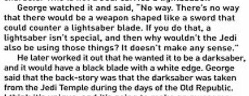
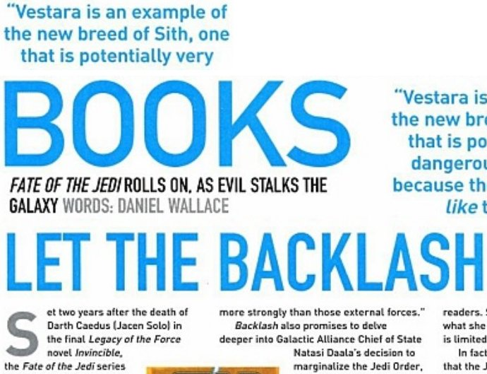
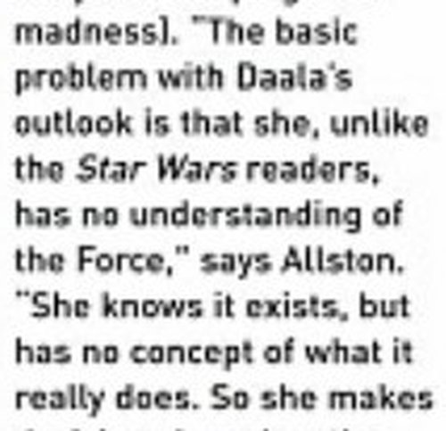
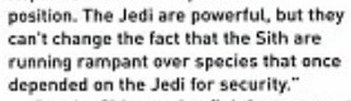
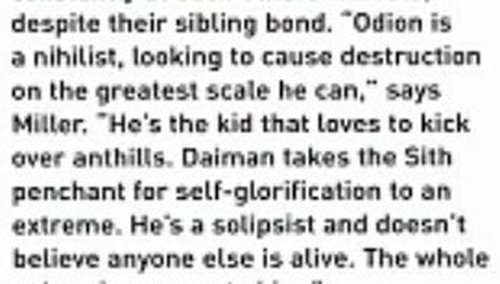

# Owner Material 038 — Star Wars Insider #1–153 plus specials (with The Lucasfilm Fan Club Magazine #1–22): Star Wars Insider #116 (2010)

- **Source:** *Star Wars Insider* magazine (issues 23–153, 1994–2014) and its predecessor *The Lucasfilm Fan Club Magazine* (issues 1–22, 1987–1994), plus seven special editions: articles, interviews, comics and short fiction Secondary source (licensed Legends reference). Scan OCR'd on the box; the scan stays box-only and is **not** published.
- **Method:** every scanned page was OCR'd and machine-screened sentence by sentence for power-relevant statements (fights, kills, defeats, Force feats, rankings, superweapons) that name a character on our roster; each kept sentence is quoted verbatim from the OCR text and has a crop of the printed passage directly under it. Pages with nothing power-relevant are still listed with what is on them.
- **Citation:** "*Star Wars Insider #116* (2010), p.X" by printed page ("scan p.X" where no printed number applies). **Weight:** Licensed magazine: a secondary source. Its short fiction and comics are Legends stories; its articles and interviews sum up or discuss lore and rank below the novels, comics and games they describe.

## scan p.1 (scan page 1)

Page contents: Cover: Matthew Wood (voice of General Grievous); Mandalorian concept art; voicing the clones; Troop Talk; Meet the Ewok (Romba); Cad Bane; Vader vs. Skywalker; Chewbacca. (hand-read)

## scan p.2 (scan page 2)

Page contents: Ad: Hardware Wars 30th Anniversary Special Edition DVD (Ernie Fosselius parody: Fluke Starbucker, Darph Nader). (hand-read)

## scan p.3 (scan page 3)

Page contents: Editor's Welcome (Jonathan Wilkins): Bill Murray Saturday Night Live epigraph; Adidas Star Wars sneakers and the David Beckham/Snoop Dogg commercial; Brian Muir on creating the Vader costume; Matthew Wood; Mandalorian episode design with Dave Filoni; ESB 30th-anniversary storyboards by Ivor Beddoes; Dee Bradley Baker "Clone Chat". (hand-read)

## scan p.4 (scan page 4)

Page contents: Contents: Matthew Wood p14; The Art of War (Mandalorian homeworld concept art, Filoni) p22; Brian Muir p32; Clone Talk (Dee Bradley Baker) p38; Dark Horse retrospective part 3 p44; ESB Vader vs. Luke storyboards p52; Catherine Taber (Padme) p62. (hand-read)

### Stat block notes (game mechanics, not feats)

- Yoda on Grievous (contents epigraph): "More machine than alive, Grievous is—though more dangerous for it." (Jedi Master Yoda, Labyrinth of Evil, quoted in Docking Bay, Star Wars Insider 116, p. 4) (Source: *Star Wars Insider #116* (2010), scan p.4)

## scan p.5 (scan page 5)

Page contents: Departments contents and exclusive variant cover notice: Launch Pad, Books, Comics, Incoming (Adidas line), Ask Lobot, Bantha Tracks, Bounty Hunters, Classic Moment (Cad Bane debut), Interrogation Droid (Debbie Carrington as Romba), Retro (Chewbacca collectibles), Art Wars, Jedi Archive (Chewie). (hand-read)

## scan p.6 (scan page 6)

Page contents: Launch Pad: The Clone Wars "Cat and Mouse" (dir. Kyle Dunlevy): Bail Organa trapped on Separatist-held Christophsis; Anakin and Obi-Wan face Admiral Trench. (hand-read)

## scan p.7 (scan page 7)

Page contents: Launch Pad: The Clone Wars "Bounty Hunters" (dir. Steward Lee): Anakin, Obi-Wan and Ahsoka ally with four bounty hunters to protect a spice farmer from Hondo Ohnaka's pirates. (hand-read)

## scan p.8 (scan page 8)

Page contents: Launch Pad: Hasbro AT-AT (24 inches tall, holds 20 figures, August 2010); James Earl Jones tops the Forbes.com most-trusted-celebrities list; Star Wars Celebration V (August 12-15, 2010, Orlando) ticket details. (hand-read)

## scan p.9 (scan page 9)

Page contents: Ad: Brian's Toys. (hand-read)

## scan p.10 (scan page 10)

Page contents: Launch Pad: Adidas Star Wars campaign (Snoop Dogg, David Beckham, Daft Punk; Beckham blog quote); Tom Angleberger book giveaway; LEGO Star Wars III: The Clone Wars announced (Traveller's Tales, Fall 2010). (hand-read)

## scan p.11 (scan page 11)

Page contents: Interrogation Droid: Debbie Carrington (Romba the Ewok, ROTJ), humorous in-character answers (named after "the great fighter, Rambo"; Chief Chirpa "great leader, but extremely strict"; "Get a wax job already, Chewbacca!"). (hand-read)

## scan p.12 (scan page 12)

Page contents: Subscription ad and statement of ownership. (hand-read)

## scan p.13 (scan page 13)

Page contents: Ad: Calgary Comic & Entertainment Expo (Leonard Nimoy, Billy Dee Williams et al.) and Vulcan, Alberta. (hand-read)

## scan p.14 (scan page 14)

Page contents: Matthew Wood interview (James Burns): began at Lucasfilm Games at 17 as a tester; SoundDroid at Skywalker Sound; supervising sound editor promotion from Rick McCallum on TPM; Ben Burtt mentor; WALL-E award nominations. (hand-read)

## scan p.15 (scan page 15)

Page contents: Matthew Wood interview title spread ("Voice of a Droid"; General Grievous art). (hand-read)

## scan p.16 (scan page 16)

Page contents: Wood interview: learning from Ben Burtt; the supervising sound editor's role (foley, dialogue, re-recording); sounds created from the script before visuals; Wood also voices Poggle the Lesser and the assassin droids. (hand-read)

## scan p.17 (scan page 17)

Page contents: Wood interview: with Dave Acord, mixes an episode every other week; voices Grievous, battle droids, commando droids, tactical droids, super battle droids, assassin droids, Wat Tambor and Poggle the Lesser; There Will Be Blood sound work; hand double for Leonardo da Vinci in Hudson Hawk. (hand-read)

## scan p.18 (scan page 18)

Page contents: Wood sidebar on The Secret of Monkey Island and Tim Schafer (Brutal Legend voice work); TPM sound: every alien has a sound; the Podrace moment with no music; Lucas says sound is 50 percent of the audience experience. (hand-read)

## scan p.19 (scan page 19)

Page contents: Wood: in ROTS most Grievous lines are yelled, so he adjusted for The Clone Wars where Grievous speaks to people; heavy voice processing; "a lot less 'Roger, Roger'" in Season Two (Filoni); cast as Bib Fortuna in TPM's Podrace scene, matching Alan Ruscoe's face. (hand-read)

## scan p.20 (scan page 20)

Page contents: Wood: John Knoll directed his Bib Fortuna shots; recorded bats and Phillip Island penguins in Australia, combined into the Geonosian sounds in AOTC; a Grievous in a tiny bottle seen in Mexico City. (hand-read)

## scan p.21 (scan page 21)

Page contents: Ad: Solomon Kane official movie magazine. (hand-read)

## scan p.22 (scan page 22)

Page contents: The Art of Mandalore (Dave Filoni at a Lucasfilm fan screening of "The Mandalore Plot"; title spread). (hand-read)

## scan p.23 (scan page 23)

Page contents: The Art of Mandalore title spread continued (Obi-Wan in clone armor vs. a darksaber). (hand-read)

## scan p.24 (scan page 24)

Page contents: Filoni on the Mandalorian trooper design: blue and black so they would not look like clones; Death Watch symbol instead of the Boba Fett symbol on Pre Vizsla's back; Kilian Plunkett stretched the helmet; McQuarrie/Johnston Boba Fett concepts. (hand-read)

## scan p.25 (scan page 25)

Page contents: Filoni on Pre Vizsla's helmet (range finder removed so he would not look like Rex; trident symbol, later matched to the Death Watch logo); clone commander and orange-pauldron sandtrooper markings exist so viewers know who is in charge. (hand-read)

## scan p.26 (scan page 26)

Page contents: Filoni on Duchess Satine: her look came from an abandoned Iain McCaig Padme design for TPM that Lucas pulled from his binder; likened to Cate Blanchett. (hand-read)

## scan p.27 (scan page 27)

Page contents: Filoni on Mandalore: Lucas wanted a desolate white-sand planet with cube-like buildings, a domed capital (Moebius influence) and layers of glass; Boba Fett armor shapes embedded in the architecture. (hand-read)

## scan p.28 (scan page 28)

Page contents: Filoni: Pre Vizsla's darksaber was originally a vibroblade; promised Jon Favreau (Pre Vizsla) an eFX replica. (hand-read)

- **Pre Vizsla** — entry/section: Lucas' darksaber back-story (via Filoni): ""George watched it and said, "No way. There's no way that there would be a weapon shaped like a sword that could counter a lightsaber blade. If you do that, a lightsaber isn't special, and then why wouldn't the Jedi also be using those things? It doesn't make any sense." He later worked it out that he wanted it to be a darksaber, and it would have a black blade with a white edge. George said that the back-story was that the darksaber was taken from the Jedi Temple during the days of the Old Republic." —Dave Filoni, Star Wars Insider 116, p. 28" Source: *Star Wars Insider #116* (2010), scan p.28
  

## scan p.29 (scan page 29)

Page contents: Ad: Total Sci-Fi Online. (hand-read)

## scan p.30 (scan page 30)

Page contents: Retro (Gus Lopez): Chewbacca collectibles: Jim Rumpf California Originals tankard (a Lucas favorite); Kenner Early Bird Chewbacca; "Wookies [sic] Need Love Too" bumper sticker; Fanboys "Flash if You Love Wookies!" sign. (hand-read)

## scan p.31 (scan page 31)

Page contents: Retro: Chewbacca Underoos and slippers; Kinder Egg hippo and M&M; "Chewy Choc Chip" muesli bars; Lucasfilm 2001 holiday card; ROTS employee statue; ILM glass-jar statue; Orange UK cell phone cover. (hand-read)

## scan p.32 (scan page 32)

Page contents: Brian Muir interview (Jonathan Wilkins), "Creating the Sith": apprentice sculptor/modeler at Elstree (the 13th candidate); mentor Arthur Healey brought him onto Star Wars, expected six weeks, worked over four months; sculpted the original Vader armor at age 23. (hand-read)

## scan p.33 (scan page 33)

Page contents: Brian Muir interview title spread (Vader helmet art). (hand-read)

## scan p.34 (scan page 34)

Page contents: Muir: David Prowse cast head to toe; Vader mask sculpted in clay, plaster-cast and sharpened, then helmet, then fiberglass; sculpted chest armor, shoulder bells and shins from McQuarrie paintings; John Mollo's line drawing; John Barry suggested the "tear ducts" and extended tubes; Lucas approved with no changes; no contact with Prowse until a 2004 convention. (hand-read)

## scan p.35 (scan page 35)

Page contents: Muir: about five weeks total on Vader; two production helmets kept in a locked box plus a third for special effects; finished Liz Moore's C-3PO after she left at the end of January 1976. Sidebar: Joe Johnston's "McQuarrie Vader" Halloween costume for a 1976 ILM party (styrene over a discarded fiberglass body mold; helmet from a toy German army helmet; crushed and discarded in 1978 except the helmet), interviewed by John Brosio. (hand-read)

## scan p.36 (scan page 36)

Page contents: Muir: sculpted C-3PO's hand plates directly onto Anthony Daniels' hands; stormtrooper armor sculpted first on an average-sized cast, with gaps for movement and differing actor sizes; Vader mask back discarded as too claustrophobic, chin vent added late; selected filmography (Alien space jockey, Raiders, Harry Potter). (hand-read)

## scan p.37 (scan page 37)

Page contents: Ad: Star Trek Magazine. (hand-read)

## scan p.38 (scan page 38)

Page contents: Dee Bradley Baker interview (James Burns), "Attack of the Clones" title spread: the man who voices the Republic's clone army. (hand-read)

## scan p.39 (scan page 39)

Page contents: Dee Bradley Baker title spread continued. (hand-read)

## scan p.40 (scan page 40)

Page contents: Baker: performer since second grade, moved to voice-over in his thirties; worked with Dave Filoni on Avatar: The Last Airbender; Temuera Morrison's film performances were the template, the writers fleshed the clones out. (hand-read)

## scan p.41 (scan page 41)

Page contents: Baker: "Rookies" recorded voices separately to keep distinctions; had expected all clones to sound the same. (hand-read)

## scan p.42 (scan page 42)

Page contents: Baker: Yoda's "fortune-telling" readings of the clones in "Ambush"; favorites "Rookies" and "Innocents of Ryloth"; Season Two Geonosis episodes; other roles (Boba Fett in TFU Ultimate Sith Edition, Gollum, Nightcrawler). (hand-read)

## scan p.43 (scan page 43)

Page contents: Ad: Titan magazine subscriptions. (hand-read)

## scan p.44 (scan page 44)

Page contents: Dark Horse retrospective part 3 (Dan Wallace): sales rose after the prequels ended; Randy Stradley on Purge and Dark Times (Jedi Order on the brink, hunted by Darth Vader; "Episode III set the tone"); Knights of the Old Republic introduced Zayne Carrick and Gryph and fleshed out the Mandalorians; Dave Marshall quote. (hand-read)

## scan p.45 (scan page 45)

Page contents: Art: Knights of the Old Republic cover montage (two Twi'lek/Zeltron-style women dueling, one with a lightsaber). (hand-read)

## scan p.46 (scan page 46)

Page contents: Dark Horse: Legacy set a full century later with Cade Skywalker, a revived Sith Empire and Imperial Knights ("we decided to move in front of the novels' continuity wave"); Empire relaunched as Rebellion; Janek Sunber revealed as "Tank" from ANH. (hand-read)

## scan p.47 (scan page 47)

Page contents: Dark Horse: Sunber as a Tatooine farm boy who chose differently from Luke; Clone Wars comics did not find a large core audience (Stradley). Reading guide "The Dark Horse Years" (crop-verified): Purge (2005, Vader hunts Jedi survivors after Order 66); KOTOR (2006-2010, nearly 4000 years before the movies, Mandalorian Wars, 50 issues); Rebellion (2006-2008); Legacy (more than 130 years after the movies, Cade Skywalker); Dark Times (2006 onward). (hand-read)

## scan p.48 (scan page 48)

Page contents: Dark Horse: Vector crossover (a Sith spirit and a stasis-frozen Jedi Knight linking KOTOR, Dark Times, Rebellion and Legacy; writers' summit with John Ostrander and John Jackson Miller; "the kind of crossover you can only do once"); Invasion and Jedi; Dark Horse 25th anniversary in 2011. (hand-read)

## scan p.49 (scan page 49)

Page contents: Reading guide continued: Vector (2008), The Force Unleashed graphic novel (Haden Blackman), The Clone Wars comics and digests, Star Wars Adventures, The Old Republic (Threat of Peace), Invasion (Refugees), Jedi (2010, the Republic's Dark Age a thousand years before the Chosen One). (hand-read)

## scan p.50 (scan page 50)

Page contents: Art Wars: Chicago artist Michael Rakowitz's exhibition on Star Wars and Saddam Hussein: a Fedayeen helmet designed by Uday Hussein resembling Darth Vader's helmet. (hand-read)

## scan p.51 (scan page 51)

Page contents: Art Wars: Saddam's Victory Arch and the ESB Coca-Cola poster with crossed lightsabers; the Iraqi army reportedly marched under the monument to the Star Wars theme; Rowena Morrill paintings found in Saddam's houses; exhibition at Tate Modern until May 3. (hand-read)

## scan p.52 (scan page 52)

Page contents: ESB storyboards by Ivor Beddoes (intro): Beddoes (died 1981; Black Narcissus, The Red Shoes, Diamonds Are Forever, Superman) worked with Irvin Kershner on blocking and in-camera tricks; storyboarded Hoth, Dagobah and the Luke-Vader duel; "Cloud City Action Sketches" completed March 12, 1979; differences from the final film in Luke's escape from the carbon-freezing chamber and plunge into the reactor shaft. (hand-read)

## scan p.53 (scan page 53)

Page contents: Beddoes storyboards: Luke enters the carbon-freezing chamber ("Lord Vader, I feel your presence"); notes on Norman Reynolds repainting a passageway set. (hand-read)

## scan p.54 (scan page 54)

Page contents: Beddoes storyboards: Luke and Vader fight; Vader slashes through a support. (hand-read)

## scan p.55 (scan page 55)

Page contents: Beddoes storyboards: Luke attacks aggressively (stunt coordinator Peter Diamond); Luke's sword goes sailing away; Luke drives Vader back up the stairs. (hand-read)

## scan p.56 (scan page 56)

Page contents: Beddoes storyboards: in-camera trick for Vader appearing to fly back; the hilt flies into Luke's hand (reverse action); matte shot of the duel. (hand-read)

## scan p.57 (scan page 57)

Page contents: Beddoes storyboards: Luke drops behind steam, climbs down and finds an angled shaft; Vader waits motionless. (hand-read)

## scan p.58 (scan page 58)

Page contents: Beddoes storyboards: Vader telekinetically hurls machinery and a flood of objects at Luke, who slices some but is hit, bruised and bleeding; a large piece smashes the window and suction drags Luke out; Luke hangs from a gantry over the reactor "a mile below"; toffee-glass stunt notes. To be continued. (hand-read)

## scan p.59 (scan page 59)

Page contents: Ad: Lost official magazine. (hand-read)

## scan p.60 (scan page 60)

Page contents: Jedi Archive (rarely seen Lucasfilm archive images): Chewbacca with bowcaster; Chewbacca and C-3PO; Peter Mayhew taking direction from George Lucas on the ROTS set. (hand-read)

## scan p.61 (scan page 61)

Page contents: Jedi Archive captions: Chewbacca takes aim as a mynock swoops by; Chewie and C-3PO (Anthony Daniels); Han Solo frozen out. (hand-read)

## scan p.62 (scan page 62)

Page contents: Catherine Taber interview (James Burns), "The Perils of Padme" title spread. (hand-read)

## scan p.63 (scan page 63)

Page contents: Catherine Taber title spread continued (Padme art). (hand-read)

## scan p.64 (scan page 64)

Page contents: Catherine Taber interview: approach to Padme, honoring the film version; working with Matt Lanter and James Arnold Taylor. (hand-read)

## scan p.65 (scan page 65)

Page contents: Taber: voiced Princess Leia in The Force Unleashed; her first voice-over job was Mission Vao in KOTOR; studied Carrie Fisher's ANH performance. (hand-read)

## scan p.66 (scan page 66)

Page contents: Taber: favorite moments ("Bombad Jedi", "Destroy Malevolence"); manning the gunship. (hand-read)

## scan p.67 (scan page 67)

Page contents: Taber: favorite episodes ("Rookies", "Innocents of Ryloth" playing Numa, "Senate Spy" with Robin Atkin Downes as Clovis); glimpses of Anakin's future. (hand-read)

## scan p.68 (scan page 68)

Page contents: Ad: Supernatural magazine. (hand-read)

## scan p.69 (scan page 69)

Page contents: Contents: Books, Ask Lobot, Adidas collection, Bantha Tracks, Bounty Hunters, Classic Moment Cad Bane "Hostage Crisis". (hand-read)

## scan p.70 (scan page 70)

Page contents: Books: Fate of the Jedi: Backlash (March 9), set two years after Darth Caedus's death; Jedi suffering a mysterious plague of madness; Abeloth (Allston keeps mum); Luke and Ben battle the Nightsisters on Dathomir. (hand-read)

- **Vestara Khai** — entry/section: Allston on Vestara Khai as the new breed of Sith: ""is an example of the new breed of Sith, one that is potentially very dangerous to the Jedi because they are so much like the Jedi." —Aaron Allston, Star Wars Insider 116, p. 70" Source: *Star Wars Insider #116* (2010), scan p.70
  
- **Admiral Daala** — entry/section: Allston on Daala and the Force: ""The basic problem with Daala's outlook is that she, unlike the Star Wars readers, has no understanding of the Force. She knows it exists, but has no concept of what it really does." —Aaron Allston, Star Wars Insider 116, p. 70" Source: *Star Wars Insider #116* (2010), scan p.70
  

## scan p.71 (scan page 71)

Page contents: Books: Star Wars: A Scanimation Book (Rufus Butler Seder), 12 moments including Luke vs. Vader, Yoda, Jango Fett, Death Star II explosion. Ask Lobot (anonymous): why Chewbacca got no medal in ANH, Lucas's 1977 in-character interview as C-3PO (Wookiee ceremony, later Life Day), novelization, Marvel UK, Tag and Bink, 1997 MTV award. (hand-read)

## scan p.72 (scan page 72)

Page contents: Comics: The Old Republic: Threat of Peace (Robert Chestney, Alex Sanchez) preview, set 300 years after KOTOR and nearly 3,600 years before the prequels; Sith Empire's treacherous peace treaty leads to a cold war (crop-verified). Panels: "Master Dar'Nala!"; "Satele! I hoped you would come..." (hand-read)

## scan p.73 (scan page 73)

Page contents: Threat of Peace preview: a Sith warrior cuts down a Jedi ("You'll have the honor of being the first Jedi to die today--"); explosion. (hand-read)

## scan p.74 (scan page 74)

Page contents: Comics: Star Wars: Jedi (John Jackson Miller), set a thousand years before Episode I in the Dark Age of the Republic before Darth Bane's Rule of Two; Kerra Holt, 18-year-old protegee of Vannar Treece, alone in Sith space; Sith siblings Lord Odion and Lord Daiman; tie-in Del Rey novel in 2011. Boba Fett Omnibus contents (Death, Lies, and Treachery; Man with a Mission; Enemy of the Empire, Fett vs. Vader; Twin Engines of Destruction vs. Jodo Kast; The Yavin Vassilika). (hand-read)

- **none** — entry/section: Miller on the Dark Age Jedi and Sith: ""The Jedi are powerful, but they can't change the fact that the Sith are running rampant over species that once depended on the Jedi for security." —John Jackson Miller, Star Wars Insider 116, p. 74" Source: *Star Wars Insider #116* (2010), scan p.74
  
- **Lord Daiman** — entry/section: Miller on Odion and Daiman: ""Odion is a nihilist, looking to cause destruction on the greatest scale he can. He's the kid that loves to kick over anthills. Daiman takes the Sith penchant for self-glorification to an extreme. He's a solipsist and doesn't believe anyone else is alive." —John Jackson Miller, Star Wars Insider 116, p. 74" Source: *Star Wars Insider #116* (2010), scan p.74
  

## scan p.75 (scan page 75)

Page contents: Art: Boba Fett Omnibus cover art. (hand-read)

## scan p.76 (scan page 76)

Page contents: Subscription and back-issue ad. (hand-read)

## scan p.77 (scan page 77)

Page contents: Incoming (Chris Spitale): Hasbro The Clone Wars Wave 2 figures. (hand-read)

## scan p.78 (scan page 78)

Page contents: Incoming: Hasbro 2010 Battle Packs (Birth of Darth Vader, Holocron Heist, Tatooine Desert Ambush, Jedi Showdown). (hand-read)

## scan p.79 (scan page 79)

Page contents: Incoming: Galactic Heroes Cinema Scenes. Ask Lobot (reader name omitted): why Bail Organa stayed in the Imperial Senate (Delegation of Two Thousand; exposed in The Force Unleashed when Vader's secret apprentice gathers the Rebel founders; Tarkin uses Alderaan against Leia). (hand-read)

## scan p.80 (scan page 80)

Page contents: Incoming: Gentle Giant Faie/Fox mini busts, animated Slave Leia maquette, Darth Revan mini bust; LEGO Freeco Speeder with the Talz chieftain. (hand-read)

## scan p.81 (scan page 81)

Page contents: Incoming: Sideshow 501st Legion "Vader's Fist" clone trooper, Emperor Palpatine 12-inch figure and Imperial Throne. (hand-read)

## scan p.82 (scan page 82)

Page contents: Incoming: F-Toys vehicle collection; Disney Jedi Mickey's R2-MK. Ask Lobot (reader name omitted): why Obi-Wan sends Luke to Yoda rather than Qui-Gon (Qui-Gon taught Obi-Wan to commune from the netherworld; Yoda instructed all younglings). (hand-read)

## scan p.83 (scan page 83)

Page contents: Incoming: Mimoco MIMOBOT Series 5 (ANH). (hand-read)

## scan p.84 (scan page 84)

Page contents: Adidas Originals Star Wars collection interview (Dean Lokes, Jess Weinstein). (hand-read)

## scan p.85 (scan page 85)

Page contents: Adidas interview: Episode IV focus, Superskate stormtrooper shoe, Darth Vader track top. (hand-read)

## scan p.86 (scan page 86)

Page contents: Adidas interview: Yoda boat shoe with Dagobah-like natural materials. (hand-read)

## scan p.87 (scan page 87)

Page contents: Adidas interview: limited editions, Micropacer Famous Scenes shoe limited to 1,977 pieces; apparel. (hand-read)

## scan p.88 (scan page 88)

Page contents: Bantha Tracks editorial (Mary Franklin) on fans and canon changes; fan costume photo (name omitted). (hand-read)

## scan p.89 (scan page 89)

Page contents: Bantha Tracks: Padawan Pen Pals, kids' fan photos (names omitted). (hand-read)

## scan p.90 (scan page 90)

Page contents: Bantha Tracks: fan art gallery (names omitted). (hand-read)

## scan p.91 (scan page 91)

Page contents: Bantha Tracks: fan art and submission guidelines (names omitted). (hand-read)

## scan p.92 (scan page 92)

Page contents: Bounty Hunters: reader photos with Ray Park and David Prowse (names omitted). (hand-read)

## scan p.93 (scan page 93)

Page contents: Bounty Hunters: reader photo with Temuera Morrison (name omitted); call for submissions. (hand-read)

## scan p.94 (scan page 94)

Page contents: Classic Moment: The Clone Wars "Hostage Crisis" (Season One, Episode 22, aired March 20, 2009; Eoghan Mahony, directed by Giancarlo Volpe); Filoni and Volpe quotes on Cad Bane; script excerpt, Cad Bane lands at the Senate Office Buildings. (hand-read)

## scan p.95 (scan page 95)

Page contents: Classic Moment script: Aurra Sing snipes Senate guards from a tower; Bane shoots the remaining guards; team of bounty hunters (Weequay, fish guy, assassin droids, Ziro's battle droids). Filoni on Bane as Lee Van Cleef counterpoint to Boba Fett; Duros sidebar; rocket boots modeled after R2-D2's side rockets. (hand-read)

### Stat block notes (game mechanics, not feats)

- Bane pits his skills against the Jedi: "Patterned after the laconic gunslingers of spaghetti Westerns, Bane is lethally cool and relishes being a bad guy. He is unflappable in the face of danger, and even welcomes the opportunity to pit his formidable skills against the legendary prowess of the Jedi Knights." (Classic Moment: Hostage Crisis, Star Wars Insider 116, p. 95) (Source: *Star Wars Insider #116* (2010), scan p.95)

## scan p.96 (scan page 96)

Page contents: Ad: StarWarsShop Death Star cookie jar. (hand-read)

## scan p.97 (scan page 97)

Page contents: Ad: StarWarsShop exclusives. (hand-read)

## scan p.98 (scan page 98)

Page contents: Next issue: Season Two finale mystery guest; Anna Graves (Satine) interview. (hand-read)

## scan p.99 (scan page 99)

Page contents: Ad: Official Pix autographs. (hand-read)

## scan p.100 (scan page 100)

Page contents: Ad: Hasbro Legacy Collection Droid Factory (YVH-1). (hand-read)

