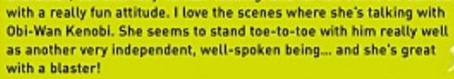
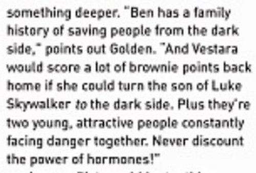
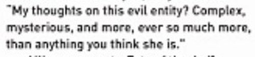

# Owner Material 038 — Star Wars Insider #1–153 plus specials (with The Lucasfilm Fan Club Magazine #1–22): Star Wars Insider #117 (2010)

- **Source:** *Star Wars Insider* magazine (issues 23–153, 1994–2014) and its predecessor *The Lucasfilm Fan Club Magazine* (issues 1–22, 1987–1994), plus seven special editions: articles, interviews, comics and short fiction Secondary source (licensed Legends reference). Scan OCR'd on the box; the scan stays box-only and is **not** published.
- **Method:** every scanned page was OCR'd and machine-screened sentence by sentence for power-relevant statements (fights, kills, defeats, Force feats, rankings, superweapons) that name a character on our roster; each kept sentence is quoted verbatim from the OCR text and has a crop of the printed passage directly under it. Pages with nothing power-relevant are still listed with what is on them.
- **Citation:** "*Star Wars Insider #117* (2010), p.X" by printed page ("scan p.X" where no printed number applies). **Weight:** Licensed magazine: a secondary source. Its short fiction and comics are Legends stories; its articles and interviews sum up or discuss lore and rank below the novels, comics and games they describe.

## scan p.1 (scan page 1)

Page contents: Cover: "The Return of Boba Fett: Ready for Revenge!" (young Boba with Jango's helmet, Bossk, Aurra Sing); "On Your Trail! Creating the Bounty Hunters"; "Romancing a Jedi! Satine's Story Revealed". Issue #117, May/June 2010. (hand-read)

## scan p.2 (scan page 2)

Page contents: Ad: Movie Magic Screenwriter and Dramatica Pro software. (hand-read)

## scan p.3 (scan page 3)

Page contents: Editor's welcome (Jonathan Wilkins) with Admiral Piett epigraph from ESB ("Bounty hunters. We don't need their scum."); Boba Fett facts teaser for p. 80; contact details. (hand-read)

## scan p.4 (scan page 4)

Page contents: Contents: Daniel Logan p13, Bounty Hunters concept art with Filoni p22, David Acord p28, Anna Graves p32, ESB storyboards p40, Boba Fett history p50, Alan Ruscoe p56; Jango Fett AOTC epigraph. (hand-read)

## scan p.5 (scan page 5)

Page contents: Contents: Books (Allies) p40?, Comics, Incoming p66, Bounty Hunters p72, Bantha Tracks p74, Classic Moment (Luke encounters Jabba) p78; edition covers. (hand-read)

## scan p.6 (scan page 6)

Page contents: Launch: coming soon in The Clone Wars, "R2 Come Home" (Giancarlo Volpe) and "Lethal Trackdown" (Dave Filoni), both April 30. (hand-read)

## scan p.7 (scan page 7)

Page contents: News: death of Gareth Wigan (Fox production executive) with George Lucas tribute; Temuera Morrison cast as Abin Sur in Green Lantern; Lucas receives Common Sense Media Lifetime Achievement Award (R2-D2 and C-3PO accept); LEGO minifigure game-show stunt. (hand-read)

## scan p.8 (scan page 8)

Page contents: News: Celebration V (Orlando, August 12-15) Official Pix autograph plans; making of the cover with Lucasfilm Animation Image Unit (Rob Gianino; pose artist Tu-Anh Nguyen; Boba Fett, Aurra Sing and Bossk). (hand-read)

## scan p.9 (scan page 9)

Page contents: Cover making: lighting by Kyle Long; credits; masthead. (hand-read)

## scan p.10 (scan page 10)

Page contents: Interrogation Droid: humorous Q&A with Jeremy Bulloch about Boba Fett (Slave I's interior, Wookiee braids, Sarlacc). Parody, not in-universe. (hand-read)

## scan p.11 (scan page 11)

Page contents: Ad: WWE comics. (hand-read)

## scan p.12 (scan page 12)

Page contents: Ad: Solomon Kane movie souvenir magazine. (hand-read)

## scan p.13 (scan page 13)

Page contents: Daniel Logan interview (Jonathan Wilkins), "Boba Fett Is Back!" title page. (hand-read)

## scan p.14 (scan page 14)

Page contents: Logan: returning as Boba in The Clone Wars; Boba older and driven by his father's death. Pull quote is TCW episode dialogue. (hand-read)

## scan p.15 (scan page 15)

Page contents: Logan: Boba about 12 years old in TCW, voice lower and more serious. Pull quote is TCW dialogue. (hand-read)

## scan p.16 (scan page 16)

Page contents: Logan: Boba refuses to accept the clones ("I'm no soldier, I'm no clone!"); recording with Dave Filoni; Takapu voice work. (hand-read)

## scan p.17 (scan page 17)

Page contents: Logan: Takapu; the fans make Boba enduring; Jango and young Boba tattoo. Pull quote is TCW dialogue. (hand-read)

## scan p.18 (scan page 18)

Page contents: Logan: favorite toy (young Boba LEGO); would play Boba again. (hand-read)

## scan p.19 (scan page 19)

Page contents: Ad: Total Sci-Fi Online. (hand-read)

## scan p.20 (scan page 20)

Page contents: My Star Wars: Peter Serafinowicz (voice of Darth Maul) on becoming a fan, Darth Maul toy, meeting Ian McDiarmid, Lewis MacLeod (Sebulba). (hand-read)

## scan p.21 (scan page 21)

Page contents: Serafinowicz: also voiced a battle droid ("Let me see your identification") and a Gungan in TPM; favorite scene C-3PO and R2-D2 in the sandcrawler; Hammerhead figure. (hand-read)

## scan p.22 (scan page 22)

Page contents: Unusual Suspects: Dave Filoni presents the TCW Season Two bounty hunters (intro). (hand-read)

## scan p.23 (scan page 23)

Page contents: Filoni on bounty hunter costumes (colorful gear, "NASCAR-effect" logos, Boba Fett's armor colors); paying off Rise of the Bounty Hunters. (hand-read)

## scan p.24 (scan page 24)

Page contents: Sugi (Jackson Sze illustrations): a Zabrak inspired by Eeth Koth, given horns; pirate-like shoulders; scenes with Obi-Wan. (hand-read)

- **none** — entry/section: Filoni on Sugi: ""She seems to stand toe-to-toe with him really well as another very independent, well-spoken being... and she's great with a blaster!" —Dave Filoni, Star Wars Insider 117, p. 24" Source: *Star Wars Insider #117* (2010), scan p.24
  

## scan p.25 (scan page 25)

Page contents: Embo (Pat Presley illustrations): design from George Lucas's earlier concept work; Steward Lee and Filoni expanded his action; speaks an invented alien tongue. (hand-read)

## scan p.26 (scan page 26)

Page contents: Seripas (Wayne Lo breakdown): a big suit of armor with a little guy inside; role cut down for time; fan club Vader patch on his flight suit. (hand-read)

## scan p.27 (scan page 27)

Page contents: Rumi Paramita (David Le Merrer illustrations): started from a Lucas design, a very small mouse-like alien with a large head and thin limbs. (hand-read)

## scan p.28 (scan page 28)

Page contents: David Acord interview (James Burns), "Sound Effects!" title spread. (hand-read)

## scan p.29 (scan page 29)

Page contents: Acord: sound designer role on The Clone Wars, working with Matthew Wood, George Lucas and Dave Filoni. (hand-read)

## scan p.30 (scan page 30)

Page contents: Acord: favorite character EV-A4-D ("Lair of Grievous"), Grievous's medical droid who put him back together; favorite episode "Landing at Point Rain"; also voices Pilf Mukmuk, Rotta the Huttlet, Pune Zignat, LEP-86C8. (hand-read)

## scan p.31 (scan page 31)

Page contents: Ad: Firefly book. (hand-read)

## scan p.32 (scan page 32)

Page contents: Anna Graves interview (Jonathan Wilkins), "The Duchess and the Jedi" title spread. (hand-read)

## scan p.33 (scan page 33)

Page contents: Title spread continued (Obi-Wan art). (hand-read)

## scan p.34 (scan page 34)

Page contents: Graves: Satine's past with Obi-Wan; modeled on Cate Blanchett's Queen Elizabeth plus a little Princess Leia; recording order "Voyage of Temptation", "The Mandalore Plot", "The Duchess of Mandalore". (hand-read)

## scan p.35 (scan page 35)

Page contents: Graves: approach to short recording sessions. (hand-read)

## scan p.36 (scan page 36)

Page contents: Graves: Mandalorian history, Concordian dialect; Satine first attracted to Obi-Wan's strength, wit and commitment; rapport with James Arnold Taylor; almost fell off the speeder. (hand-read)

## scan p.37 (scan page 37)

Page contents: Graves: video games vs. animation; favorite scenes (Pre Vizsla's lounge in "The Mandalore Plot"; the simultaneous "Fine" in "Voyage of Temptation"). (hand-read)

### Stat block notes (game mechanics, not feats)

- Leia's stormtrooper count: "In A New Hope Leia takes down more stormtroopers than any other character." (Star Wars Greatest Females!, Star Wars Insider 117, p. 37) (Source: *Star Wars Insider #117* (2010), scan p.37)
- Padme kicks the nexu: "Despite being the intended main course for the fearsome Nexu, Padmé administers a well-timed kick to the terrifying beast, buying the heroes more time in their efforts to escape." (Star Wars Greatest Females!, Star Wars Insider 117, p. 37) (Source: *Star Wars Insider #117* (2010), scan p.37)
- Mara Jade never gave up: "A hardened warrior and assassin, Mara Jade gradually became a loving wife to Luke Skywalker and a devoted mother to their children, proving that strength does not always come from the ability to fight. WHY SHE'S COOL: As hard as nails in battle, Mara may have gone down after a brutal fight, but she never gave up." (Star Wars Greatest Females!, Star Wars Insider 117, p. 37) (Source: *Star Wars Insider #117* (2010), scan p.37)
- Mon Mothma's goal: "A graceful leader, Mon Mothma's ultimate goal of restoring peace to the galaxy was eventually realized following the Battle of Endor." (Star Wars Greatest Females!, Star Wars Insider 117, p. 37) (Source: *Star Wars Insider #117* (2010), scan p.37)
- Yaddle gave her life: "A kindly Jedi who cared deeply for the younglings in her care, Yaddle was a Jedi Consular who selflessly gave her life to save others. WHY SHE'S COOL: A female of Yoda's species, Yaddle exhibited a sense of justice and strength that epitomized the Jedi way of life." (Star Wars Greatest Females!, Star Wars Insider 117, p. 37) (Source: *Star Wars Insider #117* (2010), scan p.37)

## scan p.38 (scan page 38)

Page contents: Retro (Gus Lopez): Jawa collectibles, Kenner 12-back vinyl-cape Jawa, foreign releases (Lili Ledy removable hood), large-size Jawa, unreleased Bend Ems Jawa. (hand-read)

## scan p.39 (scan page 39)

Page contents: Retro Jawas: Regal plush, fan club buttons, General Mills stickers, bop bag, radio-controlled sandcrawler, McQuarrie 1994 holiday card, JediCon T-shirt, Jawa garden gnome. (hand-read)

## scan p.40 (scan page 40)

Page contents: ESB storyboards by Ivor Beddoes, part 2 (J. W. Rinzler), "Confrontation in Cloud City! The Fight Continues"; story so far. (hand-read)

## scan p.41 (scan page 41)

Page contents: Beddoes storyboards: Luke gets under Vader's guard (heat blister on Vader's armor); Vader's sword cleaves through equipment that falls down the reactor shaft. (hand-read)

## scan p.42 (scan page 42)

Page contents: Beddoes storyboards: storyboard for Vader's reveal of fatherhood missing for security reasons; Luke plunges into the reactor shaft (black-velvet wire rig). (hand-read)

## scan p.43 (scan page 43)

Page contents: Beddoes storyboards: Luke hurtles down toward the reactor a mile below, then is blown upward and sucked into an intake ventilation tunnel; Vader watches and exits. (hand-read)

## scan p.44 (scan page 44)

Page contents: Beddoes storyboards: with a useless arm Luke catches a bar projection beneath Cloud City; position utterly hopeless; Millennium Falcon speeds in. (hand-read)

## scan p.45 (scan page 45)

Page contents: Beddoes storyboards: Luke slides down the tunnel hugging his injured arm and drops through the grill. (hand-read)

## scan p.46 (scan page 46)

Page contents: Beddoes storyboards: Luke hangs in harness; Leia and Chewie as Luke vanishes. (hand-read)

## scan p.47 (scan page 47)

Page contents: Beddoes storyboards: matte painting of Cloud City's underside; the Falcon rescues Luke. (hand-read)

## scan p.48 (scan page 48)

Page contents: Jedi Archive: rarely seen images from the Lucasfilm archives (Zam Wesell). (hand-read)

## scan p.49 (scan page 49)

Page contents: Jedi Archive captions: Zam Wesell's breathpack; Leeanna Walsman with Anthony Daniels (Dannl Faytonni) and Matt Doran (Elan Sleazebaggano) in the Outlander Club; Lucas directs Walsman. (hand-read)

## scan p.50 (scan page 50)

Page contents: "Boba Fett: A Bounty Hunter's Journey" (Leland Y. Chee), title spread with Boba Fett photo. (hand-read)

## scan p.51 (scan page 51)

Page contents: Boba Fett history intro: messy EU continuity (Journeyman Protector from Concord Dawn back-story, rewritten after AOTC); Holiday Special cartoon (Nelvana); Kenner mail-away rocket-firing figure. (hand-read)

## scan p.52 (scan page 52)

Page contents: Boba Fett history: ESB debut (four lines); "The Frozen World of Ota" newspaper strip; Marvel Star Wars #68 link to the Mandalorian supercommandos; Droids "Race to the Finish" (Sise Fromm hires Fett); Galaxy Series 7 Dan Brereton card. (hand-read)

## scan p.53 (scan page 53)

Page contents: Boba Fett history: Tales of the Bounty Hunters (Jaster Mereel past, a man convicted of murder; views on Leia as a gift); Special Edition shots; Essential Guide to Characters (Journeyman Protector from Concord Dawn); Rebel Dawn (news of Shira Brie's death); Bounty Hunter Wars (D'harhan, a bounty hunter with a blaster for a head); datafile (Mandalorian battle armor, Slave I). (hand-read)

### Stat block notes (game mechanics, not feats)

- Shadows of the Empire bounty hunter battles: "These comics focused on Fett's battles with fellow bounty hunters including IG-88, Bossk, 4-LOM, and Zuckuss to claim the bounty on Han Solo." (Boba Fett: A Bounty Hunter's Journey, Star Wars Insider 117, p. 53) (Source: *Star Wars Insider #117* (2010), scan p.53)

## scan p.54 (scan page 54)

Page contents: Boba Fett history: Underworld (Fett protects the competitors for the Yavin Vassilika); Jango Fett and Zam Wesell one-shots; post-AOTC overhaul (Jango born on Concord Dawn, Jaster Mereel adopted Jango); "Outbid but Never Outgunned" (Sintas; daughter Ailyn Vel, later in Bloodlines); Scholastic Boba Fett series (Aurra Sing tutelage, vendetta against Mace Windu, knows Dooku is Tyranus). (hand-read)

### Stat block notes (game mechanics, not feats)

- Boba Fett survives facing Vader: "In Boba Fett: Enemy of the Empire #4, again by John Wagner, the bounty hunter narrowly escaped with his life after facing off against Darth Vader on the planet Maryx Minor." (Boba Fett: A Bounty Hunter's Journey, Star Wars Insider 117, p. 54) (Source: *Star Wars Insider #117* (2010), scan p.54)

## scan p.55 (scan page 55)

Page contents: Boba Fett history: Infinities ESB unhelmeted Fett; Episode II Adventures (Jango and Boba vs. Cradossk and Bossk); Empire #4 "Betrayal" (Boba comes to Vader's aid before ANH); Last of the Jedi (Fett and D'harhan hunt Jedi); TCW Season Two concept art. (hand-read)

### Stat block notes (game mechanics, not feats)

- Jango Fett greatest bounty hunter: "The theatrical release of Attack of the Clones finally gave us George Lucas's true vision of Boba Fett's past as the clone of Jango Fett, the galaxy's greatest bounty hunter and the template for the Republic's mysterious clone army." (Boba Fett: A Bounty Hunter's Journey, Star Wars Insider 117, p. 55) (Source: *Star Wars Insider #117* (2010), scan p.55)

## scan p.56 (scan page 56)

Page contents: Alan Ruscoe interview (Jonathan Wilkins), "Phantom Menace": originally contracted as Plo Koon, then Daultay Dofine and Bib Fortuna; masks make you recyclable. (hand-read)

## scan p.57 (scan page 57)

Page contents: Ruscoe: prosthetics vs. the Plo Koon mask; Frank Oz improvising as Yoda; played Lott Dod in AOTC (Silas Carson in TPM); Bib Fortuna makeup times (Mike Carter longer in ROTJ). (hand-read)

## scan p.58 (scan page 58)

Page contents: Subscription ad. (hand-read)

## scan p.59 (scan page 59)

Page contents: Blaster section contents (edited by Neil Edwards): Invasion cover (Finn Galfridian faces the Yuuzhan Vong). (hand-read)

## scan p.60 (scan page 60)

Page contents: Books (Daniel Wallace): Fate of the Jedi: Allies, Jedi/Sith coalition; Golden: "Sith don't trust anybody, because they themselves cannot be trusted"; Daala, Hutts; Abeloth as FOTJ's nightmarish personification of evil; midpoint event comparable to Sacrifice. Ask Lobot (reader name omitted): wampa physiology conserves heat so wampas do not show on most life-form sensors; faint scent. (hand-read)

- **Ben Skywalker; Vestara Khai** — entry/section: Golden on Ben and Vestara: ""Ben has a family history of saving people from the dark side. And Vestara would score a lot of brownie points back home if she could turn the son of Luke Skywalker to the dark side. Plus they're two young, attractive people constantly facing danger together. Never discount the power of hormones!" —Christie Golden, Star Wars Insider 117, p. 60" Source: *Star Wars Insider #117* (2010), scan p.60
  
- **Abeloth** — entry/section: Golden on Abeloth: ""My thoughts on this evil entity? Complex, mysterious, and more, ever so much more, than anything you think she is." —Christie Golden, Star Wars Insider 117, p. 60" Source: *Star Wars Insider #117* (2010), scan p.60
  

## scan p.61 (scan page 61)

Page contents: Books: Adventures in Hyperspace (Ryder Windham), Fire Ring Race and Shinbone Showdown, Han and Chewie run the Five Fire Rings of Fornax for Jabba; Rebel Force: Uprising (Alex Wheeler), Luke vs. Imperial mastermind Rezi Soresh. (hand-read)

## scan p.62 (scan page 62)

Page contents: Comics (Daniel Wallace): Invasion returns (Tom Taylor, Colin Wilson); Finn Galfridian, Kaye, Nina, Caled of Artorias; Commander Tsalok "bigger, meaner, and scarier than your average Yuuzhan Vong"; Shaper experiments; Finn with Jacen and Jaina at the Jedi academy; "something inside Finn Galfridian, something never before seen". Ask Lobot (reader name omitted): Ewoks cartoons set shortly before ROTJ. (hand-read)

## scan p.63 (scan page 63)

Page contents: Comics: Invasion: Refugees collection (#0-5), on sale May 12. (hand-read)

## scan p.64 (scan page 64)

Page contents: Ask Lobot (anonymous): B-wing cockpit scenes with Ten Numb filmed but cut; white flightsuit probably only costume tests. Comics: Star Wars Omnibus collecting first 26 Marvel issues (Jaxxon, two-legged Jabba). (hand-read)

## scan p.65 (scan page 65)

Page contents: Comics: Marvel Star Wars adaptation page (Roy Thomas, Howard Chaykin), Blue Group attack run (film adaptation, S only). (hand-read)

## scan p.66 (scan page 66)

Page contents: Incoming (Chris Spitale): Hasbro TCW Wave 2 figures (cold-weather Obi-Wan and Anakin, heater-pack clone, Firefighter Droid, MagnaGuard, Cad Bane, Commanders Bly, Cody, Stone). (hand-read)

## scan p.67 (scan page 67)

Page contents: Incoming: Clone Wars Transformers (Cad Bane / Xanadu Blood, Obi-Wan Jedi starfighter, Anakin Y-wing). (hand-read)

## scan p.68 (scan page 68)

Page contents: Incoming: Sideshow 12-inch Greedo, Mos Eisley cantina environment, Boba Fett life-size bust. (hand-read)

## scan p.69 (scan page 69)

Page contents: Incoming: Uncle Milton Mini Lightsaber Tech Lab and Clone Trooper Recon Kit; Hallmark video greeting card. (hand-read)

## scan p.70 (scan page 70)

Page contents: Disney Star Wars Weekends products (Chris Spitale interviews Brad Schoeneberg): Leia and Amidala dress sets, R2-MK, Jedi Mickey's lightsaber. (hand-read)

## scan p.71 (scan page 71)

Page contents: Schoeneberg: nixed Spudda the Hutt and "Chewtater", Chipbacca; Mickey as Jedi Luke and other figures; Holographic Stitch Emperor; Star Tours Boarding Party set; Muppets; Star Wars Weekends from May 21. (hand-read)

## scan p.72 (scan page 72)

Page contents: Bounty Hunters: fan photos with David Prowse and Ray Park, and with George Lucas and Anthony Daniels at Star Wars in Concert (fan names omitted). (hand-read)

## scan p.73 (scan page 73)

Page contents: Bounty Hunters: fan photos with Jeremy Bulloch and Peter Mayhew (fan names omitted). (hand-read)

## scan p.74 (scan page 74)

Page contents: Bantha Tracks (Mary Franklin): editorial "The Force of Commitment", Almost-Annual Wedding Edition. (hand-read)

## scan p.75 (scan page 75)

Page contents: Bantha Tracks wedding edition: 501st couple's wedding (names omitted). (hand-read)

## scan p.76 (scan page 76)

Page contents: Bantha Tracks wedding edition: fan weddings with stormtrooper security guards and droid ring bearers; actress's wedding with costumed witnesses (names omitted). (hand-read)

## scan p.77 (scan page 77)

Page contents: Bantha Tracks wedding edition: proposal follow-up, Elstree honeymoon, Rebel Legion proposal at Dragon*Con (names omitted); submission guidelines. (hand-read)

## scan p.78 (scan page 78)

Page contents: Classic Moment, ROTJ Jabba's throne room (original script; film dialogue, S only). Insider Trivia: in the second-draft ROTJ script Jabba tells Luke he has "killed many Jedi Knights" (draft, not canon). What They Said: Carrie Fisher on the bathing suit (DVD commentary, 2006). (hand-read)

## scan p.79 (scan page 79)

Page contents: Classic Moment: Luke's Jedi mind trick on Bib Fortuna fails on Jabba ("Your mind powers will not work on me, boy"); Luke pulls a guard's pistol with the Force (film script, S only). Why It's a Classic. Next time: Mace Windu vs. Sidious. (hand-read)

## scan p.80 (scan page 80)

Page contents: Ad: StarWarsShop.com exclusive T-shirts. (hand-read)

## scan p.81 (scan page 81)

Page contents: Ad: StarWarsShop.com ESB 30th anniversary items. (hand-read)

## scan p.82 (scan page 82)

Page contents: Next issue preview: The Force Unleashed II, James Earl Jones on voicing Vader, TCW Season Two, Celebration V; Vader quote from TFU. (hand-read)

## scan p.83 (scan page 83)

Page contents: Ad: Brian's Toys. (hand-read)

## scan p.84 (scan page 84)

Page contents: Ad: Hardware Wars 30th anniversary DVD (parody). (hand-read)

