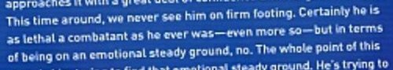
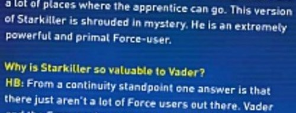
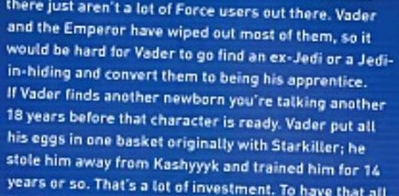
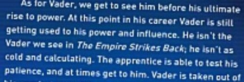
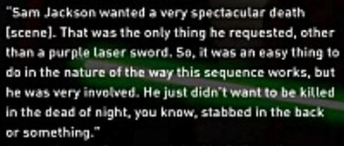

# Owner Material 038 — Star Wars Insider #1–153 plus specials (with The Lucasfilm Fan Club Magazine #1–22): Star Wars Insider #118 (2010)

- **Source:** *Star Wars Insider* magazine (issues 23–153, 1994–2014) and its predecessor *The Lucasfilm Fan Club Magazine* (issues 1–22, 1987–1994), plus seven special editions: articles, interviews, comics and short fiction Secondary source (licensed Legends reference). Scan OCR'd on the box; the scan stays box-only and is **not** published.
- **Method:** every scanned page was OCR'd and machine-screened sentence by sentence for power-relevant statements (fights, kills, defeats, Force feats, rankings, superweapons) that name a character on our roster; each kept sentence is quoted verbatim from the OCR text and has a crop of the printed passage directly under it. Pages with nothing power-relevant are still listed with what is on them.
- **Citation:** "*Star Wars Insider #118* (2010), p.X" by printed page ("scan p.X" where no printed number applies). **Weight:** Licensed magazine: a secondary source. Its short fiction and comics are Legends stories; its articles and interviews sum up or discuss lore and rank below the novels, comics and games they describe.

## scan p.1 (scan page 1)

Page contents: Cover: "Starkiller Strikes Back! The Making of Star Wars: The Force Unleashed II"; The Clone Wars secrets revealed; Celebration inside story. (hand-read)

## scan p.2 (scan page 2)

Page contents: Ad: Topps ESB 3D trading cards (30th anniversary). (hand-read)

## scan p.3 (scan page 3)

Page contents: Editor's welcome (Jonathan Wilkins), epigraph Leia "Darth Vader! Only you could be so bold."; Clone Wars Season Two secrets on p32. (hand-read)

## scan p.4 (scan page 4)

Page contents: Contents: The Force Unleashed II (p13), James Earl Jones (p22), Hugh Quarshie as Captain Panaka (p28), TCW Season Two (p32), Cloud City (p40), Celebration (p48). (hand-read)

## scan p.5 (scan page 5)

Page contents: Contents, departments: Launchpad, My Star Wars (Warwick Davis), Blaster (Books, Comics, Incoming, Bounty Hunters, Bantha Tracks), Retro Yoda collectibles, Jedi Archive C-3PO, Classic Moment Palpatine's arrest, Red Five. (hand-read)

## scan p.6 (scan page 6)

Page contents: Ashley Eckstein interview on Her Universe apparel for female fans ("Plo Koon and Ahsoka" shirt by Dave Filoni; "I feel like I'm Dave's Padawan"). (hand-read)

## scan p.7 (scan page 7)

Page contents: Launchpad (Bonnie Burton): Bacon AT-AT; Acne's Jonny Johansson collection inspired by The Clone Wars; James Marsters (Captain Argyus) with the 501st and Rebel Legion in Melbourne. (hand-read)

## scan p.8 (scan page 8)

Page contents: Launchpad: WonderCon highlights; Darth Vader headphones and Scanimation book giveaways. (hand-read)

## scan p.9 (scan page 9)

Page contents: Launchpad: Jon Favreau (voice of Pre Vizsla) visits ILM; Zillo Beast haiku (fan authors omitted); masthead. (hand-read)

## scan p.10 (scan page 10)

Page contents: Interrogation Droid (Chris Spitale): Howie Weed, who designed and wore the Special Edition wampa suit, answers in-character humorous questions (parody, S only). (hand-read)

## scan p.11 (scan page 11)

Page contents: Ad: Brian's Toys. (hand-read)

## scan p.12 (scan page 12)

Page contents: Ad: Star Trek movie guide (Titan). (hand-read)

## scan p.13 (scan page 13)

Page contents: "Starkiller Strikes Back!" (Brett Rector): The Force Unleashed II feature title spread. (hand-read)

## scan p.14 (scan page 14)

Page contents: TFU II intro: TFU the fastest-selling Star Wars game; Starkiller returns, Vader attempting to clone his former apprentice to create the ultimate Sith warrior; Haden Blackman and Sam Witwer interviewed. (hand-read)

## scan p.15 (scan page 15)

Page contents: Blackman: second lightsaber, combo system, Force Fury mode, combat Jedi mind trick; story built around the apprentice. Witwer: Starkiller even more confused in the sequel. (hand-read)

- **Galen Marek** — entry/section: Witwer on Starkiller's lethality: ""Certainly he is as lethal a combatant as he ever was—even more so—but in terms of being on an emotional steady ground, no." —Sam Witwer, Star Wars Insider 118, p. 15" Source: *Star Wars Insider #118* (2010), scan p.15
  

## scan p.16 (scan page 16)

Page contents: Blackman: TFU as much Vader's story; Starkiller as a foil for Vader. Witwer: "he's a badass with a lightsaber"; the little piece of Luke Skywalker inside him. (hand-read)

## scan p.17 (scan page 17)

Page contents: Witwer: Starkiller still terrified of Vader but more defiant; Juno as his anchor-point before the one-man assault on the Death Star. (hand-read)

- **Galen Marek** — entry/section: Witwer on the new Starkiller: ""This version of Starkiller is shrouded in mystery. He is an extremely powerful and primal Force-user." —Sam Witwer, Star Wars Insider 118, p. 17" Source: *Star Wars Insider #118* (2010), scan p.17
  
- **Galen Marek; Darth Vader (Anakin Skywalker)** — entry/section: Blackman on why Vader needs Starkiller: ""Vader and the Emperor have wiped out most of them, so it would be hard for Vader to go find an ex-Jedi or a Jedi-in-hiding and convert them to being his apprentice. If Vader finds another newborn you're talking another 18 years before that character is ready. Vader put all his eggs in one basket originally with Starkiller; he stole him away from Kashyyyk and trained him for 14 years or so." —Haden Blackman, Star Wars Insider 118, p. 17" Source: *Star Wars Insider #118* (2010), scan p.17
  
- **Darth Vader (Anakin Skywalker); Galen Marek** — entry/section: Witwer on Vader before his ultimate rise: ""At this point in his career Vader is still getting used to his power and influence. He isn't the Vader we see in The Empire Strikes Back; he isn't as cold and calculating. The apprentice is able to test his patience, and at times get to him." —Sam Witwer, Star Wars Insider 118, p. 17" Source: *Star Wars Insider #118* (2010), scan p.17
  

## scan p.18 (scan page 18)

Page contents: Blackman: Juno now a dedicated Rebel officer. Witwer: Starkiller's best "friend" was a droid that tried to kill him almost daily; "this incredibly powerful warrior has no defense for" romantic feelings; a story of identity and devotion. (hand-read)

## scan p.19 (scan page 19)

Page contents: Ad: Stargate magazine. (hand-read)

## scan p.20 (scan page 20)

Page contents: My Star Wars (Jonathan Wilkins): Warwick Davis; Kenner Millennium Falcon favorite toy; first saw Star Wars in 1977. (hand-read)

## scan p.21 (scan page 21)

Page contents: Davis: Wicket figures; played Yoda in an Episode I walking scene with Frank Oz's gloves; Ewok village set at age 12; favorite scene the trash compactor; autobiography Size Matters Not giveaway. (hand-read)

## scan p.22 (scan page 22)

Page contents: "The Voice of James Jones" title spread (Darth Vader art). (hand-read)

## scan p.23 (scan page 23)

Page contents: James Earl Jones feature: title text (voice of the ultimate galactic evil, Darth Vader). (hand-read)

## scan p.24 (scan page 24)

Page contents: Jones: career overview (Dr. Strangelove, The Great White Hope, Conan, Coming to America, Hunt for Red October); London Cat on a Hot Tin Roof; Glasgow Film Festival 2010 guest of honor; "a journeyman actor". (hand-read)

## scan p.25 (scan page 25)

Page contents: Jones: uncredited on ANH and ESB, credited in ROTJ; "I was basically hired as a special effect"; paid $7,000 for two hours' work. (hand-read)

## scan p.26 (scan page 26)

Page contents: Jones: nobody expected the phenomenon; Prowse read Vader's lines in a monotone in ESB and Irvin Kershner laid his own high-pitched voice over the soundtrack; Chrysler Laser commercials; Thulsa Doom in Conan. (hand-read)

## scan p.27 (scan page 27)

Page contents: Jones: proud of Star Wars; favorite other roles (Cry, the Beloved Country, A Family Thing, Field of Dreams); overcame a childhood stutter. (hand-read)

## scan p.28 (scan page 28)

Page contents: "Captain Fantastic": Hugh Quarshie interview (James Burns), unflappable Captain Panaka; audition and meeting George Lucas. (hand-read)

## scan p.29 (scan page 29)

Page contents: Quarshie: shaking the camera during the Naboo escape ("Blast, blast, blast"), Ralph Brown as pilot. (hand-read)

## scan p.30 (scan page 30)

Page contents: Quarshie: hot costume and real leather cavalry boots in Tunisia; fans in Naples recognized him from horror movies. (hand-read)

## scan p.31 (scan page 31)

Page contents: Ad: Supernatural magazine. (hand-read)

## scan p.32 (scan page 32)

Page contents: "Rise of the Bounty Hunters": TCW Season Two Easter eggs and trivia; Kaybur memory crystal recalls the Kyber/Kaiburr crystal (ANH drafts, Splinter of the Mind's Eye); holocrons first appeared in Dark Empire. (hand-read)

## scan p.33 (scan page 33)

Page contents: TCW trivia: Gungan toddler's mobile (colo claw fish, sando aqua monster); episode revisits film environments (Padme's apartment, Senate, Jedi Council war room, Cato Neimoidia). (hand-read)

## scan p.34 (scan page 34)

Page contents: TCW trivia: Anakin and Ahsoka arrive from Dorin, Kel Dor homeworld; Luminara's gunship nose-art of a clone kicking Dooku; second 2009 zombie story after Death Troopers. (hand-read)

## scan p.35 (scan page 35)

Page contents: TCW trivia: nods to Mace on Dantooine (micro-series) and Kit Fisto on Ord Cestus (The Cestus Deception); Robert Dalva directed; Eeth Koth, said in Inside the Worlds of AOTC to die on Geonosis, appears alive; Brea Tonnika mugshot. (hand-read)

## scan p.36 (scan page 36)

Page contents: TCW trivia: elongated Mandalorian helmets inspired by the Holiday Special Boba Fett model; turbolift teasing echo of AOTC; Jerec's "period of civil war" echoes the ANH crawl; Mon Mothma model; "Cat and Mouse" chronologically precedes all other episodes. (hand-read)

## scan p.37 (scan page 37)

Page contents: TCW trivia: Kurosawa card; repurposed ROTS heavy labor droids tend the Zillo Beast; Admiral Kilian named after Kilian Plunkett; Wilhelm scream; Plo Koon mentions the Hydian Way; Hondo's office inspired by Filoni's workspace. (hand-read)

## scan p.38 (scan page 38)

Page contents: Retro (collectibles): Yoda Ears Cap, Lucasfilm holiday cards (McQuarrie Yoda as Santa), unproduced Kenner talking Yoda. (hand-read)

## scan p.39 (scan page 39)

Page contents: Retro Yoda: Revenge of the Jedi crew patch, Yoda yogurt products, Frigo ice-pop sticks, Pepsi life-size statue, Suntory Diet Pepsi Twist can, Zewa toilet paper plush premium, Larry Noble life-size bronze statue. (hand-read)

## scan p.40 (scan page 40)

Page contents: "Inside Cloud City" (J. W. Rinzler): the labyrinthine corridors of Cloud City, title spread. (hand-read)

## scan p.41 (scan page 41)

Page contents: Cloud City sets: production over budget and behind schedule on Elstree Stage 2 in May 1979; same hallways reused (Han passes the same window twice). (hand-read)

## scan p.42 (scan page 42)

Page contents: Cloud City sets: corridor relit blue for Luke's sneak; Peter Suschitzky on rapid light changes to make the same corridor look new. (hand-read)

## scan p.43 (scan page 43)

Page contents: Cloud City sets: ceiling panels swapped for illuminated panels; circular art deco set relit for several scenes; The Making of The Empire Strikes Back. (hand-read)

## scan p.44 (scan page 44)

Page contents: Subscription ad with back issues (115-117). (hand-read)

## scan p.45 (scan page 45)

Page contents: Subscription ad: exclusive subscriber cover. (hand-read)

## scan p.46 (scan page 46)

Page contents: Jedi Archive: rarely seen images from the Lucasfilm archives (C-3PO). (hand-read)

## scan p.47 (scan page 47)

Page contents: Jedi Archive captions: C-3PO at Jabba's palace; TPM Threepio puppet rig; Silas Carson and Anthony Daniels off-set; droids in Echo Base. (hand-read)

## scan p.48 (scan page 48)

Page contents: "Celebrating the Celebrations" (Scott Chernoff): oral history of the first Celebration with Dan Madsen, Jon Bradley Snyder, Steve Sansweet and Anthony Daniels; Tom Ward's suggestion "do something for the fans". (hand-read)

## scan p.49 (scan page 49)

Page contents: Celebration history: Denver, fall 1998 planning; Wings Over the Rockies Air and Space Museum at the former Lowry Air Force Base; near-life-size X-wing remains on display. (hand-read)

## scan p.50 (scan page 50)

Page contents: Celebration history: Denver 1999 programming (Hasbro Episode I figures, vintage arcade games, Warwick Davis, Ray Park, Rick McCallum, Ahmed Best's Jar Jar Jam); Anthony Daniels as MC; near-cancellation after the Columbine tragedy. (hand-read)

## scan p.51 (scan page 51)

Page contents: Celebration history: decision to go ahead; nearly $30,000 raised for memorial funds; no blasters allowed; record rainfall and mud; Daniels greeted fans in line; McCallum's "Star Wars Woodstock". (hand-read)

## scan p.52 (scan page 52)

Page contents: Celebration II (Indianapolis, 2002): Mary Franklin hired; 27,000 fans; digital Yoda footage, Carrie Fisher, incognito Hayden Christensen in a stormtrooper helmet; Billy Dee Williams and John Hollis (Lobot) reunited on stage. (hand-read)

## scan p.53 (scan page 53)

Page contents: Celebration III (Indianapolis, 2005): Warwick Davis and Jay Laga'aia as MCs; George Lucas attended and announced an animated series and a possible live-action series. (hand-read)

## scan p.54 (scan page 54)

Page contents: Celebration IV (Los Angeles, 2007): 35,000 attendees; Seth MacFarlane, Seth Green, Billy Dee Williams; first Clone Wars footage; "Where are they now?" sidebar (Sansweet, Franklin, Madsen and Her Universe, Snyder, Daniels, Chernoff, Jim Ward). (hand-read)

## scan p.55 (scan page 55)

Page contents: Celebration Europe (London, 2007) and Japan (Tokyo, 2008); Celebration V in Orlando, August 12-15, with Reed Exhibitions. (hand-read)

## scan p.56 (scan page 56)

Page contents: Classic Moment: ROTS DVD chapter 27, Mace vs. Palpatine in the Chancellor's office (script excerpt: Palpatine cuts down three Jedi, Force-slams Mace, Mace forces Palpatine to drop his saber); "Why it's a classic" editorial on Anakin's tipping point. (hand-read)

- **Mace Windu** — entry/section: Lucas on Mace Windu's death scene: ""Sam Jackson wanted a very spectacular death [scene]. That was the only thing he requested, other than a purple laser sword. So, it was an easy thing to do in the nature of the way this sequence works, but he was very involved. He just didn't want to be killed in the dead of night, you know, stabbed in the back or something." —George Lucas, ROTS DVD commentary, quoted in Star Wars Insider 118, p. 56" Source: *Star Wars Insider #118* (2010), scan p.56
  

## scan p.57 (scan page 57)

Page contents: Classic Moment script continued: Mace blocks Palpatine's lightning, Anakin cuts off Mace's hand; Dave Elsey quote on re-creating the Emperor makeup (The Art of ROTS). (hand-read)

## scan p.58 (scan page 58)

Page contents: Ad: Lost official magazine. (hand-read)

## scan p.59 (scan page 59)

Page contents: Blaster section cover (ed. Neil Edwards): "End of an Era", Star Wars: Legacy closes a chapter (Cade Skywalker art); contents. (hand-read)

## scan p.60 (scan page 60)

Page contents: Books (Daniel Wallace): The Old Republic: Fatal Alliance by Sean Williams; smuggler Jet Nebula and a priceless artifact pit him against Hutts, Sith, Jedi and Mandalorians 3,500+ years before the films; Williams: "The Old Republic is beyond epic." Ask Lobot (Leland Y. Chee; reader name omitted): not all ANH stormtroopers are Jango-based clones; other clone hosts and recruits; "Who are you?" line redubbed in the ESB Special Edition. (hand-read)

## scan p.61 (scan page 61)

Page contents: Books: The Clone Wars Character Encyclopedia (DK, Jason Fry), ~200 characters from seasons one and two; Fry didn't know Embo's hat was a ninja Frisbee or that Embo lived; Fry's favorite character Obi-Wan. (hand-read)

## scan p.62 (scan page 62)

Page contents: Comics (Daniel Wallace): Star Wars: Legacy ends with #50; Randy Stradley on wrapping series by end of 2010 for Dark Horse's 25th anniversary and Knight Errant; Cade Skywalker 130+ years after the films; final arc on Utapau, Antares Draco rescues Princess Sia on Korriban, Darth Krayt thought dead in #31; Jan Duursema and John Ostrander quotes. (hand-read)

## scan p.63 (scan page 63)

Page contents: Comics: Legacy "Monster" trade (#42-44): Cade on Wayland meets a Yuuzhan Vong bio-engineer; three-way war of Jedi, Sith and Imperials. (hand-read)

## scan p.64 (scan page 64)

Page contents: Comics: KOTOR vol. 9 "Demon" (#47-50, John Jackson Miller, Brian Ching): Zayne Carrick, Gryph, Jarael and Rohlan conclude. Ask Lobot (anonymous): ROTJ flight uniforms by fighter type (Wedge Antilles, Horton Salm, Arvel Crynyd); Tycho Celchu figure helmet explained. (hand-read)

## scan p.65 (scan page 65)

Page contents: Comics: Clone Wars: In Service of the Republic (Henry Gilroy, Steven Melching, Scott Hepburn): Kit Fisto and Plo Koon lead commandos against a Separatist stronghold on Khorm, facing Asajj Ventress. Ask Lobot (reader name omitted): why Ewoks speak Basic in the Ewok movies; creative license and translation. (hand-read)

## scan p.66 (scan page 66)

Page contents: Incoming (Chris Spitale): Hasbro ESB 30th anniversary vintage figure re-launch (AT-AT commander, Dengar, Hoth Leia, Boba Fett, etc.), Snowspeeder, Bespin Cloud Car, Super Deluxe AT-AT. (hand-read)

## scan p.67 (scan page 67)

Page contents: Incoming: Sideshow 501st Legion Vader's Fist clone trooper 12-inch, Aurra Sing Premium Format figure. Ask Lobot (Leland Y. Chee; reader name omitted): female Imperials in the EU, from Ysanne Isard and "the brilliant and efficient Admiral Daala" to Mara Jade, Lumiya and Arden Lyn; Legacy's Nyna Calixte, Gunn Yage, Princess Marasiah Fel; Mahd Windcaller; Juno Eclipse. (hand-read)

## scan p.68 (scan page 68)

Page contents: Incoming: Funko Force bobble heads (Palpatine, Maul, shock trooper); Uncle Milton lightsaber room light, Death Star Planetarium, Clone Wars Ant Farm, Holographic Animation Lab. (hand-read)

## scan p.69 (scan page 69)

Page contents: Incoming: Acme Archives giclees ("Hunted" by William Silvers, "Vader Shogun" by Tsuneo Sanda, "The Princess' New Clothes" by Patrick Schoenmaker); LEGO Hoth Wampa set; Gentle Giant logo bookends. (hand-read)

## scan p.70 (scan page 70)

Page contents: "Super Trooper" (Chris Spitale): Super7's Frank Supiot on the Stormtrooper Super Shogun, the first authentic Jumbo Machinder in over 25 years; blow-molded polyethylene. (hand-read)

## scan p.71 (scan page 71)

Page contents: Super7: 24-inch figure with Rocket Punch fist and E-11 blaster; Boba Fett next; "What is a Jumbo Machinder?" sidebar (Mazinger Z, 1973). (hand-read)

## scan p.72 (scan page 72)

Page contents: Bounty Hunters (sponsored by Kotobukiya): reader convention encounters with Kenny Baker and Bruce Spence (Tion Medon); reader names and personal details omitted. (hand-read)

## scan p.73 (scan page 73)

Page contents: Bounty Hunters: reader photos with Jeremy Bulloch, Amy Allen (Aayla Secura) and Daniel Logan; reader names omitted. (hand-read)

## scan p.74 (scan page 74)

Page contents: Bantha Tracks: by the fans, for the fans; fan costuming groups at events; 501st Legion and Snoop Dogg in Manhattan for the Adidas Originals Star Wars launch (contributor names omitted). (hand-read)

## scan p.75 (scan page 75)

Page contents: Bantha Tracks: Empire City Garrison and other garrisons march from Foot Locker HQ to Times Square; Adidas charity donation to the Pinwheel Project (fan names omitted). (hand-read)

## scan p.76 (scan page 76)

Page contents: Bantha Tracks: Darth Vader delivers Turner Broadcasting press packs in Romania for The Clone Wars launch; Southern California Garrison at a Los Angeles Kings Star Wars night; submission guidelines (fan names omitted). (hand-read)

## scan p.77 (scan page 77)

Page contents: Bantha Tracks: "The Empire" Star Wars float wins first place at the Hatillo Masks Festival, Puerto Rico, with Rebel Legion and 501st help (fan names omitted). (hand-read)

## scan p.78 (scan page 78)

Page contents: Ad: StarWarsShop.com exclusive t-shirts. (hand-read)

## scan p.79 (scan page 79)

Page contents: Ad: StarWarsShop.com ESB 30th anniversary merchandise. (hand-read)

## scan p.80 (scan page 80)

Page contents: Red Five: Dave Filoni's five must-see animated works: Macross/Robotech (first animated character death he remembers), Dungeons & Dragons animated series (Michael Reaves worked on it). (hand-read)

## scan p.81 (scan page 81)

Page contents: Red Five (Filoni): Avatar: The Last Airbender, Princess Mononoke (San's cheek triangles recall Ahsoka), Akira. (hand-read)

## scan p.82 (scan page 82)

Page contents: Next issue: ESB 30th anniversary, Irvin Kershner, Billy Dee Williams, TCW cast and crew favorite Empire moments. (hand-read)

## scan p.83 (scan page 83)

Page contents: Ad: Movie Magic Screenwriter and Dramatica Pro software. (hand-read)

## scan p.84 (scan page 84)

Page contents: Ad: Hasbro Legacy Collection Droid Factory (build-a-droid figures). (hand-read)

