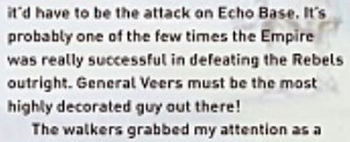
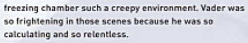
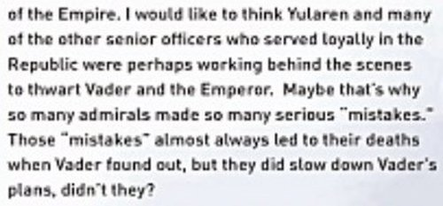
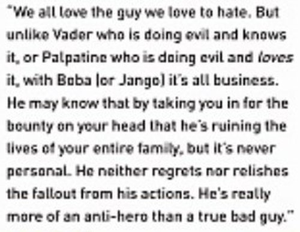

# Owner Material 038 — Star Wars Insider #1–153 plus specials (with The Lucasfilm Fan Club Magazine #1–22): Star Wars Insider #119 (2010)

- **Source:** *Star Wars Insider* magazine (issues 23–153, 1994–2014) and its predecessor *The Lucasfilm Fan Club Magazine* (issues 1–22, 1987–1994), plus seven special editions: articles, interviews, comics and short fiction Secondary source (licensed Legends reference). Scan OCR'd on the box; the scan stays box-only and is **not** published.
- **Method:** every scanned page was OCR'd and machine-screened sentence by sentence for power-relevant statements (fights, kills, defeats, Force feats, rankings, superweapons) that name a character on our roster; each kept sentence is quoted verbatim from the OCR text and has a crop of the printed passage directly under it. Pages with nothing power-relevant are still listed with what is on them.
- **Citation:** "*Star Wars Insider #119* (2010), p.X" by printed page ("scan p.X" where no printed number applies). **Weight:** Licensed magazine: a secondary source. Its short fiction and comics are Legends stories; its articles and interviews sum up or discuss lore and rank below the novels, comics and games they describe.

## scan p.1 (scan page 1)

Page contents: Cover: The Empire Strikes Back tribute issue; the cast and crew of the movie classic interviewed; collectors' cover 2 of 3. (hand-read)

## scan p.2 (scan page 2)

Page contents: Ad: Official Pix licensed autograph photos. (hand-read)

## scan p.3 (scan page 3)

Page contents: Editor's welcome (Jonathan Wilkins): issue celebrates all things Empire; ESB trailer quote; Empire trivia on p42. (hand-read)

## scan p.4 (scan page 4)

Page contents: Contents: Irvin Kershner, Loving the Empire (TCW team), Making Magic (cast and crew), Just the Facts (50 facts), True Tales (J. W. Rinzler), Toy Time (Hasbro), Lovin' Lando (Billy Dee Williams). (hand-read)

## scan p.5 (scan page 5)

Page contents: Contents: departments (Launchpad, My Star Wars Milo Ventimiglia, Retro AT-ATs, Jedi Archive Echo Base, Classic Moment, Books, Ask Lobot, Comics, Incoming, Bantha Tracks, Bounty Hunters, Red Five Kyle Newman and Jaime King). (hand-read)

## scan p.6 (scan page 6)

Page contents: Launchpad: Han Solo returns for the ESB 30th anniversary charity screening at the ArcLight, Los Angeles, raising over $40,000 for St. Jude; Harrison Ford, Peter Mayhew, Billy Dee Williams, Ewan McGregor; Ford on being cast after reading with some 300 actors. (hand-read)

## scan p.7 (scan page 7)

Page contents: Launchpad: Ford on the ad-libbed "I know" (Kershner agreed; Lucas feared a bad laugh at the San Francisco test screening); TCW Season Two DVD/Blu-ray on October 26 (featurettes Attack of the Zillo Beast, Magic of the Holocron, Return to Geonosis, Creating Mandalore; Filoni quote). (hand-read)

## scan p.8 (scan page 8)

Page contents: Launchpad: Celebration V (Orlando, August 12-15): The Main Event with George Lucas and Jon Stewart; guests Carrie Fisher, Anthony Daniels, Jeremy Bulloch, Peter Mayhew, Jake Lloyd, Temuera Morrison, Daniel Logan, Ray Park, Nick Gillard, Matthew Wood; Star Wars Stories project, chapel, laser tag, Robot Chicken panel, Ashley Eckstein fashion show, Cartoon Network room. (hand-read)

## scan p.9 (scan page 9)

Page contents: Launchpad: Celebration V TCW Season Three sneak peek, costume contests, art show, video game universe, Last Tour to Endor; Scott Pilgrim/Star Wars mash-up poster by Joe Bowen; fan AT-AT wedding cake (fan names omitted). (hand-read)

## scan p.10 (scan page 10)

Page contents: Launchpad: fan-made 1950s-style "premake" ESB trailer from old serial footage (Flash Gordon, The Fighting Devil Dogs, Devil Girl from Mars) (fan creator name omitted); Bay Area Maker Faire R2-D2 Builders and Bonnie Burton's bag puppets. (hand-read)

## scan p.11 (scan page 11)

Page contents: Launchpad: premake interview continued; Star Tweets (celebrity tweets incl. Paul Scheer on Harrison Ford laughing at "I know"; private tweeters omitted); Mimobot USB drive giveaway; masthead. (hand-read)

## scan p.12 (scan page 12)

Page contents: Interrogation Droid (Chris Spitale): Billy Dee Williams in-character Q&A on Lando's charm, Nien Nunb as better co-pilot, Colt 45 (parody/humor). (hand-read)

## scan p.13 (scan page 13)

Page contents: Ad: Chicagoland Entertainment Collectors Expo / Treasure Chest Foundation charity. (hand-read)

## scan p.14 (scan page 14)

Page contents: "Empire Builder" (Calum Waddell): Irvin Kershner interview title spread. (hand-read)

## scan p.15 (scan page 15)

Page contents: Kershner: Lucas was in his USC class; Lucas asked him to direct a sequel "even better than the first one"; took almost a month to say yes; original Empire script "was not so good", so a brand new script was written. (hand-read)

## scan p.16 (scan page 16)

Page contents: Kershner: stationed in the UK in WWII as a flight engineer; two years on Empire with terrific British crews and freedom from studio notes; multiple R2-D2 units (fast, slow, pull-along, Kenny Baker inside). (hand-read)

## scan p.17 (scan page 17)

Page contents: Kershner: R2-D2 wheels failed on plastic "ice"; Lucas: "Don't count on anything working"; mynocks were plastic on fishing poles; concentrated on characters and made the film darker than the first. (hand-read)

## scan p.18 (scan page 18)

Page contents: Kershner: second act of a three-act play, topping the opening with characterization; Dagobah set with water 3.5-4 feet deep and frogmen sinking Luke's ship; Stuart Freeborn and Yoda. (hand-read)

## scan p.19 (scan page 19)

Page contents: Kershner filmography (Stakeout on Dope Street to Robocop 2); six years out of the business; SeaQuest DSV pilot; new children's fairy-tale script. (hand-read)

## scan p.20 (scan page 20)

Page contents: Kershner: dislikes revealing effects secrets; still signs Star Wars memorabilia; proud of Empire but can't pick a favorite film. (hand-read)

## scan p.21 (scan page 21)

Page contents: Contest: win a trip to Rancho Obi-Wan (1000 Collectibles book). (hand-read)

## scan p.22 (scan page 22)

Page contents: My Star Wars (Bonnie Burton): Milo Ventimiglia; favorite film ESB "for the message of the Force"; wants a black lightsaber; would meet Alec Guinness. (hand-read)

## scan p.23 (scan page 23)

Page contents: Ventimiglia: favorite scene Yoda training Luke on Dagobah (dialogue quoted); would ask Lucas to live at Skywalker Ranch; would do a Greedo TV show ("a mid-level mobster with a bad back"). (hand-read)

## scan p.24 (scan page 24)

Page contents: "Empire Looks Back" (Pablo Hidalgo): TCW team's favorite parts of ESB; Filoni on the walkers looking like giant dinosaurs (Carnegie Museum T-Rex). (hand-read)

- **General Veers** — entry/section: Filoni on the Echo Base attack: ""It's probably one of the few times the Empire was really successful in defeating the Rebels outright. General Veers must be the most highly decorated guy out there!" —Dave Filoni, Star Wars Insider 119, p. 24" Source: *Star Wars Insider #119* (2010), scan p.24
  

## scan p.25 (scan page 25)

Page contents: "Empire Looks Back" title spread (By Pablo Hidalgo): talented people behind The Clone Wars on what makes ESB memorable. (hand-read)

## scan p.26 (scan page 26)

Page contents: TCW team favorites: Catherine Taber (Hoth outfits, wampa), James Arnold Taylor (Falcon, tauntaun, Han and Leia's Hoth argument), Matthew Wood (feeling the passage of time), Tom Kane (electrified opening-night audience). (hand-read)

## scan p.27 (scan page 27)

Page contents: TCW team: Matt Lanter (white ice planet Hoth), David Acord (Luke vs. Vader duel lighting and sounds); dream ESB voice roles (Lanter Han, Taylor the Emperor, Wood Yoda and his snowspeeder "Mount the tow cable!" line in the 2004 DVD, Acord Vader). (hand-read)

- **Darth Vader (Anakin Skywalker)** — entry/section: Acord on Vader in the carbon-freezing duel: ""Vader was so frightening in those scenes because he was so calculating and so relentless." —David Acord, Star Wars Insider 119, p. 27" Source: *Star Wars Insider #119* (2010), scan p.27
  

## scan p.28 (scan page 28)

Page contents: TCW team: sound design of Empire (Acord, Wood on Ben Burtt's original reels); Taber thinks Padmé would have punched Lando; Lanter and Taylor on seeing Vader with more compassion after TCW. (hand-read)

- **Wullf Yularen; Darth Vader (Anakin Skywalker)** — entry/section: Kane on Yularen and Vader's ill-fated officers: ""I would like to think Yularen and many of the other senior officers who served loyally in the Republic were perhaps working behind the scenes to thwart Vader and the Emperor. Maybe that's why so many admirals made so many serious "mistakes." Those "mistakes" almost always led to their deaths when Vader found out, but they did slow down Vader's plans, didn't they?" —Tom Kane, Star Wars Insider 119, p. 28" Source: *Star Wars Insider #119* (2010), scan p.28
  

## scan p.29 (scan page 29)

Page contents: Ad: The Force Unleashed II novel and game ("Read the book. Play the game."). (hand-read)

## scan p.30 (scan page 30)

Page contents: Retro: AT-AT collectibles: Kenner AT-AT toy scaled for price and playability, reissued in ROTJ packaging; Power of the Force AT-AT coin (two versions) and its plaster prototypes. (hand-read)

## scan p.31 (scan page 31)

Page contents: Retro AT-AT: unproduced Kenner Hoth Battle electronic game; Hallmark 2006 ornament; Hoth snow globe; ILM crew T-shirt and footprint stamper, real chin gun; Master Replicas AT-AT signed by Phil Tippett. (hand-read)

## scan p.32 (scan page 32)

Page contents: ESB poster art (Vader looming over Hoth battle and heroes), full-page. (hand-read)

## scan p.33 (scan page 33)

Page contents: "In Their Own Words: Making The Empire Strikes Back" title: cast and crew recall the sequel's struggles and successes. (hand-read)

## scan p.34 (scan page 34)

Page contents: "Second Strike!" George Lucas (interviewed 1980): Empire a sadder film, second act of a play, better than the first; didn't direct because he never enjoyed directing; as executive producer gave John Williams most autonomy. (hand-read)

## scan p.35 (scan page 35)

Page contents: Lucas cont.: receptive to Kershner's changes; Leigh Brackett's first draft (she died soon after), Lawrence Kasdan finished the script; no scenes cut completely. "Making It Work": Robert Watts on budget; Howie Weed (wampa) sardine-in-the-mask prank on the Special Edition set. (hand-read)

## scan p.36 (scan page 36)

Page contents: Anthony Daniels: Kershner excitable and good with actors; 18-week shoot; not taken to Norway as the 3PO suit would freeze; cringed at "They're dying and it's all my fault"; Threepio transparent; steamy Cloud City set on Chewbacca's back. (hand-read)

## scan p.37 (scan page 37)

Page contents: Kenny Baker: Empire his favorite, darkest of the first three; Harrison Ford and Mark Hamill "Peaches and Cream" anecdote. "The Ultimate Bounty Hunter": Jeremy Bulloch got the Boba Fett role via half-brother Robert Watts because the one costume fit. (hand-read)

## scan p.38 (scan page 38)

Page contents: "The Imperial Officers": Kenneth Colley (Piett) on Pauline Kael's praise and Kershner honing dialogue; Julian Glover (Veers) filmed a week, one scene with Vader. (hand-read)

## scan p.39 (scan page 39)

Page contents: "AT-AT Attackers!": Ian Liston (Wes Janson) never met Denis Lawson on set, enjoys Wes in the books, hopes Aaron Allston won't kill him off; Christopher Malcolm (Zev Senesca) on the Gone With the Wind camera. "The Other Empire!": Donald F. Glut on the two versions of ESB (film vs. his novelization). (hand-read)

## scan p.40 (scan page 40)

Page contents: "Fugitives from the Empire!": Harrison Ford (1980) on keying into the human context, the sequel being harder, Kersh's agonizing task, and Norway on the glacier; Dennis Muren: hardest film he ever worked on, crewing up in San Francisco. (hand-read)

## scan p.41 (scan page 41)

Page contents: Phil Tippett: severed-finger prank on Jim Bloom, ILM camaraderie, 12-inch tauntaun stop-motion model with steel ball-and-socket skeleton. Peter Mayhew: favorite scene Chewie hearing the doors on Hoth; blacked out carrying 50 lbs of Threepio on Cloud City; failed body double. (hand-read)

## scan p.42 (scan page 42)

Page contents: "Many Parts for the Empire": Alan Harris (Mark Newbold interview): Boba Fett costume built around him (wrist flamethrower scare); C-3PO stand-in for five months; Bossk costume; Bespin guard escorting carbon-frozen Han and body for the carbonite cast; stormtrooper, Rebel soldier, stand-in for Ford, Michael Culver and Julian Glover. (hand-read)

## scan p.43 (scan page 43)

Page contents: Ad: Star Trek Magazine subscription. (hand-read)

## scan p.44 (scan page 44)

Page contents: "Empire Fact!" 50 amazing facts about Episode V: first film with an episode designation; deleted shots (wampa attack on Echo Base, bacta mask, Yoda training); Lando originally Lando Kadar and a clone. (hand-read)

## scan p.45 (scan page 45)

Page contents: ESB facts: Han the only non-Jedi lightsaber user in the OT (Grievous in the prequels); Imperial March debut; Hamill voiced "The first transport is away!"; SE dialogue change; tennis shoe and potato among the asteroids; space slug interior. (hand-read)

## scan p.46 (scan page 46)

Page contents: ESB facts: Hoth rescue crew in a hotel doorway; wampa not written for Hamill's scars; Fisher on a box; Ford voiced the trailer; Eric Idle's house; Shining fire delay; no Tatooine visit; John Lithgow NPR Yoda; Muppet Show. (hand-read)

## scan p.47 (scan page 47)

Page contents: ESB facts: lowest body count, no major character deaths; Yoda's planet and species to stay unknown; novel Luke returns fire on Cloud City; 170-day shoot; sea otter tauntaun groan; only OT meeting of Vader and C-3PO; full-size Falcon; Guinness worked one day (Sept 5, 1979). (hand-read)

## scan p.48 (scan page 48)

Page contents: ESB facts: Nathan Hamill born during the weather vane shoot; Parker Brothers game; Kershner read Vader's temp lines; 32 Norwegian rescue skiers; Dagobah vines in Raiders; Ozzel's first name Kendal (Grange Hill joke); Bossk send-away; Glover and Sheard in Last Crusade. (hand-read)

## scan p.49 (scan page 49)

Page contents: ESB facts: Yoda purple in the original comic; Kenner Yoda released late; THX 1138 reference; tauntaun open-belly toy; Carrie Fisher quip about Leia and the Wookiee; Billy Dee Williams on Lando as a "Burt Reynolds kind of charmer"; cameos; Yoda originally "Minch." (hand-read)

## scan p.50 (scan page 50)

Page contents: ESB facts: Oscars, BAFTA, Grammy, Golden Globe, Saturn and Hugo awards; Lucas fined over $250,000 for no opening credits; Willrow Hood figure; Emperor's original look (woman's face, chimp eyes, Clive Revill voice); Yoda's moustache lip; Lobot voiced by Tom Kane in Demolition and TFU; tauntaun head trophy in Jabba's palace. (hand-read)

## scan p.51 (scan page 51)

Page contents: Ad: Stargate Universe official magazine subscription. (hand-read)

## scan p.52 (scan page 52)

Page contents: Archive: rarely seen ESB images from the Lucasfilm archives (Hamill and Kershner in Norway; Falcon cockpit cast photo). (hand-read)

## scan p.53 (scan page 53)

Page contents: Archive cont.: ESB stills (Hoth, Luke and Leia, droids, Luke in the medcenter). (hand-read)

## scan p.54 (scan page 54)

Page contents: J.W. Rinzler interview (Jonathan Wilkins) on The Making of The Empire Strikes Back: had the ending spoiled ("O.E."); Hamill carries the film; Lucas invested his own money as the budget almost quadrupled. (hand-read)

## scan p.55 (scan page 55)

Page contents: Rinzler: challenge of realizing Yoda (monkey in a suit, child actor rejected, Jim Henson and Frank Oz, Freeborn, McQuarrie, Johnston); Oz voice chosen after filming; research method; misfiled McQuarrie color studies; ILM notes; Alan Arnold cassettes. (hand-read)

## scan p.56 (scan page 56)

Page contents: Rinzler: transcription and 150,000-word draft; three hours with Lucas; organizing image archives; mysteries solved: who was under the Emperor makeup, the death of General Veers, why the Falcon has mechanical problems (cut), 35mm vs 70mm endings, Hamill nearly killed. (hand-read)

## scan p.57 (scan page 57)

Page contents: Rinzler: whether Guinness would return; ILM's hardest film, white-background snow effects; Lucas wrote the second draft in about six weeks after Brackett; 1977 Lucas quote on the Expanded Universe getting "out of control"; Ridley Scott foreword; possible ROTJ and prequel volumes. (hand-read)

## scan p.58 (scan page 58)

Page contents: Subscription offer (print and Zinio digital). (hand-read)

## scan p.59 (scan page 59)

Page contents: Subscription offer cont. (benefits and prices). (hand-read)

## scan p.60 (scan page 60)

Page contents: Hasbro vintage-style relaunch (Jason Fry): Empire-focused first wave of 11 figures (Bespin Luke, Hoth Leia, Dengar; Fett, 4-LOM and Vader repackaged); Derryl DePriest; Echo Base open-parka Han. (hand-read)

## scan p.61 (scan page 61)

Page contents: Hasbro vintage cont.: Brian Parrish on detailing Han's jacket quilting, Lucasfilm confirming no rank insignia; PVC torsos. (hand-read)

## scan p.62 (scan page 62)

Page contents: Hasbro vintage cont.: PVC sculpts; new Dack Ralter, Cloud Car Pilot, AT-AT Commander; C-3PO with removable plating; mail-away rocket-firing Boba Fett in the original Kenner style (DePriest sent for six as a kid); three new vehicles. (hand-read)

## scan p.63 (scan page 63)

Page contents: Hasbro vintage cont.: Twin-Pod Cloud Car with concealed guns and missiles, splits in two (single-pod concept art); smaller new Snowspeeder (Mark Boudreaux). (hand-read)

## scan p.64 (scan page 64)

Page contents: Hasbro vintage cont.: Snowspeeder cockpit and firing harpoon; two-foot-tall AT-AT playset holding six figures, interior troop hold, winch, speeder bike hatch, sounds. (hand-read)

## scan p.65 (scan page 65)

Page contents: Hasbro vintage cont.: AT-AT scale; vintage-style limited-edition vehicle packaging and box art; DePriest: "recreating that excitement that we had as kids 30 years ago." (hand-read)

## scan p.66 (scan page 66)

Page contents: Billy Dee Williams interview title: "The legendary lothario looks back on Lando's larger-than-life debut." (hand-read)

## scan p.67 (scan page 67)

Page contents: Billy Dee Williams interview (Scott Chernoff): Lando "all of the above"; the cape and Errol Flynn swashbucklers; Lando's life before (Steve Wynn-like Cloud City); the ladies; a possible attraction to Leia; never auditioned for Han Solo; via Berry Gordy contract. (hand-read)

## scan p.68 (scan page 68)

Page contents: Williams: Berry Gordy role; Lando's fast promotion to general "movie magic" (no real explanation, "there was no army to really speak of"); "an awful lot of Billy Dee in Lando"; Duke Ellington; Empire was a job he was happy to do for Lucas. (hand-read)

## scan p.69 (scan page 69)

Page contents: Williams: Lucas and Kershner trusted his interpretation; months in England; enjoys conventions and fans; happy to have created a character people remember and quote. (hand-read)

## scan p.70 (scan page 70)

Page contents: Williams: 18 Wheels of Justice, General Hospital/Night Shift, Dynasty, Lost "Exposé" cameo, typecast persona, The Jeffersons, matinee idol mobbed at a department store. (hand-read)

## scan p.71 (scan page 71)

Page contents: Williams: always a romantic type (A Taste of Honey); advice "Just be yourself"; voicing Lando for games and Robot Chicken; who would win, Lando or Billy Dee: "Neither one of us. We're lovers, not fighters." (hand-read)

## scan p.72 (scan page 72)

Page contents: Classic Moment: "I love you." "I know." (ESB carbon-freezing chamber; script excerpt with Threepio on Chewie's back); Kershner DVD commentary (2006) on finding the line; why it's a classic: Han and Leia's relationship and how far Han has come since Mos Eisley. (hand-read)

## scan p.73 (scan page 73)

Page contents: Classic Moment cont. (ESB DVD chapter 40): Ford and Kershner exchange from Alan Arnold's Once Upon a Galaxy; script excerpt (Vader, Fett, Lando). (hand-read)

## scan p.74 (scan page 74)

Page contents: Back issues ad. (hand-read)

## scan p.75 (scan page 75)

Page contents: Contents for the back section: Books (Year by Year), Ask Lobot (Leland Y. Chee), Hallmark ornaments, Comics (Blood Ties), Bantha Tracks, Bounty Hunters, Red Five, Incoming gear. (hand-read)

## scan p.76 (scan page 76)

Page contents: Ad: Torchwood magazine subscription. (hand-read)

## scan p.77 (scan page 77)

Page contents: Books: Star Wars: Year by Year—A Visual Chronicle (Daniel Wallace): DK 320-page hardcover; editor Elizabeth Dowsett; Windham, Hidalgo, Wallace and Lopez sections; 1977 "Alaska" screening, 1989 Zahn call, 2005 Celebration III. Ask Lobot question on an AT-AP in Episode III (answer on a following page). (hand-read)

## scan p.78 (scan page 78)

Page contents: Comics: Blood Ties (Daniel Wallace), "Double Your Fett": four-issue series of interlocking Jango and Boba tales by Tom Taylor and Chris Scalf. Ask Lobot on EU examples supporting Vader's "insignificant next to the power of the Force". (hand-read)

### Stat block notes (game mechanics, not feats)

- Ask Lobot on Force power vs. planet-destroying weapons: "Sure, there's the example of Kyp Durron using the Force to commandeer a superweapon like the system-destroying Sun Crusher which he used to destroy the Carida system. But let's talk sheer Force power. The Sith Lord Naga Sadow from the Star Wars Tales of the Jedi: Fall of the Sith Empire used the Force to cause a double star to explode, just to eliminate a fleet of Republic vessels and to hide his tracks." (Ask Lobot, Star Wars Insider 119, p. 78) (Source: *Star Wars Insider #119* (2010), scan p.78)
- Ask Lobot on the Sith War supernova: "To top that, in Star Wars Tales of the Jedi: The Sith War, Ulic Qel-Droma and Exar Kun orchestrate a plan that rips out the core of a sun causing it to go supernova and creating a shockwave that obliterated planets beyond the system. And for what? Sure they disposed of some enemies and a few unwanted allies, but ultimately, their goal was to steal some Jedi artifacts. Talk about abuse of power!" (Ask Lobot, Star Wars Insider 119, p. 78) (Source: *Star Wars Insider #119* (2010), scan p.78)

## scan p.79 (scan page 79)

Page contents: Blood Ties cont.: Jango on a mission for Count Dooku orphans Connor Freeman, who later collides with Boba; Randy Stradley on Boba's psychological scars and clone status. Ask Lobot: Boba's armor color, TCW "Death Trap" helmet bomb, helmet dents, multiple armor sets. (hand-read)

- **Boba Fett; Jango Fett; Darth Vader (Anakin Skywalker); Palpatine (Darth Sidious)** — entry/section: Stradley on the Fetts' appeal: ""But unlike Vader who is doing evil and knows it, or Palpatine who is doing evil and loves it, with Boba (or Jango) it's all business. He may know that by taking you in for the bounty on your head that he's ruining the lives of your entire family, but it's never personal. He neither regrets nor relishes the fallout from his actions. He's really more of an anti-hero than a true bad guy." —Randy Stradley, Star Wars Insider 119, p. 79" Source: *Star Wars Insider #119* (2010), scan p.79
  

### Stat block notes (game mechanics, not feats)

- Ask Lobot on Boba's helmet bomb in "Death Trap": "In The Clone Wars season two episode "Death Trap," Boba Fett plants a bomb in Jango's helmet which he hides in the wreckage of a downed Republic attack cruiser. Mace Windu and Anakin go to investigate the cruiser in search of survivors. Anakin spots the helmet but as he goes to pick it up, Mace recognizes the helmet as being Jango's just before the bomb detonates." (Ask Lobot, Star Wars Insider 119, p. 79) (Source: *Star Wars Insider #119* (2010), scan p.79)

## scan p.80 (scan page 80)

Page contents: "It's Mandalorian Season": Dark Horse Fett releases (Stradley on Fett's helmet second only to Vader's): Omnibus: Boba Fett, Blood Ties, Adventures: Boba Fett and the Vault of Terror (Jeremy Barlow, Daxiong). (hand-read)

## scan p.81 (scan page 81)

Page contents: Comics: Adventures: The Will of Darth Vader (Tom Taylor, Brian Koschak): Vader teams with a sarcastic smuggler to penetrate a Rebel asteroid base. Ask Lobot: no plans to revise OT novelizations; Ryder Windham's 2004 junior novelizations. (hand-read)

## scan p.82 (scan page 82)

Page contents: Incoming (Chris Spitale): Hasbro TCW Galactic Battle Game figure wave (Grievous, Anakin, Aurra Sing, Rex, Cody, Dooku, destroyer droid, Mandalorian police officer, Obi-Wan, Pre Vizsla, Yoda); RC hailfire droid. (hand-read)

## scan p.83 (scan page 83)

Page contents: Incoming: Sideshow 12-inch Captain Rex and clone trooper lieutenant; Senate Duel: Yoda vs. Darth Sidious diorama; LeapFrog Leapster Explorer TCW learning game. (hand-read)

## scan p.84 (scan page 84)

Page contents: Incoming: LEGO Comic-Con cube figures; Mimoco MIMOBOT series six (Hoth Luke, wampa, snowtrooper, Yoda; Lobot exclusive). (hand-read)

## scan p.85 (scan page 85)

Page contents: Incoming: Disney's 2011 Star Tours relaunch; Starspeeder 1000 toy; Shadow Trooper Donald Duck; ESB 30th anniversary pin set; Star Tours Boarding Party pins. (hand-read)

## scan p.86 (scan page 86)

Page contents: "Hallmark of the Empire": Christine Taylor and Juli McGuire on Hallmark's Star Wars history and the ESB 30th Keepsake Ornaments (Snowspeeder, His Master's Bidding, Dagobah Luke); sculptors. (hand-read)

## scan p.87 (scan page 87)

Page contents: Hallmark cont.: Lando ornament, Boba Fett and Han in carbonite minis, Yoda and Captain Rex, K-3PO and R-3PO Comic-Con set; 2011 preview. (hand-read)

## scan p.88 (scan page 88)

Page contents: Bantha Tracks (Mary Franklin editorial): convention season and friendship in fandom (Star Ladies/Club Jade); fan photos (names omitted). (hand-read)

## scan p.89 (scan page 89)

Page contents: Bantha Tracks: Canadian Garrison at Fan Expo Toronto with blaster range for Make-A-Wish; Star Wars Clube Portugal at Star Wars in Concert, honorary membership for Anthony Daniels (fan names omitted). (hand-read)

## scan p.90 (scan page 90)

Page contents: Bantha Tracks: StarForce 2009 in Torun, Poland (Richard LeParmentier and Kenneth Colley guests); Ray Park at a Tennessee con; submission guidelines (fan names omitted). (hand-read)

## scan p.91 (scan page 91)

Page contents: Bantha Tracks: Barcelona parade; WonderCon San Francisco (Matthew Wood); JediCon Düsseldorf charity auction led by Steve Sansweet (fan names omitted). (hand-read)

## scan p.92 (scan page 92)

Page contents: Bounty Hunters (sponsored by Kotobukiya): reader photos with Billy Dee Williams at MegaCon, and a police officer's encounters with Samuel L. Jackson, Harrison Ford and Jeremy Bulloch (reader names omitted). (hand-read)

## scan p.93 (scan page 93)

Page contents: Bounty Hunters: reader photos with Dave Prowse, Alan Flyng, Brian Muir, Jeremy Bulloch, Derek Lyons, Paul Blake, Gerald Home, Pam Rose; Mark Hamill, Dave Filoni and Tom Kane at SDCC 2009 (reader names omitted); "Can You Go One Better?" call for photos. (hand-read)

## scan p.94 (scan page 94)

Page contents: StarWarsShop.com ad: Star Wars basketball jerseys. (hand-read)

## scan p.95 (scan page 95)

Page contents: StarWarsShop.com ad: space slug oven mitt. (hand-read)

## scan p.96 (scan page 96)

Page contents: Red Five: Kyle Newman (Fanboys) and Jaime King (Aurra Sing voice) pick five films for ESB fans: It Happened One Night; Body Heat (Kasdan, Lucas secretly exec-produced). (hand-read)

## scan p.97 (scan page 97)

Page contents: Red Five cont.: The Good, the Bad and the Ugly; Xanadu; Blade Runner (Ford as Deckard). (hand-read)

## scan p.98 (scan page 98)

Page contents: Next issue: TCW Season Three, history of Hasbro, TFU II supporting cast, Celebration V, Al Williamson remembered. (hand-read)

## scan p.99 (scan page 99)

Page contents: Ad: Brian's Toys (ESB vintage wave, Sideshow figures). (hand-read)

## scan p.100 (scan page 100)

Page contents: Ad: Ryder Windham's TCW Secret Missions novels (Breakout Squad; Curse of the Black Hole Pirates, Nuru Kungurama). (hand-read)

