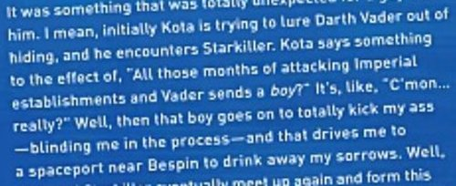
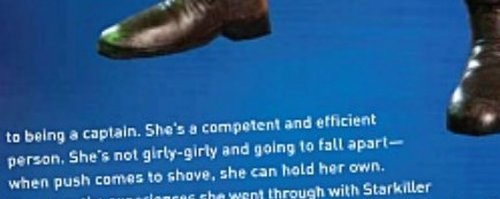
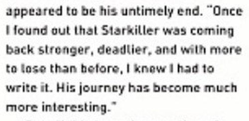
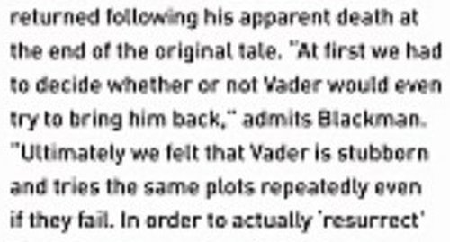

# Owner Material 038 — Star Wars Insider #1–153 plus specials (with The Lucasfilm Fan Club Magazine #1–22): Star Wars Insider #120 (2010)

- **Source:** *Star Wars Insider* magazine (issues 23–153, 1994–2014) and its predecessor *The Lucasfilm Fan Club Magazine* (issues 1–22, 1987–1994), plus seven special editions: articles, interviews, comics and short fiction Secondary source (licensed Legends reference). Scan OCR'd on the box; the scan stays box-only and is **not** published.
- **Method:** every scanned page was OCR'd and machine-screened sentence by sentence for power-relevant statements (fights, kills, defeats, Force feats, rankings, superweapons) that name a character on our roster; each kept sentence is quoted verbatim from the OCR text and has a crop of the printed passage directly under it. Pages with nothing power-relevant are still listed with what is on them.
- **Citation:** "*Star Wars Insider #120* (2010), p.X" by printed page ("scan p.X" where no printed number applies). **Weight:** Licensed magazine: a secondary source. Its short fiction and comics are Legends stories; its articles and interviews sum up or discuss lore and rank below the novels, comics and games they describe.

## scan p.1 (scan page 1)

Page contents: Cover: Toy Story (Hasbro History), The Force Unleashed II, "Juno and the General Return". (hand-read)

## scan p.2 (scan page 2)

Page contents: Ad: Official Pix autograph photos. (hand-read)

## scan p.3 (scan page 3)

Page contents: Editor's Welcome (Jonathan Wilkins); epigraph is Yoda's TCW dialogue from "Children of the Force"; Hasbro history teaser. (hand-read)

## scan p.4 (scan page 4)

Page contents: Contents: Joel Aron, TFU II actors, Hasbro History, Dave Filoni Season Three, Al Williamson tribute, ESB miniature sets; Ahsoka "Clone Cadets" dialogue epigraph. (hand-read)

## scan p.5 (scan page 5)

Page contents: Contents cont.: Launchpad, My Star Wars (Adrianne Curry), Jedi Archive (Carrie Fisher), Retro Death Star collectibles, Classic Moment (Mustafar), previews, Bounty Hunters, Bantha Tracks, Red Five (John Jackson Miller). (hand-read)

## scan p.6 (scan page 6)

Page contents: Launchpad: TCW Season Three premiere guide: "Clone Cadets", "ARC Troopers", "Supply Lines" episode synopses. (hand-read)

## scan p.7 (scan page 7)

Page contents: Launchpad: Star Wars: The Clone Wars Magazine launch; Clone Wars Adventures online game. (hand-read)

## scan p.8 (scan page 8)

Page contents: Launchpad: Lucas announces saga Blu-ray box set for fall 2011 at Celebration V with Jon Stewart; Lucas joins the Giving Pledge. (hand-read)

## scan p.9 (scan page 9)

Page contents: Launchpad: SDCC 2010 costume roundup (photos by Lucasfilm staff). (hand-read)

## scan p.10 (scan page 10)

Page contents: Launchpad: The Art of Drew Struzan book competition; Zack Snyder tweets his daughter's Yoda-on-a-unicorn cake. (hand-read)

## scan p.11 (scan page 11)

Page contents: Launchpad: Tyler Edlin's painting of Chewbacca riding a giant squirrel against Nazis; Overheard on Twitter (fan handles omitted; Simon Pegg bumping into Harrison Ford); masthead. (hand-read)

## scan p.12 (scan page 12)

Page contents: "Bounty hunter" Q&A: Jaime King answers tongue-in-cheek questions about Aurra Sing (humor, Chris Spitale). (hand-read)

## scan p.13 (scan page 13)

Page contents: Ad: Hawthorne Village ESB AT-AT Walker and Snowspeeder illuminated sculpture. (hand-read)

## scan p.14 (scan page 14)

Page contents: Joel Aron, TCW CG lighting and effects supervisor, interview opener (Jonathan Wilkins). (hand-read)

## scan p.15 (scan page 15)

Page contents: Joel Aron: from ILM photo-real work to stylized effects; Filoni's anime-style rooster tails (Wolf's Rain); impressionist painting approach. (hand-read)

## scan p.16 (scan page 16)

Page contents: Joel Aron: explosion "beats" (pop-flash/boom, rush, "shark bits" after Jaws); water as the next challenge for Kamino in Season Three. (hand-read)

## scan p.17 (scan page 17)

Page contents: Joel Aron: Sang Lee painted ocean; "Landing at Point Rain" and the Zillo Beast; Boba Fett trilogy environments; "Lethal Trackdown" lighting; Joel's Challenge. (hand-read)

## scan p.18 (scan page 18)

Page contents: Subscription ad. (hand-read)

## scan p.19 (scan page 19)

Page contents: Digital subscription and back issues ad. (hand-read)

## scan p.20 (scan page 20)

Page contents: My Star Wars: Adrianne Curry (Bonnie Burton): favorite scene carbon freeze; wants the Sarlacc as a housemate. (hand-read)

## scan p.21 (scan page 21)

Page contents: My Star Wars: Curry is "Sith all the way"; Slave Leia vs. female TIE pilot costume; Boba Fett reality show joke. (hand-read)

## scan p.22 (scan page 22)

Page contents: Ad: Star Wars: The Clone Wars Magazine. (hand-read)

## scan p.23 (scan page 23)

Page contents: TFU II interview (Brett Rector): Cully Fredricksen (Rahm Kota) and Nathalie Cox (Juno Eclipse) on auditions. (hand-read)

## scan p.24 (scan page 24)

Page contents: TFU II interview: recording together with Sam Witwer and David Collins; the Juno/Starkiller love story. (hand-read)

## scan p.25 (scan page 25)

Page contents: TFU II interview: Cox on playing Juno as if filmed; storyboard captions (Kota, Cato Neimoidia). (hand-read)

## scan p.26 (scan page 26)

Page contents: TFU II interview: in TFU II Starkiller rescues Kota from Baron Tarko; Kota won't accept that Starkiller is a clone and tells him to be the Jedi he knows him to be; Cox on Juno's Imperial background and her branding as a traitor. (hand-read)

- **Rahm Kota; Galen Marek; Darth Vader (Anakin Skywalker)** — entry/section: Fredricksen on Starkiller defeating and blinding Kota: ""Kota is trying to lure Darth Vader out of hiding, and he encounters Starkiller. Kota says something to the effect of, "All those months of attacking Imperial establishments and Vader sends a boy?" It's, like, "C'mon... really?" Well, then that boy goes on to totally kick my ass—blinding me in the process—and that drives me to a spaceport near Bespin to drink away my sorrows." —Cully Fredricksen, Star Wars Insider 120, p. 26" Source: *Star Wars Insider #120* (2010), scan p.26
  

## scan p.27 (scan page 27)

Page contents: TFU II interview: Fredricksen says Kota was raised a Jedi Knight with a narrow, war-focused view, softened by his bond with Starkiller; Cox on Juno's kiss before Starkiller drops into the Death Star. (hand-read)

- **Juno Eclipse** — entry/section: Cox on Juno's competence: ""She's a competent and efficient person. She's not girly-girly and going to fall apart—when push comes to shove, she can hold her own." —Nathalie Cox, Star Wars Insider 120, p. 27" Source: *Star Wars Insider #120* (2010), scan p.27
  

## scan p.28 (scan page 28)

Page contents: Jedi Archive: candid photos of Carrie Fisher on the ANH and ROTJ sets with Lucas and Hamill. (hand-read)

## scan p.29 (scan page 29)

Page contents: Jedi Archive header. (hand-read)

## scan p.30 (scan page 30)

Page contents: Hasbro History part 1: 1995 Power of the Force relaunch; Mark Boudreaux on finding the vintage Kenner vehicle tools; Vickie Stratford on figure tools used as boat anchors. (hand-read)

## scan p.31 (scan page 31)

Page contents: Hasbro History: who's who (DePriest, Kunitz, Stratford, Parrish, Boudreaux); the "buff" POTF2 figures. (hand-read)

## scan p.32 (scan page 32)

Page contents: Hasbro History: R2-D2 detailing, the tough-looking Leia, Classic Edition Four-Pack shrinkage, the Sandtrooper's big gun and articulation. (hand-read)

## scan p.33 (scan page 33)

Page contents: Hasbro History: Momaw Nadon, Jawa light-pipe eyes, "Attack R5-D4" inspired by Dark Horse's C-3PX; Lucasfilm wary of armed droids. (hand-read)

## scan p.34 (scan page 34)

Page contents: Hasbro History: Shadows of the Empire line (Outrider, Xizor's Virago, Snoova Chewbacca); Spirit of Obi-Wan mailaway; Cantina Band member. (hand-read)

## scan p.35 (scan page 35)

Page contents: Hasbro History: Grand Moff Tarkin's 1997 debut; Royal Guard "salt shaker"; Wedge pack-in. (hand-read)

## scan p.36 (scan page 36)

Page contents: Hasbro History: forgotten characters (Tarkin, Bom Vimdin, Wedge); Ewok articulation; Ree-Yees sculpt; digital scanning. (hand-read)

## scan p.37 (scan page 37)

Page contents: Ad: Star Trek Magazine. (hand-read)

## scan p.38 (scan page 38)

Page contents: Dave Filoni Season Three preview opener (ARC trooper art). (hand-read)

## scan p.39 (scan page 39)

Page contents: Dave Filoni (Jonathan Wilkins): Ahsoka's maturing arc after the Plo Koon mission; Hondo Ohnaka; Lucas's episode-by-episode approach and his views on Anakin, Obi-Wan and Yoda. (hand-read)

## scan p.40 (scan page 40)

Page contents: Filoni: darker episodes and Palpatine "often winning something"; episode titles mostly from Lucas. (hand-read)

## scan p.41 (scan page 41)

Page contents: Filoni: Kamino water planet with Joel Aron; bigger battles after "Landing at Point Rain"; more lightsaber fights in Season Three; Dooku's story will change; favorite proverbs from the Boba Fett trilogy and "Lethal Trackdown". (hand-read)

## scan p.42 (scan page 42)

Page contents: Filoni: avoiding villain overkill (Dooku withheld from Season Two to stay dangerous and in control); Dooku's changing story; Yoda in the Zillo Beast episodes; Plo Koon, Adi Gallia, Luminara. (hand-read)

## scan p.43 (scan page 43)

Page contents: Filoni: Yoda's home planet unrevealed; Boba Fett modeled on "Man With No Name"; "Rookies" follow-up with Echo and Fives; ARC troopers; Commander Wolffe; designing Ahsoka with Henry Gilroy. (hand-read)

## scan p.44 (scan page 44)

Page contents: Al Williamson tribute (Brian J. Robb): ESB Marvel adaptation, TPM adaptation. (hand-read)

## scan p.45 (scan page 45)

Page contents: Al Williamson: the Star Wars newspaper strip with Archie Goodwin (1981-84); childhood in Bogotá; Flash Gordon inspiration; tribute by Randy Martinez. (hand-read)

## scan p.46 (scan page 46)

Page contents: Al Williamson: EC Comics, Atlas, Flash Gordon 1966; Marvel ESB adaptation on Lucas's recommendation; tribute by Joe Corroney. (hand-read)

## scan p.47 (scan page 47)

Page contents: Al Williamson: Goodwin on Williamson as the best Star Wars artist; early Boba Fett, Ackbar and Dengar in comics; ROTJ adaptation, Classic Star Wars covers, inks on TPM and ANH SE; tributes by Grant Gould and Tom Hodges. (hand-read)

## scan p.48 (scan page 48)

Page contents: Retro (Gus Lopez): Death Star collectibles: Kenner Death Star Space Station playset, Palitoy cardboard Death Star, Escape from the Death Star and Destroy Death Star games, Duel at Death Star racing set. (hand-read)

## scan p.49 (scan page 49)

Page contents: Retro: unproduced Death Star toy concepts (Parker Brothers Death Star Battle), Helix pencil sharpener, Shreddies cereal, Frigo popsicle sticks, Mardi Gras coin, Fossil watch, the original Death Star filming model (rescuers' names omitted), bumper sticker. (hand-read)

## scan p.50 (scan page 50)

Page contents: Ready, Set, Go! (J.W. Rinzler): ESB Rebel base medical room maquette. (hand-read)

## scan p.51 (scan page 51)

Page contents: Ready, Set, Go! title page. (hand-read)

## scan p.52 (scan page 52)

Page contents: Rinzler: ESB pre-production maquettes built at Elstree under Norman Reynolds; Kershner quote on viewing them; Rebel control room maquette. (hand-read)

## scan p.53 (scan page 53)

Page contents: Maquettes: Dagobah swamp; Luke's leap into the void on Cloud City. (hand-read)

## scan p.54 (scan page 54)

Page contents: Maquettes: Hoth Rebel cannon; McQuarrie's early carbon-freezing chamber concept. (hand-read)

## scan p.55 (scan page 55)

Page contents: Maquettes: Hoth hangar (pre-Tippett tauntaun cut-out; Lucas bankrolled a new Elstree soundstage); tiny early Yoda's hovel. (hand-read)

## scan p.56 (scan page 56)

Page contents: Classic Moment: ROTS Mustafar confrontation; Why It's a Classic; Lucas DVD commentary on Anakin's anger; script excerpt begins (film dialogue). (hand-read)

## scan p.57 (scan page 57)

Page contents: Classic Moment: ROTS script excerpt (Anakin chokes Padmé; "Only a Sith Lord deals in absolutes"); trivia on Padmé's concealed-dagger idea. (hand-read)

## scan p.58 (scan page 58)

Page contents: Ad: The Art of Drew Struzan (Titan Books). (hand-read)

## scan p.59 (scan page 59)

Page contents: Preview section contents (Neil Edwards). (hand-read)

## scan p.60 (scan page 60)

Page contents: Books (Daniel Wallace): Williams on the clone mystery and Starkiller/Juno as "two hearts"; Ask Lobot (Leland Y. Chee): Yoda's escape pod distress beacon from Kashyyyk; Gran in Jedi robes in TCW movie are reused models, not Jedi (reader names omitted). (hand-read)

- **Galen Marek** — entry/section: Sean Williams on Starkiller's return in TFU II: ""Once I found out that Starkiller was coming back stronger, deadlier, and with more to lose than before, I knew I had to write it. His journey has become much more interesting." —Sean Williams, Star Wars Insider 120, p. 60" Source: *Star Wars Insider #120* (2010), scan p.60
  

## scan p.61 (scan page 61)

Page contents: Books: The Jedi Path (Daniel Wallace; Becker&Mayer, Delia Greve), annotated by Yoda, Obi-Wan, Qui-Gon, Anakin, Dooku, Sidious; The Making of ESB (Rinzler). (hand-read)

## scan p.62 (scan page 62)

Page contents: Books: Star Wars Art: Visions (Abrams). (hand-read)

## scan p.63 (scan page 63)

Page contents: Comics: Clone Wars: Hero of the Confederacy digest; Dark Empire omnibus hardcover; Marvel Omnibus A Long Time Ago vol. 2; Ask Lobot sidebar on Ryloth's day and night (reader name omitted). (hand-read)

## scan p.64 (scan page 64)

Page contents: Comics: TFU II comic (Haden Blackman) follows Boba Fett hunting Starkiller. (hand-read)

## scan p.65 (scan page 65)

Page contents: Comics: TFU II as a single trade paperback; Fett's new partner and Kamino; artist Omar Francia on drawing Boba Fett and Vader. (hand-read)

- **Darth Vader (Anakin Skywalker); Galen Marek** — entry/section: Blackman on why Vader brings Starkiller back: """At first we had to decide whether or not Vader would even try to bring him back," admits Blackman. "Ultimately we felt that Vader is stubborn and tries the same plots repeatedly even if they fail."" —Haden Blackman, Star Wars Insider 120, p. 65" Source: *Star Wars Insider #120* (2010), scan p.65
  

## scan p.66 (scan page 66)

Page contents: Incoming (Chris Spitale): Hasbro TCW wave (Kit Fisto, Mace Windu with Jango helmet "explosives", jungle ARF trooper, Ki-Adi-Mundi, battle droid commander, clone pilot Goji). (hand-read)

## scan p.67 (scan page 67)

Page contents: Incoming: LEGO Ultimate Collector's Imperial Shuttle; Williams-Sonoma sandwich cutters. (hand-read)

## scan p.68 (scan page 68)

Page contents: Incoming: Sideshow Yoda 1:6, Cyborg Darth Maul Premium Format ("Old Wounds"), C-3PO life-size bust, Nadon's Nook environment. (hand-read)

## scan p.69 (scan page 69)

Page contents: Incoming: Sideshow Gamorrean guard, Obi-Wan legendary bust, Momaw Nadon 12-inch, Jango Fett bronze statue. (hand-read)

## scan p.70 (scan page 70)

Page contents: Funko Monster Mash-Ups (Chris Spitale): Brian Mariotti and Rob Schwartz on the Vader/Frankenstein and zombie stormtrooper bobble-heads. (hand-read)

## scan p.71 (scan page 71)

Page contents: Funko: Chewbacca werewolf, Yoda as Quasimodo/Peter Lorre; possible Greedo, Palpatine, Tusken follow-ups. (hand-read)

## scan p.72 (scan page 72)

Page contents: Bounty Hunters: reader meets Daniel Logan, Dee Bradley Baker, Temuera Morrison and Jeremy Bulloch at Star Wars Weekends (reader name omitted). (hand-read)

## scan p.73 (scan page 73)

Page contents: Bounty Hunters: readers meet George Lucas at the Chicago ESB 30th screening and Anthony Daniels at Video Games Live (reader names omitted). (hand-read)

## scan p.74 (scan page 74)

Page contents: Bantha Tracks (Mary Franklin): SDCC 2010 fan trends; trend 1, adults embracing The Clone Wars. (hand-read)

## scan p.75 (scan page 75)

Page contents: Bantha Tracks: trends 2-4 (video wall, diverse pavilion, Ewoks). (hand-read)

## scan p.76 (scan page 76)

Page contents: Bantha Tracks: trends 5-6 (The Old Republic trailer, tropic troopers promoting Celebration V); submission guidelines. (hand-read)

## scan p.77 (scan page 77)

Page contents: Bantha Tracks: trends 7-8 (all eras, kids as fans); Art Galaxy fan art (artist names omitted). (hand-read)

## scan p.78 (scan page 78)

Page contents: StarWarsShop.com ad: basketball jerseys. (hand-read)

## scan p.79 (scan page 79)

Page contents: StarWarsShop.com ad: space slug oven mitt. (hand-read)

## scan p.80 (scan page 80)

Page contents: Red Five: John Jackson Miller's five comics: Crisis on Infinite Earths, Dreadstar (an inspiration for his KOTOR run). (hand-read)

## scan p.81 (scan page 81)

Page contents: Red Five cont.: Micronauts, Star Trek: Debt of Honor, Usagi Yojimbo. (hand-read)

## scan p.82 (scan page 82)

Page contents: Next issue: Star Wars video game special (history, The Old Republic, TFU II). (hand-read)

