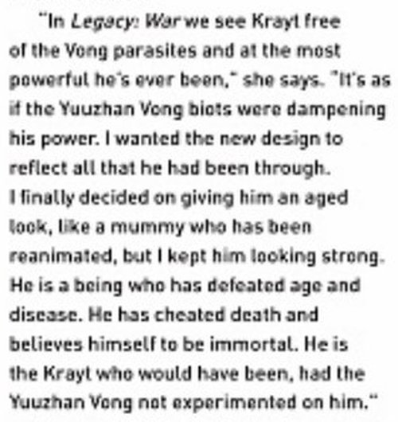
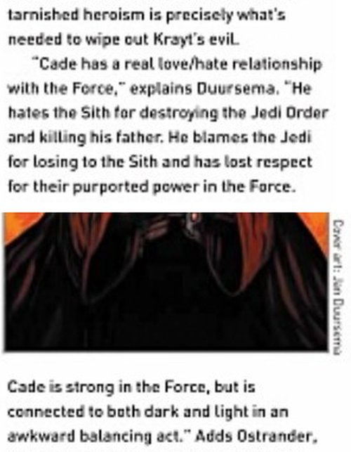

# Owner Material 038 — Star Wars Insider #1–153 plus specials (with The Lucasfilm Fan Club Magazine #1–22): Star Wars Insider #121 (2010)

- **Source:** *Star Wars Insider* magazine (issues 23–153, 1994–2014) and its predecessor *The Lucasfilm Fan Club Magazine* (issues 1–22, 1987–1994), plus seven special editions: articles, interviews, comics and short fiction Secondary source (licensed Legends reference). Scan OCR'd on the box; the scan stays box-only and is **not** published.
- **Method:** every scanned page was OCR'd and machine-screened sentence by sentence for power-relevant statements (fights, kills, defeats, Force feats, rankings, superweapons) that name a character on our roster; each kept sentence is quoted verbatim from the OCR text and has a crop of the printed passage directly under it. Pages with nothing power-relevant are still listed with what is on them.
- **Citation:** "*Star Wars Insider #121* (2010), p.X" by printed page ("scan p.X" where no printed number applies). **Weight:** Licensed magazine: a secondary source. Its short fiction and comics are Legends stories; its articles and interviews sum up or discuss lore and rank below the novels, comics and games they describe.

## scan p.1 (scan page 1)

Page contents: Cover: George Lucas Star Wars in 3D; secrets of The Old Republic; Starkiller reborn (TFU II); top 10 greatest video game moments. (hand-read)

## scan p.2 (scan page 2)

Page contents: Ad: Clone Wars Villains pop-up storybook (Grosset & Dunlap). (hand-read)

## scan p.3 (scan page 3)

Page contents: Contact page and editorial (Jonathan Wilkins) on Celebration V: Jon Stewart reading the Empire special, Matt Lanter, Julian Glover; TFU II concept art teaser (Carbonite War Droids, Terror Troopers, Gorog). (hand-read)

## scan p.4 (scan page 4)

Page contents: Contents: Creating Clones (Lucas and Filoni on Season Three), TFU II concept art, The Old Republic, Hasbro history part 2, Game On. (hand-read)

## scan p.5 (scan page 5)

Page contents: Contents: departments (Launchpad, My Star Wars Grant Imahara, Retro Ewoks, Jedi Archive Han Solo, Classic Moment Alderaan, preview section, Red Five John Hudgens). (hand-read)

## scan p.6 (scan page 6)

Page contents: Launchpad episode guide: TCW "Evil Plans" (Cad Bane kidnaps C-3PO in a plot to free Ziro the Hutt) and "Hunt for Ziro" (Obi-Wan and Quinlan Vos vs. the Hutt Council). (hand-read)

## scan p.7 (scan page 7)

Page contents: Launchpad episode guide: "Heroes on Both Sides" (Padmé and Ahsoka on Raxus, Mina Bonteri) and "Pursuit of Peace" (Padmé, Bail Organa, Onaconda Farr oppose the clone funding bill); TCW Complete Season Two DVD/Blu-ray (Jedi Temple Archives feature, Filoni production journal). (hand-read)

## scan p.8 (scan page 8)

Page contents: Launchpad: interview with a fan sculptor of one-of-a-kind custom figures (name omitted): Darth Krayt's Yuuzhan Vong implants hardest to sculpt; Darth Talon, Jarael, Mara Jade. (hand-read)

## scan p.9 (scan page 9)

Page contents: Launchpad: custom TCW bounty hunter sculpts (Embo); news that the six films will be re-released in 3D, TPM in 2012; John Knoll (ILM) on taking time with stereo conversion; Wanted: questions for a Star Wars legend. (hand-read)

## scan p.10 (scan page 10)

Page contents: Launchpad: Making of ESB giveaway; Make-A-Wish Millennium Falcon play-fort built by a Tulsa production company (volunteer names, the child and medical details omitted); Uncle Milton RC Lightsaber Room Light giveaway. (hand-read)

## scan p.11 (scan page 11)

Page contents: Launchpad: Falcon play-fort construction (about 650 lbs, solar-charged LED lighting); Uncle Milton planetarium giveaway; masthead. (hand-read)

## scan p.12 (scan page 12)

Page contents: Interrogation Droid: puppeteer Tim Rose answers rhyme questions as Admiral Ackbar ("It's a trap!" jokes; humor). (hand-read)

## scan p.13 (scan page 13)

Page contents: Ad: Topps TCW Rise of the Bounty Hunters trading cards (Pre Vizsla, Cad Bane, Bossk). (hand-read)

## scan p.14 (scan page 14)

Page contents: Feature opener "Myth Makers": Anakin art (no text). (hand-read)

## scan p.15 (scan page 15)

Page contents: Feature opener: Lucas and Filoni offer hints about Season Three. (hand-read)

## scan p.16 (scan page 16)

Page contents: Myth Makers interview: Filoni on jumping around the timeline and revisiting film characters; Lucas on going back to the roots of Star Wars and exploring the mythological aspects of the Force. (hand-read)

## scan p.17 (scan page 17)

Page contents: Interview: "Secrets Revealed" theme; Anakin's destiny and the Chosen One prophecy; Lucas: the movies are the tip of the iceberg; sidebar on Ben Quadinaros (Filoni jokes the Toong's head would not fit through ship doors). (hand-read)

## scan p.18 (scan page 18)

Page contents: Interview: Lucas: Ahsoka's growing up and Anakin's getting closer to his destiny; heroes on both sides; Filoni on character asset limits and Season Three outlines. (hand-read)

### Stat block notes (game mechanics, not feats)

- Dave Filoni on the Chosen One: "Maybe they think it means that unlike most of the other Jedi, Anakin is incredibly adept at fighting and also incredibly powerful, so that there seems to be some relevance to him fighting in the Clone Wars." —Dave Filoni (Dave Filoni on the Chosen One, Star Wars Insider 121, p. 18) (Source: *Star Wars Insider #121* (2010), scan p.18)

## scan p.19 (scan page 19)

Page contents: Interview: characters' looks moving toward Episode III; production improvements, Joel Aron's help. (hand-read)

## scan p.20 (scan page 20)

Page contents: Interview: Lucas makes no distinction between the series and the films; Filoni on more planets, bigger space battles and lightsaber duels; Season Three launch screening photo. (hand-read)

## scan p.21 (scan page 21)

Page contents: Ad: Entertainment Earth exclusive comic packs (Ysanne Isard and Baron Fel, Jango Fett with Montross and Jaster Mereel, Jarael and Rohlan Dyre, Darth Nihl and Deliah Blue). (hand-read)

## scan p.22 (scan page 22)

Page contents: My Star Wars: Grant Imahara (former ILM modeler, MythBusters) on the Hoth snowspeeder scene and driving R2-D2 at a Taco Bell convention. (hand-read)

## scan p.23 (scan page 23)

Page contents: My Star Wars: Imahara's TPM C-3PO eye-socket prototype, ILM files; Artoo as the best MythBusters addition (humor). (hand-read)

## scan p.24 (scan page 24)

Page contents: TFU II concept art (Brett Rector): Starkiller's Kamino clone garb; new lightsaber hilts Vader presents to Starkiller (Amy Beth Christensen). (hand-read)

## scan p.25 (scan page 25)

Page contents: Concept art: Rogue Shadow modified by Juno Eclipse and Rahm Kota; Terror Biodroid with Kaleesh warlord mask; Maulkiller costume concept (backstory: an unstable Vader "fusion" clone of Maul and Starkiller genetics). (hand-read)

## scan p.26 (scan page 26)

Page contents: Concept art: Terror Trooper (Vader's experimental cloaked troopers); Terror Walker boss (Stephen Chang). (hand-read)

## scan p.27 (scan page 27)

Page contents: Concept art: Carbonite War Droid, Incinerator War Droid, Imperial Riot Trooper whose weapon deflects lightsabers like MagnaGuards (Jia Tan, Christensen). (hand-read)

## scan p.28 (scan page 28)

Page contents: Concept art: Baron Tarko, Cato Neimoidia casino administrator with a gladiatorial arena; Gorog design influenced by McQuarrie's Gorax. (hand-read)

### Stat block notes (game mechanics, not feats)

- Gorog: "This beast is one of the largest enemies in the Star Wars universe, and definitely the biggest enemy you will encounter in Star Wars: The Force Unleashed II. It's so massive that it can eat rancors for breakfast—and it often does!" (Art of TFU II: Gorog, Star Wars Insider 121, p. 28) (Source: *Star Wars Insider #121* (2010), scan p.28)

## scan p.29 (scan page 29)

Page contents: Ad: Official Pix Boba Fett Metallix photo set (Bulloch, John Morton, Dickey Beer, Jason Wingreen signature edition). (hand-read)

## scan p.30 (scan page 30)

Page contents: Retro (Gus Lopez): Ewok collectibles: Kenner plush and Woklings, Ewoks cartoon figures (Logray, Wicket), Ben Cooper costume, Underoos. (hand-read)

## scan p.31 (scan page 31)

Page contents: Retro: César masks (Chief Chirpa, Paploo, Wicket, Kneesaa), Jedi soda with Paploo, Dairylea cheese, Panrico figurines, squeeze toys, Ice Capades, TV-movie crew cap, Freeborn-shop Ewok props. (hand-read)

## scan p.32 (scan page 32)

Page contents: Inside The Old Republic (Jonathan Wilkins): James Ohlen on the eight classes, class stories, world stories, starships, companion characters. (hand-read)

## scan p.33 (scan page 33)

Page contents: TOR: Sith Warrior starts on Korriban with brutal training (kill fellow students, then your Master); Trooper in Havoc Squad; light/dark side system. (hand-read)

## scan p.34 (scan page 34)

Page contents: TOR: light/dark choices and rewards (gray Jedi path); KOTOR-style dark-side corruption; eight classes, sixteen experiences; more voiceover than any other product. (hand-read)

## scan p.35 (scan page 35)

Page contents: TOR: story-driven questing; progression (high-level Trooper in full body armor, two-handed blaster cannon, air strikes); rule-based combat system (game mechanics). (hand-read)

## scan p.36 (scan page 36)

Page contents: TOR: class abilities (Jedi Knight leap, Consular telekinetic slam, Sith Warrior choke, bounty hunter missiles; game mechanics); PvP and War Zones; Rogue Squadron-style space combat; creatures, Alderaan's House of Organa, Tatooine. (hand-read)

## scan p.37 (scan page 37)

Page contents: TOR: music and sound; new world Voss; Hoth as a graveyard of Star Destroyers from a major Sith-Republic battle; future updates. (hand-read)

## scan p.38 (scan page 38)

Page contents: Subscription ad (subscriber exclusive cover). (hand-read)

## scan p.39 (scan page 39)

Page contents: Digital subscription and back issues ad. (hand-read)

## scan p.40 (scan page 40)

Page contents: Jedi Archive: Harrison Ford as Han Solo with Peter Mayhew; on the Echo Base set, the Falcon, Endor, with Richard Marquand (photo captions). (hand-read)

## scan p.41 (scan page 41)

Page contents: Jedi Archive: rarely seen images from the Lucasfilm archives (photo page). (hand-read)

## scan p.42 (scan page 42)

Page contents: History of Hasbro part 2: who's who; Expanded Universe wave; Mark Boudreaux on the 1984 Kenner Clone Wars pitch and the Imperial Sentinel based on Nilo Rodis-Jamero art; Fan Club Four. (hand-read)

## scan p.43 (scan page 43)

Page contents: Hasbro: Derryl DePriest and Brian Parrish on last-wave demand; TPM secrecy (Mace Windu and Battle Droid on STAP previews; Vickie Stratford). (hand-read)

## scan p.44 (scan page 44)

Page contents: Hasbro: Fode and Beed head change; Episode I C-3PO paint-ups; Midnight Madness; Commtech chips. (hand-read)

## scan p.45 (scan page 45)

Page contents: Hasbro: Commtech voice recording; Steve Bono writing lines; Han Solo cantina articulation; Admiral Motti elbow articulation for the Vader choke; Richard Le Parmentier anecdote; new stormtrooper. (hand-read)

## scan p.46 (scan page 46)

Page contents: Hasbro: Commtech stormtrooper color-change blaster mark; Boudreaux on articulation evolution; FX-7 with 18 arms. (hand-read)

## scan p.47 (scan page 47)

Page contents: Hasbro: 2001 Rebel Fleet Trooper boot cut joints (Dave Vennemeyer); 200th-figure Boba Fett; ANH 25th anniversary two-packs. (hand-read)

## scan p.48 (scan page 48)

Page contents: Hasbro: AOTC figures with magnets and dynamic poses; oversized Ephant Mon Fans' Choice figure; George Lucas as X-wing pilot Jorg Sacul (Brian Wilk). (hand-read)

## scan p.49 (scan page 49)

Page contents: Ad: Star Wars: The Clone Wars Magazine #1 (Titan). (hand-read)

## scan p.50 (scan page 50)

Page contents: Game On opener: "Let the Wookiee Win" vector-art spread (no text). (hand-read)

## scan p.51 (scan page 51)

Page contents: Game On (Chris Prince): greatest video game moments; Star Wars Arcade (1983), digitized Obi-Wan "Luke, trust me". (hand-read)

## scan p.52 (scan page 52)

Page contents: Game On: Super Star Wars: Return of the Jedi (EV-9D9 attacks the Ewok village; Jabba boss spitting frogs); Jedi Knight: Dark Forces II (Kyle Katarn gets a lightsaber; moral choices). (hand-read)

## scan p.53 (scan page 53)

Page contents: Game On: Shadows of the Empire (tow cables on AT-ATs at Hoth; Xizor's skyhook); X-Wing Alliance (flying the Falcon at Endor). (hand-read)

## scan p.54 (scan page 54)

Page contents: Game On: Star Wars Racer; KOTOR (the truth about Darth Revan revealed); Battlefront II hero mode. (hand-read)

## scan p.55 (scan page 55)

Page contents: Game On: LEGO Star Wars: The Complete Saga (Chewbacca pulls stormtroopers' arms off; humor); The Force Unleashed (playing Vader on Kashyyyk). (hand-read)

## scan p.56 (scan page 56)

Page contents: Classic Moment: ANH Alderaan destruction; Lucas commentary on Leia as the Rebel leader; Muren pyrotechnic trivia; script excerpt (film dialogue). (hand-read)

### Stat block notes (game mechanics, not feats)

- Why It's a Classic: "This scene really confirms Leia's inner steel. Even faced with the destruction of her home planet and everyone on it, she cannot betray her Rebel allies. It's perhaps no surprise in light of this that Leia even manages to resist the torture of Vader's interrogation droid while imprisoned in the Death Star's detention center." (Classic Moment: Why It's a Classic, Star Wars Insider 121, p. 56) (Source: *Star Wars Insider #121* (2010), scan p.56)

## scan p.57 (scan page 57)

Page contents: Classic Moment: ANH script excerpt (Tarkin, Dantooine, Alderaan destroyed; film dialogue); Carrie Fisher quote from Insider #97 on her accent; Organa Major trivia; next time Yoda vs. Dooku. (hand-read)

## scan p.58 (scan page 58)

Page contents: Ad: Star Trek Magazine (Patrick Stewart, U.S.S. Aventine, Typhon Pact). (hand-read)

## scan p.59 (scan page 59)

Page contents: Preview section contents ("There's nothing like a good blaster at your side, kid."). (hand-read)

## scan p.60 (scan page 60)

Page contents: Books (Daniel Wallace): The Sounds of Star Wars (Rinzler, Chronicle/becker&mayer) with soundboard; Ben Burtt on sound design (Tusken howl from Tunisian mules, mouse droid chirps after Curly). (hand-read)

## scan p.61 (scan page 61)

Page contents: Books: The Clone Wars: Defenders of the Republic junior novel (Rob Valois; "Clone Cadets", "ARC Troopers"); Ask Lobot question on Siri Tachi vs. Duchess Satine (reader name omitted). (hand-read)

## scan p.62 (scan page 62)

Page contents: Comics: Legacy—War #1 (Ostrander, Duursema) brings back Cade, Krayt, Marasiah Fel, Antares Draco, Wolf Sazen, Darth Talon; Ostrander: no guarantee anyone will be left. (hand-read)

- **Darth Krayt** — entry/section: Duursema on the resurrected Krayt: """In Legacy: War we see Krayt free of the Vong parasites and at the most powerful he's ever been," she says. "It's as if the Yuuzhan Vong biots were dampening his power. I wanted the new design to reflect all that he had been through. I finally decided on giving him an aged look, like a mummy who has been reanimated, but I kept him looking strong. He is a being who has defeated age and disease. He has cheated death and believes himself to be immortal. He is the Krayt who would have been, had the Yuuzhan Vong not experimented on him."" —Jan Duursema, Star Wars Insider 121, p. 62" Source: *Star Wars Insider #121* (2010), scan p.62
  
- **Cade Skywalker** — entry/section: Duursema on Cade and the Force: """Cade has a real love/hate relationship with the Force," explains Duursema. "He hates the Sith for destroying the Jedi Order and killing his father. He blames the Jedi for losing to the Sith and has lost respect for their purported power in the Force. Cade is strong in the Force, but is connected to both dark and light in an awkward balancing act."" —Jan Duursema, Star Wars Insider 121, p. 62" Source: *Star Wars Insider #121* (2010), scan p.62
  

### Stat block notes (game mechanics, not feats)

- Legacy: War: "Speaking of Krayt, his surprise resurrection freed him from his reliance on the Yuuzhan Vong biotechnology that allowed the Clone Wars veteran—then known as A'Sharad Hett—to sustain his ancient body. The new Krayt is old but even stronger than before" (Comics: This Means War, Star Wars Insider 121, p. 62) (Source: *Star Wars Insider #121* (2010), scan p.62)

## scan p.63 (scan page 63)

Page contents: Comics: Omnibus Quinlan Vos—Jedi in Darkness (Twilight, Infinity's End, Darkness, Stark Hyperspace War, Devaronian Version, Rite of Passage); Ask Lobot sidebar: Commander Cody's post-Episode III exploits remain untold. (hand-read)

## scan p.64 (scan page 64)

Page contents: Comics: The Clone Wars—Deadly Hands of Shon-Ju graphic novel (Jeremy Barlow, Brian Koschak): Shon-Ju, a former Padawan turned cult leader. (hand-read)

### Stat block notes (game mechanics, not feats)

- Deadly Hands of Shon-Ju: "The Twi'lek Jedi has fought a thousand enemies since the start of the Clone Wars, but this time her mission is complicated by the interference of someone who used to be a friend." (Comics: A Deadly Union, Star Wars Insider 121, p. 64) (Source: *Star Wars Insider #121* (2010), scan p.64)

## scan p.65 (scan page 65)

Page contents: Ask Lobot (Leland Y. Chee): Jedi build lightsabers on Ilum, crystals determine blade color; Barriss Offee assembling hers through the Force under Luminara; Ahsoka went to Ilum before getting a Master; Darth Caedus pronounced KIE-duss (reader names omitted). (hand-read)

## scan p.66 (scan page 66)

Page contents: Incoming (Chris Spitale): Hasbro ROTS vintage-style wave (Sidious, Anakin, MagnaGuard, Grievous, Obi-Wan, Cody); TCW vehicles (AT-AP, AAT, swamp speeder, Hyena bomber). (hand-read)

## scan p.67 (scan page 67)

Page contents: Incoming: Acme Archives prints ("Power & Glory Forever", "Replica" Boba Fett, "Shadows of Tatooine", "Victory is Imminent"); LEGO Obi-Wan's Jedi Starfighter UCS. (hand-read)

## scan p.68 (scan page 68)

Page contents: Incoming: Sideshow "Fall of the Empire" Ewoks vs. Stormtrooper diorama, Commander Cody 12-inch, Clone Trooper Episode III Premium Format. (hand-read)

## scan p.69 (scan page 69)

Page contents: Incoming: Revell Snaptite TCW kits (Soulless One, Republic attack shuttle, AAT, Ahsoka's starfighter, AT-TE); Funko DJ headphones. (hand-read)

## scan p.70 (scan page 70)

Page contents: Gentle Giant 12-inch vintage-style figures (Chris Spitale): Dev Gilmore and Ashly Powell on scanning original Kenner figures and Hasbro's involvement. (hand-read)

## scan p.71 (scan page 71)

Page contents: Gentle Giant: vintage discrepancies, vinyl capes, keeping seam lines, packaging; Han and Chewbacca first, hopes for Greedo, Walrus Man, Hammerhead, Biker Scout. (hand-read)

## scan p.72 (scan page 72)

Page contents: Bounty Hunters (Kotobukiya-sponsored): reader photos with Carrie Fisher at Wishful Drinking and Peter Mayhew (reader names omitted). (hand-read)

## scan p.73 (scan page 73)

Page contents: Bounty Hunters: reader photos with Dave Filoni, Billy Dee Williams and Rusty Goffe (reader names omitted). (hand-read)

## scan p.74 (scan page 74)

Page contents: Bantha Tracks (Mary Franklin): fan memories of Celebration V; Filoni teaching a kids' drawing class; R2-D2 Builders' Echo Base display (fan names omitted). (hand-read)

## scan p.75 (scan page 75)

Page contents: Bantha Tracks: Celebration V fan photos (speeder bike, Bossk, ESB 30th collectors' club) (fan names omitted). (hand-read)

## scan p.76 (scan page 76)

Page contents: Bantha Tracks: Celebration V fan photos (Belgian Garrison wampa props; camping out to see George Lucas at the Main Event; Jay Laga'aia, James Arnold Taylor, Tom Kane, Robert Wynn); submission guidelines (fan names omitted). (hand-read)

## scan p.77 (scan page 77)

Page contents: Bantha Tracks: a fan's first convention (Filoni Season Three panel, Seth Green, Ashley Eckstein, Aaron Allston, Troy Denning, Shelly Shapiro, Jan Duursema); Mary Franklin's "First Fan in Line" thanks to her volunteer Elite Squad (fan and volunteer names omitted). (hand-read)

## scan p.78 (scan page 78)

Page contents: StarWarsShop.com ad: ESB clapper, aprons, lightsaber bottle opener, McQuarrie-concept Vader bronze bust. (hand-read)

## scan p.79 (scan page 79)

Page contents: StarWarsShop.com ad: Eau Lando cologne, Hoth Brewing Company mug, Yoda ears cap. (hand-read)

## scan p.80 (scan page 80)

Page contents: Red Five: fan filmmaker John Hudgens' five non-Star Wars fan films: Closet Cases of the Nerd Kind, Raiders of the Lost Ark: The Adaptation. (hand-read)

## scan p.81 (scan page 81)

Page contents: Red Five cont.: Batman: Dead End, The Hunt for Gollum, Star Trek: New Voyages/Phase II. (hand-read)

## scan p.82 (scan page 82)

Page contents: Next issue: Ashley Eckstein on Ahsoka coming of age in Season Three, Endor, Mark Hamill, original Marvel comic; quote "With a great deal of training and patience, she might amount to something."—Anakin Skywalker. (hand-read)

## scan p.83 (scan page 83)

Page contents: Ad: Brian's Toys (vintage and modern figures). (hand-read)

