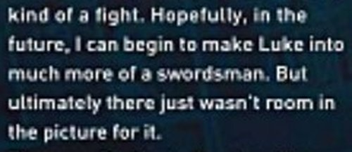
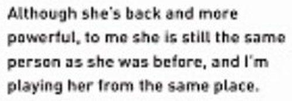
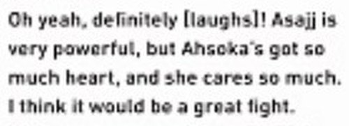
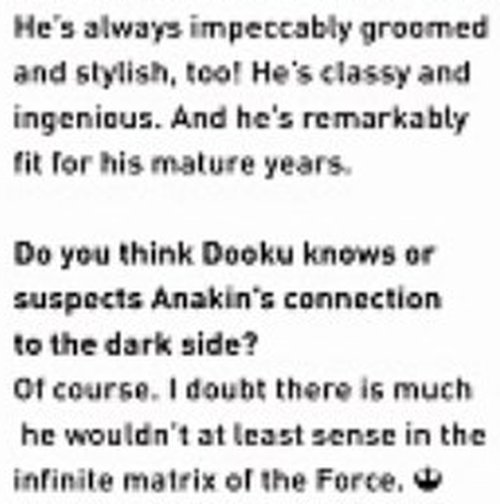
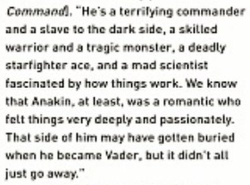

# Owner Material 038 — Star Wars Insider #1–153 plus specials (with The Lucasfilm Fan Club Magazine #1–22): Star Wars Insider #122 (2011)

- **Source:** *Star Wars Insider* magazine (issues 23–153, 1994–2014) and its predecessor *The Lucasfilm Fan Club Magazine* (issues 1–22, 1987–1994), plus seven special editions: articles, interviews, comics and short fiction Secondary source (licensed Legends reference). Scan OCR'd on the box; the scan stays box-only and is **not** published.
- **Method:** every scanned page was OCR'd and machine-screened sentence by sentence for power-relevant statements (fights, kills, defeats, Force feats, rankings, superweapons) that name a character on our roster; each kept sentence is quoted verbatim from the OCR text and has a crop of the printed passage directly under it. Pages with nothing power-relevant are still listed with what is on them.
- **Citation:** "*Star Wars Insider #122* (2011), p.X" by printed page ("scan p.X" where no printed number applies). **Weight:** Licensed magazine: a secondary source. Its short fiction and comics are Legends stories; its articles and interviews sum up or discuss lore and rank below the novels, comics and games they describe.

## scan p.1 (scan page 1)

Page contents: Cover: "The evil plans of Savage Opress and the Nightsisters revealed!" (hand-read)

## scan p.2 (scan page 2)

Page contents: Ad: Star Wars Insider subscription. (hand-read)

## scan p.3 (scan page 3)

Page contents: Editor's Welcome (Jonathan Wilkins): free Howard Chaykin ESB-homage poster, 1976 Lucas/Chaykin comic transcript, Savage Opress debut, Nightsisters; Corey Burton teaser; Luke quote from Marvel Star Wars #1. (hand-read)

## scan p.4 (scan page 4)

Page contents: Contents: features (Nightsisters, Endor locations, Mark Hamill, Jon Stewart, Marvel comic adaptation, ForceCast, Ventress, Corey Burton); Ventress quote "Now you fall. As all Jedi must." ("Cloak of Darkness"). (hand-read)

## scan p.5 (scan page 5)

Page contents: Contents: departments (Launchpad, My Star Wars Rick McCallum, Retro ice cream, Jedi Archive Darth Maul, Classic Moment Dooku vs. Yoda, Books Star Wars: Frames and Red Harvest, Comics, Incoming, Bantha Tracks, Bounty Hunters, Red Five Paul S. Kemp). (hand-read)

## scan p.6 (scan page 6)

Page contents: Launchpad: TCW Season Three Nightsisters arc preview. Sidious orders Dooku to destroy Ventress; she survives the assassination attempt and turns to the Nightsisters; Talzin offers Dooku a new apprentice, Savage Opress, secretly loyal to Ventress. Episode dialogue (Sidious, Talzin) kept as S. (hand-read)

### Stat block notes (game mechanics, not feats)

- Nightsisters: "Disturbed by Asajj Ventress' increasing knowledge of the dark side of the Force, Darth Sidious orders Count Dooku to destroy her. However, a Sith apprentice is not easily defeated. After surviving Dooku's assassination attempt, Ventress vows to take revenge, calling on her own people, the Nightsisters of Dathomir, for help." (Launchpad, Star Wars Insider 122, p. 6) (Source: *Star Wars Insider #122* (2011), scan p.6)

## scan p.7 (scan page 7)

Page contents: 111 words, 8 paragraphs | headings/entries: DOREY BURTON; TRIAL BY SITH!

### Stat block notes (game mechanics, not feats)

- Trial by Sith: "Savage Opress is procured from the tribal men of Dathomir, the Nightbrothers, who are subservient to the Nightsisters. An unpredictable warrior, he makes for a formidable opponent thanks to his reckless, impulsive nature and sheer brute force. Personally selected by Asajj Ventress, in a gruelling process that pits nine of the mightiest warriors against each other." (Launchpad, Star Wars Insider 122, p. 7) (Source: *Star Wars Insider #122* (2011), scan p.7)
- Making a Monster: "In a mystical, ancient ceremony, the Nightsisters use their magic to mutate Savage Opress into an even more brutal warrior than he was before. He gains great height and size, his horns lengthen, and and he develops a disturbing, unmatched ferocity." (Launchpad, Star Wars Insider 122, p. 7) (Source: *Star Wars Insider #122* (2011), scan p.7)

## scan p.8 (scan page 8)

Page contents: 97 words, 12 paragraphs | headings/entries: CHPAL; SITH TRAINING; CHALLENGE?" —DOOKU; INSIDER

### Stat block notes (game mechanics, not feats)

- First Mission: "Savage Opress' first mission is to seize control of the Temple of Eedit on the jungle planet of Devaron, killing many clones and Jedi in the process." (Launchpad, Star Wars Insider 122, p. 8) (Source: *Star Wars Insider #122* (2011), scan p.8)
- Sith Training: "A brutal training regime takes place. Unlike Jedi training, Sith training is fueled by fear and hate. Force lightning is blasted from Dooku's fingertips into Savage Opress' body until he finally gains a crude mastery of the Force and proficiency a lightsaber." (Launchpad, Star Wars Insider 122, p. 8) (Source: *Star Wars Insider #122* (2011), scan p.8)

## scan p.9 (scan page 9)

Page contents: Secrets of a Sith Lord: Darth Maul recap (Nightbrother taken by Sidious, Black Sun mission, Tatooine and Theed duels, cut in two by Obi-Wan). Obi-Wan dialogue ("This thing, this animal, is extremely dangerous!") kept as S. (hand-read)

### Stat block notes (game mechanics, not feats)

- Confrontation: "Sent to capture King Katuunko of Toydaria, Savage Opress is confronted by Anakin and Obi-Wan. Although Opress escapes, he displeases Dooku, leading to brutal combat. Then Ventress strikes. Unable to best the powerful Dooku, the two escape, but there is one last shock to come, when Mother Talzin reveals Opress has a brother, living in exile in the Outer Rim, who will complete his training: Darth Maul!" (Launchpad, Star Wars Insider 122, p. 9) (Source: *Star Wars Insider #122* (2011), scan p.9)
- Secrets of a Sith Lord: "During the Invasion of Naboo Maul was dispatched to follow Queen Amidala. He traced her to the remote planet Tatooine, where he confronted Jedi Master Qui-Gon Jinn. Later, Maul confronted Jinn and his apprentice, Obi-Wan Kenobi in the city of Theed on Naboo. Although he killed the Jedi Master, he underestimated Kenobi's skill and the Padawan sliced the Sith Lord in two" (Launchpad, Star Wars Insider 122, p. 9) (Source: *Star Wars Insider #122* (2011), scan p.9)

## scan p.10 (scan page 10)

Page contents: Launchpad: Robot Chicken Star Wars Episode III, Seth Green quote; airs December 19 on Adult Swim. (hand-read)

## scan p.11 (scan page 11)

Page contents: Launchpad: copywriter Roger Horberry praises Yoda's speech patterns; Star Wars Omnibus: A Long Time Ago vols. 1-2 giveaway; staff credits. (hand-read)

## scan p.12 (scan page 12)

Page contents: Interrogation Droid (Chris Spitale): Caroline Blakiston (Mon Mothma) and Dermot Crowley (Madine) answer joke hypotheticals (Ewoks vs. Duloks, Sith Holocrons, aiwha poaching, Kuat Drive Yards). Humor. (hand-read)

## scan p.13 (scan page 13)

Page contents: Ad: Entertainment Earth Star Wars comic packs. (hand-read)

## scan p.14 (scan page 14)

Page contents: Nightsisters feature (Leland Y. Chee) title spread: witches in the EU and the Savage Opress arc. (hand-read)

## scan p.15 (scan page 15)

Page contents: Nightsisters feature title page: "Everything you wanted to know but were afraid to ask." (hand-read)

## scan p.16 (scan page 16)

Page contents: Nightsisters: early EU witches (S'ybll the mind witch, Charal, Morag); Courtship of Princess Leia introduces the Witches of Dathomir and Nightsisters; Singing Mountain Clan and the exiled Jedi Allya; Kirana Ti, Tenel Ka, Tamith Kai and the Shadow Academy. (hand-read)

### Stat block notes (game mechanics, not feats)

- Witches of Star Wars: "The 1985 made-for-TV movie Ewoks: The Battle for Endor featured the evil witch Charal [right], whom the Expanded Universe would later identify as a Nightsister. Among her powers is the ability to change her appearance to that of a lovely young woman or a raven. That same year, Morag, a powerful Tulgah witch whose magical powers rival those of Logray the Ewok medicine man, appeared in the Ewoks Saturday morning cartoon [below]." (Nightsisters feature, Star Wars Insider 122, p. 16) (Source: *Star Wars Insider #122* (2011), scan p.16)

## scan p.17 (scan page 17)

Page contents: Nightsisters: witches use hand gestures and chants; Book of Law vs. Gethzerion's Book of Shadows; Yoda and the Chu'unthor crash; TCW retcon of Zabraks on Dathomir, human-Zabrak hybrids, Maul's tattoos from Nightbrother warrior culture. (hand-read)

## scan p.18 (scan page 18)

Page contents: Nightsisters: Iain McCaig's "Sith witch" TPM concept became Zalem in Infinity's End; Ros Lai; Mighella falls fighting Darth Maul in the Darth Maul comic. (hand-read)

## scan p.19 (scan page 19)

Page contents: Nightsisters: witches in games (Galaxies, Forces of Corruption's Silri, Jedi Alliance's Sai Sircu and Yansu Grjak). (hand-read)

### Stat block notes (game mechanics, not feats)

- The Fate of Rattatak: "We discover that Asajj was not born on Rattatak, but rather she was taken there by raiders after having been given up as an offering by Mother Talzin... Like in the EU, Asajj was befriended by a Jedi named Ky Narec who found himself isolated on the planet. Sensing Asajj's Force potential, Narec trained Asajj in the Jedi arts, but he fell in battle when their village was attacked by pirates, which is consistent with the previous EU back-story for Asajj." (Nightsisters feature, Star Wars Insider 122, p. 19) (Source: *Star Wars Insider #122* (2011), scan p.19)

## scan p.20 (scan page 20)

Page contents: Nightsisters: planet/species map (Iridonia, Rattatak, Dathomir; Chu'unthor crash). (hand-read)

## scan p.21 (scan page 21)

Page contents: Ad: Torchwood magazine. (hand-read)

## scan p.22 (scan page 22)

Page contents: My Star Wars: Rick McCallum on first seeing Star Wars and his favorite scene (Luke at the twin suns). (hand-read)

## scan p.23 (scan page 23)

Page contents: My Star Wars: McCallum favors Empire; R2-D2 merchandise; "I am your father" joke. (hand-read)

## scan p.24 (scan page 24)

Page contents: Filming Locations (Brandon Alinger): the search for ROTJ's Smith River shield-bunker location. (hand-read)

## scan p.25 (scan page 25)

Page contents: Filming Locations: Blue Harvest production at Smith River in May 1982; the "Fern Gully" crew. (hand-read)

## scan p.26 (scan page 26)

Page contents: Filming Locations: logging changed the landscape; searches with Gus Lopez in 2005 and 2008; 1983 aerial photographs. (hand-read)

## scan p.27 (scan page 27)

Page contents: Filming Locations: the original location map is found; bunker site identified in May 2010; "Heartshape," "Norman's Log," "Spaghetti Tree." (hand-read)

## scan p.28 (scan page 28)

Page contents: Filming Locations: documenting the site; Ship Ashore Motel; Harrison Ford's favorite eatery. (hand-read)

## scan p.29 (scan page 29)

Page contents: Ad: Star Trek magazine. (hand-read)

## scan p.30 (scan page 30)

Page contents: Retro (Gus Lopez): Star Wars ice cream promotions from Streets, Tip Top and Lyons Maid. (hand-read)

## scan p.31 (scan page 31)

Page contents: Retro: more ice cream promotions (Lyons Maid ESB, Peters, Frigo, Walls, Eskimo, M&M's, Bomb Pops). (hand-read)

## scan p.32 (scan page 32)

Page contents: Mark Hamill at Celebration V title image (Luke montage). (hand-read)

## scan p.33 (scan page 33)

Page contents: Mark Hamill at Celebration V (Tony A. Rowe) title page. (hand-read)

## scan p.34 (scan page 34)

Page contents: Hamill panel (moderator Jay Laga'aia): "Ultra-Passionate Fans," his childhood fandom, comic strips, Universal and Hammer horror films. (hand-read)

## scan p.35 (scan page 35)

Page contents: Hamill: meeting Alec Guinness ("I want to be known by my name, not my accolade"); Peter Cushing. (hand-read)

## scan p.36 (scan page 36)

Page contents: Hamill: Guinness's humor; rivalry with Harrison Ford; deleted Biggs Darklighter scene sidebar. (hand-read)

## scan p.37 (scan page 37)

Page contents: Hamill: Yoda "Alec Guinness as a toad"; ESB lightsaber training with Bob Anderson; Empire filming memory (family detail omitted). (hand-read)

## scan p.38 (scan page 38)

Page contents: Photo: Hamill as Luke with Endor strike team. (hand-read)

## scan p.39 (scan page 39)

Page contents: Hamill: sprained thumb on the AT-AT jump shot delayed duel filming; reading the Luke Starkiller script ("Little Rascals in outer space"). (hand-read)

## scan p.40 (scan page 40)

Page contents: Jon Stewart at Celebration V press Q&A: on his fandom and his questions for Lucas (midi-chlorian test joke). (hand-read)

## scan p.41 (scan page 41)

Page contents: Jon Stewart: Star Wars as a morality tale; Belgians building spaceships. (hand-read)

## scan p.42 (scan page 42)

Page contents: Jon Stewart: Jar Jar, Lucas coping with fan worship, merchandising joke. Humor. (hand-read)

## scan p.43 (scan page 43)

Page contents: Ad: Star Wars Insider Interview Special. (hand-read)

## scan p.44 (scan page 44)

Page contents: Movie Frame to Comic (J. W. Rinzler): July 27, 1976 meeting with George Lucas, Howard Chaykin, Roy Thomas and Charley Lippincott on the Marvel adaptation. (hand-read)

## scan p.45 (scan page 45)

Page contents: Movie Frame to Comic: Chaykin's Star Wars heroes art. (hand-read)

## scan p.46 (scan page 46)

Page contents: Transcript: Lucas praises Chaykin's Cody Starbuck; color vs. black-and-white; Chaykin unsure how to draw lightsabers. (hand-read)

## scan p.47 (scan page 47)

Page contents: Transcript: likenesses (Hamill "soft in the face"; Vader "a comic book character—Doctor Doom"); reference material needs. (hand-read)

## scan p.48 (scan page 48)

Page contents: Transcript: production schedule; Roy Thomas arrives; "Suddenly" captions; Chaykin needs head shots. Marvel panel captions (Vader choking a rebel officer) kept as S. (hand-read)

## scan p.49 (scan page 49)

Page contents: Transcript: pacing of the first issues; the Death Star sky battle; logo discussion. (hand-read)

## scan p.50 (scan page 50)

Page contents: Transcript: title without "The"; Lucas says the lightsaber is Samurai-style; Guinness "pretty good with a sword," Prowse "terrible"; Chaykin will choreograph the swordplay. Marvel trench-run and Death Star explosion panels. (hand-read)

- **Luke Skywalker** — entry/section: Movie Frame to Comic: ""Hopefully, in the future, I can begin to make Luke into much more of a swordsman. But ultimately there just wasn't room in the picture for it." —George Lucas, Star Wars Insider 122, p. 50" Source: *Star Wars Insider #122* (2011), scan p.50
  

## scan p.51 (scan page 51)

Page contents: Ad: Titan Books The Avengers. (hand-read)

## scan p.52 (scan page 52)

Page contents: Jedi Archive: rare Darth Maul images (McCaig costume concept, Ray Park stunt shots for the Qui-Gon desert duel). (hand-read)

## scan p.53 (scan page 53)

Page contents: Jedi Archive: Darth Maul close-up photo. (hand-read)

## scan p.54 (scan page 54)

Page contents: The ForceCast (Jonathan Wilkins): hosts Jason Swank and Jimmy McInerney on how the podcast started. (hand-read)

## scan p.55 (scan page 55)

Page contents: ForceCast: the hosts' first Star Wars experiences. (hand-read)

## scan p.56 (scan page 56)

Page contents: ForceCast: collecting and putting the show together; Steve Sansweet and Dave Filoni photos. (hand-read)

## scan p.57 (scan page 57)

Page contents: ForceCast: big-name guests and Celebration V live shows, meeting Mark Hamill. (hand-read)

## scan p.58 (scan page 58)

Page contents: Ad: Star Wars Insider holiday subscription offer. (hand-read)

## scan p.59 (scan page 59)

Page contents: Ad: Titan holiday subscription offers. (hand-read)

## scan p.60 (scan page 60)

Page contents: The Sith Witch feature opener: Ventress image. (hand-read)

## scan p.61 (scan page 61)

Page contents: 51 words, 6 paragraphs | headings/entries: TH; AND WORDS: JONATHAN WILKINS; INSIDER 61 |

### Stat block notes (game mechanics, not feats)

- The Sith Witch: "Cunning, devious, and more powerful with the Force than her Sith masters could have foreseen, Asajj Ventress' time has come with an epic storyline in Star Wars: The Clone Wars." (feature intro, Star Wars Insider 122, p. 61) (Source: *Star Wars Insider #122* (2011), scan p.61)

## scan p.62 (scan page 62)

Page contents: Origins of Asajj Ventress: Dermot Power/Iain McCaig female Sith concepts for AOTC; name from Asaji in Throne of Blood; originally to be named Juno Eclipse; voiced by Grey DeLisle (2003) and Nika Futterman (2008). (hand-read)

### Stat block notes (game mechanics, not feats)

- Who Is Asajj Ventress?: "Although not officially a Sith apprentice, Ventress is well-trained in the Sith arts by her master, Count Dooku... She carries twin-curved lightsabers, given to her by Dooku, that connect to become a double-bladed weapon. A flamboyant Force user, Ventress uses telekinesis and Force speed during combat, as well as the gravity-defying Force jump. Her skills with the dark side include the use of the Force grip, and the ability to control others' minds." (Ventress feature, Star Wars Insider 122, p. 62) (Source: *Star Wars Insider #122* (2011), scan p.62)

## scan p.63 (scan page 63)

Page contents: Futterman on the challenge of discovering who Ventress is. (hand-read)

- **Asajj Ventress** — entry/section: Voicing Ventress: ""Although she's back and more powerful, to me she is still the same person as she was before, and I'm playing her from the same place." —Nika Futterman, Star Wars Insider 122, p. 63" Source: *Star Wars Insider #122* (2011), scan p.63
  

## scan p.64 (scan page 64)

Page contents: Futterman: powerful people make up for having felt powerless; evil is fun to play; Ventress not tragic, could move toward the light. (hand-read)

## scan p.65 (scan page 65)

Page contents: Futterman: "Darkness sees darkness"; revenge may block her becoming a Master; voice-acting advice; LEGO figure. (hand-read)

- **Asajj Ventress; Ahsoka Tano** — entry/section: Voicing Ventress: ""Oh yeah, definitely [laughs]! Asajj is very powerful, but Ahsoka's got so much heart, and she cares so much. I think it would be a great fight." —Nika Futterman (asked whether Asajj could take down Ahsoka), Star Wars Insider 122, p. 65" Source: *Star Wars Insider #122* (2011), scan p.65
  

## scan p.66 (scan page 66)

Page contents: Corey Burton feature opener image. (hand-read)

## scan p.67 (scan page 67)

Page contents: Corey Burton feature title: the voice of Clone Wars villainy. (hand-read)

## scan p.68 (scan page 68)

Page contents: Burton on warm-ups and what makes a good villain; Cad Bane inspired by Lee Van Cleef, plus Peter Lorre at Lucas's suggestion. (hand-read)

## scan p.69 (scan page 69)

Page contents: Burton: recording with Anthony Daniels remotely; Cad Bane "a dispassionate realist"; advice from Hans Conried and Daws Butler. (hand-read)

## scan p.70 (scan page 70)

Page contents: Burton: scripted fight scenes; Ziro the Hutt's Truman Capote voice. (hand-read)

## scan p.71 (scan page 71)

Page contents: Burton: playing two characters at once; the Sy Snootles love scene; his own take on Dooku; Dooku training Savage as master/protege. (hand-read)

- **Count Dooku** — entry/section: Corey Burton interview: ""He's always impeccably groomed and stylish, too! He's classy and ingenious. And he's remarkably fit for his mature years... I doubt there is much he wouldn't at least sense in the infinite matrix of the Force." —Corey Burton, Star Wars Insider 122, p. 71" Source: *Star Wars Insider #122* (2011), scan p.71
  

## scan p.72 (scan page 72)

Page contents: Classic Moment: AOTC Yoda vs. Dooku (DVD chapter 46); Rick McCallum commentary quote; AOTC script excerpt (kept as S). (hand-read)

### Stat block notes (game mechanics, not feats)

- Why It's a Classic: "Before Attack of the Clones we knew Yoda was a great Jedi Master, and saw a glimpse of his greatness when he lifted Luke's X-wing from the swamps of Dagobah. But we hadn't truly seen him in action... As the sequence progresses, Yoda repels the objects Dooku throws at him, and then his Force lightning attack, and we begin to feel Yoda's power." (Classic Moment, Star Wars Insider 122, p. 72) (Source: *Star Wars Insider #122* (2011), scan p.72)

## scan p.73 (scan page 73)

Page contents: Classic Moment cont.: script excerpt (Yoda deflects lightning, the duel, the crane); sidebar on female Sith concepts inspiring Ventress. (hand-read)

## scan p.74 (scan page 74)

Page contents: Ad: RuneScape tie-in novel (Titan Books). (hand-read)

## scan p.75 (scan page 75)

Page contents: Contents continued: departments list; Han quote "There's nothing like a good blaster at your side, kid." (hand-read)

## scan p.76 (scan page 76)

Page contents: Ad: Brian's Toys. (hand-read)

## scan p.77 (scan page 77)

Page contents: Books (Daniel Wallace): Star Wars: Frames, 1,416 frames picked by George Lucas, 1,138 copies at $3,000; J. W. Rinzler and Mike Blanchard on the selection process. (hand-read)

## scan p.78 (scan page 78)

Page contents: Books: Joe Schreiber's Red Harvest (zombie-infested Sith academy, "zombies with lightsabers"); Troy Denning's Fate of the Jedi: Vortex (Luke and Ben with Vestara Khai, the Fallanassi on Pydyr). (hand-read)

## scan p.79 (scan page 79)

Page contents: Comics: Star Wars: Legacy Vol. 10 - Extremes collects #47-50. Ask Lobot (Leland Chee): C-3PO wires were for a microphone and eye lights; "Dack" Ralter spelling (reader names omitted). (hand-read)

## scan p.80 (scan page 80)

Page contents: Comics (Daniel Wallace): Darth Vader and the Lost Command, a Star Destroyer lost in the Ghost Nebula; Blackman on failure as a test. (hand-read)

- **Darth Vader (Anakin Skywalker)** — entry/section: Darth Vader and the Lost Command: ""He's a terrifying commander and a slave to the dark side, a skilled warrior and a tragic monster, a deadly starfighter ace, and a mad scientist fascinated by how things work. We know that Anakin, at least, was a romantic who felt things very deeply and passionately. That side of him may have gotten buried when he became Vader, but it didn't all just go away." —Haden Blackman, Star Wars Insider 122, p. 80" Source: *Star Wars Insider #122* (2011), scan p.80
  

## scan p.81 (scan page 81)

Page contents: Lost Command cont.: Vader starts at a disadvantage after failing the Emperor in Purge: The Hidden Blade; Blackman on Vader's regrets; Blackman leaves LucasArts. Ask Lobot: Yoda's toes (four, the CG model was fixed); Palpatine's second lightsaber per Stover's ROTS novelization (reader names omitted). (hand-read)

### Stat block notes (game mechanics, not feats)

- Darth Vader and the Lost Command: "The inclusion of Tarkin in the mix calls to mind the classic rivalry of Star Wars: A New Hope, in which Vader clearly possessed more power than the Grand Moff, yet backed down when Tarkin barked an order." (Comics, Star Wars Insider 122, p. 81) (Source: *Star Wars Insider #122* (2011), scan p.81)

## scan p.82 (scan page 82)

Page contents: Incoming: Hasbro vintage-packaging ROTJ wave. (hand-read)

## scan p.83 (scan page 83)

Page contents: Incoming: Sideshow Boil and Waxer with Numa 12-inch set; Museum Replicas Luke ceremonial jacket and medal. (hand-read)

## scan p.84 (scan page 84)

Page contents: Incoming: Kotobukiya Darth Maul ARTFX statue (Hokusai ukiyo-e style). (hand-read)

## scan p.85 (scan page 85)

Page contents: Incoming: Kotobukiya Stormtrooper Builder Pack; Funko holiday bobble heads; Star Wars DJ headphones. (hand-read)

## scan p.86 (scan page 86)

Page contents: Sideshow Attraction (Chris Spitale): Tom Gilliland on the 1:5 maquette line (Ronin-motif Maul, Obi-Wan as desert nomad). (hand-read)

## scan p.87 (scan page 87)

Page contents: Sideshow cont.: Obi-Wan's backpack "time capsule" (Trevor Grove, Joe Allard); Gamorrean Guard maquette concept. (hand-read)

## scan p.88 (scan page 88)

Page contents: Bantha Tracks Best of 2010: R2-D2 Builders, envelope art, vegetable-carved wampa scene (fan names omitted). (hand-read)

## scan p.89 (scan page 89)

Page contents: Bantha Tracks: Celebration V fan photos, a 501st proposal, a 501st hospital visit (fan names and private details omitted). (hand-read)

## scan p.90 (scan page 90)

Page contents: Bantha Tracks: fan photos, a 501st group shot, Ashley Eckstein with a young costumer, library Star Wars day (fan names omitted). (hand-read)

## scan p.91 (scan page 91)

Page contents: Bantha Tracks: Nordic Garrison visits the Finse ESB locations; Empire City Garrison charity walk; Mary Franklin's "Star Wars is forever" column; submission guidelines (fan names and private details omitted). (hand-read)

## scan p.92 (scan page 92)

Page contents: Bounty Hunters: reader photos with Richard LeParmentier and Carrie Fisher (reader names omitted). (hand-read)

## scan p.93 (scan page 93)

Page contents: Bounty Hunters: reader photos with Boba Fett and Darth Vader costumed appearance, Ashley Eckstein, Peter Mayhew and Daniel Logan (reader names, children and charity details omitted). (hand-read)

## scan p.94 (scan page 94)

Page contents: StarWarsShop.com ad (ESB clapper, aprons, McQuarrie Vader bust). (hand-read)

## scan p.95 (scan page 95)

Page contents: StarWarsShop.com ad (Eau Lando cologne, Hoth Brewing mug). (hand-read)

## scan p.96 (scan page 96)

Page contents: Red Five: Paul S. Kemp's sword-and-sorcery picks: Moorcock's Elric Saga (parallel to Anakin/Vader), Thieves' World. (hand-read)

## scan p.97 (scan page 97)

Page contents: Red Five cont.: Howard's Conan, Zelazny's Jack of Shadows, Salvatore's The Crystal Shard (Drizzt). (hand-read)

## scan p.98 (scan page 98)

Page contents: Next issue: Matt Lanter, the Force, Ben Burtt and Matthew Wood, Catherine Taber and James Arnold Taylor; US January 25, UK January 27. USPS ownership statement. (hand-read)

## scan p.99 (scan page 99)

Page contents: Ad: Torchwood stories. (hand-read)

## scan p.100 (scan page 100)

Page contents: Ad: Drew Struzan art book (Titan Books). (hand-read)

