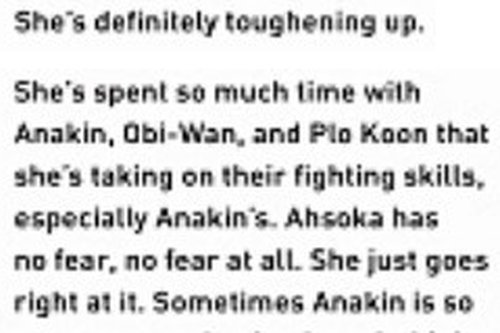
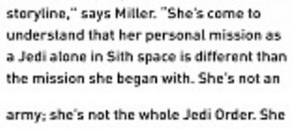

# Owner Material 038 — Star Wars Insider #1–153 plus specials (with The Lucasfilm Fan Club Magazine #1–22): Star Wars Insider #123 (2011)

- **Source:** *Star Wars Insider* magazine (issues 23–153, 1994–2014) and its predecessor *The Lucasfilm Fan Club Magazine* (issues 1–22, 1987–1994), plus seven special editions: articles, interviews, comics and short fiction Secondary source (licensed Legends reference). Scan OCR'd on the box; the scan stays box-only and is **not** published.
- **Method:** every scanned page was OCR'd and machine-screened sentence by sentence for power-relevant statements (fights, kills, defeats, Force feats, rankings, superweapons) that name a character on our roster; each kept sentence is quoted verbatim from the OCR text and has a crop of the printed passage directly under it. Pages with nothing power-relevant are still listed with what is on them.
- **Citation:** "*Star Wars Insider #123* (2011), p.X" by printed page ("scan p.X" where no printed number applies). **Weight:** Licensed magazine: a secondary source. Its short fiction and comics are Legends stories; its articles and interviews sum up or discuss lore and rank below the novels, comics and games they describe.

## scan p.1 (scan page 1)

Page contents: Cover: Obi-Wan vs Padme (James Arnold Taylor and Catherine Taber), Anakin and Ahsoka's date with destiny, the mysteries of the Force. (hand-read)

## scan p.2 (scan page 2)

Page contents: Ad: Supernatural magazine subscriptions (Titan). (hand-read)

## scan p.3 (scan page 3)

Page contents: Contact details; Editor's Welcome (Jonathan Wilkins): Force issue, TCW Mortis interviews, Kershner tribute. Yoda epigraph "A Jedi uses the Force for knowledge and defense. Never for attack." (hand-read)

## scan p.4 (scan page 4)

Page contents: Contents: features (ForceCast, Secrets of the Force, Matt Lanter, Taber and Taylor, Ahsoka, Burtt and Wood). (hand-read)

## scan p.5 (scan page 5)

Page contents: Contents: departments (Launchpad, My Star Wars Simon Pegg, Retro, Jedi Archive, Classic Moment, Books, Comics, Incoming, Bounty Hunters, Bantha Tracks). (hand-read)

## scan p.6 (scan page 6)

Page contents: Launchpad: Encounter on Mortis, TCW Season Three Mortis arc preview ("Overlords"). (hand-read)

### Stat block notes (game mechanics, not feats)

- Overlords: "Anakin Skywalker, Obi-Wan Kenobi, and Ahsoka Tano are drawn to the mysterious planet of Mortis. As Anakin learns about his destiny from a family of powerful Force users—the Father, Son, and Daughter—he faces his most difficult challenge yet." (Launchpad, Star Wars Insider 123, p. 6) (Source: *Star Wars Insider #123* (2011), scan p.6)

## scan p.7 (scan page 7)

Page contents: Launchpad: "Altar of Mortis" (Feb. 11; Ahsoka taken as a lure to turn Anakin, the Father tries to stop his children's confrontation) and "Ghosts of Mortis" (Feb. 18; Anakin glimpses his future). (hand-read)

## scan p.8 (scan page 8)

Page contents: Launchpad: Irvin Kershner obituary (Brian J. Robb), died November at 87; early career; Lucas: "I considered him a mentor." (hand-read)

## scan p.9 (scan page 9)

Page contents: Kershner tribute cont.: Lucas picked him after Eyes of Laura Mars; "I turned it down at first." (hand-read)

## scan p.10 (scan page 10)

Page contents: Kershner tribute cont.: Lucas wanted a sequel better than Star Wars; Norway shoot, tauntaun froze at 26 below. (hand-read)

## scan p.11 (scan page 11)

Page contents: Kershner tribute cont.: Never Say Never Again, RoboCop 2, acting cameos; Lucas statement; "I'm Mr. Empire Strikes Back." Masthead. (hand-read)

## scan p.12 (scan page 12)

Page contents: Launchpad: ANU students' light-based tractor beam; 1977 Harrison Ford interview; Star Wars as a silent movie. (hand-read)

## scan p.13 (scan page 13)

Page contents: Launchpad: cardboard morris-dancing stormtroopers in London (David Owen); 1980 Today Show Hamill/Ford clip; Bill Murray Star Wars song; #BountyHunterSitcoms. (hand-read)

## scan p.14 (scan page 14)

Page contents: Interrogation Droid: Paul Blake (Greedo) answers comic what-ifs (humor, not canon). (hand-read)

## scan p.15 (scan page 15)

Page contents: Ad: Primeval books (Titan). (hand-read)

## scan p.16 (scan page 16)

Page contents: Secrets of the Force opener: full-page TCW Yoda art. (hand-read)

## scan p.17 (scan page 17)

Page contents: Secrets of the Force title page (Dan Wallace): the Force and the Mortis arc. (hand-read)

## scan p.18 (scan page 18)

Page contents: Secrets of the Force: In the Beginning (Ashla and Bogan, Jedi Bendu, the 12 children of Skywalker, Lucas on Yoda and the lasersword); Force Jump (Luke leaving the carbon-freeze chamber; Kyle Katarn in the Jedi Knight games); Do You Have What It Takes? (midi-chlorians, age, the cyborg limit). (hand-read)

## scan p.19 (scan page 19)

Page contents: Force Powers: Jedi as superheroes; Telekinesis; Jedi Mind Trick (Watto immune). (hand-read)

### Stat block notes (game mechanics, not feats)

- Telekinesis: "In the Expanded Universe: Starkiller, Darth Vader's apprentice, steers a Star Destroyer into a spectacular crash landing in The Force Unleashed." (Secrets of the Force, Star Wars Insider 123, p. 19) (Source: *Star Wars Insider #123* (2011), scan p.19)
- Telekinesis: "In the movies: Luke calls his lightsaber to his hand in the wampa's cave. Darth Sidious tosses seating pods at Yoda inside the Senate chamber." (Secrets of the Force, Star Wars Insider 123, p. 19) (Source: *Star Wars Insider #123* (2011), scan p.19)
- Jedi Mind Trick: "In the Knights of the Old Republic comics, misfit Jedi Zayne Carrick fails to mind-trick the Snivvian con artist Gryph, because Gryph is far too savvy to fall for a tactic intended for the weak-minded." (Secrets of the Force, Star Wars Insider 123, p. 19) (Source: *Star Wars Insider #123* (2011), scan p.19)

## scan p.20 (scan page 20)

Page contents: Force Lightning (Emperor vs Luke; Dooku vs Yoda); The Sith: dark side "quicker, easier, and more seductive", the Rule of Two, Force lightning and telekinetic strangulation "tend to be more menacing." (hand-read)

### Stat block notes (game mechanics, not feats)

- Telepathy: "In the Expanded Universe: Mara Jade mentally warns Leia of Imperial assassins in the novel The Last Command, then conveys specific instructions on how to take them down." (Secrets of the Force, Star Wars Insider 123, p. 20) (Source: *Star Wars Insider #123* (2011), scan p.20)
- Precognition: "In the New Jedi Order novels, Jacen Solo has a vision of the galaxy in which his missteps leads to imbalance and potential victory by the Yuuzhan Vong invaders." (Secrets of the Force, Star Wars Insider 123, p. 20) (Source: *Star Wars Insider #123* (2011), scan p.20)
- Force Lightning: "In the Expanded Universe: Although Force lightning is considered a dark side power, Jedi Master Plo Koon wields it in the PlayStation game Jedi Power Battles." (Secrets of the Force, Star Wars Insider 123, p. 20) (Source: *Star Wars Insider #123* (2011), scan p.20)

## scan p.21 (scan page 21)

Page contents: The Sith cont. (EU Sith: Malgus, Krayt, Talon, Desolous, Caedus); Midi-chlorians: What's the Deal? (Anakin's count over 20,000; midi-chlorians "aren't the Force, but merely the broadcasters"; Skippy the Jedi Droid); Force Artifacts (Kiber crystal, Rakatan relics, Charal's ring). (hand-read)

### Stat block notes (game mechanics, not feats)

- Force Artifacts: "Using a different spelling, the Kaiburr crystal served as the centerpiece of Alan Dean Foster's 1978 novel Splinter of the Mind's Eye. It gave Luke the ability to defeat Vader in a one-on-one duel." (Secrets of the Force, Star Wars Insider 123, p. 21) (Source: *Star Wars Insider #123* (2011), scan p.21)

## scan p.22 (scan page 22)

Page contents: Luminous Beings Are We (Kershner: "Having Ben come back is almost like Zen"; "Netherworld" in the ROTJ rough draft); The Chosen One (Mace's line; Plagueis "may have been the mastermind"; the Mortis bombshell). (hand-read)

### Stat block notes (game mechanics, not feats)

- Luminous Beings Are We: "Interestingly, Yoda freely admits that he can't stop himself from dying. "Strong am I with the Force," he says, "but not that strong." Instead, merging with the Force seems to be a way for a Jedi to die on his or her own terms, gaining additional powers in the process." (Secrets of the Force, Star Wars Insider 123, p. 22) (Source: *Star Wars Insider #123* (2011), scan p.22)
- Luminous Beings Are We: "In Revenge of the Sith we learn that this isn't a standard Jedi feat. It is something that Qui-Gon Jinn picked up from a Shaman of the Whills, and it can only be accomplished through compassion, not greed." (Secrets of the Force, Star Wars Insider 123, p. 22) (Source: *Star Wars Insider #123* (2011), scan p.22)
- Luminous Beings Are We: "In the Legacy comics set more than 130 years after the movies, Luke Skywalker appears as a Force spirit to his descendent, Cade." (Secrets of the Force, Star Wars Insider 123, p. 22) (Source: *Star Wars Insider #123* (2011), scan p.22)
- The Chosen One: "Regardless of how it happened, the Chosen One has a clear checklist that Anakin fulfills in Return of the Jedi. He destroys the Sith in the form of Emperor Palpatine, and he brings balance to the Force by clearing the way for Luke to restore the Jedi Order." (Secrets of the Force, Star Wars Insider 123, p. 22) (Source: *Star Wars Insider #123* (2011), scan p.22)

## scan p.23 (scan page 23)

Page contents: Ad: Torchwood magazine (Titan). (hand-read)

## scan p.24 (scan page 24)

Page contents: My Star Wars (Bonnie Burton): Simon Pegg on Chewbacca and Leia. (hand-read)

## scan p.25 (scan page 25)

Page contents: My Star Wars cont.: Pegg on Nien Nunb ("helped save the Rebellion"), his Vader Project helmet, and Paul. (hand-read)

## scan p.26 (scan page 26)

Page contents: Matt Lanter interview opener: full-page TCW Anakin art. (hand-read)

## scan p.27 (scan page 27)

Page contents: Matt Lanter interview (Jonathan Wilkins): reaction to the Mortis scripts ("it's going to be a game changer"). (hand-read)

## scan p.28 (scan page 28)

Page contents: Lanter cont.: Filoni directing him and Sam Witwer (the Son); how far down the dark path Anakin can go in TCW. (hand-read)

## scan p.29 (scan page 29)

Page contents: Lanter cont.: the Mortis reveal "really changes your perception of something as big as the Force"; Anakin's brash decisions. (hand-read)

## scan p.30 (scan page 30)

Page contents: Lanter cont.: Celebration V; Anakin's new look ("a little bigger... a bit more intimidating"); joke about a double-bladed saber. (hand-read)

## scan p.31 (scan page 31)

Page contents: Ad: The Clone Wars Comic subscriptions (Titan). (hand-read)

## scan p.32 (scan page 32)

Page contents: Retro (Gus Lopez): Luke collectibles (over 2,400 items; Kenner Early Bird, Icons lightsaber replica, Omni snowspeeder soap). (hand-read)

## scan p.33 (scan page 33)

Page contents: Retro cont.: Celebration medallions, Dairy Time yogurt, unproduced Kenner Luke toys, Luke cookie jar prototype. (hand-read)

## scan p.34 (scan page 34)

Page contents: Versus title art (Taber vs Taylor). (hand-read)

## scan p.35 (scan page 35)

Page contents: Versus intro: Catherine Taber (Padme) and James Arnold Taylor (Obi-Wan) interview each other. (hand-read)

## scan p.36 (scan page 36)

Page contents: Versus cont.: lightsaber colors, Padme "will fight", Taylor's Force joke (Obi-Wan spinning a chair). (hand-read)

## scan p.37 (scan page 37)

Page contents: Versus cont.: mind-trick joke (Filoni "completely immune"), Padme's ringtone, vacation planets. (hand-read)

## scan p.38 (scan page 38)

Page contents: Scan duplicate of printed p. 37 (identical image and OCR); printed p. 38 is missing from this scan. From here on, file page N is printed page N-1. (hand-read)

## scan p.39 (scan page 39)

Page contents: (printed p. 38) Versus cont.: dewback or tauntaun, dinner guests, Han or Anakin; Taylor nervous about taking on Obi-Wan. (hand-read)

## scan p.40 (scan page 40)

Page contents: (printed p. 39) Versus cont.: Obi-Wan and Padme's trust; "I like my gunplay!" (hand-read)

## scan p.41 (scan page 41)

Page contents: (printed p. 40) Jedi Archive photos: Christensen, McGregor, Portman on set. (hand-read)

## scan p.42 (scan page 42)

Page contents: (printed p. 41) Jedi Archive: rarely seen images (Lloyd, McGregor, Neeson, R2-D2; Geonosian guard stand-in). (hand-read)

## scan p.43 (scan page 43)

Page contents: (printed p. 42) Ashley Eckstein interview opener: full-page TCW Ahsoka art. (hand-read)

## scan p.44 (scan page 44)

Page contents: (printed p. 43) Eckstein: Ahsoka's new costume designed by Filoni; second, shorter lightsaber "almost like a lightsaber dagger." (hand-read)

- **Ahsoka Tano; Darth Vader (Anakin Skywalker); Obi-Wan Kenobi; Plo Koon** — entry/section: Ashley Eckstein interview: ""She's spent so much time with Anakin, Obi-Wan, and Plo Koon that she's taking on their fighting skills, especially Anakin's. Ahsoka has no fear, no fear at all. She just goes right at it." —Ashley Eckstein, Star Wars Insider 123, p. 43" Source: *Star Wars Insider #123* (2011), scan p.44
  

## scan p.45 (scan page 45)

Page contents: (printed p. 44) Eckstein cont.: the Mortis scripts "really blew my mind"; Ahsoka's personality transformations. (hand-read)

## scan p.46 (scan page 46)

Page contents: (printed p. 45) Eckstein cont.: James Arnold Taylor's coaching; "Two lightsabers are always better than one!" (hand-read)

## scan p.47 (scan page 47)

Page contents: (printed p. 46) Eckstein cont.: five years on the show; Filoni's direction of Mortis. (hand-read)

## scan p.48 (scan page 48)

Page contents: (printed p. 47) Eckstein cont.: Lanter as the centerpiece of the arc; Filoni's advice ("trust my instincts"). (hand-read)

## scan p.49 (scan page 49)

Page contents: (printed p. 48) Eckstein cont.: Filoni as her Jedi Master; where Ahsoka goes next; Her Universe. (hand-read)

## scan p.50 (scan page 50)

Page contents: (printed p. 49) Ad: Star Wars Insider back issues. (hand-read)

## scan p.51 (scan page 51)

Page contents: (printed p. 50) Sounds of a Saga (Tony A. Rowe): Ben Burtt and Matthew Wood at Celebration V, hosted by David Collins. (hand-read)

## scan p.52 (scan page 52)

Page contents: (printed p. 51) Burtt on moving into digital with Wood ("kid genius"); Wood sneaking into the sound archive. (hand-read)

## scan p.53 (scan page 53)

Page contents: (printed p. 52) Cataloguing about 1,200 new TPM sounds into a database. (hand-read)

## scan p.54 (scan page 54)

Page contents: (printed p. 53) The Clone Wars reusing the library; WALL-E as "R2-D2: the Movie"; Soundhenge; digital versus analog. (hand-read)

## scan p.55 (scan page 55)

Page contents: (printed p. 54) Burtt on digital tools and the two kinds of sound people; "Build your own sound effects library." (hand-read)

## scan p.56 (scan page 56)

Page contents: (printed p. 55) Burtt Celebration V Q&A: the lightsaber hum came from projector motors; Indy's pistol; the old propeller recordings; a heartbeat door-thump loop he never used. (hand-read)

## scan p.57 (scan page 57)

Page contents: (printed p. 56) Classic Moment: ESB Cloud City dining room (DVD chapter 38). Kershner on the reverse-filmed string gag for the gun jumping into Vader's hand; script excerpt. (hand-read)

### Stat block notes (game mechanics, not feats)

- Classic Moment: Vader disarms Han on Cloud City: "Surprised by Vader's unexpected appearance in the Cloud City dining hall, our heroes are helpless and unable to do anything to resist once the Dark Lord has disarmed Han Solo. In A New Hope, Han scoffed at the idea of the Force being superior to a good blaster at your side, but Vader proves that Han can no longer be certain about that." (Classic Moment, Star Wars Insider 123, p. 56) (Source: *Star Wars Insider #123* (2011), scan p.57)

## scan p.58 (scan page 58)

Page contents: (printed p. 57) Classic Moment cont.: script, with Vader deflecting Han's bolts and Force-pulling the blaster (film); Filoni quote reprinted from Insider #120 on Vader's menace. Next time: Death Star swing. (hand-read)

## scan p.59 (scan page 59)

Page contents: (printed p. 58) Ad: Star Wars Interview Special (Titan). (hand-read)

## scan p.60 (scan page 60)

Page contents: (printed p. 59) Incoming contents page: Knight Errant novel, Deceived, Ask Lobot, Mighty Beanz, merchandise. (hand-read)

## scan p.61 (scan page 61)

Page contents: (printed p. 60) Books (Daniel Wallace): Knight Errant novel, John Jackson Miller on the Dark Ages and the Cold War as models for the feuding Sith statelets (Daiman and Odion); "If she were to overthrow one Sith Lord, somebody even worse would take his or her place." (hand-read)

### Stat block notes (game mechanics, not feats)

- Books: Knight Errant: "During the height of Sith power a thousand years before the events of A New Hope, one Jedi went behind enemy lines to liberate a sector... Kerra Holt is the sole hope for breaking the hold of the Sith Lords in the region, but ruined infrastructure and zero communication force her to fly blind." (Books, Star Wars Insider 123, p. 60) (Source: *Star Wars Insider #123* (2011), scan p.61)

## scan p.62 (scan page 62)

Page contents: (printed p. 61) Books cont.: Kemp on Malgus's three pillars (the Empire, the Force, Eleena), "a character that readers can respect but still abhor"; Secret Missions 3: Duel at Shattered Rock (Windham; Chiss Padawan Nuru Kungurama). (hand-read)

### Stat block notes (game mechanics, not feats)

- Books: Deceived: "The same Sith who kicked butt in the trailer now stares from the cover of Star Wars: The Old Republic—Deceived, the book that will place Darth Malgus among the ranks of Star Wars' toughest bad guys." (Books, Star Wars Insider 123, p. 61) (Source: *Star Wars Insider #123* (2011), scan p.62)

## scan p.63 (scan page 63)

Page contents: (printed p. 62) Comics: Star Wars Adventures: Boba Fett and the Ship of Fear (Barlow/Daxiong) — Fett hunts a relic aboard the starliner Reverie. (hand-read)

## scan p.64 (scan page 64)

Page contents: Ask Lobot answer: Yoda's ROTS lightsaber was lost and never recovered; the gold-bladed saber Yoda gave Qu Rahn, which ended up with the dark-sider Pic, was not the one he used against Palpatine. (hand-read)

## scan p.65 (scan page 65)

Page contents: (printed p. 64) Comics: Knight Errant "Aflame" (#1–5) finale. Ask Lobot: a stormtrooper-variants question (Imperial Sourcebook, the upcoming Essential Guide to Warfare). Reader name omitted. (hand-read)

- **Kerra Holt** — entry/section: Comics: Knight Errant "Aflame": ""She's come to understand that her personal mission as a Jedi alone in Sith space is different than the mission she began with. She's not an army; she's not the whole Jedi Order." —John Jackson Miller, Star Wars Insider 123, p. 64" Source: *Star Wars Insider #123* (2011), scan p.65
  

### Stat block notes (game mechanics, not feats)

- Comics: Knight Errant "Aflame": "...her two twisted Sith antagonists: Lord Daiman, who believes that he created reality for his amusement, and Lord Odion, who wants nothing more than to plunge reality into a pit of fire. The conclusion of "Aflame" pits Sith against Sith..." (Comics, Star Wars Insider 123, p. 64) (Source: *Star Wars Insider #123* (2011), scan p.65)

## scan p.66 (scan page 66)

Page contents: (printed p. 65) Comics cont.: Miller on Daiman as a foil ("thinks existence is all a game"); the second arc in 2011. Panel: an armored Sith smashing a catwalk. (hand-read)

### Stat block notes (game mechanics, not feats)

- Comics: Knight Errant "Aflame": "And how exactly does a single Jedi—and a young and inexperienced one at that—hope to stand up to two veteran Sith Lords? Miller reveals that Kerra Holt has a secret weapon: her relentless willpower." (Comics, Star Wars Insider 123, p. 65) (Source: *Star Wars Insider #123* (2011), scan p.66)

## scan p.67 (scan page 67)

Page contents: (printed p. 66) Incoming (Chris Spitale): LEGO Clone Trooper and Mandalorian Battle Packs, Battle of Naboo. (hand-read)

## scan p.68 (scan page 68)

Page contents: (printed p. 67) Incoming: LEGO Imperial V-wing, Bounty Hunter Assault Gunship (Sugi, Aurra Sing, Embo, IG-86), T-6 Jedi Shuttle (Shaak Ti, Saesee Tiin). (hand-read)

## scan p.69 (scan page 69)

Page contents: (printed p. 68) Incoming: Sideshow Sidious Legendary Scale bust; Anakin vs. Tusken Raiders diorama; Acme "Ruminations" print. (hand-read)

## scan p.70 (scan page 70)

Page contents: (printed p. 69) Incoming: Acme prints "Regrets" (Vader) and "Jango Fett" (facing death at Mace Windu's hands). (hand-read)

## scan p.71 (scan page 71)

Page contents: (printed p. 70) Mighty Beanz (Spin Master's Fraser Paterson interview): seasons and waves. (hand-read)

## scan p.72 (scan page 72)

Page contents: (printed p. 71) Mighty Beanz cont.: vector art style, transfer labels; the Palpatine bean's open mouth. (hand-read)

## scan p.73 (scan page 73)

Page contents: (printed p. 72) Bounty Hunters: reader photos with Jeremy Bulloch, Warwick Davis, and George Lucas (ESB 30th anniversary screening, Field Museum). Reader names omitted. (hand-read)

## scan p.74 (scan page 74)

Page contents: (printed p. 73) Bounty Hunters cont.: reader photos with Daniel Logan, Peter Mayhew, and Dave Filoni (clone armor painting); 501st charity events. Reader names omitted. (hand-read)

## scan p.75 (scan page 75)

Page contents: (printed p. 74) Bantha Tracks vol. 54, "Cosplay and Effect": fan costumes (a Boba Fett parody). Fan names omitted. (hand-read)

## scan p.76 (scan page 76)

Page contents: Scan duplicate of printed p. 74 (same image as file p75). From here on, file page N is printed page N-2. (hand-read)

## scan p.77 (scan page 77)

Page contents: (printed p. 75) Bantha Tracks cont.: fan Tusken and clone trooper costumes; the 501st escorting Billy Dee Williams at a convention. Fan names omitted. (hand-read)

## scan p.78 (scan page 78)

Page contents: (printed p. 76) Bantha Tracks cont.: 501st hospital visits; snowtrooper and fire-safety events; submission guidelines. Fan names and private details omitted. (hand-read)

## scan p.79 (scan page 79)

Page contents: (printed p. 77) Bantha Tracks editorial "Best Dressed" (Mary Franklin) on costuming groups as ambassadors; a fan's Captain Rex charity photos (name omitted). (hand-read)

## scan p.80 (scan page 80)

Page contents: (printed p. 78) Ad: StarWarsShop (ESB clapper, aprons, lightsaber bottle opener, McQuarrie Vader bronze bust). (hand-read)

## scan p.81 (scan page 81)

Page contents: (printed p. 79) Ad: StarWarsShop (Lando cologne, mugs, Yoda cap, iPhone case). (hand-read)

## scan p.82 (scan page 82)

Page contents: (printed p. 80) Ad: subscribe and get an R2-D2 magazine holder. (hand-read)

## scan p.83 (scan page 83)

Page contents: (printed p. 81) Ad: subscription offer. (hand-read)

## scan p.84 (scan page 84)

Page contents: (printed p. 82) Next issue: The Clone Wars season 3 finale preview; new fiction. (hand-read)

## scan p.85 (scan page 85)

Page contents: (printed p. 83) Ad: Star Trek Magazine special. (hand-read)

## scan p.86 (scan page 86)

Page contents: Back cover: Star Trek Magazine ad (OCR empty; read from the image). (hand-read)

