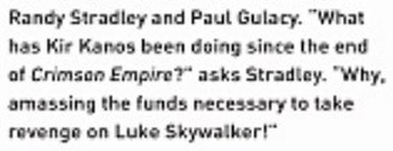

# Owner Material 038 — Star Wars Insider #1–153 plus specials (with The Lucasfilm Fan Club Magazine #1–22): Star Wars Insider #124 (2011)

- **Source:** *Star Wars Insider* magazine (issues 23–153, 1994–2014) and its predecessor *The Lucasfilm Fan Club Magazine* (issues 1–22, 1987–1994), plus seven special editions: articles, interviews, comics and short fiction Secondary source (licensed Legends reference). Scan OCR'd on the box; the scan stays box-only and is **not** published.
- **Method:** every scanned page was OCR'd and machine-screened sentence by sentence for power-relevant statements (fights, kills, defeats, Force feats, rankings, superweapons) that name a character on our roster; each kept sentence is quoted verbatim from the OCR text and has a crop of the printed passage directly under it. Pages with nothing power-relevant are still listed with what is on them.
- **Citation:** "*Star Wars Insider #124* (2011), p.X" by printed page ("scan p.X" where no printed number applies). **Weight:** Licensed magazine: a secondary source. Its short fiction and comics are Legends stories; its articles and interviews sum up or discuss lore and rank below the novels, comics and games they describe.

## scan p.1 (scan page 1)

Page contents: Cover: Darren Marshall maquettes, LEGO Star Wars III: The Clone Wars, editor Paul Hirsch, Wookiees vs. Trandoshans, essential collectibles. (hand-read)

## scan p.2 (scan page 2)

Page contents: Ad: Star Wars Interview Special (Titan). (hand-read)

## scan p.3 (scan page 3)

Page contents: Editorial (Jonathan Wilkins): Chewbacca; Wookiee/Trandoshan history from Leland Chee; Darren Marshall maquettes; original fiction returns with a Paul S. Kemp Malgus story. (hand-read)

### Stat block notes (game mechanics, not feats)

- Editorial: "He's the saga's gentle giant; a kind, reliable soul who stands by his freinds and yet has amazing physical strength, ready to be directed against anyone who threatens his friends. We never actually see him pull anybody's arms or legs out of their sockets, but there's always the chance that he will lose his famously precarious Wookiee temper." (Editorial, Star Wars Insider 124, p. 3) (Source: *Star Wars Insider #124* (2011), scan p.3)

## scan p.4 (scan page 4)

Page contents: Contents: Wookiees vs. Trandoshans, LEGO TCW, maquettes, Malgus fiction, Paul Hirsch. (hand-read)

## scan p.5 (scan page 5)

Page contents: Contents: departments (Launchpad, My Star Wars with Lewis MacLeod, Retro, Jedi Archive, Classic Moment, Incoming, Bounty Hunters, Bantha Tracks). (hand-read)

## scan p.6 (scan page 6)

Page contents: Launchpad: TCW S3 "Padawan Lost" preview (Ahsoka and younglings hunted by Trandoshans on Wasskah). (hand-read)

## scan p.7 (scan page 7)

Page contents: Launchpad: "Wookiee Hunt" preview (Chewbacca as ally); Peter Mayhew on Chewie's TCW return (temper aside). (hand-read)

## scan p.8 (scan page 8)

Page contents: Launchpad: Grant McCune tribute (Brian J. Robb): chief model maker, Oscar for ANH, R2-D2 detailing, motion control; the Star Destroyer model was three feet long. (hand-read)

## scan p.9 (scan page 9)

Page contents: McCune tribute cont. (his advice to "get a good background in photography first"; died December 27, 2010). Saga Blu-ray announced for September 2011. (hand-read)

## scan p.10 (scan page 10)

Page contents: Launchpad news: Death Star survey gag, papercraft trilogy, Guggenheim YouTube Play shortlist, R2-D2 go-kart. Fan names omitted. (hand-read)

## scan p.11 (scan page 11)

Page contents: Launchpad news: NY Post Jets/Patriots parody cover; Finca Bellavista Ewok-style treehouse community; milk-jug helmet; masthead. (hand-read)

## scan p.12 (scan page 12)

Page contents: Interrogation Droid: Daniel Logan (young Boba Fett) in comic answers. He jokes Boba would beat young Anakin in a playground fight, that Boba ignored his jet pack lessons, and that Bossk is the best father figure. Humor, not a feat claim. (hand-read)

## scan p.13 (scan page 13)

Page contents: Ad: Brian's Toys. (hand-read)

## scan p.14 (scan page 14)

Page contents: Wookiees vs. Trandoshans (Leland Y. Chee): title spread. (hand-read)

## scan p.15 (scan page 15)

Page contents: Wookiees vs. Trandoshans: art spread (no text besides the folio). (hand-read)

## scan p.16 (scan page 16)

Page contents: Wookiees vs. Trandoshans: intro; holochess shows Wookiees as sore losers "capable of ripping arms out of their sockets"; Lucas's take on Wookiee culture; the Holiday Special. (hand-read)

## scan p.17 (scan page 17)

Page contents: Wookiees vs. Trandoshans: Wookiees used as slaves "for their size and strength"; Chewbacca's life-debt; Fett's Wookiee scalps; Ozzik Sturn's Wookiee-pelt sash. (hand-read)

## scan p.18 (scan page 18)

Page contents: Wookiees vs. Trandoshans: Bossk's origins (Galaxy Guide 3; rivalry with Chewbacca from Gandolo IV; the "blood feud"); "The Prize Pelt"; jagannath points and the Scorekeeper. (hand-read)

### Stat block notes (game mechanics, not feats)

- Wookiees vs. Trandoshans: "Chenlambec, along with his human partner Tinian I'att, teams up with Bossk to pursue Han Solo, although Bossk makes no attempt to hide his having killed hundreds of Wookiees." (Wookiees vs. Trandoshans, Star Wars Insider 124, p. 18) (Source: *Star Wars Insider #124* (2011), scan p.18)

## scan p.19 (scan page 19)

Page contents: Wookiees vs. Trandoshans: "Kashyyyk in Flames" (Kai Justiss); HoloNet News with Oppo Rancisis mediating talks. (hand-read)

### Stat block notes (game mechanics, not feats)

- Wookiees vs. Trandoshans: "The Trandoshan made the mistake of capturing Chewbacca, who organized his fellow captives to revolt against their masters. Ssoh is thought to be the only Trandoshan to fight Chewbacca hand-to-hand and live, and we see first-hand what happens to someone who upsets a Wookiee, as Ssoh has his arms and legs ripped out of their sockets." (Wookiees vs. Trandoshans, Star Wars Insider 124, p. 19) (Source: *Star Wars Insider #124* (2011), scan p.19)
- Wookiees vs. Trandoshans: "Bossk's father, Cradossk, headed the Bounty Hunter's Guild until Bossk killed him in a misguided attempt to unify the Guild." (Wookiees vs. Trandoshans, Star Wars Insider 124, p. 19) (Source: *Star Wars Insider #124* (2011), scan p.19)

## scan p.20 (scan page 20)

Page contents: Wookiees vs. Trandoshans cont.: Pekt in Galactic Battlegrounds, Republic Commando (Tarfful), SWG Rage of the Wookiees; the rivalry's place in TCW canon. (hand-read)

## scan p.21 (scan page 21)

Page contents: Ad: titanmagazines.com. (hand-read)

## scan p.22 (scan page 22)

Page contents: My Star Wars: Lewis MacLeod (Sebulba) on becoming a fan and getting the part. (hand-read)

## scan p.23 (scan page 23)

Page contents: MacLeod cont.: favorite scenes (escape pod over Tatooine, space slug), toys, Sebulba merchandise, would voice Gamorreans. (hand-read)

## scan p.24 (scan page 24)

Page contents: LEGO Star Wars III: The Clone Wars (Jonathan Wilkins interviews the co-project lead): new look, over 100 characters, Free Play returns, TCW voice actors' grunts. (hand-read)

## scan p.25 (scan page 25)

Page contents: LEGO SW III cont.: TFU characters and a battle-damaged Vader to unlock; Zillo Beast battle; slapstick retellings; Traveller's Tales engine. (hand-read)

## scan p.26 (scan page 26)

Page contents: LEGO SW III cont.: levels from "Ambush," Blue Shadow Virus, Malevolence, "Jedi Crash"; space battles. (hand-read)

## scan p.27 (scan page 27)

Page contents: LEGO SW III cont.: physical LEGO builds for approval; Gor and the acklay as hard builds; favorite character Nahdar Vebb. (hand-read)

## scan p.28 (scan page 28)

Page contents: LEGO SW III cont.: Wicket but not every Ewok; hidden Indiana Jones content; dynamic split screen and "scene swap" (the Blue Shadow Virus example); in stores March 25. (hand-read)

## scan p.29 (scan page 29)

Page contents: Ad: Star Wars Insider subscriptions. (hand-read)

## scan p.30 (scan page 30)

Page contents: Retro (Gus Lopez): fast food collectibles (Burger Chef posters and Fun Meal boxes, Burger King glasses and displays, McDonald's Australian ESB tumblers). (hand-read)

## scan p.31 (scan page 31)

Page contents: Retro cont.: Tricon's three-chain Episode I promotion (cup toppers repurposed as employee awards), Disney Jedi Training Academy boxes, the 2008 McDonald's TCW tie-in, a French McDonald's billboard of Vader levitating a meal tray. (hand-read)

## scan p.32 (scan page 32)

Page contents: Maquettes (Jonathan Wilkins interviews sculptor Darren Marshall): opener. (hand-read)

## scan p.33 (scan page 33)

Page contents: Maquettes: Anakin maquette art (no body text). (hand-read)

## scan p.34 (scan page 34)

Page contents: Maquettes (OCR failed; read from the image): Marshall came from ILM and Mackinnon & Saunders stop-motion; Dooku was the first maquette (2005); Tarkin, and his love of the Hammer films with Cushing and Lee. (hand-read)

## scan p.35 (scan page 35)

Page contents: Maquettes (read from the image): pitch maquettes of Anakin, Obi-Wan and Ahsoka shown to Lucas with extreme lighting; Chavant clay; process (head in a day or two, then a Photoshop paintover). (hand-read)

## scan p.36 (scan page 36)

Page contents: Maquettes (read from the image): stylizing Chewbacca's fur from the archive masks (ANH/ESB yak fur, "like one of those old 1970s rugs"). (hand-read)

## scan p.37 (scan page 37)

Page contents: Maquettes (read from the image): he usually gets classic characters (Bossk, Greedo, a Gamorrean, Tarkin); he had long wanted to do Tarkin; Chewie was a surprise. (hand-read)

## scan p.38 (scan page 38)

Page contents: Maquettes (read from the image): artistic license; Kilian Plunkett; maquettes of Mama the Hutt, Jabba, Palpatine and Obi-Wan. (hand-read)

## scan p.39 (scan page 39)

Page contents: Maquettes (read from the image): lighting under an Anglepoise lamp; Season Three cast redesign; he sculpted George Lucas and family for "Sphere of Influence" and designed Savage Opress; clone maquette wrap gift. (hand-read)

## scan p.40 (scan page 40)

Page contents: Jedi Archive: alien masks from the Lucasfilm Archives. (hand-read)

## scan p.41 (scan page 41)

Page contents: Jedi Archive cont.: the masks identified (Greedo, Bossk, Ponda Baba, an Ugnaught, Kabe, a Rodian, and others). (hand-read)

## scan p.42 (scan page 42)

Page contents: Fiction opener: Paul S. Kemp's Darth Malgus tale. (hand-read)

## scan p.43 (scan page 43)

Page contents: Fiction: full-page Darth Malgus art (OCR empty; read from the image). (hand-read)

## scan p.44 (scan page 44)

Page contents: The Third Lesson: after the Empire's retreat from Alderaan, a wounded Malgus senses a light-side user from his shuttle; he faces a Zabrak Jedi with two blue lightsabers. (hand-read)

### Stat block notes (game mechanics, not feats)

- The Third Lesson (fiction, Paul S. Kemp): "His skin stung from burns. A Republic commando had exploded a grenade in his face, and combat with a Jedi witch had damaged his lungs. Lacerations and contusions made a grim mosaic on his flesh. But he felt no pain. He felt only anger." (The Third Lesson, Star Wars Insider 124, p. 44) (Source: *Star Wars Insider #124* (2011), scan p.44)
- The Third Lesson (fiction, Paul S. Kemp): "Malgus deactivated the comlink and leapt off the ramp into the open air. He ignited his blade as the ground rushed up to meet him. Using the Force to cushion the impact, he hit the ground in a crouch." (The Third Lesson, Star Wars Insider 124, p. 44) (Source: *Star Wars Insider #124* (2011), scan p.44)

## scan p.45 (scan page 45)

Page contents: The Third Lesson flashback: young Veradun (Malgus) and his father, a biologist in the Imperial Science Corps, at the family menagerie; the kouhun tank. (hand-read)

### Stat block notes (game mechanics, not feats)

- The Third Lesson (fiction, Paul S. Kemp): "The Jedi held his ground. At twenty meters, the Jedi raised his lightsabers aloft to either side and drew them both down with a flourish. Too late the rumble of the falling buildings penetrated the haze of Malgus's anger. An avalanche of duracrete and transparisteel crashed down on him from either side of the street..." (The Third Lesson, Star Wars Insider 124, p. 45) (Source: *Star Wars Insider #124* (2011), scan p.45)

## scan p.46 (scan page 46)

Page contents: The Third Lesson flashback: the kouhun kills a rat it does not eat; the lesson that "savagery is useful only if it's controlled and put in service to an end"; "The end is everything." (hand-read)

### Stat block notes (game mechanics, not feats)

- The Third Lesson (fiction, Paul S. Kemp): "Malgus stood in a pocket under a mountain of rubble, legs bent, the power from his upraised hands preventing several tons of duracrete and steel from crushing him... Using the Force, he blew the rubble up and away from him. It fell with a crash into the adjacent buildings. A Force-augmented leap carried him out and over the heap." (The Third Lesson, Star Wars Insider 124, p. 46) (Source: *Star Wars Insider #124* (2011), scan p.46)
- The Third Lesson (fiction, Paul S. Kemp): "The red line of Malgus's lightsaber moved so quickly it blurred into a red smear. The Jedi parried again and again, the sizzle of blade on blade resounding through the ruins. Malgus's onslaught—a blizzard of slashes, cuts, and stabs—allowed the Jedi no room for a counterattack." (The Third Lesson, Star Wars Insider 124, p. 46) (Source: *Star Wars Insider #124* (2011), scan p.46)

## scan p.47 (scan page 47)

Page contents: The Third Lesson flashback: the mimnil, which poses as a juvenile viirsun and kills its adoptive mother; "You must trust no one... Least of all those who appear weak." Malgus notes he "could have ended the Jedi in any of several ways, but he needed the satisfaction of a lightsaber kill." (hand-read)

### Stat block notes (game mechanics, not feats)

- The Third Lesson (fiction, Paul S. Kemp): "Malgus loosed a furious series of overhand strikes that forced the Zabrak to retreat rapidly. Sidestepping a stab from the Jedi, Malgus rode his motion into a Force-augmented spinning side kick that hit the Jedi in the ribs and sent him cartwheeling into the wall of nearby building. At the same time, he reached out with the Force for the hidden light-side user, brushed aside the resistance he felt, and pulled the Jedi out of hiding." (The Third Lesson, Star Wars Insider 124, p. 47) (Source: *Star Wars Insider #124* (2011), scan p.47)
- The Third Lesson (fiction, Paul S. Kemp): "'So much for your ambush,' Malgus said, and closed his fist, crushing Vorin's windpipe." (The Third Lesson, Star Wars Insider 124, p. 47) (Source: *Star Wars Insider #124* (2011), scan p.47)
- The Third Lesson (fiction, Paul S. Kemp): "At 10 meters, Malgus extended his free hand and loosed veins of blue Force lightning. They struck the charging Jedi: swept through his defenses, swirled around him, and began to burn flesh... Malgus channeled more power and the Jedi fell to his knees, screaming." (The Third Lesson, Star Wars Insider 124, p. 47) (Source: *Star Wars Insider #124* (2011), scan p.47)

## scan p.48 (scan page 48)

Page contents: The Third Lesson ending: Veradun is to leave for the academy on Dromund Kaas; the third lesson is an empty cage. Malgus kills the Zabrak Jedi with his lightsaber. Ad for Deceived by Paul S. Kemp (March 22). (hand-read)

### Stat block notes (game mechanics, not feats)

- The Third Lesson (fiction, Paul S. Kemp): "The lightning spiraled around the Zabrak, blasting dark holes in his body. The lightsabers fell from his hands and he writhed in agony, screaming his pain into the sky." (The Third Lesson, Star Wars Insider 124, pp. 47-48) (Source: *Star Wars Insider #124* (2011), scan p.48)

## scan p.49 (scan page 49)

Page contents: Ad: Star Trek magazine (Titan). (hand-read)

## scan p.50 (scan page 50)

Page contents: Interview: editor Paul Hirsch (by Jonathan Wilkins), part 1: how he got into film and editing in 1966, the Moviola. (hand-read)

## scan p.51 (scan page 51)

Page contents: Hirsch interview: re-cutting Uncle Owen's droid purchase (four minutes down to about three); pull quote "The first cut was oddly inconsistent". (hand-read)

## scan p.52 (scan page 52)

Page contents: Hirsch interview: temp music (Holst, Stravinsky's Rite of Spring, Herrmann's Psycho); moving Leia's message later in the Ben's-home scene; working with Richard Chew and Marcia Lucas. (hand-read)

## scan p.53 (scan page 53)

Page contents: Hirsch interview: favorite sequence (Ben-Vader duel convergence); transitional wipes; Lucas's "This cost a million dollars" ILM shot. (hand-read)

## scan p.54 (scan page 54)

Page contents: Hirsch interview: the first ILM shot was Death Star laser cannons; post-Oscar work with De Palma; editing Empire. (hand-read)

## scan p.55 (scan page 55)

Page contents: Hirsch interview ending: Source Code (Duncan Jones), the next Mission: Impossible (Brad Bird); Ray as the film he would most like to be remembered for. (hand-read)

## scan p.56 (scan page 56)

Page contents: Classic Moment: Luke and Leia's swing across the chasm (A New Hope, DVD ch. 37); Fisher quote about the swing stunt; trivia: the abyss was only about 12 feet deep, the rest a matte painting. Film dialogue. (hand-read)

## scan p.57 (scan page 57)

Page contents: Classic Moment continued: dialogue and action ("For luck!"); Lucas DVD commentary on the swing in the serial tradition. Next time: the story of Darth Plagueis. (hand-read)

## scan p.58 (scan page 58)

Page contents: Ad: Star Trek Magazine subscription. (hand-read)

## scan p.59 (scan page 59)

Page contents: Incoming contents page: Star Wars Craft Book, Clone Wars 3-D, Bounty Hunters, Bantha Tracks. (hand-read)

## scan p.60 (scan page 60)

Page contents: Incoming: The Star Wars Craft Book by Bonnie Burton (words: Daniel Wallace), on sale March 29, 176 pages; project list. (hand-read)

## scan p.61 (scan page 61)

Page contents: Star Wars: The Clone Wars: A Jedi Adventure in 3-D by Pablo Hidalgo (64 pages), told from Ahsoka's point of view; Hidalgo's upcoming Head to Head Tag Teams and a 3-D sequel covering Season Three. (hand-read)

## scan p.62 (scan page 62)

Page contents: Dark Horse summer preview (Daniel Wallace): Lost Command and Legacy: War wrap up; Dark Horse Presents #1 with a Crimson Empire III prelude; Jedi: The Dark Side (Qui-Gon's first encounter with the dark side, Scott Allie / Mahmud Asrar). (hand-read)

- **Kir Kanos; Luke Skywalker** — entry/section: Crimson Empire III prelude: ""What has Kir Kanos been doing since the end of Crimson Empire? Why, amassing the funds necessary to take revenge on Luke Skywalker!" —Randy Stradley, Star Wars Insider 124, p. 62" Source: *Star Wars Insider #124* (2011), scan p.62
  

### Stat block notes (game mechanics, not feats)

- Dark Horse summer preview: "This long-awaited sequel to the 1997 series and its 1998 follow-up stars Kir Kanos, the last surviving member of Emperor Palpatine's Royal Guard" (Dark Horse preview, Star Wars Insider 124, p. 62) (Source: *Star Wars Insider #124* (2011), scan p.62)

## scan p.63 (scan page 63)

Page contents: Preview: The Old Republic: The Lost Suns, set about 3,400 years before the movies, starring Republic spy Theron Shan, son of Jedi Master Satele Shan (Alexander Freed). (hand-read)

## scan p.64 (scan page 64)

Page contents: Preview: Invasion: Revelations (Finn Galfridian trains under Master Dray, "who just might be insane"); Clone Wars: The Starcrusher Trap, a "near-unstoppable Separatist battle cruiser" (Mike Barr / Fillbach Bros.). (hand-read)

## scan p.65 (scan page 65)

Page contents: Preview: Knight Errant: Deluge (Kerra Holt returns to Aquilaris; Miller / Rodriguez); Dark Times: Out of the Wilderness (Dass Jennir pursued by Darth Vader and a bounty hunter with a killer droid). (hand-read)

## scan p.66 (scan page 66)

Page contents: Incoming merchandise (Chris Spitale): Hasbro Clone Wars wave (Obi-Wan, 87-47, Cad Bane with Todo 360, clone cadet); Uncle Milton Dark Side Detector mini lightsaber, $14.99. (hand-read)

## scan p.67 (scan page 67)

Page contents: Incoming: Cartamundi Clone Wars, Vehicle, Posters & Quotes, and 3-D playing card tins (vehicle deck includes Soulless One and Khetanna). Product copy. (hand-read)

## scan p.68 (scan page 68)

Page contents: Incoming: Hallmark Gold Crown "wit and wisdom" gift line; Vandor water bottle, Yoda shot glass, Vader tin tote, ANH shopper tote. Product copy. (hand-read)

## scan p.69 (scan page 69)

Page contents: Incoming: Topps Star Wars Galaxy 6, a 120-card set with New Visions art. (hand-read)

## scan p.70 (scan page 70)

Page contents: Interview: Attakus's Etienne Aillaud on the 1:10 Elite Collection (Vader, stormtrooper, shadow trooper, clones); Commander Cody poses. (hand-read)

## scan p.71 (scan page 71)

Page contents: Attakus interview ending: European market differences; 1:5 Commander Cody variants; the 16.5-inch probe droid. (hand-read)

## scan p.72 (scan page 72)

Page contents: Bounty Hunters: fan photos with Clone Wars voice actors (Catherine Taber, Tom Kane, Dee Bradley Baker, Ashley Eckstein) and a guest at Supanova Perth. Fan names omitted. (hand-read)

## scan p.73 (scan page 73)

Page contents: Bounty Hunters continued: fan photos with Warwick Davis, Ray Park and Dave Filoni (Celebration V). Fan names omitted. (hand-read)

## scan p.74 (scan page 74)

Page contents: Bantha Tracks ("by the fans, for the fans"), on the theme of focused fandom: a Return of the Jedi hat and a tattoo; a Star Wars-themed kids' bedroom. Fan names omitted. (hand-read)

## scan p.75 (scan page 75)

Page contents: Bantha Tracks: thirty years of homemade Chewbacca costumes; the bantha costume worn by Mardji the elephant at Marine World Africa USA; Ashley Eckstein and Empire City Garrison troopers trade Ahsoka/Rex voice banter (humor). Submission guidelines. Fan names omitted. (hand-read)

## scan p.76 (scan page 76)

Page contents: Bantha Tracks: Wrestling Troopers at a con; tattoos including the Mandalorian proverb "Aliit ori'shya tal'din" from Karen Traviss's books; Bossk collectibles (stone carving). Fan names omitted. (hand-read)

## scan p.77 (scan page 77)

Page contents: Bantha Tracks: Hoth backyard toy photos and an Echo Base diorama; Chewbacca/Ewok pillows; Bossk collectibles (Topps 1980 candy head, Cubeecraft, Mini Muggs, a Clone Wars Bossk signed by Dave Filoni); Mary Franklin's sign-off. Fan names omitted. (hand-read)

## scan p.78 (scan page 78)

Page contents: Ad: StarWarsShop.com Death Star cookie jar, $49.99. (hand-read)

## scan p.79 (scan page 79)

Page contents: Ad: StarWarsShop.com exclusives (Boba Fett tattoo shirt, ESB clapper, lightsaber bottle opener, Falcon sun shade, space slug oven mitt, lightsaber chopsticks, garden Jawa, Darth Vader toaster). (hand-read)

## scan p.80 (scan page 80)

Page contents: Ad: subscription offer with an exclusive R2-D2 magazine holder. (hand-read)

## scan p.81 (scan page 81)

Page contents: Ad: subscription offer (8 issues a year, $49.99/£29.99); digital subscription. (hand-read)

## scan p.82 (scan page 82)

Page contents: Next issue: the 50 greatest moments of The Clone Wars Season Three; Dave Filoni on Season Four. UK on sale April 28. (hand-read)

## scan p.83 (scan page 83)

Page contents: Ad: Lenore Vol. 2 #2 (Titan Comics). (hand-read)

## scan p.84 (scan page 84)

Page contents: Back cover ad: Star Wars: The Clone Wars comic magazine ("Learn the Secrets of the Force!"), Titan. (hand-read)

