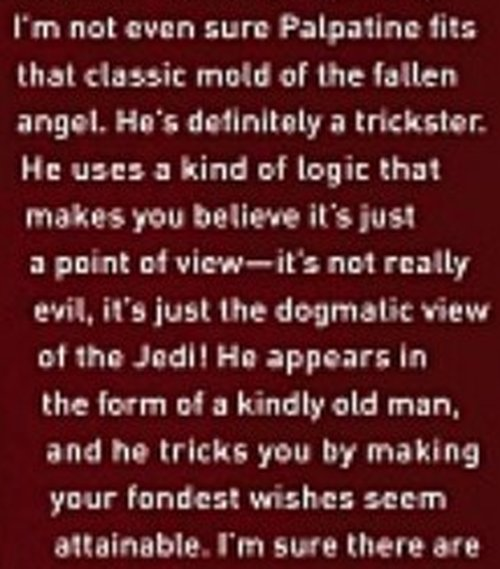
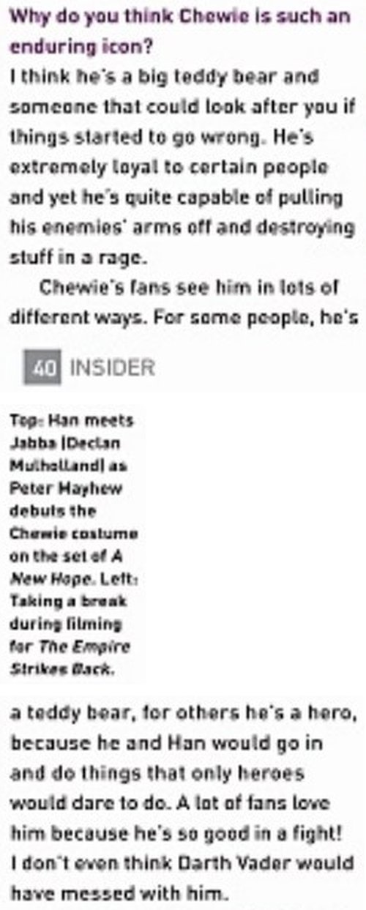

# Owner Material 038 — Star Wars Insider #1–153 plus specials (with The Lucasfilm Fan Club Magazine #1–22): Star Wars Insider #125 (2011)

- **Source:** *Star Wars Insider* magazine (issues 23–153, 1994–2014) and its predecessor *The Lucasfilm Fan Club Magazine* (issues 1–22, 1987–1994), plus seven special editions: articles, interviews, comics and short fiction Secondary source (licensed Legends reference). Scan OCR'd on the box; the scan stays box-only and is **not** published.
- **Method:** every scanned page was OCR'd and machine-screened sentence by sentence for power-relevant statements (fights, kills, defeats, Force feats, rankings, superweapons) that name a character on our roster; each kept sentence is quoted verbatim from the OCR text and has a crop of the printed passage directly under it. Pages with nothing power-relevant are still listed with what is on them.
- **Citation:** "*Star Wars Insider #125* (2011), p.X" by printed page ("scan p.X" where no printed number applies). **Weight:** Licensed magazine: a secondary source. Its short fiction and comics are Legends stories; its articles and interviews sum up or discuss lore and rank below the novels, comics and games they describe.

## scan p.1 (scan page 1)

Page contents: Cover: The Clone Wars Season 3 (50 great reasons to rewatch), Filoni on classic characters returning in Season 4, Katie Lucas, the man who built Echo Base, new fiction. (hand-read)

## scan p.2 (scan page 2)

Page contents: Ad: Titan magazine subscriptions. (hand-read)

## scan p.3 (scan page 3)

Page contents: Editorial (Jonathan Wilkins): 50 reasons to revisit Season 3 (Savage Opress, the mysteries of the Force, Chewbacca's appearance); Steve Sansweet steps down; the "Wookiee error" cover apostrophe joke; Christie Golden fiction on p. 58. Epigraph is Clone Wars dialogue (Even Piell). (hand-read)

## scan p.4 (scan page 4)

Page contents: Contents: Filoni, Third Strike, Peter Mayhew, Katie Lucas, Norman Reynolds, fiction, Tarkin. (hand-read)

## scan p.5 (scan page 5)

Page contents: Contents continued: Launchpad (Phantom Menace 3D, Star Tours, Indiana Jones), My Star Wars (Christie Golden), Retro (Padmé), Jedi Archive (Kit Fisto), Bantha Tracks, Bounty Hunters. (hand-read)

## scan p.6 (scan page 6)

Page contents: Launchpad: The Phantom Menace 3D release on February 10, 2012; John Knoll of ILM supervises the 2D-to-3D conversion. (hand-read)

## scan p.7 (scan page 7)

Page contents: Launchpad: Knoll on taking time over the conversion; new Episode I packaging featuring Darth Maul and the Theed generator (PILOT design firm, art by Chris Foard). (hand-read)

## scan p.8 (scan page 8)

Page contents: Launchpad: Star Wars: In Concert at the Hollywood Bowl (Anthony Daniels narrates); Star Tours relaunches in 3D, set between Episodes III and IV with C-3PO as pilot and 54 storyline combinations. (hand-read)

## scan p.9 (scan page 9)

Page contents: Launchpad: Indiana Jones and the Adventure of Archaeology touring exhibition (Montreal Science Center, April 28 to September 18, 2011). (hand-read)

## scan p.10 (scan page 10)

Page contents: Launchpad: ID-Wall mural giveaway; a fan's recycled-parts AT-AT sculpture; Star Wars Craft Book giveaway. Fan names omitted. (hand-read)

## scan p.11 (scan page 11)

Page contents: Launchpad: a fan's CG Imperial fleet models; MIT hologram tech using a Kinect; masthead. Fan names omitted. (hand-read)

## scan p.12 (scan page 12)

Page contents: Yoda (Tom Kane) gives "advice" on silly scenarios (Dad Vader, Lando's dates, Bossk-breath, Ewoks with a Wokling). Humor, words by Chris Spitale. (hand-read)

## scan p.13 (scan page 13)

Page contents: Ad: Hasbro Vintage Collection (Aurra Sing on an Attack of the Clones card). (hand-read)

## scan p.14 (scan page 14)

Page contents: Dave Filoni interview (Jonathan Wilkins), part 1: Chewbacca's appearance was the hardest secret to keep; the Season 3 structure (political stories, then action). (hand-read)

## scan p.15 (scan page 15)

Page contents: Filoni interview art page (no text beyond the folio). (hand-read)

## scan p.16 (scan page 16)

Page contents: Filoni interview: "Heroes on Both Sides" (Ahsoka and Lux); "Anakin is all about being powerful and a warrior, and Lux is not that." (hand-read)

## scan p.17 (scan page 17)

Page contents: Filoni interview: no more flashback episodes planned (old Ahsoka models); Dooku has a tragic past as a corrupted Jedi; Liam Neeson's return as Qui-Gon (with Lynne Hale's help), and Pernilla August as Shmi. (hand-read)

- **Palpatine (Darth Sidious)** — entry/section: Empire State of Mind (Filoni sidebar): ""I'm not even sure Palpatine fits that classic mold of the fallen angel. He's definitely a trickster. He uses a kind of logic that makes you believe it's just a point of view—it's not really evil, it's just the dogmatic view of the Jedi! He appears in the form of a kindly old man, and he tricks you by making your fondest wishes seem attainable." —Dave Filoni, Star Wars Insider 125, p. 17" Source: *Star Wars Insider #125* (2011), scan p.17
  

## scan p.18 (scan page 18)

Page contents: Filoni interview: Liam Neeson added "Obi-Wan" to Qui-Gon's first line; he and Christian Taylor were careful not to give definitive answers about the Mortis trilogy. (hand-read)

## scan p.19 (scan page 19)

Page contents: Filoni interview: the Mortis symbolism parallels the Dagobah cave; he had Peter Mayhew visit Skywalker Ranch for Chewbacca; Stephen Stanton as young Tarkin. (hand-read)

## scan p.20 (scan page 20)

Page contents: Filoni interview: no young Han Solo; Season 4 will open "with a bang" with battles "like we've never seen before" and a returning classic character or two; Doctor Who sidebar. (hand-read)

## scan p.21 (scan page 21)

Page contents: Ad: R2-D2 magazine holder. (hand-read)

## scan p.22 (scan page 22)

Page contents: My Star Wars: Christie Golden (Fate of the Jedi: Omen, Allies) on seeing Star Wars in 1977 at 13; favorite film is the original, with Empire a close second. (hand-read)

## scan p.23 (scan page 23)

Page contents: My Star Wars: Golden on the Dagobah cave scene and how a good person can slide into darkness; her first signing at SDCC 2009 with Allston and Denning; the Vader-throttle question (humor). (hand-read)

## scan p.24 (scan page 24)

Page contents: Third Strike: the 50 greatest moments of Clone Wars Season 3 (Dan Wallace with Pablo Hidalgo and Leland Y. Chee); intro on "the toughness of Cad Bane", the potential return of Darth Maul, and Mortis; episode list. (hand-read)

## scan p.25 (scan page 25)

Page contents: Third Strike: Domino Squad's grid-chamber training against real battle droids; the Battle of Kamino and the 501st; Trident drills; the "bad batch" Ninety-Nine; Obi-Wan rides an aiwha; aqua droids. (hand-read)

## scan p.26 (scan page 26)

Page contents: Third Strike: blurrgs; Toydarian banquets; Pantorans modeled on the Lucas family (children's names omitted), "The Chairman can handle twin blasters pretty well"; Greedo's age (validates an Episode I cut scene). (hand-read)

## scan p.27 (scan page 27)

Page contents: Third Strike: Ardees beverage nod; Satine's guard; Aurra Sing's return in "Assassin" with Ahsoka as bodyguard; Alderaan scenery; the holochess callback. (hand-read)

### Stat block notes (game mechanics, not feats)

- Third Strike: "The Academy": "While teaching on Mandalore, Ahsoka must surrender her lightsaber to port security forces. But that doesn't stop her from taking out a squad of Mandalorian police later in the episode, ninja style!" (Third Strike, Star Wars Insider 125, p. 27) (Source: *Star Wars Insider #125* (2011), scan p.27)

## scan p.28 (scan page 28)

Page contents: Third Strike: "Evil Plans" droid wash; the Hutt Council (Jabba, Oruba, Arok, Marlo, Gorga) and gangster-movie nods; Quinlan Vos's animated debut (Big Lebowski line). (hand-read)

## scan p.29 (scan page 29)

Page contents: Third Strike: Hutt mummies; Sy Snootles tricks the Gamorreans; Ziro's mom; Ahsoka's new look; Infiltrator droids; Mina Bonteri. (hand-read)

### Stat block notes (game mechanics, not feats)

- Third Strike: "Hunt for Ziro": "Has a Star Wars fight ever topped this matchup among Obi-Wan, Cad Bane, and Quinlan Vos? The fight features misty mesas, rocket boots, a flamethrower, and a lightsaber-toting Todo 360—and it's an action stunner!" (Third Strike, Star Wars Insider 125, p. 29) (Source: *Star Wars Insider #125* (2011), scan p.29)

## scan p.30 (scan page 30)

Page contents: Third Strike: "Pursuit of Peace" (a Selkath goon, a Rodian pin-up); "Nightsisters" energy bows; Mother Talzin's double-undertone voice and robe that moves on its own. (hand-read)

## scan p.31 (scan page 31)

Page contents: Third Strike: "Scissor Cut": Dooku threatens Opress with two lightsabers in a "V" around his neck, the method Anakin later uses to kill Dooku. (hand-read)

### Stat block notes (game mechanics, not feats)

- Third Strike: "Monster": "Asajj Ventress is one tough taskmaster! The Nightbrothers are ordered to undergo three trials, and Ventress makes short work of the students who have slow reflexes. Savage Opress is the last Nightbrother standing." (Third Strike, Star Wars Insider 125, p. 31) (Source: *Star Wars Insider #125* (2011), scan p.31)
- Third Strike: "Monster": "Using her magic, Mother Talzin reshapes Savage Opress into a bulked-up, long-horned agent of destruction. Savage's neck-snapping murder of his brother Feral seals the dark side deal." (Third Strike, Star Wars Insider 125, p. 31) (Source: *Star Wars Insider #125* (2011), scan p.31)
- Third Strike: "Witches of the Mist": "Poor King Katuunko, we barely knew him! Savage Opress makes short work of the Toydarian monarch, putting an end to Katuunko's string of recurring Clone Wars appearances." (Third Strike, Star Wars Insider 125, p. 31) (Source: *Star Wars Insider #125* (2011), scan p.31)

## scan p.32 (scan page 32)

Page contents: Third Strike: future-vision Ahsoka; Qui-Gon's "Nothing ever really dies" with Neeson and August; Sam Witwer voices the Son and Adrienne Wilkinson the Daughter; the Son's tower nods to Orthanc; the Father vanishes on death like Obi-Wan and Yoda. (hand-read)

### Stat block notes (game mechanics, not feats)

- Third Strike: "Overlords": "The bizarre world of Mortis is described as 'a conduit through which the entire Force of the universe flows,' and a place that acts as both an amplifier and a magnet for Force energy." (Third Strike, Star Wars Insider 125, p. 32) (Source: *Star Wars Insider #125* (2011), scan p.32)

## scan p.33 (scan page 33)

Page contents: Third Strike: "The Citadel": Osi Sobeck's Walken-style delivery (James Arnold Taylor); Even Piell is a Lannik, not related to Yoda; Jedi in carbonite (Filoni/Gilroy, later used in The Shipyards of Doom). (hand-read)

## scan p.34 (scan page 34)

Page contents: Third Strike: "Counterattack": Taylor voices both Obi-Wan and Sobeck; Lola Sayu's sulfur-yellow rivers; anooba creatures based on Terryl Whitlatch's Episode I concept art. (hand-read)

## scan p.35 (scan page 35)

Page contents: Third Strike: "Padawan Lost": Sochek nods to Walter Sobchak; the MSP80 Pteroptor speeder; "Wookiee Hunt" lodge trophies (Wookiee pelts, a rancor head, a reek head, a crystal skull). (hand-read)

## scan p.36 (scan page 36)

Page contents: Retro: Padmé Amidala collectibles (words and pictures: Gus Lopez): Lucasfilm crew items, the "Queen of Visual FX" invitation, the Snow Bunny Padmé from the Clone Wars micro-series (Gentle Giant), the Chef Boyardee label. (hand-read)

## scan p.37 (scan page 37)

Page contents: Retro: Padmé on food items (La Vache Qui Rit, Pepsi Twist, cereal power cards); the "Franken Naberrie" parody box; Burger King shadow caster; a bootleg SDCC 2004 coin. (hand-read)

## scan p.38 (scan page 38)

Page contents: Peter Mayhew interview (Jonathan Wilkins): first day as Chewie on the Docking Bay 94 set (the cut Jabba scene); Alec Guinness; getting back into the character; the Episode III costume. (hand-read)

## scan p.39 (scan page 39)

Page contents: Mayhew interview title page. (hand-read)

## scan p.40 (scan page 40)

Page contents: Mayhew interview: the Episode III costume's shoulder pads fixed; all-blue-screen work on Sith; his Chewie collection. (hand-read)

- **Chewbacca; Darth Vader (Anakin Skywalker)** — entry/section: Peter Mayhew interview: ""I think he's a big teddy bear and someone that could look after you if things started to go wrong. He's extremely loyal to certain people and yet he's quite capable of pulling his enemies' arms off and destroying stuff in a rage... A lot of fans love him because he's so good in a fight! I don't even think Darth Vader would have messed with him." —Peter Mayhew, Star Wars Insider 125, p. 40" Source: *Star Wars Insider #125* (2011), scan p.40
  

## scan p.41 (scan page 41)

Page contents: Mayhew interview: souvenirs (the binders), the broken-up Falcon; his books Growing Up Giant and My Favorite Giant (dedication details omitted). (hand-read)

## scan p.42 (scan page 42)

Page contents: Jedi Archive: Kit Fisto behind the scenes: Zach Jensen as Kit Fisto with Samuel L. Jackson; Silas Carson as Ki-Adi-Mundi. (hand-read)

## scan p.43 (scan page 43)

Page contents: Jedi Archive: Kit Fisto headpiece drying; a Nautolan character key (images only). (hand-read)

## scan p.44 (scan page 44)

Page contents: Interview with the writer of the Nightsisters trilogy (Jonathan Wilkins); title spread. (hand-read)

## scan p.45 (scan page 45)

Page contents: Title spread art: Savage Opress (image only). (hand-read)

## scan p.46 (scan page 46)

Page contents: Nightsisters writer interview: Buffy as an influence; growing as a writer since "Jedi Crash". (hand-read)

## scan p.47 (scan page 47)

Page contents: Nightsisters writer interview: never heard of the Nightsisters before; Gary Scheppke supplied the EU basics; the challenge of the fan base. (hand-read)

## scan p.48 (scan page 48)

Page contents: Nightsisters writer interview: music inspirations; adapting to sci-fi; Chi Eekway in The Clone Wars. (hand-read)

## scan p.49 (scan page 49)

Page contents: Ad: Brian's Toys. (hand-read)

## scan p.50 (scan page 50)

Page contents: Norman Reynolds interview: title spread (his design work on the original trilogy and Raiders earned two Academy Awards). (hand-read)

## scan p.51 (scan page 51)

Page contents: Reynolds interview title spread art (image only). (hand-read)

## scan p.52 (scan page 52)

Page contents: Reynolds interview: how he got into the industry; art director versus production designer; taking over from John Barry on Empire. (hand-read)

## scan p.53 (scan page 53)

Page contents: Reynolds interview: reference films (Silent Running, High Noon/Gary Cooper for Han); McQuarrie paintings; Barry's Falcon interior and the Matmata location. (hand-read)

## scan p.54 (scan page 54)

Page contents: Reynolds interview: about 50 Empire sets; Finse, Norway; impressions of Lucas, Kershner and Marquand. (hand-read)

## scan p.55 (scan page 55)

Page contents: Reynolds interview: Empire as the hardest film; the Star Wars stage at Elstree; British crew tea; Raiders and other films. (hand-read)

## scan p.56 (scan page 56)

Page contents: Reynolds interview: why Star Wars hasn't dated (the used look, car parts on the Falcon); Oscars and BAFTA. (hand-read)

## scan p.57 (scan page 57)

Page contents: Reynolds interview: the freedom of sci-fi design; carbon-freezing chamber design; fan response at Celebration IV. (hand-read)

## scan p.58 (scan page 58)

Page contents: "First Blood" fiction (Christie Golden, art by Brian Rood): opening art. (hand-read)

## scan p.59 (scan page 59)

Page contents: "First Blood": Ship summons five Lost Tribe Sith (Taalon, Workan, Rhea, Myal, Vestara) to take a vessel and repair the Omen. (hand-read)

## scan p.60 (scan page 60)

Page contents: 463 words, 25 paragraphs | headings/entries: WAS DISABLED;AND; INSTEAD IT HEADED FOR THE PLANET.'

### Stat block notes (game mechanics, not feats)

- "First Blood" fiction: "At once, Ship—designed to obey a powerful will—sprang into action. Vestara and the others found themselves making use of the Force to press their bodies flat against the floor of Ship's interior as the vessel, eager for battle, dove toward his unwitting prey. Weapons appeared out of nowhere—laser cannons manifested from its belly and screamed fire at the freighter, a magnetic accelerator formed at its back to hurl devastating metallic orbs that punched holes in the freighter's side." (Exclusive Fiction "First Blood", Star Wars Insider 125, p. 60) (Source: *Star Wars Insider #125* (2011), scan p.60)
- "First Blood" fiction: "And as Ship had said it would happen, so it did. The freighter was disabled and unable to make the jump into hyperspace." (Exclusive Fiction "First Blood", Star Wars Insider 125, p. 60) (Source: *Star Wars Insider #125* (2011), scan p.60)

## scan p.61 (scan page 61)

Page contents: "First Blood": parangs (thrown glass blades that return) described; Workan kills a Sullustan pilot with his parang; Taalon sends Vestara back to the freighter. (hand-read)

### Stat block notes (game mechanics, not feats)

- "First Blood" fiction: "All three of them drew their lightsabers, batting back the blaster bolts that did nothing other than reveal the shooter's location to his killers... Myal inclined his head, drew his blaster, and fired while Vestara and Workan almost effortlessly defended him. This shooter, a human, also dropped, dead before he hit the ground." (Exclusive Fiction "First Blood", Star Wars Insider 125, p. 61) (Source: *Star Wars Insider #125* (2011), scan p.61)

## scan p.62 (scan page 62)

Page contents: "First Blood": Vestara kills an escaped slave girl, feels the death in the Force, and names her "First." (hand-read)

### Stat block notes (game mechanics, not feats)

- "First Blood" fiction: "Her parang was in her hands in an instant. She gathered the Force to guide her aim, then let it fly. The glass weapon could not know pity. It went through her with the same ruthless efficiency as it had once sliced through tangled undergrowth." (Exclusive Fiction "First Blood", Star Wars Insider 125, p. 62) (Source: *Star Wars Insider #125* (2011), scan p.62)

## scan p.63 (scan page 63)

Page contents: "First Blood": pull quote art. (hand-read)

## scan p.64 (scan page 64)

Page contents: Subscription ad: R2-D2 magazine holder. (hand-read)

## scan p.65 (scan page 65)

Page contents: Subscription ad. (hand-read)

## scan p.66 (scan page 66)

Page contents: Stephen Stanton interview (Jonathan Wilkins): title page (Obi-Wan in Empire at War, Maul in Battlefront II, now Captain Tarkin in The Clone Wars). (hand-read)

## scan p.67 (scan page 67)

Page contents: Stanton interview: becoming a voice actor (Daws Butler imitations). (hand-read)

## scan p.68 (scan page 68)

Page contents: Stanton interview: Peter Cushing research (Island of Terror, Sherlock Holmes, Doctor Who films); audition from "The Citadel"; Cushing's rolled r's. (hand-read)

## scan p.69 (scan page 69)

Page contents: Stanton interview: Filoni on the Anakin–Tarkin relationship; "Rebel Friends!" sidebar on his special-effects career and Ray Harryhausen. (hand-read)

## scan p.70 (scan page 70)

Page contents: Stanton interview: pressure of the role; a hoped-for Tarkin–Dooku meeting (Cushing/Lee); would like to voice Ackbar. (hand-read)

## scan p.71 (scan page 71)

Page contents: Ad: Star Wars: The Clone Wars comic (Chewbacca season finale issue). (hand-read)

## scan p.72 (scan page 72)

Page contents: Classic Moment: Revenge of the Sith opera house scene (words: Neil Edwards); Rick McCallum commentary quote; opera cameo trivia (Lucas family names omitted); script excerpt (film dialogue). (hand-read)

### Stat block notes (game mechanics, not feats)

- Classic Moment: "Why It's a Classic": "There's no doubt that Palpatine himself was the apprentice who learned from Darth Plagueis before killing him. Ironically, it would be Palpatine's own Sith apprentice, Darth Vader, who would kill him too." (Classic Moment, Star Wars Insider 125, p. 72) (Source: *Star Wars Insider #125* (2011), scan p.72)

## scan p.73 (scan page 73)

Page contents: Classic Moment: "The Tragedy of Darth Plagueis" script excerpt (film dialogue); Squid Lake trivia (the EU says the Mon Calamari were among the races Palpatine treated most brutally). (hand-read)

## scan p.74 (scan page 74)

Page contents: Back issues ad. (hand-read)

## scan p.75 (scan page 75)

Page contents: Incoming contents page (edited by Neil Edwards): Books, Ask Lobot, Jazwares, Comics, Bantha Tracks, Bounty Hunters. (hand-read)

## scan p.76 (scan page 76)

Page contents: Ad: Star Trek magazine. (hand-read)

## scan p.77 (scan page 77)

Page contents: Books: Fate of the Jedi: Conviction (Daniel Wallace); Aaron Allston on the Jedi running the government ("World Wrestling Federation ... NATO"), Tahiri Veila's redemptive path, more to learn about Abeloth. Ask Lobot (Leland Y. Chee; questioner omitted): Porkins could have survived with helmet and life support or a Guidenhauser ejection seat. (hand-read)

## scan p.78 (scan page 78)

Page contents: Books: Star Wars Character Encyclopedia; Battles for the Galaxy. Ask Lobot (questioner omitted): no reinforcements in the trench because the other pilots were busy with TIEs; Red Leader knew the odds. (hand-read)

## scan p.79 (scan page 79)

Page contents: Comics: Jedi – The Dark Side (Scott Allie, Mahmud Asrar), Qui-Gon and his Padawan Xanatos 21 years before TPM; Allie on a younger, vulnerable Qui-Gon. (hand-read)

## scan p.80 (scan page 80)

Page contents: Comics: The Old Republic Vol. 2 – Threat of Peace (Rob Chestney, Alex Sanchez). Ask Lobot (questioner omitted): the lone Y-wing pilot is Keyan Farlander. (hand-read)

## scan p.81 (scan page 81)

Page contents: Comics: Blood Ties – A Tale of Jango and Boba Fett (Tom Taylor, Chris Scalf). Ask Lobot (questioner omitted): unselected Initiates go to the four Jedi Service Corps branches; Obi-Wan was headed for the Agricultural Corps. (hand-read)

## scan p.82 (scan page 82)

Page contents: Incoming (Chris Spitale): Hasbro vintage-packaged wave (Fi-Ek Sirch, AT-RT Driver, X-wing Luke, Weequay skiff master, General Lando). (hand-read)

## scan p.83 (scan page 83)

Page contents: Incoming: EFX Luke ROTJ stunt lightsaber replica (hero vs. stunt props explained); Funko Pop! bobble-heads. (hand-read)

## scan p.84 (scan page 84)

Page contents: Incoming: Sideshow 501st Vader's Fist clone bust; Emperor on Imperial Throne Premium Format figure; Mimoco TIE pilot Mimobot. (hand-read)

## scan p.85 (scan page 85)

Page contents: Incoming: ACME "Knight of Passage" and "Resurrection" (Boba Fett escaping the Sarlacc) giclées; Gentle Giant Darth Talon statue and jumbo vintage figures. (hand-read)

## scan p.86 (scan page 86)

Page contents: Jazwares spyware interview with Joe Amaro (Chris Spitale): bounty hunter theme; voice changer; Search & Capture Sensor. (hand-read)

## scan p.87 (scan page 87)

Page contents: Jazwares interview: development difficulties; cut Lobot listening device; Perimeter Droids (Maul's seeker droids), Spy Hunter Watch, Night Vision Goggles. (hand-read)

## scan p.88 (scan page 88)

Page contents: Bantha Tracks: fan art (fan names omitted). (hand-read)

## scan p.89 (scan page 89)

Page contents: Bantha Tracks: fan art, a fan poem, sculptures, submission guidelines (fan names omitted). (hand-read)

## scan p.90 (scan page 90)

Page contents: Bantha Tracks: fan art, including Mandalorian/Maori tattoo art and Obi-Wan vs. Ventress art (fan names omitted). (hand-read)

## scan p.91 (scan page 91)

Page contents: Bantha Tracks: fan art and a charity heart; "All That Inspires Us" editorial (Mary Franklin, editor). (hand-read)

## scan p.92 (scan page 92)

Page contents: Bounty Hunters (sponsored by Kotobukiya): readers' meetings with Ashley Eckstein at a Padres Star Wars night, Hayden Christensen, and George Lucas (reader names omitted). (hand-read)

## scan p.93 (scan page 93)

Page contents: Bounty Hunters: readers' meetings with Anthony Daniels, Dee Bradley Baker, Maria de Aragon, Billy Dee Williams and Peter Mayhew (reader names omitted). (hand-read)

## scan p.94 (scan page 94)

Page contents: Ad: StarWarsShop.com Death Star cookie jar. (hand-read)

## scan p.95 (scan page 95)

Page contents: Ad: StarWarsShop.com exclusives. (hand-read)

## scan p.96 (scan page 96)

Page contents: David Acord (Skywalker Sound, Clone Wars sound designer) picks five must-hear movies: The Exorcist, Punch-Drunk Love. (hand-read)

## scan p.97 (scan page 97)

Page contents: Acord picks continued: Jurassic Park, Wall-E (Ben Burtt), The Lord of the Rings trilogy. (hand-read)

## scan p.98 (scan page 98)

Page contents: Next issue preview: Kilian Plunkett; the writers of The Old Republic. (hand-read)

## scan p.99 (scan page 99)

Page contents: Ad: Lenore comics. (hand-read)

## scan p.100 (scan page 100)

Page contents: Ad: The Old Republic novel (Del Rey/Titan). (hand-read)

