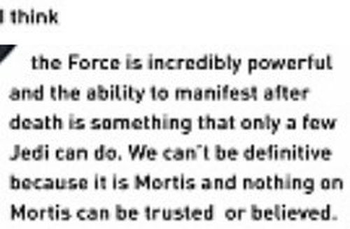
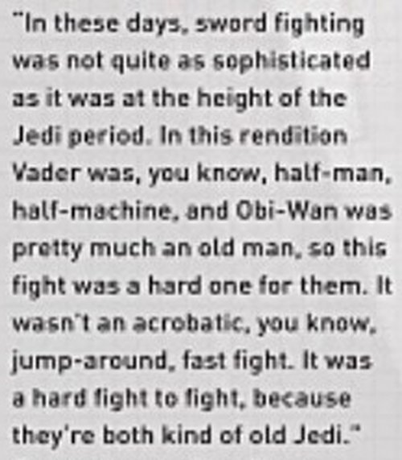
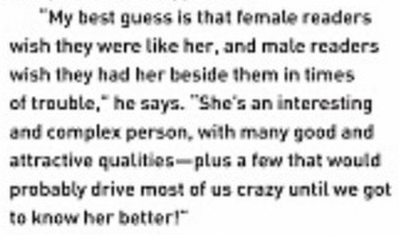

# Owner Material 038 — Star Wars Insider #1–153 plus specials (with The Lucasfilm Fan Club Magazine #1–22): Star Wars Insider #126 (2011)

- **Source:** *Star Wars Insider* magazine (issues 23–153, 1994–2014) and its predecessor *The Lucasfilm Fan Club Magazine* (issues 1–22, 1987–1994), plus seven special editions: articles, interviews, comics and short fiction Secondary source (licensed Legends reference). Scan OCR'd on the box; the scan stays box-only and is **not** published.
- **Method:** every scanned page was OCR'd and machine-screened sentence by sentence for power-relevant statements (fights, kills, defeats, Force feats, rankings, superweapons) that name a character on our roster; each kept sentence is quoted verbatim from the OCR text and has a crop of the printed passage directly under it. Pages with nothing power-relevant are still listed with what is on them.
- **Citation:** "*Star Wars Insider #126* (2011), p.X" by printed page ("scan p.X" where no printed number applies). **Weight:** Licensed magazine: a secondary source. Its short fiction and comics are Legends stories; its articles and interviews sum up or discuss lore and rank below the novels, comics and games they describe.

## scan p.1 (scan page 1)

Page contents: Cover: The Old Republic, exclusive fiction, Rick Baker on the cantina creatures, the Clone Wars head writer. (hand-read)

## scan p.2 (scan page 2)

Page contents: Ad: Titan Magazines online. (hand-read)

## scan p.3 (scan page 3)

Page contents: Editor's Welcome (Jonathan Wilkins): LEGO Clone Wars III, The Old Republic writer Daniel Erickson, Christian Taylor; masthead quote from General Grievous on battle droids (ROTS novelization). (hand-read)

## scan p.4 (scan page 4)

Page contents: Contents: Christian Taylor, Kevin Kiner, Daniel Erickson, fiction, Rick Baker; Kavar quote (KOTOR II). (hand-read)

## scan p.5 (scan page 5)

Page contents: Contents: departments (Launchpad, My Star Wars with Bonnie Piesse, Retro candy, Jedi Archive, Classic Moment, Books with Timothy Zahn, Comics, Incoming, Bantha Tracks, Bounty Hunters, Red Five with Steve Sansweet). (hand-read)

## scan p.6 (scan page 6)

Page contents: Launchpad: Star Wars: The Complete Saga Blu-ray special features, disks 1–8. (hand-read)

## scan p.7 (scan page 7)

Page contents: Launchpad: Blu-ray disk nine documentaries (Star Warriors, Conversation with the Masters, Spoofs, Making of, SPFX, Classic Creatures, Anatomy of a Dewback, Star Wars Tech). (hand-read)

## scan p.8 (scan page 8)

Page contents: Launchpad: Star Tours: The Adventures Continue reopens (54 possible ride combinations). (hand-read)

## scan p.9 (scan page 9)

Page contents: Launchpad: Character Encyclopedia giveaway; Del Rey/Bantam Star Wars backlist goes to eBook (Howard Roffman and Gina Centrello quotes). (hand-read)

## scan p.10 (scan page 10)

Page contents: Beyond the Outer Rim (Brian J. Robb): Harrison Ford in Cowboys & Aliens (Jon Favreau directing); Ian McDiarmid in Timon of Athens; Peter Mayhew names ESB his favorite ("He can smell danger and usually takes evasive action"); Ewan McGregor's Chilean great-grandfather; Mark Hamill in Sushi Girl; Jimmy Smits; Liam Neeson in Taken 2. (hand-read)

## scan p.11 (scan page 11)

Page contents: Galaxy in Pictures (LEGO sightings); masthead. (hand-read)

## scan p.12 (scan page 12)

Page contents: Interrogation Droid: Catherine Taber (Padmé in TCW, Leia in TFU) answers humorous mash-up questions (Padmé in Jabba's palace, Leia on Jar Jar, etc.). (hand-read)

## scan p.13 (scan page 13)

Page contents: Ad: Star Trek magazine. (hand-read)

## scan p.14 (scan page 14)

Page contents: Christian Taylor interview (Jonathan Wilkins): animation vs. live action; Lucas in the Season Three writers' room; technical limits (costumes, water, fabric). (hand-read)

## scan p.15 (scan page 15)

Page contents: Taylor interview art: Mortis montage (images only). (hand-read)

## scan p.16 (scan page 16)

Page contents: Taylor interview: the show is told from Ahsoka's point of view; multi-episode arcs; his childhood Star Wars sets. (hand-read)

## scan p.17 (scan page 17)

Page contents: Taylor interview: doesn't read the EU ("if George Lucas says it's true, then it's true"); Lucas spoke about the Force for about 20 minutes during the Mortis arc. (hand-read)

## scan p.18 (scan page 18)

Page contents: Taylor interview art: Ahsoka, Mortis scenes (images only). (hand-read)

## scan p.19 (scan page 19)

Page contents: Taylor interview: Liam Neeson as Qui-Gon; plans for older Ahsoka ("the show started with her, and I think it will end with her story"); Anakin's darkness building toward ROTS. (hand-read)

- **Qui-Gon Jinn** — entry/section: Christian Taylor interview: ""I think the Force is incredibly powerful and the ability to manifest after death is something that only a few Jedi can do. We can't be definitive because it is Mortis and nothing on Mortis can be trusted or believed." —Christian Taylor, Star Wars Insider 126, p. 19" Source: *Star Wars Insider #126* (2011), scan p.19
  

## scan p.20 (scan page 20)

Page contents: Taylor interview: the fixed timeline; a hinted epic story from Lucas; maybe Han Solo someday. (hand-read)

## scan p.21 (scan page 21)

Page contents: Ad: Supernatural magazine. (hand-read)

## scan p.22 (scan page 22)

Page contents: My Star Wars: Bonnie Piesse (Beru) on her audition and favorite scene (the ROTS twin-sunset ending). (hand-read)

## scan p.23 (scan page 23)

Page contents: My Star Wars: Piesse on personal development; Joel Edgerton and Piesse chased by stormtrooper costumers at Celebration II; favorite film ESB. (hand-read)

## scan p.24 (scan page 24)

Page contents: Kevin Kiner interview (Matt McAllister): title page. (hand-read)

## scan p.25 (scan page 25)

Page contents: Kiner interview title art ("Kiner Wars!"): Anakin, Yoda (images only). (hand-read)

## scan p.26 (scan page 26)

Page contents: Kiner interview: the audition; adapting the Star Wars theme, switching to 5/4 time to avoid "disco". (hand-read)

## scan p.27 (scan page 27)

Page contents: Kiner interview: temp tracks; Filoni's solo-trumpet idea; he scores each episode wall-to-wall. (hand-read)

## scan p.28 (scan page 28)

Page contents: Kiner interview: mixing; own themes (Ahsoka, clones, battle) rather than Williams'; favorites are the Nightsisters themes and "Innocents of Ryloth". (hand-read)

## scan p.29 (scan page 29)

Page contents: Ad: Brian's Toys. (hand-read)

## scan p.30 (scan page 30)

Page contents: Retro: Star Wars candy (Gus Lopez): Nestlé pendants, Meiji Seika and Morinaga in Japan, Trebor in the UK, Hershey six-packs. (hand-read)

## scan p.31 (scan page 31)

Page contents: Retro candy: PEZ (1995), Kinder Eggs "Happy Hippo" figures, M&M "M-Pire", Marks & Spencer lightsaber tubes and Clone Wars lollipops. (hand-read)

## scan p.32 (scan page 32)

Page contents: Daniel Erickson interview (Tony A. Rowe): The Old Republic as story-driven MMO (eight class stories; "more than 60 years" for one person to write); glossary. (hand-read)

## scan p.33 (scan page 33)

Page contents: Erickson interview art: TOR class line-up (image only). (hand-read)

## scan p.34 (scan page 34)

Page contents: Erickson interview: why 3,500 years before the films; the "news-pit" writing room; Drew Karpyshyn on the team. (hand-read)

## scan p.35 (scan page 35)

Page contents: Erickson interview: eight class stories plus two faction stories; chapter one of each class is longer than all of KOTOR; "Setting the Scene" sidebar (TOR is 300 years after KOTOR). (hand-read)

## scan p.36 (scan page 36)

Page contents: Erickson interview: ESB as their bible; Smuggler (Han Solo/Indiana Jones), Sith Warrior (Shakespearean), Bounty Hunter (Westerns, Boba Fett); dark/light side from actions not words. (hand-read)

## scan p.37 (scan page 37)

Page contents: Erickson interview: multiplayer dialogue with social-point rolls; group play. (hand-read)

## scan p.38 (scan page 38)

Page contents: Erickson interview: companions handle crafting; romances, betrayal. (hand-read)

## scan p.39 (scan page 39)

Page contents: Erickson interview: romance types; Lucasfilm approval ("The Old Republic is a love letter to Star Wars"). (hand-read)

## scan p.40 (scan page 40)

Page contents: Jedi Archive: Leia's Boussh disguise (images: helmet sculpture, on set). (hand-read)

## scan p.41 (scan page 41)

Page contents: Jedi Archive: captions for Boussh and Chewbacca in Jabba's palace (Carrie Fisher, Peter Mayhew). (hand-read)

## scan p.42 (scan page 42)

Page contents: "Buyer's Market" fiction art (Brian Rood): Lando Calrissian (image only). (hand-read)

## scan p.43 (scan page 43)

Page contents: "Buyer's Market" (Timothy Zahn): post-Endor, Lando arrives at Blackie's junkyard in Vorrnti City aboard the Lady Luck; repulsorlifts are banned because of scrap rats. (hand-read)

## scan p.44 (scan page 44)

Page contents: Buyer's Market: Lando spots the non-working AT-AT (two Taim & Bak MS-1 heavy laser cannons at the chin) and buys two marsh crawlers to block the yard exit. (hand-read)

### Stat block notes (game mechanics, not feats)

- Buyer's Market: "Lando let him get the crawler about a third of the way through the gap. Then, with a startled shout, he snatched out his blaster, crouched down, and opened fire on the hauler's underside... The engine seized up on Lando's third shot, the roar becoming a howl as the power regulators began cascading, and even that faded away on Lando's fifth shot." (Buyer's Market, Star Wars Insider 126, p. 44) (Source: *Star Wars Insider #126* (2011), scan p.44)

## scan p.45 (scan page 45)

Page contents: Buyer's Market: Lando calls Lt. Judder Page of the Katarn Commandos; the "big shot" deal is glitterstim; Cravel's gang gets the AT-AT working in two days. (hand-read)

## scan p.46 (scan page 46)

Page contents: Buyer's Market art: AT-AT head (image only). (hand-read)

## scan p.47 (scan page 47)

Page contents: Buyer's Market: Page's commandos stun the thieves and seize the AT-AT; Lando wants forty AT-ATs for Nomad City on Nkllon; "Expanded Universe" box: Choices of One and the Heir to the Empire 20th Anniversary Edition (Zahn). (hand-read)

### Stat block notes (game mechanics, not feats)

- Buyer's Market: "AT-ATs weren't the kind of war machine that could sneak up on anyone, and the bodyguards were already outside the building, pelting the massive intruder with fire of their own. But even heavy blaster rifles were of no use whatsoever against AT-AT armor. The machine's chin laser cannons raked the customs building with fire, calmly and systematically laying it open and killing everyone in sight." (Buyer's Market, Star Wars Insider 126, p. 47) (Source: *Star Wars Insider #126* (2011), scan p.47)

## scan p.48 (scan page 48)

Page contents: Subscription offer: R2-D2 magazine holder (editor quote is product copy). (hand-read)

## scan p.49 (scan page 49)

Page contents: Subscription offer page. (hand-read)

## scan p.50 (scan page 50)

Page contents: Rick Baker interview (Calum Waddell): title page. (hand-read)

## scan p.51 (scan page 51)

Page contents: Baker interview: career, Oscars; credited as "makeup artist: second unit" on Star Wars. (hand-read)

## scan p.52 (scan page 52)

Page contents: Baker interview: Lucas wanted to embellish the cantina; Stuart Freeborn's masks; Baker suggests puppet creatures. (hand-read)

## scan p.53 (scan page 53)

Page contents: Baker interview: slip-on rubber masks made with no time or money; his crew played the cantina band. (hand-read)

## scan p.54 (scan page 54)

Page contents: Baker interview: The Incredible Melting Man paid more; seeing the film at an early screening. (hand-read)

## scan p.55 (scan page 55)

Page contents: Baker interview: glad the Special Edition cut his werewolf mask; group photo. (hand-read)

## scan p.56 (scan page 56)

Page contents: Classic Moment: Obi-Wan vs. Vader, ANH script excerpt (film dialogue). (hand-read)

### Stat block notes (game mechanics, not feats)

- Classic Moment: Why It's a Classic: "While Vader has been consumed by the dark side, Obi-Wan has been preparing to become one with the Force, which will make him even more powerful." (Classic Moment, Star Wars Insider 126, p. 56) (Source: *Star Wars Insider #126* (2011), scan p.56)

## scan p.57 (scan page 57)

Page contents: Classic Moment: script continues (the duel and Ben's death; film dialogue). (hand-read)

- **Obi-Wan Kenobi; Darth Vader (Anakin Skywalker)** — entry/section: Classic Moment: What They Said: ""In these days, sword fighting was not quite as sophisticated as it was at the height of the Jedi period. In this rendition Vader was, you know, half-man, half-machine, and Obi-Wan was pretty much an old man, so this fight was a hard one for them. It wasn't an acrobatic, you know, jump-around, fast fight. It was a hard fight to fight, because they're both kind of old Jedi." —George Lucas (A New Hope DVD commentary), Star Wars Insider 126, p. 57" Source: *Star Wars Insider #126* (2011), scan p.57
  

## scan p.58 (scan page 58)

Page contents: Ad: Lenore comics. (hand-read)

## scan p.59 (scan page 59)

Page contents: Universe section contents (Books, Ask Lobot, Her Universe with Ashley Eckstein, Bounty Hunters, Bantha Tracks). (hand-read)

## scan p.60 (scan page 60)

Page contents: Books (Daniel Wallace): Heir to the Empire 20th Anniversary Edition (annotations, new 18,000-word Thrawn novella, reflective cover); Zahn on fan loyalty. (hand-read)

## scan p.61 (scan page 61)

Page contents: Books: Choices of One (between ANH and ESB): Mara Jade on a mission of Imperial justice with the Hand of Judgment stormtroopers; "Luke and Mara actually do work together in this book". Ask Lobot (Leland Y. Chee): Bespin and Hoth are in separate systems; Bespin is a short distance from the Anoat system along the Ison Corridor; the Falcon used a much slower backup hyperdrive, travel time unspecified. (hand-read)

- **Mara Jade Skywalker** — entry/section: Books: Mara on a Mission: ""My best guess is that female readers wish they were like her, and male readers wish they had her beside them in times of trouble... She's an interesting and complex person, with many good and attractive qualities—plus a few that would probably drive most of us crazy until we got to know her better!" —Timothy Zahn, Star Wars Insider 126, p. 61" Source: *Star Wars Insider #126* (2011), scan p.61
  

## scan p.62 (scan page 62)

Page contents: Comics (Daniel Wallace): The Old Republic: The Lost Suns, set during the Jedi–Sith "truce" after the sacking of Coruscant; writer Alexander Freed. (hand-read)

## scan p.63 (scan page 63)

Page contents: Lost Suns: 22-page format; Freed on family; Theron Shan isn't a Jedi; creative team (Dave Ross, Mark McKenna, Michael Atiyeh, Benjamin Carré covers); "our ninth story". (hand-read)

### Stat block notes (game mechanics, not feats)

- Comics: The Lost Suns: "The Lost Suns stars Republic spy Theron Shan, son of Jedi Grand Master Satele Shan." (Comics, Star Wars Insider 126, p. 63) (Source: *Star Wars Insider #126* (2011), scan p.63)

## scan p.64 (scan page 64)

Page contents: Comics: Invasion "Revelations" (Tom Taylor): Finn and Kaye Galfridian; their mother Nina exposed as a disguised Yuuzhan Vong agent; Borsk Fey'lya on Coruscant. (hand-read)

## scan p.65 (scan page 65)

Page contents: Invasion: Kaye and her mother on Shramar in the Imperial Remnant; artist Colin Wilson on Vong tech. Ask Lobot: rule of thumb on unofficial characters. (hand-read)

## scan p.66 (scan page 66)

Page contents: Incoming (Chris Spitale): LEGO Sith Infiltrator; Attakus Elite Collection clone troopers. (hand-read)

## scan p.67 (scan page 67)

Page contents: Incoming: Sideshow Commander Bly; Hallmark 2011 ornaments. (hand-read)

## scan p.68 (scan page 68)

Page contents: Incoming: Acme art prints (Lawrence Noble, Tsuneo Sanda). (hand-read)

## scan p.69 (scan page 69)

Page contents: Incoming: Disney Star Tours merchandise. (hand-read)

## scan p.70 (scan page 70)

Page contents: Her Universe: Ashley Eckstein interview (Chris Spitale) on founding the line for female fans; designer profile: Cat Staggs ("I Know" shirt). (hand-read)

## scan p.71 (scan page 71)

Page contents: Her Universe: jewelry, the "Boba Fett-ish" set, Star Wars Weekends; designer profile: Katie Cook ("Daddy's Little Girl" shirt). (hand-read)

## scan p.72 (scan page 72)

Page contents: Bounty Hunters (fan celebrity encounters; fan names omitted): Bonnie Piesse, Ahmed Best, Ashley Eckstein, Sam Witwer. (hand-read)

## scan p.73 (scan page 73)

Page contents: Bounty Hunters: Harrison Ford inducted into the San Diego Air & Space Museum Hall of Fame; Peter Mayhew; Daniel Logan (fan names omitted). (hand-read)

## scan p.74 (scan page 74)

Page contents: Bantha Tracks: the Almost-Annual Wedding Edition (fan weddings; names and personal details omitted). (hand-read)

## scan p.75 (scan page 75)

Page contents: Bantha Tracks: fan wedding stories (names and personal details omitted). (hand-read)

## scan p.76 (scan page 76)

Page contents: Bantha Tracks: fan wedding stories (names and personal details omitted). (hand-read)

## scan p.77 (scan page 77)

Page contents: Bantha Tracks: Celebration V speed-dating couples; editor Mary Franklin's "Making Memories" (fan names omitted). (hand-read)

## scan p.78 (scan page 78)

Page contents: Red Five: Steve Sansweet's collecting memories: least treasured (food items); most treasured (fan-made items; fan names and private details omitted). (hand-read)

## scan p.79 (scan page 79)

Page contents: Red Five: Sansweet's one that got away (the carded Brazilian Vlix); most wanted (holochess monster replicas); the Jedi bike story. (hand-read)

## scan p.80 (scan page 80)

Page contents: Ad: Titan subscription. (hand-read)

## scan p.81 (scan page 81)

Page contents: Back issues ad. (hand-read)

## scan p.82 (scan page 82)

Page contents: Next issue: Han Solo; Timothy Zahn. (hand-read)

## scan p.83 (scan page 83)

Page contents: Ad: R2-D2 magazine holder. (hand-read)

## scan p.84 (scan page 84)

Page contents: Ad: Pirates of the Caribbean: On Stranger Tides movie guide. (hand-read)

