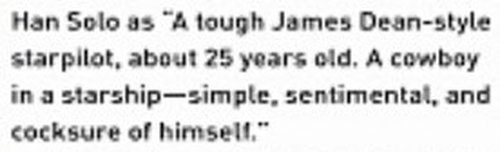
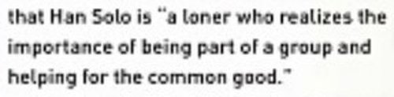
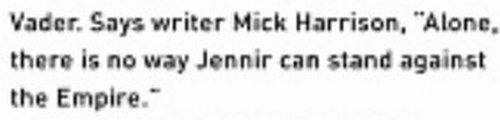
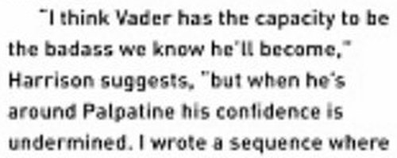

# Owner Material 038 — Star Wars Insider #1–153 plus specials (with The Lucasfilm Fan Club Magazine #1–22): Star Wars Insider #127 (2011)

- **Source:** *Star Wars Insider* magazine (issues 23–153, 1994–2014) and its predecessor *The Lucasfilm Fan Club Magazine* (issues 1–22, 1987–1994), plus seven special editions: articles, interviews, comics and short fiction Secondary source (licensed Legends reference). Scan OCR'd on the box; the scan stays box-only and is **not** published.
- **Method:** every scanned page was OCR'd and machine-screened sentence by sentence for power-relevant statements (fights, kills, defeats, Force feats, rankings, superweapons) that name a character on our roster; each kept sentence is quoted verbatim from the OCR text and has a crop of the printed passage directly under it. Pages with nothing power-relevant are still listed with what is on them.
- **Citation:** "*Star Wars Insider #127* (2011), p.X" by printed page ("scan p.X" where no printed number applies). **Weight:** Licensed magazine: a secondary source. Its short fiction and comics are Legends stories; its articles and interviews sum up or discuss lore and rank below the novels, comics and games they describe.

## scan p.1 (scan page 1)

Page contents: Cover: Han Solo, still the man; Timothy Zahn; Anthony Daniels; Star Tours; 30 years of the radio drama. (hand-read)

## scan p.2 (scan page 2)

Page contents: Ad: Star Trek magazine starships special. (hand-read)

## scan p.3 (scan page 3)

Page contents: Editor's Welcome: Meryl Streep on Harrison Ford (masthead quote); the Han series, Star Tours, the radio drama's 30th anniversary, Celebration VI in Orlando (August 23–26, 2012). (hand-read)

## scan p.4 (scan page 4)

Page contents: Contents: features (Han Solo profile, Zahn, TOR multiplayer, radio drama, Star Tours, Revan excerpt, Anthony Daniels). (hand-read)

## scan p.5 (scan page 5)

Page contents: Contents: departments (Launchpad, My Star Wars with Greg Hildebrandt, Five Facts, Jedi Archive, Classic Moment, Red Five with Joel Aron). (hand-read)

## scan p.6 (scan page 6)

Page contents: Launchpad: Kinect Star Wars for Xbox 360. (hand-read)

## scan p.7 (scan page 7)

Page contents: Launchpad: Sue Rostoni retires as Lucasfilm executive editor after 20 years. (hand-read)

## scan p.8 (scan page 8)

Page contents: Launchpad: Kazuhiko Sano dies (ROTJ poster); X-wing from office supplies; twin foals named Leia and Mara Jade (owner's name omitted). (hand-read)

## scan p.9 (scan page 9)

Page contents: Launchpad: Oklahoma college mythology course (instructor's name omitted); Polish Star Wars Magazyn; Lucasfilm's "Sandcrawler Building" in Singapore. (hand-read)

## scan p.10 (scan page 10)

Page contents: Beyond the Outer Rim: Lucas and the Red Tails score in Prague; Carrie Fisher becomes the Jenny Craig spokeswoman; James Earl Jones receives the Monte Cristo Award; Frank Oz; Ian McDiarmid in Emperor and Galilean; Ewan McGregor in Jack the Giant Killer; Brian Blessed's Cambridge chancellor bid; Hayden Christensen in The Diplomat; Christopher Lee in The Hobbit; Temuera Morrison's telethon duet; Samuel L. Jackson in The Samaritan. (hand-read)

## scan p.11 (scan page 11)

Page contents: Photo Finish: Paul Crowther photographs Star Wars actors (Jeremy Bulloch, Julian Glover, Peter Mayhew). (hand-read)

## scan p.12 (scan page 12)

Page contents: Launchpad: Celebration VI tickets; R2-BQ drum smoker (TheForce.net founder); masthead. (hand-read)

## scan p.13 (scan page 13)

Page contents: Ad: Brian's Toys. (hand-read)

## scan p.14 (scan page 14)

Page contents: Han Solo feature art: Harrison Ford as Han (image only). (hand-read)

## scan p.15 (scan page 15)

Page contents: Han Solo feature (Brian J. Robb) title page: investigating the character's origins, influences, and continuing appeal. (hand-read)

## scan p.16 (scan page 16)

Page contents: Han feature: early drafts made Han a green alien; the rogue with a heart of gold; the cowboy roots; Chewbacca as his constant companion. (hand-read)

- **Han Solo** — entry/section: Han Solo feature: ""A tough James Dean-style starpilot, about 25 years old. A cowboy in a starship—simple, sentimental, and cocksure of himself." —George Lucas (August 1975 third-draft script), Star Wars Insider 127, p. 16" Source: *Star Wars Insider #127* (2011), scan p.16
  

## scan p.17 (scan page 17)

Page contents: Han feature: Han defined against Luke; a survivor who stays out of politics; arrogance (chasing stormtroopers on the Death Star); "Solo in Love": EU romances (Bria Tharen, Xaverri, Salla Zend, Jenny in a deleted scene) and Leia. (hand-read)

## scan p.18 (scan page 18)

Page contents: Han feature: from cynic to leader; "Harrison the Hero": Western influences, John Mollo's costume (Corellian bloodstripes), other actors considered (Kurt Russell, Christopher Walken, Perry King). (hand-read)

- **Han Solo** — entry/section: Han Solo feature: ""a loner who realizes the importance of being part of a group and helping for the common good." —George Lucas, Star Wars Insider 127, p. 18" Source: *Star Wars Insider #127* (2011), scan p.18
  

## scan p.19 (scan page 19)

Page contents: Han feature: Ford wanted Han killed in ROTJ; AFI 2005 heroes list (Han 14th, Indiana Jones 2nd, Obi-Wan 37th, Vader 3rd villain); humorous Top 5 checklist (Falcon, Wookiee pal, shoots first, carbonite, Leia). (hand-read)

### Stat block notes (game mechanics, not feats)

- Han Solo feature: "Of all the heroes in Star Wars, Han Solo is the most flawed and therefore the most like us." (Han Solo feature, Star Wars Insider 127, p. 19) (Source: *Star Wars Insider #127* (2011), scan p.19)

## scan p.20 (scan page 20)

Page contents: My Star Wars: Greg Hildebrandt on the Hildebrandt brothers' poster, painted in 36 hours; the alarm-company caller; painting B-25 nose art; favorite scene: the opening Star Destroyer. (hand-read)

## scan p.21 (scan page 21)

Page contents: My Star Wars: Hildebrandt's son as "the Star Wars kid"; sidebar on Tom Jung's design and the Hildebrandt version. (hand-read)

## scan p.22 (scan page 22)

Page contents: Timothy Zahn interview (Jonathan Wilkins): title page, 20 years since Heir to the Empire. (hand-read)

## scan p.23 (scan page 23)

Page contents: Zahn interview: panic at the offer; West End Games RPG material as research ("a resource, not a restriction"). (hand-read)

## scan p.24 (scan page 24)

Page contents: Zahn interview: a test of whether fans still cared; plotting the trilogy (Mount Tantiss known from the start); adding Han's side trip to Bel Iblis in Dark Force Rising. (hand-read)

## scan p.25 (scan page 25)

Page contents: Zahn interview: creating vs. established characters; Dark Force Rising covers. (hand-read)

## scan p.26 (scan page 26)

Page contents: Zahn interview: relies on editors, the Holocron, and Wookieepedia; female characters; music while writing. (hand-read)

## scan p.27 (scan page 27)

Page contents: Zahn interview: the prequels enabled Outbound Flight; Coruscant ("means glittering") reaching the films; he'd like to write Obi-Wan after ROTS muddying his back-trail so Vader or the Emperor couldn't track him. (hand-read)

## scan p.28 (scan page 28)

Page contents: Zahn interview: the Thrawn trilogy dates are about 5 years off the later timeline; could do 20 books; Sibyl's War, Cobra Wars, Quadrail. (hand-read)

## scan p.29 (scan page 29)

Page contents: Ad: Star Wars kids' products. (hand-read)

## scan p.30 (scan page 30)

Page contents: Mon Mothma's Five Facts (1 Fake): little people as Luke and the Lars family; A New Hope film stock prone to fading. (hand-read)

## scan p.31 (scan page 31)

Page contents: Five Facts: Vader crushing Antilles' neck (walnut sound effect); Billy Dee Williams auditioned for Han; Lucas's story notes made some stormtroopers women. (hand-read)

## scan p.32 (scan page 32)

Page contents: The Old Republic PvP feature title art ("Battle"; image only). (hand-read)

## scan p.33 (scan page 33)

Page contents: TOR PvP feature (Tony Rowe, with BioWare's Gabe Amatangelo): PvE vs. PvP servers; glossary. (hand-read)

## scan p.34 (scan page 34)

Page contents: TOR PvP: Flashpoints (The Esseles: a liner to Coruscant intercepted by an Imperial fleet; a recurring Grand Moff). (hand-read)

## scan p.35 (scan page 35)

Page contents: TOR PvP: Warzones (Alderaan turrets). (hand-read)

## scan p.36 (scan page 36)

Page contents: TOR PvP: Void Star Warzone; level bolstering; Valor and tokens (game mechanics). (hand-read)

## scan p.37 (scan page 37)

Page contents: TOR PvP: Jedi Guardian guard mechanic; badges; the Resolve system vs. crowd control (game mechanics). (hand-read)

## scan p.38 (scan page 38)

Page contents: Radio drama feature title page: producer Tony Van Ness (Vaegett as printed), director John Madden, writer Brian Daley. (hand-read)

## scan p.39 (scan page 39)

Page contents: Radio drama feature: 30th anniversary; Richard Toscan and John Houseman revive radio drama at USC/KUSC; cast (Anthony Daniels, Bernard Behrens as Ben Kenobi, Perry King as Han, Mark Hamill as Luke). (hand-read)

## scan p.40 (scan page 40)

Page contents: Radio drama: NPR's Frank Mankiewicz; "Why don't you do Star Wars?"; Lucas sells the rights to KUSC for one dollar; BBC co-production; director John Madden and engineer Tom Voegeli; the first BBC script rejected and Toscan writes episode one; Daley's handwritten C-3PO insults for R2. (hand-read)

## scan p.41 (scan page 41)

Page contents: Radio drama: Brian Daley writes 13 scripts in three months; recording at Westlake Audio (June 1980); cast incl. Brock Peters (Vader), Keene Curtis (Tarkin), Perry King (Han), David Alan Grier, Meshach Taylor. (hand-read)

## scan p.42 (scan page 42)

Page contents: Radio drama: 13 scripts recorded in 13 days; cut line "Don't mind me, I'm just driving the bus"; March 1981 release, Griffith Observatory premiere; 55,000 calls, 40 percent audience rise; leads to the Empire adaptation. (hand-read)

## scan p.43 (scan page 43)

Page contents: Ad: Titan Magazines subscriptions. (hand-read)

## scan p.44 (scan page 44)

Page contents: Star Tours feature (Steve Sansweet) opening photo: Bob Iger, George Lucas, Anthony Daniels. (hand-read)

## scan p.45 (scan page 45)

Page contents: Star Tours feature title page: Star Tours: The Adventures Continue. (hand-read)

## scan p.46 (scan page 46)

Page contents: Star Tours: Lucas visits Disneyland at opening in 1955; May 20, 2011 opening at Hollywood Studios; 50+ ride combinations, Dolby 3D; the original 1987 ride with pilot Rex. (hand-read)

## scan p.47 (scan page 47)

Page contents: Star Tours: Howard Roffman and Tom Fitzgerald; the Jedi Training Academy rollercoaster concept; opening ceremony skit (Vader, Lucas and Iger with lightsabers, R2 destroys the energy shield). (hand-read)

## scan p.48 (scan page 48)

Page contents: Star Tours: Lucas picks the simulator idea; ~$32 million original cost; the 2003 Australia brainstorm; 54 storyline combinations set between Episodes III and IV. (hand-read)

## scan p.49 (scan page 49)

Page contents: Star Tours: C-3PO as the accidental pilot (replacing the AC-38 "Ace" idea); ILM's Bill George and the Lodestar code name; opening crawl text. (hand-read)

## scan p.50 (scan page 50)

Page contents: Star Tours: ILM's Bill George; the motion base needs a pause (the hologram briefing); the Death Star core chasm; Wookiee stuntman and the opee sea killer tongue marks; restored Podracer models; 501st members in the pre-show. (hand-read)

## scan p.51 (scan page 51)

Page contents: Star Tours: the Hoth AT-AT battle (Lucas: other AT-AT battles could have happened there earlier); the security droid gag; Lucas: "It's like Star Tours on steroids." (hand-read)

## scan p.52 (scan page 52)

Page contents: Jedi Archive: Jabba the Hutt (puppet photo, early concept sketches). (hand-read)

## scan p.53 (scan page 53)

Page contents: Jedi Archive: Jabba; the Japanese ad model; McQuarrie concept art; Leia and Bib Fortuna (Michael Carter) caption. (hand-read)

## scan p.54 (scan page 54)

Page contents: Anthony Daniels with C-3PO costume pieces (photo only). (hand-read)

## scan p.55 (scan page 55)

Page contents: Anthony Daniels interview (Jason Surrell): C-3PO in the pilot's seat of Star Tours: The Adventures Continue. (hand-read)

## scan p.56 (scan page 56)

Page contents: Daniels interview: the original Star Tours animatronic Threepio; Tom Fitzgerald's surprise that Threepio would be the pilot; shaping the lines as the "Threepio expert". (hand-read)

## scan p.57 (scan page 57)

Page contents: Daniels interview: back in the suit for the pre-show set (the Starspeeder built bigger for Threepio's shoulders); two days of recording. (hand-read)

## scan p.58 (scan page 58)

Page contents: Daniels interview: a day in bed after recording; Threepio is "a pretty good pilot" with a surprise "I've always wanted to do this" moment; matching his 20-year-old performance; Star Tours as immortality; Lucas "like a kid on Christmas morning". (hand-read)

## scan p.59 (scan page 59)

Page contents: Daniels interview: audience-participation Rebel spy; Star Wars Weekends with Eckstein, Taylor, Spence, Filoni, Logan; "without them we would have had only one movie." (hand-read)

## scan p.60 (scan page 60)

Page contents: Ad: subscription offer with R2-D2 magazine holder. (hand-read)

## scan p.61 (scan page 61)

Page contents: Ad: subscription offer details and digital subscription. (hand-read)

## scan p.62 (scan page 62)

Page contents: Kenner prototypes feature intro: unproduced vintage toys. (hand-read)

## scan p.63 (scan page 63)

Page contents: Kenner prototypes: Rocket-Firing Boba Fett (L-slot and J-slot), canceled over safety concerns. (hand-read)

## scan p.64 (scan page 64)

Page contents: Kenner prototypes: the pre-school line; C-3PO walkie-talkies; Micro Collection "4-ups" (Gamorrean Guard, Power Droid). (hand-read)

## scan p.65 (scan page 65)

Page contents: Kenner prototypes: the Han Solo blaster squirt gun; the gyro lightsaber; unreleased Micro Collection playsets (Bacta Chamber, Torture Chamber, Jabba's Palace). (hand-read)

## scan p.66 (scan page 66)

Page contents: Kenner prototypes: large-size Empire figures (Lando head sculpt, Hoth Han, Bespin Luke and Leia); talking Yoda doll; Yoda hand puppet; handheld LED game. (hand-read)

## scan p.67 (scan page 67)

Page contents: Kenner prototypes: early Jedi Luke and Emperor versions; Parker Brothers' Death Star Battle game; kit-bashed figures; unreleased Power of the Force figures and coin album. (hand-read)

## scan p.68 (scan page 68)

Page contents: Revan fiction excerpt art (Benjamin Carré). (hand-read)

## scan p.69 (scan page 69)

Page contents: Exclusive fiction: extract from The Old Republic: Revan (Drew Karpyshyn); Revan, Canderous and T3-M4 in the damaged Ebon Hawk search Rekkiad for the camp. (hand-read)

## scan p.70 (scan page 70)

Page contents: Revan excerpt: the hike plan; Canderous takes a heavy repeating blaster carbine; Jedi aren't popular out here, so Revan leaves the lightsaber unused. (hand-read)

### Stat block notes (game mechanics, not feats)

- Revan crash-lands the Ebon Hawk: "Fighting wind and gravity, Revan struggled to keep the damaged ship level as he took it down. Seconds before they touched ground, a blast of wind grabbed the Ebon Hawk and pitched it hard to starboard. Revan jammed the stick to port, desperately trying to keep the ship from flipping over. It slammed into the snow bank at a forty-five degree angle, carving a fifty-meter-long trench in the powder before finally coming to rest." (The Old Republic: Revan excerpt, Star Wars Insider 127, p. 70) (Source: *Star Wars Insider #127* (2011), scan p.70)

## scan p.71 (scan page 71)

Page contents: Revan excerpt: Revan carries a pair of blaster pistols; a two-hour blizzard trek; Clan Ordo sentries; Canderous greets Edric. (hand-read)

### Stat block notes (game mechanics, not feats)

- Mandalorian surrender terms: "As part of the terms of the surrender, he'd ordered the Mandalorians to disassemble their infamous basilisk war-droids—great metal beasts that the Mandalorians often rode into combat." (The Old Republic: Revan excerpt, Star Wars Insider 127, p. 71) (Source: *Star Wars Insider #127* (2011), scan p.71)

## scan p.72 (scan page 72)

Page contents: Revan excerpt: inside the supply shack; Mandalorian clan loyalty; clan leader Veela arrives ("Su cuy gar"). (hand-read)

## scan p.73 (scan page 73)

Page contents: Revan excerpt: "Cin vhetin"; Canderous introduces Revan as the mercenary "Avner"; Veela's threats; the search for Mandalore's Mask; "She's my wife." Revan on sale October 18. (hand-read)

## scan p.74 (scan page 74)

Page contents: Classic Moment (ESB DVD chapter 30) trivia: IG-88's head is a Rolls-Royce Derwent jet engine burner; Dengar's repainted trooper armor; Zuckuss' bubble-wrap eyes; script descriptions differ from the final designs. (hand-read)

### Stat block notes (game mechanics, not feats)

- Classic Moment: bounty hunters on the Executor: "Bounty hunters represent the grittier, seamier side of the Star Wars universe, and as we see here, despite Admiral Piett's disdain for them, even the ruthlessly efficient, all-powerful Empire has its uses for them. It's notable in this scene that Vader singles out Fett to remind him there should be "No disintegrations." Fett's fearsome reputation clearly precedes him, and it's no doubt one of the reasons Fett became such a fan favorite." (Classic Moment, Star Wars Insider 127, p. 74) (Source: *Star Wars Insider #127* (2011), scan p.74)

## scan p.75 (scan page 75)

Page contents: Classic Moment: 1980 script text (Bossk, Zuckuss, Dengar, IG-88, 4-LOM, Boba Fett); dialogue "No disintegrations." / "As you wish."; Lucas DVD commentary on bringing the bounty hunters back. (hand-read)

## scan p.76 (scan page 76)

Page contents: Ad: Star Wars craft and activity books (Random House / Titan Books). (hand-read)

## scan p.77 (scan page 77)

Page contents: Universe contents: Books (Ascension, How to Speak Wookiee), Ask Lobot, Bantha Tracks, Bounty Hunters. (hand-read)

## scan p.78 (scan page 78)

Page contents: Ascension preview (Daniel Wallace): Vestara Khai and her father Gavar Khai; the Jedi ruling the government ("the worst monster of all—bureaucracy!"); Natasi Daala as an almost classic tragic hero; on sale August 14, series ends June 2012. (hand-read)

## scan p.79 (scan page 79)

Page contents: Ask Lobot (Leland Y. Chee): AT-ATs reached Hoth in boxy Y-86 Titan dropships, each capable of carrying four AT-ATs and four AT-STs; the "Imperial landing craft" of Force Commander and Empire at War. (hand-read)

## scan p.80 (scan page 80)

Page contents: Dark Times preview (Daniel Wallace): Dass Jennir pursued by Vader, a bounty hunter and his killer droid, and the Uhumele crew; Doug Wheatley: drawing Vader's mask "is like drawing a toaster." (hand-read)

- **Dass Jennir; Darth Vader (Anakin Skywalker)** — entry/section: Dark Times: Out of the Wilderness preview: ""Alone there is no way Jennir can stand against the Empire." —Mick Harrison (Randy Stradley), Star Wars Insider 127, p. 80" Source: *Star Wars Insider #127* (2011), scan p.80
  
- **Darth Vader (Anakin Skywalker); Palpatine (Darth Sidious)** — entry/section: Dark Times: Out of the Wilderness preview: ""I think Vader has the capacity to be the badass we know he'll become, but when he's around Palpatine his confidence is undermined." —Mick Harrison (Randy Stradley), Star Wars Insider 127, p. 80" Source: *Star Wars Insider #127* (2011), scan p.80
  

## scan p.81 (scan page 81)

Page contents: Dark Times: Jennir righting smaller wrongs; End of an Alias: Mick Harrison and Welles Hartley are pen names of Dark Horse editor Randy Stradley. (hand-read)

## scan p.82 (scan page 82)

Page contents: Star Wars Adventures: Chewbacca and the Slavers of the Shadowlands (Chris Cerasi, Jennifer L. Meyer): young Chewie on Kashyyyk nearly 200 years before A New Hope; on sale September 21. (hand-read)

## scan p.83 (scan page 83)

Page contents: Star Wars Omnibus: A Long Time Ago... Volume 4 (Marvel #68-85 and ROTJ adaptation). (hand-read)

## scan p.84 (scan page 84)

Page contents: Incoming (Chris Spitale): Hasbro vintage figures wave 3 (Barriss Offee, Bespin Han, Logray, ARC Trooper Commander, Rebel fleet trooper, Bom Vimdin). (hand-read)

## scan p.85 (scan page 85)

Page contents: Incoming: Playskool Heroes Jedi Force vehicles. (hand-read)

## scan p.86 (scan page 86)

Page contents: Incoming: Playskool Jedi Force 2-packs; Attakus Elite Collection (41st Elite Corps Kashyyyk trooper, Clone Commander Neyo). (hand-read)

## scan p.87 (scan page 87)

Page contents: Incoming: MIMOBOT series 7; Disney Collector Pack 3 (Park Series #12). (hand-read)

## scan p.88 (scan page 88)

Page contents: Incoming: LEGO Ewok Attack; Sideshow Figrin D'an life-size bust and 12-inch figure. (hand-read)

## scan p.89 (scan page 89)

Page contents: Incoming: Topps dog tags; Uncle Milton R2-D2 Microviewer and Lightsaber Room Lights. (hand-read)

## scan p.90 (scan page 90)

Page contents: Bantha Tracks: fan celebrations (a Darth Vader hot-air balloon at the Philippine festival with the 501st and Rebel Legion; fan names omitted). (hand-read)

## scan p.91 (scan page 91)

Page contents: Bantha Tracks: Phoenix Suns Clone Wars night; producer Robert Watts meets fans in London; UK costuming group at the SFX Weekender (fan names omitted). (hand-read)

## scan p.92 (scan page 92)

Page contents: Bantha Tracks: Cincinnati Reds charity night; other costumed events; submission rules (fan names omitted). (hand-read)

## scan p.93 (scan page 93)

Page contents: Bantha Tracks: Muskegon Lumberjacks Star Wars night (Han in Carbonite ice sculpture); Oklahoma City "Ghost-Troopers"; the 501st raised over $300,000 directly and $3 million indirectly in 2010 (fan names omitted); editor Mary Franklin. (hand-read)

## scan p.94 (scan page 94)

Page contents: Bounty Hunters: reader photos with Ashley Eckstein and George Lucas (reader and family names omitted). (hand-read)

## scan p.95 (scan page 95)

Page contents: Bounty Hunters: reader encounters with Julian Glover, Chris Muncke, Anthony Daniels, Peter Mayhew (reader names omitted). (hand-read)

## scan p.96 (scan page 96)

Page contents: Red Five: Clone Wars CG/FX/lighting supervisor Joel Aron's influences: Baraka; Janusz Kaminski. (hand-read)

## scan p.97 (scan page 97)

Page contents: Red Five: Conrad Hall; Jaws (Bill Butler); 2001: A Space Odyssey (Geoffrey Unsworth); The Shining influencing an upcoming Clone Wars episode. (hand-read)

## scan p.98 (scan page 98)

Page contents: Next issue: Blu-ray box set preview, Clone Wars season four; Five Facts answer: the fake is #4 (Billy Dee Williams did not audition for Han). (hand-read)

## scan p.99 (scan page 99)

Page contents: Ad: R2-D2 magazine holder. (hand-read)

## scan p.100 (scan page 100)

Page contents: Ad: Hasbro vintage collection Barriss Offee (product copy). (hand-read)

## scan p.101 (scan page 101)

Page contents: Back cover: Chewbacca bandolier art (image only). (hand-read)

