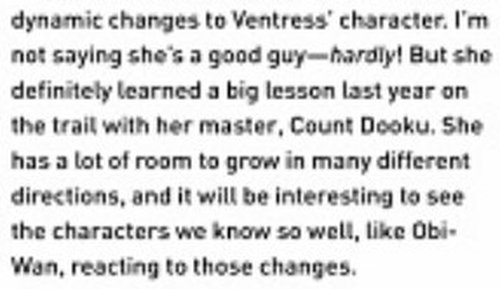
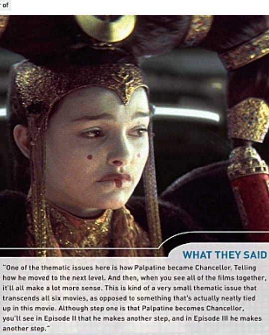

# Owner Material 038 — Star Wars Insider #1–153 plus specials (with The Lucasfilm Fan Club Magazine #1–22): Star Wars Insider #128 (2011)

- **Source:** *Star Wars Insider* magazine (issues 23–153, 1994–2014) and its predecessor *The Lucasfilm Fan Club Magazine* (issues 1–22, 1987–1994), plus seven special editions: articles, interviews, comics and short fiction Secondary source (licensed Legends reference). Scan OCR'd on the box; the scan stays box-only and is **not** published.
- **Method:** every scanned page was OCR'd and machine-screened sentence by sentence for power-relevant statements (fights, kills, defeats, Force feats, rankings, superweapons) that name a character on our roster; each kept sentence is quoted verbatim from the OCR text and has a crop of the printed passage directly under it. Pages with nothing power-relevant are still listed with what is on them.
- **Citation:** "*Star Wars Insider #128* (2011), p.X" by printed page ("scan p.X" where no printed number applies). **Weight:** Licensed magazine: a secondary source. Its short fiction and comics are Legends stories; its articles and interviews sum up or discuss lore and rank below the novels, comics and games they describe.

## scan p.1 (scan page 1)

Page contents: Cover (Blu-ray collector's cover): Kyle Newman on The Phantom Menace; Clone Wars new season; new fiction; radio plays; prototype toys. (hand-read)

## scan p.2 (scan page 2)

Page contents: Ad: Brian's Toys. (hand-read)

## scan p.3 (scan page 3)

Page contents: Editor's Welcome (Jonathan Wilkins): masthead quote "Here we go again!" (C-3PO, ROTJ); Blu-ray marathon; Kyle Newman's Certain Point of View; Dash Rendar story by Michael Reaves and Maya Kaathryn Bohnhoff; Dave Filoni on Clone Wars season four. (hand-read)

## scan p.4 (scan page 4)

Page contents: Contents: masthead quote from Biggs Darklighter (A New Hope); features list. (hand-read)

## scan p.5 (scan page 5)

Page contents: Contents: departments; cover variants. (hand-read)

## scan p.6 (scan page 6)

Page contents: Launchpad: Clone Wars season four preview ("Water War", "Gungan Attack"; Captain Ackbar, the Gungan army). (hand-read)

## scan p.7 (scan page 7)

Page contents: Launchpad: "Prisoners" (Karkarodons), "Shadow Warrior" (Jar Jar vs. Grievous, General Tarpals); Noel Gallagher on Star Wars to Mojo. (hand-read)

## scan p.8 (scan page 8)

Page contents: Launchpad: fans fund restoration of the decaying Lars Homestead "igloo" set in Tunisia ($10,000 goal reached in 10 months; Spring 2012 expedition; organizer names omitted) (Brian J. Robb). (hand-read)

## scan p.9 (scan page 9)

Page contents: Launchpad: a real-life hoverbike built by an Australian engineer; Adelaide University's EDWARD vehicle inspired by Grievous' wheel bike; fan fundraising for a sick child (family and medical details omitted); masthead. (hand-read)

## scan p.10 (scan page 10)

Page contents: Launchpad: Hornby licenses Scalextric Star Wars slot cars (CEO Frank Martin); first look at Star Wars: The Blueprints (Mos Eisley drawings). (hand-read)

## scan p.11 (scan page 11)

Page contents: Launchpad: the new Miss USA is a Star Wars fan; Robot Chicken giveaway. (hand-read)

## scan p.12 (scan page 12)

Page contents: Interrogation Droid: Richard LeParmentier (Admiral Motti) on how Motti would have survived Hoth, Vader, the Executor and Endor (humor, not canon); "He was the only one who knew how to drive the Death Star!" (hand-read)

## scan p.13 (scan page 13)

Page contents: Ad: Titan Books Crazy 4 Cult. (hand-read)

## scan p.14 (scan page 14)

Page contents: A Blu Hope! title spread: Blu-ray box sets (art only). (hand-read)

## scan p.15 (scan page 15)

Page contents: A Blu Hope!: Kayleen Walters, Lucasfilm senior director of marketing, on The Complete Saga Blu-ray. (hand-read)

## scan p.16 (scan page 16)

Page contents: Blu-ray Q&A (restoration, lightsaber color matching, special features); Han's Girl: Jenny Cresswell on the deleted cantina scene (Alec Guinness's presence on set). (hand-read)

## scan p.17 (scan page 17)

Page contents: Blu-ray: more than 40 hours of special features; Cresswell on Lucas, Ford and Hamill, and being cut because Leia was to be Han's only love interest. (hand-read)

## scan p.18 (scan page 18)

Page contents: Blu-ray: deleted scenes (Tosche Station, Biggs on Tatooine, wampas attacking Echo Base, Luke building his lightsaber in ROTJ); menus; 501st documentary. (hand-read)

## scan p.19 (scan page 19)

Page contents: My Best Friend Was a Jedi: Garrick Hagon (Biggs Darklighter) on the audition, the cape, the name "Darklighter", the cut line "We're a couple of shooting stars that will never be stopped", and the Anchorhead scenes. (hand-read)

## scan p.20 (scan page 20)

Page contents: Blu-ray: Anakin/Luke cover art, Lucas approval, Skywalker Sound and ILM restorations; In a Fix with Fixer: Anthony Forrest (Fixer, and the sandtrooper who falls for Obi-Wan's mind trick) on Fixer's fate. (hand-read)

## scan p.21 (scan page 21)

Page contents: Ad: Star Wars Insider subscription with Clone Wars figure. (hand-read)

## scan p.22 (scan page 22)

Page contents: My Star Wars: Tom Kane (Yoda in The Clone Wars) on first seeing Star Wars in 1977; favorite scenes (the Star Destroyer flyover, Vader's Force choke in the Death Star conference room). (hand-read)

## scan p.23 (scan page 23)

Page contents: My Star Wars: Tom Kane's favorite film (Empire), first autograph at Celebration IV, being recognized as Yoda's voice. (hand-read)

## scan p.24 (scan page 24)

Page contents: Dave Filoni on Clone Wars season four: epic-scale battles over multi-episode arcs, a hundred walkers, gunships dropping tanks and AT-RTs (production). (hand-read)

## scan p.25 (scan page 25)

Page contents: Filoni: the underwater Mon Calamari episodes; a season-four premiere battle had 5,000 characters removed and still has thousands at war; Fellowship of the Ring and ROTS Coruscant pan as visual cues. (hand-read)

## scan p.26 (scan page 26)

Page contents: Filoni: pushing the show's design closer to A New Hope (Roger Christian greeblies); the writers' room. (hand-read)

## scan p.27 (scan page 27)

Page contents: Filoni: writers' room; threads for Ahsoka, Ventress, Savage Opress, the clones and Rex in season four; Obi-Wan/Ventress "bizarre, flirtatious relationship"; Walter Murch directing; sidebar Big Fish: Admiral Ackbar will appear as a younger officer in The Clone Wars, "more in the thick of it than we ever saw before." (hand-read)

- **Asajj Ventress; Count Dooku; Obi-Wan Kenobi** — entry/section: Filoni on Ventress after Season Three: ""I'm not saying she's a good guy—hardly! But she definitely learned a big lesson last year on the trail with her master, Count Dooku. She has a lot of room to grow in many different directions, and it will be interesting to see the characters we know so well, like Obi-Wan, reacting to those changes." —Dave Filoni, Star Wars Insider 128, p. 27" Source: *Star Wars Insider #128* (2011), scan p.27
  

## scan p.28 (scan page 28)

Page contents: Filoni: Murch's attention to detail; much of Anakin's and Obi-Wan's dialogue is Lucas's; Filoni directed the episode marking the return of Death Watch. (hand-read)

## scan p.29 (scan page 29)

Page contents: Ad: Star Wars: The Old Republic: Revan novel. (hand-read)

## scan p.30 (scan page 30)

Page contents: Five Facts (Mon Mothma): Miss Piggy on the Empire set; Peter Serafinowicz voiced five Phantom Menace characters. (hand-read)

## scan p.31 (scan page 31)

Page contents: Five Facts: Lucas considered making Star Wars in Japanese; "Mark Hamster"; a teenage Jodie Foster interviewed for Leia (answer on p. 82). (hand-read)

## scan p.32 (scan page 32)

Page contents: Radio Drama part 2: the NPR Empire Strikes Back adaptation (Brian Daley scripts; John Lithgow as Yoda; Billy Dee Williams as Lando; producer Tom Voegeli; Ben Burtt effects). (hand-read)

## scan p.33 (scan page 33)

Page contents: Radio Drama: Empire's 1983 premiere; NPR funding cuts kill Jedi in 1983-84; Highbridge Audio later finishes the trilogy with Daley in 1995. (hand-read)

## scan p.34 (scan page 34)

Page contents: Radio Drama: Daley's unused opening; John Whitman's rewrite puts Luke in Ben's home tuning adegan crystals, gives many of Fett's lines to Jabba's dancer "Arica" (Mara Jade), and alludes to Threepio flying the Falcon over Coruscant (Shadows of the Empire); the 1996 cast (Joshua Fardon as Luke, Arye Gross as Lando, Ed Begley Jr. as Boba Fett, Ed Asner as Jabba, Anthony Daniels). (hand-read)

### Stat block notes (game mechanics, not feats)

- ROTJ radio drama: Luke vs. Fixer's battle droid: "Fixer, cranky as ever, orders his homemade battle droid "Gunmetal" to blast the mysterious man out of the way. But a warbot built out of spare parts is no match for a Jedi Knight. Luke easily dissembles the hunk to junk and stops his two friends from joining the vile gangster's staff." (Radio Drama, Star Wars Insider 128, p. 34) (Source: *Star Wars Insider #128* (2011), scan p.34)

## scan p.35 (scan page 35)

Page contents: Radio Drama: Threepio's final scene with Luke; Daley's last words for the radio Jedi ("The Jedi have returned."); Daley died February 11, 1996. (hand-read)

## scan p.36 (scan page 36)

Page contents: Prototypes part 2 (Gus Lopez): unproduced Droids and Ewoks cartoon figures, second wave. (hand-read)

## scan p.37 (scan page 37)

Page contents: Prototypes: Ewoks preschool train and waterfall playsets; Wicket soap dish; late-1980s small-scale figure pitch; Just Toys Bend-Ems Jawa. (hand-read)

## scan p.38 (scan page 38)

Page contents: Prototypes: Shadows of the Empire card designs and the unproduced Virago (Xizor's ship) toy; POTF2 coin figures; Icons Han blaster; Illusive Concepts Rancor plaque; Hardware Wars lunchboxes; Action Masters Hoth stormtrooper. (hand-read)

## scan p.39 (scan page 39)

Page contents: Prototypes: oval CommTech chips; General Mills AOTC premiums (midi-chlorian counter); Pepsi golf club covers; ROTS NASCAR cars. (hand-read)

## scan p.40 (scan page 40)

Page contents: Jedi Archive: General Grievous (image spread). (hand-read)

## scan p.41 (scan page 41)

Page contents: Jedi Archive: captions (Warren Fu concept art of Grievous and two MagnaGuards; Obi-Wan battling a stuntman later replaced by CG Grievous). (hand-read)

## scan p.42 (scan page 42)

Page contents: Fiction intro: "And Leebo Makes Three" by Michael Reaves and Maya Kaathryn Bohnhoff; who is Dash Rendar (Shadows of the Empire, 1996). (hand-read)

## scan p.43 (scan page 43)

Page contents: Fiction: Dash and his Nautolan partner Eaden Vrill buy an LE-series droid from the Rodian comic Kood Gareeda in The Nexu's Den. (hand-read)

### Stat block notes (game mechanics, not feats)

- "And Leebo Makes Three": Eaden Vrill's training: "Nautolans as a species tended to be unemotional. Add to that Eaden's few decades of training in the teräs käsi martial arts discipline, and the result was a very inscrutable alien." (And Leebo Makes Three, Star Wars Insider 128, p. 43) (Source: *Star Wars Insider #128* (2011), scan p.43)

## scan p.44 (scan page 44)

Page contents: Fiction: the droid has a personality substrate and protests its 1,000-credit price. (hand-read)

## scan p.45 (scan page 45)

Page contents: Fiction: Black Sun thugs arrive; Dash names the droid Leebo; the Wookiee Kravengash, associate of Hox Bilan, fires on the Outrider; Leebo plots the slingshot orbit around a gas giant over 200,000 km across. (hand-read)

### Stat block notes (game mechanics, not feats)

- "And Leebo Makes Three": gas-giant slingshot to restart the hyperdrive: "Eaden made the corrections while Dash engaged the thrusters. The Outrider shot out of the gas giant's gravity well like a laser lancing off a durasteel mirror and rocketed into vacuum—close enough to the cruiser that they could see their distorted reflection in its fuselage." (And Leebo Makes Three, Star Wars Insider 128, p. 45) (Source: *Star Wars Insider #128* (2011), scan p.45)

## scan p.46 (scan page 46)

Page contents: Fiction: a micro-datastick hidden in Leebo's restraining bolt lists the Black Sun Vigos of the Third Quadrant and everyone on their payrolls. (hand-read)

## scan p.47 (scan page 47)

Page contents: Fiction: an old Hutt jumpgate in a binary system whose white dwarf is eleven minutes from going supernova. (hand-read)

## scan p.48 (scan page 48)

Page contents: Fiction: Leebo harasses Kravengash in an armed life pod while the Outrider transits the gate; Dash ejects the datastick; Leebo emerges through the gate and joins the crew. Teaser for Shadow Games. (hand-read)

### Stat block notes (game mechanics, not feats)

- "And Leebo Makes Three": Leebo survives the supernova in a life pod: "The supernova energy interacted with the hypermatter in both ships' drives to create a protective local space-time hyper-fold. It only required that the cruiser's bulk shield the pod for a fraction of a second." —Eaden Vrill (And Leebo Makes Three, Star Wars Insider 128, p. 48) (Source: *Star Wars Insider #128* (2011), scan p.48)

## scan p.49 (scan page 49)

Page contents: Ad: Star Wars craft/activity books (Titan/Random House). (hand-read)

## scan p.50 (scan page 50)

Page contents: A Certain Point of View: Kyle Newman (director of Fanboys) on the summer of 1999 and The Phantom Menace (title spread). (hand-read)

## scan p.51 (scan page 51)

Page contents: A Certain Point of View: title spread art. (hand-read)

## scan p.52 (scan page 52)

Page contents: Newman: TPM's release as a global event; the podrace; Maul's double-bladed lightsaber reveal. (hand-read)

## scan p.53 (scan page 53)

Page contents: Newman: Lucas pioneering digital filmmaking as filmmaker and studio. (hand-read)

## scan p.54 (scan page 54)

Page contents: Newman: Doug Chiang's and Gavin Bocquet's design work; the Republic at peace, "form over function"; TPM reframes the saga as Anakin's. (hand-read)

## scan p.55 (scan page 55)

Page contents: Newman: parallels between Anakin's and Luke's journeys; the absence of a Han Solo figure as a "conscious masterstroke"; Qui-Gon's insight into the Force. (hand-read)

## scan p.56 (scan page 56)

Page contents: Classic Moment (Neil Edwards): TPM chapter 29, the Senate vote of no confidence; Amidala and Bail Organa unknowingly do Palpatine's work; trivia on Senator Grebleips of Brodo Asogi; script excerpt (Palpatine: "Enter the bureaucrats, the true rulers of the Republic"). (hand-read)

### Stat block notes (game mechanics, not feats)

- Classic Moment: Vote of No Confidence: "Reforming the Senate and having himself declared Chancellor is one of the key steps in Palpatine's rise to power, and the vote of no confidence he orchestrates here is the first part of his plan to eventually rule the galaxy." (Classic Moment, Star Wars Insider 128, p. 56) (Source: *Star Wars Insider #128* (2011), scan p.56)

## scan p.57 (scan page 57)

Page contents: Classic Moment script: Amidala moves the vote; Mas Amedda takes over; Bail Organa seconds; Palpatine: "the tide is with us." Next time: The Pit of Carkoon. (hand-read)

- **Palpatine (Darth Sidious)** — entry/section: Lucas on Palpatine's rise: ""One of the thematic issues here is how Palpatine became Chancellor. Telling how he moved to the next level. And then, when you see all of the films together, it'll all make a lot more sense. ... Although step one is that Palpatine becomes Chancellor, you'll see in Episode II that he makes another step, and in Episode III he makes another step." —George Lucas, TPM DVD audio commentary, Star Wars Insider 128, p. 57" Source: *Star Wars Insider #128* (2011), scan p.57
  

## scan p.58 (scan page 58)

Page contents: Ad: Star Trek 45th anniversary guide. (hand-read)

## scan p.59 (scan page 59)

Page contents: Departments divider: Books, Comics (Kerra Holt returns home), Ask Lobot, Incoming, Bounty Hunters, Bantha Tracks. (hand-read)

## scan p.60 (scan page 60)

Page contents: Books (Daniel Wallace): Darth Vader: A 3-D Reconstruction Log (becker&mayer!, editor Ben Grossblatt; art by Chris Trevas and Chris Reiff), set right after Mustafar in 19 BBY as notes by surgical droids 2-1B and DD-13; covers the ten layers of Vader's suit, his chest box, artificial sternum, implants and improved hearing. (hand-read)

## scan p.61 (scan page 61)

Page contents: Books: Klutz Star Wars Folded Flyers (Pat Murphy). Ask Lobot: Bossk's line to Piett is "Res luk ra'auf" in Dosh (Trandoshan), meaning not yet given (reader name omitted). (hand-read)

## scan p.62 (scan page 62)

Page contents: Comics (Daniel Wallace): Knight Errant—Deluge; John Jackson Miller on Kerra Holt returning to her homeworld Aquilaris, now enslaved under Lord Daiman. (hand-read)

## scan p.63 (scan page 63)

Page contents: Comics: Knight Errant—Deluge art (image only). (hand-read)

## scan p.64 (scan page 64)

Page contents: Comics: Captain Jenn Devaad's Grace Command ("almost an older version of Kerra"); Zodoh the Hutt; Hutt Space under Sith rule; Ivan Rodriguez art, Michael Atiyeh colors. (hand-read)

### Stat block notes (game mechanics, not feats)

- Knight Errant—Deluge: Kerra vs. the Grumani Sith: "And the obstacles facing Kerra have never been higher. She has already fought Lord Daiman and Lord Odion, but hasn't come close to loosening the local Sith stranglehold." (Comics, Star Wars Insider 128, p. 64) (Source: *Star Wars Insider #128* (2011), scan p.64)

## scan p.65 (scan page 65)

Page contents: Comics: Dark Times—Out of the Wilderness #2 cover featuring the "Verpine Jedi" Beyghor Sahdett (who had a fight sequence in Blue Harvest). Ask Lobot: Qui-Gon sold Anakin's Podracer to Sebulba after Boonta Eve; Sebulba's son Hekula later totals it on Euceron (Jedi Quest #3); in Racer Revenge Anakin rebuilds his Podracer (reader name omitted). (hand-read)

## scan p.66 (scan page 66)

Page contents: Incoming (Chris Spitale): Hasbro Republic Attack Shuttle. (hand-read)

## scan p.67 (scan page 67)

Page contents: Incoming: Hasbro Saga Commemorative four-figure packs. (hand-read)

## scan p.68 (scan page 68)

Page contents: Incoming: Playskool Jedi Force Millennium Falcon; Uncle Milton Boba Fett Launch Lab. (hand-read)

## scan p.69 (scan page 69)

Page contents: Incoming: Attakus "Yoda Using the Force" prestige statue; Funko Wacky Wisecracks bobble heads. (hand-read)

## scan p.70 (scan page 70)

Page contents: Incoming: Sideshow C-3PO life-size bust (Fred Barton); Sandtrooper Deluxe Figure, Desert Sands Detachment (E-11, DLT-19, RT-97C, T-21). (hand-read)

## scan p.71 (scan page 71)

Page contents: Incoming: Sideshow Stormtrooper and Han Solo in Carbonite Premium Format figures; Dewback 12-inch accessory. (hand-read)

## scan p.72 (scan page 72)

Page contents: Bounty Hunters: reader photos with Clone Wars cast and Dave Filoni at Celebration V; the 501st makes prequel stunt coordinator Nick Gillard (Cin Drallig) an honorary member (reader names omitted). (hand-read)

## scan p.73 (scan page 73)

Page contents: Bounty Hunters: reader encounters with Ashley Eckstein, Catherine Taber, Ray Park, Daniel Logan, Jeremy Bulloch (reader names omitted). (hand-read)

## scan p.74 (scan page 74)

Page contents: Bantha Tracks: kids' fandom issue, including a "Snow Jabba" sculpture, fan art and crafts (fan names omitted). (hand-read)

## scan p.75 (scan page 75)

Page contents: Bantha Tracks: kids' fan photos, fan art and party themes, including a sketch of Even Piell and Ahsoka from "Citadel Rescue" (fan names and ages omitted). (hand-read)

## scan p.76 (scan page 76)

Page contents: Bantha Tracks: submission guidelines; family fan photos and costumes (fan names omitted). (hand-read)

## scan p.77 (scan page 77)

Page contents: Bantha Tracks: a young fan's crayon drawings signed by cast members (Ralph McQuarrie, Dave Prowse, James Earl Jones, Jeremy Bulloch, Jason Wingreen, Dave Filoni and Clone Wars voice actors); a Star Wars-themed Rube Goldberg machine; editorial "The Ever-Renewing Story" by Mary Franklin (fan names omitted). (hand-read)

## scan p.78 (scan page 78)

Page contents: Red Five: Timothy Zahn's five storytelling pet peeves: inconsistent technology (or Force/psi powers) that isn't explained, and experts who do stupid things. (hand-read)

## scan p.79 (scan page 79)

Page contents: Red Five: Zahn: large, mean, powerful organizations who are incompetent; unnecessary deaths of major characters; time travel as a plot device ("No. Just no. Please."). (hand-read)

## scan p.80 (scan page 80)

Page contents: Subscription ad with R2-D2 magazine holder. (hand-read)

## scan p.81 (scan page 81)

Page contents: Subscription offer page. (hand-read)

## scan p.82 (scan page 82)

Page contents: Next issue: James Arnold Taylor on Obi-Wan; Cary Silver on season four; Rogue's Gallery. Five Facts answer: #2 is false (Peter Serafinowicz voiced three characters: Darth Maul, a battle droid commander, ...). (hand-read)

## scan p.83 (scan page 83)

Page contents: Ad: Jerry Vanderstelt fine art prints. (hand-read)

## scan p.84 (scan page 84)

Page contents: Ad: Gus and Duncan's guides to Star Wars prototypes and collectibles (back cover). (hand-read)

