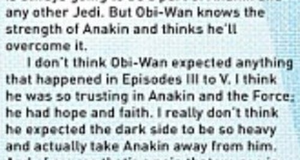

# Owner Material 038 — Star Wars Insider #1–153 plus specials (with The Lucasfilm Fan Club Magazine #1–22): Star Wars Insider #129 (2011)

- **Source:** *Star Wars Insider* magazine (issues 23–153, 1994–2014) and its predecessor *The Lucasfilm Fan Club Magazine* (issues 1–22, 1987–1994), plus seven special editions: articles, interviews, comics and short fiction Secondary source (licensed Legends reference). Scan OCR'd on the box; the scan stays box-only and is **not** published.
- **Method:** every scanned page was OCR'd and machine-screened sentence by sentence for power-relevant statements (fights, kills, defeats, Force feats, rankings, superweapons) that name a character on our roster; each kept sentence is quoted verbatim from the OCR text and has a crop of the printed passage directly under it. Pages with nothing power-relevant are still listed with what is on them.
- **Citation:** "*Star Wars Insider #129* (2011), p.X" by printed page ("scan p.X" where no printed number applies). **Weight:** Licensed magazine: a secondary source. Its short fiction and comics are Legends stories; its articles and interviews sum up or discuss lore and rank below the novels, comics and games they describe.

## scan p.1 (scan page 1)

Page contents: Cover: James Arnold Taylor (Obi-Wan Kenobi); Sea of Conflict (Mon Calamari vs. Quarren); Rogues and Scoundrels; fiction by Paul S. Kemp. (hand-read)

## scan p.2 (scan page 2)

Page contents: Ad: Titan magazines subscription (Supernatural). (hand-read)

## scan p.3 (scan page 3)

Page contents: Editorial (Jonathan Wilkins): Alec Guinness's diary on Star Wars ("Exciting, very noisy, and warm-hearted"); James Arnold Taylor and Cary Silver interviews; Kemp/Brian Rood fiction on the Junker's origin (first seen in Crosscurrent); staff credits. (hand-read)

## scan p.4 (scan page 4)

Page contents: Contents: Mon Calamari vs. Quarren, James Arnold Taylor, Denis Lawson, Cary Silver, Kemp fiction, Rogues' Gallery. (hand-read)

## scan p.5 (scan page 5)

Page contents: Contents: cover variants; departments (Crimson Empire III comic with Kir Kanos, Incoming, Bounty Hunters, Bantha Tracks). (hand-read)

## scan p.6 (scan page 6)

Page contents: Insider Preview: The Clone Wars season four, "Mercy Mission" (droids on Aleen; clone trooper Boost returns). (hand-read)

## scan p.7 (scan page 7)

Page contents: Insider Preview: "Nomad Droids" (Adi Gallia, Plo Koon) and "Darkness on Umbara" (Anakin gives up command of the 501st; Jedi Master Pong Krell); coming-soon titles. (hand-read)

## scan p.8 (scan page 8)

Page contents: Launchpad: Hasbro Fans' Choice poll; previous winner Bastila Shan (Vintage Wave 5); Derryl DePriest interview on poll history and the EU share of votes. (hand-read)

## scan p.9 (scan page 9)

Page contents: Launchpad: DePriest: Darth Revan one of the most sought-after Fans' Choice figures ("a great and important EU character"); 3-3/4" scale; few off-limits characters. (hand-read)

## scan p.10 (scan page 10)

Page contents: Launchpad: The Art of Drew Struzan (Titan Books) giveaway; DK's The Clone Wars Incredible Vehicles (Jason Fry, Richard Chasemore) giveaway. (hand-read)

## scan p.11 (scan page 11)

Page contents: Launchpad: readers' photos of LEGO Star Wars minifigures around the world (reader names omitted). (hand-read)

## scan p.12 (scan page 12)

Page contents: Launchpad: Star Wars Blu-ray launch (London BT Tower lit as a lightsaber; Anthony Daniels, Warwick Davis); deleted scenes include the Spielberg-supervised Utapau chase animatic and an alternate Shaak Ti death. (hand-read)

## scan p.13 (scan page 13)

Page contents: Ad: Brian's Toys. (hand-read)

## scan p.14 (scan page 14)

Page contents: Feature (Leland Y. Chee): Mon Calamari vs. Quarren, title spread on the season four opening arc. (hand-read)

## scan p.15 (scan page 15)

Page contents: Feature: Mon Calamari vs. Quarren, art page. (hand-read)

## scan p.16 (scan page 16)

Page contents: Feature: the Squid Head and Mon Calamari debut in ROTJ; Ackbar's pre-release appearances (Bantha Tracks #17, the Goodwin/Williamson strip, the Kenner mail-away); performed by Tim Rose and voiced by Erik Bauersfeld. (hand-read)

### Stat block notes (game mechanics, not feats)

- Mon Calamari cruisers vs. Star Destroyers: "Also significant to the Alliance cause was identifying the new, large ships of the Rebel fleet as Mon Calamari cruisers that were capable of going toe-to-toe with Imperial Star Destroyers." (Mon Calamari vs. Quarren, Star Wars Insider 129, p. 16) (Source: *Star Wars Insider #129* (2011), scan p.16)

## scan p.17 (scan page 17)

Page contents: Feature: Squid Head named Quarren in The Star Wars Sourcebook (1987); the Jabba's palace Quarren named Tessek in Galaxy Guide 5; Mon Calamari/Dac described as a water world with floating cities above and Quarren below. (hand-read)

## scan p.18 (scan page 18)

Page contents: Feature: the Imperial attack on Mon Calamari (the Quarren Seggor Tels lowers the planetary shields); liners converted into the warships that formed the Rebel fleet at Endor; TCW King Yos Kolina's assassination; Death in the Undercity RPG (the Calamari Project). (hand-read)

## scan p.19 (scan page 19)

Page contents: Feature: generations of Quarren vs. Mon Calamari war (the technologically superior Mon Calamari won each time, took over a million Quarren prisoners, and re-educated Quarren youth). (hand-read)

## scan p.20 (scan page 20)

Page contents: Feature: X-Wing Rogue Squadron's Nrin Vakil (Quarren) and Ibtisam (Mon Calamari); comic panel art. (hand-read)

## scan p.21 (scan page 21)

Page contents: Feature: the Clone Wars era: Bant Eerin; Commander Merai backs the Confederacy (Republic #50); Tartakovsky micro-series has Kit Fisto leading the Mon Calamari Knights on keeradaks while the Quarren Isolation League fields a prawn-shaped superweapon "powerful enough to destroy a Republic assault ship with a single blast"; "Fierce Currents" (Moappa). (hand-read)

## scan p.22 (scan page 22)

Page contents: My Star Wars: Dave Elsey (Revenge of the Sith creature shop creative supervisor) on first seeing Star Wars (interview: Jonathan Wilkins). (hand-read)

## scan p.23 (scan page 23)

Page contents: My Star Wars: Elsey made up Ian McDiarmid as the Emperor (Hammer horror, Christopher Lee visits); homemade lightsaber anecdote; first Kenner figures. (hand-read)

## scan p.24 (scan page 24)

Page contents: Interview (Jonathan Wilkins): James Arnold Taylor ("Taylor Made") on Obi-Wan's popularity (the prequels, Ewan McGregor); "The Citadel" (Filoni: Obi-Wan is the one who says they must keep moving forward); season four teaser. (hand-read)

## scan p.25 (scan page 25)

Page contents: Interview: Taylor on The Clone Wars' drama (Han in carbonite, Mortis, Christian Taylor's writing); pull-quote "Obi-Wan's strong when other characters don't know what to do." (hand-read)

## scan p.26 (scan page 26)

Page contents: Interview: photo captions (Obi-Wan "always primed for action, even against a surprise opponent"; Obi-Wan and Asajj Ventress's epic confrontations). (hand-read)

## scan p.27 (scan page 27)

Page contents: Interview: Taylor on recording (scripts arrive at the session; Filoni's briefings); the cut Padmé/Obi-Wan romance hint; sidebar "The Changing Face of Obi-Wan Kenobi" (Guinness, McGregor, Taylor, David Davies, Tim Omundson, Bernard Behrens). (hand-read)

## scan p.28 (scan page 28)

Page contents: Interview: pull-quote and photo of Taylor with Matt Lanter (Anakin). (hand-read)

## scan p.29 (scan page 29)

Page contents: Interview: Taylor on Obi-Wan and Padmé, Obi-Wan's humor, voicing Plo Koon, flirtation with Ventress (Nika Futterman; their first recorded scene was the film duel), Duchess Satine (Anna Graves); youthening his voice for Qui-Gon in "Mortis"; would like to voice Uncle Owen. (hand-read)

- **Obi-Wan Kenobi; Darth Vader (Anakin Skywalker)** — entry/section: Taylor on Obi-Wan's faith in Anakin: ""But Obi-Wan knows the strength of Anakin and thinks he'll overcome it. I don't think Obi-Wan expected anything that happened in Episodes III to V. I think he was so trusting in Anakin and the Force; he had hope and faith. I really don't think he expected the dark side to be so heavy and actually take Anakin away from him." —James Arnold Taylor, Star Wars Insider 129, p. 29" Source: *Star Wars Insider #129* (2011), scan p.29
  

## scan p.30 (scan page 30)

Page contents: Mon Mothma's Five Facts (one false; answer on p. 82): Zuckuss's "two minds" schizophrenia claim; Greedo speaks Quechua. (hand-read)

## scan p.31 (scan page 31)

Page contents: Five Facts: Boba Fett's costume originally designed for Alan Harris (Bossk); Dengar's head cloth inspired by Morris Bush's bandage; 4-LOM missing from Glut's ESB novelization. (hand-read)

## scan p.32 (scan page 32)

Page contents: Interview (Calum Waddell): Denis Lawson (Wedge Antilles) career intro; Wedge survives the Death Star run, flies at Hoth, and fires on the second Death Star in ROTJ; voiced Wedge in Rogue Leader. (hand-read)

## scan p.33 (scan page 33)

Page contents: Interview: photo of Lawson as Wedge in the cockpit (image only). (hand-read)

## scan p.34 (scan page 34)

Page contents: Interview: Wedge ranked eighth most popular character in Insider #38's reader poll; Lawson says the films didn't shape his career and he felt his role was small; filming ANH like "an enormous army"; his nephew Ewan McGregor cast as Obi-Wan. (hand-read)

## scan p.35 (scan page 35)

Page contents: Interview: Lawson on McGregor's career and Wedge's EU expansion (Thrawn trilogy, X-Wing: Rogue Squadron comics); sidebar "The Three Wedges" (Colin Higgins, Lawson, voice by David Ankrum); caption "Han and Wedge 2, Death Stars 0!" (hand-read)

## scan p.36 (scan page 36)

Page contents: Interview: photo of Cary Silver (image only). (hand-read)

## scan p.37 (scan page 37)

Page contents: Interview (Jonathan Wilkins): Cary Silver on why The Clone Wars season four "breaks new boundaries" (title spread). (hand-read)

## scan p.38 (scan page 38)

Page contents: Interview: Silver on keeping up the quality Lucas asks for, expensive ideas in the writers' room, and Lucas's underwater opening arc that made every existing asset unusable. (hand-read)

## scan p.39 (scan page 39)

Page contents: Interview: Silver on the new underwater construct, streamlining production, Joel Aron's lighting, new animation supervisor Keith Kellogg, and Lucas's storytelling sense. (hand-read)

## scan p.40 (scan page 40)

Page contents: Interview: Silver on Lucas "constantly imploding the mold"; Walter Murch directing a pivotal season four episode; partnering with directors. (hand-read)

## scan p.41 (scan page 41)

Page contents: Interview: Silver on producers' role, fan reaction at Celebration V (The Clone Wars as "the torch-bearer"), a possible second movie, and favorite episodes ("Nightsisters", "Mortis", "R2 Come Home", "Wookiee Hunt"). (hand-read)

## scan p.42 (scan page 42)

Page contents: Fiction: "Fair Trade" art by Brian Rood, Khedryn Faal and Marr Hales in Seeker's cockpit (image only). (hand-read)

## scan p.43 (scan page 43)

Page contents: Fiction (Paul S. Kemp, "Fair Trade"): hungover Khedryn Faal and the Cerean Marr Hales take Seeker from Fhost into the Unknown Regions to tow a derelict salvage. (hand-read)

## scan p.44 (scan page 44)

Page contents: Fiction: Reegas's YT-2400 Blackstar disables Seeker and orders them to leave; Khedryn plans a counter-move. (hand-read)

## scan p.45 (scan page 45)

Page contents: Fiction: Marr wrecks Seeker's engines and tunes the deflectors against life scans; they suit up and launch an empty escape pod as a decoy; Reegas boards with his men. (hand-read)

## scan p.46 (scan page 46)

Page contents: Fiction: Blackstar atomizes the pod; Khedryn and Marr use hardsuit anti-grav jets to cross to Blackstar while Reegas blows Seeker's hatch. (hand-read)

### Stat block notes (game mechanics, not feats)

- Marr cracks the airlock code under fire: "Marr's intense stare drank in the cracker's failed formulae. He stopped the device's routine, pushed a few buttons, and started it down a different path. "Got something?" Khedryn asked. "Nothing certain. It ran the hexidecimals and got nothing, so it's something else. I tweaked it to run a base eleven run, then a twelve, and so on. The problem is the spaces."" (Fair Trade, Star Wars Insider 129, p. 46) (Source: *Star Wars Insider #129* (2011), scan p.46)

## scan p.47 (scan page 47)

Page contents: Fiction: Khedryn kills Verra in the airlock and Marr's suit is grazed; they strand Reegas and rename Blackstar the Junker (origin of the Junker from Crosscurrent); Riptide plug. (hand-read)

### Stat block notes (game mechanics, not feats)

- Khedryn takes Blackstar and destroys Reegas's shuttle: ""Shoot it, Marr." Blackstar's cannons lit up space and turned the shuttle to debris." (Fair Trade, Star Wars Insider 129, p. 47) (Source: *Star Wars Insider #129* (2011), scan p.47)

## scan p.48 (scan page 48)

Page contents: Rogues' Gallery opener: Peter Cushing as Tarkin; Wayne Pygram's ROTS Tarkin makeup tests (courtesy of Dave Elsey). (hand-read)

## scan p.49 (scan page 49)

Page contents: Ad page. (hand-read)

## scan p.50 (scan page 50)

Page contents: Rogues' Gallery: Han Solo opener ("known to shoot first and ask questions later"). (hand-read)

## scan p.51 (scan page 51)

Page contents: Rogues' Gallery: title spread on the rogues and scoundrels "who live on the murky edge between." (hand-read)

## scan p.52 (scan page 52)

Page contents: Rogues' Gallery: fringers as the gray between good and evil (Han, Cad Bane, Vilmarh Grahrk, Jabba, Bib Fortuna); D&D alignment comparison. (hand-read)

## scan p.53 (scan page 53)

Page contents: Rogues' Gallery: Principle #1 "Keep your head down" (Watto; Lando protecting Cloud City's five million people); Principle #2 "You can't have it all" (fringers as the street-smartest people in the saga). (hand-read)

## scan p.54 (scan page 54)

Page contents: Rogues' Gallery: smugglers (Brian Daley's Han Solo novels, Big Bunji, Ploovo Two-For-One); Principle #3 money; Principle #4 "Somebody's got to do it!"; captions (HK-47; Chewbacca, Cad Bane, Embo, Sugi). (hand-read)

### Stat block notes (game mechanics, not feats)

- Watto shrugs off a Jedi mind trick: "...and why we smile when Watto puts the kibosh on a Jedi Master's mind-whammy with the ultimatum, "No money, no parts, no deal."" (Rogues' Gallery, Star Wars Insider 129, p. 54) (Source: *Star Wars Insider #129* (2011), scan p.54)

## scan p.55 (scan page 55)

Page contents: Rogues' Gallery: Tatooine as the fringe capital (Jabba, Gardulla, Jawas); bounty hunters as "just business" (Boba Fett works for whoever pays); Principle #5 "Fringers make everything better" (Marn Hierogryph, Vilmarh Grahrk, HK-47, TOR smuggler and bounty hunter classes). (hand-read)

## scan p.56 (scan page 56)

Page contents: Classic Moment: ROTJ DVD chapter 12, the Sarlacc pit; trivia on Leia's metal and rubber bikinis (stunt double Tracy Eddon); start of the script. (hand-read)

### Stat block notes (game mechanics, not feats)

- Classic Moment: Luke at the Sarlacc pit: "When Luke catches the lightsaber that R2 ejects, ignites it and begins taking down Jabba's henchmen, all with John Williams' soundtrack triumphantly swelling in the background, it's clear that far from suffering from the "delusions of grandeur" Han thought he was, Luke is now truly becoming the Jedi Knight he was destined to be." (Classic Moment, Star Wars Insider 129, p. 56) (Source: *Star Wars Insider #129* (2011), scan p.56)

## scan p.57 (scan page 57)

Page contents: Classic Moment: script continues (Han's defiance; Luke springs off the plank with a flip and catches his lightsaber from Artoo); Ben Burtt on the ruler-twang sound effect; EU note that Bib Fortuna and the Max Rebo Band escaped the Khetanna; next time "Hello, There." (hand-read)

## scan p.58 (scan page 58)

Page contents: Ad: Star Wars: The Clone Wars comic magazine subscription. (hand-read)

## scan p.59 (scan page 59)

Page contents: Star Wars Art section contents (edited by Neil Edwards): books, comics, Incoming, Bounty Hunters, Bantha Tracks. (hand-read)

## scan p.60 (scan page 60)

Page contents: Books: Star Wars: The Blueprints (Epic Ink; J.W. Rinzler) on UK production art department blueprints. (hand-read)

## scan p.61 (scan page 61)

Page contents: Books: The Blueprints continued (Norman Reynolds, Gavin Bocquet, Peter Russell, Roger Christian; John Barry designed nearly two-thirds of the ANH sets; 5,000 numbered copies). (hand-read)

## scan p.62 (scan page 62)

Page contents: Books: Industrial Light & Magic: The Art of Innovation (Pamela Glintenkamp; Greg Grusby). (hand-read)

## scan p.63 (scan page 63)

Page contents: Books: ILM book continued (prequel HD cameras, CG characters Jar Jar, Watto, Yoda, Grievous). Ask Lobot (as related to Leland Y. Chee) on what happened to the pirates who found Ventress in "Nightsisters" (reader name omitted). (hand-read)

### Stat block notes (game mechanics, not feats)

- Ask Lobot: Ventress mass Force choke: "This seething hatred of pirates amplified Asajj's power in the dark side of the Force enabling her to force-choke Ratch's men, killing them all in an instant, simultaneously. Perhaps Asajj had indeed become too powerful, as Darth Sidious feared." (Ask Lobot, Star Wars Insider 129, p. 63) (Source: *Star Wars Insider #129* (2011), scan p.63)

## scan p.64 (scan page 64)

Page contents: Books: Star Wars Art: Comics (J.W. Rinzler, Abrams; Lucas picked every piece; Williamson, Chaykin, Hughes, Dorman and others). (hand-read)

## scan p.65 (scan page 65)

Page contents: Books: Star Wars Art: Comics continued (new works by Cassaday, Mignola, Steranko and others; the second of a five-volume series after Visions). (hand-read)

## scan p.66 (scan page 66)

Page contents: Comics (Daniel Wallace): Crimson Empire III, Kir Kanos's revenge; Randy Stradley on its origins (Nom Anor in Crimson Empire II led to the Yuuzhan Vong and NJO; the abandoned plan became the Invasion series); Dave Dorman art. (hand-read)

## scan p.67 (scan page 67)

Page contents: Comics: Crimson Empire III is set 13 years after ROTJ (Admiral Pellaeon's Empire; Mirith Sinn as Leia's head of security; Kanos targeting Leia and Luke); Stradley on Kanos and Sinn; Paul Gulacy art. Ask Lobot (as related to Leland Y. Chee), on whether Maul's return was always planned (reader handle omitted): any plan to resurrect Darth Maul was known only to Lucas; the Tales/Visionaries appearances were never confirmed as the real Maul; bringing back the real Maul was considered for The Force Unleashed and abandoned; Lucas chooses what EU material TCW uses. (hand-read)

## scan p.68 (scan page 68)

Page contents: Incoming (Chris Spitale): Disney Star Wars Muppets two-packs; Star Tours Starspeeder 1000 playset. (hand-read)

## scan p.69 (scan page 69)

Page contents: Incoming: Disney Series 5 figures (Goofy as Cad Bane, etc.); Cartamundi 3-D playing cards; Hallmark NYCC astromech two-pack (R2-Q5, R2-A3). (hand-read)

## scan p.70 (scan page 70)

Page contents: Incoming: Attakus Commander Thire and Commander Bly (Order 66 on Felucia) statues; Hasbro Death Star Trench Run set. (hand-read)

## scan p.71 (scan page 71)

Page contents: Incoming: Clone Wars Ultimate Gift Set; Prototype Armor Boba Fett mail-away; Revenge of the Jedi vintage-style carded figures (incl. Bastila Shan, Keyan Farlander); Transformers Darth Vader to Star Destroyer. (hand-read)

## scan p.72 (scan page 72)

Page contents: Bounty Hunters: readers meeting Jeremy Bulloch, Julian Glover, Michael Kingma, Peter Mayhew, Ashley Eckstein (reader names omitted). (hand-read)

## scan p.73 (scan page 73)

Page contents: Bounty Hunters: readers meeting Billy Dee Williams, Matthew Wood, Ben Burtt, Mark Hamill, Dermot Crowley, Daniel Logan (reader and non-staff names omitted). (hand-read)

## scan p.74 (scan page 74)

Page contents: Bantha Tracks: Spirit of Fandom theme; a youth Star Wars: Musical Edition stage production in Costa Mesa (fan and performer names omitted). (hand-read)

## scan p.75 (scan page 75)

Page contents: Bantha Tracks: Star Wars Weekends photos; 501st/Rebel Legion Food Network ice-sculpture event; a library Star Wars Day; Steve Sansweet marching in Imperial uniform at the reopening of Star Tours: The Adventures Continue (fan names omitted). (hand-read)

## scan p.76 (scan page 76)

Page contents: Bantha Tracks: Jedi costumers in the Kobe parade; a fan's Hoth AT-AT diorama; DK's "Attack of the Authors" tour with Ryder Windham; submission guidelines (fan names omitted). (hand-read)

## scan p.77 (scan page 77)

Page contents: Bantha Tracks: the Singapore Garrison in the Chingay Parade; a Swedish exhibition with Anthony Daniels; editorial by Mary Franklin, "Spirit of Fandom—Spirit of Wonder" (fan names omitted). (hand-read)

## scan p.78 (scan page 78)

Page contents: Red Five: Mark Hamill's favorite comics: Superman (George Reeves); The Flash (he voiced the Trickster on Justice League). (hand-read)

## scan p.79 (scan page 79)

Page contents: Red Five: Hamill on Batman: The Animated Series (Ferris Boyle, then the Joker, "the high water-mark of my voice-over career") and his Dark Horse comic The Black Pearl. (hand-read)

## scan p.80 (scan page 80)

Page contents: Titan subscriptions ad. (hand-read)

## scan p.81 (scan page 81)

Page contents: Titan subscriptions ad (Supernatural, Star Trek, Clint). (hand-read)

## scan p.82 (scan page 82)

Page contents: Next issue: Dee Bradley Baker (Captain Rex); an exclusive Darth Plagueis tale by Matthew Stover; Saga of the Skywalkers. (hand-read)

## scan p.83 (scan page 83)

Page contents: Ad: Star Wars: The Blueprints (Forbidden Planet). (hand-read)

## scan p.84 (scan page 84)

Page contents: Ad: Empire Strikes Back 148-page collector's edition (back cover). (hand-read)

