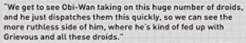
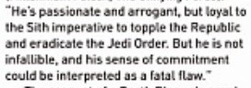
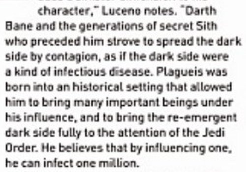

# Owner Material 038 — Star Wars Insider #1–153 plus specials (with The Lucasfilm Fan Club Magazine #1–22): Star Wars Insider #130 (2012)

- **Source:** *Star Wars Insider* magazine (issues 23–153, 1994–2014) and its predecessor *The Lucasfilm Fan Club Magazine* (issues 1–22, 1987–1994), plus seven special editions: articles, interviews, comics and short fiction Secondary source (licensed Legends reference). Scan OCR'd on the box; the scan stays box-only and is **not** published.
- **Method:** every scanned page was OCR'd and machine-screened sentence by sentence for power-relevant statements (fights, kills, defeats, Force feats, rankings, superweapons) that name a character on our roster; each kept sentence is quoted verbatim from the OCR text and has a crop of the printed passage directly under it. Pages with nothing power-relevant are still listed with what is on them.
- **Citation:** "*Star Wars Insider #130* (2012), p.X" by printed page ("scan p.X" where no printed number applies). **Weight:** Licensed magazine: a secondary source. Its short fiction and comics are Legends stories; its articles and interviews sum up or discuss lore and rank below the novels, comics and games they describe.

## scan p.1 (scan page 1)

Page contents: Cover (Jan 2012): Dee Bradley Baker, voice of the clones; tales from the dark side, the story of Darth Plagueis; why the Force isn't always with you; powerful friends; the characters of The Old Republic; what not to miss in 2012. (hand-read)

## scan p.2 (scan page 2)

Page contents: Ad: Empire Strikes Back 148-page collector's edition. (hand-read)

## scan p.3 (scan page 3)

Page contents: Editor's Welcome (Jonathan Wilkins): Yoda didn't foresee Order 66; TCW shows the clones as individuals; Dee Bradley Baker interview; "Darkness on Umbara" as his favorite episode; masthead. (hand-read)

### Stat block notes (game mechanics, not feats)

- Editorial epigraph: Yoda on the clones: ""A weapon they are. Obey orders without question for good or ill. For now they fight for us. Who is to say what the future holds?"—Yoda on the clones, "Honor Bound", Star Wars Tales 22" (Editor's Welcome, Star Wars Insider 130, p. 3) (Source: *Star Wars Insider #130* (2012), scan p.3)

## scan p.4 (scan page 4)

Page contents: Contents: Dee Bradley Baker; new Sith fiction ahead of the Darth Plagueis novel; Blu-ray and Visions art; the Force; LEGO Miniland; Keith Kellogg; 2012 preview; the 501st. (hand-read)

## scan p.5 (scan page 5)

Page contents: Contents continued: Launchpad, My Star Wars, Five Facts, Classic Moment (Obi-Wan vs. Grievous), Books (Darth Plagueis), Comics (Jahan Cross), Incoming, Rogues' Gallery (Mos Eisley aliens); covers. (hand-read)

## scan p.6 (scan page 6)

Page contents: Launchpad: TCW Season Four "Escape from Kadavo" (Anakin, Ahsoka, Obi-Wan free slaves; Dooku; Sidious cameo) and "A Friend in Need" (Lux Bonteri renounces Dooku; Death Watch returns); forthcoming episode titles. (hand-read)

## scan p.7 (scan page 7)

Page contents: Launchpad: a rock musician recalls Ewan McGregor celebrating his Obi-Wan casting with a toy-lightsaber duel at his house (musician's name omitted as a non-staff person in a news item). (hand-read)

## scan p.8 (scan page 8)

Page contents: Launchpad: giveaways (The Jedi Path, Ultimate FX lightsabers, LEGO Star Wars Character Encyclopedia with medal Han minifigure); Hasbro fan poll closed, winner to be announced at Toy Fair. (hand-read)

## scan p.9 (scan page 9)

Page contents: 2011 Year in Review, Jan.–Apr.: Blu-ray date announced; Pernilla August's directing award; Darth Vader and the Lost Command comic; Volkswagen "Darth Vader kid" ad; Mortis trilogy airs; Christopher Lee's BAFTA Fellowship; Tom Kane voices the Oscars; TPM 3D date; Steve Sansweet steps down to Fan Relations Advisor; April Fools' jokes; Chewbacca's TCW debut (personal health item and a non-staff awards item omitted). (hand-read)

## scan p.10 (scan page 10)

Page contents: Year in Review, May–July: Star Tours relaunch; Daniel Wallace on Talk Like Yoda Day; Lucas has 50 hours of scripts for the live-action TV series; early Lucas autograph found; Red Tails date; Star Wars Kinect demo; Yoda voted best movie puppet; Star Wars: Detours title; eBook relaunch; Sue Rostoni retires (private and medical family items omitted). (hand-read)

## scan p.11 (scan page 11)

Page contents: Year in Review, July–Sept.: Blu-ray Early Access app; Joe Johnston wants to make a Boba Fett movie; Celebration VI in Orlando; LEGO The Padawan Menace; Niue legal-tender coins; TPM 3D conversion finished; Heir to the Empire 20th Anniversary Edition; Blu-ray sales records (Kayleen Walters quote); BT Tower lightsaber; TOR release date. (hand-read)

## scan p.12 (scan page 12)

Page contents: Year in Review, Oct.–Dec.: fan film Hughes the Force; Lucas's tribute to a late tech executive (non-staff name omitted); Vader wins the Scream Awards' Ultimate Villain; Seth Green's animated comedy confirmed by Howard Roffman; ILM: The Art of Innovation; the Umbara arc with Pong Krell; TOR released. (hand-read)

## scan p.13 (scan page 13)

Page contents: Ad: Brian's Toys. (hand-read)

## scan p.14 (scan page 14)

Page contents: Dee Bradley Baker feature opener "Super Trooper" (Captain Rex art; no other text). (hand-read)

## scan p.15 (scan page 15)

Page contents: Interview (Dee Bradley Baker): the Umbara arc and director Walter Murch; his first reaction to the scripts (a Jedi general whose methods aren't what the clones are used to). (hand-read)

## scan p.16 (scan page 16)

Page contents: Interview (Baker): Umbara was hard to play because of the clones' despicable general; Rex "pretty much lose[s] it"; clones in conflict with their general; like a war film; the story leads to Episode III. (hand-read)

## scan p.17 (scan page 17)

Page contents: Interview (Baker): "Rookies" as the first experiment giving the clones distinct personalities; pull-quote "These guys are intelligent, flexible, and have a sense of humor." (hand-read)

## scan p.18 (scan page 18)

Page contents: Interview (Baker): the clones' humanity makes ROTS more tragic; he wants to know what happens to Rex, Ventress and Ahsoka; the finale hasn't been decided; the writing separates the clone characters. (hand-read)

## scan p.19 (scan page 19)

Page contents: Interview (Baker): Dave Filoni's direction; his notes for each clone's status and obedience; more stories like Umbara are coming. (hand-read)

## scan p.20 (scan page 20)

Page contents: My Star Wars: Catherine Taber (Padmé in TCW) opener; her favorite film is Empire, because of Yoda (interview by James Burns and Mark Newbold). (hand-read)

## scan p.21 (scan page 21)

Page contents: My Star Wars (Taber): became a fan and collector; Hasbro Millennium Falcon toy; James Arnold Taylor introducing her to schoolchildren as Padmé; Yoda's lessons; she voiced Mission Vao in KOTOR. (hand-read)

## scan p.22 (scan page 22)

Page contents: Fiction opener art (Brian Rood): split portrait of Darth Tenebrous and Darth Plagueis. (hand-read)

## scan p.23 (scan page 23)

Page contents: Fiction (Matthew Stover; art by Brian Rood), Darth Plagueis prequel tale: the dying Darth Tenebrous, a Bith, enjoys his death at the hands of his Muun apprentice Plagueis and feels his midi-chlorians wink out. (hand-read)

### Stat block notes (game mechanics, not feats)

- Tenebrous: Force shielding from death agony: "It hardly mattered. Shielded from suffering by his command of the Force, Tenebrous observed the death agony of his physical form with appropriately Bithan dispassion." (Fiction, Star Wars Insider 130, p. 23) (Source: *Star Wars Insider #130* (2012), scan p.23)

## scan p.24 (scan page 24)

Page contents: Fiction (Stover): Plagueis's weakness is fear of death, which Tenebrous cultivated to steer his midi-chlorian aptitude toward mastery of life and death; Tenebrous's Bith intellect; his calculations foretell the end of the Rule of Two, the great shadow, and the "One Sith." (hand-read)

### Stat block notes (game mechanics, not feats)

- Tenebrous: the dark side as an energy source: "Soon he had confirmed to his own satisfaction that the dark side of the Force, far from being some malevolent mystic sentience bent on spreading suffering throughout the Galaxy, was in truth merely an energy source, and a tool with which he could impose his will upon reality. It was a sort of natural amplifier he could use to multiply the effectiveness of his many useful abilities." (Fiction, Star Wars Insider 130, p. 24) (Source: *Star Wars Insider #130* (2012), scan p.24)
- Tenebrous calculates the future: "The future was always in motion, and while other Sith struggled to foresee the faintest, least specific hints of what was to come, Tenebrous had no need to see the future. He could calculate it." (Fiction, Star Wars Insider 130, p. 24) (Source: *Star Wars Insider #130* (2012), scan p.24)
- Tenebrous's prophecy of the One Sith: "The conclusion was so obvious as to require no confirmation; one single Sith Lord would arise of such power that he'd have no need of any apprentice nor fear of the Jedi. He would take and hold the galaxy by his own hand alone. Without an apprentice—or a Jedi Order—to destroy him, the One Sith would rule forever!" (Fiction, Star Wars Insider 130, p. 24) (Source: *Star Wars Insider #130* (2012), scan p.24)
- Plagueis's unparalleled midi-chlorian aptitude: "Thus had Tenebrous skillfully re-directed his apprentice's unparalleled aptitude for midi-chlorian manipulation away from the deepening of insight, from the intuition of the future, and from the amassing of personal and political power—away from any and all pursuits that might have proven inconvenient for Tenebrous' ultimate plan—toward a single goal." (Fiction, Star Wars Insider 130, p. 24) (Source: *Star Wars Insider #130* (2012), scan p.24)

## scan p.25 (scan page 25)

Page contents: Fiction art (Brian Rood): a lightsaber-wielding Sith fighting a winged creature (no text). (hand-read)

## scan p.26 (scan page 26)

Page contents: Fiction (Stover): the legend in the Journal of the Whills of a savior "born of pure Force"; Tenebrous killed his own Master and chose Plagueis for his midi-chlorian skills and weaknesses; the "maxi-chlorians" that would migrate into Plagueis; "Tenebrous created a retrovirus that could infect midi-chlorians." (hand-read)

### Stat block notes (game mechanics, not feats)

- Tenebrous's Chosen One plan: "With proper execution, the "savior" might have a midi-chlorian count as high as fifteen thousand! Perhaps even more. It might be possible to create a being with the greatest Force potential ever recorded! ... With this single stroke, decades after his body's death, he would become the most powerful Force-user in the history of the galaxy." (Fiction, Star Wars Insider 130, p. 26) (Source: *Star Wars Insider #130* (2012), scan p.26)
- Tenebrous ranked above Plagueis's other victims: "Tenebrous was by far the most powerful Force-user whose death Plagueis had the opportunity to observe" (Fiction, Star Wars Insider 130, p. 26) (Source: *Star Wars Insider #130* (2012), scan p.26)

## scan p.27 (scan page 27)

Page contents: Fiction art (Brian Rood): Tenebrous in armor with a red lightsaber and Force lightning (no text). (hand-read)

## scan p.28 (scan page 28)

Page contents: Fiction (Stover): the maxi-chlorian retrovirus encoded with Tenebrous's consciousness, at the cost of his foresight; he enters Plagueis's body and senses that his apprentice's Force connection is far deeper and more powerful than he suspected; he foresees Plagueis's death at his own apprentice's hands, a "shadow." (hand-read)

### Stat block notes (game mechanics, not feats)

- Plagueis's Force connection exceeds Tenebrous's estimate: "As he continued to explore, Tenebrous gradually became aware of the full range of his apprentice's connection to the Force, which was considerably deeper, broader, and more powerful than Tenebrous had ever suspected. He reflected, with a twinge of uncomfortable premonition, that perhaps Plagueis had been right when he contended that Tenebrous had always underestimated him." (Fiction, Star Wars Insider 130, p. 28) (Source: *Star Wars Insider #130* (2012), scan p.28)

## scan p.29 (scan page 29)

Page contents: Fiction (Stover): Tenebrous yanks his maxi-chlorians out of Plagueis and is left trapped in an endless loop reliving his death beside his own mummified remains; ads for the Darth Plagueis novel by James Luceno (Dec. 27, 2011). (hand-read)

## scan p.30 (scan page 30)

Page contents: Five Facts (Mon Mothma): Lucas directed a 1991 pop music video (the artist's name is omitted as a non-staff person); Han's "I happen to like to shoot first" (Brian Daley, Han Solo at Star's End) vs. Fett in Karen Traviss's Bloodlines; Ewoks named after the Miwok. (hand-read)

## scan p.31 (scan page 31)

Page contents: Five Facts: the infant who played baby Luke and Leia in ROTS was a crew member's child (name omitted); Carrie Fisher appeared in a rock music video (musician's name omitted); answer on p. 98. (hand-read)

## scan p.32 (scan page 32)

Page contents: Art feature opener: Star Wars Art: Visions artists Roy Grinnell, Krystii Melaine and Ann Hanson, whose art also graced the Blu-ray booklet. (hand-read)

## scan p.33 (scan page 33)

Page contents: Art (Roy Grinnell), "Wait...the Droid Just Wants to Say Hello": a lonely giant droid meeting R2 and C-3PO; his Fighter Aces work; the Visions Limited Edition combat painting of Anakin in an N-1. (hand-read)

## scan p.34 (scan page 34)

Page contents: Art (Krystii Melaine), "Fur Balls": Han Solo with Ewoks (Lucas bought the painting); she showed the Ewoks defiant, honoring their role in destroying the second Death Star. (hand-read)

## scan p.35 (scan page 35)

Page contents: Art (Melaine) continued: plans for more Star Wars portraits; preliminary sketch. (hand-read)

## scan p.36 (scan page 36)

Page contents: Art: a preliminary sketch (caption only). (hand-read)

## scan p.37 (scan page 37)

Page contents: Art (Ann Hanson), "On the Hunt": Boba Fett riding Boga as a Western bounty hunter; an early idea had Fett on an exotic horse-like creature. (hand-read)

## scan p.38 (scan page 38)

Page contents: Feature opener art: portrait of Leia and Luke with Vader looming behind them (no text). (hand-read)

## scan p.39 (scan page 39)

Page contents: Feature (Jason Fry), "A Certain Point of View: Family Tradition": was Anakin's fall provoked by the Jedi's aversion to emotion? The Jedi's traditions lead to their ruin, and Luke saves the galaxy by rejecting them; Anakin's Council test in TPM ("Cold, sir"; Yoda on fear leading to anger, hate and suffering). (hand-read)

## scan p.40 (scan page 40)

Page contents: Feature (Fry): Obi-Wan can't understand Anakin's bond with his mother; Qui-Gon left Shmi in slavery; the AOTC teaser poster ("A Jedi shall not know anger. Nor hatred. Nor love."); Shmi captured by Tuskens and her torment reaching Anakin in dreams. (hand-read)

## scan p.41 (scan page 41)

Page contents: Feature (Fry): Anakin slaughters the Tuskens (Yoda and Mace sense his pain; Qui-Gon's voice); Yoda's advice to let go; the Council refuses him the rank of Master; Palpatine's tale of Plagueis; Anakin betrays Mace and becomes Vader. (hand-read)

### Stat block notes (game mechanics, not feats)

- Anakin's premonitions as predictions: "but we have to remember Anakin's abilities with the Force: As Qui-Gon notes in Episode I, Anakin can see things before they happen. For Anakin, premonitions are predictions, and painfully accurate ones." (A Certain Point of View, Star Wars Insider 130, p. 41) (Source: *Star Wars Insider #130* (2012), scan p.41)

## scan p.42 (scan page 42)

Page contents: Feature (Fry): Luke succeeds by rejecting Yoda's and Obi-Wan's teachings and embracing love and family. EU box: Obi-Wan and Duchess Satine in TCW; Jude Watson's Qui-Gon/Tahl and Obi-Wan/Siri Tachi; Karen Traviss's rogue Jedi Djinn Altis; Stover's ROTS novelization on the Masters-only lore Anakin hoped would save Padmé. (hand-read)

## scan p.43 (scan page 43)

Page contents: Feature (Fry) conclusion: in ROTJ Luke reaches the man behind the mask, refuses to kill Anakin, and Vader sacrifices himself to hurl the Emperor down the reactor shaft, bringing balance; author bio (personal details omitted). (hand-read)

### Stat block notes (game mechanics, not feats)

- Dark Empire: the twins rebound Sidious's Force storm: "In Dark Empire, Luke is saved by his sister's love, rather than by his father's: Leia joins her Jedi powers with Luke's, and Sidious' destructive Force storm washes over the Skywalker twins, rebounding on its creator and destroying him." (A Certain Point of View, Star Wars Insider 130, p. 43) (Source: *Star Wars Insider #130* (2012), scan p.43)

## scan p.44 (scan page 44)

Page contents: LEGO Miniland feature opener: Ryan Ziegelbauer, one of the creators of the Star Wars Miniland at LEGOLAND California (interview and photos by Tony A. Rowe). (hand-read)

## scan p.45 (scan page 45)

Page contents: LEGO Miniland interview (Ryan Ziegelbauer): the LEGOLAND California Star Wars Miniland, one iconic scene per movie including TCW, over 1.5 million bricks; concept drawings from 2004; research from the films and DK Visual Dictionaries. (hand-read)

## scan p.46 (scan page 46)

Page contents: LEGO Miniland interview: details like Han being kicked out of the Imperial Academy; unglued prototypes; a Lucasfilm representative approves all models. (hand-read)

## scan p.47 (scan page 47)

Page contents: LEGO Miniland interview: moving the Millennium Falcon by forklift (built in Germany); Miniland scale is about 1:20. (hand-read)

## scan p.48 (scan page 48)

Page contents: LEGO Miniland interview: altered scale and forced perspective (Endor landing platform); animals knock models over at night; the master model builder competition. (hand-read)

## scan p.49 (scan page 49)

Page contents: LEGO Miniland photos: Naboo starfighter hangar; the droid army (captions only). (hand-read)

## scan p.50 (scan page 50)

Page contents: LEGO Miniland interview: advice for builders; building Endor scenes as a kid; Luke cutting a speeder bike in half; Minilands also in Billund and Germany; Kashyyyk beach battle photo. (hand-read)

## scan p.51 (scan page 51)

Page contents: LEGO Miniland photo: Showdown on Geonosis (caption only). (hand-read)

## scan p.52 (scan page 52)

Page contents: Rogues' Gallery (Leland Y. Chee), "The Unusual Suspects: Who's Who in Mos Eisley": Atheloe (Lutrillian, Lutrillia), Reegesk (Ranat, Aralia), Wioslea (Vuvrian, Vurdon Ka), Kal Fas, Sai'torr (Saurin, Durkteel). (hand-read)

## scan p.53 (scan page 53)

Page contents: Rogues' Gallery: Takeel and Zutton (Snivvian, Cadomai), Ownellco (Lutrillian), Thuku (Rodian), Kabe (Chadra-Fan, Chad), Mosep Binneed and Tawss Khaa (Nimbanel, Nimban). (hand-read)

## scan p.54 (scan page 54)

Page contents: Art: Jedi Master Pong Krell with two double-bladed lightsabers (caption only). (hand-read)

## scan p.55 (scan page 55)

Page contents: Interview (Keith Kellogg, TCW animation supervisor; by Jonathan Wilkins): reviewing 80–100 shots a day from three studios; rigging dailies; creating new characters is harder, e.g. Pong Krell, animated across two studios. (hand-read)

## scan p.56 (scan page 56)

Page contents: Interview (Kellogg): telling the Umbara clones apart through brows and lids; villains like Osi Sobeck can be pushed about 20 percent more; Ackbar in "Water War", young Tarkin; box on Chewbacca (Peter Mayhew helped shape his TCW performance). (hand-read)

## scan p.57 (scan page 57)

Page contents: Interview (Kellogg): Chewbacca box continued (less aggressive, more curious, bow-legged; first moving fur). (hand-read)

## scan p.58 (scan page 58)

Page contents: Interview (Kellogg): Duwayne Dunham's underwater arc (Thunderball as reference; Massive crowd software); Walter Murch on Umbara; filming ADR sessions. (hand-read)

## scan p.59 (scan page 59)

Page contents: Interview (Kellogg): "stylized realism"; distinct species walks; pushing TV animation toward feature quality with Joel Aron; box on how he got into animation (Centropolis). (hand-read)

## scan p.60 (scan page 60)

Page contents: Titan Magazines holiday subscription ad (Insider, TCW comic and magazine, Star Wars Galaxy). (hand-read)

## scan p.61 (scan page 61)

Page contents: Titan Magazines holiday subscription ad (other titles); ordering information. (hand-read)

## scan p.62 (scan page 62)

Page contents: Feature opener, "The Wookiee Is My Co-Pilot": TOR companion characters, interview with BioWare senior creative director James Ohlen by Tony A. Rowe (art of a Twi'lek gunslinger). (hand-read)

## scan p.63 (scan page 63)

Page contents: TOR companions (Ohlen): companions as a BioWare staple since Baldur's Gate; the Smuggler can get a Wookiee, the Sith Warrior a corrupted Jedi, the Trooper a powerful war droid; affection scores unlock quests and romances; Crew Skills crafting. (hand-read)

## scan p.64 (scan page 64)

Page contents: TOR companions (Ohlen): up to five companions, one active at a time; each class has five unique companions; customizing gear and appearance. (hand-read)

## scan p.65 (scan page 65)

Page contents: TOR companions (Ohlen): some companions can be guided to the light or dark side; the first companion arrives within the first four or five hours; companions can't be permanently lost; comparison with MMO pets. (hand-read)

## scan p.66 (scan page 66)

Page contents: TOR art: a red-masked Sith warrior with a lightsaber; pull quote "Our companion characters have to always be smart...". (hand-read)

## scan p.67 (scan page 67)

Page contents: TOR companions (Ohlen): party slots; real-time AI and pathfinding challenges; customizable companion AI; TOR available globally from December 20. (hand-read)

## scan p.68 (scan page 68)

Page contents: "Coming to a Galaxy Near You" (2012 preview, with comments from fan site hosts; names omitted): The Phantom Menace 3D in theaters February 10. (hand-read)

## scan p.69 (scan page 69)

Page contents: 2012 preview: the AOTC 10th anniversary (Yoda's fighting skills, Mace's purple lightsaber); 35 years of ANH; 30 years of Star Wars videogames; Celebration VI in Orlando, August 23–26 (commenters' names omitted). (hand-read)

## scan p.70 (scan page 70)

Page contents: Special Report opener (Jason Fry): a Star Wars author straps on stormtrooper armor at a baseball stadium. (hand-read)

## scan p.71 (scan page 71)

Page contents: Special Report photo: stormtroopers watching the game at Citi Field, September 13 (caption only). (hand-read)

## scan p.72 (scan page 72)

Page contents: Special Report (Fry): Lucasfilm joined Major League Baseball and eBay for Stand Up To Cancer around the September 16 Blu-ray release; 13 teams held Star Wars nights; Fry suits up with the 501st's Empire City Garrison (celebrity, player and costumer names omitted). (hand-read)

## scan p.73 (scan page 73)

Page contents: Special Report (Fry): Star Wars nights across the U.S.; what it's like inside stormtrooper armor (tiny field of vision, fogging lenses, sweating); tossing T-shirts on the field (player names omitted). (hand-read)

## scan p.74 (scan page 74)

Page contents: Classic Moment: ROTS DVD chapter 21, Obi-Wan confronts Grievous on Utapau; EU note that Grievous was the Kaleesh warlord Qymaen jai Sheelal, made a cyborg after his shuttle was bombed; script begins. (hand-read)

### Stat block notes (game mechanics, not feats)

- Obi-Wan in his prime on Utapau: "Obi-Wan's confidence in facing greater odds, and his ruthlessness in taking down the droids who attack him, show us the Jedi in his prime, as one of the greatest Jedi ever, and one who would help the Jedi return by setting Luke Skywalker on his path to greatness." (Classic Moment, Star Wars Insider 130, p. 74) (Source: *Star Wars Insider #130* (2012), scan p.74)

## scan p.75 (scan page 75)

Page contents: Classic Moment: Lucas on "Hello, there!" as a nod to Alec Guinness; trivia (Lucas recorded Grievous's cough while he had a bad cold); Grievous's four-armed lightsaber display; next issue: "We'll handle this." (hand-read)

- **Obi-Wan Kenobi; General Grievous** — entry/section: Obi-Wan dispatches the droids: ""We get to see Obi-Wan taking on this huge number of droids, and he just dispatches them this quickly, so we can see the more ruthless side of him, where he's kind of fed up with Grievous and all these droids." —Rob Coleman, ROTS DVD audio commentary, Star Wars Insider 130, p. 75" Source: *Star Wars Insider #130* (2012), scan p.75
  

### Stat block notes (game mechanics, not feats)

- Obi-Wan drops ceiling equipment on the bodyguards: "OBI-WAN uses the Force to release a piece of equipment from the ceiling. It drops on the BODYGUARDS, smashing them. OBI-WAN walks toward GRIEVOUS, slashing the last BODYGUARD to pieces." (Classic Moment script, Star Wars Insider 130, p. 75) (Source: *Star Wars Insider #130* (2012), scan p.75)
- Grievous trained by Dooku: "GENERAL GRIEVOUS: You fool. I have been trained in your Jedi arts by Count Dooku himself. Attack, Kenobi. ... OBI-WAN: You forget I trained the Jedi that defeated Count Dooku!" (Classic Moment script, Star Wars Insider 130, p. 75) (Source: *Star Wars Insider #130* (2012), scan p.75)

## scan p.76 (scan page 76)

Page contents: Advertisement: The Clone Wars comic magazine subscription. (hand-read)

## scan p.77 (scan page 77)

Page contents: Bantha Tracks section contents: Books (Darth Plagueis, The Jedi Path), Ask Lobot (the fate of Darth Bane, ARC trooper armor), Comics (Jahan Cross), Operation Bounty Hunters. (hand-read)

## scan p.78 (scan page 78)

Page contents: Books (Daniel Wallace), "Darth Plagueis": Luceno's first draft was a race for immortality between Plagueis and Qui-Gon (Qui-Gon succeeding by contacting the Whills), later dropped; Lucas supplied that Plagueis was a Muun; the novel's history spans decades. (hand-read)

- **Darth Plagueis** — entry/section: Luceno on Plagueis as a Sith: ""He's passionate and arrogant, but loyal to the Sith imperative to topple the Republic and eradicate the Jedi Order. But he is not infallible, and his sense of commitment could be interpreted as a fatal flaw." —James Luceno, Star Wars Insider 130, p. 78" Source: *Star Wars Insider #130* (2012), scan p.78
  
- **Darth Plagueis; Darth Bane** — entry/section: Plagueis infects one million: ""Darth Bane and the generations of secret Sith who preceded him strove to spread the dark side by contagion, as if the dark side were a kind of infectious disease. Plagueis was born into an historical setting that allowed him to bring many important beings under his influence, and to bring the re-emergent dark side fully to the attention of the Jedi Order. He believes that by influencing one, he can infect one million." —James Luceno, Star Wars Insider 130, p. 78" Source: *Star Wars Insider #130* (2012), scan p.78
  

## scan p.79 (scan page 79)

Page contents: Books: Phantom Menace 3D tie-ins (LEGO Anakin—Space Pilot, Darth Maul's Mission, the TPM Expanded Visual Dictionary); The Jedi Path trade edition (Chronicle's Emily Haynes). Ask Lobot: who wins over Zannah's body at the end of Dynasty of Evil? Chee defers to Drew Karpyshyn's website (asker's name omitted). (hand-read)

## scan p.80 (scan page 80)

Page contents: Comics (Daniel Wallace), Agent of the Empire: Jahan Cross, Bond-style Imperial agent (John Ostrander); assassin droid IN-GA 44, inspired by Maria from Metropolis; "Iron Eclipse", from December 14, set 3–4 years before ANH; Cross reports to Armand Isard; Han and Chewie appear; art by Stephane Roux. (hand-read)

## scan p.81 (scan page 81)

Page contents: Agent of the Empire cover art by Stephane Roux: Jahan Cross, IN-GA 44, Armand Isard, Han and Chewbacca (no text). (hand-read)

## scan p.82 (scan page 82)

Page contents: Comics: Star Wars Omnibus: At War With the Empire Volume 2 (December 14), collecting "General" Skywalker, In the Shadows of Their Fathers (Jabiim), The Ahakista Gambit (Wyl Tarson vs. Vader), Small Victories (Deena Shan), and Vector parts 7–8 (Luke vs. the Sith spirit Karness Muur). (hand-read)

## scan p.83 (scan page 83)

Page contents: Comic art (Rob Williams, Dustin Weaver, Wil Glass); Ask Lobot on ARC trooper armor in TCW Season Three: kama and pauldron with a Phase II helmet; Commander Neyo's helmet has an enhanced breath filter (asker anonymous). (hand-read)

## scan p.84 (scan page 84)

Page contents: Incoming (Chris Spitale) section opener: the latest Star Wars gear. (hand-read)

## scan p.85 (scan page 85)

Page contents: Incoming: Hasbro Star Wars Operation: R2-D2 Edition ($29.99). (hand-read)

## scan p.86 (scan page 86)

Page contents: Incoming: Hasbro Ultimate FX Lightsabers (Vader, Anakin, Luke ROTJ; $34.99); LEGO Anakin & Sebulba's Podracers ($89.99). (hand-read)

## scan p.87 (scan page 87)

Page contents: Incoming: LEGO Star Wars Advent Calendar with an exclusive Santa Yoda ($39.99). (hand-read)

## scan p.88 (scan page 88)

Page contents: Incoming: Sideshow Darth Maul with Mechanical Legs Premium Format figure from "Old Wounds" (Visionaries) ($334.99). (hand-read)

## scan p.89 (scan page 89)

Page contents: Incoming: Gentle Giant Holiday Vader mini-bust (dove; deluxe version holding C-3PO's head, from "Thank the Maker", Tales #4; $75); Watto with the chance cube Qui-Gon manipulated with the Force ($69.99, February 2012). (hand-read)

## scan p.90 (scan page 90)

Page contents: Bantha Tracks fan creations (names omitted): Star Wars garden ornaments, including a Yoda levitating pie pans. (hand-read)

## scan p.91 (scan page 91)

Page contents: Bantha Tracks fan creations (names omitted): Star Wars-themed wooden jewelry boxes; a Star Wars 40th birthday party; a life-size battle droid built from scrap wood. (hand-read)

## scan p.92 (scan page 92)

Page contents: Bantha Tracks: a 501st member's Celebration V "TK Project" helmet collage of over 1,000 Legion logo pieces, auctioned for Make-A-Wish (member's name omitted); submission guidelines (Mary Franklin). (hand-read)

## scan p.93 (scan page 93)

Page contents: Bantha Tracks fan creations (names omitted): a Popsicle-stick Star Destroyer; a vegetable carving of Anakin's Podracer from a Japanese fan after the Tohoku earthquake, "May the Force Be With Japan"; signed Mary Franklin. (hand-read)

## scan p.94 (scan page 94)

Page contents: Bounty Hunters (sponsored by Kotobukiya): a reader's photos with Star Wars actors at Star Wars Weekends and Celebration V (reader names omitted). (hand-read)

## scan p.95 (scan page 95)

Page contents: Bounty Hunters: readers' encounters with Bruce Spence, Jeremy Bulloch, Ray Park, Jay Laga'aia and Kenny Baker (reader names omitted); "Can You Go One Better?" call for submissions. (hand-read)

## scan p.96 (scan page 96)

Page contents: Red Five: Mark Kermode's movies that heralded Star Wars: 2001: A Space Odyssey (an inspiration for Star Wars) and Beneath the Planet of the Apes. (hand-read)

## scan p.97 (scan page 97)

Page contents: Red Five (Kermode): Silent Running (its drones possibly inspired R2-D2, and some of its crew went on to Lucasfilm), Solaris, Rollerball. (hand-read)

## scan p.98 (scan page 98)

Page contents: Next issue preview: Darth Maul returns; ILM's John Knoll on Episode I 3D; Han and Chewie in a new adventure; on sale January 31 (U.S.) and February 9 (U.K.); Five Facts answer: fact 5 was the fake (Carrie Fisher's music video cameo; musician's name omitted). (hand-read)

## scan p.99 (scan page 99)

Page contents: Advertisement: Star Trek Magazine. (hand-read)

## scan p.100 (scan page 100)

Page contents: Advertisement: Titan Books art books (Loomis, Chris Foss, Drew Struzan's Oeuvre). (hand-read)

