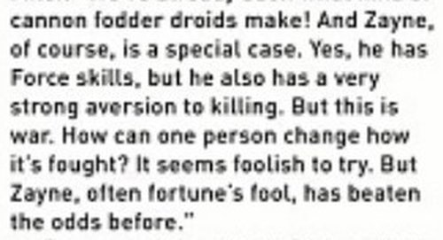
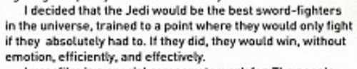

# Owner Material 038 — Star Wars Insider #1–153 plus specials (with The Lucasfilm Fan Club Magazine #1–22): Star Wars Insider #131 (2012)

- **Source:** *Star Wars Insider* magazine (issues 23–153, 1994–2014) and its predecessor *The Lucasfilm Fan Club Magazine* (issues 1–22, 1987–1994), plus seven special editions: articles, interviews, comics and short fiction Secondary source (licensed Legends reference). Scan OCR'd on the box; the scan stays box-only and is **not** published.
- **Method:** every scanned page was OCR'd and machine-screened sentence by sentence for power-relevant statements (fights, kills, defeats, Force feats, rankings, superweapons) that name a character on our roster; each kept sentence is quoted verbatim from the OCR text and has a crop of the printed passage directly under it. Pages with nothing power-relevant are still listed with what is on them.
- **Citation:** "*Star Wars Insider #131* (2012), p.X" by printed page ("scan p.X" where no printed number applies). **Weight:** Licensed magazine: a secondary source. Its short fiction and comics are Legends stories; its articles and interviews sum up or discuss lore and rank below the novels, comics and games they describe.

## scan p.1 (scan page 1)

Page contents: Cover: The Phantom Menace 3D edition; all-new fiction with Han and Chewie; legends in action. (hand-read)

## scan p.2 (scan page 2)

Page contents: Advertisement: Star Wars: The Blueprints by J. W. Rinzler (Forbidden Planet). (hand-read)

## scan p.3 (scan page 3)

Page contents: Editor's Welcome (Jonathan Wilkins), February/March 2012: TPM returns in 3D; John Knoll interview, unseen storyboards, Jar Jar's greatest moments; staff credits; epigraph quote from Qui-Gon (TPM). (hand-read)

## scan p.4 (scan page 4)

Page contents: Contents: Menace 3D, storyboards, Jar Jar, John Knoll, comic art, Han and Chewie fiction, icons, Alan Roderick-Jones on design. (hand-read)

## scan p.5 (scan page 5)

Page contents: Contents (departments): Launchpad, My Star Wars (Stephen Stanton), Rogues' Gallery (Boonta Eve spectators), Five Facts, Classic Moment (the Duel of the Fates), Books (The Book of Sith; Millennium Falcon manual), Comics (John Jackson Miller on Zayne Carrick), Incoming, Bantha Tracks, Bounty Hunters, Red Five (stunt coordinator Nick Gillard). (hand-read)

## scan p.6 (scan page 6)

Page contents: Advertisement: The Clone Wars comic magazine subscription. (hand-read)

## scan p.7 (scan page 7)

Page contents: Launchpad: TCW Season Four February episodes ("The Box": Obi-Wan in a deadly contest, with Embo returning; "Crisis on Naboo": Dooku's bounty hunters try to kidnap Palpatine; "Massacre": Dooku's revenge on Ventress and the Nightsisters; writer credit omitted); Star Wars Weekends 2012 dates; Ad Week names VW's "The Force" the best ad of 2011. (hand-read)

## scan p.8 (scan page 8)

Page contents: Launchpad: Lucasfilm companies received 12 Annie Award nominations (TCW, Dee Bradley Baker for the clones, Nika Futterman for Ventress, Star Tours, ILM); a charity clone-helmet auction raised $5,475 (beneficiary's details omitted), with thanks from Stephen Stanton. (hand-read)

## scan p.9 (scan page 9)

Page contents: Launchpad: a letter from a ROTJ actor on playing both a Quarren (Tessek) and a Mon Calamari officer (letter writer's name omitted); DK TPM Expanded Visual Dictionary giveaway; The Essential Reader's Companion by Pablo Hidalgo due summer 2012; correction: Leia is Padmé's daughter. (hand-read)

## scan p.10 (scan page 10)

Page contents: Special Report (Matt McAllister), "Diorama Dramas": Lucasfilm artist Stephen Hayford on customizing figures and making dioramas (personal and medical details omitted). (hand-read)

## scan p.11 (scan page 11)

Page contents: Hayford diorama art: an Empire Strikes Back poster recreated with figures (no text beyond the title). (hand-read)

## scan p.12 (scan page 12)

Page contents: Hayford interview: dioramas as storytelling; his photojournalism influences; a tribute to a Hasbro toy photographer (medical details omitted); upcoming Florida-themed work. (hand-read)

## scan p.13 (scan page 13)

Page contents: Brian's Toys advertisement. (hand-read)

## scan p.14 (scan page 14)

Page contents: "Things to Look Out For in Episode I 3D!": the lightsaber used to cut through a door; the Force run; the only non-CG Jar Jar shots; the only film where Obi-Wan has no beard. (hand-read)

### Stat block notes (game mechanics, not feats)

- The Jedi Force run in TPM: "The first and only time, oddly enough, that we see the Jedi use their "Force run" ability in a Star Wars movie!" (Things to Look Out For, Star Wars Insider 131, p. 14) (Source: *Star Wars Insider #131* (2012), scan p.14)
- Qui-Gon's lightsaber cuts through a door: "We're used to seeing lightsabers used in combat, but for the first time we see an alternative use for the lightsaber, as Qui Gon attempts to cut through a door!" (Things to Look Out For, Star Wars Insider 131, p. 14) (Source: *Star Wars Insider #131* (2012), scan p.14)

## scan p.15 (scan page 15)

Page contents: Things to look out for: one-film characters (Boss Nass, Kitster, Wald, Ric Olié, Panaka); Dominic West as a Naboo guard; the "ripple effect" viewscreen; Keira Knightley as Sabé and Sofia Coppola as Saché; Lindsay Duncan (TC-14) in Doctor Who. (hand-read)

## scan p.16 (scan page 16)

Page contents: Storyboards, "The Battle for Theed!": never-seen pre-production storyboards by Ed Natividad of a Jedi-led attack on Theed before the hangar, with Obi-Wan and Qui-Gon fighting droids (panels 1–7). (hand-read)

## scan p.17 (scan page 17)

Page contents: Theed storyboards panels 8–13: Qui-Gon and Obi-Wan deflect fire and charge through battle droid lines (no text). (hand-read)

## scan p.18 (scan page 18)

Page contents: Theed storyboards continued: droidekas and battle droids versus the two Jedi (no text). (hand-read)

## scan p.19 (scan page 19)

Page contents: Theed storyboards panels 23–25: lightsaber cuts through a droid STAP or tank (no text). (hand-read)

## scan p.20 (scan page 20)

Page contents: Theed storyboards continued (no text). (hand-read)

## scan p.21 (scan page 21)

Page contents: Theed storyboards panels 31–37: the Jedi Force-push the battle droids aside (no text). (hand-read)

## scan p.22 (scan page 22)

Page contents: Interview opener (J. W. Rinzler with ILM's John Knoll): Episode I returns to theaters in 3D. (hand-read)

## scan p.23 (scan page 23)

Page contents: Art: Naboo N-1 starfighters attacking the droid control ship (no text). (hand-read)

## scan p.24 (scan page 24)

Page contents: Knoll interview: 3D samples near the end of Episode III; Lucas wanted all the films converted, starting with Episode I; Knoll's quality concerns and test shots with Prime Focus; 3D fact box (Blackthorne's Star Wars 3D comics, 1987–88). (hand-read)

## scan p.25 (scan page 25)

Page contents: Knoll interview: five critique iterations; restoration from archive tapes (about 78 percent found), showing about eight percent more image; 3D fact box. (hand-read)

## scan p.26 (scan page 26)

Page contents: Knoll interview: the conversion process (a synthetic second eye, labor-intensive in-fill); long review sessions; Lucas reviewing the reels; quiet character moments make the best 3D. (hand-read)

## scan p.27 (scan page 27)

Page contents: Photo: battle droids on STAPs; 3D fact box (1950s 3D films). (hand-read)

## scan p.28 (scan page 28)

Page contents: Knoll interview: transparent objects (holograms, lightsaber glows) are hard to convert; the work took about 10 months; aiming for immersive, naturalistic 3D; Knoll bio (Photoshop co-creator; VFX supervisor on the special editions and prequels; Oscar for Dead Man's Chest; cameos as Rya Kirsch and Tannon Praji). (hand-read)

## scan p.29 (scan page 29)

Page contents: TPM 3D out February 10, 2012; Darth Maul photo caption. (hand-read)

## scan p.30 (scan page 30)

Page contents: My Star Wars: Stephen Stanton (TCW's Captain Tarkin; interview by Mark Newbold and James Burns): favorite films ANH, ESB, TPM; a newspaper review that mislabeled two stormtroopers as C-3PO and R2-D2. (hand-read)

## scan p.31 (scan page 31)

Page contents: My Star Wars (Stanton): favorite scene, Tarkin and Vader in the conference room; a TIE fighter toy from Dave Filoni at his first TCW session; Lost in Space fan; the 15-minute Super 8 digest of Star Wars. (hand-read)

## scan p.32 (scan page 32)

Page contents: Art (Paul Pope): Jawas carrying R2-D2 across the desert (no text). (hand-read)

## scan p.33 (scan page 33)

Page contents: "Drawing on the Force" (Jonathan Wilkins and Martin Eden), Star Wars Art: Comics: Paul Pope on Ralph McQuarrie, Joe Johnston and Nilo Rodis-Jamero as influences; J. W. Rinzler invited him; he drew Jawas in the desert and the probe droid on Hoth. (hand-read)

## scan p.34 (scan page 34)

Page contents: Pope interview: Lucas personally approved the strip; Moebius and Mézières; art captions (a Tusken on a bantha in the Jundland Wastes; Luke arriving at Jabba's palace); upcoming Battling Boy, THB, Psychenaut. (hand-read)

## scan p.35 (scan page 35)

Page contents: Pope art: Han and Chewie take out a probe droid (ESB); Pope bio (THB, Eisner Awards). (hand-read)

## scan p.36 (scan page 36)

Page contents: Frank Quitely interview: he saw ANH at about 30; Rinzler's invitation with a loose remit; a detailed, gory cantina-aftermath piece (Lucasfilm allowed "a tasteful amount of gore" in comics); bio (We3, All-Star Superman; personal details omitted). (hand-read)

## scan p.37 (scan page 37)

Page contents: Quitely art: a Padawan, a heap of bodies, and a perplexed Jedi Master in a dive, with "the first reference to bathrooms in Star Wars history" (caption); rough outline (non-narrative illustration). (hand-read)

## scan p.38 (scan page 38)

Page contents: "Characters" essay by Jason Fry: ANH's archetypes (Luke, Han, Leia) and their conflicting points of view. (hand-read)

## scan p.39 (scan page 39)

Page contents: Fry essay: Lucas's twists on the archetypes (Leia defies Vader, Chewie as pilot and Han's conscience, Vader takes orders from Tarkin); Obi-Wan as the audience's guide; ESB's focus on character. (hand-read)

### Stat block notes (game mechanics, not feats)

- Leia no helpless maiden: defies Vader, shoots her way out: "Princess Leia is no helpless maiden—she defies Vader, orders her rescuers around, and proves capable of shooting her way out of trouble." (Characters, Star Wars Insider 131, p. 39) (Source: *Star Wars Insider #131* (2012), scan p.39)

## scan p.40 (scan page 40)

Page contents: Fry essay: ESB plot turns driven by character; Mark Hamill's underrated work; Yoda "a curious mixture of wise and harsh"; "Luminous beings are we" and "That is why you fail." (hand-read)

### Stat block notes (game mechanics, not feats)

- Yoda raises Luke's X-wing (essay): "So is the quiet moment after Yoda levitates Luke's sunken X-wing to shore." (Characters, Star Wars Insider 131, p. 40) (Source: *Star Wars Insider #131* (2012), scan p.40)

## scan p.41 (scan page 41)

Page contents: Fry essay: Vader slapping down Boba Fett's gun; David Prowse's stride; in ROTJ Luke beats the Emperor by refusing Obi-Wan and Yoda's advice and reaching Anakin; the prequels follow Anakin, mirroring Luke's story and doubling characters (Amidala and her handmaidens; Palpatine/Sidious). (hand-read)

## scan p.42 (scan page 42)

Page contents: Fry essay: Qui-Gon as the prequels' most interesting character, a rebel who heeds only the will of the Force; Ewan McGregor's Obi-Wan. (hand-read)

## scan p.43 (scan page 43)

Page contents: Fry essay: the prequels recast Owen Lars as protective; Sidious seeks a Skywalker apprentice in both trilogies; Ian McDiarmid's Palpatine; author bio (family details omitted). (hand-read)

## scan p.44 (scan page 44)

Page contents: Art by Brian Rood: Han, Chewbacca and the Millennium Falcon (fiction opener, no text). (hand-read)

## scan p.45 (scan page 45)

Page contents: Exclusive fiction "Maze Run" by David J. Williams and Mark S. Williams (art by Brian Rood): the broker Norund Tac hires Han for a supply run through the Imperial blockade of Hutt space to an illegal energy farm by the Rishi Maze's central black hole. (hand-read)

### Stat block notes (game mechanics, not feats)

- "Maze Run": only the best pilots can cross the Rishi Maze: "...he'd been presented with a challenge of the first magnitude, for only the very best pilots stood a chance of getting through the Maze." (Maze Run, Star Wars Insider 131, p. 45) (Source: *Star Wars Insider #131* (2012), scan p.45)

## scan p.46 (scan page 46)

Page contents: Maze Run: Han's modified Falcon and its military-grade sensors; radiation climbs, so he seals the cockpit and flies from the engineering station. (hand-read)

## scan p.47 (scan page 47)

Page contents: Maze Run: Han recalls his instructors Badure and Adar Tallon; the derelict wreck of an unknown battlecruiser thousands of meters long. (hand-read)

### Stat block notes (game mechanics, not feats)

- Han and Chewie run the Maze on instruments: "For the next twenty minutes, man and machine and Wookiee ran the galaxy's most lethal gauntlet without incurring any further damage." (Maze Run, Star Wars Insider 131, p. 47) (Source: *Star Wars Insider #131* (2012), scan p.47)

## scan p.48 (scan page 48)

Page contents: Maze Run: automated defense drones with oversized shields attack; Chewie destroys one; Han hijacks the derelict's engines; they find Firebase Alpha's beacon, and the base calls the wreck a "Sith relic." (hand-read)

### Stat block notes (game mechanics, not feats)

- Han turns the derelict's engines on the drones: "...the Falcon's computer found what it was looking for— "Do it," Han said through gritted teeth. —and ordered the giant starship's engines to ignite a full burn. White heat surged across the pursuing drones, detonating them in a series of flashes." (Maze Run, Star Wars Insider 131, p. 48) (Source: *Star Wars Insider #131* (2012), scan p.48)
- Chewie called a crack shot: "Solo throttled the ship into high-gear; as he tracked the incoming drones he realized that even a crack shot like Chewie would be hard-pressed to destroy them." (Fiction, Star Wars Insider 131, p. 48) (Source: *Star Wars Insider #131* (2012), scan p.48)

## scan p.49 (scan page 49)

Page contents: Art (Brian Rood): the Falcon near the black hole and the derelict (no text). (hand-read)

## scan p.50 (scan page 50)

Page contents: Maze Run: the cargo hides an Imperial baradium bomb meant to destroy the Rebel base; the hold doors are jammed, so Han goes out in a spacesuit. (hand-read)

### Stat block notes (game mechanics, not feats)

- Baradium bomb in the Falcon's cargo: "He'd spent enough time as an Imperial cadet to know all about baradium and the disintegrating wave its fusion reaction unleashed. And there was enough here to fracture a small moon." (Maze Run, Star Wars Insider 131, p. 50) (Source: *Star Wars Insider #131* (2012), scan p.50)

## scan p.51 (scan page 51)

Page contents: Maze Run: Han opens the hold on the hull; the bomb is jettisoned and explodes at the event horizon; Chewie tractors the drifting Han back aboard. Ad for the Millennium Falcon Owner's Workshop Manual. (hand-read)

### Stat block notes (game mechanics, not feats)

- Chewie's piloting saves Han at the black hole: "He'd always thought he was an amazing pilot, but once again his Wookiee partner had shown there was more to him than met the eye." (Maze Run, Star Wars Insider 131, p. 51) (Source: *Star Wars Insider #131* (2012), scan p.51)

## scan p.52 (scan page 52)

Page contents: "An Audience" by Leland Y. Chee: who's watching the Boonta Eve Classic (crowd illustration; a Toydarian junk dealer). (hand-read)

## scan p.53 (scan page 53)

Page contents: An Audience: labeled Boonta Eve spectators (an aspiring Aqualish Podracer, a Rodian enforcer, a Quarren Podracing fanatic, a Weequay saboteur, a Pacithhip factotum). (hand-read)

## scan p.54 (scan page 54)

Page contents: "We Need to Talk About Jar Jar" by Dan Wallace: a defense of Jar Jar Binks in 10 pieces of evidence; Lucas on fans who dislike comic sidekicks (to the BBC). (hand-read)

## scan p.55 (scan page 55)

Page contents: Photo: Jar Jar Binks close-up (no text). (hand-read)

## scan p.56 (scan page 56)

Page contents: Jar Jar: Star Wars Tales #3, "The Death of Captain Tarpals" (Tarpals escorts the exiled Jar Jar); Jar Jar's crimes (exploding Boss Nass's oven, wrecking his heyblibber); Representative Binks proposes the emergency powers. (hand-read)

## scan p.57 (scan page 57)

Page contents: Jar Jar: Robot Chicken (Vader spaces him; he returns as a Force spirit); TCW's "Bombad Jedi" (he befriends a Kwazel Maw and sets it on Gunray's droids) and "Supply Lines" (a distraction on Toydaria); HoloNet News ice-statue story; Ryder Windham's internal Gungan glossary. (hand-read)

## scan p.58 (scan page 58)

Page contents: Jar Jar: the carbonite Jar Jar given to Lucas at Celebration III and shown at ILM; the slab in The Force Unleashed; the non-canon Star Wars Manga: Black "Tantive IV" (Abso Bar Binks delays Vader); Star Wars Tales #20 "George R. Binks" (Tony Millionaire). (hand-read)

## scan p.59 (scan page 59)

Page contents: Jar Jar moments we'd rather forget: the Monster Mouth candy and Super Bombad Racing; the Rolling Stone cover (printed "May of 1977"); The Onion satire; The Phantom Edit; the eopie dung; the Dancing Jar Jar toy. (hand-read)

## scan p.60 (scan page 60)

Page contents: Subscription advertisement. (hand-read)

## scan p.61 (scan page 61)

Page contents: Digital edition and back issues advertisement. (hand-read)

## scan p.62 (scan page 62)

Page contents: Feature opener photos: Boba Fett, a fan favorite despite brief screen time; his backstory expanded in TCW (captions). (hand-read)

## scan p.63 (scan page 63)

Page contents: "Iconic villains" by Brian J. Robb: how Boba Fett, Darth Maul and Grievous became icons from minutes of screen time; Vader's entrance set the template (taciturn, mysterious, in charge). (hand-read)

## scan p.64 (scan page 64)

Page contents: Robb: Fett's few lines; Iain McCaig designed Maul as Lucas's "a figure from your worst nightmare," with the Rorschach tattoos and the double-bladed lightsaber; Maul is cut down by Obi-Wan; Maul is back in TCW (caption). (hand-read)

## scan p.65 (scan page 65)

Page contents: Robb: contradictory early EU origins for Fett; the prequels told Vader's and Fett's backstories; Grievous follows the Vader playbook (mask, few words, hacking cough). (hand-read)

### Stat block notes (game mechanics, not feats)

- Grievous wields multiple lightsabers (feature): "Another fantastic design contributed to his impact—his unique ability to split his arms to wield multiple lightsabers at once." (Iconic villains feature, Star Wars Insider 131, p. 65) (Source: *Star Wars Insider #131* (2012), scan p.65)

## scan p.66 (scan page 66)

Page contents: Mon Mothma's Big Fake: five facts, one false (Dan Madsen's cameo as Dams Denna; "lightsaber" never said in TPM; Liam Neeson kept Qui-Gon's hand on Shmi's shoulder; Maul blinks only once, when cut in half by Obi-Wan). (hand-read)

## scan p.67 (scan page 67)

Page contents: Big Fake fact 5: Samuel L. Jackson was supposedly first cast as Grando Calrissian, Lando's father (the answer is given elsewhere in the issue). (hand-read)

## scan p.68 (scan page 68)

Page contents: "Notes from the Drawing Board" (J. W. Rinzler): ANH production designer and draftsman Alan Roderick-Jones; recruited by John Barry; drew the Cantina from Ralph McQuarrie's illustrations (page printed rotated; read from a rotated view). (hand-read)

## scan p.69 (scan page 69)

Page contents: Roderick-Jones: drafting the Death Star and the Millennium Falcon set; set painters; Lucas and Barry reviewing his Cantina model; making set parts removable for the camera (rotated page; Death Star and Cantina photos). (hand-read)

## scan p.70 (scan page 70)

Page contents: Roderick-Jones blueprint (Falcon cockpit or interior drafting) and a photo of Luke with the T-16 skyhopper model (rotated page). (hand-read)

## scan p.71 (scan page 71)

Page contents: Roderick-Jones: built the Falcon cockpit panels with Letraset and hi-fi-store knobs; Roger Christian's set dressing; drafted the Garage; Norman Reynolds on the Rebel war room (rotated page). (hand-read)

## scan p.72 (scan page 72)

Page contents: Roderick-Jones: the original Massassi Temple throne room design and the finished set; "Coffee Break!" anecdote about the Falcon cockpit design (rotated page). (hand-read)

## scan p.73 (scan page 73)

Page contents: Roderick-Jones: construction supervisor Bill Welch; the Death Star war-room screen graphics; "Remembering John Barry" tribute (rotated page). (hand-read)

## scan p.74 (scan page 74)

Page contents: Classic Moment: TPM DVD chapter 39, the Duel of the Fates opening, Jedi and Sith "at the top of their game"; Maul's double-bladed lightsaber reveal; the non-canon Visionaries comic "Old Wounds" (a cybernetic Maul); Rick McCallum's commentary quote. (hand-read)

### Stat block notes (game mechanics, not feats)

- Duel of the Fates: Jedi and Sith at their peak: "...but here we saw Jedi and Sith fighting when they were at the top of their game. It was a completely different kind of lightsaber duel than we'd seen before, particularly because of Darth Maul's acrobatic, martial arts-style of fighting." (Classic Moment, Star Wars Insider 131, p. 74) (Source: *Star Wars Insider #131* (2012), scan p.74)

## scan p.75 (scan page 75)

Page contents: Classic Moment: the TPM script excerpt (Theed hangar; Maul appears and ignites both ends of his laser sword); trivia: 300 stunt lightsaber blades used up during filming. (hand-read)

## scan p.76 (scan page 76)

Page contents: Star Trek Magazine advertisement. (hand-read)

## scan p.77 (scan page 77)

Page contents: Expanded Universe section contents (Books, Ask Lobot, Comics, Bantha Tracks, Incoming, Bounty Hunters). (hand-read)

## scan p.78 (scan page 78)

Page contents: Books: Book of Sith: Secrets from the Dark Side (Daniel Wallace; becker&mayer!), a holocron-packaged compendium compiled by Sidious with writings by Bane, Malgus, Mother Talzin, Plagueis (notes on midi-chlorian experimentation) and others, annotated by Yoda, Mace Windu and Quinlan Vos; quotes from Jim Becker and Delia Greve. (hand-read)

## scan p.79 (scan page 79)

Page contents: Books: The Millennium Falcon Owner's Workshop Manual (Ryder Windham, Chris Reiff, Chris Trevas; Haynes); Darth Maul: Shadow Hunter re-release with a new short story; Star Wars Folded Flyers. (hand-read)

## scan p.80 (scan page 80)

Page contents: Comics: Knights of the Old Republic: War (John Jackson Miller): ex-Jedi civilian Zayne Carrick is drafted on Phaeda into the Mandalorian Wars, serving under Dallan Morvis on the frigate Reciprocity. Ask Lobot (Leland Y. Chee): Lando wears Han's clothes in ESB because of the rushed escape from Cloud City (asker's name omitted). (hand-read)

- **Zayne Carrick** — entry/section: John Jackson Miller on Zayne in KotOR: War: ""And Zayne, of course, is a special case. Yes, he has Force skills, but he also has a very strong aversion to killing. But this is war. How can one person change how it's fought? It seems foolish to try. But Zayne, often fortune's fool, has beaten the odds before." —John Jackson Miller, Star Wars Insider 131, p. 80" Source: *Star Wars Insider #131* (2012), scan p.80
  

## scan p.81 (scan page 81)

Page contents: KotOR: War cover art: Zayne Carrick under fire (no text). (hand-read)

## scan p.82 (scan page 82)

Page contents: KotOR: War: art by Andrea Mutti, covers by Benjamin Carré; Miller on Zayne as "a kid who wasn't the best Jedi" who uses his wits. (hand-read)

## scan p.83 (scan page 83)

Page contents: Comics releases: the Legacy—War trade paperback (Krayt back for revenge; Cade versus Krayt); the TPM adaptation digest; Episode I digest stories. Ask Lobot on underwater lightsabers (Splinter of the Mind's Eye, Marvel's Kiro, Dark Forces II, the deleted TPM "water fried my weapon" scene; asker's name omitted). (hand-read)

### Stat block notes (game mechanics, not feats)

- Ask Lobot: lightsabers work underwater: "It would later be explained that Fisto's lightsaber had a special "bifurcating cyclical ignition pulse" which allowed this particular weapon to function underwater. With pervasive underwater lightsaber use by Fisto, Anakin, and Ahsoka in the Mon Cala arc in Season Four premiere of The Clone Wars, however, the issue can finally be laid to rest: Standard lightsabers do indeed function underwater." (Ask Lobot, Star Wars Insider 131, p. 83) (Source: *Star Wars Insider #131* (2012), scan p.83)

## scan p.84 (scan page 84)

Page contents: Incoming (Chris Spitale): Sideshow 12-inch Utapau Shadow Trooper and Commander Bacara (the copy says Bacara killed Ki-Adi-Mundi under "Order 44," a misprint for Order 66). (hand-read)

## scan p.85 (scan page 85)

Page contents: Incoming: Sideshow Holiday Yoda (after McQuarrie's 1981 card) and a 40-inch Legendary Scale Darth Maul; Vandor tote, cups, glasses and mug. (hand-read)

## scan p.86 (scan page 86)

Page contents: Incoming: Gentle Giant mini-busts of Shae Vizla (TOR), General Veers, and Sebulba and Anakin. (hand-read)

### Stat block notes (game mechanics, not feats)

- Merchandise copy: Shae Vizla, aide to "seemingly invincible" Malgus: "Clad in Mandalorian armor and seeking her next galactic prize, this assassin aide of the seemingly invincible Darth Malgus is an attractive but deadly new character in the game." (Incoming, Star Wars Insider 131, p. 86) (Source: *Star Wars Insider #131* (2012), scan p.86)

## scan p.87 (scan page 87)

Page contents: Incoming: Gentle Giant 12-inch Kenner Walrus Man and Yoda in 3D glasses; Uncle Milton Darth Maul lightsaber room light. (hand-read)

## scan p.88 (scan page 88)

Page contents: Incoming: Hasbro Darth Maul double-bladed lightsaber, Fighter Pods, Movie Heroes figures, electronic helmets. (hand-read)

## scan p.89 (scan page 89)

Page contents: Incoming: Hasbro Vintage Collection TPM wave, Titanium 3-packs, Class II attack vehicles. (hand-read)

## scan p.90 (scan page 90)

Page contents: Bantha Tracks (Mary Franklin), best fan moments of 2011: costume clubs at a PBS pledge drive, a charity shoe box, a trooper fire photo (fan names omitted). (hand-read)

## scan p.91 (scan page 91)

Page contents: Bantha Tracks: fan tattoos, a skate deck, 501st and Rebel Legion relief for the Japan earthquake and tsunami, and a costumers' charity drive for an ill infant (names and medical details omitted). (hand-read)

## scan p.92 (scan page 92)

Page contents: Bantha Tracks: collecting-club charity check, children's art, fan garden Jawas, R2-D2 at a Giants game, submission guidelines (fan names omitted). (hand-read)

## scan p.93 (scan page 93)

Page contents: Bantha Tracks: MLB Star Wars nights; Jedi training at the TCW Season Four premiere; editor Mary Franklin's "Best of my year" on fan cooperation (fan names omitted). (hand-read)

## scan p.94 (scan page 94)

Page contents: Bounty Hunters (reader celebrity photos): meetings with John Williams and Tim Rose (reader names omitted). (hand-read)

## scan p.95 (scan page 95)

Page contents: Bounty Hunters: meetings with Amy Allen, Orli Shoshan, Nick Gillard, Jake Lloyd, Ashley Eckstein and George Lucas (reader names omitted). (hand-read)

## scan p.96 (scan page 96)

Page contents: Red Five: Nick Gillard's best sword fights: the swordmaster's craft; The Princess Bride (Bob Anderson); 300 (Tim Weske). (hand-read)

## scan p.97 (scan page 97)

Page contents: Red Five: The Sea Hawk; Scaramouche; TPM (Gillard: Lucas told him to reinvent lightsaber fighting; eight weeks of prep; Ewan McGregor and Ray Park "supreme athletes"). (hand-read)

- **Obi-Wan Kenobi; Qui-Gon Jinn; Darth Maul** — entry/section: Gillard: the Jedi as the best sword-fighters in the universe: ""I decided that the Jedi would be the best sword-fighters in the universe, trained to a point where they would only fight if they absolutely had to. If they did, they would win, without emotion, efficiently, and effectively." —Nick Gillard, Star Wars Insider 131, p. 97" Source: *Star Wars Insider #131* (2012), scan p.97
  

## scan p.98 (scan page 98)

Page contents: Next issue preview (TCW Season Four finale; Walter Murch on "The General"; Fate of the Jedi authors). Big Fake answer: fact 5 is false; Samuel L. Jackson lobbied on TFI Friday and got Mace Windu. (hand-read)

## scan p.99 (scan page 99)

Page contents: Back-issues order page. (hand-read)

## scan p.100 (scan page 100)

Page contents: Ad: The Empire Strikes Back 148-page collector's edition (with a digital edition). (hand-read)

## scan p.101 (scan page 101)

Page contents: Back cover art: Chewbacca's bandolier (no text). (hand-read)

