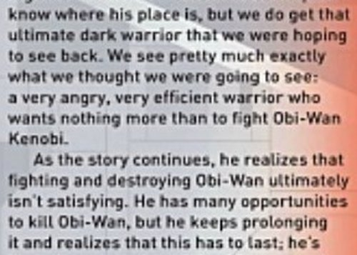
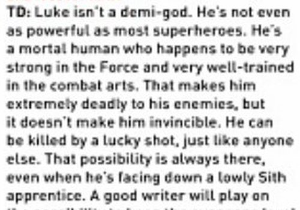
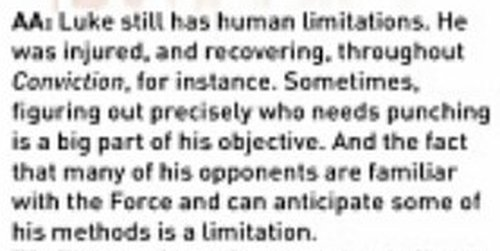
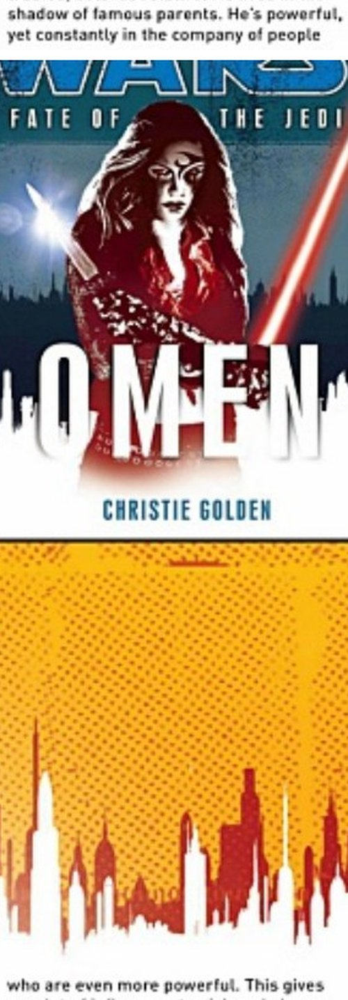
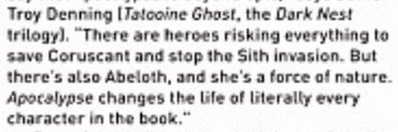
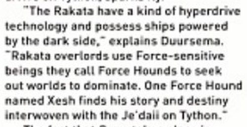
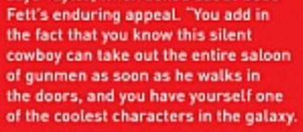

# Owner Material 038 — Star Wars Insider #1–153 plus specials (with The Lucasfilm Fan Club Magazine #1–22): Star Wars Insider #132 (2012)

- **Source:** *Star Wars Insider* magazine (issues 23–153, 1994–2014) and its predecessor *The Lucasfilm Fan Club Magazine* (issues 1–22, 1987–1994), plus seven special editions: articles, interviews, comics and short fiction Secondary source (licensed Legends reference). Scan OCR'd on the box; the scan stays box-only and is **not** published.
- **Method:** every scanned page was OCR'd and machine-screened sentence by sentence for power-relevant statements (fights, kills, defeats, Force feats, rankings, superweapons) that name a character on our roster; each kept sentence is quoted verbatim from the OCR text and has a crop of the printed passage directly under it. Pages with nothing power-relevant are still listed with what is on them.
- **Citation:** "*Star Wars Insider #132* (2012), p.X" by printed page ("scan p.X" where no printed number applies). **Weight:** Licensed magazine: a secondary source. Its short fiction and comics are Legends stories; its articles and interviews sum up or discuss lore and rank below the novels, comics and games they describe.

## scan p.1 (scan page 1)

Page contents: Cover (Apr/May 2012): "Vader strikes back!"; "Apocalypse now!" (making of Fate of the Jedi); exclusive fiction. (hand-read)

## scan p.2 (scan page 2)

Page contents: Ad: Kotobukiya ARTFX+ Darth Maul (TPM) and Clone Trooper statues. (hand-read)

## scan p.3 (scan page 3)

Page contents: Editor's welcome (Jonathan Wilkins): Maul's return, the Darth Plagueis novel, Walter Murch's "The General"; masthead. Epigraph: "You worms are no match for the dark side!" (Maul, Battlefront II). (hand-read)

## scan p.4 (scan page 4)

Page contents: Contents: Murch, art feature, Fate of the Jedi authors, "The Guns of Kelrodo-Ai" fiction, Ryder Windham on ESB and the EU. Epigraph: "Stealth is the greatest tool of the Sith assassin." (Sidious, New Essential Guide to Vehicles and Vessels). (hand-read)

## scan p.5 (scan page 5)

Page contents: Contents, departments: My Star Wars (Meredith Salenger), Rogues Gallery bounty hunters, Classic Moment (R2), Red Five (Ashley Eckstein), Books, Comics (Dawn of the Jedi), Incoming, Bounty Hunters, Bantha Tracks. (hand-read)

## scan p.6 (scan page 6)

Page contents: Launch Pad: TCW Season Four finale arc, "Massacre" (Grievous assaults Dathomir; Talzin "far from helpless") and "Bounty" (Ventress joins Boba Fett's syndicate). (hand-read)

## scan p.7 (scan page 7)

Page contents: Launch Pad: "Brothers" (Savage finds a mad, broken Maul) and "Revenge" (Maul and Savage against Obi-Wan and Ventress). (hand-read)

## scan p.8 (scan page 8)

Page contents: Launch Pad: Ian Abercrombie (TCW Palpatine) dies at 77, with Dave Filoni's tribute; Star Wars Identities exhibition; Red Tails box office (Lucas: "as close as you'll get to [Star Wars] Episode VII"). (hand-read)

## scan p.9 (scan page 9)

Page contents: Launch Pad: McCallum on the live-action series (working title Underworld; 50+ scripts) and the Seth Green comedy; VW "The Bark Side"; Vodafone Yoda ads; TPM 3D gross; James Arnold Taylor's one-man show; authors at Celebration VI. (hand-read)

## scan p.10 (scan page 10)

Page contents: Obituary (Brian J. Robb): Bob Anderson, died January 1 at 89 (crop-verified; OCR read "69"); Vader's fight double in ESB and ROTJ. Hamill revealed him in 1983; Lucas: "He was the Jedi Master of the original trilogy". Royal Marines, 1952 Olympics, Errol Flynn. (hand-read)

## scan p.11 (scan page 11)

Page contents: Obituary continued: Bond films, Barry Lyndon, Highlander, Princess Bride, Zorro, LOTR, with Martin Campbell and Peter Jackson tributes. Correction to last issue's Red Five on Last Stand of the 300 (performers were highly trained). (hand-read)

## scan p.12 (scan page 12)

Page contents: Launch Pad: unseen Paul Pope sketches for Star Wars Art: Comics; Five Amazing Facts quiz (Lucas cameos; the answer is printed upside down on the page). (hand-read)

## scan p.13 (scan page 13)

Page contents: Ad: Jerry Vanderstelt fine-art giclée prints. (hand-read)

## scan p.14 (scan page 14)

Page contents: Feature opener: Sam Witwer plays the returning Darth Maul in the TCW Season Four finale. (hand-read)

## scan p.15 (scan page 15)

Page contents: Witwer interview (Back from the Depths): Maul's return; Filoni pitched a "Gollum" direction, Witwer added a "Colonel Kurtz" one. (hand-read)

## scan p.16 (scan page 16)

Page contents: Witwer interview: Maul insane after his bisection; garbage spider-legs as manifestations of pain; Sith cheat death (Vader parallel); Maul may have been meant for the Clone Wars role later given to Grievous or Dooku. (hand-read)

## scan p.17 (scan page 17)

Page contents: Witwer sidebar (Brotherly Love?): Savage not necessarily a bad guy; Maul will come to see Savage as his apprentice. (hand-read)

## scan p.18 (scan page 18)

Page contents: Witwer interview: recording with Clancy Brown and James Arnold Taylor; Brown knows The Force Unleashed; first-session nerves. (hand-read)

- **Darth Maul; Obi-Wan Kenobi** — entry/section: Witwer: restored Maul a very efficient warrior; prolongs killing Obi-Wan: ""we do get that ultimate dark warrior that we were hoping to see back. We see pretty much exactly what we thought we were going to see: a very angry, very efficient warrior who wants nothing more than to fight Obi-Wan Kenobi. As the story continues, he realizes that fighting and destroying Obi-Wan ultimately isn't satisfying. He has many opportunities to kill Obi-Wan, but he keeps prolonging it" —Sam Witwer, Star Wars Insider 132, p. 18" Source: *Star Wars Insider #132* (2012), scan p.18
  

## scan p.19 (scan page 19)

Page contents: Witwer sidebar: rediscovering his childhood Darth Vader Collector's Case; photo captions. (hand-read)

## scan p.20 (scan page 20)

Page contents: Sidebar (Red Menace): Iain McCaig's Maul design origins (a rejected nightmare design later inspired the Nightsisters; the head feathers became horns). Witwer on Maul's future, "deep stuff". (hand-read)

## scan p.21 (scan page 21)

Page contents: Witwer interview: Starkiller formula ("two parts Han Solo, one part Luke, one part Indiana Jones, one part Darth Maul"); Maul borrows from Palpatine; Sith Code mutterings ("Through victory my chains are broken"); Witwer's World bio. (hand-read)

## scan p.22 (scan page 22)

Page contents: My Star Wars: Meredith Salenger (Barriss Offee) interview (James Burns and Mark Newbold); first saw Star Wars in 1977. (hand-read)

## scan p.23 (scan page 23)

Page contents: My Star Wars: Salenger's favorites (Cantina, "I know", Ewoks, Jawas, R2-KT). (hand-read)

## scan p.24 (scan page 24)

Page contents: Walter Murch interview opener: photo of Murch's team on "The General" (Brickley, Ng, Tulouris, Yeper). (hand-read)

## scan p.25 (scan page 25)

Page contents: Walter Murch interview (J.W. Rinzler): coined "sound designer"; directed Return to Oz; Lucas invited him to guest-direct the Umbara episode "The General". (hand-read)

## scan p.26 (scan page 26)

Page contents: Murch: a 12-week guest-director gig; Lucas wants a live-action, scene-based sensibility via zViz; Murch added the tree climb and booby trap to Fives and Hardcase's base infiltration, and made the flying creatures vultures. Captions on Umbaran vehicles (Legged Assault Tank, mobile heavy cannon). (hand-read)

## scan p.27 (scan page 27)

Page contents: Murch sidebar (The Cinema of Walter Murch): USC with Lucas; Zoetrope; Oscars. Learning zViz with story artists. (hand-read)

## scan p.28 (scan page 28)

Page contents: Murch: virtual lenses; recording the clones and Krell; grisly ideas (clones shoot Umbarans, scorpion tanks stomp clones, vultures); the clones-as-army themes; the Umbara arc as assassinating "a kind of Hitler". (hand-read)

## scan p.29 (scan page 29)

Page contents: Murch: TCW density; the first cut was too dark ("Customer's Moonlight"); body-language animation; praises Ventress as a "wonderfully evil female character". (hand-read)

## scan p.30 (scan page 30)

Page contents: Art feature opener: full-page painting (rancor and woman) by Arantzazu Martinez (no text). (hand-read)

## scan p.31 (scan page 31)

Page contents: Art feature (Jonathan Wilkins), Star Wars Art: Visions: Arantzazu Martinez; ROTJ at age seven. (hand-read)

## scan p.32 (scan page 32)

Page contents: Martinez interview: invited by Rinzler; the rancor painting took about four months; bio. (hand-read)

## scan p.33 (scan page 33)

Page contents: Noah Buchanan interview: "Your Father's Lightsaber" (Ben's hovel; painted over the approved study; studied HD stills); would like to paint Qui-Gon next; bio. (hand-read)

## scan p.34 (scan page 34)

Page contents: Fate of the Jedi feature: interview with Aaron Allston, Christie Golden and Troy Denning. Origins (a father/son odyssey to learn why Jacen fell, Homer's Odyssey model); the Maw entity idea; Daala banishes Luke; Golden's Ben/Vestara romance ("Jedi versus Sith"). (hand-read)

## scan p.35 (scan page 35)

Page contents: Fate of the Jedi feature: Troy Denning portrait; image credits. (hand-read)

## scan p.36 (scan page 36)

Page contents: Fate of the Jedi: myth structure (Outcast's working title "The Hidden One"; Backlash's Dathomir as the Amazons); the goal to avoid another galactic war; Luke/Ben and Leia/Allana generationality; Maw and Centerpoint mysteries. (hand-read)

## scan p.37 (scan page 37)

Page contents: Fate of the Jedi: the collaboration process; Golden was surprised by Allston's conspiracy subplot; Denning on worthy foes for Luke. (hand-read)

- **Luke Skywalker** — entry/section: Denning: Luke isn't a demi-god; can be killed by a lucky shot: ""Luke isn't a demi-god. He's not even as powerful as most superheroes. He's a mortal human who happens to be very strong in the Force and very well-trained in the combat arts. That makes him extremely deadly to his enemies, but it doesn't make him invincible. He can be killed by a lucky shot, just like anyone else. That possibility is always there, even when he's facing down a lowly Sith apprentice." —Troy Denning, Star Wars Insider 132, p. 37" Source: *Star Wars Insider #132* (2012), scan p.37
  

## scan p.38 (scan page 38)

Page contents: Fate of the Jedi: Abeloth's origins (Callista used against Luke; Celestials; a "Cthuloid" flavor; fitted to the Mortis mythology with Filoni's help). Unused cover concepts. (hand-read)

- **Luke Skywalker** — entry/section: Allston: Luke still has human limitations: ""Luke still has human limitations. He was injured, and recovering, throughout Conviction, for instance. Sometimes, figuring out precisely who needs punching is a big part of his objective. And the fact that many of his opponents are familiar with the Force and can anticipate some of his methods is a Limitation" —Aaron Allston, Star Wars Insider 132, p. 38" Source: *Star Wars Insider #132* (2012), scan p.38
  

## scan p.39 (scan page 39)

Page contents: Fate of the Jedi: Ben's development (Luke grooming a successor; Ben not the next Grand Master); Golden: Ben is "biologically 16" (crop-verified; OCR read 14). (hand-read)

- **Ben Skywalker** — entry/section: Allston: Ben powerful, yet surrounded by people even more powerful: ""He's powerful, yet constantly in the company of people who are even more powerful." —Aaron Allston, Star Wars Insider 132, p. 39" Source: *Star Wars Insider #132* (2012), scan p.39
  

## scan p.40 (scan page 40)

Page contents: Fate of the Jedi: book list, Lost Tribe tie-ins and First Blood (Insider 125); themes of colliding destinies; Denning: destiny and balance; favorite scenes (Allston). (hand-read)

## scan p.41 (scan page 41)

Page contents: Fate of the Jedi: favorite scenes (Golden, Denning); scrapped ideas (joke: Vestara's love child, Jaina/Abeloth alliance, Pocket as a Sith Lord); Denning: the Sith were originally going to be the One Sith, but Dark Horse objected, so they created the Lost Tribe. (hand-read)

## scan p.42 (scan page 42)

Page contents: Fiction opener: "The Guns of Kelrodo-Ai" by Jason Fry, art by John Van Fleet. (hand-read)

## scan p.43 (scan page 43)

Page contents: Fiction: early Empire, Western Reaches Operation; Captain Shea Hublin (77th Wing, Sword Squadron V-wings) gives a propaganda holo-interview ("One Empire") under Moff Tarkin's command; the Kelrodoan valet Fara; Fighter Slang sidebar. (hand-read)

## scan p.44 (scan page 44)

Page contents: Fiction: the clone-template banter (Shea: "They did something to their brains—made them more obedient"); briefing on the 25 m reactor pipe; 30 bandits engage. (hand-read)

## scan p.45 (scan page 45)

Page contents: Fiction: anti-capital-ship cannons; Blade Three lost; Scimitar Flight enters the shaft and loses signal (Kaal killed). (hand-read)

## scan p.46 (scan page 46)

Page contents: Fiction: a biological colony lines the shaft and reacts to fast motion; Fara's egg-harvesting reveals that slow movement passes it; three V-wings crawl through on repulsors (137 seconds), torpedo the hypermatter reactor, and crawl back out against the countdown. (hand-read)

## scan p.47 (scan page 47)

Page contents: Fiction: the mountain explodes; all survivors escape ("the Slowest Gun in the Western Reaches"); Tarkin calls Shea personally. Tie-in to the Essential Guide to Warfare. (hand-read)

## scan p.48 (scan page 48)

Page contents: Rogues Gallery, "Warriors of The Box" (Leland Y. Chee): data cards for Moralo Eval, Bulduga, Kyuzo bounty hunter Embo, Twazzi (Frenk), Mantu (Selkath), Rodian hunter; species, heights, claims to fame. (hand-read)

## scan p.49 (scan page 49)

Page contents: Rogues Gallery continued: Derrown ("The Exterminator"), Cad Bane ("Needs no introduction"), Rako Hardeen, Kiera Swan, Sinrich, Bulduga, Sixtat ("The Outlands Butcher"). (hand-read)

## scan p.50 (scan page 50)

Page contents: Full-page art: Darth Vader, from the comic "Thank the Maker" (Star Wars Tales). (hand-read)

## scan p.51 (scan page 51)

Page contents: Feature (Ryder Windham), Expanding the Empire: how ESB shaped the EU. The bounty hunter on Ord Mantell line ("In Mortal Combat," Marvel #37, Archie Goodwin). (hand-read)

## scan p.52 (scan page 52)

Page contents: Windham: Goodwin's comic strip set between ANH and ESB (Vader's flagship, Hoth, the hunt for Luke); "The Bounty Hunter of Ord Mantell" (Skorr and Gribbet; Solo turns the tables). (hand-read)

## scan p.53 (scan page 53)

Page contents: Windham: "Showdown" (Skorr with Bossk, Dengar, Fett); Scoundrel's Luck (Alfreda Goot); Rebel Mission to Ord Mantell audio (Cypher Bos); Last Stand at Ord Mantell; the Kenner Bossk flyer first named the Executor. (hand-read)

## scan p.54 (scan page 54)

Page contents: Windham: Zuckuss/Dengar/4-LOM naming mix-up (corrected in Galaxy Guide 3, 1989); Tales of the Bounty Hunters (Vader uses the Force to discourage Dengar from double-crossing him; Fett vs IG-88 on Cloud City). (hand-read)

## scan p.55 (scan page 55)

Page contents: Windham: Meltdown on Hoth picture book; "Thank the Maker" (Vader recognized C-3PO's parts on Cloud City); Jeremy Bulloch's Imperial officer (Lt. Sheckil). (hand-read)

## scan p.56 (scan page 56)

Page contents: Ad: Brian's Toys price list. (hand-read)

## scan p.57 (scan page 57)

Page contents: Classic Moment, TCW 1.07 "Duel of the Droids": R2 vs R3 on Skytop Station; script excerpt (R2 saws R3's grapple; Anakin catches R2 in the Delta's socket); Rob Coleman quote. (hand-read)

### Stat block notes (game mechanics, not feats)

- Classic Moment: R2's duel to the death with spy droid R3: "this duel against the spy droid R3 was the first time we'd seen him take on a droid with similar weapons in a fight to the death." (Classic Moment, Star Wars Insider 132, p. 57) (Source: *Star Wars Insider #132* (2012), scan p.57)

## scan p.58 (scan page 58)

Page contents: Ad: The Essential Guide to Warfare (Jason Fry). (hand-read)

## scan p.59 (scan page 59)

Page contents: Blaster section opener (edited by Neil Edwards): Books, Comics (Dawn of the Jedi), Bounty Hunters, Bantha Tracks, Red Five (Ashley Eckstein). Epigraph: "There's nothing like a good blaster at your side, kid." (hand-read)

## scan p.60 (scan page 60)

Page contents: Books (Daniel Wallace): FotJ: Apocalypse (March 13). Denning says Jacen's fall was "the seed for the entire Fate of the Jedi series," that Apocalypse reveals the Balance of the Force, and that it "isn't Luke's swan song." Also: Haynes Millennium Falcon Owner's Workshop. (hand-read)

- **Abeloth** — entry/section: Denning: Abeloth is a force of nature: ""There are heroes risking everything to save Coruscant and stop the Sith invasion. But there's also Abeloth, and she's a force of nature. Apocalypse changes the life of literally every character in the book." —Troy Denning, Star Wars Insider 132, p. 60" Source: *Star Wars Insider #132* (2012), scan p.60
  

### Stat block notes (game mechanics, not feats)

- Books preview: Abeloth as the embodiment of the dark side: "Abeloth—the embodiment of the dark side itself" (Books, Star Wars Insider 132, p. 60) (Source: *Star Wars Insider #132* (2012), scan p.60)

## scan p.61 (scan page 61)

Page contents: Books: Essential Guide to Warfare (Jason Fry with Paul Urquhart; originally Karen Traviss's "Essential Guide to the Military"); Beware the Sith, Secret Life of Droids, Wookiee Pies. Ask Lobot (Leland Chee): Boss Nass (first name Rugor) is alive in the ROTS funeral; for "Shadow Warrior" the creators wanted a Gungan Boss resembling Jar Jar, so they created Boss Lyonie, a successor to Nass at some point after the Battle of Naboo. (hand-read)

## scan p.62 (scan page 62)

Page contents: Comics (Daniel Wallace): Dawn of the Jedi (Ostrander/Duursema), 25,000+ years BBY; the Tho Yor ships brought Force-sensitives to Tython (Je'daii). (hand-read)

## scan p.63 (scan page 63)

Page contents: Full-page Dawn of the Jedi cover art. (hand-read)

## scan p.64 (scan page 64)

Page contents: Dawn of the Jedi cont.: no lightsabers, but Rakata Force sabers (Ostrander); Kaleth seen before it became a ruin (a tie to The Old Republic). (hand-read)

- **Xesh** — entry/section: Duursema: Rakata dark-side tech and the Force Hound Xesh: ""The Rakata have a kind of hyperdrive technology and possess ships powered by the dark side ... Rakata overlords use Force-sensitive beings they call Force Hounds to seek out worlds to dominate. One Force Hound named Xesh finds his story and destiny interwoven with the Je'daii on Tython." —Jan Duursema, Star Wars Insider 132, p. 64" Source: *Star Wars Insider #132* (2012), scan p.64
  

## scan p.65 (scan page 65)

Page contents: Dawn of the Jedi art. Ask Lobot: planet gravity is treated as Earth-standard; writers use Earth's 12,756 km diameter as the baseline when sizing planets. (hand-read)

## scan p.66 (scan page 66)

Page contents: Comics: Blood Ties—Boba Fett is Dead (Tom Taylor, art by Chris Scalf). Fett is killed on page one by a hit squad ("literally full of holes, and that's after the flamethrower"), and someone avenges him. (hand-read)

- **Boba Fett** — entry/section: Tom Taylor on Fett's reputation: ""You add in the fact that you know this silent cowboy can take out the entire saloon of gunmen as soon as he walks in the doors, and you have yourself one of the coolest characters in the galaxy." —Tom Taylor, Star Wars Insider 132, p. 66" Source: *Star Wars Insider #132* (2012), scan p.66
  

## scan p.67 (scan page 67)

Page contents: Full-page Blood Ties cover art (David Palumbo variant). (hand-read)

## scan p.68 (scan page 68)

Page contents: Incoming (Chris Spitale): Star Wars Amp'd vehicles, Class III MTT. (hand-read)

## scan p.69 (scan page 69)

Page contents: Incoming: Revell Snaptite kits, Fine Molds Naboo starfighter. (hand-read)

## scan p.70 (scan page 70)

Page contents: Incoming: Sideshow Tarkin with IT-O Premium Format, Clone Captain; Kotobukiya ice trays; Mimomicro. (hand-read)

## scan p.71 (scan page 71)

Page contents: Incoming: LEGO planet sets, X-wing, TIE fighter, Endor battle pack. (hand-read)

## scan p.72 (scan page 72)

Page contents: Bounty Hunters reader photos (names omitted): meeting Mark Hamill. (hand-read)

## scan p.73 (scan page 73)

Page contents: Bounty Hunters reader photos (names omitted): Peter Mayhew, Jeremy Bulloch, Daniel Logan, Anthony Forrest, and others. (hand-read)

## scan p.74 (scan page 74)

Page contents: Bantha Tracks Art Galaxy (fan art). (hand-read)

## scan p.75 (scan page 75)

Page contents: Bantha Tracks Art Galaxy (fan art; names omitted). (hand-read)

## scan p.76 (scan page 76)

Page contents: Bantha Tracks Art Galaxy: fan art incl. Starkiller vs Darth Maul (fan art, not canon); submission guidelines. (hand-read)

## scan p.77 (scan page 77)

Page contents: Bantha Tracks Art Galaxy; editorial by Mary Franklin. (hand-read)

## scan p.78 (scan page 78)

Page contents: Red Five (Ashley Eckstein): favorite fashion (Ahsoka's new outfit, Leia's necklace). (hand-read)

## scan p.79 (scan page 79)

Page contents: Red Five: Padme's lake dress, Ventress's arm warmers, Satine's earrings. (hand-read)

## scan p.80 (scan page 80)

Page contents: Subscription ad. (hand-read)

## scan p.81 (scan page 81)

Page contents: Digital editions / back issues ad. (hand-read)

## scan p.82 (scan page 82)

Page contents: Next issue (#133): Battle Lines, clones' 10th anniversary, Essential Guide to Warfare art, new fiction. On sale May 1 (US). (hand-read)

## scan p.83 (scan page 83)

Page contents: Ad: Supernatural magazine. (hand-read)

## scan p.84 (scan page 84)

Page contents: Ad: Calgary Expo. (hand-read)

