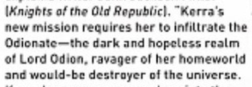

# Owner Material 038 — Star Wars Insider #1–153 plus specials (with The Lucasfilm Fan Club Magazine #1–22): Star Wars Insider #133 (2012)

- **Source:** *Star Wars Insider* magazine (issues 23–153, 1994–2014) and its predecessor *The Lucasfilm Fan Club Magazine* (issues 1–22, 1987–1994), plus seven special editions: articles, interviews, comics and short fiction Secondary source (licensed Legends reference). Scan OCR'd on the box; the scan stays box-only and is **not** published.
- **Method:** every scanned page was OCR'd and machine-screened sentence by sentence for power-relevant statements (fights, kills, defeats, Force feats, rankings, superweapons) that name a character on our roster; each kept sentence is quoted verbatim from the OCR text and has a crop of the printed passage directly under it. Pages with nothing power-relevant are still listed with what is on them.
- **Citation:** "*Star Wars Insider #133* (2012), p.X" by printed page ("scan p.X" where no printed number applies). **Weight:** Licensed magazine: a secondary source. Its short fiction and comics are Legends stories; its articles and interviews sum up or discuss lore and rank below the novels, comics and games they describe.

## scan p.1 (scan page 1)

Page contents: Cover: Classic Creatures; Warwick Davis; inside the aliens workshop. (hand-read)

## scan p.2 (scan page 2)

Page contents: Ad: Star Wars: The Ultimate Visual Guide, updated and expanded (Ryder Windham). (hand-read)

## scan p.3 (scan page 3)

Page contents: Editor's welcome (Jonathan Wilkins): the war issue, built around the Essential Guide to Warfare; notes Ralph McQuarrie's death. Epigraph: Yoda, "Wars not make one great." (hand-read)

## scan p.4 (scan page 4)

Page contents: Contents: Warwick Davis, greatest battles, the VW Super Bowl ad, Art of Warfare, the clones' birthday, Vader and Son, Duwayne Dunham, "Hunting the Gorach" fiction (Jeff Grubb). Epigraph: Piett, "Deadly Reunion" (1981). (hand-read)

## scan p.5 (scan page 5)

Page contents: Departments contents: Sam Witwer's My Star Wars, Rogues Gallery, Classic Moment (Jaxxon), Red Five (Danny Wagner), Books (Scourge), Comics (Vader and the Ghost Prison, Knight Errant: Escape), Incoming, Bounty Hunters, Bantha Tracks. (hand-read)

## scan p.6 (scan page 6)

Page contents: Launch Pad: Ralph McQuarrie died March 3; tribute statement from George Lucas. (hand-read)

## scan p.7 (scan page 7)

Page contents: Launch Pad: Celebration VI stage hosts (James Arnold Taylor, David Collins, Pablo Hidalgo). Hasbro Fans' Choice poll: Mara Jade Skywalker first, Jocasta Nu second, Jaxxon third (2013 Vintage figure). (hand-read)

## scan p.8 (scan page 8)

Page contents: Launch Pad: MediCinema Star Wars charity quiz in London (Warwick Davis, Jeremy Bulloch, Nick Frost; auction lots incl. Nick Gillard training); Essential Guide to Warfare giveaway; Class II attack vehicles. (hand-read)

## scan p.9 (scan page 9)

Page contents: Ask Warwick Davis opener: Davis with Wicket and a Life's Too Short clapperboard. (hand-read)

## scan p.10 (scan page 10)

Page contents: Warwick Davis Q&A (fan questioners' names omitted): Wicket's blink in the Blu-ray; little people in film. (hand-read)

## scan p.11 (scan page 11)

Page contents: Warwick Davis Q&A: on digitally shrinking actors; Ricky Gervais/Stephen Merchant and Star Wars. (hand-read)

## scan p.12 (scan page 12)

Page contents: Warwick Davis Q&A: he did the Yoda voice on the Episode I set but it wasn't used; Mark Hamill gave him toys on the ROTJ set; a possible Willow sequel. Personal/medical content omitted. (hand-read)

## scan p.13 (scan page 13)

Page contents: Ad (printed rotated): Hawthorne Village Star Wars Express HO-scale electric train. (hand-read)

## scan p.14 (scan page 14)

Page contents: Feature opener: the 10 greatest battles, from The Essential Guide to Warfare (Jason Fry & Paul R. Urquhart). (hand-read)

## scan p.15 (scan page 15)

Page contents: Battle #1: Yavin (the BBY/ABY calendar is based on it). (hand-read)

### Stat block notes (game mechanics, not feats)

- Greatest Battles: the Death Star was designed against large-scale assaults: "Tarkin's battle station was designed to fend off large-scale assaults ... Rebel starfighters slipped through the Death Star's shields, evaded its turbolasers and took aim at a tiny weakness in its defenses" (Greatest Battles, Star Wars Insider 133, p. 15) (Source: *Star Wars Insider #133* (2012), scan p.15)

## scan p.16 (scan page 16)

Page contents: Battle: Endor (the Emperor underestimated the Ewoks "and a father's love for his son"); Ebaq 9 (Sien Sovv's trap for the Vong armada in the Deep Core). (hand-read)

### Stat block notes (game mechanics, not feats)

- Greatest Battles: Ebaq 9: "the Jedi Knight Vergere sacrificed herself to annihilate a massive Vong ground force, and Jaina Solo (far right) slew the brutal Warmaster Tsavong Lah (left)." (Greatest Battles, Star Wars Insider 133, p. 16) (Source: *Star Wars Insider #133* (2012), scan p.16)

## scan p.17 (scan page 17)

Page contents: Battle: the Pius Dea Civil War. The Jedi ended their recusal; BoSS's rogue navicomputer code crippled the cathedral ships at Uquine; Chancellor Contispex XIX was captured. (hand-read)

## scan p.18 (scan page 18)

Page contents: Battles: Geonosis (start of the Clone Wars; the Jedi become generals); Coruscant (Dooku dies, Grievous flees). (hand-read)

## scan p.19 (scan page 19)

Page contents: Malachor V: the Mandalorians called the defeat Ani'la Akaan, the Great Last Battle. (hand-read)

### Stat block notes (game mechanics, not feats)

- Greatest Battles: Malachor V: "There, Revan killed Mandalore the Ultimate (left) and activated the Mass Shadow Generator, which shattered Malachor V and destroyed much of the Mandalorian and Republic fleets." (Greatest Battles, Star Wars Insider 133, p. 19) (Source: *Star Wars Insider #133* (2012), scan p.19)

## scan p.20 (scan page 20)

Page contents: Battles: Ruusan (Lord Hoth's gambit vs Kaan's Brotherhood); Bilbringi (Thrawn killed by his Noghri bodyguard; Karrde's smugglers hit the rear); Fondor (Jacen Solo vs Niathal; Daala's Maw Irregulars and Mandalorian commandos turn the tide). (hand-read)

### Stat block notes (game mechanics, not feats)

- Greatest Battles: Ruusan: "Ultimately, a dark-side superweapon destroyed both armies." (Greatest Battles, Star Wars Insider 133, p. 20) (Source: *Star Wars Insider #133* (2012), scan p.20)
- Greatest Battles: Fondor: "Pellaeon ordered the Imperial ships to support Niathal—for which he was slain by Solo's apprentice Tahiri Veila." (Greatest Battles, Star Wars Insider 133, p. 20) (Source: *Star Wars Insider #133* (2012), scan p.20)
- Greatest Battles: Bilbringi, Thrawn's trap: "Thrawn deployed a classic Star Destroyer phalanx with interdictor pickets, planning to deny the Rebels room to maneuver, pound them with his turbolasers, and force a retreat in disarray." (Greatest Battles, Star Wars Insider 133, p. 20) (Source: *Star Wars Insider #133* (2012), scan p.20)

## scan p.21 (scan page 21)

Page contents: Feature opener (Jason Fry & Mike Morello): Tom Spina Designs re-creates the Cantina aliens for VW's 2012 Super Bowl ad "The Dog Strikes Back." (hand-read)

## scan p.22 (scan page 22)

Page contents: VW ad feature: 10 hero aliens (Djas Puhr, Momaw Nadon/Hammerhead, Ponda Baba, Gotal, Nabrun Leids, Snaggletooth, Kabe, Muftak, Dr. Evazan, Myo); the original masks are too fragile to use. (hand-read)

## scan p.23 (scan page 23)

Page contents: VW ad feature: mask-making details; Walrus Man given both flippers and hairy hands as a nod to the continuity glitch. (hand-read)

## scan p.24 (scan page 24)

Page contents: VW ad feature sidebar "The Bark Side" (Jeff Elmassian's dog-bark Imperial March); Hammerhead worn by an actor. (hand-read)

## scan p.25 (scan page 25)

Page contents: VW ad feature: Walrus Man's arm removed on the shoot (severed by Obi-Wan); Spina's tribute to Rick Baker and Stuart Freeborn. (hand-read)

## scan p.26 (scan page 26)

Page contents: My Star Wars: Sam Witwer (Starkiller, TCW Maul). His first film was ROTJ; his favorite scene is Vader's redemption. (hand-read)

## scan p.27 (scan page 27)

Page contents: My Star Wars (Witwer): his favorite film is the original Star Wars; showing the saga to a friend; "The Emperor seemed unbeatable" (a newcomer's impression, not scaling). (hand-read)

## scan p.28 (scan page 28)

Page contents: Art of Warfare: Jason Fry interview. His art wish list: two Super Star Destroyers exchanging broadsides, the Imperial Naval Academy, Xim the Despot's ships, Red Squadron before Yavin. (hand-read)

## scan p.29 (scan page 29)

Page contents: Art of Warfare (Fry): Dave Seeley's Battle of Coruscant art; Mandalorians, AT-AT, and Xim ships. (hand-read)

## scan p.30 (scan page 30)

Page contents: Art of Warfare: Dave Seeley (Crosscurrent, Riptide covers); the Millennium Falcon in a Wookiee tree was the trickiest image. (hand-read)

## scan p.31 (scan page 31)

Page contents: Art of Warfare: John VanFleet (Rothana, droids). (hand-read)

## scan p.32 (scan page 32)

Page contents: Art of Warfare: Bruno Werneck; a painting of Grievous fighting a group of clone troopers (hard to pose with four arms). (hand-read)

## scan p.33 (scan page 33)

Page contents: Art of Warfare: Werneck's AT-AT assault painting (the Rebel troops retreating but "not cowards"). (hand-read)

## scan p.34 (scan page 34)

Page contents: Art of Warfare: Darren Tan (Hutt fleet ships; aerial panorama of the Naboo battle). (hand-read)

## scan p.35 (scan page 35)

Page contents: Art of Warfare (Tan): two Executor-class Star Dreadnoughts duking it out at the Battle of Orinda. (hand-read)

## scan p.36 (scan page 36)

Page contents: Art of Warfare: editor Erich Schoeneweiss. Battle of Kashyyyk (LotF): Jacen Solo/Caedus orders the Anakin Solo to fire turbolasers on the wroshyr forests; the Ewoks "routed two of the Empire's best garrisons." Chris Scalf's Ewok/Endor painting. (hand-read)

## scan p.37 (scan page 37)

Page contents: Art of Warfare: Scalf's "Rule of Two" painting (Darth Bane and his adversaries); Tommy Lee Edwards (Hoth hangar). (hand-read)

## scan p.38 (scan page 38)

Page contents: Rogues Gallery (Leland Chee), Massassi Temple ceremony: Deacon Eso, Caf Treblanc, Tyr Taskeen, C-3PO, Bob Hudsol, Duron Veertag, Anj Zavor, R2-D2, Luke. (hand-read)

## scan p.39 (scan page 39)

Page contents: Rogues Gallery cont.: Leia, Arhul Hextrophon, Han, Jan Dodonna, Voren Na'al, Chewbacca, Evram Lajaie, Pashna Starkiller, Morts Werl. (hand-read)

## scan p.40 (scan page 40)

Page contents: Clone anniversary feature title spread ("Kamino's Finest"). (hand-read)

## scan p.41 (scan page 41)

Page contents: Feature (Mark Newbold): 10 years of clone troopers with the 501st Legion; clones bred from Jango Fett's DNA. (hand-read)

## scan p.42 (scan page 42)

Page contents: Clone feature: the 501st integrates the clone trooper (heroes or villains, depending on the timeline). (hand-read)

## scan p.43 (scan page 43)

Page contents: Clone feature: interviews with 501st members (fans; names omitted). Includes an "Order 44" misprint for Order 66, and favorite armors (ARC, ARF, phase one). (hand-read)

## scan p.44 (scan page 44)

Page contents: Darth Vader and Son: Jeffrey Brown interview (Martin Eden); the idea began as a Google Father's Day logo concept. (hand-read)

## scan p.45 (scan page 45)

Page contents: Vader and Son: Brown's favorite strip (Vader telling Luke to pick up his toys). (hand-read)

## scan p.46 (scan page 46)

Page contents: Vader and Son: Brown's view of Vader as an evil, powerful being forced to be patient by his son; Save the Date film. (hand-read)

## scan p.47 (scan page 47)

Page contents: Ad: Brian's Toys. (hand-read)

## scan p.48 (scan page 48)

Page contents: Duwayne Dunham interview (J.W. Rinzler): guest director of TCW "Pursuit of Peace." (hand-read)

## scan p.49 (scan page 49)

Page contents: Dunham: added the nightclub and speeder bike chase; on "Water War" (S4 opener), about 300 assets allowed per episode but they had 1,500. (hand-read)

## scan p.50 (scan page 50)

Page contents: Dunham: Riff Tamson as a shark; Lucas: "Take that dorsal fin off Riff. He's a man, not a fish!"; cut 600 assets. (hand-read)

## scan p.51 (scan page 51)

Page contents: Dunham: Lucas's intercutting; sidebar "First Fett!" (Dunham wore the all-white Boba Fett prototype costume for Lucas in ESB preproduction). (hand-read)

## scan p.52 (scan page 52)

Page contents: Fiction title art: "Hunting the Gorach" (the Gorach in a targeting reticle). (hand-read)

## scan p.53 (scan page 53)

Page contents: Fiction, "Hunting the Gorach" (Jeff Grubb, art by Joe Corroney): Parella the Hutt, a trophy hunter in Ruusan copper armor, hunts the four-armed Gorach on Lowick with a Pa'lowick guide (Kashina Furt). The Gorach are legendary star barbarians who once held a dozen systems and are said not to age. (hand-read)

## scan p.54 (scan page 54)

Page contents: Fiction: Parella firebombs the swamp with beater drones and hits the Gorach in the leg. "The shot he had given it would have downed a Wookiee, but it only discomforted the Gorach." Minor one-off characters; no roster entries. (hand-read)

## scan p.55 (scan page 55)

Page contents: Fiction: the Gorach's flint-tipped spear nearly penetrates the Hutt's copper armor; Parella throws the guide down the burrow; a flint jams his carbine; the Gorach lures him off a crumbling cliff into a mudflat. (hand-read)

## scan p.56 (scan page 56)

Page contents: Fiction: Parella sheds his armor as a decoy and kills the Gorach with the vibrobayonet. The Gorach turns out to have been an artist. Scourge (Grubb) out now. (hand-read)

## scan p.57 (scan page 57)

Page contents: Fiction art: Parella in armor with his carbine. (hand-read)

## scan p.58 (scan page 58)

Page contents: Ad: Supernatural magazine. (hand-read)

## scan p.59 (scan page 59)

Page contents: Classic Moment: Jaxxon, Marvel Star Wars #8 "Eight for Aduba-3" (1978); Pablo Hidalgo on Jaxxon; the name comes from Bugs Bunny's "Jackson." (hand-read)

## scan p.60 (scan page 60)

Page contents: Ad: The Essential Guide to Warfare. (hand-read)

## scan p.61 (scan page 61)

Page contents: Blaster section opener (Neil Edwards): Comics (Knight Errant: Escape), Books, Ask Lobot, Incoming, Bounty Hunters, Bantha Tracks. (hand-read)

## scan p.62 (scan page 62)

Page contents: Books (Daniel Wallace): Scourge (Jeff Grubb). Jedi archivist Mander Zuma investigates a student's murder in Hutt Space about 19 ABY, before the NJO; based on Grubb's 2002 RPG adventure Tempest Feud. (hand-read)

## scan p.63 (scan page 63)

Page contents: Books: Star Wars 1,2,3 (Scholastic) follows Star Wars ABC. Holocron sidebar: Jedi funding through a joint account at the Galactic Capital Bank (Rogue Planet). (hand-read)

## scan p.64 (scan page 64)

Page contents: Comics (Wallace): Darth Vader and the Ghost Prison (Haden Blackman; art by Agustin Alessio). Coup against the newly installed Emperor; Moff Trachta; cadet Laurita Tohm; issue #1 on sale May 28. Blackman: "Anakin is truly dead"; "Some of Anakin's traits still live underneath that helmet." (hand-read)

### Stat block notes (game mechanics, not feats)

- Comics: Ghost Prison cemented Vader's reputation: "Darth Vader and the Ghost Prison, which tells the tale of the mission that cemented Vader's reputation as an unstoppable killing machine." (Comics, Star Wars Insider 133, p. 64) (Source: *Star Wars Insider #133* (2012), scan p.64)

## scan p.65 (scan page 65)

Page contents: Comics art: Ghost Prison cover (Vader above a planet, with a Star Destroyer). (hand-read)

## scan p.66 (scan page 66)

Page contents: Comics: Knight Errant: Escape (John Jackson Miller). Kerra joins Odion's Novitiates; the "Claimers"; Lord Malakite's Sith mutates. Ask Lobot (Leland Chee): the Death Star has a Class 4.0 hyperdrive and sublight drives at its equator. (hand-read)

- **Lord Odion; Kerra Holt** — entry/section: Miller: Lord Odion, would-be destroyer of the universe: ""Kerra's new mission requires her to infiltrate the Odionate—the dark and hopeless realm of Lord Odion, ravager of her homeworld and would-be destroyer of the universe." —John Jackson Miller, Star Wars Insider 133, p. 66" Source: *Star Wars Insider #133* (2012), scan p.66
  

## scan p.67 (scan page 67)

Page contents: Comics art: Knight Errant: Escape cover (Kerra Holt with a red lightsaber over a slain beast). (hand-read)

## scan p.68 (scan page 68)

Page contents: Incoming (Chris Spitale): Sideshow Aayla Secura Premium Format (1:4, $349.99); STAP and battle droid 12-inch set ($174.99). (hand-read)

## scan p.69 (scan page 69)

Page contents: Incoming: Funko POP series 3; Gentle Giant 12-inch Kenner jumbos ($80); Death Trooper statue; candy dispensers. (hand-read)

## scan p.70 (scan page 70)

Page contents: Incoming: Star Wars Weekends 2012 Disney merchandise (Filoni Racers, Donald as Maul/Savage, R2 football, bowling set, Cycltron, Rizzo as Yoda). (hand-read)

## scan p.71 (scan page 71)

Page contents: Incoming: Hasbro vintage figures (Shae Vizla, Starkiller, Tarkin); Kotobukiya Yoda and Maul ARTFX+; SDCC Carbonite Chamber pack; Duel on Naboo battle pack. (hand-read)

## scan p.72 (scan page 72)

Page contents: Bounty Hunters (sponsored by Kotobukiya): reader photos with Mark Hamill, Peter Mayhew and Bonnie Piesse (reader names omitted). (hand-read)

## scan p.73 (scan page 73)

Page contents: Bounty Hunters: reader photos with Jeremy Bulloch, Ray Park, Dave Dorman, Matt Busch and Gerald Home (reader names omitted). (hand-read)

## scan p.74 (scan page 74)

Page contents: Bantha Tracks: "Our Focus Determines": fan costume features (fan and 501st names omitted). (hand-read)

## scan p.75 (scan page 75)

Page contents: Bantha Tracks: fan costumes, a Han/Chewie birthday surprise, a Hoth Christmas display, and the Burton Star Wars Experience snowboard school at Sierra-at-Tahoe. (hand-read)

## scan p.76 (scan page 76)

Page contents: Bantha Tracks: fan creations (Build-A-Bear outfits, bedding, cakes, a plumbing-pipe Dianoga); submission guidelines (fan names omitted). (hand-read)

## scan p.77 (scan page 77)

Page contents: Bantha Tracks (Mary Franklin): "Well Worth Remembering", a fan's memories of Irvin Kershner and Yoda (fan names omitted). (hand-read)

## scan p.78 (scan page 78)

Page contents: Red Five: Danny Wagner (ILM model-maker and makeup man). He made up Bib Fortuna (TPM), Saesee Tiin and Kit Fisto (AOTC); Lucas as Baron Papanoida; he cameoed as Mawhonic; ROTS maquettes of Mustafar, Utapau and Kashyyyk. (hand-read)

## scan p.79 (scan page 79)

Page contents: Red Five: Wagner sculpted the podracers Dud Bolt and Mars Guo, acklay reference maquettes, new C-3PO pieces, and podracer models. (hand-read)

## scan p.80 (scan page 80)

Page contents: Subscription ad. (hand-read)

## scan p.81 (scan page 81)

Page contents: Digital editions and back issues ad. (hand-read)

## scan p.82 (scan page 82)

Page contents: Next issue: Ralph McQuarrie tribute, Dave Filoni on TCW Seasons 4–5; on sale June 12 (US). (hand-read)

## scan p.83 (scan page 83)

Page contents: Ad: CLiNT magazine (Mark Millar). (hand-read)

## scan p.84 (scan page 84)

Page contents: Ad: Fighter Pods. (hand-read)

## scan p.85 (scan page 85)

Page contents: Back cover: Chewbacca bandolier art (no text). (hand-read)

