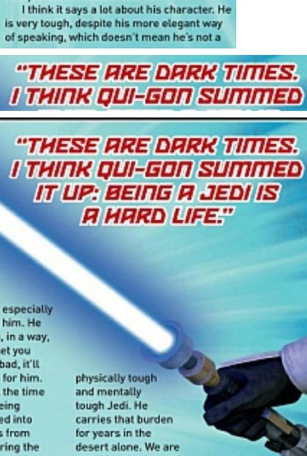
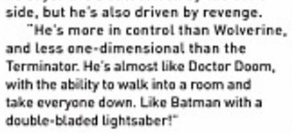

# Owner Material 038 — Star Wars Insider #1–153 plus specials (with The Lucasfilm Fan Club Magazine #1–22): Star Wars Insider #134 (2012)

- **Source:** *Star Wars Insider* magazine (issues 23–153, 1994–2014) and its predecessor *The Lucasfilm Fan Club Magazine* (issues 1–22, 1987–1994), plus seven special editions: articles, interviews, comics and short fiction Secondary source (licensed Legends reference). Scan OCR'd on the box; the scan stays box-only and is **not** published.
- **Method:** every scanned page was OCR'd and machine-screened sentence by sentence for power-relevant statements (fights, kills, defeats, Force feats, rankings, superweapons) that name a character on our roster; each kept sentence is quoted verbatim from the OCR text and has a crop of the printed passage directly under it. Pages with nothing power-relevant are still listed with what is on them.
- **Citation:** "*Star Wars Insider #134* (2012), p.X" by printed page ("scan p.X" where no printed number applies). **Weight:** Licensed magazine: a secondary source. Its short fiction and comics are Legends stories; its articles and interviews sum up or discuss lore and rank below the novels, comics and games they describe.

## scan p.1 (scan page 1)

Page contents: Cover, issue 134 (July 2012): Ralph McQuarrie remembered; Clone Wars Season 5 exclusive; new fiction; Vote Star Wars. (hand-read)

## scan p.2 (scan page 2)

Page contents: Ad: Kotobukiya ARTFX (Yoda, Obi-Wan, Darth Maul). (hand-read)

## scan p.3 (scan page 3)

Page contents: Masthead and editorial (Jonathan Wilkins): the McQuarrie tribute by Paul Bateman; Filoni interview; launch of the Insider awards. Epigraph: "The dream goes on."—Ralph McQuarrie, Insider #50. (hand-read)

## scan p.4 (scan page 4)

Page contents: Contents art. Epigraph: "Remember, the Force will be with you, always."—Obi-Wan Kenobi. (hand-read)

## scan p.5 (scan page 5)

Page contents: Contents: TCW Season 4 moments, Sith language, Tom Angleberger, Force Speed run, Nilo Rodis-Jamero, Warfare shipbuilding, Harley Brown on Yoda, Jaina/Jag fiction after FotJ, Brian Muir My Star Wars, Mercy Kill. (hand-read)

## scan p.6 (scan page 6)

Page contents: Ad: The Essential Guide to Warfare. (hand-read)

## scan p.7 (scan page 7)

Page contents: Launch Pad: TCW Season 5 episode titles: "A War on Two Fronts", "Front Runners", "The Soft War", "Tipping Points", "An Old Friend", "The Rise of Clovis", "Crisis at the Heart." (hand-read)

## scan p.8 (scan page 8)

Page contents: Celebration VI guests: Carrie Fisher, Peter Mayhew, Daniel Logan, Jeremy Bulloch, Ian McDiarmid (his first US Celebration), Filoni, Joel Aron, Seth Green and Matthew Senreich, Tom Spina. (hand-read)

## scan p.9 (scan page 9)

Page contents: Full-page photo: Princess Leia (Endor braids), with the Celebration VI news. (hand-read)

## scan p.10 (scan page 10)

Page contents: Launch Pad: The Complete Saga Blu-ray wins five Home Media Magazine awards; Boston Pops John Williams 80th-birthday concert (August 18). Mon Mothma's Facts: the fake is #2 (IG-88 in the cantina; a drinks dispenser was used as his head in the scene). Other facts: Bossk threw Zuckuss at Boba Fett; Aurra Sing was described as "Babe Fett"; Wuher made Greedo's body into a liqueur; Cad Bane's inmate number is 22. (hand-read)

## scan p.11 (scan page 11)

Page contents: Ad: Brian's Toys. (hand-read)

## scan p.12 (scan page 12)

Page contents: Insider Awards 2012 voting; winners in issue #137 (on sale October 23). (hand-read)

## scan p.13 (scan page 13)

Page contents: Insider Awards art ("Make your vote count!"). (hand-read)

## scan p.14 (scan page 14)

Page contents: Insider Awards categories: TCW Season 4 episode, books (Choices of One, Darth Plagueis, FotJ), non-fiction, comics, collectible, a community award. (hand-read)

## scan p.15 (scan page 15)

Page contents: Insider Awards categories: movie hero, villain, greatest moment, favorite movie. (hand-read)

## scan p.16 (scan page 16)

Page contents: Ad: Prometheus: The Art of the Film (Titan). (hand-read)

## scan p.17 (scan page 17)

Page contents: Ad: Prometheus art book (continued). (hand-read)

## scan p.18 (scan page 18)

Page contents: Dave Filoni interview (Pablo Hidalgo), on TCW Season 4: "There's really nothing we can't do at this point"; Mon Cala built from scratch; Wasskah is still the most complex environment. (hand-read)

## scan p.19 (scan page 19)

Page contents: Filoni interview: portrait (by Joel Aron) and an image of a Gungan taking on General Grievous. (hand-read)

## scan p.20 (scan page 20)

Page contents: Filoni: Grievous was nearly cut from the arc but was needed to trade for Anakin; fans disliked Krell (voiced by Dee Bradley Baker... OCR "David Fenoy"; name not verified, omitted); Season 5 already shot; "A Friend in Need" came from George's version of Filoni's Death Watch pitch. (hand-read)

## scan p.21 (scan page 21)

Page contents: Filoni: Lucas wanted Death Watch to be more like a violent biker gang; Bo-Katan (Katee Sackhoff); Slaves of the Republic adapted from Henry Gilroy's comic. (hand-read)

## scan p.22 (scan page 22)

Page contents: Filoni on canon: "The EU is a well of ideas, and there's what's on screen. They don't live in the same universe." The Lazy Lucky nod. Obi-Wan's Maul-arc quips ("When I cut you in half, I should have aimed for your neck"); Season 5 Obi-Wan: "These are dark times." (hand-read)

- **Obi-Wan Kenobi** — entry/section: Filoni: Obi-Wan physically and mentally tough: ""He is very tough, despite his more elegant way of speaking, which doesn't mean he's not a physically tough and mentally tough Jedi. He carries that burden for years in the desert alone." —Dave Filoni, Star Wars Insider 134, p. 22" Source: *Star Wars Insider #134* (2012), scan p.22
  

## scan p.23 (scan page 23)

Page contents: Filoni: Lucas on bringing Maul back ("This Savage Opress thing is going really well... we're going to bring Darth Maul back now"); the Nightsisters made it possible (writer's name omitted); Padmé is closest to Sidious. (hand-read)

## scan p.24 (scan page 24)

Page contents: Filoni: Padmé's major Season 5 arc. Expanded Universe sidebar: Onderon (Tales of the Jedi), Black Sun's debut, Hondo, R2's "biggest contribution to the war effort", Embo and Marrok; "Some of the characters that we have created for the show will meet their destinies." (hand-read)

## scan p.25 (scan page 25)

Page contents: Filoni interview art: his Embo sketch, Darth Maul's return, Padmé. (hand-read)

## scan p.26 (scan page 26)

Page contents: TCW Season 4 top 10 moments (Jason Fry): #10, R2-D2 vs. the big Hay-zu ("Nomad Droids", Patitite Patuna). (hand-read)

## scan p.27 (scan page 27)

Page contents: #9: Death Watch's revenge ("A Friend in Need"): Pre Vizsla runs his Darksaber through the chieftain's granddaughter and burns the Carlac village. (hand-read)

## scan p.28 (scan page 28)

Page contents: TCW top 10: #8, Old Daksa's zombie Nightsisters ("Massacre"); #7, Krell arrested ("Carnage of Krell"); #6, Anakin vs. Darts D'Nar's tentacled beast ("Kidnapped"). (hand-read)

### Stat block notes (game mechanics, not feats)

- TCW S4 top 10: Massacre, Grievous's horde overwhelms the Nightsisters: "Ventress and her Nightsisters battle the droids, but are no match for the mechanical horde. They need reinforcements." (TCW Season Four countdown, Star Wars Insider 134, p. 28) (Source: *Star Wars Insider #134* (2012), scan p.28)
- TCW S4 top 10: Carnage of Krell: "But bringing down a powerful, four-armed Besalisk Jedi armed with twin double-bladed lightsabers is no easy task, even for battle-hardened clones." (TCW Season Four countdown, Star Wars Insider 134, p. 28) (Source: *Star Wars Insider #134* (2012), scan p.28)

## scan p.29 (scan page 29)

Page contents: TCW top 10: #5, C-21 Highsinger's spinning cannons ("Bounty," Quarzite train; Ventress with Boba Fett's gang). (hand-read)

## scan p.30 (scan page 30)

Page contents: TCW top 10: Umbaran mechanical "worms"; Rex kills Agruss ("I'm no Jedi"); Maul revealed ("Brothers"); #1, Maul confronts Obi-Wan on Raydonia ("Jedi... I have been waiting for you"). (hand-read)

### Stat block notes (game mechanics, not feats)

- TCW S4 top 10: Savage on Lotho Minor: "The junk world of Lotho Minor is full of hazards: acid rain, fire-breathing droids, murderous scavengers, and treacherous serpent guides. The Zabrak warrior Savage Opress defeats them all" (TCW Season Four countdown, Star Wars Insider 134, p. 30) (Source: *Star Wars Insider #134* (2012), scan p.30)

## scan p.31 (scan page 31)

Page contents: TCW art: Maul and Obi-Wan; spider-legged Maul. Expanded Universe box. (hand-read)

## scan p.32 (scan page 32)

Page contents: Ralph McQuarrie: Dreamer & Visionary, a tribute by Paul Bateman (title spread with a portrait). (hand-read)

## scan p.33 (scan page 33)

Page contents: McQuarrie tribute: early life; technical illustrator at Boeing; Korean War service (injury details omitted); Art Center; film posters. (hand-read)

## scan p.34 (scan page 34)

Page contents: McQuarrie tribute: concept-painting art (cantina battle, etc.). (hand-read)

## scan p.35 (scan page 35)

Page contents: McQuarrie tribute: CBS Apollo paintings; Hal Barwood and Matthew Robbins's Star Dancing; Lucas and Gary Kurtz; ANH paintings took three or four days each; first matte paintings (opening Tatooine shot). (hand-read)

## scan p.36 (scan page 36)

Page contents: McQuarrie tribute: retouched publicity stills (Vader's "laser sword"); covers for Splinter of the Mind's Eye; Battlestar Galactica with Joe Johnston. (hand-read)

## scan p.37 (scan page 37)

Page contents: McQuarrie tribute: Star Trek TMP/IV, Cocoon (Academy Award), Close Encounters mothership, E.T., the Raiders Bible illustration; more art for Empire than any other film (50 production paintings); General Pharl McQuarrie cameo. (hand-read)

## scan p.38 (scan page 38)

Page contents: McQuarrie tribute art: Luke vs. the rancor, Endor, and the sail barge. (hand-read)

## scan p.39 (scan page 39)

Page contents: McQuarrie tribute: Forbidden Planet remake paintings; ROTJ speeder bikes, A-wings, Jabba's palace and sail barge; Trumbull rides; retirement before the prequels (health details omitted); TCW used his unused designs. About Paul Bateman. (hand-read)

## scan p.40 (scan page 40)

Page contents: Sith Language (Ben Grossblatt): invented for Book of Sith (November 2010). Plausible and linguistically sound; martial and mystical; closed syllables. Samples: "ember", hask "anguish", ajak "doctrine". (hand-read)

## scan p.41 (scan page 41)

Page contents: Sith Language art: the Emperor unleashing Force lightning. (hand-read)

## scan p.42 (scan page 42)

Page contents: Sith Language: consonant clusters (mw-, dzw-, tsy-); agglutinative like Turkish; stress on the first syllable; Palpatine as "Marmiltin" or "Chirkyat" ("He Who Causes Them to Throb and Tremble in Fear"); the Knotters of Entrails (Sithspawn alchemists). (hand-read)

## scan p.43 (scan page 43)

Page contents: Sith Language: the Kittat alphabet and the Rule of Two in Sith; Qorit ("The End"). Grossblatt is a senior editor at becker&mayer!. (hand-read)

## scan p.44 (scan page 44)

Page contents: Tom Angleberger interview (J.W. Rinzler): the Origami Yoda books (Dwight and Harvey/Darth Paper). (hand-read)

## scan p.45 (scan page 45)

Page contents: Origami art: Darth Paper; The Secret of the Fortune Wookiee cover; the school bus numbered 3263827. (hand-read)

## scan p.46 (scan page 46)

Page contents: Angleberger: Yoda's influence; six books planned to match the six films; The Secret of the Fortune Wookiee out August 2012. (hand-read)

## scan p.47 (scan page 47)

Page contents: Ad: Star Trek Magazine (Leonard Nimoy). (hand-read)

## scan p.48 (scan page 48)

Page contents: "The Force Runs Strong" (Pablo Hidalgo): Chris Hardwick's Course of the Force lightsaber relay, Santa Monica to San Diego, July 7–11, for Make-A-Wish; $500 per quarter-mile. (hand-read)

## scan p.49 (scan page 49)

Page contents: Hardwick Q&A: idea origin (personal details omitted); slave-Leia costumes "going to fare better in the heat"; a Notable Hutts bluegrass band; he co-hosts the Celebration VI special guest hour. (hand-read)

## scan p.50 (scan page 50)

Page contents: My Star Wars: Brian Muir (sculptor of Vader's armor and stormtrooper armor; Mark Newbold and James Burns). Former basketball player and coach (injury details omitted); the cast and crew screening of ANH in London drew a standing ovation. (hand-read)

## scan p.51 (scan page 51)

Page contents: Muir: his favorite film is ANH; he worked with John Barry and Liz Moore. (hand-read)

## scan p.52 (scan page 52)

Page contents: "Designs on an Empire!": Nilo Rodis-Jamero interview title spread (concept art of a ship with a figure). (hand-read)

## scan p.53 (scan page 53)

Page contents: Nilo Rodis-Jamero interview (J.W. Rinzler): he moved from designing tanks and cars (GM) to working for Lucas; Lucas asked whether he liked science fiction books, science fiction movies, and movies ("No" each time), then hired him. Slave I and Boba Fett art. (hand-read)

## scan p.54 (scan page 54)

Page contents: Rodis-Jamero: "You used to do tangible designs. Now I'm asking you to do intangible designs"; worked with Joe Johnston at Ancho Vista; Lucas reframed the Hoth ion cannon shot; "George is the painter and I'm merely a brush." (hand-read)

## scan p.55 (scan page 55)

Page contents: Rodis-Jamero: the Flubber/ILM 10 percent deal; Lucas's "CBB" ("could be better") and accepting the first shot for momentum. Cloud car pilot and early speeder bike concepts. (hand-read)

## scan p.56 (scan page 56)

Page contents: Rodis-Jamero: the first ESB effects meeting (Muren, Edlund, Ralston, Tippett, Kurtz, Bruce Nicholson); the walker and snowspeeder are "White." (hand-read)

## scan p.57 (scan page 57)

Page contents: Rodis-Jamero: the white-on-white matte problem (Nicholson later won the Oscar). Art: the Rebel medical frigate, the Executor, the Cloud City shaft. (hand-read)

## scan p.58 (scan page 58)

Page contents: Rogues Gallery (Leland Y. Chee): Jabba's court #1–16 (Hermi Odle, Klaatu, Mosep Binneed, Ree-Yees, Bossk, Boba Fett, Amanaman, Ortugg, Nysad, Snipp Nkik, Herat, Yarna d'al' Gargan, Yoxgit, Rayc Ryjerd, J'Quille). (hand-read)

## scan p.59 (scan page 59)

Page contents: Rogues Gallery #17–29: Geezum, Saelt-Marae, Gauron Nas Tal, Rogua, Tessek, Jabba Desilijic Tiure, Bib Fortuna, Tanus Spijek, Ephant Mon, Bubo, a rock wart, Droopy McCool, Salacious B. Crumb. (hand-read)

## scan p.60 (scan page 60)

Page contents: Subscription ad. (hand-read)

## scan p.61 (scan page 61)

Page contents: Digital editions and back issues ad. (hand-read)

## scan p.62 (scan page 62)

Page contents: "Designing the Warship" (Jason Fry, co-author of The Essential Guide to Warfare): title spread with the Assertor-class Star Dreadnought. (hand-read)

## scan p.63 (scan page 63)

Page contents: Warship design: the processes of artists Ian Fullwood and Ansel Hsiao (3ds Max, Photoshop). (hand-read)

## scan p.64 (scan page 64)

Page contents: Warship design: Fullwood's Lightwave process at 1:1 scale ("Would that actually work?"). Art: Xim's Kaloth dreadnought, an Endurance-class fleet carrier, a Star Destroyer-buster battleship. (hand-read)

## scan p.65 (scan page 65)

Page contents: Warship design: Xim the Despot's chrome cigar-hull ships with moveable armor plates (Fullwood and John VanFleet); Hsiao's Bellator-class from Cam Kennedy's Dark Empire design ("built to hunt destroyers and worry dreadnoughts"); the Assertor modeled on Senator Tillman's "maximum battleships", "more optimized for basic, conventional fleet work against a growing New Republic." (hand-read)

## scan p.66 (scan page 66)

Page contents: Harley Brown interview (Jonathan Wilkins): his Yoda portrait for Star Wars Art: Visions. (hand-read)

## scan p.67 (scan page 67)

Page contents: Harley Brown: the Yoda portrait took several months ("a battle of wits"); a Lucas portrait. He would like to paint Obi-Wan, Leia or Amidala. (hand-read)

## scan p.68 (scan page 68)

Page contents: "Getaway" fiction art (Joe Corroney): Jaina, Pharika, the holocron, Jag. (hand-read)

## scan p.69 (scan page 69)

Page contents: "Getaway," exclusive fiction by Christie Golden (post-FotJ honeymoon): Jag and Jaina on Sakuub, with Karn Valenti and Lina Zek as doubles on Hapes; the Sky Temple of Karsol; Abeloth mentioned. (hand-read)

## scan p.70 (scan page 70)

Page contents: "Getaway": the Sakuub market; the guide Pharika; a Hutt glimpsed; a Dunelizard fighter in the port. (hand-read)

## scan p.71 (scan page 71)

Page contents: "Getaway": the four-day hike; at the temple Jaina says "This place is absolutely soaked in [the Force]!" (hand-read)

## scan p.72 (scan page 72)

Page contents: "Getaway": Jaina finds a Jedi holocron disguised as a rock; Pharika betrays them and shoots Jag's foot; a mystery ship appears. (hand-read)

### Stat block notes (game mechanics, not feats)

- Jaina vs. Pharika: battle mastery: "Jaina was beautiful in battle. She had long ago learned to master her anger and direct it well in a fight... Jaina didn't appear to even be breaking a sweat as she leapt and dove, rolled, somersaulted, and batted back Pharika's well-aimed blaster bolts." ("Getaway" by Christie Golden, Star Wars Insider 134, p. 72) (Source: *Star Wars Insider #134* (2012), scan p.72)

## scan p.73 (scan page 73)

Page contents: "Getaway": the mystery ship disintegrates Pharika; a Hutt in the Dunelizard destroys the ship. (hand-read)

### Stat block notes (game mechanics, not feats)

- Jaina telekinetically hurls a column chunk at a ship while deflecting fire: "Jaina batted back Pharika's fire with her lightsaber while using her other hand to levitate a huge chunk of fallen column with the other. It rose easily and Jaina hurled it toward the ship." ("Getaway" by Christie Golden, Star Wars Insider 134, p. 73) (Source: *Star Wars Insider #134* (2012), scan p.73)
- Jaina's limit against a ship attack: "Jaina could handle a lot, but Jag could see she was beginning to reach her limit. The human body, even when in harmony with and drawing upon the Force, could only do so much. Not even Jaina Solo could stand alone against a ship attacking both her and the ground upon which she stood." ("Getaway" by Christie Golden, Star Wars Insider 134, p. 73) (Source: *Star Wars Insider #134* (2012), scan p.73)
- Jag disarms Pharika while wounded: "Jag shoved his knee firmly into her injured thigh and she cried out, her grip loosening. Jag grabbed Pharika's hand, pressed hard on a nerve cluster, and tugged the blaster away from her splayed fingers" ("Getaway" by Christie Golden, Star Wars Insider 134, p. 73) (Source: *Star Wars Insider #134* (2012), scan p.73)

## scan p.74 (scan page 74)

Page contents: "Getaway": the Hutt repays the Klatooine/Treaty of Vontor debt; Jaina Force-floats down the cliff ("You said for better or for worse"). (hand-read)

## scan p.75 (scan page 75)

Page contents: Classic Moment: the Han/Leia argument in the ESB Hoth ice corridor (screwball comedy); Kershner commentary quote (2008); script excerpt ("I'd just as soon kiss a Wookiee"). (hand-read)

## scan p.76 (scan page 76)

Page contents: Ad: CLiNT magazine (Mark Millar). (hand-read)

## scan p.77 (scan page 77)

Page contents: Books and comics section contents. (hand-read)

## scan p.78 (scan page 78)

Page contents: Books: X-Wing: Mercy Kill (Daniel Wallace and Aaron Allston), set after FotJ, about 40 years after ROTJ; Wraith Squadron, Piggy, Face Loran, Jesmin Tainer, Scut; the Lecersen Conspiracy. Allston: "Luke Skywalker at age 62 would be as hale as a fit 40-year old". (hand-read)

## scan p.79 (scan page 79)

Page contents: Star Wars Phonics; Darth Maul: Shadow Conspiracy (Jason Fry), adapting a Season Five arc, with "the unstoppable Savage Opress"; Star Wars Origami (Chris Alexander). Ask Lobot: Naboo has no molten core, only the Abyss of seas and waterways (questioner omitted). (hand-read)

## scan p.80 (scan page 80)

Page contents: Comics: Darth Maul: Death Sentence (Tom Taylor); a mining corporation's bounty on Maul and Savage; Moorjhone. Taylor: Maul is an "insanely evil fighting machine with a double-bladed lightsaber". (hand-read)

## scan p.81 (scan page 81)

Page contents: Death Sentence art: Maul and Savage deflecting blaster bolts. (hand-read)

## scan p.82 (scan page 82)

Page contents: Death Sentence: Taylor on Maul's survival ("giant space trampoline"); Savage needs his brother. Issue #1 on sale July 25, with a Dave Dorman cover. (hand-read)

- **Darth Maul** — entry/section: Tom Taylor on post-revival Maul: ""He's more in control than Wolverine, and less one-dimensional than the Terminator. He's almost like Doctor Doom, with the ability to walk into a room and take everyone down. Like Batman with a double-bladed lightsaber!" —Tom Taylor, Star Wars Insider 134, p. 82" Source: *Star Wars Insider #134* (2012), scan p.82
  

### Stat block notes (game mechanics, not feats)

- Tom Taylor: Savage fearsome, Maul more formidable: "Savage is fearsome," Taylor points out. "He would tear the arms off a Wookiee with his teeth. But Maul is calculating, and his ability makes him a far more formidable foe." (Comics, Star Wars Insider 134, p. 82) (Source: *Star Wars Insider #134* (2012), scan p.82)

## scan p.83 (scan page 83)

Page contents: Comics: TCW: The Sith Hunters (Melching and Gilroy); the Jedi send "a team of powerful Jedi supported by a squad of clone commandos" rather than a single Jedi. Omnibus: Droids and Ewoks. Ask Lobot: stormtrooper armor was worn over the heroes' clothes (questioner omitted). (hand-read)

## scan p.84 (scan page 84)

Page contents: Incoming (Chris Spitale): Sideshow Sixth Scale Tusken Raider ($134.99). (hand-read)

## scan p.85 (scan page 85)

Page contents: Incoming: Sideshow life-size Darth Malgus figure ("vicious Sith Lord of The Old Republic"), over seven feet tall, $5,999.99. (hand-read)

## scan p.86 (scan page 86)

Page contents: Incoming: Comic Images plush AT-AT backpack and plush Death Star and TIE fighter. (hand-read)

## scan p.87 (scan page 87)

Page contents: Incoming: Gentle Giant jumbo Kenner Yoda and Power Droid. (hand-read)

## scan p.88 (scan page 88)

Page contents: Incoming: Mimoco hooded Darth Maul Mimobot. (hand-read)

## scan p.89 (scan page 89)

Page contents: Incoming: Hasbro Ultimate FX lightsabers; Fighter Pods Republic Dropship Pack. (hand-read)

## scan p.90 (scan page 90)

Page contents: Bantha Tracks: fan costumers at TPM 3D screenings (names omitted). (hand-read)

## scan p.91 (scan page 91)

Page contents: Bantha Tracks: more TPM 3D screening events (names omitted). (hand-read)

## scan p.92 (scan page 92)

Page contents: Bantha Tracks: screening photos; submission guidelines (names omitted). (hand-read)

## scan p.93 (scan page 93)

Page contents: Bantha Tracks editorial by Mary Franklin ("It's the mileage"): TPM and the fan community. (hand-read)

## scan p.94 (scan page 94)

Page contents: Bounty Hunters: reader photos with Star Wars actors (reader names omitted). (hand-read)

## scan p.95 (scan page 95)

Page contents: Bounty Hunters: more reader encounters (reader names omitted). (hand-read)

## scan p.96 (scan page 96)

Page contents: Red Five: James Burns and Dan Curto's favorite Kenner figures: #1 Darth Vader, #2 Jawa. (hand-read)

## scan p.97 (scan page 97)

Page contents: Red Five: Bespin Han Solo, Ben (Obi-Wan) Kenobi, Yoda (with snake). (hand-read)

## scan p.98 (scan page 98)

Page contents: Next issue: 30 years of video games, Allston on Mercy Kill, a McQuarrie interview; on sale July 24 (U.S.). (hand-read)

## scan p.99 (scan page 99)

Page contents: Ad: digital editions (TCW Season 5 cover). (hand-read)

## scan p.100 (scan page 100)

Page contents: Back cover: Hasbro Movie Heroes ad. (hand-read)

