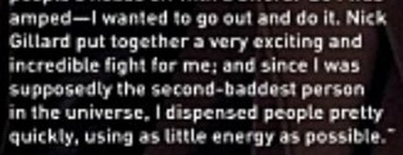
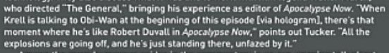
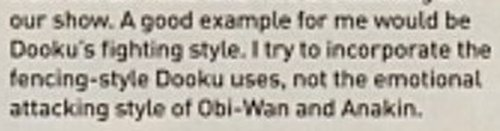

# Owner Material 038 — Star Wars Insider #1–153 plus specials (with The Lucasfilm Fan Club Magazine #1–22): Star Wars Insider #136 (2012)

- **Source:** *Star Wars Insider* magazine (issues 23–153, 1994–2014) and its predecessor *The Lucasfilm Fan Club Magazine* (issues 1–22, 1987–1994), plus seven special editions: articles, interviews, comics and short fiction Secondary source (licensed Legends reference). Scan OCR'd on the box; the scan stays box-only and is **not** published.
- **Method:** every scanned page was OCR'd and machine-screened sentence by sentence for power-relevant statements (fights, kills, defeats, Force feats, rankings, superweapons) that name a character on our roster; each kept sentence is quoted verbatim from the OCR text and has a crop of the printed passage directly under it. Pages with nothing power-relevant are still listed with what is on them.
- **Citation:** "*Star Wars Insider #136* (2012), p.X" by printed page ("scan p.X" where no printed number applies). **Weight:** Licensed magazine: a secondary source. Its short fiction and comics are Legends stories; its articles and interviews sum up or discuss lore and rank below the novels, comics and games they describe.

## scan p.1 (scan page 1)

Page contents: Cover: "Life of Leia!" Carrie Fisher; join the celebration (TCW at 5, AOTC at 10, ANH at 35). (hand-read)

## scan p.2 (scan page 2)

Page contents: Ad: Jocasta Nu exclusive figure (with a bust of Master Dooku). (hand-read)

## scan p.3 (scan page 3)

Page contents: Editorial (Jonathan Wilkins): Leia and Padmé as heroines; the never-before-published Carrie Fisher interview. Opening quote: "The princess? She's here?" —Luke Skywalker, A New Hope. (hand-read)

## scan p.4 (scan page 4)

Page contents: Contents opener with a crop-verified quote: "Remember...the Force will be with you, always." —Obi-Wan Kenobi, A New Hope, 1977. (hand-read)

## scan p.5 (scan page 5)

Page contents: Contents: Fisher, Episode II storyboards, Joel Aron photos, McQuarrie part 2, TCW S4 Blu-ray, Joe Johnston, "Bane Begins", Jaime King, Rogues Gallery (Outlander club), Classic Moment (Emperor reborn), Randy Martinez. (hand-read)

## scan p.6 (scan page 6)

Page contents: Ad: Insider digital edition. (hand-read)

## scan p.7 (scan page 7)

Page contents: Comic-Con 2012 report: TCW panel (Filoni, Matt Michnovetz): a "Revival" clip of Maul and Savage tearing through a space station; a clip from "The Lawless" with Sidious on Mandalore and Obi-Wan in Mandalorian armor fighting beside Bo-Katan; the Indiana Jones snake display; Course of the Force raised over a quarter-million dollars. (hand-read)

## scan p.8 (scan page 8)

Page contents: Exclusive glimpse of Reinhart's A Galactic Pop-Up Adventure (out October 16). (hand-read)

## scan p.9 (scan page 9)

Page contents: Remembering Kay Freeborn, makeup artist (her Insider #102 recollections; Tom Spina's tribute). (hand-read)

## scan p.10 (scan page 10)

Page contents: "The Perils of Being Indy!": Vic Armstrong, Harrison Ford's stunt double (Raiders' revolving-airplane fight; Ford keen to do his own stunts; Temple of Doom conveyor fight with Pat Roach). Health details omitted. (hand-read)

## scan p.11 (scan page 11)

Page contents: Armstrong: the Last Crusade horse-to-tank jump (three months' preparation); his ROTJ cameo as Han dragged by Ewoks. Events: Identities in Edmonton, Indiana Jones archaeology exhibit, Star Wars toys at the Louvre's Museum of Decorative Arts (400 items). (hand-read)

## scan p.12 (scan page 12)

Page contents: Special report (Mark Dermul): Save the Lars Homestead, mission accomplished. 425 donors gave $10K; the four founders and helpers restored the Tunisian igloo in May 2012 (staff and founder names as published). (hand-read)

## scan p.13 (scan page 13)

Page contents: Ad: CLiNT magazine (Mark Millar). (hand-read)

## scan p.14 (scan page 14)

Page contents: Carrie Fisher feature opener art. (hand-read)

## scan p.15 (scan page 15)

Page contents: "Keep Calm and Carrie On!": Charles Lippincott's January 4, 1977 interview with Carrie Fisher (never before published). (hand-read)

## scan p.16 (scan page 16)

Page contents: Fisher: always assumed she would perform; musicals and fantasy; old songs and big bands (Helen Forrest). Sidebar on Leia's looks (cinnamon buns, Ewok dress). (hand-read)

## scan p.17 (scan page 17)

Page contents: Fisher: growing up around cameras; home movies; reading (The Secret Garden, Hemingway, Fitzgerald, Orwell); studying at Central in London. (hand-read)

## scan p.18 (scan page 18)

Page contents: Fisher: sci-fi films and books; love comics. Leia's Greatest Looks: the gold bikini ("not helpless, as Jabba would later learn the hard way"). (hand-read)

## scan p.19 (scan page 19)

Page contents: Fisher: TV (Andy of Mayberry, Outer Limits) and comedies (Cary Grant, Capra). Looks: braided for battle on Hoth. (hand-read)

## scan p.20 (scan page 20)

Page contents: Fisher: Marx Brothers; curiosity about effects from her mother's films. Looks: Cloud City. (hand-read)

## scan p.21 (scan page 21)

Page contents: "Charming, to the last": Leia's classic put-downs ("walking carpet", "holding Vader's leash", "laser brain"). (hand-read)

## scan p.22 (scan page 22)

Page contents: AOTC 10th anniversary, "In Their Own Words" (interviews by Mark Newbold; fast quotes from the set). (hand-read)

## scan p.23 (scan page 23)

Page contents: Daniel Logan (2005): golf-cart races with Ewan McGregor; Lucas as "a regular guy". Temuera Morrison (2012): drew on his Maori warrior side to play Jango; if Jango had survived, "He'd be running the galaxy and be married to Zam Wesell." (hand-read)

## scan p.24 (scan page 24)

Page contents: Anthony Daniels: did the AOTC C-3PO puppetry himself; the cut scene in which Padmé dresses Threepio in his coverings. (hand-read)

## scan p.25 (scan page 25)

Page contents: Jesse Jensen (2008), art-department carpenter (Dooku's solar sailer) who replaced his brother Zac as Saesee Tiin. Fast quotes, crop-verified: Rick McCallum, "Yoda will be back in a bigger role than in Episode I, and we'll see him in action scenes this time too!"; Lucas on Dooku in the Peter Cushing mold and Anakin's flaws. (hand-read)

## scan p.26 (scan page 26)

Page contents: Hayden Christensen ("create my own Anakin") and Natalie Portman (Padmé no longer a queen) fast quotes; Rena Owen (Taun We, Nee Alavar) on Lucas. (hand-read)

## scan p.27 (scan page 27)

Page contents: Christopher Lee: Lucas spent 15 minutes on Sith history; Coppola watched his speeder-bike scene; the Dooku vs. Yoda fight shot in Australia and London ("danger of an unintentional laugh"). Nick Gillard (2007): Hayden "a natural at just about anything". (hand-read)

## scan p.28 (scan page 28)

Page contents: Veronica Segura (Cordé, 2011): "I never thought a wig could weigh more than a person!" Samuel L. Jackson fast quote (The Crimson Pirate inspiration). (hand-read)

- **Mace Windu** — entry/section: Samuel L. Jackson on Mace's AOTC fight: ""Nick Gillard put together a very exciting and incredible fight for me; and since I was supposedly the second-baddest person in the universe, I dispensed people pretty quickly, using as little energy as possible." —Samuel L. Jackson, Star Wars Insider 136, p. 28" Source: *Star Wars Insider #136* (2012), scan p.28
  

## scan p.29 (scan page 29)

Page contents: Ewan McGregor on R2-D2's appeal (family anecdote omitted); Bonnie Piesse (Beru, 2012): playing a younger Shelagh Fraser; greenscreen sunset; "I raised Luke Skywalker!" (hand-read)

## scan p.30 (scan page 30)

Page contents: My Star Wars: Jaime King (Aurra Sing voice; Mark Newbold and James Burns): her first autograph at SDCC 2009; turned down a Leia cameo in Fanboys. (hand-read)

## scan p.31 (scan page 31)

Page contents: Jaime King (bubbles viewed): ESB is her favorite ("deeply rooted in truth"); her favorite toy is her Aurra Sing figure. (hand-read)

## scan p.32 (scan page 32)

Page contents: Insider exclusive "Losing Padmé": never-before-seen Episode II storyboards. After the Geonosis arena battle, as Anakin, Obi-Wan, and Padmé race after Dooku, a stray laser bolt strikes their gunship. (hand-read)

## scan p.33 (scan page 33)

Page contents: Storyboards (viewed, no text): Padmé falls from the gunship's open door. (hand-read)

## scan p.34 (scan page 34)

Page contents: Storyboards (viewed, no text): Anakin and Obi-Wan react; Padmé lands on the dunes. (hand-read)

## scan p.35 (scan page 35)

Page contents: Storyboards (viewed, no text): Dooku on his speeder bike. (hand-read)

## scan p.36 (scan page 36)

Page contents: Storyboards (viewed, no text): Anakin and Obi-Wan argue; Padmé watches the battle. (hand-read)

## scan p.37 (scan page 37)

Page contents: Storyboards (viewed, no text): Padmé rises as the clone battle rages; the gunship flies on. (hand-read)

## scan p.38 (scan page 38)

Page contents: Celebration V portfolio by Joel Aron: the Main Event with George Lucas and Jon Stewart; R2-D2 crashes the party. (hand-read)

## scan p.39 (scan page 39)

Page contents: "Thru the Lens": Joel Aron's Celebration V portfolio intro. (hand-read)

## scan p.40 (scan page 40)

Page contents: Photos: TCW voice cast (James Arnold Taylor, Tom Kane, Catherine Taber, Matt Lanter) with Meagan Finnerty. (hand-read)

## scan p.41 (scan page 41)

Page contents: Photo (viewed): cast downtime in the hotel lounge; no caption. (hand-read)

## scan p.42 (scan page 42)

Page contents: Photo: Adrianne Curry with Darth Vader. (hand-read)

## scan p.43 (scan page 43)

Page contents: Photos: Dave Filoni preparing to address fans; James Arnold Taylor; a fan Cade Skywalker cosplay (unnamed). (hand-read)

## scan p.44 (scan page 44)

Page contents: Photo: Jay Laga'aia (Captain Typho) at rehearsal. (hand-read)

## scan p.45 (scan page 45)

Page contents: Photos: TheForce.net hosts; an unnamed Sith cheerleader; ILM's Lorne Peterson at the Main Event. (hand-read)

## scan p.46 (scan page 46)

Page contents: Rogues Gallery (Leland Y. Chee), "A Night at the Outlander Club" (names crop-verified): 01 Pons Lo, 02 Eos Morne, 03 Kristoff Vestswe, 04 Aliza Darsk, 05 Bille Doshun, 06 Hayde Gofai, 07 Onie Arkmen. (hand-read)

## scan p.47 (scan page 47)

Page contents: Outlander Club, continued: 08 Seib Nod, 09 Immi Danoo, 10 Dyemma Reel, 11 Wilst Molan, 12 Di Mantid, 13 Nyrat Agira, 14 Kell Borean. (hand-read)

## scan p.48 (scan page 48)

Page contents: McQuarrie part 2 opener (viewed): the probe droid painting; Thomas G. Smith's 1984 interview for Industrial Light & Magic: The Art of Special Effects. (hand-read)

## scan p.49 (scan page 49)

Page contents: "Back to the Drawing Board" (viewed): McQuarrie on Star Trek: Planet of the Titans and Battlestar Galactica; early Tusken Raider sketches (Lucas called them "a nomadic kind of mutated creatures"; McQuarrie gave them masks and goggles); ESB design with Joe Johnston; matte artist Michael Pangrazio. (hand-read)

## scan p.50 (scan page 50)

Page contents: McQuarrie quote: he never thought he'd be a film designer. (hand-read)

## scan p.51 (scan page 51)

Page contents: McQuarrie on E.T.: the Dr. Seuss-style spaceship, with the sound of a 747. (hand-read)

## scan p.52 (scan page 52)

Page contents: McQuarrie on working with Lucas (viewed): Lucas is a filmmaker who lets him work; Hoth and Dagobah paintings. (hand-read)

## scan p.53 (scan page 53)

Page contents: Ralph's favorite artists (Rockwell, Fawcett, Magritte, Parrish, the Wyeths); Ralph on art (music as the greater art). (hand-read)

## scan p.54 (scan page 54)

Page contents: TCW The Complete Season Four, out October 23, 2012 on DVD and Blu-ray (Pablo Hidalgo; viewed). (hand-read)

## scan p.55 (scan page 55)

Page contents: Arc-by-arc tour title page (viewed). (hand-read)

## scan p.56 (scan page 56)

Page contents: Season Four extras: the Battle of Mon Cala commentary (Riff Tamson, Commander Monnk, Kit Fisto, Lee-Char deleted scene); droid episodes; the Umbara arc with Krell's brutal command of Rex's clones (Walter Murch directed "The General"); "Shadow Warrior" with Anakin vs. Dooku; the 2.35 widescreen presentation. (hand-read)

- **Pong Krell** — entry/section: Krell unfazed under fire (Umbara commentary): ""When Krell is talking to Obi-Wan at the beginning of this episode [via hologram], there's that moment where he's like Robert Duvall in Apocalypse Now. All the explosions are going off, and he's just standing there, unfazed by it." —Jason Tucker, Star Wars Insider 136, p. 56" Source: *Star Wars Insider #136* (2012), scan p.56
  

## scan p.57 (scan page 57)

Page contents: Slaves of Zygerria (from the EU comics; Henry Gilroy says Sidious wants the Togruta artisans of Kiros to build monuments to him; a deleted scene with Miraj Scintel and Dooku). (hand-read)

## scan p.58 (scan page 58)

Page contents: Death Watch, "A Friend in Need": extended fight between Pre Vizsla and Ahsoka; the brawl between Ahsoka and Bo-Katan. Obi-Wan undercover arc: the Box, Dooku's manipulation of Obi-Wan; Cad Bane reclaims his hat from Bulduga. (hand-read)

## scan p.59 (scan page 59)

Page contents: Darth Maul Returns commentary (Filoni, Sam Witwer, James Arnold Taylor, and the episode writer; the writer's quotes are left out): Krismo and Pluma were once lovers before becoming siblings; the origin of Morley. Extended scenes: Ventress vs. Grievous; Ventress vs. the Kage warriors; Savage terrorizing a diner. (hand-read)

## scan p.60 (scan page 60)

Page contents: Subscription offer (free figure, save 20%). (hand-read)

## scan p.61 (scan page 61)

Page contents: Subscription offer details. (hand-read)

## scan p.62 (scan page 62)

Page contents: Joe Johnston interview opener (viewed; Thomas G. Smith), part of the never-before-published ILM series. (hand-read)

## scan p.63 (scan page 63)

Page contents: Johnston: DesignWorks; hired by John Dykstra in August 1975; storyboarded the opening Star Destroyer sequence first; redesigned Colin Cantwell's Star Destroyer (it "looked like a fortress or a minelayer"). (hand-read)

## scan p.64 (scan page 64)

Page contents: Johnston: screening rough sequences; Lucas's promise of a cover; shot design; the speeder bike brief ("look like they're going 200 miles-an-hour", later 89 mph); the School of Galactica sidebar. (hand-read)

## scan p.65 (scan page 65)

Page contents: Johnston on the ANH opening shot ("like the Indians attacking a stagecoach in space") and the Dykstraflex; Lucas's "come up with something interesting... then we'll worry about how to do it"; he prefers Empire. Caption: Johnston played both stormtroopers on the Death Star surface in a pickup shot. (hand-read)

## scan p.66 (scan page 66)

Page contents: Johnston: Empire was harder than Star Wars; the Ewoks evolved from 300 drawings to "We'll kill 'em with cuteness!"; the "Faster, More Intense!" sidebar (Lucas re-watched ANH reels: "kind of slow isn't it?"). (hand-read)

## scan p.67 (scan page 67)

Page contents: 3D section starts (viewed): a 3D cover with Slave I firing on a Jedi starfighter in an asteroid field. (hand-read)

## scan p.68 (scan page 68)

Page contents: AOTC 10th, TCW cast and crew quiz: Catherine Taber (Yoda "particularly badass in Episode II"; Padmé's ship blowing up). (hand-read)

## scan p.69 (scan page 69)

Page contents: Matt Lanter: Yoda "kicking some major butt"; "when Yoda flies in with the clone army and they just decimate the enemy"; Jango is a bad guy. (hand-read)

## scan p.70 (scan page 70)

Page contents: 3D art of Jango Fett with jetpack over Coruscant (viewed, no text). (hand-read)

## scan p.71 (scan page 71)

Page contents: Keith Kellogg (animation supervisor; family detail left out) and Joel Aron (Obi-Wan on Kamino; the Geonosis battle to Anakin losing his arm; Padmé "this bright star" for Anakin; Jango as the face of the Republic and Order 66, printed as "Order 65"). (hand-read)

- **Count Dooku** — entry/section: Animator on Dooku's fencing style (TCW): ""A good example for me would be Dooku's fighting style. I try to incorporate the fencing-style Dooku uses, not the emotional attacking style of Obi-Wan and Anakin." —Keith Kellogg, Star Wars Insider 136, p. 71" Source: *Star Wars Insider #136* (2012), scan p.71
  

## scan p.72 (scan page 72)

Page contents: James Arnold Taylor ("When Dooku makes such short work of Anakin. I still get surprised when people lose limbs"; would play Dexter Jettster) and Sam Witwer (favorite sequence "Yoda vs. Dooku"; Jango "a dad who can beat up your dad. Unless you're Luke Skywalker"). Crop-verified. (hand-read)

## scan p.73 (scan page 73)

Page contents: 3D comic "Duel of the Fates!" (writer Steve White, art Will Sliney, colors Digikore, letters Andrew James; viewed): on Tatooine, young Anakin and Sebulba trade boasts; in the Coruscant underworld, Darth Maul watches swoop riders. (hand-read)

## scan p.74 (scan page 74)

Page contents: "Duel of the Fates!" (viewed): the Boonta podrace in Beggar's Canyon. (hand-read)

## scan p.75 (scan page 75)

Page contents: "Duel of the Fates!" (viewed): Maul leaps among swoop-riding attackers (later revealed as training droids) and cuts them down. (hand-read)

## scan p.76 (scan page 76)

Page contents: "Duel of the Fates!" (viewed): the podrace continues, with Anakin and Sebulba racing past the Tusken snipers. (hand-read)

## scan p.77 (scan page 77)

Page contents: "Duel of the Fates!" (viewed): "He's heading down! Cut him off!" Maul destroys a swoop and its rider ("Hmmm"). (hand-read)

## scan p.78 (scan page 78)

Page contents: "Duel of the Fates!" (viewed): Sebulba crashes during the podrace and Anakin speeds on. (hand-read)

## scan p.79 (scan page 79)

Page contents: "Duel of the Fates!" (viewed): Maul destroys the last droid attackers with his saber; Sidious reveals the attack was a test. (hand-read)

### Stat block notes (game mechanics, not feats)

- Maul passes Sidious's swoop-droid test: "Well done, my apprentice." / "While the droids may still need work... ...you have performed beyond my expectations." (Duel of the Fates!, Star Wars Insider 136, p. 79) (Source: *Star Wars Insider #136* (2012), scan p.79)

## scan p.80 (scan page 80)

Page contents: "Duel of the Fates!" ending (viewed): Sidious says, "Time for you to face a real test, one worthy of a Sith..." Anakin and Maul are side by side. "The end... for now!" (hand-read)

## scan p.81 (scan page 81)

Page contents: Ad: Kotobukiya (Royal Guards; a Jaina Solo Bishoujo statue whose copy says she joined Rogue Squadron at 18 and became a Jedi Knight; Vader with an alternate Anakin head). (hand-read)

## scan p.82 (scan page 82)

Page contents: Ad: Supernatural magazine. (hand-read)

## scan p.83 (scan page 83)

Page contents: Classic Moment, Dark Horse's Dark Empire #6 "The Fate of a Galaxy" (Tom Veitch, Cam Kennedy): Mike Richardson's "What They Said"; trivia: an imposter in Vader's armor was a vetoed plotline. Next issue: "The Mandalorian Menace!" (hand-read)

### Stat block notes (game mechanics, not feats)

- Classic Moment: Luke vs. the reborn Emperor (Dark Empire #6): "Luke desperately destroys as many as he can, but the Emperor manages to make the transference into the last remaining one and faces Luke in a lightsaber duel. But, unlike the last time they met, Luke is now a Jedi Master and seems an even match until the Emperor gets the upper hand." (Classic Moment, Star Wars Insider 136, p. 83) (Source: *Star Wars Insider #136* (2012), scan p.83)
- Classic Moment: why it's a classic: "The Emperor is more powerful than ever, in a new body and with apparently indestructible new weapons. ... By joining his power with Leia and that of her as yet unborn child, Luke is finally able to triumph against the Emperor." (Classic Moment, Star Wars Insider 136, p. 83) (Source: *Star Wars Insider #136* (2012), scan p.83)

## scan p.84 (scan page 84)

Page contents: Exclusive fiction (written by Ari Marmell, art by Tom Hodges; viewed): Cad Bane in the moonlight. Contents title: "Bane Begins". (hand-read)

## scan p.85 (scan page 85)

Page contents: "Bane Begins": a Duros hunter on Coruscant before the Clone Wars ("War's coming"); Bothan boss Akris Ur'etu of the Skar'kla Consortium hides as a "Jedi" cuts through his blast door. (hand-read)

### Stat block notes (game mechanics, not feats)

- A young Bane leaps into action: "Coat flowing behind him like wings, boots spraying a wake of filthy water, the bounty hunter hit the edge of the platform and leapt." (Bane Begins, Star Wars Insider 136, p. 85) (Source: *Star Wars Insider #136* (2012), scan p.85)

## scan p.86 (scan page 86)

Page contents: The "Jedi" kills Ur'etu's guards with a detonator and a smoke-shrouded leap. (hand-read)

## scan p.87 (scan page 87)

Page contents: The Duros notes the Jedi's meter-long pike-like saber haft and flashes of light from the soles of his boots. (hand-read)

## scan p.88 (scan page 88)

Page contents: Ur'etu flees by a hidden passage to his Weequay security chief. (hand-read)

## scan p.89 (scan page 89)

Page contents: The Weequay readies his force pike ("Been wantin' to try my hand against a Jedi"). (hand-read)

## scan p.90 (scan page 90)

Page contents: "Bane Begins" art (viewed): Cad Bane tips his hat. (hand-read)

## scan p.91 (scan page 91)

Page contents: The false Jedi (using a mono-filament grapple, gas emitter, and boot jets, working for a Hutt) kills the Weequay and chokes Ur'etu; Bane exposes him and demands he teach him to build miniaturized gear. "Bane. The name's Cad Bane." "Never heard of you." "Not yet." (hand-read)

### Stat block notes (game mechanics, not feats)

- Bane shoots the false Jedi's lightsaber and boot jet: "I don't recommend it, son. Not even a Jedi'd be fast enough—and we both know you're no Jedi." ... And just as swiftly shut down as a blaster bolt tore through the shaft... "The boots, right. Impressive." A second blaster bolt flew, piercing miniature engine, leather, and flesh alike. (Bane Begins, Star Wars Insider 136, p. 91) (Source: *Star Wars Insider #136* (2012), scan p.91)

## scan p.92 (scan page 92)

Page contents: Ad: Gentle Giant (Sandtrooper on dewback, Gamorrean Guard, and others). (hand-read)

## scan p.93 (scan page 93)

Page contents: Section opener for Books, Incoming, and Red Five (Randy Martinez). (hand-read)

## scan p.94 (scan page 94)

Page contents: Books: Star Wars Art: Illustration (Abrams; editor Eric Klopfer; about 200 pieces chosen by Lucas). (hand-read)

## scan p.95 (scan page 95)

Page contents: Art: Hugh Fleming's "Dewback Attack" (Insider #35, 1997). (hand-read)

## scan p.96 (scan page 96)

Page contents: Star Wars Art: Illustration artist list; next volume Star Wars Art: Concepts (fall 2013); Terese Nielsen's "Luke and Gaitie Armige" Star Wars Miniatures art (2007). (hand-read)

## scan p.97 (scan page 97)

Page contents: Books: The Essential Reader's Companion (Pablo Hidalgo; Del Rey, October): every novel and short story, organized in-universe with notes on continuity; NJO development binder. (hand-read)

## scan p.98 (scan page 98)

Page contents: Comics: Dark Horse's new Star Wars series (Brian Wood, Carlos D'Anda, Alex Ross covers), set after ANH; Wood must write "a younger, less-experienced Wedge who survived Yavin with Luke", not the X-wing novels' Wedge. (hand-read)

## scan p.99 (scan page 99)

Page contents: Alex Ross ("Darth Vader is as big as any comic book legend") and D'Anda ("Vader is hard"; "I don't want to draw Harrison Ford, I want to draw Han Solo!"). (hand-read)

## scan p.100 (scan page 100)

Page contents: Incoming (Pete Vilmur): Fighter Pods Rampage X-wing vs. TIE pack; Acme Archives' "Revenge of the Sandpeople" print by Mark Daniels. (hand-read)

## scan p.101 (scan page 101)

Page contents: The "Revenge of the Sandpeople" retro zombie-movie poster (viewed). (hand-read)

## scan p.102 (scan page 102)

Page contents: Incoming: Adam Hughes's "Last Daughter of Alderaan" dart board; Nien Nunb mini bust. (hand-read)

## scan p.103 (scan page 103)

Page contents: Incoming (viewed): White Clone Trooper deluxe statue concept ($265). (hand-read)

## scan p.104 (scan page 104)

Page contents: Incoming: Revell SnapTite Landspeeder. (hand-read)

## scan p.105 (scan page 105)

Page contents: Incoming: Revell SnapTite TIE Fighter. (hand-read)

## scan p.106 (scan page 106)

Page contents: Bantha Tracks: the 501st's Empire City Garrison at West Point (presenting the colors to "Lord Vader"); member names omitted. (hand-read)

## scan p.107 (scan page 107)

Page contents: Bantha Tracks: El Centro Air Show; Buffalo Bisons Star Wars game; names omitted. (hand-read)

## scan p.108 (scan page 108)

Page contents: Bantha Tracks: a library Star Wars Day with a doll exhibit; Tampa Bay Lightning TPM 3D night; submission guidelines; names omitted. (hand-read)

## scan p.109 (scan page 109)

Page contents: Bantha Tracks: the Jedi Order of Japan in Osaka; May the Fourth at the Wings Over the Rockies museum; Canada Day troopers; editor Mary Franklin's column on Celebration II (fan groups, Frank D'Iorio's dioramas, the first R2 builders' room). (hand-read)

## scan p.110 (scan page 110)

Page contents: Bounty Hunters: a reader met Ian McDiarmid after Timon of Athens in Chicago (reader name omitted). (hand-read)

## scan p.111 (scan page 111)

Page contents: Bounty Hunters: reader encounters with Nick Gillard (lightsaber class), Bodie Taylor, Ray Park, and Dave Filoni; reader names and family omitted. (hand-read)

## scan p.112 (scan page 112)

Page contents: Red Five, Randy Martinez's favorite posters: a Hungarian ROTJ one-sheet, Tom Jung's Style A, the Style D "circus" poster by Charles White III and Drew Struzan. (hand-read)

## scan p.113 (scan page 113)

Page contents: Red Five: Hugh Fleming's "Star Wars Rocks"; Martinez's "Sgt. Lucas" Celebration Europe key art (personal names omitted). (hand-read)

## scan p.114 (scan page 114)

Page contents: Next issue: an exclusive Mark Hamill interview, Insider Awards winners, 1313 uncovered; on US newsstands October 23. (hand-read)

## scan p.115 (scan page 115)

Page contents: Back issues ad. (hand-read)

## scan p.116 (scan page 116)

Page contents: Ad: Hasbro Movie Heroes figures. (hand-read)

