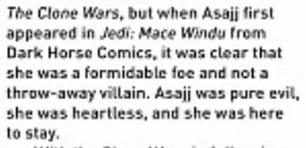
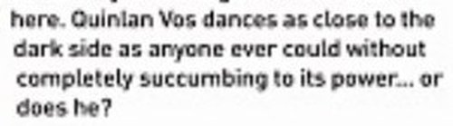

# Owner Material 038 — Star Wars Insider #1–153 plus specials (with The Lucasfilm Fan Club Magazine #1–22): Star Wars Insider #137 (2012)

- **Source:** *Star Wars Insider* magazine (issues 23–153, 1994–2014) and its predecessor *The Lucasfilm Fan Club Magazine* (issues 1–22, 1987–1994), plus seven special editions: articles, interviews, comics and short fiction Secondary source (licensed Legends reference). Scan OCR'd on the box; the scan stays box-only and is **not** published.
- **Method:** every scanned page was OCR'd and machine-screened sentence by sentence for power-relevant statements (fights, kills, defeats, Force feats, rankings, superweapons) that name a character on our roster; each kept sentence is quoted verbatim from the OCR text and has a crop of the printed passage directly under it. Pages with nothing power-relevant are still listed with what is on them.
- **Citation:** "*Star Wars Insider #137* (2012), p.X" by printed page ("scan p.X" where no printed number applies). **Weight:** Licensed magazine: a secondary source. Its short fiction and comics are Legends stories; its articles and interviews sum up or discuss lore and rank below the novels, comics and games they describe.

## scan p.1 (scan page 1)

Page contents: Cover: Mark Hamill exclusive interview; Insider Awards results issue. (hand-read)

## scan p.2 (scan page 2)

Page contents: Ad: Star Wars Insider Special Edition (classic interviews). (hand-read)

## scan p.3 (scan page 3)

Page contents: Editorial (Jonathan Wilkins): Luke's arc "from a whiny kid... to a powerful Jedi Knight in the space of three movies"; a never-before-printed Hamill interview from the Lucasfilm Archives, done before the film came out; first Insider Awards. (hand-read)

## scan p.4 (scan page 4)

Page contents: Contents: TCW season 5, Award Winners, Indy and Han, Hidalgo's Essential Reader's Companion, Old Republic fiction. (hand-read)

## scan p.5 (scan page 5)

Page contents: Contents (departments): My Star Wars with Dennis Muren; Rogues Gallery of Jedi who fell at the end of the Clone Wars; Classic Moment (Pre Vizla's darksaber); Red Five by Joe Corroney; Agent of the Empire—Hard Targets; Kotobukiya Jaina Solo. (hand-read)

## scan p.6 (scan page 6)

Page contents: Launch Pad: Star Wars Detours unveiled at Celebration VI (Seth Green, Matthew Senreich, Todd Grimes), a comedy set between Episodes III and IV: the Death Star passed off as a shopping mall, a bored Vader, a 14-year-old Leia, Bilf Tarkin, Sergeant Basher; non-canon parody. (hand-read)

## scan p.7 (scan page 7)

Page contents: Launch Pad: TCW art of the Banking Clan vault and Scipio (Chris Glenn, Andre Kirk). (hand-read)

## scan p.8 (scan page 8)

Page contents: Launch Pad: AOTC 3D and ROTS 3D for fall 2013, "10 scenes" including "Yoda battles Sidious, and the Senate comes off worse" (promo blurb, not a feat). (hand-read)

## scan p.9 (scan page 9)

Page contents: Launch Pad (viewed): 3D stills; dates were AOTC 3D September 20, 2013 and ROTS 3D October 13, 2013 (later cancelled). (hand-read)

## scan p.10 (scan page 10)

Page contents: Launch Pad: Ryan Hall's paper Star Wars figures at Rancho Obi-Wan; Camille Paglia's Glittering Images calls Lucas the greatest living artist; Celebration Europe II in Essen, July 24–28, 2013. (hand-read)

## scan p.11 (scan page 11)

Page contents: Ad: Brian's Toys. (hand-read)

## scan p.12 (scan page 12)

Page contents: Mark Hamill interviewed by Charles Lippincott in January 1977, from the Lucasfilm Archives (intro). (hand-read)

## scan p.13 (scan page 13)

Page contents: Full-page photo of Hamill as Luke with a blaster (viewed). (hand-read)

## scan p.14 (scan page 14)

Page contents: Hamill/Lippincott: casting (Fred Roos), Star Wars' structure ("Luke grows up in Star Wars"), the droids as Laurel and Hardy, Han as his favorite character; Gary Kurtz as "Mr. Machine"; the THX 1138 prisoner-transfer in-joke. (hand-read)

## scan p.15 (scan page 15)

Page contents: Hamill on Lucas: "Just from the script alone, I thought Star Wars was a winner"; his nickname "The Kid". (hand-read)

## scan p.16 (scan page 16)

Page contents: Hamill on Harrison Ford (viewed): Ford called him "kid"; the "Mr. Kid" phone message. (hand-read)

## scan p.17 (scan page 17)

Page contents: Hamill on Alec Guinness ("my favorite actor") and Peter Cushing; early love of magic tricks, Harryhausen, King Kong, Famous Monsters, comics (Silver Surfer, Green Lantern, Batman "because of his mortality"); EC comics. (hand-read)

## scan p.18 (scan page 18)

Page contents: "The Hero's Journey" sidebar (crop-verified): also Luke getting Han and Chewie to go along with the rescue, the Death Star run, and showing off his lightsaber skills at the "Saarlac pit" (sic). (hand-read)

### Stat block notes (game mechanics, not feats)

- holds his own against Vader at Bespin until overwhelmed: "Taking on the Dark Lord would be a brave move for even a veteran Jedi, but for an impatient Padawan? Thankfully, Luke's enough of a Jedi to hold his own, until Vader overwhelms him." ("The Hero's Journey", Star Wars Insider 137, p. 18) (Source: *Star Wars Insider #137* (2012), scan p.18)
- first Force pull: the lightsaber in the wampa cave: "It's easily overlooked, but the first sense of Luke using the physical force can be seen as he races to collect his lightsaber from its icy home as a ferocious and very hungry wampa approaches at speed...." ("The Hero's Journey", Star Wars Insider 137, p. 18) (Source: *Star Wars Insider #137* (2012), scan p.18)

## scan p.19 (scan page 19)

Page contents: Hamill on growing up (family details omitted), his school years in Japan, and free first-run movies on the naval base; predicts Star Wars will be "amazing" in Japan. (hand-read)

## scan p.20 (scan page 20)

Page contents: Hamill on Japanese monster films, testing for the voice of Astro Boy, and life on the base; "The Many Outfits of Luke Skywalker" sidebar (farmboy chic). (hand-read)

## scan p.21 (scan page 21)

Page contents: Hamill on high school in Virginia as the "court jester" of a tough crowd; Hoth gear sidebar. (hand-read)

## scan p.22 (scan page 22)

Page contents: My Star Wars: Dennis Muren (eight-time Oscar winner, an original ILM member) on first hearing of Star Wars in 1975, seeing it, being recognized at the Tate, and not being a sci-fi fan. (hand-read)

## scan p.23 (scan page 23)

Page contents: Muren (viewed): his favorite scene is the helicopter shot of Luke on the tauntaun opening Empire; he is supervising the AOTC/ROTS 3D conversions. (hand-read)

## scan p.24 (scan page 24)

Page contents: 119 words, 9 paragraphs | headings/entries: HTS ON THE SHOW!

## scan p.25 (scan page 25)

Page contents: Pre Vizla image (viewed); Filoni on keeping the show's darkness in check for kids who have not seen ROTS. (hand-read)

## scan p.26 (scan page 26)

Page contents: TCW cast and crew: Ashley Eckstein and Filoni on strong female characters and why Ahsoka was created (Filoni's family detail omitted); Filoni hopes to bring Mark Hamill onto the show, but not in Season 5; Joel Aron on the show's Frank Miller-influenced lighting; Anakin's bedroom like Elliott's from E.T.; kids learning Anakin's fate from TCW. (hand-read)

## scan p.27 (scan page 27)

Page contents: Filoni on what the show means (Campbell), Lucas's retirement and Kathleen Kennedy, a sixth season in the works; Season 4 Blu-ray/DVD October 23. (hand-read)

## scan p.28 (scan page 28)

Page contents: Star Wars Insider Awards results (reader-voted) intro. (hand-read)

## scan p.29 (scan page 29)

Page contents: Awards: Favorite movie villain went to Vader, ahead of Boba Fett 18.2%, Maul 15.1%, Palpatine 11.2%, Grievous 7.6% (popularity poll, not scaling). (hand-read)

## scan p.30 (scan page 30)

Page contents: Awards (viewed): Favorite hero went to Obi-Wan Kenobi, ahead of Han, Luke, Yoda, and Anakin; Favorite moment was "No, I am your father!", ahead of Order 66, Obi-Wan and Qui-Gon vs. Maul, the Death Star attack, and the Emperor's death. (hand-read)

## scan p.31 (scan page 31)

Page contents: Awards (viewed): Favorite movie was The Empire Strikes Back, ahead of ROTS, ROTJ, ANH, and AOTC; Favorite TCW S4 episode was "Revenge" (Maul's return), ahead of "Carnage of Krell", "Bounty", "Brothers", and "The Box". (hand-read)

## scan p.32 (scan page 32)

Page contents: Awards: Favorite novel was Darth Plagueis (Luceno), ahead of the Heir to the Empire anniversary edition, Fate of the Jedi, the Old Republic novels, and Choices of One; Favorite reference book was the Character Encyclopedia (Ryder Windham), ahead of the Essential Guide to Warfare, The Jedi Path, the Falcon owner's guide, and The Blueprints. (hand-read)

## scan p.33 (scan page 33)

Page contents: Awards (viewed): Favorite comic was Legacy—War (Ostrander), ahead of Blood Ties, KOTOR—War, The Old Republic, and Dawn of the Jedi; Favorite collectible was Hasbro's Vintage Collection. (hand-read)

## scan p.34 (scan page 34)

Page contents: Outstanding Contribution award: George Lucas. (hand-read)

## scan p.35 (scan page 35)

Page contents: Outstanding Contribution awards: Ralph McQuarrie (posthumous), Dave Filoni, Steve Sansweet (Rancho Obi-Wan). (hand-read)

## scan p.36 (scan page 36)

Page contents: Rogues Gallery "Stand of the Jedi!" (Leland Y. Chee, viewed; names only, no bios): Shadday Potkin, Whie Malreaux, Melik Galerha, Joopi Shé, Cin Drallig. (hand-read)

## scan p.37 (scan page 37)

Page contents: Rogues Gallery (viewed): Bene, Olana Chion, Ma'kis'shaalas, Jurokk, Koffi Arana. (hand-read)

## scan p.38 (scan page 38)

Page contents: "Small World, Dr. Jones" title page (Matt Ford): links between Indiana Jones and Star Wars. (hand-read)

## scan p.39 (scan page 39)

Page contents: Indy feature intro: the serials of the 1930s and '40s; Indy on Blu-ray. (hand-read)

## scan p.40 (scan page 40)

Page contents: Indy links: the "OB-CPO" biplane and Falcon hyperdrive sound (Ben Burtt quote on reused sounds); Indiana Smith and Lucas's Malamute Indiana; Tunisia's "Star Wars Canyon" and Elstree; William Hootkins and Michael Sheard cameos; C-3PO and R2-D2 hieroglyphics. (hand-read)

## scan p.41 (scan page 41)

Page contents: Indy links: Temple of Doom as a prequel; Club Obi Wan; the Thuggee chase mirroring Han's stormtrooper chase; the spike chamber and the trash compactor; Vic Armstrong doubling for Ford in Doom and in ROTJ's Ewok-stake scene; "Indy shoots first". (hand-read)

## scan p.42 (scan page 42)

Page contents: Indy links: Julian Glover (Veers/Donovan), the "Imperial March" on the piano, the Wilhelm scream; the comic "Into the Great Unknown" (Haden Blackman), where Han is killed by a tribe on a planet where the Falcon crashed and Indy later finds his skeleton (non-canon Infinities-style story); Ford as Han and Indy. (hand-read)

## scan p.43 (scan page 43)

Page contents: Indy links: Indy's own expanded universe; Quechua and Burtt's alien languages; "I have a bad feeling about this"; crew cameos (Muren as a Nazi spy, Lucas in Temple of Doom). (hand-read)

## scan p.44 (scan page 44)

Page contents: "Guide to a Galaxy": Pablo Hidalgo on Star Wars: The Essential Reader's Companion (interview by Jonathan Wilkins), intro. (hand-read)

## scan p.45 (scan page 45)

Page contents: Art (viewed, caption crop-verified): "Boba Fett is slowly digested in the stomach of the Sarlacc. Art by Jeff Carlisle." (hand-read)

## scan p.46 (scan page 46)

Page contents: Hidalgo on the book's origins (internally the "Official Guide to Fiction"), prose vs. visuals, entry lengths, what was included (novels, short stories, Jude Watson juniors) and left out (comics, very young reader books, choose-your-adventure books); complete to the end of 2012, missing Zahn's "Winner Lose All". (hand-read)

### Stat block notes (game mechanics, not feats)

- art caption: Plagueis fights assassins at the Canted Circle ambush: "Darth Plagueis battles assassins as the secret gathering of the Order of the Canted Circle is ambushed." (caption, "Guide to a Galaxy", Star Wars Insider 137, p. 46) (Source: *Star Wars Insider #137* (2012), scan p.46)

## scan p.47 (scan page 47)

Page contents: Art: "Team Falcon!" Han, Chewbacca, Blue Max, and Bollux (Chris Trevas). (hand-read)

## scan p.48 (scan page 48)

Page contents: Hidalgo: the original trilogy era is under-represented in prose; continuity callouts; his sidebar on how Darth Bane re-established the Sith Order; his first Star Wars books (Han Solo at Stars' End, the Foster novelization). Caption (crop-verified): Obi-Wan, Anakin, and Siri Tachi battle seeker droids swarming the Senate chambers (Trevas). (hand-read)

## scan p.49 (scan page 49)

Page contents: Art (viewed, caption crop-verified): "Luke Skywalker defends himself as Dathomirian warrior Teneniel Djo strikes! Art by Darren Tan." (hand-read)

## scan p.50 (scan page 50)

Page contents: Hidalgo on the artists (Tan, Trevas, Carlisle, Scalf, Corroney, Brian Rood); the blue-skinned Yoda in Glut's ESB novelization; he hopes for a new Comics Companion. Captions: Bail Organa helps a wounded Obi-Wan across Zigoola (Trevas); Rahm Kota and Den Dhur (Rood). (hand-read)

## scan p.51 (scan page 51)

Page contents: Art: the Solo/Skywalker family dinner from Legacy of the Force (Chris Scalf). (hand-read)

## scan p.52 (scan page 52)

Page contents: Exclusive fiction (viewed): "The Last Battle of Colonel Jace Malcom" by Alexander Freed, art by David Rabbitte (SWTOR era, tie-in to Annihilation). (hand-read)

## scan p.53 (scan page 53)

Page contents: Malcom (SpecForce, scarred, 40 years fighting the Sith Empire) advises Sergeant Immel's Republic squad on Kalandis Seven; they leave a dying corporal and move on to bomb an Imperial spaceport; propaganda reports the Empire withdrawing from Corellia. (hand-read)

## scan p.54 (scan page 54)

Page contents: Malcom shoots two Imperial troopers in the back; spots a planetary command ship and goes in alone to capture it; takes a bolt on the lower deck (kolto injections); knocks out a sentry with his rifle butt. (hand-read)

## scan p.55 (scan page 55)

Page contents: The Sith overseer (unnamed, brass mask) evades Malcom's first blaster bursts "like a dancer" before he crashes into her with the weight of his armor; she drops her lightsaber. (hand-read)

### Stat block notes (game mechanics, not feats)

- Malcom on fighting Sith: "There were no tricks to fighting Sith, Jace had explained to more officers and grunts than he cared to remember. Sith were powerful, and fast, and they broke just as easily as anyone else. You couldn't afford to fear them—not even for a moment. The rest was just smart fighting." ("The Last Battle of Colonel Jace Malcom", Star Wars Insider 137, p. 55) (Source: *Star Wars Insider #137* (2012), scan p.55)
- tackles the Sith overseer, survives her lightning through his helmet, and shoots her dead: "Jace felt something give beneath him—a robed arm twisted out of position or a rib broken somewhere—even as he slammed an elbow toward where the Sith's head seemed to be... a second later a hand closed over his helmet and his vision turned white... He rolled, and blinked away spots in time to see the last arcs of electricity jump from the Sith's hand toward him. Any longer, or without the helmet, and the Sith's sorcery would've charred his skull... Jace squeezed his rifle's trigger. This time, the bolts struck heart and lung" ("The Last Battle of Colonel Jace Malcom", Star Wars Insider 137, p. 55) (Source: *Star Wars Insider #137* (2012), scan p.55)

## scan p.56 (scan page 56)

Page contents: The Sith's dying command triggers self-destruct; the spaceport is destroyed; Malcom is recalled to the Core Worlds by the Supreme Chancellor aboard Frontier Justice, whose Jedi captain "had fought through half a dozen blockades just to arrive at Kalandis on time"; a likely promotion (sets up his role in TOR). (hand-read)

### Stat block notes (game mechanics, not feats)

- survives the self-destructing command ship by rolling out onto a Republic fighter's wing: "The ship shook, and Jace rolled out into the fog, falling free, looking down onto a rising shadow. He hit surface fast—much too fast, much too close to be at ground level—and lay stunned for a few long moments. He realized he was hugging the wing of a Republic fighter, hovering near the plummeting mass of the Imperial command ship." ("The Last Battle of Colonel Jace Malcom", Star Wars Insider 137, p. 56) (Source: *Star Wars Insider #137* (2012), scan p.56)

## scan p.57 (scan page 57)

Page contents: Full-page art (viewed): Malcom clinging to the Republic fighter's wing beside the falling command ship (Rabbitte). (hand-read)

## scan p.58 (scan page 58)

Page contents: Ad: The Old Republic: Annihilation by Drew Karpyshyn (November, hardcover). (hand-read)

## scan p.59 (scan page 59)

Page contents: Classic Moment (Neil Edwards): Obi-Wan vs. Pre Vizsla in TCW "The Mandalore Plot"; Filoni (from Insider #116) on the darksaber starting as a vibroblade and being taken from the Jedi Temple in the Old Republic; trivia: Vizsla was first "Vista", and Satine's look came from a Padmé concept. (hand-read)

### Stat block notes (game mechanics, not feats)

- the editorial verdict on the duel: Obi-Wan the better fighter: "Obi-Wan, however, sticks to the Jedi Code and proves he's the better fighter. He also makes a tactical retreat, reminding us that he is one of the wisest Jedi, as well as one of the most powerful." ("Classic Moment", Star Wars Insider 137, p. 59) (Source: *Star Wars Insider #137* (2012), scan p.59)
- script excerpt: the duel's beats: "PRE VIZSLA: Defend her, if you will. Defeat me or die on this blade, like many Jedi before you... Obi-Wan knocks Pre Vizsla back with the force of his lightsaber strike. Pre Vizsla moves forward again, but Obi-Wan quickly disarms him. Vizsla recovers and punches Obi-Wan so hard he FLIES back... But Obi-Wan FORCE LEAPS into the air and lands two hard punches on Pre Vizsla before tossing him to the ground." (script (2008), "Classic Moment", Star Wars Insider 137, p. 59) (Source: *Star Wars Insider #137* (2012), scan p.59)

## scan p.60 (scan page 60)

Page contents: Ad: Star Wars Insider digital edition. (hand-read)

## scan p.61 (scan page 61)

Page contents: Section opener: The latest gear; Sansweet's Ultimate Action Figure Collection. (hand-read)

## scan p.62 (scan page 62)

Page contents: Books: The Ultimate Action Figure Collection (Sansweet; nearly 2,500 figures; Becker&Mayer's Kjersti Egerdahl). (hand-read)

## scan p.63 (scan page 63)

Page contents: Books: The Old Republic: Annihilation (Karpyshyn, November 13): Theron Shan, non-Force-sensitive son of Satele Shan; Darth Karrid and the Ascendant Spear; Teff'ith and Gnost-Dural. Star Wars and History (Wiley; editors Nancy Reagin and Janice Liedl; Rinzler on Lucas's outline). (hand-read)

## scan p.64 (scan page 64)

Page contents: Books: The Old Republic Encyclopedia (lead author Ian Ryan, 262 pages, in-universe; secrets of the Sith Emperor, Supreme Chancellor Janarus). (hand-read)

## scan p.65 (scan page 65)

Page contents: Comics: Omnibus: Clone Wars Vol. 2—The Enemy On All Sides (Republic #54–66 and #68 (crop-verified), covering Jabiim, Obi-Wan vs. Asajj Ventress, and Mace Windu's vendetta against bounty hunters; Jedi—Yoda; General Grievous #1–4); KOTOR Vol. 10—War (Zayne Carrick drafted into the Mandalorian Wars); Dark Times Vol. 5—Out of the Wilderness (Dass Jennir pursued by an assassin and Vader). (hand-read)

## scan p.66 (scan page 66)

Page contents: Comics: Agent of the Empire—Hard Targets (Ostrander, Davide Fabbri, Stéphane Roux covers): Jahan Cross on Alderaan at a Bail Organa celebration for the current Count Dooku; Leia and Boba Fett appear. (hand-read)

## scan p.67 (scan page 67)

Page contents: Art: Hard Targets cover by Stéphane Roux. (hand-read)

## scan p.68 (scan page 68)

Page contents: Incoming (Pete Vilmur): Fantasy Flight's X-Wing Millennium Falcon expansion ($29.95, November 2012). (hand-read)

## scan p.69 (scan page 69)

Page contents: Incoming: Kotobukiya Jaina Solo ARTFX Bishoujo statue (Shunya Yamashita design; Koto's first non-screen Star Wars figure; $44.99); Chewbacca messenger bag; Nintendo bobblehead styluses. (hand-read)

## scan p.70 (scan page 70)

Page contents: Incoming: LEGO B-wing (1,436 pieces, $199.99); Revell SnapTite kits. (hand-read)

## scan p.71 (scan page 71)

Page contents: Incoming: Seiko Brightz Japan-exclusive watches (about $1,700); Galerie gummy candies. (hand-read)

## scan p.72 (scan page 72)

Page contents: Bounty Hunters: a reader and his R2 unit met Kenny Baker and other guests at Celebration VI (reader name omitted). (hand-read)

## scan p.73 (scan page 73)

Page contents: Bounty Hunters: reader encounters with Peter Mayhew, Jeremy Bulloch, Nick Gillard, Tim Rose, Daniel Logan, Anthony Daniels, and Katie Cook (reader and family names omitted). (hand-read)

## scan p.74 (scan page 74)

Page contents: Bantha Tracks "Crafty Tracks": a family's projects from The Star Wars Craft Book (names omitted). (hand-read)

## scan p.75 (scan page 75)

Page contents: Bantha Tracks: fan R2-D2 cakes, pyrography, a pine R2-D2 made after a hurricane, an Ahsoka bag, a Grievous pinewood derby car (all fan names omitted). (hand-read)

## scan p.76 (scan page 76)

Page contents: Bantha Tracks: tattoo artists' charity skateboard decks; actor Gerald Home (Tessek, a Mon Calamari officer in ROTJ) on a gift from fans in Valencia; submission guidelines; Celebration VI fan photos (names omitted). (hand-read)

## scan p.77 (scan page 77)

Page contents: Bantha Tracks: Star Wars University's "From World War to Star Wars" talk (Cole Horton, Chris Reiff, Chris Trevas); the Elite Squad volunteers (names omitted); editor Mary Franklin. (hand-read)

## scan p.78 (scan page 78)

Page contents: Red Five (interview by Mark Newbold): Joe Corroney's five great Star Wars comic-book characters, starting with Asajj Ventress and Valance the Hunter. (hand-read)

- **Asajj Ventress** — entry/section: Corroney on Ventress's debut in Jedi: Mace Windu: ""when Asajj first appeared in Jedi: Mace Windu from Dark Horse Comics, it was clear that she was a formidable foe and not a throw-away villain. Asajj was pure evil, she was heartless, and she was here to stay." —Joe Corroney, Star Wars Insider 137, p. 78" Source: *Star Wars Insider #137* (2012), scan p.78
  

### Stat block notes (game mechanics, not feats)

- Valance's sacrifice against Vader: "Rather than revealing Luke's identity as the pilot who destroyed the Death Star to Vader, Valance sacrifices himself during his battle with the Dark Lord in an effort to allow Luke to escape." (Red Five, Star Wars Insider 137, p. 78) (Source: *Star Wars Insider #137* (2012), scan p.78)

## scan p.79 (scan page 79)

Page contents: Red Five, continued: Aayla Secura (first appeared in Republic "Twilight"; Lucas put her in the films; originally meant to be killed off); Quinlan Vos; Lumiya (Shira Brie, lightwhip wielder); honorable mention Kai Justiss (Corroney's own Jedi, captured in a battle in Jedi: Dooku and then released by Count Dooku). The family detail behind Aayla being spared is omitted. (hand-read)

- **Quinlan Vos** — entry/section: Corroney on Vos and the dark side: ""Quinlan Vos dances as close to the dark side as anyone ever could without completely succumbing to its power... or does he?" —Joe Corroney, Star Wars Insider 137, p. 79" Source: *Star Wars Insider #137* (2012), scan p.79
  

### Stat block notes (game mechanics, not feats)

- Kai Justiss in Jedi: Dooku: "Jan and John Ostrander included Kai for a battle scene early on in the story where he's captured, then released by Count Dooku." (Red Five, Star Wars Insider 137, p. 79) (Source: *Star Wars Insider #137* (2012), scan p.79)

## scan p.80 (scan page 80)

Page contents: Subscription ad (UK/rest of world): free action figure. (hand-read)

## scan p.81 (scan page 81)

Page contents: Subscription ad (US/Canada): free Insider T-shirt. (hand-read)

## scan p.82 (scan page 82)

Page contents: Next issue: Harrison Ford on Han Solo; Timothy Zahn's Scoundrels plus a short story; Celebration VI; TCW Season Five's first half. On sale December 11 (US). (hand-read)

## scan p.83 (scan page 83)

Page contents: Ad: CLiNT magazine. (hand-read)

## scan p.84 (scan page 84)

Page contents: Ad: The Walking Dead magazine. (hand-read)

## scan p.85 (scan page 85)

Page contents: Back cover (OCR empty; viewed): cartoon close-up of Chewbacca's bandolier. (hand-read)

