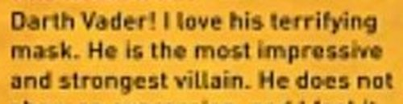
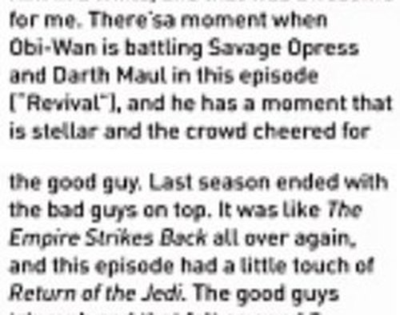
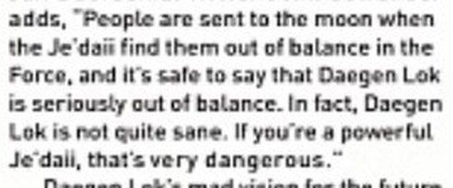
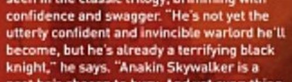

# Owner Material 038 — Star Wars Insider #1–153 plus specials (with The Lucasfilm Fan Club Magazine #1–22): Star Wars Insider #138 (2013)

- **Source:** *Star Wars Insider* magazine (issues 23–153, 1994–2014) and its predecessor *The Lucasfilm Fan Club Magazine* (issues 1–22, 1987–1994), plus seven special editions: articles, interviews, comics and short fiction Secondary source (licensed Legends reference). Scan OCR'd on the box; the scan stays box-only and is **not** published.
- **Method:** every scanned page was OCR'd and machine-screened sentence by sentence for power-relevant statements (fights, kills, defeats, Force feats, rankings, superweapons) that name a character on our roster; each kept sentence is quoted verbatim from the OCR text and has a crop of the printed passage directly under it. Pages with nothing power-relevant are still listed with what is on them.
- **Citation:** "*Star Wars Insider #138* (2013), p.X" by printed page ("scan p.X" where no printed number applies). **Weight:** Licensed magazine: a secondary source. Its short fiction and comics are Legends stories; its articles and interviews sum up or discuss lore and rank below the novels, comics and games they describe.

## scan p.1 (scan page 1)

Page contents: Cover: Harrison Ford on becoming Han Solo; Lucas and Kennedy on the future; plus Boba Fett, Timothy Zahn, Celebration VI. (hand-read)

## scan p.2 (scan page 2)

Page contents: Ad: The Walking Dead magazine. (hand-read)

## scan p.3 (scan page 3)

Page contents: Editorial (Jonathan Wilkins, January/February 2013): a never-before-run Ford interview; Zahn's Scoundrels and a short story; Angry Birds Star Wars; Catherine Taber's side-arms guide; Tsuneo Sanda; the Disney purchase of Lucasfilm and the new trilogy planned for 2015. (hand-read)

## scan p.4 (scan page 4)

Page contents: Contents (viewed): full-page Han Solo photo, "12 Han Solo: a never-before-published interview with Harrison Ford". (hand-read)

## scan p.5 (scan page 5)

Page contents: Contents: Lucas/Kennedy, Zahn, Tsuneo Sanda, Celebration VI, the Zahn fiction, Rogues Gallery (Gamorrean guards), Classic Moment (Anakin and C-3PO reunited, comic), Taber's five weapons, books (What Is a Sith Warrior?, Who Are the Jedi?), comics (Dawn of the Jedi: Prisoner of Bogan; Purge—The Tyrant's Fist), Incoming, Bounty Hunters, Bantha Tracks. (hand-read)

## scan p.6 (scan page 6)

Page contents: Launch Pad: Disney agrees to buy Lucasfilm (October 30, 2012); Episode VII targeted for 2015; Kennedy named Lucasfilm president; Lucas quote on passing Star Wars to new filmmakers; Robert Iger quote; Michael Arndt to write the Episode VII screenplay. (hand-read)

## scan p.7 (scan page 7)

Page contents: Launch Pad (viewed): David Tennant voices the droid Huyang in TCW "A Test of Strength" (Insider had recommended him to Filoni in 2011; inset reprint of that page); Sansweet's Ultimate Toy Collection giveaway. (hand-read)

## scan p.8 (scan page 8)

Page contents: Launch Pad: TCW Season Five concept art: Carida star base ("Point of No Return", Pat Presley); Filoni's sketch of D-Squad on Abafar ("A Sunny Day in the Void"); Pons Ora mining facility (Chris Glenn, "Missing in Action"). (hand-read)

## scan p.9 (scan page 9)

Page contents: Launch Pad: Lucasfilm Sidewalk Art Festival (Ackbar "It's a trap!" won); Vulture's devoted fanbases list (Star Wars at #2); Hasbro MTT giveaway; IGT Star Wars slots; Aigan eyewear. (hand-read)

## scan p.10 (scan page 10)

Page contents: Launch Pad: US Navy C-3PO-inspired firefighting robot ASH (Virginia Tech RoMeLa; the researcher quoted is omitted as a non-staff person in the news); the PocketWarwick app; "In Our Galaxy" actor projects (Neeson, McGregor, Davis, Ford, Portman, Fisher, Hamill, James Earl Jones; ILM's slate). (hand-read)

## scan p.11 (scan page 11)

Page contents: Ad: Brian's Toys. (hand-read)

## scan p.12 (scan page 12)

Page contents: The Harrison Ford/Charles Lippincott interview from January 1977 (archive): on interviews and on George Lucas ("George didn't talk at all when we worked on Graffiti"). (hand-read)

## scan p.13 (scan page 13)

Page contents: Full-page photo (OCR empty; viewed): Harrison Ford as Han Solo, blaster raised. (hand-read)

## scan p.14 (scan page 14)

Page contents: Ford interview: Han and Leia (the Princess's "cynicism about her environment"); on auditioning (Fred Roos insisted; Ford knew "from the beginning what he was like"). Photo captions (ESB publicity, audition still, ANH cast). Non-cast audition names omitted. (hand-read)

## scan p.15 (scan page 15)

Page contents: Ford interview pull quote; on producer Gary Kurtz's color-pencil shot layouts. (hand-read)

## scan p.16 (scan page 16)

Page contents: Ford interview (viewed): on Han Solo ("I don't know how to act. It's different every time..."); Endor photo with Fisher; "Trust Him" Ford facts sidebar (carpentry, Colonel G. Lucas in Apocalypse Now, species named after him). (hand-read)

## scan p.17 (scan page 17)

Page contents: Ford interview (viewed; full-page portrait): on fame and being "an indoor actor". (hand-read)

## scan p.18 (scan page 18)

Page contents: Ford interview: on working with the English crew. (hand-read)

## scan p.19 (scan page 19)

Page contents: Ford interview: on humor in Star Wars ("There are laughs... I don't think there are jokes"); on not knowing what to expect; Han's "thematic function". Death Star and Endor photo captions. (hand-read)

## scan p.20 (scan page 20)

Page contents: My Star Wars: Jeremy Bulloch (interview James Burns and Mark Newbold): favorite scene, Vader's "No disintegrations" on his first day on set; first autograph in 1983; the Newcomers bus-stop story. Family details omitted. (hand-read)

## scan p.21 (scan page 21)

Page contents: My Star Wars (viewed): Bulloch's favorite film is ESB (his first appearance); Olly Moss–style ESB Boba Fett poster art; www.jeremybulloch.com. (hand-read)

## scan p.22 (scan page 22)

Page contents: The Saga Continues: Lucas and Kennedy talk to Lynne Hale (October 19, 2012) about the Disney merger, Lucas's retirement, and Disney as a home for Star Wars. (hand-read)

## scan p.23 (scan page 23)

Page contents: Full-page portrait of Kathleen Kennedy (viewed): "Ready to take Lucasfilm forward and Star Wars back to the big screen." (hand-read)

## scan p.24 (scan page 24)

Page contents: Lucas/Kennedy: Disney as brand steward; the new films. Lucas has story treatments for Episodes VII, VIII and IX and hands them to Kennedy ("I'm going from being the creator to a fan"); Kennedy is meeting writers. (hand-read)

## scan p.25 (scan page 25)

Page contents: Lucas/Kennedy: fans and protecting the characters; how Lucas asked Kennedy to take over at a New York lunch; "My Yoda has to be there"; retirement as letting go. Pull quote: "The one thing I missed in life is that I never got to see Star Wars." Interviewee family details omitted. (hand-read)

## scan p.26 (scan page 26)

Page contents: Lucas/Kennedy: Kennedy on building a production company again; ILM and Skywalker Sound unchanged; new filmmakers; what she looks for in a director. (hand-read)

## scan p.27 (scan page 27)

Page contents: Lucas/Kennedy: Lucas as creative consultant ("a lot of blank spots in the story treatments"); Kennedy calls him "the keeper of the flame"; the essence of Star Wars (mythology, good and evil, democracies turning into dictatorships). Photo from the 2007 Crystal Skull set. (hand-read)

## scan p.28 (scan page 28)

Page contents: Zahn feature opener (viewed): "Scoundrels? We like the sound of that." Line-up art of the Scoundrels crew. (hand-read)

## scan p.29 (scan page 29)

Page contents: Scoundrels feature opener (interview by Tricia Barr): Zahn takes Han, Chewbacca and Lando on a caper set just after ANH. (hand-read)

## scan p.30 (scan page 30)

Page contents: Zahn interview: Scoundrels is a heist story with "no Force-users involved"; the Black Sun villains are the target; Zahn's own explanation for the Han–Lando falling-out. (hand-read)

## scan p.31 (scan page 31)

Page contents: Zahn interview: Han's loyalty and resourcefulness, the team built backward from the vault. Sidebar by Troy Denning, "The Continuing Adventures of Han Solo": a survey of Han's EU novels (Daley, Crispin, Courtship, Tatooine Ghost, Solo Command vs. Zsinj, Agents of Chaos, Millennium Falcon, Crucible). (hand-read)

## scan p.32 (scan page 32)

Page contents: Zahn interview: designing an "unbreakable" vault; writing a big cast; Chewie; competent characters such as Mara Jade and Thrawn. Randy Martinez art. (hand-read)

## scan p.33 (scan page 33)

Page contents: Zahn interview: trust as a theme (Villachor's Black Sun organization); Kell Tainer and Winter younger; the sisters Bink and Tavia (ghost thief); the ebook novella Winner Lose All with Zerbs. Scoundrels out January 1, 2013. (hand-read)

## scan p.34 (scan page 34)

Page contents: Rogues Gallery "Pigs in Space!" (rotated; viewed), Ugnaughts and Gamorreans identified by Leland Y. Chee: Lee Phenets, Hapnix, Grugnak, Yoxgit, Ugloste. (hand-read)

## scan p.35 (scan page 35)

Page contents: Rogues Gallery, continued (rotated; viewed): Gamorreans Ghana Gleemort, Thok, Thug. (hand-read)

## scan p.36 (scan page 36)

Page contents: Full-page Tsuneo Sanda art (OCR empty; viewed): Boba Fett with Slave I. (hand-read)

## scan p.37 (scan page 37)

Page contents: The Art of Tsuneo Sanda (interview by Mark Newbold): George Lucas chose the art in Star Wars Art: Illustration; his tools; "Surely stormtroopers are the most important characters in Star Wars?"; his ties to the 501st Legion. (hand-read)

## scan p.38 (scan page 38)

Page contents: Sanda: his method and style; favorite subject Darth Vader; art prints. www.sandaworld.com. (hand-read)

- **Darth Vader (Anakin Skywalker)** — entry/section: Sanda's pick of a single character to paint: ""Darth Vader! I love his terrifying mask. He is the most impressive and strongest villain." —Tsuneo Sanda, Star Wars Insider 138, p. 38" Source: *Star Wars Insider #138* (2013), scan p.38
  

## scan p.39 (scan page 39)

Page contents: Full-page Sanda art (OCR empty; viewed): a 30th Anniversary saga montage. (hand-read)

## scan p.40 (scan page 40)

Page contents: Celebration VI "Through the Eyes of..." opener (viewed): stormtrooper costumers and photo captions (fans unnamed). (hand-read)

## scan p.41 (scan page 41)

Page contents: Celebration VI opener, continued (viewed): a stormtrooper riding a dewback costume; title spread. (hand-read)

## scan p.42 (scan page 42)

Page contents: Celebration VI, "The Headliner": Mark Hamill on the fans and his Q&A with host James Arnold Taylor; Twitter @user (hand-read)

## scan p.43 (scan page 43)

Page contents: Celebration VI photos: the live "Smuggler's Gambit" audio-drama cast (Tom Kane, Daniel Logan, Ashley Eckstein, Dee Bradley Baker, Matt Lanter, Sam Witwer, Clare Grant, Matt Wood, David Collins); costumes (wearers unnamed). (hand-read)

## scan p.44 (scan page 44)

Page contents: Celebration VI, "The Host": James Arnold Taylor (interview by Amy Ratcliffe) on the Main Stage (McDiarmid, Hamill, Fisher, the Detours premiere, Lucas's surprise appearance) and his show Talking to Myself. (hand-read)

## scan p.45 (scan page 45)

Page contents: Taylor on the TCW Season Five premiere "Revival" and Obi-Wan's rough year; Seth Green photo. (hand-read)

- **Obi-Wan Kenobi; Savage Opress; Darth Maul** — entry/section: Taylor on Obi-Wan in "Revival": ""There's a moment when Obi-Wan is battling Savage Opress and Darth Maul in this episode ("Revival"), and he has a moment that is stellar and the crowd cheered for the good guy." —James Arnold Taylor, Star Wars Insider 138, p. 45" Source: *Star Wars Insider #138* (2013), scan p.45
  

## scan p.46 (scan page 46)

Page contents: Celebration VI, "The Cosplay Queen": a guest's first-person account of cosplaying Asajj Ventress and raising money for Stand Up To Cancer (personal, family and medical details omitted). (hand-read)

## scan p.47 (scan page 47)

Page contents: Cosplay photos (people unnamed). (hand-read)

## scan p.48 (scan page 48)

Page contents: Full-page art by Brian Rood (OCR empty; viewed) for Zahn's fiction: a uniformed man dancing with a woman in a red gown aboard a starliner. (hand-read)

## scan p.49 (scan page 49)

Page contents: Exclusive fiction by Timothy Zahn, art by Brian Rood: Bink Kitik and her identical twin Tavia plan a heist aboard a starliner, targeting the wealthy Cristoff. (hand-read)

## scan p.50 (scan page 50)

Page contents: Full-page Rood art (OCR empty; viewed): a woman with a holoprojector, watched by a woman in white. (hand-read)

## scan p.51 (scan page 51)

Page contents: Zahn fiction: Tavia's sensor-mesh dress copies Cristoff's real keycard (the decoy alerts security); the starliner docks at Kaitor V; Tavia poses as Bink. (hand-read)

## scan p.52 (scan page 52)

Page contents: Zahn fiction: Bink uses actor's putty and the copied keycard, then reads Cristoff's safe combination from falpas-sauce sweat traces on the keypad and the date of his first corporate takeover. (hand-read)

## scan p.53 (scan page 53)

Page contents: Zahn fiction ends: Bink takes a few modest stones, drains the safe's energy cell to force a lockdown, and resets the purser code; the sisters have a month's breathing space. "Bink and Tavia return in Scoundrels... available from January 1, 2012" (sic; 2013 elsewhere). Brian Rood site. (hand-read)

## scan p.54 (scan page 54)

Page contents: Subscription ad (US/Canada). (hand-read)

## scan p.55 (scan page 55)

Page contents: Classic Moment, "Thank the Maker" (Ryder Windham comic, art Killian Plunkett): Vader cradles C-3PO's head on Cloud City, remembers building him as a boy, and has the parts returned to the prisoners, "one of the first steps in the redemption". What They Said: Windham, 2012, with his thumbnail sketch. Trivia: the Gentle Giant Deluxe Mini Bust (2011). (hand-read)

## scan p.56 (scan page 56)

Page contents: Subscription ad (UK/rest of world). (hand-read)

## scan p.57 (scan page 57)

Page contents: Section opener: books (Scoundrels previewed), comics (Dawn of the Jedi part two), Bounty Hunters, Bantha Tracks fashion; "There's nothing like a good blaster at your side, kid." (hand-read)

## scan p.58 (scan page 58)

Page contents: Ad: Tarzan centennial book (Titan). (hand-read)

## scan p.59 (scan page 59)

Page contents: Books: "Smugglers, Tramps, and Thieves" (Dan Wallace): Scoundrels set after the first Death Star; Han breaks into a Black Sun boss's vault to pay off Jabba; Lando still holds a grudge over the Falcon; Zahn quotes ("lightsabers (slightly damaged)"). (hand-read)

## scan p.60 (scan page 60)

Page contents: Books: "Choose Your Side": DK's Who Are the Jedi? and What Is a Sith Warrior? (Glenn Dakin; 96-page hardcovers, from December 24) in Q&A form ("Can a Jedi defeat a zombie?"); Dakin on Plo Koon, Pong Krell, Obi-Wan's sarcasm, and Sith allies turning into enemies. (hand-read)

## scan p.61 (scan page 61)

Page contents: Comics: "Dark Side of the Moon" (Dan Wallace): Dawn of the Jedi: The Prisoner of Bogan (from November 28; Force Storm collected December 12); Xesh is exiled on Bogan; Daegen Lok; Ostrander and Duursema quotes. Comic captions too low-res to read (not quoted). (hand-read)

- **Daegen Lok** — entry/section: Ostrander on Daegen Lok: ""People are sent to the moon when the Je'daii find them out of balance in the Force, and it's safe to say that Daegen Lok is seriously out of balance. In fact, Daegen Lok is not quite sane. If you're a powerful Je'daii, that's very dangerous." —John Ostrander, Star Wars Insider 138, p. 61" Source: *Star Wars Insider #138* (2013), scan p.61
  

## scan p.62 (scan page 62)

Page contents: Dawn of the Jedi continued: Lok and Xesh stage a jailbreak; the Rakata send the Force Hound Trill to find Tython; new worlds (Kaleth's Krev Cover, Nox, Shikaakwa); the Force Wars end in a cataclysm that sends the Je'daii from Tython to become the Jedi; five-issue run. (hand-read)

## scan p.63 (scan page 63)

Page contents: Dawn of the Jedi art page (OCR empty; viewed): Twi'lek-type Je'daii with a lightsaber in mid-leap, plus two comic panels of lightning and duelling. (hand-read)

## scan p.64 (scan page 64)

Page contents: Comics: "The Emperor's Black Knight" (Wallace): Purge—The Tyrant's Fist (Alexander Freed; art Marco Castiello and Andrea Chella; covers Dan Scott): Vader hunts a Jedi hidden among natives in the early Empire. Freed: "Vader's first instinct is to wipe out the whole planet... Fury and rage won't win this, so Vader is going to need to think less like a soldier and more like a king." Page notes "Continued on page 46" (sic; continues on p. 66). (hand-read)

## scan p.65 (scan page 65)

Page contents: Purge—The Tyrant's Fist cover art by Dan Scott (Vader). (hand-read)

## scan p.66 (scan page 66)

Page contents: Freed on Vader early in his career (crop-verified). (hand-read)

- **Darth Vader (Anakin Skywalker)** — entry/section: Freed on the early-Empire Vader: ""He's not yet the utterly confident and invincible warlord he'll become, but he's already a terrifying black knight," —Alexander Freed, Star Wars Insider 138, p. 66" Source: *Star Wars Insider #138* (2013), scan p.66
  

## scan p.67 (scan page 67)

Page contents: Ad: Titan Books, Olly Moss Silhouettes / Tarzan centennial. (hand-read)

## scan p.68 (scan page 68)

Page contents: Incoming (James Burns): Hasbro's Angry Birds Star Wars Battle Games (AT-AT, Darth Vader's Lightsaber, Fight on Tatooine, Jabba's Palace, Early Birds), Mystery Bags, $9.99–39.99. (hand-read)

## scan p.69 (scan page 69)

Page contents: Incoming: Cartamundi Angry Birds Star Wars playing cards in tins ($4.99); Angry Birds Jenga Death Star ($29.97); Early Birds Package (R2-D2, Luke, Leia, Chewbacca; $9.97). (hand-read)

## scan p.70 (scan page 70)

Page contents: Incoming: Sideshow's Darth Malgus Premium Format figure (1:4, "the formidable commander of the Imperial Army"), C-3PO and R2-D2 Premium Format set ($749.99, January 2013), and Bossk Scum and Villainy Sixth Scale figure (Relby V-10 grenade launcher; editions of 3,000 and 1,250 exclusive; $159.97). (hand-read)

## scan p.71 (scan page 71)

Page contents: Incoming: Gentle Giant Power Droid Kenner jumbo figure ($90), Sy Snootles mini-bust ("20th Anniversary" of ROTJ, sic; $75), AT-AT bookends ($225). (hand-read)

## scan p.72 (scan page 72)

Page contents: Incoming: Her Universe pajamas (Katie Cook art) and Chewbacca holiday pin (1,000 pieces); WeLoveFine.com tees (Lucas bought several at CVI). (hand-read)

## scan p.73 (scan page 73)

Page contents: Incoming: Black Milk Star Wars swimsuits, dresses and leggings. (hand-read)

## scan p.74 (scan page 74)

Page contents: Bounty Hunters (sponsored by Kotobukiya): readers' photos with Kenny Baker, Peter Mayhew, Dave Prowse and Simon Pegg (reader names omitted). (hand-read)

## scan p.75 (scan page 75)

Page contents: Bounty Hunters continued: readers meet Nick Gillard ("Jedi King"), Carrie Fisher, Jeremy Bulloch and Daniel Logan, and Anthony Daniels (reader names and personal details omitted); call for photos. (hand-read)

## scan p.76 (scan page 76)

Page contents: Bantha Tracks giving edition, "The Season of Giving... All Year Long!": a fan-made Star Wars birthday party (TIE fighter cake pops, Ewok cakes) (fan and family names omitted). (hand-read)

## scan p.77 (scan page 77)

Page contents: Bantha Tracks: costume groups at charity events (an autism walk in London, Ontario; a breast-cancer fundraiser by Nar Shaddaa Rebel Legion and Midwest Garrison members; Star Wars pillowcases for a children's hospital; the Salvation Army in Omaha) (fan names omitted). (hand-read)

## scan p.78 (scan page 78)

Page contents: Bantha Tracks: a Crystal Ball charity fundraiser in Southaven, Mississippi, with Death Star decor and a mural by comic artist Lin Workman, supported by Gulf-region garrisons and bases; Orli Shoshan (Shaak Ti) welcomed in Puerto Rico; Saber Guild radio fundraiser for children living in motels (fan names omitted). (hand-read)

## scan p.79 (scan page 79)

Page contents: Bantha Tracks editorial by Mary Franklin thanking a generous fandom; submission guidelines; baby Leia photo (names omitted). (hand-read)

## scan p.80 (scan page 80)

Page contents: Red Five: "Catherine Taber's 5 Favorite Star Wars Blasters" (the voice of Padmé). 1. E-11 (semi-auto, full auto and pulse fire; the stock absorbs recoil). 2. DL-44 (Han's; firepower yet concealable; the grip vibrates when ammo runs low; "Just ask Greedo"). (hand-read)

## scan p.81 (scan page 81)

Page contents: Taber's list continued. 3. DDC Defender (Leia's sporting blaster; breaks down into three pieces). 4. ELG-3A (the "diplomat's blaster", accurate with long range and a stun setting). 5. Q2 (palm-sized hold-out, for close range). (hand-read)

### Stat block notes (game mechanics, not feats)

- Taber on the ELG-3A stun setting: "I think the coolest feature is that you have the ability to stun your foes. You can see this in The Clone Wars episode "Assassin," when Padmé stuns Aurra Sing." (Red Five, Star Wars Insider 138, p. 81) (Source: *Star Wars Insider #138* (2013), scan p.81)

## scan p.82 (scan page 82)

Page contents: Next issue (#139): the TCW 100th-episode retrospective, new fiction, the EU Explored, and reaction to the new movies; on sale January 29 (US) and February 7 (UK). (hand-read)

## scan p.83 (scan page 83)

Page contents: Ad: Star Wars Insider digital edition (exclusive Harrison Ford interview). (hand-read)

## scan p.84 (scan page 84)

Page contents: Ad: Star Wars Insider Special Edition 2013. (hand-read)

