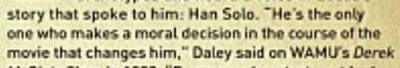
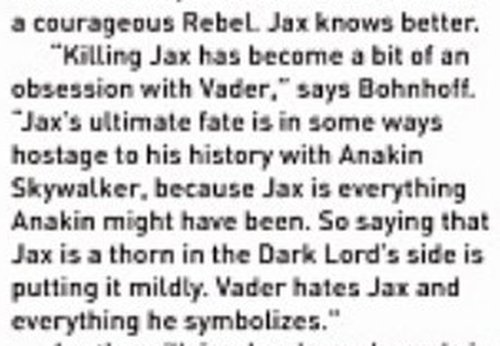
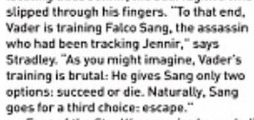

# Owner Material 038 — Star Wars Insider #1–153 plus specials (with The Lucasfilm Fan Club Magazine #1–22): Star Wars Insider #139 (2013)

- **Source:** *Star Wars Insider* magazine (issues 23–153, 1994–2014) and its predecessor *The Lucasfilm Fan Club Magazine* (issues 1–22, 1987–1994), plus seven special editions: articles, interviews, comics and short fiction Secondary source (licensed Legends reference). Scan OCR'd on the box; the scan stays box-only and is **not** published.
- **Method:** every scanned page was OCR'd and machine-screened sentence by sentence for power-relevant statements (fights, kills, defeats, Force feats, rankings, superweapons) that name a character on our roster; each kept sentence is quoted verbatim from the OCR text and has a crop of the printed passage directly under it. Pages with nothing power-relevant are still listed with what is on them.
- **Citation:** "*Star Wars Insider #139* (2013), p.X" by printed page ("scan p.X" where no printed number applies). **Weight:** Licensed magazine: a secondary source. Its short fiction and comics are Legends stories; its articles and interviews sum up or discuss lore and rank below the novels, comics and games they describe.

## scan p.1 (scan page 1)

Page contents: Cover: "George Lucas and Flash Gordon: The Untold Story!"; Han & Chewie back in action; TCW 100 episodes celebrated. (hand-read)

## scan p.2 (scan page 2)

Page contents: Ad: The Walking Dead magazine. (hand-read)

## scan p.3 (scan page 3)

Page contents: Editorial (Jonathan Wilkins, March 2013): Disney ownership and new movies; the TCW 100-episode guide; Edward Summer; Smuggler's Gambit behind the scenes; Brian Daley profile (first of an EU-creators series); Jason Fry fiction with Tom Hodges art. Lucas quote on TCW (Late Night with Conan O'Brien, May 1, 2007). Staff credits. (hand-read)

## scan p.4 (scan page 4)

Page contents: Contents, features: Smuggler's Gambit (26), Edward Summer (28), Brian Daley (36), all-new fiction (40). Quote: "In my book, experience outranks everything." —Captain Rex. (hand-read)

## scan p.5 (scan page 5)

Page contents: Contents, departments: Launch Pad, My Star Wars (Toby Philpott), Rogues Gallery (Padawans, Leland Chee), Classic Moment (Oola, p. 55), Red Five (Jason Fry's cliffhangers, p. 80), Books (The Last Jedi; Savage and Maul), Comics (Dark Times: Fire Carrier; Order 66; Infinities collected), Incoming, Bounty Hunters, Bantha Tracks; subscriber covers. Viewed. (hand-read)

## scan p.6 (scan page 6)

Page contents: Launch Pad, TCW S5 concept art: "Sabotage" (Episode III Jedi interceptors over Cato Neimoidia, art Pat Presley); "The Lawless" introduces the "fearsome Mandalorian super commandos" (art Chris Glenn); Anakin's damaged interceptor and the Twilight (art Will Nichols, Carlos Sanchez); a grown-up Korkie. (hand-read)

## scan p.7 (scan page 7)

Page contents: Concept art (OCR garbled; viewed): super-commando turnarounds, Anakin's interceptor, the Twilight, a cadet turnaround, a cliffside city. (hand-read)

## scan p.8 (scan page 8)

Page contents: Launch Pad: Angry Birds Star Wars hit #1 on US iTunes in two and a half hours; Michael Arndt on Episode IV's climax (three arcs resolved within 22 seconds); Tweet of the Month (author omitted); Revenge of the Sith 3D moved to October 4, 2013. (hand-read)

## scan p.9 (scan page 9)

Page contents: Launch Pad: Star Tours: The Adventures Continue opens at Tokyo Disneyland on May 7, 2013; SWTOR goes free-to-play on November 15 (level cap 50); "A Galaxy Closer to Home" actor news (Christensen, Jackson, Temuera Morrison, Edgerton, Rose Byrne, Skywalker Sound). (hand-read)

## scan p.10 (scan page 10)

Page contents: Launch Pad: Rick McCallum retires from Lucasfilm, with tributes from McCallum and Lucas and his future slate (family detail omitted); release calendar (Coruscant Nights #4: The Last Jedi on Feb 26; Dawn of the Jedi: Into the Void on May 7; Crucible on July 9; AOTC 3D on Sep 20; ROTS 3D on Oct 4; comics including Agent of the Empire: Hard Targets, Dark Times: Fire Carrier #1, Star Wars #2, Prisoner of Bogan #3–4). (hand-read)

## scan p.11 (scan page 11)

Page contents: Ad (rotated; viewed): Hawthorne Village glow-in-the-dark Star Wars Express HO-scale train. (hand-read)

## scan p.12 (scan page 12)

Page contents: Feature: "Counting to 100: Looking Back at 100 Episodes of The Clone Wars" (compiled by Pablo Hidalgo). "Revival" is the 100th half-hour episode produced, the 93rd broadcast and the 104th counting the film; production numbers explained (26 produced per season, about 22 aired). Production Season One: "Castle of Deception" (101), "Downfall of a Droid" (102), "Castle of Doom", "Castle of Salvation" (in the film): Ventress, a Teth rancor, a vulture droid, Ziro the Hutt. (hand-read)

## scan p.13 (scan page 13)

Page contents: Title art "Counting" (OCR empty; viewed): Yoda, Anakin, Obi-Wan and clones. (hand-read)

## scan p.14 (scan page 14)

Page contents: Episode guide (Production Season One): "Bombad Jedi" (105), "Duel of the Droids" (106), "Rising Malevolence" (107), "Ambush" (108, aired as the premiere), "Shadow of Malevolence" (109), "Cloak of Darkness" (110), "Destroy Malevolence" (111), "Lair of Grievous" (112), "Cargo of Doom" (113, first episode produced with Cad Bane), "Rookies" (114, first appearance of Domino Squad). (hand-read)

## scan p.15 (scan page 15)

Page contents: Episode guide: "Storm Over Ryloth" (115), "Dooku Captured" (116, first appearance of Hondo Ohnaka), "Innocents of Ryloth" (117), "The New Padawan" (118, in the film). (hand-read)

## scan p.16 (scan page 16)

Page contents: Episode guide: "Trespass" (Talz vs. Pantorans on Orto Plutonia), "Blue Shadow Virus". Production Season Two (episodes 27–52): "The Hidden Enemy" (series prequel to the film), "Mystery of a Thousand Moons", "Hostage Crisis" (Cad Bane's bounty hunters seize the Senate with an unarmed Anakin inside), "The Deserter" (Cut Lawquane), "Landing at Point Rain", "Senate Spy", "Children of the Force". (hand-read)

## scan p.17 (scan page 17)

Page contents: Episode guide: "Weapons Factory", "Legacy of Terror", "Senate Murders", "Lightsaber Lost", "Brain Invaders", "Grievous Intrigue" (Eeth Koth tortured), "Duchess of Mandalore", "Death Trap" (Boba Fett targets Mace Windu), "Holocron Heist", "The Mandalore Plot" (Jon Favreau as Pre Vizsla), "R2 Come Home". (hand-read)

## scan p.18 (scan page 18)

Page contents: Episode guide: "Bounty Hunters" (a Seven Samurai homage dedicated to Kurosawa), "Lethal Trackdown" (first appearance of the underworld portal, later used in Star Wars 1313), "The Zillo Beast" (awakened by an electro-proton bomb on Malastare), "The Zillo Beast Strikes Back", "Assassin", "Supply Lines", "Sphere of Influence", "The Academy". Production Season Three (53–78): "Clone Cadets", "ARC Troopers" (the defense of Kamino against Grievous and Ventress). (hand-read)

## scan p.19 (scan page 19)

Page contents: Episode guide: "Evil Plans", "Corruption", "Hunt for Ziro" (Quinlan Vos and Obi-Wan tangle with Cad Bane), "Heroes on Both Sides" (first appearance of Lux Bonteri), "Pursuit of Peace", "Nightsisters", "Monster" (Talzin and Ventress create Savage Opress), "Witches of the Mist" (Savage's betrayal of Dooku), "Overlords" (the Mortis family of "god-like Force-wielders"), "Altar of Mortis". (hand-read)

## scan p.20 (scan page 20)

Page contents: Episode guide: "Ghosts of Mortis" (the Father destroys himself with the Mortis dagger), "The Citadel" (first appearance of Tarkin), "Counterattack", "Citadel Rescue", "Padawan Lost", "Wookiee Hunt" (thanks to Peter Mayhew); Season Four: "Shadow Warrior" (Jar Jar faces Grievous), "Mercy Mission", "Nomad Droids", "Water War". (hand-read)

## scan p.21 (scan page 21)

Page contents: Episode guide: "Gungan Attack", "Prisoners", "Darkness on Umbara", "The General", "Plan of Dissent", "Carnage of Krell" (Rex confronts Krell), "Kidnapped" (based on a Dark Horse story; Obi-Wan must fight the Zygerrian leader), "Slaves of the Republic", "Escape from Kadavo". Production Season Four (79–104). (hand-read)

## scan p.22 (scan page 22)

Page contents: Episode guide: "A Friend in Need" (Favreau as Pre Vizsla, Katee Sackhoff as Bo-Katan), "Deception", "Friends and Enemies", "The Box", "Crisis on Naboo", "Massacre" (Grievous's strike on the Nightsisters), "Bounty", "Brothers" (Savage finds Maul on Lotho Minor), "Revenge" (Savage and Maul pursue Obi-Wan, who allies with Ventress), "A War on Two Fronts" (writer credits of a Lucas family member omitted). (hand-read)

## scan p.23 (scan page 23)

Page contents: Episode guide: "Front Runners", "The Soft War", "Tipping Points", "An Old Friend", "The Rise of Clovis" and "Crisis at the Heart" (slated for a later season), "The Gathering", "A Test of Strength" (David Tennant as Huyang), "Bound for Rescue", "A Necessary Bond" (Grievous attacks Hondo's base), "Revival" (426: Savage and Maul vs. Obi-Wan and Adi Gallia; the 100th episode produced, not counting the film). (hand-read)

## scan p.24 (scan page 24)

Page contents: My Star Wars: puppeteer Toby Philpott (Jabba's left arm, head and tongue in ROTJ; interview by Mark Newbold). He first saw the films as research; on 2001 and Campbell; Jabba's palace is his favorite scene (Jabba as "a pirate, an anarchist, a Bond villain"); his first autograph; The Dark Crystal led to Star Wars. (hand-read)

## scan p.25 (scan page 25)

Page contents: Philpott: mistaken for Billy Bob Thornton at LAX; ROTJ is his favorite; Elstree Studios; Twitter. (hand-read)

## scan p.26 (scan page 26)

Page contents: Feature: "The Making of Smuggler's Gambit: A Han Solo Adventure" by director Kyle Newman: a live audio drama at Celebration VI (art Paul Bateman, photos Sheldon Norton). (hand-read)

## scan p.27 (scan page 27)

Page contents: Smuggler's Gambit poster art by Paul Bateman (OCR empty; viewed): Chewbacca, Boba Fett, Xizor, Bib Fortuna-type figure, Han. (hand-read)

## scan p.28 (scan page 28)

Page contents: Newman on the NPR radio dramas by Brian Daley ("late 1780s", OCR for 1980s); co-created with ForceCast hosts; Mary Franklin championed it; written with F. J. DeSanto. Editor's note: "Smuggler's Gambit is fan fiction and not part of official Star Wars canon". Set just after ANH. (hand-read)

## scan p.29 (scan page 29)

Page contents: Smuggler's Gambit opening crawl: after Yavin, Leia orders a search for a new base; Han and Chewbacca lead a recon team to Abrossos VI (non-canon fan production; no feats logged). (hand-read)

## scan p.30 (scan page 30)

Page contents: Newman on writing for audio, Jimmy Mac's 100+ live sound cues, mining Chewbacca's onscreen lines, and casting TCW actors (Matt Lanter as Luke). (hand-read)

## scan p.31 (scan page 31)

Page contents: Art (viewed): Sam Witwer as Ro Kurota and Ashley Eckstein as Ryder Thorne. (hand-read)

## scan p.32 (scan page 32)

Page contents: The cast: David Collins (Han), Eckstein (Ryder Thorne), Witwer (Ro Kurota), Lanter (Luke), Dee Bradley Baker (Xizor, Sweeper), Clare Grant (Leia), Matthew Wood (Bib Fortuna, Rebel lieutenant), Daniel Logan (Boba Fett), Tom Kane (narrator); about 2,000 fans, no retakes; the final mix is on StarWars.com. (hand-read)

## scan p.33 (scan page 33)

Page contents: Smuggler's Gambit photos: Lanter, Grant, Eckstein. (hand-read)

## scan p.34 (scan page 34)

Page contents: Rogues Gallery, "The Younglings and Their Lightsabers" by Leland Y. Chee (viewed): Zatt, Byph and Petro, with their lightsaber hilts. (hand-read)

## scan p.35 (scan page 35)

Page contents: Rogues Gallery, "Ahsoka's Younglings" (viewed): Ahsoka Tano, Katooni, Gungi and Ganodi, with their hilts. (hand-read)

## scan p.36 (scan page 36)

Page contents: Feature: "A Flash of Inspiration", Edward Summer interview part 1 (J. W. Rinzler): his NYU film Item 72-D: The Adventures of Spa and Fon (1969, with Hervé Villechaize), often confused with THX 1138; Jay Cocks introduced Lucas and Gary Kurtz at his Supersnipe Comic Book Euphorium; he got Lucas an Alex Raymond Flash Gordon Sunday page. (hand-read)

## scan p.37 (scan page 37)

Page contents: Summer on the Flash Gordon serials and Lucas's attempt to buy the rights from King Features (who reportedly wanted Fellini); King's original art put on microfiche (Summer's non-staff friends' names omitted); photo of Lucas and Summer, 1975. (hand-read)

## scan p.38 (scan page 38)

Page contents: Summer and Lucas read the original Alex Raymond art at King Features; an NEA-funded comic-strip documentary (now lost) filmed at McQuarrie's studio and Lucas's house; Campbell's Hero with a Thousand Faces; "Luke was still Luke Starkiller"; McQuarrie and Lucas are both quiet; photo of Jay Cocks and Martin Scorsese outside Supersnipe, circa 1979. (hand-read)

## scan p.39 (scan page 39)

Page contents: Summer: Colin Cantwell's long, skinny early Falcon (later the blockade runner) and its hot-rod concept; EC Comics ships in the Prequels; the Disneyland Mars and Beyond ships influenced the round Falcon and Cloud City ("Inspiration is a delicate thing really. Nothing was ever copied."); the first script, "The Star Wars: The Adventures of Luke Starkiller from the Journal of the Whills"; Howard Chaykin's Starship art and Close Encounters; to be continued. Lucas photo with Flashing Swords!; Conan development (cinematographer friend's name omitted). (hand-read)

## scan p.40 (scan page 40)

Page contents: Feature, "Authors of the Expanded Universe: Brian Daley" by Michael Kogge: Daley's Han Solo books and radio adaptations; his friend and collaborator James Luceno. (hand-read)

## scan p.41 (scan page 41)

Page contents: Art (viewed): covers of Han Solo's Revenge and Han Solo and the Lost Legacy; a photo of Daley. (hand-read)

## scan p.42 (scan page 42)

Page contents: Daley's second-novel struggle with Lester del Rey; Judy-Lynn del Rey offered him a Star Wars book; he proposed a Luke and Leia Jedi-history story, but Lucasfilm barred the Jedi, the Force, the Empire and Vader before ESB (photo captions naming private individuals omitted). (hand-read)

## scan p.43 (scan page 43)

Page contents: "The Han Solo Solution": Daley picked Han as the one character who makes a moral decision (crop-verified quote); his early life and military service, kept to the professional parts (family, wartime and health details omitted). (hand-read)

- **Han Solo** — entry/section: Daley on why he chose Han: ""He's the only one who makes a moral decision in the course of the movie that changes him," —Brian Daley (WAMU's Derek McGinty Show, 1993), quoted in Star Wars Insider 139, p. 43" Source: *Star Wars Insider #139* (2013), scan p.43
  

## scan p.44 (scan page 44)

Page contents: "Fast Friends": The Doomfarers of Coramonde sold to Del Rey on July 6, 1976; friendship with Luceno; NPR radio adaptations (see Insider #127–128); Daley on Luke as a science-fiction fan ("Wormie" as a nod to T. H. White's "Wart"); Lucas wrote him that he enjoyed the radio drama. Photo of Tom Voegeli, John Madden and Daley. (hand-read)

## scan p.45 (scan page 45)

Page contents: "Gambler's Choice": Han Solo at Stars' End (originally The Millennium Falcon Deal) became a NYT bestseller, followed by Han Solo's Revenge and Han Solo and the Lost Legacy; Carol Titelman's correction notes (more Han worrying about Chewie). "The Secret Life of Jack McKinney": Rebel Mission to Ord Mantell, Galaxy Rangers, 20+ Robotech books with Luceno; a 1989 Jedi-series pitch lost when the license went to Bantam (personal relationship details omitted). (hand-read)

## scan p.46 (scan page 46)

Page contents: Daley bibliography: Coramonde novels, the Han Solo Adventures (1979–80), the NPR dramatizations (1981, 1983, 1996), Tron (1982), A Tapestry of Magics, Rebel Mission to Ord Mantell (1983), Hobart Floyt and Alacrity Fitzhugh, Galaxy Rangers (1986), GammaLAW (1997–99). Family photo captions omitted. (hand-read)

## scan p.47 (scan page 47)

Page contents: "Circle of the Force": the 1995–96 ROTJ radio adaptation for HighBridge Audio; Daley died February 11, 1996, the night the cast finished recording Jedi (medical details omitted); Anthony Daniels felt he truly captured C-3PO's voice; tribute from a friend (name omitted). Kogge bio; thanks list. (hand-read)

## scan p.48 (scan page 48)

Page contents: Exclusive fiction: "Speaking Silently" (Jason Fry; art Tom Hodges, per p. 53 credits). On Ereesus, Captain Rex of Torrent Company meets Lt. Sollaw ap-Orwien and Cpl. Dafyd of the Ereesus Planetary Security Forces; Sgt. Palola's militia squad has been captured. (hand-read)

## scan p.49 (scan page 49)

Page contents: Ap-Orwien explains the Kanz Disorders: nearly 4,000 years ago, "nearly six billion beings died"; Argazdan fanatics enslaved the Lorrdians and banned speech for three centuries. From the Separatist holo of Palola, ap-Orwien reads the prisoners' location, the guards, the tactical droid's HQ and the artillery dumps. (hand-read)

## scan p.50 (scan page 50)

Page contents: Lorrdian "kinetic communication" passes a test message (three squads, EMP "droid poppers"). Rex goes over Sector Command for a raid on an unarmed stealth gunship with Y-wing diversion strikes; ap-Orwien mimics Rex perfectly. (hand-read)

## scan p.51 (scan page 51)

Page contents: Art (OCR empty; viewed): ap-Orwien shoots the head off a commando droid swinging a vibrosword over a downed Rex. (hand-read)

## scan p.52 (scan page 52)

Page contents: 1086 words, 52 paragraphs | headings/entries: IN; UMMM MMe wii TOME OO; My; Rex shook his head. "We're clones."; Rex decided not to think about

### Stat block notes (game mechanics, not feats)

- Rex dodges an ambush from a ceiling commando droid: "Descending the stairs, Rex ducked his head to try and spot the droids. That saved his life. Even as Jesse and Ringo fired at the commando droids advancing up the stairs, a third commando detached itself from a jumble of pipes on the ceiling above them, vibrosword slashing through the space where Rex's head had been." (Speaking Silently, Star Wars Insider 139, p. 52) (Source: *Star Wars Insider #139* (2013), scan p.52)

## scan p.53 (scan page 53)

Page contents: All seven captives rescued; Rex raids the granary and brings back "the tactical droid's severed head" (crop-verified); "we're not machines. At least the Jedi don't regard us that way"; he declines sabacc with the Lorrdians. Fry/Hodges credits; Essential Guide to Warfare plug. (hand-read)

### Stat block notes (game mechanics, not feats)

- A commando droid pins Rex until ap-Orwien kills it: "Blows hammered at his armor – the commando droid, he realized. ... The droid was dead weight, he realized. Above him, ap-Orwien raised his blaster and smiled. Sparks spat from the back of the commando droid's head." (Speaking Silently, Star Wars Insider 139, p. 53) (Source: *Star Wars Insider #139* (2013), scan p.53)
- Rex shoots a second ceiling commando droid on reaction: "Rex was firing his pistols before he saw the commando droid above them. Its vibrosword hit the floor point first with a shriek, then pinwheeled across the room, just missing Dafyd's head. Then the smoking hulk of the commando droid plummeted after it." (Speaking Silently, Star Wars Insider 139, p. 53) (Source: *Star Wars Insider #139* (2013), scan p.53)

## scan p.54 (scan page 54)

Page contents: Ad: Brian's Toys (Jocasta Nu figure, helmets, 12" vintage figures). (hand-read)

## scan p.55 (scan page 55)

Page contents: Classic Moment (words Neil Edwards): Oola's death in Jabba's throne room (ROTJ 1983 script excerpt); the EU (Tales from Jabba's Palace: Oola and Sienn'rha meet Luke in Mos Eisley); a Femi Taylor quote on reshooting for the 1997 Special Edition (cites Insider #108). (hand-read)

## scan p.56 (scan page 56)

Page contents: Ad: Star Wars Comic UK subscription. (hand-read)

## scan p.57 (scan page 57)

Page contents: Contents, part 2: Books p59, Comics p61, Incoming p66, Bounty Hunters p72, Bantha Tracks p74, Red Five p80. (hand-read)

## scan p.58 (scan page 58)

Page contents: Ad: Insider subscription with a free Han Solo T-shirt. (hand-read)

## scan p.59 (scan page 59)

Page contents: Books: "Sole Survivor", The Last Jedi by Michael Reaves and Maya Kaathryn Bohnhoff: Jax Pavan after Coruscant Nights, aiding the Whiplash resistance; I-Five, Laranth Tarak, Den Dhur. (hand-read)

## scan p.60 (scan page 60)

Page contents: The Last Jedi goes off-world (Far Ranger; Toprawa, Antarian Rangers, Dathomir); new characters including Antarian Ranger Sacha Swiftbird; Vader's obsession with Jax (crop-verified quote); Xizor ("It's just business"); Tuden Sal, Prefect Pol Haus. Also Darth Maul: Shadow Conspiracy (Scholastic, Jason Fry), adapting the S5 four-episode arc of Maul and Savage taking over the underworld. (hand-read)

- **Jax Pavan; Darth Vader (Anakin Skywalker)** — entry/section: Bohnhoff on Vader's fixation on Jax: ""Killing Jax has become a bit of an obsession with Vader," says Bohnhoff. "Jax's ultimate fate is in some ways hostage to his history with Anakin Skywalker, because Jax is everything Anakin might have been. So saying that Jax is a thorn in the Dark Lord's side is putting it mildly. Vader hates Jax and everything he symbolizes." —Maya Kaathryn Bohnhoff, Star Wars Insider 139, p. 60" Source: *Star Wars Insider #139* (2013), scan p.60
  

## scan p.61 (scan page 61)

Page contents: Comics: Blood Ties Volume 2—Boba Fett Is Dead TPB (Tom Taylor, Chris Scalf, cover David Palumbo); Connor Freeman, son of one of Jango's original clones; January 23. (hand-read)

## scan p.62 (scan page 62)

Page contents: Comics: Dark Times—Fire Carrier (Randy Stradley; art Gabriel Guzman, covers Doug Wheatley): K'Kruhk and his 10 Padawans on Arkinnea; Vader training Falco Sang to find Dass Jennir. "Order 66" (crop-verified; the OCR read it as 64). Issue #1 on sale February 6. (hand-read)

- **Darth Vader (Anakin Skywalker)** — entry/section: Stradley on Vader training Falco Sang: ""To that end, Vader is training Falco Sang, the assassin who had been tracking Jennir," says Stradley. "As you might imagine, Vader's training is brutal: He gives Sang only two options: succeed or die. Naturally, Sang goes for a third choice: escape." —Randy Stradley, Star Wars Insider 139, p. 62" Source: *Star Wars Insider #139* (2013), scan p.62
  

### Stat block notes (game mechanics, not feats)

- Stradley recaps K'Kruhk defending his Padawans from pirates: "When last seen in Dark Times Volume 2: Parallels, K'Kruhk had defended the 10 Padawans in his care from a band of pirates," says Stradley. (Comics, Star Wars Insider 139, p. 62) (Source: *Star Wars Insider #139* (2013), scan p.62)

## scan p.63 (scan page 63)

Page contents: Fire Carrier cover art (OCR empty; viewed): K'Kruhk with a green lightsaber shielding his Padawans. (hand-read)

## scan p.64 (scan page 64)

Page contents: Comics: Star Wars Omnibus: Infinities (730 pp., February 13): Infinities ANH (Leia trained as a Sith), ESB (Han trains as a Jedi after Luke dies on Hoth) and ROTJ (Vader ends up fighting for the light side). (hand-read)

## scan p.65 (scan page 65)

Page contents: Ad: Insider UK/RoW subscription with a free Hasbro figure. (hand-read)

## scan p.66 (scan page 66)

Page contents: Incoming (words James Burns): Her Universe Missy-cut V-neck (designed by Ashley Eckstein); Sideshow Shaak Ti Premium Format Figure (TFU; alternate hand holding Starkiller's lightsaber, recalling her fight with Starkiller on Felucia by the sarlacc pit; exclusive edition of 1,000; June 2013, $349.99). (hand-read)

## scan p.67 (scan page 67)

Page contents: Incoming: Sideshow Boba Fett Mythos statue (19"; pose from the EU, going after his 239th bounty, a Bith); fourth Mythos statue after Ben Kenobi, Darth Maul and the Gamorrean Guard. (hand-read)

## scan p.68 (scan page 68)

Page contents: Incoming: WeLoveFine.com polo shirts and infant onesies. (hand-read)

## scan p.69 (scan page 69)

Page contents: Incoming: Funko Angry Birds Star Wars Wacky Wobblers and Pop! 3D bookmarks. (hand-read)

## scan p.70 (scan page 70)

Page contents: Incoming: Angry Birds Star Wars plush; Hallmark spring and Father's Day line (Yoda bottle opener, Darth Vader Destiny Decider, Yoda sound button). (hand-read)

## scan p.71 (scan page 71)

Page contents: Incoming: Hallmark mugs, lightsaber sentiment plaque; Tribe USB drives (Europe). (hand-read)

## scan p.72 (scan page 72)

Page contents: Bounty Hunters (sponsored by Kotobukiya): Ian McDiarmid and David Prowse appear together at Fan Days 2012, Irving, Texas, and are made honorary members of fan groups (submitter names omitted). (hand-read)

## scan p.73 (scan page 73)

Page contents: Bounty Hunters: reader encounters with Jeremy Bulloch (Switzerland), Ashley Eckstein (Star Wars Reads Day), and Tom Kane, Mike Edmonds and Peter Mayhew (Rhode Island Comic Con); fan and reader names omitted. (hand-read)

## scan p.74 (scan page 74)

Page contents: Bantha Tracks "Best of the Year" 2012: the Belgian Garrison's Death Star set at Celebration VI; a Stealth-X Jaina Solo costume, and Del Rey revealing Jaina's own book series (Shelly Shapiro mentioned; fan names omitted). (hand-read)

## scan p.75 (scan page 75)

Page contents: Bantha Tracks: the largest clone trooper group, at Celebration VI; Nerdist's Chris Hardwick inducted as a "Friend of the Legion"; the Rebel Legion cantina; a Bo-Katan costume meets Dave Filoni; father-son weekend (fan names and family details omitted). (hand-read)

## scan p.76 (scan page 76)

Page contents: Bantha Tracks: family photos on the Falcon set; a Savage Opress costume; the Jedi Assembly's honorary members James Arnold Taylor, Ashley Eckstein, Amy Allen and Mark Hamill; a "Meet the Fan Clubs" panel hosted by Daniel Logan; youth group and fan art (fan, child and family names omitted). (hand-read)

## scan p.77 (scan page 77)

Page contents: Bantha Tracks: Muppet troopers at Celebration VI; a Salacious Crumb prop (fan names omitted). (hand-read)

## scan p.78 (scan page 78)

Page contents: Bantha Tracks: the 501st replica garbage masher; Jedi vs. Sith chess; a Minnie Mouse scout trooper; twin birthdays at CVI (fan names omitted). (hand-read)

## scan p.79 (scan page 79)

Page contents: Bantha Tracks: the Wookiee parade; Mary Franklin's "Best of My Year": Celebration VI (more than 32,000 attendees, ReedPOP) and the first annual "Running of the Willrow Hoods"; Star Wars Day at the SF Giants; submission guidelines. (hand-read)

## scan p.80 (scan page 80)

Page contents: Red Five (Jason Fry), cliffhangers: "The Last One Standing" by Daniel Keys Moran (an older Han vs. an older Boba Fett standoff, no ending); Star by Star (Anakin Solo dies, Jacen captured, Coruscant falls to the Vong); Marvel Star Wars #18 "The Empire Strikes" by Archie Goodwin (personal anecdote details omitted). (hand-read)

## scan p.81 (scan page 81)

Page contents: Red Five, continued: Clone Wars "Chapter 18" by Genndy Tartakovsky (an Anakin vs. Asajj Ventress Force duel on Yavin IV ending in a rain-soaked standoff, "the dark side practically leaking out of Anakin"); The Empire Strikes Back. Fry website; "Interview by Mark Newbold" credit (sic, on a Fry column). (hand-read)

## scan p.82 (scan page 82)

Page contents: Next issue: end of TCW Season 5, Dave Filoni on S5, Kilian Plunkett on character design, Return of the Jedi making-of; U.S. newsstands March 12, UK March 21. (hand-read)

## scan p.83 (scan page 83)

Page contents: Ad: Insider digital edition (Flash Gordon, Smuggler's Gambit cover lines). (hand-read)

## scan p.84 (scan page 84)

Page contents: Ad (back cover): Kotobukiya ARTFX Bishoujo Jaina Solo (in Rogue Squadron at 18, a fully trained Jedi Knight) and ARTFX+ Jango Fett. (hand-read)

