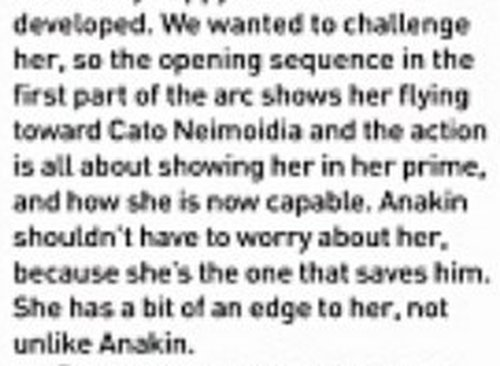
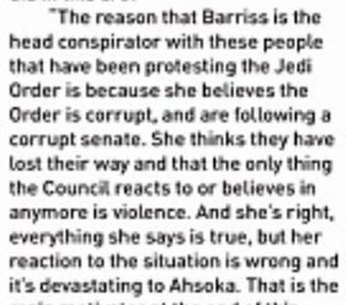

# Owner Material 038 — Star Wars Insider #1–153 plus specials (with The Lucasfilm Fan Club Magazine #1–22): Star Wars Insider #140 (2013)

- **Source:** *Star Wars Insider* magazine (issues 23–153, 1994–2014) and its predecessor *The Lucasfilm Fan Club Magazine* (issues 1–22, 1987–1994), plus seven special editions: articles, interviews, comics and short fiction Secondary source (licensed Legends reference). Scan OCR'd on the box; the scan stays box-only and is **not** published.
- **Method:** every scanned page was OCR'd and machine-screened sentence by sentence for power-relevant statements (fights, kills, defeats, Force feats, rankings, superweapons) that name a character on our roster; each kept sentence is quoted verbatim from the OCR text and has a crop of the printed passage directly under it. Pages with nothing power-relevant are still listed with what is on them.
- **Citation:** "*Star Wars Insider #140* (2013), p.X" by printed page ("scan p.X" where no printed number applies). **Weight:** Licensed magazine: a secondary source. Its short fiction and comics are Legends stories; its articles and interviews sum up or discuss lore and rank below the novels, comics and games they describe.

## scan p.1 (scan page 1)

Page contents: Cover (OCR empty; viewed): "Fate of a Jedi?" Ahsoka Tano; Return of the Jedi unseen photos; Russ Manning ("Rebel Rouser"); Dave Filoni on Ahsoka and Season 5; Dawn of the Jedi, LEGO Star Wars, Boba Fett. (hand-read)

## scan p.2 (scan page 2)

Page contents: Ad: The Walking Dead magazine (Titan). (hand-read)

## scan p.3 (scan page 3)

Page contents: Editorial (Jonathan Wilkins): the TCW Season 5 finale, Filoni interview p14, ROTJ archive (Rinzler), Russ Manning, Willow Blu-ray, J. J. Abrams to direct Episode VII; Obi-Wan epigraph from "The Mandalore Plot"; staff box. (hand-read)

## scan p.4 (scan page 4)

Page contents: Contents, part 1: Palpatine epigraph from "Crisis on Naboo"; The Clone Wars p14. (hand-read)

## scan p.5 (scan page 5)

Page contents: Contents: LEGO Star Wars p24, ROTJ p32, Harrison Ellenshaw p38, Edward Summer p48, Russ Manning p54, Willow p62, Dawn of the Jedi p66, Launch Pad p7, My Star Wars (David Collins, PROXY) p30, Rogues Gallery (Shadow Collective) p46, Classic Moment (Shaak Ti) p71, Red Five (Jeremy Bulloch) p96, Books p74, Comics p77, Incoming p80, Bantha Tracks p88, Bounty Hunters p94. (hand-read)

## scan p.6 (scan page 6)

Page contents: Ad: Insider digital edition. (hand-read)

## scan p.7 (scan page 7)

Page contents: Launch Pad: J. J. Abrams named director of Episode VII (Michael Arndt writing; Kasdan and Kinberg consulting; Bryan Burk and Bad Robot producing); quotes from Kennedy, Lucas and Abrams; Dennis Muren, Ben Burtt and Matthew Wood on Abrams. (hand-read)

## scan p.8 (scan page 8)

Page contents: Launch Pad: Celebration Europe II, Messe Essen, July 26–28, 2013 (Dave Filoni attending, Warwick Davis hosting); Mary Franklin and Peter Tatara (ReedPOP) quoted; Celebration history (London 2007 almost 30,000 fans, Tokyo 2008). (hand-read)

## scan p.9 (scan page 9)

Page contents: Launch Pad: an interview with a vinyl label owner on Prequel soundtracks on colored vinyl (non-staff interviewee not named); Tweets of the month (Matt Lanter, Carrie Fisher); a celebrity R2-D2 item (name left out); a personal-life item about Lucas, left out; Episode II and III 3D re-releases postponed to focus on Episode VII. (hand-read)

## scan p.10 (scan page 10)

Page contents: Launch Pad special report (Amy Ratcliffe): a new San Anselmo community park on land donated by Lucas (8,700 sq ft) will feature bronze Indiana Jones and Yoda statues by the sculptor of the Letterman Center Yoda fountain; a fountain 15 ft across, a $150,000 maintenance fundraiser (non-staff local officials not named). (hand-read)

## scan p.11 (scan page 11)

Page contents: San Anselmo park, continued (planning approval January 7; local quotes, names left out). Star Spotting: Christopher Lee, Bruce Spence, Jimmy Smits, Oliver Ford Davies, Rena Owen, John Williams. (hand-read)

## scan p.12 (scan page 12)

Page contents: Awards: 2013 Golden Globe, VES, BAFTA and Oscar nominations for Lucasfilm alumni (Ewan McGregor, Kathleen Kennedy for Lincoln, John Williams, ILM's The Avengers, Gary Rydstrom); 2011 UK census: 176,432 people gave "Jedi" as their religion (0.31%), down from 390,127. (hand-read)

## scan p.13 (scan page 13)

Page contents: Ad: Brian's Toys. (hand-read)

## scan p.14 (scan page 14)

Page contents: Feature opener (viewed): a Dave Filoni interview on Season 5, Ahsoka and Barriss Offee (Jonathan Wilkins); photo of Filoni holding a clone helmet; spoiler warning. (hand-read)

## scan p.15 (scan page 15)

Page contents: "Unexpected Journeys" (Ahsoka art, viewed): Filoni expected to work on TCW about two years and is now approaching his 8th; interview done January 16, before the S5 finale aired; spoiler warning. (hand-read)

## scan p.16 (scan page 16)

Page contents: Filoni on TCW's challenges: technical barriers (water, fire, cloth) solved; about 22 episodes a season; juggling character arcs; budget never dictates the stories; "I'm a considerably better director today for all of George's teaching." (hand-read)

## scan p.17 (scan page 17)

Page contents: "Sith Lords and Younglings": the four-part younglings arc (lightsaber building, Yoda's lesson; Lucas nixed a Kel Dor youngling as "Too ugly!"); crystal-cave clues tying to The Old Republic game (fleet symbol on the Crucible); Huyang voiced by David Tennant. (hand-read)

## scan p.18 (scan page 18)

Page contents: "A New Voice for the Republic?": Tim Curry replaces the late Ian Abercrombie as Palpatine/Sidious ("a gravelly edge"; Curry's first line overlaps Abercrombie in "Revival"); the move to Saturday mornings; Season 5 is the darkest yet. (hand-read)

## scan p.19 (scan page 19)

Page contents: "Jedi No More?": the Ahsoka finale arc. The opener at Cato Neimoidia shows her "in her prime" saving Anakin (crop-verified); the Jedi Temple bombing and her framing; the Council plays politics; Barriss Offee revealed as the head conspirator, believing the Order corrupt; Tarkin's military rises; the Republic courtroom mirrors the Death Star. (hand-read)

- **Ahsoka Tano; Darth Vader (Anakin Skywalker)** — entry/section: Filoni on Ahsoka in her prime: ""We wanted to challenge her, so the opening sequence in the first part of the arc shows her flying toward Cato Neimoidia and the action is all about showing her in her prime, and how she is now capable. Anakin shouldn't have to worry about her, because she's the one that saves him. She has a bit of an edge to her, not unlike Anakin." —Dave Filoni, Star Wars Insider 140, p. 19" Source: *Star Wars Insider #140* (2013), scan p.19
  
- **Barriss Offee** — entry/section: Filoni on Barriss's motive: ""The reason that Barriss is the head conspirator with these people that have been protesting the Jedi Order is because she believes the Order is corrupt, and are following a corrupt senate. She thinks they have lost their way and that the only thing the Council reacts to or believes in anymore is violence. And she's right, everything she says is true, but her reaction to the situation is wrong and it's devastating to Ahsoka." —Dave Filoni, Star Wars Insider 140, p. 19" Source: *Star Wars Insider #140* (2013), scan p.19
  

## scan p.20 (scan page 20)

Page contents: "Challenging the Fans": the Council offers to take Ahsoka back and she turns them down (changed from the original plan to bring her back); Lucas and Filoni have planned her ultimate fate; recording the final Ahsoka/Anakin scene with only Eckstein and Lanter; Kevin Kiner's music; Joel Aron's lighting (the sky from a photo Filoni took). (hand-read)

## scan p.21 (scan page 21)

Page contents: "Cleaning House": many characters killed off in S5; the Mandalorians as "a capable warrior race" whose culture changes, differing from the novels (crop-verified); fan generations. (hand-read)

## scan p.22 (scan page 22)

Page contents: "A Century of Clones": 100 episodes reached in January ("we need 100 more"); Ahsoka created via sketches by Filoni and Henry Gilroy; Filoni's fan-costume wall; fan criticism comes "from a place of passion"; Filoni the only announced Celebration Europe II guest; his blog. (One dropped/garbled OCR line in a Filoni quote not reconstructed.) (hand-read)

## scan p.23 (scan page 23)

Page contents: Images (viewed): Maul and Pre Vizsla dueling (darksaber); Anakin watching Ahsoka walk away from the Temple. The pull quote is a layout glitch repeating "GEORGE LUCAS SAID THE COMIC BOOK WILL GET PEOPLE TALKING!" (sic, garbled in print; not quoted). (hand-read)

## scan p.24 (scan page 24)

Page contents: "Expanded Universe" interview with Michael Price (LEGO Star Wars specials writer; Jonathan Wilkins): why Star Wars is ripe for parody; a joke about hiding Luke on Tatooine. (hand-read)

## scan p.25 (scan page 25)

Page contents: Price bio (The Simpsons writer); the origins of the LEGO Star Wars shorts (The Hunt for R2-D2, Bombad Bounty) and The Padawan Menace TV special; the brief was free rein within the six-film timeline. (hand-read)

## scan p.26 (scan page 26)

Page contents: Price's pitch was chosen; meetings with Kathleen Fleming (LEGO), Howard Roffman, Derek Stothard; the kids became Padawans; the Vader walk-on gag with Lucas saying "you're not in this one!" (non-canon parody: S only). (hand-read)

## scan p.27 (scan page 27)

Page contents: Production process (animatics, as on The Simpsons; director David Scott); Price was executive producer on The Empire Strikes Out; sound mix at Skywalker Sound with Matthew Wood; a cut pitch of Yoda and a kid on Hoth chasing a B1 droid. (hand-read)

## scan p.28 (scan page 28)

Page contents: Cut ideas: a snowball fight against 100 battle droids, Fode and Beed; Vader's podracer escape in Empire Strikes Out; Price loves writing Yoda; The Yoda Chronicles (three episodes) announced. (hand-read)

## scan p.29 (scan page 29)

Page contents: Expanded roles for Palpatine/Sidious (forced to announce a Republic victory), Dooku and Grievous "a bumbling fall guy"; Price would like to write a Star Wars comedy film; the Vader-with-medal minifigure; Empire Strikes Out Blu-ray dates (March 26 US, March 18 UK). (hand-read)

## scan p.30 (scan page 30)

Page contents: "Expanded Universe" Q&A with David W. Collins (former LucasArts lead sound designer and voice director; voice of PROXY in The Force Unleashed; Mark Newbold): ROTJ memories, toys, jazz singing, audiobooks, favorite scenes (family details left out). (hand-read)

## scan p.31 (scan page 31)

Page contents: Collins Q&A, continued: recognized in Manhattan in 2007 as PROXY; favorite films Empire and Jedi; his first autograph signing in 2001 at a Starfighter event at the Metreon (partly garbled OCR, not quoted). (hand-read)

## scan p.32 (scan page 32)

Page contents: "From the Archives: Return of the Jedi, Part I" (J. W. Rinzler): unseen or rescanned ROTJ artwork and photos left out of the forthcoming The Making of Return of the Jedi (Del Rey, fall 2013; 372 pages, more than 700 images); McQuarrie, Johnston, Rodis-Jamero. (hand-read)

## scan p.33 (scan page 33)

Page contents: Images (viewed): an early McQuarrie speeder bike ("rocket bike") concept, early 1981; early creature concepts (possibly for the rancor) by McQuarrie, early 1981. (hand-read)

## scan p.34 (scan page 34)

Page contents: Images (viewed): a throne room set still (Luke); a continuity Polaroid of an "Imp Dig" (Imperial dignitary), early 1982; an ILM A-wing maquette. (hand-read)

## scan p.35 (scan page 35)

Page contents: Images (viewed) and captions: Richard Marquand directs Mark Hamill and Ian McDiarmid on the throne room set at Elstree, early 1982; a PR photo of Carrie Fisher in the slave outfit; the ILM A-wing maquette, circa mid-1982. (hand-read)

## scan p.36 (scan page 36)

Page contents: Images (viewed): "The Old Wrist Man," a joke drawing by visual effects supervisor Ken Ralston (between 1981 and 1983; Ralston on his "wrist man" doodles and MAD magazine); ILM crew with models. (hand-read)

## scan p.37 (scan page 37)

Page contents: Image (viewed): after Jedi wrapped, a photo session of all the original trilogy models; Lucas examines an Ewok concept maquette while producer Howard Kazanjian looks on. (hand-read)

## scan p.38 (scan page 38)

Page contents: Full-page photo (viewed): Harrison Ellenshaw with a Death Star matte painting (opener of the Ellenshaw interview). (hand-read)

## scan p.39 (scan page 39)

Page contents: Opener (viewed): Harrison Ellenshaw, matte painter on Star Wars and Empire (also Disney's The Black Hole, Academy nomination); a complete interview with Thomas G. Smith from the book Industrial Light & Magic: The Art of Special Effects, printed for the first time (family details left out). (hand-read)

## scan p.40 (scan page 40)

Page contents: Ellenshaw interview: head of Disney's matte department; Jim Nelson brought McQuarrie's illustrations in 1976; Ellenshaw was handed plates after principal photography; captions on the Cloud City and Stage 1 mattes, Kazanjian and Powell. (hand-read)

## scan p.41 (scan page 41)

Page contents: Ellenshaw: did Star Wars at night while on Pete's Dragon ("10 or 15 shots"); bipack camera; no projector at the first ILM; front projection at Marin for Empire; CalArts blue-spill painters; his symmetrical Millennium Falcon gaffe; George secretive about footage; the detention-block reel ("Han Solo seemed like a real jerk"). (hand-read)

## scan p.42 (scan page 42)

Page contents: 17 matte paintings on Star Wars; McQuarrie did about half of Empire's; 70–80 shots in six months at the end of '79; Michael Pangrazio; a deal with Gary Kurtz by phone; The Black Hole had over 100 matte shots; captions (Hoth/Yavin base exteriors). (hand-read)

## scan p.43 (scan page 43)

Page contents: Ellenshaw's start: a Disney matte apprentice in 1970 under Alan Maley at $84 a week (Bedknobs and Broomsticks); nobody wanted to train as a matte artist then (personal background details left out). (hand-read)

## scan p.44 (scan page 44)

Page contents: Took over the Disney department in his mid-20s; "backed into" the craft; associate producer and visual effects co-supervisor on TRON; captions on the Dagobah swamp and the Empire matte team (McQuarrie, Pangrazio, etc.). (hand-read)

## scan p.45 (scan page 45)

Page contents: Ellenshaw on producing, "stoking and stroking," Lucas's wordless motivation ("give it another try"); a good matte painting is a throwaway; "Don't fall in love with it"; "you can only equal reality"; his website. (hand-read)

## scan p.46 (scan page 46)

Page contents: Rogues Gallery (Leland Y. Chee; viewed): "Bad Guys United!", the Shadow Collective: 1. Ziton Moj, 2. Gorga the Hutt, 3. Darth Maul, 4. Savage Opress. (hand-read)

## scan p.47 (scan page 47)

Page contents: Rogues Gallery, continued (viewed): 5. Bo-Katan, 6. Jabba the Hutt, 7. Pre Vizsla (with the darksaber), 8. Lom. Labels only; no text entries. (hand-read)

## scan p.48 (scan page 48)

Page contents: Full-page Howard Chaykin Star Wars poster art (viewed); caption (crop-verified): first exhibited at the New York Comic Art Convention by Edward Summer on July 2–6, 1976, at the McAlpin Hotel. (hand-read)

## scan p.49 (scan page 49)

Page contents: Edward Summer interview, Part 2 of 3 (J. W. Rinzler): Lucas was taken with Chaykin's storyboards (Iron Wolf in Weird Worlds); Frazetta turned down a Star Wars art book cover; Al Williamson declined the newspaper strip but later did the Empire comic adaptation (personal details left out). (hand-read)

## scan p.50 (scan page 50)

Page contents: Setting up the Marvel deal: Warren, DC and Marvel compared; Roy Thomas; a meeting with Ed Shukin, followed up by Charlie Lippincott. Pull quote "GEORGE LUCAS SAID THE COMIC BOOK WILL GET PEOPLE TALKING!" (the same pull quote leaked onto p23 by a layout error). (hand-read)

## scan p.51 (scan page 51)

Page contents: "The Perils of Fame": a party in Coppola's Sherry-Netherland suite the first week after release; Lucas joked that Summer could sign autographs as him; they snuck out through the kitchen (private attendee details left out). Captions: Chaykin art, Summer's Starship Under painting, the first Marvel adaptation. (hand-read)

## scan p.52 (scan page 52)

Page contents: Lucas on comics before the film ("it'll get people talking"); Shukin: "This is a dog"; "Selling the Idea of Star Wars": the Chaykin poster sold for a dollar at a 1976 New York convention; Obi-Wan's death changed during shooting (per Lippincott); Steranko's MediaScene #22 (Nov/Dec 1976, crop-verified) and #26. (hand-read)

## scan p.53 (scan page 53)

Page contents: Disney press books (Peter Pan) as the marketing model; Gary Kurtz and Carl Barks; Lucas wrote the introduction to a Barks book after Walter Cronkite declined; Part III next issue; Summer's book The Legend of Teddy Bear Sod (2013). (hand-read)

## scan p.54 (scan page 54)

Page contents: "Authors of the Expanded Universe: Russ Manning" (Michael Kogge); title panel (viewed): Luke and Leia, "It's Threepio! We're loose!" (hand-read)

## scan p.55 (scan page 55)

Page contents: Manning profile intro: the Star Wars newspaper strip writer and artist; Carol Titelman of Black Falcon Ltd. contacted him in 1978 after Al Williamson declined (on Shel Dorf's recommendation); Manning saw the film on its second night and four more times. (hand-read)

## scan p.56 (scan page 56)

Page contents: "Moon Boy": Manning born January 5, 1929, in Van Nuys; a Burroughs fan; studied at the LA County Art Institute; early fandom and Jesse Marsh (personal, family and service details left out). (hand-read)

## scan p.57 (scan page 57)

Page contents: "Apprentice to a Master": drew Brothers of the Spear for Dell; created Magnus, Robot Fighter 4000 A.D. for Gold Key (1963), which outsold Superman, with film student George Lucas among its readers; took over Tarzan (sample strip art, garbled OCR, not quoted). (hand-read)

## scan p.58 (scan page 58)

Page contents: "Master of Apprentices": Manning wrote and drew Tarzan; assistants Mike Royer and Bill Stout; a perfectionist taskmaster; quote from former assistant Rick Hoberg (strip panels: Boba Fett). (hand-read)

## scan p.59 (scan page 59)

Page contents: "From the Jungle to the Stars": Lucasfilm barred him from the Empire storyline and from killing lead characters; the strip began March 11, 1979, in 215 papers with the Sunday "The Constancia Affair" (C-3PO narrating to Mnemos; Luke's parents given as "Master and Mistress Tan Skywalker," later revised); the daily "Gambler's World" (Vorzyd V; the villain Blackhole); hand-off to Hoberg, Stevens and Alcala ("The Frozen World of Ota," Boba Fett's first comics appearance); Goodwin and Williamson ran the strip until March 11, 1984; Manning died in 1981 (medical details left out). (hand-read)

## scan p.60 (scan page 60)

Page contents: "A Lasting Legacy": Dark Horse reprints (Classic Star Wars: The Early Adventures); Blackhole used by later authors, including Matthew Stover's Luke Skywalker and the Shadows of Mindor; strip panels (viewed: Chewbacca roaring at a bald Imperial; Lady Tarkin vowing revenge, caption only, not quoted). (hand-read)

## scan p.61 (scan page 61)

Page contents: Subscription ad: a free Han Solo T-shirt. (hand-read)

## scan p.62 (scan page 62)

Page contents: "The Return of Willow" (Jason Fry); opener photo (viewed): Warwick Davis with a Willow clapperboard. (hand-read)

## scan p.63 (scan page 63)

Page contents: Willow (1988, Ron Howard directing a Lucas story) restored for Blu-ray at 25 years with three deleted scenes; archetypes shared with Star Wars. (hand-read)

## scan p.64 (scan page 64)

Page contents: Willow parallels (Kael/Sorsha as a split Vader; Elora Danan); Warwick Davis cast after Wicket; Julian Blazewicz and Rob Wynn on the release; deleted scenes (the "fish-boy" sequence, the troll, Sorsha's father); Howard on the magic-acorn continuity point; Dennis Muren on morphing. (hand-read)

## scan p.65 (scan page 65)

Page contents: Willow was the first film to show a character's transformation with software morphing; Warwick Davis's own on-set camcorder footage became "Willow: An Unlikely Hero"; Willow out now on Blu-ray. (hand-read)

## scan p.66 (scan page 66)

Page contents: Image (viewed): the Dawn of the Jedi: Into the Void (Tim Lebbon) book cover, Lanoree Brock with a sword. (hand-read)

## scan p.67 (scan page 67)

Page contents: Exclusive excerpt, Star Wars: Dawn of the Jedi—Into the Void (Tim Lebbon): Dal Brock's diary (10,461 TYA); young Lanoree on Tython near Bodhi, the Je'daii Temple of the Arts, senses the river's life through the Force (crop-verified), then probes her brother's mind. (hand-read)

### Stat block notes (game mechanics, not feats)

- Lanoree senses river life through the Force as a child: "There's a power to it that is intimidating, and closing her eyes, Lanoree feels the Force and senses the myriad life-forms that call the river home. Some are as small as her finger, others that swim upriver from the ocean are almost half the size of a Cloud Chaser ship." (Star Wars: Dawn of the Jedi—Into the Void excerpt, Star Wars Insider 140, p. 67) (Source: *Star Wars Insider #140* (2013), scan p.67)

## scan p.68 (scan page 68)

Page contents: Art (viewed): Je'daii figures with a glowing orb (Dawn of the Jedi art accompanying the excerpt). (hand-read)

## scan p.69 (scan page 69)

Page contents: Excerpt, continued: Dal's angry fire (Lanoree's scar), Temple Master Fenn, Dal slashes his drawing; Lanoree wakes on her way home. Into the Void out May 7 (Del Rey); next issue an Ostrander/Duursema prequel. Lebbon Q&A: approached by Random House; the Je'daii and balance; ties to the "Force Storm" arc; he hopes for a Lanoree trilogy. (hand-read)

## scan p.70 (scan page 70)

Page contents: Subscription ad (UK and others): a free Hasbro action figure. (hand-read)

## scan p.71 (scan page 71)

Page contents: Classic Moment (Neil Edwards): "Shaak Under Attack!" from The Force Unleashed (2008). Starkiller hunts Shaak Ti on Felucia; her dying prophecy starts his turn toward the light; Sam Witwer quote (from Insider #104); Escape from Dagu, the unreleased novel, became canon via The Official Star Wars Fact File 116 (crop-verified; the OCR had 114) and Insider #66; two cut ROTS death scenes for Shaak Ti (Grievous on the Invisible Hand; Vader during Order 66, crop-verified). Next issue: Qui-Gon returns. (hand-read)

### Stat block notes (game mechanics, not feats)

- Starkiller kills Kazdan Paratus: "After killing the insane Jedi Master Kazdan Paratus on Raxus Prime, Darth Vader's secret apprentice, Galen Marek (aka Starkiller), is sent to assassinate Shaak Ti." (Classic Moment, Star Wars Insider 140, p. 71) (Source: *Star Wars Insider #140* (2013), scan p.71)
- Starkiller's ladder: Kota, Paratus, Shaak Ti: "After an inconclusive victory against Rahm Kota, and a more final one against the mad Paratus, Starkiller takes on a far more formidable foe in this classic scene: Shaak Ti, one of the most powerful Jedi." (Classic Moment, Star Wars Insider 140, p. 71) (Source: *Star Wars Insider #140* (2013), scan p.71)
- Shaak Ti, a highly skilled duelist with allies on Felucia: "Ti is a highly skilled lightsaber duelist backed by a group of Force-using natives of the planet, as well as a sarlacc." (Classic Moment, Star Wars Insider 140, p. 71) (Source: *Star Wars Insider #140* (2013), scan p.71)
- Cut ROTS scene: Grievous kills Shaak Ti: "In the first, she was stabbed through the chest with a lightsaber by General Grievous aboard the Invisible Hand during the rescue of Chancellor Palpatine." (Classic Moment, Star Wars Insider 140, p. 71) (Source: *Star Wars Insider #140* (2013), scan p.71)

## scan p.72 (scan page 72)

Page contents: Back-issues ad. (hand-read)

## scan p.73 (scan page 73)

Page contents: "Blaster" section opener (viewed): Books p74, Comics p77 ("Family Ties! Meet Han and Leia's great-great-granddaughter"), Incoming p80, Bantha Tracks p88, Bounty Hunters p94, Red Five p96. (hand-read)

## scan p.74 (scan page 74)

Page contents: Books (Dan Wallace): Ice Sabers: 30 Chilled Treats by Lara Starr (Chronicle, April 2; four lightsaber ice-pop molds; recipe list). (hand-read)

## scan p.75 (scan page 75)

Page contents: Books: Star Wars Thumb Doodles (Klutz); Star Wars: Mega Models (DK, April 15; Boba Fett helmet, TIE fighter, Anakin's lightsaber hilt, Yoda). (hand-read)

## scan p.76 (scan page 76)

Page contents: Books: LEGO Star Wars: The Empire Strikes Out tie-in by Ace Landers (Scholastic, April); Art2-D2's Guide to Folding and Doodling by Tom Angleberger (Amulet, March 26). (hand-read)

## scan p.77 (scan page 77)

Page contents: Comics: The Clone Wars digest Defenders of the Lost Temple (Justin Aclin, Ben Bates; Pre Vizsla and Death Watch; March 13); Vader: The Ghost Prison Deluxe Edition hardcover (Haden Blackman, Agustin Alessio; March 27). (hand-read)

## scan p.78 (scan page 78)

Page contents: Full-page Legacy: Prisoner of the Floating World cover art by Dave Wilkins (viewed): Ania Solo, Sauk, a lightsaber duel. (hand-read)

## scan p.79 (scan page 79)

Page contents: "Future Solo": Star Wars Legacy: Prisoner of the Floating World (Corinna Bechko, Gabriel Hardman) stars Ania Solo, Han and Leia's great-great-granddaughter, set after Legacy: War; her Mon Calamari engineer friend Sauk; issue #1 out March 20 (creator background details left out). (hand-read)

## scan p.80 (scan page 80)

Page contents: Incoming (James Burns): Kotobukiya Jango Fett ARTFX+ statue (1/10 scale, about 8 in; Summer 2013, $49.99). (hand-read)

## scan p.81 (scan page 81)

Page contents: Incoming (viewed): full-page images of the Jango Fett statue, front and back. (hand-read)

## scan p.82 (scan page 82)

Page contents: Sideshow Yoda: Jedi Master—Order of the Jedi sixth-scale figure (AOTC/ROTS look; Council chair and hover chair; exclusive holocron; June 2013, $99.99). (hand-read)

## scan p.83 (scan page 83)

Page contents: Fantasy Flight X-Wing Miniatures expansions: Slave I ($29.95), A-wing ($14.95), TIE Interceptor with Baron Soontir Fel ($14.95); March/April 2013 (product copy, not used as feats). (hand-read)

## scan p.84 (scan page 84)

Page contents: Hasbro The Vintage Collection re-issues of "fan favorites" (voted favorite collectible in the first Insider Awards); the US list (Maul, Nom Anor, Starkiller, Shae Vizla, etc.); $7.99/$8.99. (hand-read)

## scan p.85 (scan page 85)

Page contents: The Vintage Collection list outside the US (Waves 1–2, including "Lost Line Look" variants). (hand-read)

## scan p.86 (scan page 86)

Page contents: Neat-Oh! Star Wars storage: Darth Vader and stormtrooper ZipBin cases, a storage bin. (hand-read)

## scan p.87 (scan page 87)

Page contents: Neat-Oh! X-wing backpack; LEGO Death Star transforming carry case. (hand-read)

## scan p.88 (scan page 88)

Page contents: Bantha Tracks "Art Galaxy" fan art (Vader pastel, Qui-Gon and Han, "The Chase"); fan names left out. (hand-read)

## scan p.89 (scan page 89)

Page contents: Bantha Tracks fan art, continued (viewed; "King Reecor" and others; fan names left out). (hand-read)

## scan p.90 (scan page 90)

Page contents: Bantha Tracks fan art, continued ("A New Hope: 1977" pencil and Photoshop; fan names left out). (hand-read)

## scan p.91 (scan page 91)

Page contents: Bantha Tracks fan art, continued (a wood-burned "Relaxing Stormtrooper" with an Aurebesh inscription, child art of Clone Wars characters, Yoda; fan names left out). (hand-read)

## scan p.92 (scan page 92)

Page contents: Bantha Tracks fan art, continued (Ahsoka art and others); submission guidelines. (hand-read)

## scan p.93 (scan page 93)

Page contents: Bantha Tracks editorial "Creativity Obscura" by editor Mary Franklin: preparing Celebration Europe II (July 26–28, Essen, Germany); fan art of Clone Commander Bly (fan name left out). (hand-read)

## scan p.94 (scan page 94)

Page contents: Bounty Hunters (sponsored by Kotobukiya): a reader's Celebration photo story with Anthony Daniels (reader name and private family/medical details left out). (hand-read)

## scan p.95 (scan page 95)

Page contents: Bounty Hunters, continued: reader encounters with Peter Mayhew, Jeremy Bulloch, Matthew Wood, Aaron Allston, Billy Dee Williams and Ray Park (reader names left out). (hand-read)

## scan p.96 (scan page 96)

Page contents: Red Five: "Jeremy Bulloch's Five Favorite Rogues" (Mark Newbold); No. 1 "The Man With No Name" (Clint Eastwood, compared to Boba Fett); Boba Fett art (viewed). (hand-read)

## scan p.97 (scan page 97)

Page contents: Bulloch's rogues, continued: Han Solo ("could go to the dark side quite easily if the money was right"; he and Boba as friends who fell out), Madmartigan, Jodo Kast ("an unproven rogue"), Indiana Jones; his website. (hand-read)

## scan p.98 (scan page 98)

Page contents: Next issue (#141; US newsstands April 30, UK May 3): making The Empire Strikes Back; a Dawn of the Jedi prequel by Ostrander and Duursema; an Episode VII update; an interview with original Star Wars books editor Carol Titelman. (hand-read)

## scan p.99 (scan page 99)

Page contents: Ad: Titan magazine subscriptions. (hand-read)

## scan p.100 (scan page 100)

Page contents: Back cover ad (viewed): Grimm: The Ultimate Companion (Titan). (hand-read)

