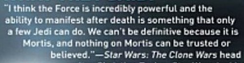
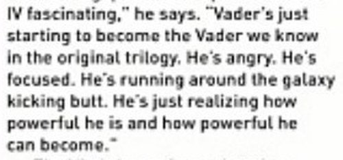
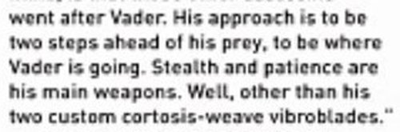

# Owner Material 038 — Star Wars Insider #1–153 plus specials (with The Lucasfilm Fan Club Magazine #1–22): Star Wars Insider #141 (2013)

- **Source:** *Star Wars Insider* magazine (issues 23–153, 1994–2014) and its predecessor *The Lucasfilm Fan Club Magazine* (issues 1–22, 1987–1994), plus seven special editions: articles, interviews, comics and short fiction Secondary source (licensed Legends reference). Scan OCR'd on the box; the scan stays box-only and is **not** published.
- **Method:** every scanned page was OCR'd and machine-screened sentence by sentence for power-relevant statements (fights, kills, defeats, Force feats, rankings, superweapons) that name a character on our roster; each kept sentence is quoted verbatim from the OCR text and has a crop of the printed passage directly under it. Pages with nothing power-relevant are still listed with what is on them.
- **Citation:** "*Star Wars Insider #141* (2013), p.X" by printed page ("scan p.X" where no printed number applies). **Weight:** Licensed magazine: a secondary source. Its short fiction and comics are Legends stories; its articles and interviews sum up or discuss lore and rank below the novels, comics and games they describe.

## scan p.1 (scan page 1)

Page contents: Cover (May/June 2013): Oola speaks out; Return of the Jedi archive photos; Vader's Little Princess; new fiction from the early days of the Jedi; Edward Summer on Yoda's first day; tribute to Stuart Freeborn. (hand-read)

## scan p.2 (scan page 2)

Page contents: Ad: The Walking Dead magazine (Titan). (hand-read)

## scan p.3 (scan page 3)

Page contents: Editor's Welcome (Jonathan Wilkins): The Clone Wars is ending production after five years ("The best is yet to come!" —Filoni); tribute to Stuart, Kay and Graham Freeborn (makeup; created Yoda and Chewbacca); staff credits. (hand-read)

## scan p.4 (scan page 4)

Page contents: Contents opener art: Jabba's palace ("The illustrious Jabba bids you welcome..." —See-Threepio, ROTJ). (hand-read)

## scan p.5 (scan page 5)

Page contents: Contents: Summer pt3, ROTJ archives, EU publishing history, Jeffrey Brown, storyboard artist Benton Jew, Ostrander/Duursema fiction, Femi Taylor's My Star Wars, Rogues Gallery Wookiee army, Classic Moment Qui-Gon on Mortis, Red Five Don Bies archive finds; subscriber and comic-store covers. (hand-read)

## scan p.6 (scan page 6)

Page contents: Launch Pad: The Clone Wars ends on Cartoon Network, with story arcs still in production; Detours postponed; cast farewells (James Arnold Taylor, Ashley Eckstein). (hand-read)

## scan p.7 (scan page 7)

Page contents: Cast farewells, continued (Matt Lanter, Catherine Taber, Dee Bradley Baker, Daniel Logan). (hand-read)

## scan p.8 (scan page 8)

Page contents: Celebration Europe II countdown (Essen, July 26–28, 2013): hosts Warwick Davis (career overview) and Pablo Hidalgo (Behind-the-Scenes Stage). (hand-read)

## scan p.9 (scan page 9)

Page contents: Celebration Europe guests: Ian McDiarmid (Emperor, Palpatine, "revealing the true power of Darth Sidious"; Almeida Theatre), Carrie Fisher (career; family details left out); Steve Sansweet's Rancho Obi-Wan exhibit. (hand-read)

## scan p.10 (scan page 10)

Page contents: Her Universe "Year of the Fangirl" (Ashley Eckstein quote; fan contributors left out); Dates for Your Diary: books (Crucible, Kenobi, Maul: Lockdown, and others), events, comics. (hand-read)

## scan p.11 (scan page 11)

Page contents: Ad: Brian's Toys. (hand-read)

## scan p.12 (scan page 12)

Page contents: Tribute "A Star Wars Family" (Tom Spina): the late Stuart Freeborn and the Freeborn makeup family (Kay, Graham); Stuart's early career stunt; Dr. Strangelove (personal and medical details left out). (hand-read)

## scan p.13 (scan page 13)

Page contents: Freeborn tribute, continued: Rick Baker on the 2001 apes and the hair-punching trick; Nick Dudman and Nick Maley on training under Stuart; Kay's makeup work; caption "the enduring Jedi Master Yoda". (hand-read)

## scan p.14 (scan page 14)

Page contents: Freeborn tribute, continued: Graham sculpted cantina creatures and was chief makeup artist on ESB/ROTJ (wampa, Ugnaughts); Danny Wagner ("Yoda was so real that I thought he was a rare creature"); Dave Elsey re-creating Chewbacca and the Wookiee army for ROTS. (hand-read)

## scan p.15 (scan page 15)

Page contents: George Lucas on Stuart Freeborn ("His artistry and craftsmanship will live on forever in the characters he created"); photo captions (Ewok headpiece, Chewbacca, Peter Cushing, Carrie Fisher on the ESB set). (hand-read)

## scan p.16 (scan page 16)

Page contents: Freeborn tribute, continued: Spina's restoration of Ugnaught and Ewok masks; the Volkswagen Super Bowl cantina-alien commercial; tauntaun head restoration. (hand-read)

## scan p.17 (scan page 17)

Page contents: Sidebar "Tales from the Makeup Chair": actress Pam Rose on her cantina "weird girl" head-cast and daily makeup. (hand-read)

## scan p.18 (scan page 18)

Page contents: Freeborn tribute, concluded: Prop Store of London (Stephen Lane, Tim Lawes) preserving Stuart's materials; Baker ("one of its true masters"); caption of Yoda, Freeborn and Irvin Kershner. (hand-read)

## scan p.19 (scan page 19)

Page contents: Freeborn tribute photos (viewed): the Freeborns in front of the Jabba's palace set; Yoda and Stuart Freeborn. (hand-read)

## scan p.20 (scan page 20)

Page contents: My Star Wars: Femi Taylor (Oola), interview by Mark Newbold; first saw Star Wars at the Dominion Theatre; recognized in Thailand; first autograph show in Plano, Texas (personal and family details left out). (hand-read)

## scan p.21 (scan page 21)

Page contents: Femi Taylor photo (viewed): Oola, Rystáll-style dancers and Greeata in costume (a Special Edition-era photo). (hand-read)

## scan p.22 (scan page 22)

Page contents: Edward Summer interview pt. III (J. W. Rinzler): the first Yoda meeting at Jim Henson's house with Gary Kurtz, Frank Oz and David Lazer (Yoda first conceived as small, fast-moving and fast-talking; the backpack problem); Frank Oz first picking up the Yoda puppet at Elstree; Buck Rogers' "Han" warriors. (hand-read)

## scan p.23 (scan page 23)

Page contents: Full-page Yoda photo (viewed). (hand-read)

## scan p.24 (scan page 24)

Page contents: Summer, continued: seeing the cantina during the mix; cutting close in Cinemascope. (hand-read)

## scan p.25 (scan page 25)

Page contents: Summer, continued: Vader interrogating Leia with the floating droid; sidebar "Keeping Empire's Secrets" (a phony script written to protect the Vader/Luke revelation). (hand-read)

## scan p.26 (scan page 26)

Page contents: Summer, continued: Lucas as editor; Dolby stereo; Classics Illustrated War of the Worlds art as an AT-AT inspiration; the Supersnipe Comic Art Gallery. (hand-read)

## scan p.27 (scan page 27)

Page contents: Summer, concluded: the Supersnipe Star Wars exhibition (McQuarrie and Johnston prints); Lucas staring at the Star Wars line ("It's amazing."); the Red Tails premiere (personal companions left out). (hand-read)

## scan p.28 (scan page 28)

Page contents: ROTJ 30th anniversary archive feature (J. W. Rinzler), opener (viewed): Harrison Ford on the Ewok forest set at Elstree, early 1982. (hand-read)

## scan p.29 (scan page 29)

Page contents: Archive feature intro: photo selects from The Making of Return of the Jedi (Oct 8, 2013). (hand-read)

## scan p.30 (scan page 30)

Page contents: Archive (viewed): Michael Stevens as a Millennium Falcon gunner in a cut scene (two gunners filmed; more battle action originally planned for the pirate ship), early 1982. (hand-read)

## scan p.31 (scan page 31)

Page contents: Archive (viewed): model maker Paul Huston on the large AT-ST crushed between two trees in the Ewok ambush; "Insect droid at desk" concept by Norman Reynolds for Jabba's throne room (Dec 1981). (hand-read)

## scan p.32 (scan page 32)

Page contents: Archive (viewed): concept sketch; Jan 21, 1982, the Ewok village celebration (scene 132E), clapper reading "Revenge of the Jedi". (hand-read)

## scan p.33 (scan page 33)

Page contents: Archive (viewed): a "Revenge of the Jedi" logo (Oct 2, 1980); Nilo Rodis-Jamero rebel HQ concept for a grass planet; Lucas's handwritten early Act I story outline (Vader meets Moff Jerjerrod, Luke and Yoda talk, and so on). Development material, not used as feats. (hand-read)

## scan p.34 (scan page 34)

Page contents: Rogues Gallery "Wookiee Warriors!" (Leland Y. Chee, viewed): Kashyyyk's finest soldiers—1 Eugroothwa, 2 Grakchawwaa, 3 Salporin, 4 Tarfful (identification only). (hand-read)

## scan p.35 (scan page 35)

Page contents: Rogues Gallery, continued (viewed): 5 Chewbacca, 6 Merumeru, 7 Guanta, 8 Lachichuk (identification only). (hand-read)

## scan p.36 (scan page 36)

Page contents: "The Early Days of the Expanded Universe" (Michael Kogge): from five planets in 1977 to a galaxy spanning millennia; caption photos (the first novel, the record/book set, Splinter of the Mind's Eye). (hand-read)

## scan p.37 (scan page 37)

Page contents: EU history photos (viewed): covers of Splinter of the Mind's Eye, Lando Calrissian and the Mindharp of Sharu, and the Star Wars read-along record. (hand-read)

## scan p.38 (scan page 38)

Page contents: EU history, continued: the Star Wars Corporation trailers; Charles Lippincott's licensing (Marvel's Roy Thomas and Howard Chaykin; Judy-Lynn del Rey); the novelization topped the bestseller list; Alan Dean Foster on early continuity; Carol Titelman as first VP of publishing and "gatekeeper" (personal relationships left out). (hand-read)

## scan p.39 (scan page 39)

Page contents: EU history, continued: the "Star Wars bible" style sheet as the first Holocron; Lucas on Wookiee reproduction ("Wookiees have litters"); Brian Daley's Han Solo books and the radio plays; Russ Helm's newspaper strip "Planet of Kadril" (pacifog; Rodno); Glut's Empire novelization (three drafts in six weeks). Staff health details left out. (hand-read)

## scan p.40 (scan page 40)

Page contents: EU history, continued: editors writing toy-packaging and trading-card text; The Art of Star Wars as Titelman's "crown jewel"; the Egg Company building; the move to San Rafael in 1981. (hand-read)

## scan p.41 (scan page 41)

Page contents: EU history, concluded: where the original publishing team went (personal life details left out); "a cornerstone of Star Wars publishing"; Kogge bio. (hand-read)

## scan p.42 (scan page 42)

Page contents: "The Little Princess Diaries" (Jeffrey Brown): Vader drops Leia off in an AT-AT (viewed; humor comic, non-canon). (hand-read)

## scan p.43 (scan page 43)

Page contents: Jeffrey Brown interview (Martin Eden): Vader's Little Princess commissioned after Darth Vader and Son; young Han as a foil to protective Vader; favorite cameo IG-88; drawing the AT-AT (family details left out). (hand-read)

## scan p.44 (scan page 44)

Page contents: Brown, continued: wanted to draw Boussh Leia and a wampa; Jar Jar cameo; the Han/Leia kiss gag (humor; non-canon). (hand-read)

## scan p.45 (scan page 45)

Page contents: Brown, concluded: favorite figures Hoth troopers and Yoda; the upcoming Jedi Academy (Scholastic; Roan, Yoda teaching on Coruscant); A Matter of Life (family details left out). (hand-read)

## scan p.46 (scan page 46)

Page contents: "Planning the Prequels": storyboard artist Benton Jew interviewed by Jonathan Wilkins (Star Wars Storyboards: The Prequel Trilogy). (hand-read)

## scan p.47 (scan page 47)

Page contents: Benton Jew: storyboards vs. comics; Hong Kong martial arts films as inspiration for the TPM Jedi/Maul fight (Once Upon a Time in China pole and scaffold fights; The Bride with White Hair); Lucas liked Sammo Hung's Moon Warriors. (hand-read)

## scan p.48 (scan page 48)

Page contents: Benton Jew, continued: undeveloped laser-wall timing ideas for the Jedi/Maul fight; how storyboards are used. Real-world production detail only. (hand-read)

## scan p.49 (scan page 49)

Page contents: Benton Jew, concluded; storyboard captions (Anakin and Obi-Wan in Episode III by Derek Thompson; Obi-Wan vs. Jango Fett by Warren Drummond; the Geonosis arena by Ed Natividad). (hand-read)

## scan p.50 (scan page 50)

Page contents: Exclusive fiction "Eruption" (John Ostrander, art by Jan Duursema; Dawn of the Jedi): full-page art of Lanoree Brock (viewed). (hand-read)

## scan p.51 (scan page 51)

Page contents: "Eruption": Je'daii Rangers Lanoree Brock and Hawk Ryo, sent by the Je'daii Council, mediate a Dessain Mining labor dispute on the moon Zerist and search for the kidnapped Oma Dessain; Hawk finds a ship tied to his brother, Baron Volnos Ryo. (hand-read)

## scan p.52 (scan page 52)

Page contents: "Eruption": Lanoree silences the negotiation by firing her slugthrower into the ceiling; Hawk channels the dark side to kill two Twi'lek guards (Bogan backstory). (hand-read)

### Stat block notes (game mechanics, not feats)

- Lanoree's intimidation (Ska Gora): "The last time I was a negotiator was on Ska Gora. Before I was done, forests were ablaze and one of the parties was dead." (Eruption, Star Wars Insider 141, p. 52) (Source: *Star Wars Insider #141* (2013), scan p.52)
- Hawk Ryo dark-side Force leap and kills: "Right now he needed to use aggression, however, which meant channeling the dark side. He eased into it with a comfortable familiarity while he crouched and then leaped straight upward, letting the Force carry him. Hawk cleared the edge of the roof, right in front of the very surprised Twi'lek guard, and without hesitation slashed his sword across the guard's neck. He died silently. The other guard sensed something amiss and started to turn. Hawk gestured with the Force and pulled him across the roof. The guard gasped for a moment before being impaled on the Ranger's sword." (Eruption, Star Wars Insider 141, p. 52) (Source: *Star Wars Insider #141* (2013), scan p.52)

## scan p.53 (scan page 53)

Page contents: "Eruption": the volcano erupts early; Hawk kills the three remaining guards with a Force-guided thrown knife, an aerial flip and a Force blow. (hand-read)

### Stat block notes (game mechanics, not feats)

- Hawk Ryo vs three armed Twi'leks: "Hurling the knife towards the guard standing next to Oma, he guided it with the Force into the Twi'lek's neck." ... "Hawk threw himself into a forward roll beneath their shots and pushed off of one leg as he came forward and up. Flipping in mid-air over the guards, the Je'daii shoved his boot down hard into the upturned face of the one to his right. Nose bone and cartilage cracked as the Twi'lek fell backwards. The Je'daii landed, spun, and thrust his sword into the fallen Twi'lek's chest—a quick and clean kill. His partner kept firing, but always where the Je'daii had been. Hawk landed in a crouch and, with a gesture of his hand, delivered a Force blow that sent his target backwards through the window." (Eruption, Star Wars Insider 141, p. 53) (Source: *Star Wars Insider #141* (2013), scan p.53)

## scan p.54 (scan page 54)

Page contents: "Eruption": Hawk carries Oma across the rooftops through the ash; Lanoree detects poisoned wine, catches the servant Betolo with the Force and exposes him as the inside traitor; Oma refuses to marry Brom Santis. (hand-read)

### Stat block notes (game mechanics, not feats)

- Hawk Force-leaps rooftops carrying Oma: "Calling on the Force once more, he leaped to the next nearest roof, ran across, and then jumped to the next roof after that. He could barely breathe and was jumping blind, but he hoped he could trust in the Force that he was taking them out of danger." (Eruption, Star Wars Insider 141, p. 54) (Source: *Star Wars Insider #141* (2013), scan p.54)
- Lanoree catches the would-be poisoner with the Force: "The servant turned to run. Lanoree caught him with the Force, lifted him up, and dropped him onto the round table." (Eruption, Star Wars Insider 141, p. 54) (Source: *Star Wars Insider #141* (2013), scan p.54)

## scan p.55 (scan page 55)

Page contents: "Eruption", concluded: Lanoree proposes fostering between the families; she is summoned back to Tython (leading into Into the Void); Hawk heads to Furies Gate. (hand-read)

## scan p.56 (scan page 56)

Page contents: Ad: US Star Wars Insider subscription with a free Han Solo T-shirt. (hand-read)

## scan p.57 (scan page 57)

Page contents: Classic Moment: The Clone Wars "Overlords" (S3E15); on Mortis, Obi-Wan sees Qui-Gon Jinn, Ahsoka has a vision of her future self, and Anakin sees a vision of Shmi; trivia (Liam Neeson's only reprisal so far); a James Arnold Taylor quote. (hand-read)

- **Qui-Gon Jinn** — entry/section: Force ghost manifestation is rare (Mortis caveat): ""I think the Force is incredibly powerful and the ability to manifest after death is something that only a few Jedi can do. We can't be definitive because it is Mortis, and nothing on Mortis can be trusted or believed." —Christian Taylor (The Clone Wars head writer, quoted from Insider #126), Star Wars Insider 141, p. 57" Source: *Star Wars Insider #141* (2013), scan p.57
  

## scan p.58 (scan page 58)

Page contents: Ad: UK and rest-of-world subscription with a free Hasbro action figure. (hand-read)

## scan p.59 (scan page 59)

Page contents: Blaster section cover (viewed): "Target: Vader!" (Ninth Assassin); contents for Books, Comics, Incoming, Bounty Hunters, Bantha Tracks, Red Five. (hand-read)

## scan p.60 (scan page 60)

Page contents: Books: Dawn of the Jedi: Into the Void (Tim Lebbon, May 7) — Lanoree Brock described as "one of Tython's most powerful Je'daii"; a cult leader's cosmic gateway threatens Tython; no FTL drive in the setting. (hand-read)

### Stat block notes (game mechanics, not feats)

- Lanoree among Tython's most powerful: "Into the Void stars Lanoree Brock, one of Tython's most powerful Je'daii (the predecessors of the Jedi)." (Books, Star Wars Insider 141, p. 60) (Source: *Star Wars Insider #141* (2013), scan p.60)

## scan p.61 (scan page 61)

Page contents: Books: The Clone Wars—Episode Guide (DK; Jason Fry): 108 episodes; Fry's favorites "Innocents of Ryloth", "Bounty" (C-21 Highsinger, Ventress) and "The Lawless" ("Obi-Wan's high point"). (hand-read)

## scan p.62 (scan page 62)

Page contents: Comics: Darth Vader and the Ninth Assassin (writer Tim Siedell; art Stephen Thompson) — eight hired assassins all wind up dead; set months after ROTS. (hand-read)

- **Darth Vader (Anakin Skywalker)** — entry/section: Siedell on early Vader: ""Vader's just starting to become the Vader we know in the original trilogy. He's angry. He's focused. He's running around the galaxy kicking butt. He's just realizing how powerful he is and how powerful he can become." —Tim Siedell, Star Wars Insider 141, p. 62" Source: *Star Wars Insider #141* (2013), scan p.62
  

## scan p.63 (scan page 63)

Page contents: Comics full-page art (viewed): a horned red alien on a throne facing armed troopers (unlabeled; no feat text). (hand-read)

## scan p.64 (scan page 64)

Page contents: Ninth Assassin, continued: his method is to stay two steps ahead; the mastermind is a rich industrialist avenging his son; Thompson's design as "a sleeker version of Vader"; issue #1 on sale April 17. (hand-read)

- **Ninth Assassin; Darth Vader (Anakin Skywalker)** — entry/section: Ninth Assassin's methods and weapons: ""His approach is to be two steps ahead of his prey, to be where Vader is going. Stealth and patience are his main weapons. Well, other than his two custom cortosis-weave vibroblades." —Tim Siedell, Star Wars Insider 141, p. 64" Source: *Star Wars Insider #141* (2013), scan p.64
  

## scan p.65 (scan page 65)

Page contents: Comics: Star Wars Omnibus: Wild Space Vol. 1 (rare reprints, including Alan Moore's Marvel UK work and the Blackthorne 3D comics); Knight Errant Vol. 3—Escape (Kerra Holt retrieves an artifact of extraordinary evil; Miller/Castiello); Darth Maul—Death Sentence (Tom Taylor; Maul faces a Jedi team and an army of mercenaries). (hand-read)

## scan p.66 (scan page 66)

Page contents: Incoming (James Burns): Disney Star Wars Weekends 2013 exclusives (ROTJ 30th anniversary theme): Muppets figure packs, Jedi Mickey's Jedi starfighter with R2-MK, a latex Salacious B. Crumb. (hand-read)

## scan p.67 (scan page 67)

Page contents: Disney on Endor: limited-edition 3-pack with Mickey as Endor Luke and Chip 'n' Dale as Ewoks (1,983 pieces). (hand-read)

## scan p.68 (scan page 68)

Page contents: Star Tours droid 3-packs (Search for the Rebel Spy; Sector 2 Security); Cars Star Wars die-cast crossovers; Vinylmation Series 3. (hand-read)

## scan p.69 (scan page 69)

Page contents: Vinylmation Droids Juniors; Jabba/Salacious and Carbonite Han limited sets; plush (Endor Luke, Kneesaa, Chip 'n' Dale Ewoks). (hand-read)

## scan p.70 (scan page 70)

Page contents: WeLoveFine.com Dark Side Design Contest and Star Wars T-shirts. (hand-read)

## scan p.71 (scan page 71)

Page contents: Sideshow Chewbacca Premium Format figure (over 23 in; $284.99); Gentle Giant 12-in Kenner jumbo Bossk ($90); LEGO UCS Red Five X-wing #10240 (1,558 pieces; $199.99). (hand-read)

## scan p.72 (scan page 72)

Page contents: Bounty Hunters (sponsored by Kotobukiya): a reader meets Harrison Ford (reader name left out). (hand-read)

## scan p.73 (scan page 73)

Page contents: Bounty Hunters, continued: readers meet Sam Witwer and Billy Dee Williams (reader names and costume details left out). (hand-read)

## scan p.74 (scan page 74)

Page contents: Bantha Tracks "Star Wars Fans: In All Corners of Your Galaxy": Star Wars Galactic Adventures reading event in the Minneapolis area (Abdo Publishing, Hennepin County Library; guests Troy Denning, Daniel Wallace, Kevin Dayton). Fan and member names left out. (hand-read)

## scan p.75 (scan page 75)

Page contents: Bantha Tracks, continued: Star Wars Reads Day at the Anne Arundel County Public Library (collecting club); a Rebel Legion group photo with a snowspeeder at Celebration VI (fan names left out). (hand-read)

## scan p.76 (scan page 76)

Page contents: Bantha Tracks "Memories": Celebration VI photos from the 501st Mexico Garrison (with Albin Johnson and Jeremy Bulloch; Rory the Rancor). Fan names left out. (hand-read)

## scan p.77 (scan page 77)

Page contents: Bantha Tracks: Ian McDiarmid meets the 501st Empire City Garrison at New York Comic Con (charity fundraiser); a 501st visit to Patch Barracks, Germany. Fan names left out. (hand-read)

## scan p.78 (scan page 78)

Page contents: Bantha Tracks: biker scouts at the North Little Rock Family Funfest; the Nordic Garrison at the Angry Birds Star Wars launch in Helsinki (Rovio); submission guidelines. Fan names left out. (hand-read)

## scan p.79 (scan page 79)

Page contents: Bantha Tracks editorial "The Circle Is Now Complete" (Mary Franklin): the Lakehouse Sisters female fan forum (via Her Universe; met Ashley Eckstein and Matt Lanter at Celebration VI); the 1990s Star Ladies / Club Jade online group. Fan names and personal details left out. (hand-read)

## scan p.80 (scan page 80)

Page contents: Red Five: archivist Don Bies's favorite Lucasfilm Archives finds (interview by Mark Newbold): Sebastian Shaw's Anakin reveal mask from ROTJ, found in a crate (Bies later re-created it for ROTS); Lando's Cloud City evacuation communicator. (hand-read)

## scan p.81 (scan page 81)

Page contents: Red Five, continued: AT-AT foot engineering prototype (Jon Berg; held for the copyright lawsuit, later returned); the kit-bashed ROTJ medical frigate model; ESB opening-crawl lithographs. (hand-read)

## scan p.82 (scan page 82)

Page contents: Next issue (#142; US newsstands June 11, UK June 20): Padmé Amidala feature; exclusive Crucible prequel by Christie Golden with art by Joe Corroney; Roy Thomas and Howard Chaykin on Marvel's Star Wars; free Topps cards. (hand-read)

## scan p.83 (scan page 83)

Page contents: Ad: Star Wars Insider back issues. (hand-read)

## scan p.84 (scan page 84)

Page contents: Back cover ad: Kotobukiya Star Wars Business Style metal card cases. (hand-read)

