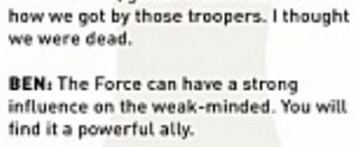

# Owner Material 038 — Star Wars Insider #1–153 plus specials (with The Lucasfilm Fan Club Magazine #1–22): Star Wars Insider #142 (2013)

- **Source:** *Star Wars Insider* magazine (issues 23–153, 1994–2014) and its predecessor *The Lucasfilm Fan Club Magazine* (issues 1–22, 1987–1994), plus seven special editions: articles, interviews, comics and short fiction Secondary source (licensed Legends reference). Scan OCR'd on the box; the scan stays box-only and is **not** published.
- **Method:** every scanned page was OCR'd and machine-screened sentence by sentence for power-relevant statements (fights, kills, defeats, Force feats, rankings, superweapons) that name a character on our roster; each kept sentence is quoted verbatim from the OCR text and has a crop of the printed passage directly under it. Pages with nothing power-relevant are still listed with what is on them.
- **Citation:** "*Star Wars Insider #142* (2013), p.X" by printed page ("scan p.X" where no printed number applies). **Weight:** Licensed magazine: a secondary source. Its short fiction and comics are Legends stories; its articles and interviews sum up or discuss lore and rank below the novels, comics and games they describe.

## scan p.1 (scan page 1)

Page contents: Cover: Padmé Amidala ("By Royal Appointment"); Marvel Comics history; Clone Wars Season Five; ROTJ; visual effects secrets; two exclusive Topps Jedi Legacy cards. (hand-read)

## scan p.2 (scan page 2)

Page contents: Ad: DK Star Wars: The Clone Wars Episode Guide. (hand-read)

## scan p.3 (scan page 3)

Page contents: Editor's welcome (Jonathan Wilkins): more prequel coverage (Padmé, the handmaidens, Temuera Morrison); masthead and contacts. (hand-read)

## scan p.4 (scan page 4)

Page contents: Contents spread (Captain Typho quote: "She's not one to follow orders"). (hand-read)

## scan p.5 (scan page 5)

Page contents: Contents: Launch Pad, My Star Wars (Temuera Morrison), Rogues Gallery (handmaidens), Classic Moment (Ben's Jedi mind trick), Red Five (Arnaud Grunberg), Dykstra on VFX, Padmé profile, ROTJ art, Marvel, Golden/Corroney fiction, Denning's Crucible, The Star Wars comic, Incoming, Bounty Hunters, Bantha Tracks. (hand-read)

## scan p.6 (scan page 6)

Page contents: Launch Pad: J. W. Rinzler previews the enhanced eBooks of The Making of Star Wars/ESB/ROTJ (dailies, BTS footage, Boba Fett's San Anselmo parade debut). (hand-read)

## scan p.7 (scan page 7)

Page contents: Rinzler eBooks, continued (Star Wars gag reel; Lucas ADR session with Guinness; out October 1, 2013); Pacific League baseball "Vader's Challenge" promotion for the 35th anniversary of Star Wars in Japan. (hand-read)

## scan p.8 (scan page 8)

Page contents: Launch Pad: "Looking Back on LucasArts" (David W. Collins): closed April 5, 2013; SCUMM adventure games; X-Wing (1993), TIE Fighter (1994; early Thrawn cameo). (hand-read)

## scan p.9 (scan page 9)

Page contents: LucasArts, continued: Rebel Assault, Dark Forces (Kyle Katarn), Jedi Knight, Republic Commando, ROTS game, Battlefront II, The Force Unleashed (Galen Marek "Starkiller"; summary only), the cancelled 1313. (hand-read)

## scan p.10 (scan page 10)

Page contents: Obituaries for Richard LeParmentier (Admiral Motti) and Colin Higgins (the original Wedge), with Gerald Home quoted; This Is Madness fan tournament on starwars.com (Matt Martin): Yoda beats Vader in the final popularity poll (2.5 million votes; not a power feat). Personal biographical details left out. (hand-read)

## scan p.11 (scan page 11)

Page contents: Ad: Brian's Toys. (hand-read)

## scan p.12 (scan page 12)

Page contents: Feature "The Show That Changed Star Wars" (Eric Geller): Clone Wars Season Five's legacy after cancellation of a full sixth season; finale "The Wrong Jedi". (hand-read)

## scan p.13 (scan page 13)

Page contents: Season Five, continued: the Onderon rebellion arc (Steela's freedom fighters) as groundwork for later rebel groups. (hand-read)

## scan p.14 (scan page 14)

Page contents: Season Five, continued: the "Return of the Sith" section on Maul after Talzin restored him. (hand-read)

### Stat block notes (game mechanics, not feats)

- Maul bests Obi-Wan, outmaneuvers Vizsla: "He made alliances and inspired loyalty through fear and cunning, he bested Obi-Wan Kenobi and was always one step ahead of even his most creative pseudo-allies, as we saw in the case of Pre Vizsla." (The Show That Changed Star Wars, Star Wars Insider 142, p. 14) (Source: *Star Wars Insider #142* (2013), scan p.14)

## scan p.15 (scan page 15)

Page contents: Season Five, continued: Ahsoka comes of age (Onderon, Lux Bonteri, the "Young Jedi" younglings arc); Sidious's confrontation in "The Lawless". (hand-read)

### Stat block notes (game mechanics, not feats)

- Sidious makes short work of Maul and Savage: "Sidious confronted his former apprentice in the episode "The Lawless" and made short work of both Maul and his brother Savage Opress. In a duel that left no doubt as to why Sidious was the Dark Lord of the Sith, he re-established his control over Maul..." (The Show That Changed Star Wars, Star Wars Insider 142, p. 15) (Source: *Star Wars Insider #142* (2013), scan p.15)
- Ahsoka holds her own vs. Grievous: "In the story arc's final episode, "A Necessary Bond," Ahsoka even held her own in a duel against General Grievous, something that far more experienced Jedi have often failed to do." (The Show That Changed Star Wars, Star Wars Insider 142, p. 15) (Source: *Star Wars Insider #142* (2013), scan p.15)

## scan p.16 (scan page 16)

Page contents: Season Five, continued: "All Good Things..." on Ahsoka leaving the Order; Anakin's attachment (the Geonosis "Weapons Factory" rubble); Barriss Offee's confession to the Temple bombing and to framing Ahsoka; public backlash against the Jedi. (hand-read)

## scan p.17 (scan page 17)

Page contents: Season Five, continued: "Anakin's Journey": Ahsoka walks away at the end of the final episode, foreshadowing Vader; Season Five on Blu-ray/DVD. Author's personal details left out. (hand-read)

## scan p.18 (scan page 18)

Page contents: My Star Wars: Temuera Morrison (viewed; image-heavy): first awareness of Star Wars in 1977; impressed by the special effects; favorite scene is Vader's "I am your father" reveal. (hand-read)

## scan p.19 (scan page 19)

Page contents: My Star Wars, continued: favorite film ESB; cast as Jango Fett after a chat with casting director Robin Gurland ("Who is Jango Fett?!"); first autograph at a Star Wars Weekend. (hand-read)

## scan p.20 (scan page 20)

Page contents: Feature "Industrial Light & Magic": Thomas G. Smith's 1985 unedited interview with John Dykstra (opener). (hand-read)

## scan p.21 (scan page 21)

Page contents: Photo (viewed): John Dykstra inspecting the X-wing and Y-wing models later used for the Battle of Yavin. (hand-read)

## scan p.22 (scan page 22)

Page contents: Dykstra feature photos and captions (OCR garbled; real-world production photos: Death Star model, model makers); pull quote "For the most part, we were all sort of students." (hand-read)

## scan p.23 (scan page 23)

Page contents: Dykstra interview: from Doug Trumbull/Silent Running to being hired by Gary Kurtz and George Lucas in 1975; motion-control camera concept; the original ILM team. (hand-read)

## scan p.24 (scan page 24)

Page contents: Dykstra interview, continued: relationship with Lucas and Kurtz; building equipment from scratch; release-date pressure. (hand-read)

## scan p.25 (scan page 25)

Page contents: Dykstra interview, continued: about 18 months total; facility built from scratch; enthusiasm over state of the art (real-world production; S only). (hand-read)

## scan p.26 (scan page 26)

Page contents: Rogues Gallery "Loyal to Their Queen!" (Leland Y. Chee; viewed): 1 Cordé, 2 Sabé, 3 Ellé, 4 Eirtaé, 5 Umé, 6 Queen Amidala. (hand-read)

## scan p.27 (scan page 27)

Page contents: Rogues Gallery, continued (viewed): 7 Rabé, 8 Miré, 9 Hollé, 10 Moteé, 11 Teckla Minnau, 12 Dormé. (hand-read)

## scan p.28 (scan page 28)

Page contents: Feature "Ruminations on Padmé" (Tricia Barr): "Siren of Character": Padmé's heroism in TPM. (hand-read)

### Stat block notes (game mechanics, not feats)

- Padmé leads the palace assault as a trained markswoman: "Padmé repeatedly shows her bravery. She doesn't just give orders from afar; she uses her tactical skills as a trained markswoman to lead the assault on the captured palace, the key to her plan's success." (Ruminations on Padmé, Star Wars Insider 142, p. 28) (Source: *Star Wars Insider #142* (2013), scan p.28)

## scan p.29 (scan page 29)

Page contents: Full-page photo (viewed): Queen Amidala in her red throne-room gown; no text. (hand-read)

## scan p.30 (scan page 30)

Page contents: Photo spread (viewed): Anakin and Padmé on Naboo (AOTC), inset of young Anakin and Padmé on Tatooine; pull quote "In reaching out a hand, Padmé ensures she will become part of Anakin's tragic fate." (hand-read)

## scan p.31 (scan page 31)

Page contents: Ruminations on Padmé, continued: "Reflections of the Daughter and the Son" (AOTC: exile, Anakin's Tusken confession, defying the Council to rescue Obi-Wan, the Geonosis arena, knocked from the gunship). (hand-read)

### Stat block notes (game mechanics, not feats)

- Padmé frees herself in the Geonosis arena: "After being brought into the Geonosian arena for execution, Padmé's use of a carefully concealed hairpin shows she shares the same resourcefulness as her daughter... As Obi-Wan and Anakin exchange banter, Padmé picks the lock on one of her shackles and begins to climb the column that binds her to an almost inevitably gruesome death." (Ruminations on Padmé, Star Wars Insider 142, p. 31) (Source: *Star Wars Insider #142* (2013), scan p.31)

## scan p.32 (scan page 32)

Page contents: Ruminations on Padmé, continued: ROTS; Padmé's deleted political subplot (Stover novelization); Anakin's fear drives him to cut off Mace Windu's hand in defense of a Sith Lord. (hand-read)

## scan p.33 (scan page 33)

Page contents: Ruminations on Padmé, continued: "Padmé's Last Stand": the Empire is declared; on Mustafar Vader chokes Padmé. (hand-read)

### Stat block notes (game mechanics, not feats)

- Obi-Wan, defeater of Maul and Grievous: "Imagine that the greatest living Jedi, the man who defeated Darth Maul and General Grievous, comes to you when you're pregnant and vulnerable..." (Ruminations on Padmé, Star Wars Insider 142, p. 33) (Source: *Star Wars Insider #142* (2013), scan p.33)

## scan p.34 (scan page 34)

Page contents: Ruminations on Padmé, continued: the droid says Padmé "has lost the will to live"; the essay argues the droid may be mistaken; the Clone Wars supernatural (Mortis, Talzin, Orphne; Maul's resurrection shows "dark side users can defy death by a sheer act of will"). (hand-read)

### Stat block notes (game mechanics, not feats)

- Resurrection by will (editorial): "The resurrection of Darth Maul illustrates that dark side users can defy death by a sheer act of will." ("Ruminations on Padmé," Star Wars Insider 142, p. 34) (Source: *Star Wars Insider #142* (2013), scan p.34)

## scan p.35 (scan page 35)

Page contents: Ruminations on Padmé, continued: a karmic reading of Padmé's death tied to Vader's refusal to accept death; her dying words "There's good in him". (hand-read)

## scan p.36 (scan page 36)

Page contents: Return of the Jedi archive opener (J. W. Rinzler): photo of Harrison Ford and Mark Hamill, early 1982. (hand-read)

## scan p.37 (scan page 37)

Page contents: ROTJ archive: rare Lucasfilm Archives artifacts for the enhanced eBook; PR shoot of David Prowse's Vader with an Imperial droid and stormtroopers at Elstree. (hand-read)

## scan p.38 (scan page 38)

Page contents: ROTJ archive (viewed): monster creator Phil Tippett checks Admiral Ackbar's articulated mask (actor Tim Rose inside); model makers working on the Death Star model. (hand-read)

## scan p.39 (scan page 39)

Page contents: ROTJ archive (viewed): Norman Reynolds's January 1982 concept for the "Int. Imperial bunker" (Endor); Harrison Ford and George Lucas on location in the redwoods, May 1982. (hand-read)

## scan p.40 (scan page 40)

Page contents: ROTJ archive (viewed): continuity Polaroids of "forest" rebel troopers (extras' names left out); Nilo Rodis-Jamero's April 1981 "palace guard" concept for Jabba's fortress. (hand-read)

## scan p.41 (scan page 41)

Page contents: ROTJ archive (viewed): full-page Rodis-Jamero 1981 "Guard" concept with an axe-polearm; no text. (hand-read)

## scan p.42 (scan page 42)

Page contents: Authors of the EU: Roy Thomas and Howard Chaykin (Michael Kogge): Marvel's Star Wars (1977–1986), opening with the rough-cut crawl text. (hand-read)

## scan p.43 (scan page 43)

Page contents: Collage of Marvel Star Wars covers (viewed): #1 "Enter Luke Skywalker!", Jaxxon and others; no prose. (hand-read)

## scan p.44 (scan page 44)

Page contents: Kogge, continued: "Roy Thomas: The Origin Story" (Marvel editor-in-chief 1972; met Lucas via Edward Summer). (hand-read)

## scan p.45 (scan page 45)

Page contents: Kogge, continued: "Spaghetti Dinners and Space Operas": Charley Lippincott pitches the comic; McQuarrie's cantina painting convinces Thomas; panel caption on Marvel's Jabba. (hand-read)

## scan p.46 (scan page 46)

Page contents: Kogge, continued: Stan Lee approves (a Guinness fan); Thomas insists on six issues. (hand-read)

## scan p.47 (scan page 47)

Page contents: Kogge, continued: "Always Two There Are": Chaykin hired; Leialoha, Hoberg and Wray help finish. Chaykin Q (real-world): "I regard it as going to school in public." (hand-read)

## scan p.48 (scan page 48)

Page contents: Kogge, continued: "Saving Marvel Comics": Star Wars #1 eventually sold more than a million copies; Jim Shooter claimed Star Wars kept Marvel afloat. (hand-read)

## scan p.49 (scan page 49)

Page contents: Kogge, continued: "Of Rogues and Rabbits": the Starhoppers of Aduba-3/Jaxxon arc, then Lucasfilm pushback; Goodwin/Infantino from #11; Pablo Hidalgo quote on the pastiche; bibliographies. (hand-read)

## scan p.50 (scan page 50)

Page contents: "Good Hunting" opening art (viewed): Jaina, Tenel Ka and Allana with the nexu Anji (Joe Corroney & Hi-Fi); no text. (hand-read)

## scan p.51 (scan page 51)

Page contents: "Good Hunting" (exclusive fiction by Christie Golden, Crucible prequel; title crop-verified): Jaina, Tenel Ka and Allana camp on Luuhar in the Hapes Cluster with Anji. (hand-read)

## scan p.52 (scan page 52)

Page contents: "Good Hunting", continued: Jaina and Tenel Ka sense danger through the Force; Anji flees, and Jaina's Force reach to halt her is "Too late." (hand-read)

## scan p.53 (scan page 53)

Page contents: 710 words, 22 paragraphs | headings/entries: NSIDER

### Stat block notes (game mechanics, not feats)

- Danger sense, deflection: "At that moment, Jaina's danger sense kicked into high gear. She activated her lightsaber, whirling just in time to return blaster fire back toward the man who'd fired it, burning a curiously small but lethal smoking hole in his chest." ("Good Hunting," Star Wars Insider 142, p. 53) (Source: *Star Wars Insider #142* (2013), scan p.53)
- Deflection: "Tenel Ka uttered a war cry in Dathomiri and drew her own lightsaber, its hilt fashioned from a rancor's tooth. Teal and violet blades moved in a blur, sending streaks of white blaster fire back to target their owners." ("Good Hunting," Star Wars Insider 142, p. 53) (Source: *Star Wars Insider #142* (2013), scan p.53)
- Force hurl, acrobatics: "Jaina pressed the attack, pausing to hurl one of the three remaining men into the trunk of a nearby tree before leaping and somersaulting in mid-air, striking another full in the chest with her feet." ("Good Hunting," Star Wars Insider 142, p. 53) (Source: *Star Wars Insider #142* (2013), scan p.53)

## scan p.54 (scan page 54)

Page contents: 815 words, 29 paragraphs | headings/entries: INSIDER

### Stat block notes (game mechanics, not feats)

- Levitation: "Jaina levitated the unconscious poacher while Tenel Ka calculated their whereabouts." ("Good Hunting," Star Wars Insider 142, p. 54) (Source: *Star Wars Insider #142* (2013), scan p.54)
- Hit by a dark-side Force push: "Jaina felt an intangible pressure on her chest and went flying. Immediately, she regained control and turned the fall into a tumble, landing smoothly on her feet." ("Good Hunting," Star Wars Insider 142, pp. 54–55) (Source: *Star Wars Insider #142* (2013), scan p.54)

## scan p.55 (scan page 55)

Page contents: "Good Hunting" ends: Anji kills the poacher guide when he runs for Allana; tie-in note for Troy Denning's Crucible (July 9, 2013). (hand-read)

### Stat block notes (game mechanics, not feats)

- Contested telekinesis vs. a dark-side poacher guide: "While Tenel Ka distracted him, Jaina reached out in the Force, attempting to snatch the blaster out of his hand. She did, but just barely, and her own hand wavered as if someone had attempted to shove it aside." ("Good Hunting," Star Wars Insider 142, p. 55) (Source: *Star Wars Insider #142* (2013), scan p.55)
- Breaks dark-side control, kills the Force-user: "Anji had been summoned and controlled by an unusually powerful will. But instead of turning against her mistress, or even staying out of the fight, the nexu had fought to defend and protect Allana. ... Her simple love had been stronger than the dark side's will." ("Good Hunting," Star Wars Insider 142, p. 55) (Source: *Star Wars Insider #142* (2013), scan p.55)

## scan p.56 (scan page 56)

Page contents: Ad: Insider subscription offer with a Han Solo T-shirt. (hand-read)

## scan p.57 (scan page 57)

Page contents: Classic Moment (Neil Edwards): the "These are not the droids you're looking for" scene. Script excerpt; Anthony Forrest's reprinted Insider #98 quote about playing the sandtrooper; jerba trivia. (hand-read)

- **Obi-Wan Kenobi** — entry/section: Mind trick on stormtroopers: ""The Force can have a strong influence on the weak-minded. You will find it a powerful ally." —Ben Kenobi (A New Hope script excerpt, revised fourth draft), Star Wars Insider 142, p. 57" Source: *Star Wars Insider #142* (2013), scan p.57
  

### Stat block notes (game mechanics, not feats)

- Mind trick, editorial framing: "It's in this scene that we witness the power of the Force, as Obi-Wan uses it to influence the weak-minded sandtrooper during this encounter. We saw that even though the Empire is a totalitarian state, individually, its foot soldiers are no match for the power of the Force." (Classic Moment, Star Wars Insider 142, p. 57) (Source: *Star Wars Insider #142* (2013), scan p.57)

## scan p.58 (scan page 58)

Page contents: Ad: Dark Horse Digital comics. (hand-read)

## scan p.59 (scan page 59)

Page contents: Section opener: Books (Denning), Incoming, Bounty Hunters, Bantha Tracks, Red Five (Arnaud Grunberg). (hand-read)

## scan p.60 (scan page 60)

Page contents: Books: "Back in the Saddle" covers Troy Denning's Crucible: an old-guard "last hurrah" set 40+ years after ROTJ, post-Fate of the Jedi; the villains are Galactic Exploitation Technologies; a Force-strong artifact; "a Han-driven ensemble story"; release July 9. Real-world author commentary, so no feats. (hand-read)

## scan p.61 (scan page 61)

Page contents: Crucible cover art (viewed); no text. (hand-read)

## scan p.62 (scan page 62)

Page contents: Books: The Clone Wars: The Smuggler's Code digest (Justin Aclin, Eduardo Ferrara), June 26. (hand-read)

## scan p.63 (scan page 63)

Page contents: Smuggler's Code comic preview pages (viewed): Obi-Wan and Ahsoka on a beach world; no feats legible. (hand-read)

## scan p.64 (scan page 64)

Page contents: Legacy Book 1 hardcover collection (viewed): Ostrander/Duursema, June 12; descriptive text only. (hand-read)

## scan p.65 (scan page 65)

Page contents: "Star Wars Through the Looking Glass": Dark Horse's The Star Wars (Rinzler/Mayhew), adapting Lucas's 1974 rough draft. Not Legends continuity, so S only. (hand-read)

## scan p.66 (scan page 66)

Page contents: Incoming (James Burns): Topps Star Wars cards with relic and autograph odds. (hand-read)

## scan p.67 (scan page 67)

Page contents: Incoming: Bladez Toys R5-D4 inflatable RC droid; WeLoveFine Dark Side design contest tees. (hand-read)

## scan p.68 (scan page 68)

Page contents: Incoming: FFG Edge of the Empire GM Kit and dice, JAKKS 31" Vader, Her Universe Rogue Squadron tank. (hand-read)

## scan p.69 (scan page 69)

Page contents: Incoming: Comic Images Creatures plush, rag dolls, Backpack Buddies. (hand-read)

## scan p.70 (scan page 70)

Page contents: Incoming: Hallmark 2013 Keepsake Ornaments (ROTJ 30th, including Wrath of the Rancor and a Jango Fett ornament). (hand-read)

## scan p.71 (scan page 71)

Page contents: Incoming: Sideshow sixth-scale Darth Malgus ("formidable commander of the Imperial Army"; Alderaan assault) and Clone Commander Wolffe (Wolfpack losses at Abregado vs. the Malevolence). Product copy, no feats. (hand-read)

## scan p.72 (scan page 72)

Page contents: Bounty Hunters (fan photos with stars; 501st charity booth with Ray Park); fan names left out. (hand-read)

## scan p.73 (scan page 73)

Page contents: Bounty Hunters: fan encounters with Anthony Daniels, Jeremy Bulloch and Tim Rose; fan names left out. (hand-read)

## scan p.74 (scan page 74)

Page contents: Bantha Tracks: Star Wars nights at sports games (501st/Rebel Legion; Red Sox at Fenway); fan names left out. (hand-read)

## scan p.75 (scan page 75)

Page contents: Bantha Tracks: charity Star Wars games with the Akron Aeros, Tulsa Drillers and Detroit Pistons, plus submission guidelines; fan, family and charity-beneficiary names left out. (hand-read)

## scan p.76 (scan page 76)

Page contents: Bantha Tracks: a fan family's Star Wars room, plus a correction; family and fan names left out. (hand-read)

## scan p.77 (scan page 77)

Page contents: Bantha Tracks: a fan's "M-Pire" armor (name left out); Mary Franklin's "Fantasy Star Wars sports teams" humor column (clone rugby team, Darth Maul as ultimate fighter). Non-canon fan humor, S only. (hand-read)

## scan p.78 (scan page 78)

Page contents: Celebration Europe (Essen, July 26–28, 2013): Kathleen Kennedy appearance, Anthony Daniels, and "four Fetts" (Bulloch, Logan, Morton, Beer). (hand-read)

## scan p.79 (scan page 79)

Page contents: Celebration Europe: Jabba's Palace reunion guests, Gus Lopez collecting panels, fan-club list. (hand-read)

## scan p.80 (scan page 80)

Page contents: Red Five (Arnaud Grunberg): Hildebrandt badge and the 1978 French-packaged Vader figure. (hand-read)

## scan p.81 (scan page 81)

Page contents: Red Five: 1980 Bespin Luke 12" prototype, 1983 speeder-bike pedal car display, modern Hasbro clones. (hand-read)

## scan p.82 (scan page 82)

Page contents: Next-issue preview: Warwick Davis guest edits; Kenobi prequel fiction (John Jackson Miller); ROTJ 30th special. (hand-read)

## scan p.83 (scan page 83)

Page contents: Ad: subscription offer with a free Hasbro figure. (hand-read)

## scan p.84 (scan page 84)

Page contents: 117 words, 5 paragraphs | headings/entries: 

### Stat block notes (game mechanics, not feats)

- Trained by Dooku (ad copy, viewed): "General Grievous, cyborg and Supreme Commander of the Separatist's [sic] droid army during the Clone Wars, was trained in the art of lightsaber combat by Count Dooku." (Kotobukiya ad, Star Wars Insider 142, p. 84) (Source: *Star Wars Insider #142* (2013), scan p.84)
