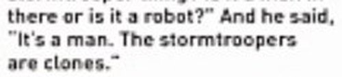
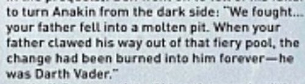
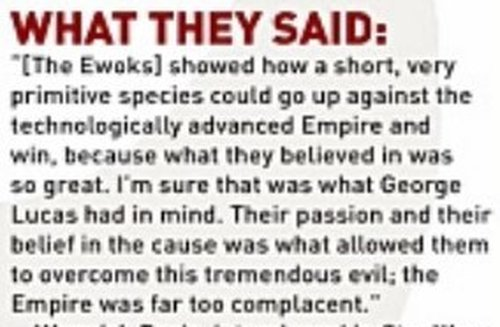

# Owner Material 038 — Star Wars Insider #1–153 plus specials (with The Lucasfilm Fan Club Magazine #1–22): Star Wars Insider #143 (2013)

- **Source:** *Star Wars Insider* magazine (issues 23–153, 1994–2014) and its predecessor *The Lucasfilm Fan Club Magazine* (issues 1–22, 1987–1994), plus seven special editions: articles, interviews, comics and short fiction Secondary source (licensed Legends reference). Scan OCR'd on the box; the scan stays box-only and is **not** published.
- **Method:** every scanned page was OCR'd and machine-screened sentence by sentence for power-relevant statements (fights, kills, defeats, Force feats, rankings, superweapons) that name a character on our roster; each kept sentence is quoted verbatim from the OCR text and has a crop of the printed passage directly under it. Pages with nothing power-relevant are still listed with what is on them.
- **Citation:** "*Star Wars Insider #143* (2013), p.X" by printed page ("scan p.X" where no printed number applies). **Weight:** Licensed magazine: a secondary source. Its short fiction and comics are Legends stories; its articles and interviews sum up or discuss lore and rank below the novels, comics and games they describe.

## scan p.1 (scan page 1)

Page contents: Cover: guest editor Warwick Davis issue (ROTJ 30th); exclusive fiction, collectibles, rare photos, Ewoks. (hand-read)

## scan p.2 (scan page 2)

Page contents: Ad: The Walking Dead magazine subscription. (hand-read)

## scan p.3 (scan page 3)

Page contents: Warwick's Welcome (guest editor Warwick Davis): his Star Wars career since the 1981 casting call; the ROTJ 30th special; masthead. (hand-read)

## scan p.4 (scan page 4)

Page contents: Contents: features (An Ewok's Memoirs, Jabba's Palace, Acting the Part, Making Jedi, James Kahn, Pinball, Skiff Secrets, Thru the Lens, Kenobi fiction). (hand-read)

## scan p.5 (scan page 5)

Page contents: Contents, continued: departments (My Star Wars with Tim Rose, Rogues Gallery skiff guards, Classic Moment, Books, Comics, Incoming, Bantha Tracks, Bounty Hunters, Red Five). (hand-read)

## scan p.6 (scan page 6)

Page contents: Ad (viewed): Titan's Star Wars: The Clone Wars comic magazine. (hand-read)

## scan p.7 (scan page 7)

Page contents: Launch Pad: Star Wars Rebels announced (Kinberg, Filoni, Weisman; set between Episodes III and IV); new Battlefront by DICE; John Knoll named ILM Chief Creative Officer. (hand-read)

## scan p.8 (scan page 8)

Page contents: Launch Pad: Star Wars Reads Day 2013 (October 5); Kyle Newman's documentary The Return of Return of the Jedi: 30 Years and Counting (interviewee's family details left out). (hand-read)

## scan p.9 (scan page 9)

Page contents: Launch Pad: Newman interview continued (ROTJ as a film about redemption); The Clone Wars wins a Daytime Emmy, and David Tennant wins for Huyang. (hand-read)

## scan p.10 (scan page 10)

Page contents: Launch Pad: the Celebration Collecting Track and Star Tots (Gus Lopez); giveaway; private collectors' names left out. (hand-read)

## scan p.11 (scan page 11)

Page contents: Launch Pad: Episode VII casting-call character types; Warwick Davis's side projects (Multiverse, Pocket Warwick, Dwarves Assemble, Life's Too Short, Celebration Europe II hosting). (hand-read)

## scan p.12 (scan page 12)

Page contents: Launch Pad: Celebration Artists' Alley (Brian Rood on Boba Fett; Joe Corroney on an EU Fett/Slave Leia piece; Chris Trevas on Vader's off-screen search for the droids and the Lars' fate). Art commentary, no feats. (hand-read)

## scan p.13 (scan page 13)

Page contents: Ad: Brian's Toys (Jocasta Nu exclusive figure). (hand-read)

## scan p.14 (scan page 14)

Page contents: "An Ewok's Memoirs" (Warwick Davis): first day on the ROTJ set; Richard Marquand's direction; Kenny Baker as Paploo. (hand-read)

## scan p.15 (scan page 15)

Page contents: Full-page photo of Wicket (viewed); no text. (hand-read)

## scan p.16 (scan page 16)

Page contents: An Ewok's Memoirs, continued: "Life in the Ewok Village": cold UK winter shoot at Elstree, incense haze, working 20 feet up. (hand-read)

## scan p.17 (scan page 17)

Page contents: An Ewok's Memoirs, continued: the Ewok TV movies (Caravan of Courage, Battle for Endor) and the costume-shoe change; plug for his autobiography Size Matters Not. (hand-read)

## scan p.18 (scan page 18)

Page contents: Mark Hamill interview (Jonathan Wilkins): opening spread. (hand-read)

## scan p.19 (scan page 19)

Page contents: Full-page photo (viewed): Luke in his black hooded cloak on the Jabba's palace set; no text. (hand-read)

## scan p.20 (scan page 20)

Page contents: Hamill interview: first reaction to the script, Han as the cynical voice, Alec Guinness ("always wanted to play a wizard"), peppering Lucas with questions. (hand-read)

## scan p.21 (scan page 21)

Page contents: Hamill interview sidebars: Warwick Davis recalls Hamill giving him toys during the ROTJ shoot; Hamill on Lucas's "anything over two hours is an epic"; photo captions. (hand-read)

## scan p.22 (scan page 22)

Page contents: Hamill interview, continued: predicting a hit, the "most expensive low-budget movie," the Fox screening without a score, opening day at Grauman's Chinese. (hand-read)

## scan p.23 (scan page 23)

Page contents: Hamill interview sidebar: Celebration as a Beatles-like experience; Chicago-airport pull quote. (hand-read)

## scan p.24 (scan page 24)

Page contents: Hamill interview, continued: the Chicago airport mob, a fan prank by a crew acquaintance (private-life details left out), Frank Oz's Episode I telegram, Oz as Yoda, holding back from the prequel sets. (hand-read)

## scan p.25 (scan page 25)

Page contents: Hamill interview, continued: Yoda's puppetry and staging; acting with effects as "pretend"; sidebar on Lucas's legacy. Real-world, no feats. (hand-read)

## scan p.26 (scan page 26)

Page contents: My Star Wars: Tim Rose (Ackbar, Sy Snootles, Salacious Crumb) interviewed by Mark Newbold. (hand-read)

## scan p.27 (scan page 27)

Page contents: My Star Wars (Tim Rose), continued (viewed): favorite film and favorite toy answers; LEGO Ackbar photo. (hand-read)

## scan p.28 (scan page 28)

Page contents: "Inside Jabba's Court" opening spread (viewed): photo of the Jabba's palace set. (hand-read)

## scan p.29 (scan page 29)

Page contents: Inside Jabba's Court spread, continued (viewed): Mark Newbold talks to the cast and crew. (hand-read)

## scan p.30 (scan page 30)

Page contents: Jabba's palace oral history: Femi Taylor (Oola; nearly strangled by the leash; personal acquaintance details left out) and Gerald Home (Tessek; the sauna-like set). (hand-read)

## scan p.31 (scan page 31)

Page contents: Jabba's palace oral history: Anthony Daniels on the smoky set, the Jabba crew, and Threepio's fall. (hand-read)

## scan p.32 (scan page 32)

Page contents: Jabba's palace oral history: Simon Williamson (Max Rebo, Gamorrean guards Gartogg and Jubnuk). (hand-read)

## scan p.33 (scan page 33)

Page contents: Jabba's palace oral history: Toby Philpott on operating Jabba with Dave Barclay and Mike Edmonds. (hand-read)

## scan p.34 (scan page 34)

Page contents: Jabba's palace oral history: Tim Rose on the Sy Snootles reverse-string marionette and Salacious Crumb. (hand-read)

## scan p.35 (scan page 35)

Page contents: Jabba's palace oral history: Jeremy Bulloch on playing Boba Fett in the palace ("He commands without even saying anything"). (hand-read)

## scan p.36 (scan page 36)

Page contents: Rogues Gallery: "Jabba's Henchmen!" (Leland Y. Chee; viewed): skiff guards named Gailid, Brock Starsher, Pagetti Rook and Pote Snitkin. Name labels only, no bios or feats. (hand-read)

## scan p.37 (scan page 37)

Page contents: Rogues Gallery, continued (viewed): Yotts Orren, Barada and Lathe. Labels only. (hand-read)

## scan p.38 (scan page 38)

Page contents: "How to Be a Star Wars Actor" (Warwick Davis): opener (viewed). (hand-read)

## scan p.39 (scan page 39)

Page contents: How to Be a Star Wars Actor: learning technical jargon ("give validity to nonsense"). (hand-read)

## scan p.40 (scan page 40)

Page contents: How to Be a Star Wars Actor: greenscreen imagination (the eopie reins in Episode I); "W" character names; the Podrace grandstand juice and the Lucas nap anecdote. (hand-read)

## scan p.41 (scan page 41)

Page contents: How to Be a Star Wars Actor: playing Yoda for the TPM shuttle-ramp scene ("faster, more intense"); Lucas's directing style. (hand-read)

## scan p.42 (scan page 42)

Page contents: How to Be a Star Wars Actor: characters get their backstory from the EU (Essential Reader's Companion shown); playing extra characters. (hand-read)

## scan p.43 (scan page 43)

Page contents: How to Be a Star Wars Actor: Warwick asks Lucas whether stormtroopers are men or robots (crop-verified quote logged); secrecy (Blue Harvest). (hand-read)

- **none** — entry/section: Lucas: stormtroopers are clones (as told to Warwick Davis): ""It's a man. The stormtroopers are clones." —George Lucas (as recalled by Warwick Davis), Star Wars Insider 143, p. 43" Source: *Star Wars Insider #143* (2013), scan p.43
  

## scan p.44 (scan page 44)

Page contents: Making Return of the Jedi Unseen! Part 4 (J. W. Rinzler), opener (viewed): Nilo Rodis-Jamero concept art. (hand-read)

## scan p.45 (scan page 45)

Page contents: Making ROTJ Unseen (viewed): Rodis-Jamero's "rebel war room" concept, mid-1981. (hand-read)

## scan p.46 (scan page 46)

Page contents: Making ROTJ Unseen (viewed): Marquand and Ford in the Rebel hangar set; Norman Reynolds's "Key musician, Jabba's" artwork for Red Ball Jett (Max Rebo). (hand-read)

## scan p.47 (scan page 47)

Page contents: Making ROTJ Unseen (viewed): Billy Dee Williams as Lando publicity still. (hand-read)

## scan p.48 (scan page 48)

Page contents: Making ROTJ Unseen (viewed): the Death Star II reactor chamber model; the Imperial "transport scene" concept (cut). (hand-read)

## scan p.49 (scan page 49)

Page contents: Making ROTJ Unseen (viewed): Lucas supervises Hamill's costume fitting in late 1981; trooper concept sketch. (hand-read)

## scan p.50 (scan page 50)

Page contents: Authors of the EU: Chronicler: James Kahn (Michael Kogge): career before Star Wars, E.T., the Poltergeist novelization. Real-world. (hand-read)

## scan p.51 (scan page 51)

Page contents: Full-page photo of James Kahn, mid-1980s (viewed). (hand-read)

## scan p.52 (scan page 52)

Page contents: Kahn profile, continued: Spielberg recommends him to Lucas; Lucas's "very clear and distinct vision"; first draft in three weeks; Kahn's novelization description of Jabba quoted (descriptive, not a feat). (hand-read)

## scan p.53 (scan page 53)

Page contents: Kahn profile, continued: the "very depth of space" opening line and the $60 poker check (crop-verified; OCR read $40/$460); NYT bestseller; scenes cut from the film (Luke building his lightsaber, the sandstorm, the Royal Guard choke); Han's "27 piracies"; Lando's Battle of Tanaab and Pesmenben IV scam; the excised Leia/Alderaan chapter; Ben says Owen is his brother (later retconned). Family detail behind the planet name left out. (hand-read)

- **Obi-Wan Kenobi; Darth Vader (Anakin Skywalker)** — entry/section: ROTJ novelization (Kahn): Ben's account of the duel and the molten pit: ""We fought... your father fell into a molten pit. When your father clawed his way out of that fiery pool, the change had been burned into him forever—he was Darth Vader." —Obi-Wan Kenobi (James Kahn's Return of the Jedi novelization, quoted), Star Wars Insider 143, p. 53" Source: *Star Wars Insider #143* (2013), scan p.53
  

### Stat block notes (game mechanics, not feats)

- ROTJ novelization: Vader Force-chokes a Royal Guard: "And in the middle of the novelization, a red-robed Royal Guard received a Force-choke when he tries to stop Vader from entering the Emperor's throne-room." (Authors of the Expanded Universe: James Kahn, Star Wars Insider 143, p. 53) (Source: *Star Wars Insider #143* (2013), scan p.53)

## scan p.54 (scan page 54)

Page contents: Kahn profile, continued: Lucas's pile of scripts; his TV career (St. Elsewhere, TNG, Voyager, Melrose Place); bibliography sidebar. (hand-read)

## scan p.55 (scan page 55)

Page contents: Kahn profile, continued: John Scalzi's praise; Kahn on Luke rebuilding the Republic after ROTJ ("revolutionaries are often great at knocking down..."); hopes to return. (hand-read)

## scan p.56 (scan page 56)

Page contents: How to be a Star Wars Pinball master (Zen Studios tips): Jedi training mini-game, lightsaber return, Saber Saver. Game, non-canon. (hand-read)

## scan p.57 (scan page 57)

Page contents: Pinball tips, continued: homing missiles, Whip Save, Thrust Diverter. Game, non-canon. (hand-read)

## scan p.58 (scan page 58)

Page contents: Pinball tips, continued: Clone kickbacks, Point Rain gunship mode, Liberation ramp. Game, non-canon. (hand-read)

## scan p.59 (scan page 59)

Page contents: Subscription ad: free Han Solo T-shirt. (hand-read)

## scan p.60 (scan page 60)

Page contents: "I Survived the Sarlacc!" (Bryan Young; viewed): how Corey Dee Williams came to play Klaatu and briefly double Lando. (hand-read)

## scan p.61 (scan page 61)

Page contents: I Survived the Sarlacc: hired as a stand-in at the Yuma shoot; scale of the sail barge set; doubling Lando at the Sarlacc pit after a squib mishap (injury detail left out). (hand-read)

## scan p.62 (scan page 62)

Page contents: I Survived the Sarlacc: falling from the skiff amid sparks and explosions ("Chewbacca was smoldering"); cast as Klaatu because of a shortage of creature performers. (hand-read)

## scan p.63 (scan page 63)

Page contents: I Survived the Sarlacc: the heat inside the Klaatu head and the 7-story barge set; seeing ROTJ at a studio screening. Personal and family details left out. (hand-read)

## scan p.64 (scan page 64)

Page contents: Celebration VI photography of Joel Aron (TCW): the convention through his lens. Costume photos; fan names left out. (hand-read)

## scan p.65 (scan page 65)

Page contents: Joel Aron photos, continued: a Mother Talzin/Nightsisters tribute, a fan-made Pong Krell, sound designer Matthew Wood. Fan content, non-canon. (hand-read)

## scan p.66 (scan page 66)

Page contents: "Incognito" (fiction, John Jackson Miller; art by Chris Scalf), full-page art (viewed): a hooded Obi-Wan with an infant beside a Kedorzhan. (hand-read)

## scan p.67 (scan page 67)

Page contents: Incognito: Senator Dewell Bronk (Kedorzhan, a signer of the Petition of the 2000) flees Coruscant after the Empire is declared; the hooded "Young Father" with an infant turns aside two Devaronian thugs. (hand-read)

### Stat block notes (game mechanics, not feats)

- "Incognito": the "Young Father" (unnamed; the art shows Obi-Wan) mind-tricks two Devaronian thugs: "\"You don't want to disturb that woman,\" a nearby voice said. Its tones were warm and confident. ... \"We don't want to disturb this woman,\" a gruff Devaronian voice responded." (Incognito, Star Wars Insider 143, p. 67) (Source: *Star Wars Insider #143* (2013), scan p.67)

## scan p.68 (scan page 68)

Page contents: Incognito: Dewell's backstory; his son Tytoor died in the Clone Wars; the Kedorzhans fight for the weak; he refuses to withdraw from the Petition of the 2000. (hand-read)

## scan p.69 (scan page 69)

Page contents: Incognito: at a green-skied spaceport, Dewell intervenes when clone troopers harass an Ortolan janitor. (hand-read)

## scan p.70 (scan page 70)

Page contents: Incognito: the troopers try to arrest "Senator Bronk" on the Emperor's authority; the Young Father rescues him and warns that life in exile will be "that way and worse." (hand-read)

### Stat block notes (game mechanics, not feats)

- "Incognito": the Young Father disables two clone troopers (a bucket lands over a helmet with no one behind; cleanser foam; a rifle-butt strike; an unseen shove sends both into a maintenance pit): "The janitor's bucket landed over the helmet of the first clone trooper with a loud clang ... surely, it would have taken someone a Wookiee's height to shove the bucket over his partner's head. But there was no one behind him at all ... In one swift move, the human smashed the trooper in the head with the butt of his own rifle. ... The Young Father shoved at them both now—exactly how, Dewell could not see—pushing them into one of the side doorways. It was a maintenance pit, he realized. He heard the colossal clamor as the armored men tumbled down a staircase." (Incognito, Star Wars Insider 143, p. 70) (Source: *Star Wars Insider #143* (2013), scan p.70)

## scan p.71 (scan page 71)

Page contents: Incognito, ending: Dewell decides to go back and recant; "Even the smallest among us could change the galaxy"; "Who I am is no longer important." Plug for Kenobi (Del Rey). Roster: dewell-bronk. (hand-read)

## scan p.72 (scan page 72)

Page contents: Classic Moment (Neil Edwards): ROTJ script, Threepio tells the Ewok council the saga; why it's a classic (the power of storytelling); Ewokese trivia (Ben Burtt). (hand-read)

- **Wicket W. Warrick** — entry/section: Warwick Davis on the Ewoks beating the Empire: ""[The Ewoks] showed how a short, very primitive species could go up against the technologically advanced Empire and win, because what they believed in was so great. I'm sure that was what George Lucas had in mind. Their passion and their belief in the cause was what allowed them to overcome this tremendous evil; the Empire was far too complacent." —Warwick Davis (interviewed in Star Wars Insider #110, quoted), Star Wars Insider 143, p. 72" Source: *Star Wars Insider #143* (2013), scan p.72
  

## scan p.73 (scan page 73)

Page contents: Subscription ad (UK/Eire/Aus/NZ): free Hasbro figure. (hand-read)

## scan p.74 (scan page 74)

Page contents: Ad: Dark Horse Digital comics. (hand-read)

## scan p.75 (scan page 75)

Page contents: Contents/section divider: Books, Comics, Gear, Bantha Tracks, Bounty Hunters, Red Five. (hand-read)

## scan p.76 (scan page 76)

Page contents: Books: The Surprise Attack of Jabba the Puppett (Origami Yoda, non-canon middle-grade) and William Shakespeare's Star Wars (Ian Doescher; non-canon mashup). (hand-read)

## scan p.77 (scan page 77)

Page contents: Books: The Bounty Hunter Code (Windham, Wallace, Fry): an in-universe artifact book with a Bounty Hunters' Guild handbook, a Death Watch manifesto, and Cradossk's memoir "Making a Killing"; Star Wars: Kenobi (John Jackson Miller) preview with Shelly Shapiro. (hand-read)

## scan p.78 (scan page 78)

Page contents: Comics: Dark Times—A Spark Remains (Randy Stradley, Doug Wheatley): Dass Jennir, Beyghor Sahdett, Ember Chankeli; the Uhumele crew's suicide mission against Vader. (hand-read)

## scan p.79 (scan page 79)

Page contents: Full-page Dark Times art (Doug Wheatley; viewed): Vader shields himself against a fiery blast. (hand-read)

## scan p.80 (scan page 80)

Page contents: Comics: Star Wars: Purge collection (Ostrander, Wheatley, Blackman, Scalf, Freed): Vader hunts Jedi survivors. Solicitation only. (hand-read)

## scan p.81 (scan page 81)

Page contents: Comics: Agent of the Empire—Hard Targets (Jahan Cross) and Dawn of the Jedi—Prisoner of Bogan (Xesh) collections. Solicitation only. (hand-read)

## scan p.82 (scan page 82)

Page contents: Incoming (James Burns): Hasbro Black Series 6-inch launch, SDCC Boba Fett exclusive. Merchandise. (hand-read)

## scan p.83 (scan page 83)

Page contents: Incoming: Super7 T-shirts. Merchandise. (hand-read)

## scan p.84 (scan page 84)

Page contents: Incoming: FFG X-Wing Miniatures expansions (HWK-290 with Kyle Katarn, Lambda shuttle, B-wing, TIE bomber). Game product copy, no feats. (hand-read)

## scan p.85 (scan page 85)

Page contents: Incoming: Her Universe (Ashley Eckstein): ROTJ necklace, Filoni Ahsoka tee, Vader dress. Merchandise. (hand-read)

## scan p.86 (scan page 86)

Page contents: Incoming: Sideshow Darth Vader Deluxe sixth-scale figure; Mimoco Chewbacca MIMOBOTs. Merchandise. (hand-read)

## scan p.87 (scan page 87)

Page contents: Incoming: WeLoveFine Dark Side Design Contest winners (judges Sansweet, Hardwick, Curry, Rebel Force Radio; winner names left out). Merchandise. (hand-read)

## scan p.88 (scan page 88)

Page contents: Bantha Tracks: Celebration Generations (Mary Franklin): Celebration I in the Denver rain (1999). Fan content, non-canon; volunteer's name left out. (hand-read)

## scan p.89 (scan page 89)

Page contents: Bantha Tracks: Celebration II memories: the AOTC Yoda trailer reveal; the R2-D2 Builders' Club; the diorama workshop (fan names left out). Fan content. (hand-read)

## scan p.90 (scan page 90)

Page contents: Bantha Tracks: Celebration III (Indianapolis, 2005): Lucas's surprise attendance and fans waiting in the rain; Lucas: "The point of the movies is to get on with your lives... leave your uncle's moisture farm." Real-world; event staff and fan names left out. (hand-read)

## scan p.91 (scan page 91)

Page contents: Bantha Tracks: Celebration IV (Los Angeles, 2007): the first Clone Wars footage, Star Wars Day in LA, the 30th-anniversary cake. Volunteer names left out. (hand-read)

## scan p.92 (scan page 92)

Page contents: Bantha Tracks: Celebration Europe (London, 2007) and Celebration Japan (2008). Fan and 501st content; fan names left out. (hand-read)

## scan p.93 (scan page 93)

Page contents: Bantha Tracks: Celebrations V and VI (Orlando): Jon Stewart interviews Lucas; Lucas drops in on a Clone Wars panel with Dave Filoni; Sam Witwer on the TCW S5 red carpet. (hand-read)

## scan p.94 (scan page 94)

Page contents: Bounty Hunters (sponsored by Kotobukiya): reader photo with Carrie Fisher. Reader names left out. (hand-read)

## scan p.95 (scan page 95)

Page contents: Bounty Hunters: reader photos with Ashley Eckstein and Peter Sumner (Lt. Pol Treidum, the "TK-421" line, the dianoga operator). Reader and 501st member names left out. (hand-read)

## scan p.96 (scan page 96)

Page contents: Red Five: Warwick Davis's five favorite on-stage convention memories (viewed; OCR garbled): "Artoo Dave-2," the Jedi trials, interviewing Robert Watts, a security scare ("We need to talk!"), ribbing Rick McCallum at Star Wars Weekends. (hand-read)

## scan p.97 (scan page 97)

Page contents: Full-page photo of Warwick Davis by Joel Aron (viewed). (hand-read)

## scan p.98 (scan page 98)

Page contents: Next-issue preview: The Star Wars (Dark Horse), a Hondo Ohnaka Pirate Tales story, a Leia tribute, Dennis Muren. (hand-read)

## scan p.99 (scan page 99)

Page contents: Ad: TCW Season 5 collector's edition magazine. (hand-read)

## scan p.100 (scan page 100)

Page contents: Back-cover ad: Kotobukiya ARTFX+ Sandtrooper Sergeant two-pack. Product copy, no feats. (hand-read)

