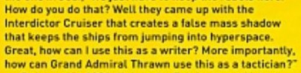
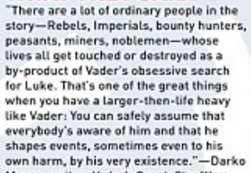

# Owner Material 038 — Star Wars Insider #1–153 plus specials (with The Lucasfilm Fan Club Magazine #1–22): Star Wars Insider #144 (2013)

- **Source:** *Star Wars Insider* magazine (issues 23–153, 1994–2014) and its predecessor *The Lucasfilm Fan Club Magazine* (issues 1–22, 1987–1994), plus seven special editions: articles, interviews, comics and short fiction Secondary source (licensed Legends reference). Scan OCR'd on the box; the scan stays box-only and is **not** published.
- **Method:** every scanned page was OCR'd and machine-screened sentence by sentence for power-relevant statements (fights, kills, defeats, Force feats, rankings, superweapons) that name a character on our roster; each kept sentence is quoted verbatim from the OCR text and has a crop of the printed passage directly under it. Pages with nothing power-relevant are still listed with what is on them.
- **Citation:** "*Star Wars Insider #144* (2013), p.X" by printed page ("scan p.X" where no printed number applies). **Weight:** Licensed magazine: a secondary source. Its short fiction and comics are Legends stories; its articles and interviews sum up or discuss lore and rank below the novels, comics and games they describe.

## scan p.1 (scan page 1)

Page contents: Cover: Leia tribute; 10 years of Knights of the Old Republic; Jeffrey Brown's Jedi Academy; RPGs; Hondo Ohnaka. (hand-read)

## scan p.2 (scan page 2)

Page contents: Ad: Kotobukiya ARTFX+ R2-Q5 and business card holders. Product copy. (hand-read)

## scan p.3 (scan page 3)

Page contents: Editor's welcome (Jonathan Wilkins): Leia tribute, KOTOR at 10, the WEG roleplaying game; masthead. (hand-read)

## scan p.4 (scan page 4)

Page contents: Contents: features (Leia, roleplaying, ROTJ rare images, KOTOR, Dennis Muren, miniature photography, Jedi Academy, Hondo fiction). (hand-read)

## scan p.5 (scan page 5)

Page contents: Contents: departments; subscriber and comic-store covers. (hand-read)

## scan p.6 (scan page 6)

Page contents: Ad: Titan Comics/magazines (OCR garbled; ad only). (hand-read)

## scan p.7 (scan page 7)

Page contents: Launch Pad: Kathleen Kennedy confirms John Williams will score the sequel trilogy; Williams's Celebration Europe II message. (hand-read)

## scan p.8 (scan page 8)

Page contents: Launch Pad: Rebels concept art revealed by Dave Filoni (the Ghost, a TIE crash); Celebration Europe II sound bites (Anthony Daniels picks Darth Maul as favorite; Ian McDiarmid on attending conventions). Real-world. (hand-read)

## scan p.9 (scan page 9)

Page contents: Launch Pad: Celebration Europe II photos; Hamill and Fisher stage banter (Star Tours). (hand-read)

## scan p.10 (scan page 10)

Page contents: Launch Pad: J. W. Rinzler interview on The Making of Return of the Jedi and the enhanced eBooks; rejected cover. (hand-read)

## scan p.11 (scan page 11)

Page contents: Rinzler interview: Marquand's contributions (the Slave Leia costume idea, casting Ackbar as a Mon Calamari, possibly recommending McDiarmid); Lucas's review process; credit to the UK art departments and Mark Hamill. (hand-read)

## scan p.12 (scan page 12)

Page contents: Launch Pad: Star Wars: The Blueprints giveaway; McQuarrie-concept troopers by the 501st; TCW S5 and complete-series Blu-ray; Lucas on Star Trek in Trek Nation. Real-world. (hand-read)

## scan p.13 (scan page 13)

Page contents: Ad: Brian's Toys (Jocasta Nu exclusive; price list). Ad only. (hand-read)

## scan p.14 (scan page 14)

Page contents: Leia feature opener: "Leia, Princess of the People" (photo of Fisher with a stormtrooper). (hand-read)

## scan p.15 (scan page 15)

Page contents: Leia feature intro by Tricia Barr: Leia introduced a new type of heroine. (hand-read)

## scan p.16 (scan page 16)

Page contents: 380 words, 3 paragraphs | headings/entries: 

### Stat block notes (game mechanics, not feats)

- Leia in A New Hope (editorial): "In her first on-screen moments, Leia transfers the stolen plans to R2-D2, then engages stormtroopers as a diversion for the droid's escape." ... "Quick thinking and a blaster 'borrowed' from her rescuer enable Leia to create an exit opportunity from the detention block." (Leia feature, Tricia Barr, Star Wars Insider 144, p. 16) (Source: *Star Wars Insider #144* (2013), scan p.16)

## scan p.17 (scan page 17)

Page contents: 952 words, 28 paragraphs | headings/entries: COMING OF AGE; Strikes Back; The 1980s not only ushered in the; SLAVE LEIA ON THE; SCREEN MIRRORS; Above: sep recy; Meie image: Ever; INSIDER

### Stat block notes (game mechanics, not feats)

- Leia slays Jabba (editorial): "Fisher vividly channels the emotions of a woman using the chains of captivity to slay the grotesque Jabba to gain freedom" ... "Leia volunteers for the combat mission to the forest moon, flies a speeder bike to chase down the biker scouts who might expose the rebels' presence, and mediates with the primitive Ewoks." (Leia feature, Tricia Barr, Star Wars Insider 144, p. 17) (Source: *Star Wars Insider #144* (2013), scan p.17)

## scan p.18 (scan page 18)

Page contents: Full-page photo: Leia on Endor. (hand-read)

## scan p.19 (scan page 19)

Page contents: 222 words, 26 paragraphs | headings/entries: Amidala and the inabi; Skywalker to master; Princesses are; Middleton re; William. In the; IWSIDER 19

### Stat block notes (game mechanics, not feats)

- Leia in the EU (editorial): "the Expanded Universe has seen her endure the death of her youngest son to war, witness her eldest son's plunge to the dark side, and then see his death at the hand of his own twin sister." (Leia feature, Tricia Barr, Star Wars Insider 144, p. 19) (Source: *Star Wars Insider #144* (2013), scan p.19)

## scan p.20 (scan page 20)

Page contents: My Star Wars: McFly's Tom Fletcher (favorite scene: trash compactor). Real-world. (hand-read)

## scan p.21 (scan page 21)

Page contents: My Star Wars: Fletcher auditioned for Episode I's young Anakin; sang in the children's choir on Williams's "Victory Celebration" for the ROTJ Special Edition. Real-world. (hand-read)

## scan p.22 (scan page 22)

Page contents: Roleplaying feature (Bryan Young), part 1: how West End Games' Star Wars RPG shaped the galaxy; the state of Star Wars in 1987. Real-world. (hand-read)

## scan p.23 (scan page 23)

Page contents: Roleplaying feature: Bill Slavicsek of West End Games on starting the RPG; WEG product images (OCR garbled; product art only). (hand-read)

## scan p.24 (scan page 24)

Page contents: Roleplaying feature: WEG's sources (VHS tapes, A Guide to the Star Wars Universe, Bantha Tracks/Starlog articles, Skywalker Ranch archives); "The Name Game" sidebar: Slavicsek named the Ithorians and other species in the Star Wars Sourcebook. Real-world. (hand-read)

## scan p.25 (scan page 25)

Page contents: 212 words, 9 paragraphs | headings/entries: 

### Stat block notes (game mechanics, not feats)

- Ackbar backstory first established by WEG: "The idea that Admiral Ackbar was a slave of Grand Moff Tarkin and escaped to join the rebellion? All written, right there, in the original RPG for the first time in 1987." (Roleplaying feature, Bryan Young, Star Wars Insider 144, p. 25) (Source: *Star Wars Insider #144* (2013), scan p.25)

## scan p.26 (scan page 26)

Page contents: Roleplaying feature: the Jedi Trials expanded in Domain of Evil (1991); Bantam sends Timothy Zahn the WEG source material; Millennium Falcon blueprint. (hand-read)

### Stat block notes (game mechanics, not feats)

- The Jedi Code (first written for the WEG RPG by Greg Costikyan): "There is no emotion; there is peace. There is no ignorance; there is knowledge. There is no passion; there is serenity. There is no death; there is the Force." (Roleplaying feature, Bryan Young, Star Wars Insider 144, p. 26) (Source: *Star Wars Insider #144* (2013), scan p.26)

## scan p.27 (scan page 27)

Page contents: Roleplaying feature: Zahn on WEG's two-way-blind cloaking devices; Heir to the Empire hits #1 on the NYT list; next time: Coruscant, Wizards of the Coast. (hand-read)

- **Grand Admiral Thrawn** — entry/section: Zahn on WEG cloaking devices and Interdictors: ""Well they came up with the Interdictor Cruiser that creates a false mass shadow that keeps the ships from jumping into hyperspace. Great, how can I use this as a writer? More importantly, how can Grand Admiral Thrawn use this as a tactician?" —Timothy Zahn, Star Wars Insider 144, p. 27" Source: *Star Wars Insider #144* (2013), scan p.27
  

## scan p.28 (scan page 28)

Page contents: Ad: Star Wars Insider digital edition. (hand-read)

## scan p.29 (scan page 29)

Page contents: Rogues Gallery, "You're Barred!" (Leland Y. Chee): the Holiday Special cantina's barflies #1–19: Ket Maliss, Thorp, Solomahal, Pons "Brainiac" Limbic, Sosio Kakra, Yamnoss, Myhr Rho, Ackmena, Bludlow, Sun'il Ei'de, Tork, Tedn Dahai, Dratun, Figrin "Barbarine" D'an, Ohwun De Maal, Arleil Schous, Tech Mo'r, Zutmore, Ickabel G'ont (labels crop-verified; page printed sideways). (hand-read)

## scan p.30 (scan page 30)

Page contents: The Star Wars (Dark Horse adaptation of Lucas's 1974 rough draft) feature by Daniel Wallace: opener art by Mike Mayhew. Non-canon. (hand-read)

## scan p.31 (scan page 31)

Page contents: The Star Wars interview (J. W. Rinzler, Randy Stradley): Lucas's approval; Aldeeraan as the Imperial seat; Luke as an aging Jedi general; the Jedi-Bendu; the "Force of Others"; the roll-up text; the Darth Vader sidebar (an Imperial general under Governor Hoedaack). Non-canon. (hand-read)

## scan p.32 (scan page 32)

Page contents: The Star Wars interview: Mike Mayhew joins; sidebars on Annikin Starkiller (18, a Kessilian civil-war veteran) and the droids (Artwo talks). Non-canon. (hand-read)

## scan p.33 (scan page 33)

Page contents: The Star Wars interview: reference material (McQuarrie, Cantwell, Johnston); sidebars on Utapau, Alderaan (gas-planet capital) and Star Destroyers (two-person fighters). Non-canon. (hand-read)

## scan p.34 (scan page 34)

Page contents: Art: cover of The Star Wars #2 (Mayhew). Non-canon. (hand-read)

## scan p.35 (scan page 35)

Page contents: The Star Wars interview: the one added action scene (end of #3); sidebars on the Emperor (Cos Dashit; Governor Crispin Hoedaack), Luke Skywalker (Jedi general) and Princess Leia (daughter of King Kayos of Aquilae). Non-canon. (hand-read)

## scan p.36 (scan page 36)

Page contents: "Making Return of the Jedi Unseen!" part 3 (J. W. Rinzler) opener: the Millennium Falcon on the sandstorm-scene stage; The Making of Return of the Jedi book (out Oct 1). Real-world production history. (hand-read)

## scan p.37 (scan page 37)

Page contents: ROTJ Unseen: the Falcon set to be "flooded" with sand for the sandstorm scene (the first scene shot in principal photography). (hand-read)

## scan p.38 (scan page 38)

Page contents: ROTJ Unseen: McQuarrie concept of an Imperial guard, perhaps for the Emperor's palace when it was on Had Abbadon in early drafts (OCR garbled; caption read from the image). (hand-read)

## scan p.39 (scan page 39)

Page contents: ROTJ Unseen: Harrison Ford coming out of carbon freeze, directed by second-unit director Roger Christian; Ewok village hut set. (hand-read)

## scan p.40 (scan page 40)

Page contents: ROTJ Unseen: Mark Hamill does "Hamlet" with a skull on the rancor set; Norman Reynolds and Robert Watts on the Emperor's throne set; continuity Polaroid of food props from Jabba's barge. (hand-read)

## scan p.41 (scan page 41)

Page contents: ROTJ Unseen: full-page photo of Hamill holding a skull. (hand-read)

## scan p.42 (scan page 42)

Page contents: Knights of the Old Republic at 10 (Michael Kogge): Star Wars games history; KOTOR on Time's 2012 list of the best videogames of all time; Derek Watts's Ewok-village art caption (ROTJ Unseen tail). Real-world. (hand-read)

## scan p.43 (scan page 43)

Page contents: KOTOR key art (Revan, Bastila, HK-47) in a TV-frame layout. (hand-read)

## scan p.44 (scan page 44)

Page contents: KOTOR, "Aborted Origins": Ron Gilbert and Noah Falstein on why LucasArts passed on a 1990s Star Wars RPG with Origin. Real-world. (hand-read)

## scan p.45 (scan page 45)

Page contents: KOTOR, "Enter BioWare": Casey Hudson made project lead; Baldur's Gate's morality system; caption: BioWare team, Bastila Shan, and Darth Revan and Darth Malak as characters who became popular in their own right. Real-world. (hand-read)

## scan p.46 (scan page 46)

Page contents: KOTOR, "Where Do We Begin?": the team (Ohlen, Watts, Falkner, Brockington, Gilmour, Karpyshyn); choosing the Old Republic era after Tales of the Jedi; caption: Karpyshyn at Celebration VI, HK-47, Darth Malak, Malak confronts Bastila Shan (caption crop-verified). Real-world. (hand-read)

## scan p.47 (scan page 47)

Page contents: KOTOR, "Building the Galaxy": Aurora toolset and the d20 rules; HK-47 named after Karpyshyn's billiards team and the AK-47; Zaalbar, Carth, Bastila, Canderous and Mission came from Ohlen's WEG campaign; Taris was once to be named Sleheyron; levels scaled down 30%; Ohlen says the Rakatan "Tatooine as ancestral human home" strand "didn't make it into official Star Wars lore." Real-world. (hand-read)

## scan p.48 (scan page 48)

Page contents: KOTOR, "Not Your Father, Not Your Clone": the rejected twist that the hero was a clone; the morality-based twist; over 2 million copies sold. Real-world. (hand-read)

## scan p.49 (scan page 49)

Page contents: KOTOR, "Next-Gen Knights": the Xbox release in July 2003 sold 250,000 in four days; Aspyr's iPad version; team careers (Hudson on Mass Effect, Ohlen on The Old Republic, Karpyshyn on the Darth Bane novels). Real-world. (hand-read)

## scan p.50 (scan page 50)

Page contents: Dennis Muren: Effects Visionary, a classic 1986 interview by Thomas G. Smith (from Industrial Light & Magic: The Art of Special Effects): early stop-motion experiments; Dave Allen and Jim Danforth. Real-world. (hand-read)

## scan p.51 (scan page 51)

Page contents: Muren interview: making Equinox (about $8,000); working at Cascade with Phil Kellison; joining the union. Caption: Muren blows up Vader's TIE fighter for its attack run in the making of Star Wars (OCR garbled; read from the image). Real-world. (hand-read)

## scan p.52 (scan page 52)

Page contents: Muren interview: getting hired by John Dykstra for Star Wars; only one ILM runner predicted a hit; his approach to miniature photography (the snow walkers). Real-world. (hand-read)

## scan p.53 (scan page 53)

Page contents: Muren interview: go-motion on Empire's tauntaun and Dragonslayer; hand-held-style programmed star moves in Star Wars; "There are shots in Star Wars that had never been done before. I'd sneak them in and try them out." Real-world. (hand-read)

## scan p.54 (scan page 54)

Page contents: Muren interview: favorite shots (the Empire asteroid sequence, the Jedi bike chase, the Temple of Doom mine-car chase); learning from Doug Trumbull. Real-world. (hand-read)

## scan p.55 (scan page 55)

Page contents: Muren interview: digital technology; comparing Spielberg and Lucas ("Go ahead and just do it" on the bike chase); lighting with smoke. Real-world. (hand-read)

## scan p.56 (scan page 56)

Page contents: "Small Wars!" opener: Douglas Smith, assistant cameraman on A New Hope's miniature unit (interview by Calum Waddell). (hand-read)

## scan p.57 (scan page 57)

Page contents: Douglas Smith interview: hired at ILM as a gopher; worked with Jamie Shourt and Don Trumbull; "how not to get killed when you have to blow something up." Real-world. (hand-read)

## scan p.58 (scan page 58)

Page contents: Douglas Smith interview: plates replaced by bluescreen; Lucas spent a week with Edlund and Smith on the dogfight footage; ILM crew cameo as Death Star crew; second-unit Jawa shots; Lucas "said he was never going to do another effects film"; the premiere (a Marvin the Martian cartoon, then a standing ovation). Real-world. (hand-read)

## scan p.59 (scan page 59)

Page contents: Ad: Star Wars Insider subscription (free Han Solo T-shirt). (hand-read)

## scan p.60 (scan page 60)

Page contents: Jedi Academy feature: Jeffrey Brown on his Scholastic book about Roan Novachez's year at the Jedi Academy; unused outtake art (the cafeteria seat page; a character named after Henrik Zetterberg). Kids' book; S only. (hand-read)

## scan p.61 (scan page 61)

Page contents: Jedi Academy: rejected title spread with character descriptions; sample art. (hand-read)

## scan p.62 (scan page 62)

Page contents: Jedi Academy: Brown on the process (J. W. Rinzler suggested him; Carol Roeder pitched it to Scholastic); the bus modeled on the Star Tours vehicle; photo-style drawings. (hand-read)

## scan p.63 (scan page 63)

Page contents: Jedi Academy: draft Student Council minutes page turned into a comic; lightsaber-care notes; dodgeball page as a Freaks and Geeks tribute. (hand-read)

## scan p.64 (scan page 64)

Page contents: Jedi Academy: Brown's favorite characters (Mr. Garfield, Gaer, RW-22, T-P30); his autobiographical book A Matter of Life (family details omitted); a childhood drawing of an Ewok on a speeder bike. (hand-read)

## scan p.65 (scan page 65)

Page contents: Ad: UK subscription (free Hasbro figure). (hand-read)

## scan p.66 (scan page 66)

Page contents: Exclusive fiction: "Hondo Ohnaka's Not-So-Big Score" by Jason Fry, art by Chris Scalf (title page). (hand-read)

## scan p.67 (scan page 67)

Page contents: "Not-So-Big Score": on Florrum, Hondo plans to kidnap rich passengers from the liner Salin Mariner (Lianna to Botajef); his crew (Turk Falso, Peg Leg Piit, Goru, Tegotash, Sabo, Oagu Flask, 4A-2R, Pilf Mukmuk); Hondo boards as "Rondo Rosada" and meets Pelf Pachoola and her swamp dogs Higgs and Twiggs. (hand-read)

## scan p.68 (scan page 68)

Page contents: "Not-So-Big Score": tablemates Fume Pachoola, Sibs Monchan (Monchantics), Usk Haffa, Dix Tarfait; a drunken first night (he catapults a dame into the dessert cart); the plan uses mass mines to pull the ship out of hyperspace; Higgs swallows his comlink. (hand-read)

## scan p.69 (scan page 69)

Page contents: 408 words, 25 paragraphs | headings/entries: Pedstatstal

## scan p.70 (scan page 70)

Page contents: "Not-So-Big Score": Hondo bluffs his way through the Saffa painting exhibition; Pelf's bridesmaid-dress meltdown; Hondo dumps an emetic for the swamp dogs to get his comlink back. (hand-read)

### Stat block notes (game mechanics, not feats)

- Hondo's gundark hole is not a metaphor: "the philosopher's babbling had proved so annoying that he really had wound up in a gundark hole." ("Hondo Ohnaka's Not-So-Big Score," Jason Fry, Star Wars Insider 144, p. 70) (Source: *Star Wars Insider #144* (2013), scan p.70)

## scan p.71 (scan page 71)

Page contents: "Not-So-Big Score" ending: the crew "improvises", Sector forces arrive, and Hondo flees in a pod with Tarfait, the Pachoolas and the swamp dogs; the ransom fetches only eight cases of grog and Fume's overcoat. (hand-read)

### Stat block notes (game mechanics, not feats)

- Hondo bundles hostages into an escape pod: "'Mr. Tarfait, follow me to freedom!' he said, seizing the startled Gotal and flinging him into the pod." ("Hondo Ohnaka's Not-So-Big Score," Jason Fry, Star Wars Insider 144, p. 71) (Source: *Star Wars Insider #144* (2013), scan p.71)

## scan p.72 (scan page 72)

Page contents: Classic Moment trivia: the tortured prisoner first offers "Sunblazer" or "Starkiller"; next issue: Ventress. (hand-read)

- **Darth Vader (Anakin Skywalker)** — entry/section: Macan on Vader shaping events: ""There are a lot of ordinary people in the story—Rebels, Imperials, bounty hunters, peasants, miners, noblemen—whose lives all get touched or destroyed as a by-product of Vader's obsessive search for Luke. That's one of the great things when you have a larger-than-life heavy like Vader: You can safely assume that everybody's aware of him and that he shapes events, sometimes even to his own harm, by his very existence." —Darko Macan (from Star Wars Insider #42), Star Wars Insider 144, p. 72" Source: *Star Wars Insider #144* (2013), scan p.72
  

### Stat block notes (game mechanics, not feats)

- Vader's Quest: Vader learns the name Skywalker: "The Dark Lord discovers through torture and interrogation the pilot's name—Skywalker. Having discovered this all-important information, and what it means, Vader sets about slaying all who heard it, driven by his rage to kill even the non-sentient songbirds that echo the name without thinking." ... "It's notable that Vader keeps what he discovers a secret from the Emperor." (Classic Moment, Vader's Quest, Neil Edwards, Star Wars Insider 144, p. 72) (Source: *Star Wars Insider #144* (2013), scan p.72)

## scan p.73 (scan page 73)

Page contents: Ad: The Walking Dead magazine. (hand-read)

## scan p.74 (scan page 74)

Page contents: Ad: Star Wars Insider back issues. (hand-read)

## scan p.75 (scan page 75)

Page contents: Contents, the Blaster section: Books, Comics, Incoming, Bantha Tracks, Bounty Hunters, Red Five. (hand-read)

## scan p.76 (scan page 76)

Page contents: Books: Kenobi novel preview (moisture farmers versus Sand People; Miller balancing Ewan McGregor's and Alec Guinness's voices). (hand-read)

## scan p.77 (scan page 77)

Page contents: Books: Empire and Rebellion: Razor's Edge (Martha Wells; Leia meets Alderaanian refugees turned pirates; upcoming Han novel by James S. A. Corey and Luke novel by Kevin Hearne); National Geographic Angry Birds Star Wars: The Science Behind the Saga (Amy Griggs). Non-canon (Angry Birds). (hand-read)

## scan p.78 (scan page 78)

Page contents: Comics: Ewoks: Shadows of Endor (Kneesa, Latara, the Duloks; Chief Chirpa, Logray, Teebo; set as the Empire builds the shield generator; the ridge and tunnel to the bunker). (hand-read)

## scan p.79 (scan page 79)

Page contents: Comics: Shadows of Endor art: Ewoks take down a Dulok ("We're not stupid..."). (hand-read)

## scan p.80 (scan page 80)

Page contents: Comics: Star Wars Volume 1: In the Shadow of Yavin (Brian Wood; collects #1–6 plus FCBD 2013; Leia's secret X-wing squadron; art by Carlos D'Anda, Ryan Odagawa, Gabe Eltaeb; Alex Ross cover). (hand-read)

## scan p.81 (scan page 81)

Page contents: Comics: Star Wars Omnibus: Knights of the Old Republic vol. 1 (#0–18; John Jackson Miller; Brian Ching, Travel Foreman, Harvey Tolibas, Dustin Weaver; Travis Charest cover). (hand-read)

### Stat block notes (game mechanics, not feats)

- KotOR Omnibus vol. 1: "Padawan Zayne Carrick, a fugitive framed for the murder of his fellow Jedi-in-training... Zayne's Jedi Masters set out to silence Zayne before he can reveal their roles in the Padawan Massacre." (Comics, Star Wars Insider 144, p. 81) (Source: *Star Wars Insider #144* (2013), scan p.81)

## scan p.82 (scan page 82)

Page contents: Incoming (James Burns): LEGO Ewok Village, printed as "Set #1023" [sic] (1,990 pieces, $249.99). (hand-read)

## scan p.83 (scan page 83)

Page contents: Incoming: LEGO Star Wars Advent Calendar 2013 #75023. (hand-read)

## scan p.84 (scan page 84)

Page contents: Incoming: WeLoveFine T-shirts. (hand-read)

## scan p.85 (scan page 85)

Page contents: Incoming: Her Universe R2-D2 A-line dress (Ashley Eckstein). (hand-read)

## scan p.86 (scan page 86)

Page contents: Incoming: Gentle Giant Snow-bunny Padmé statue. (hand-read)

## scan p.87 (scan page 87)

Page contents: Incoming: Edge of the Empire: Beyond the Rim (Cholganna, the nexu, the Sa Nalsor). (hand-read)

## scan p.88 (scan page 88)

Page contents: Bantha Tracks: "Almost-Annual" Wedding Edition intro and fan wedding/proposal stories (fan names omitted). (hand-read)

## scan p.89 (scan page 89)

Page contents: Bantha Tracks: fan wedding photos (names omitted). (hand-read)

## scan p.90 (scan page 90)

Page contents: Bantha Tracks: fan weddings (Chilled Monkey Brains cake; Star Wars music and a themed cake; names omitted). (hand-read)

## scan p.91 (scan page 91)

Page contents: Bantha Tracks: fan weddings, including a May the 4th wedding in Turkey (names omitted). (hand-read)

## scan p.92 (scan page 92)

Page contents: Bantha Tracks: submission guidelines; a 501st proposal at Celebration VI (names omitted). (hand-read)

## scan p.93 (scan page 93)

Page contents: Bantha Tracks: a fan wedding in Gloucestershire (names omitted); editorial with a joke "galaxy dating ad". (hand-read)

## scan p.94 (scan page 94)

Page contents: Bounty Hunters: fan photos with the cast of Star Trek Into Darkness/J.J. Abrams in Mexico City and with Mark Hamill at Celebration VI (fan names omitted). (hand-read)

## scan p.95 (scan page 95)

Page contents: Bounty Hunters: fan photos with Ashley Eckstein and Daniel Logan, and with Carrie Fisher and Ian McDiarmid (fan names omitted). (hand-read)

## scan p.96 (scan page 96)

Page contents: Red Five: Paul Bateman's five Ralph McQuarrie paintings: 1 Splinter of the Mind's Eye cover; 2 Official Fan Club poster (Death Star trench run). (hand-read)

## scan p.97 (scan page 97)

Page contents: Red Five: 3 Yoda trains Luke (McQuarrie imagined Yoda as "a little studious, tea-drinking chap"); 4 Luke and Vader on Endor; 5 Coruscant skyline. Expanded Universe sketches by Bateman start next issue. (hand-read)

## scan p.98 (scan page 98)

Page contents: Next issue: Lucas and Alan Dean Foster on Splinter of the Mind's Eye; "Rebel Heart" Leia story; RPG history; Darth Maul: victim or villain? (U.S. newsstands Oct 22). (hand-read)

## scan p.99 (scan page 99)

Page contents: Ad: Dark Horse Digital. (hand-read)

## scan p.100 (scan page 100)

Page contents: Back cover ad: Hasbro The Black Series 6-inch Luke Skywalker #01. (hand-read)

