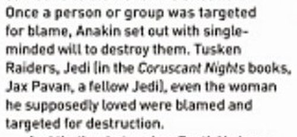
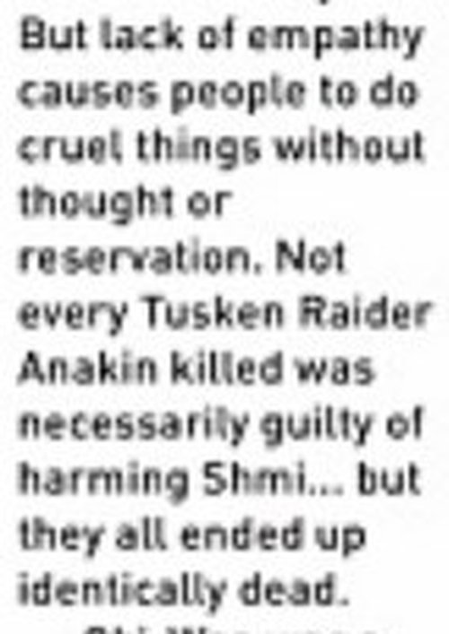
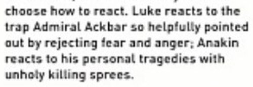
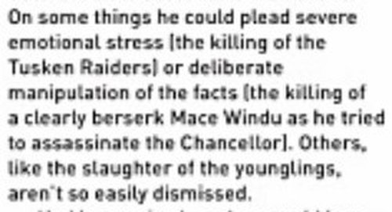
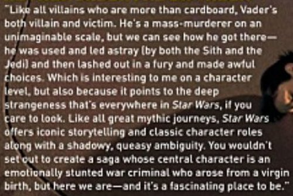
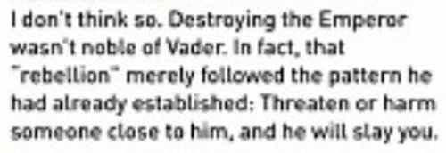
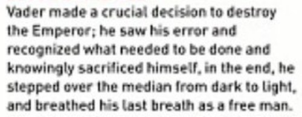
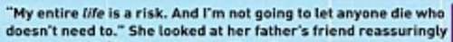

# Owner Material 038 — Star Wars Insider #1–153 plus specials (with The Lucasfilm Fan Club Magazine #1–22): Star Wars Insider #145 (2013)

- **Source:** *Star Wars Insider* magazine (issues 23–153, 1994–2014) and its predecessor *The Lucasfilm Fan Club Magazine* (issues 1–22, 1987–1994), plus seven special editions: articles, interviews, comics and short fiction Secondary source (licensed Legends reference). Scan OCR'd on the box; the scan stays box-only and is **not** published.
- **Method:** every scanned page was OCR'd and machine-screened sentence by sentence for power-relevant statements (fights, kills, defeats, Force feats, rankings, superweapons) that name a character on our roster; each kept sentence is quoted verbatim from the OCR text and has a crop of the printed passage directly under it. Pages with nothing power-relevant are still listed with what is on them.
- **Citation:** "*Star Wars Insider #145* (2013), p.X" by printed page ("scan p.X" where no printed number applies). **Weight:** Licensed magazine: a secondary source. Its short fiction and comics are Legends stories; its articles and interviews sum up or discuss lore and rank below the novels, comics and games they describe.

## scan p.1 (scan page 1)

Page contents: Cover (Nov/Dec 2013): "Is this Sith Lord Star Wars' greatest hero?"; Royal Rebel Leia tale; the strange Star Wars novel you never saw; free exclusive cards; win a Death Star manual. (hand-read)

## scan p.2 (scan page 2)

Page contents: Advertorial: Topps Star Wars Illustrated: A New Hope (radio-drama scenes: Tosche Station, Leia and Bail on Alderaan, first R2/3PO meeting; "Mission: Destroy the Death Star" codes). (hand-read)

## scan p.3 (scan page 3)

Page contents: Advertorial: HighBridge A New Hope Original Radio Drama "Light Side"/"Dark Side" Topps editions (Matt Busch, Randy Martinez art); Star Wars Illustrated launches November 6, 2013. (hand-read)

## scan p.4 (scan page 4)

Page contents: Contents: Lucas & Foster, RPGs part 2, McCaig & Chiang, McQuarrie completed, Lando tales (L. Neil Smith), Princess Leia fiction, Lorne Peterson, Mike Mayhew, Rogues Gallery (Naboo warriors), Classic Moment (Yoda vs. Ventress on Rugosa), Red Five (Howie Weed). (hand-read)

## scan p.5 (scan page 5)

Page contents: Subscriber's cover; editorial (Jonathan Wilkins): Vader hero or villain? feature on p. 10; Star Wars Rebels team next issue; masthead. (hand-read)

## scan p.6 (scan page 6)

Page contents: Launch Pad: Gilbert Taylor B.S.C., Star Wars director of photography, dies aged 99 (August 23, 2013); career summary and 2005 quote on the look of Star Wars; George Lucas tribute quote. (hand-read)

## scan p.7 (scan page 7)

Page contents: Launch Pad: A. C. Crispin (Han Solo trilogy author) has passed (health details omitted); Episode VII to be shot on 35mm film (Daniel Mindel); Disney's Jay Rasulo: one Star Wars film a year from Episode VII in 2015. Lucas family item omitted. (hand-read)

## scan p.8 (scan page 8)

Page contents: Launch Pad: congratulations item on set dresser/second unit director Roger Christian (private and family details omitted); Bill Harman built the first wooden mock-up R2-D2. (hand-read)

## scan p.9 (scan page 9)

Page contents: Launch Pad: wedding photos (omitted); Star Wars Pinball: Balance of the Force; "The Force Is Strong With..." (Star Wars Frames trade edition, How to Speak Droid with R2-D2, LEGO Star Wars: The Yoda Chronicles DVD). (hand-read)

## scan p.10 (scan page 10)

Page contents: Feature opener art: Darth Vader by Brian Rood. (hand-read)

## scan p.11 (scan page 11)

Page contents: "Vader: Hero or Villain?" panel intro (30 years since Vader died aboard the Death Star): Timothy Zahn, Aaron Allston, John Jackson Miller, Christie Golden, Michael Reaves, Maya Kaathryn Bohnhoff, Douglas Wheatley, Kevin Hearne, Ryder Windham, Joe Schreiber. (hand-read)

## scan p.12 (scan page 12)

Page contents: "Hero or Villain?" Q1, bad guy or victim? Zahn (victim but accountable), Allston (both; selfishness about loss), Miller (hubris the Jedi encouraged; going after the Tuskens alone), Golden (a combination), Reaves (benign neglect of younglings; Anakin a loner). (hand-read)

## scan p.13 (scan page 13)

Page contents: "Hero or Villain?" Q1 continued: Bohnhoff (a darker Han "Not My Fault" Solo), Wheatley (tragic circumstance), Windham (circumstances, Palpatine, his own decisions), Hearne (truly bad guy), Schreiber (villain, but no one is beyond forgiveness). (hand-read)

- **Darth Vader (Anakin Skywalker); Jax Pavan** — entry/section: Bohnhoff: Anakin targets those he blames: ""Once a person or group was targeted for blame, Anakin set out with single-minded will to destroy them. Tusken Raiders, Jedi (in the Coruscant Nights books, Jax Pavan, a fellow Jedi), even the woman he supposedly loved were blamed and targeted for destruction." —Maya Kaathryn Bohnhoff, Star Wars Insider 145, p. 13" Source: *Star Wars Insider #145* (2013), scan p.13
  

## scan p.14 (scan page 14)

Page contents: "Hero or Villain?" Q2, who is to blame? Zahn (plenty to go around), Allston (Obi-Wan a brother when Anakin needed a father; Anakin ultimately responsible), Miller (Jedi negligence vs. Palpatine's malice; Kenobi's culpability), Golden (Sidious and Anakin co-creators), Bohnhoff (freeing Shmi was a writer's decision). (hand-read)

- **Darth Vader (Anakin Skywalker); Shmi Skywalker** — entry/section: Allston on the Tusken massacre: ""But lack of empathy causes people to do cruel things without thought or reservation. Not every Tusken Raider Anakin killed was necessarily guilty of harming Shmi... but they all ended up identically dead." —Aaron Allston, Star Wars Insider 145, p. 14" Source: *Star Wars Insider #145* (2013), scan p.14
  

## scan p.15 (scan page 15)

Page contents: "Hero or Villain?" Q2 continued: Bohnhoff (Anakin and Palpatine most responsible), Wheatley (Windu's "too dangerous to be left alive" echoes Palpatine on Dooku), Windham ("It's all George Lucas's fault"; Qui-Gon could have left him on Tatooine), Hearne. (hand-read)

- **Darth Vader (Anakin Skywalker)** — entry/section: Hearne on Anakin's choices: ""Luke reacts to the trap Admiral Ackbar so helpfully pointed out by rejecting fear and anger; Anakin reacts to his personal tragedies with unholy killing sprees." —Kevin Hearne, Star Wars Insider 145, p. 15" Source: *Star Wars Insider #145* (2013), scan p.15
  

## scan p.16 (scan page 16)

Page contents: "Hero or Villain?" Q3, can he be redeemed? Zahn (redeemed per the Force; a trial if he had lived), Allston (personally no, but Lucas says yes; "What did Luke get for him?"), Miller (Luke's act redeems; atonement begins with overthrowing the Emperor). (hand-read)

- **Darth Vader (Anakin Skywalker); Mace Windu; Palpatine (Darth Sidious)** — entry/section: Zahn on the Windu killing at a hypothetical trial: ""On some things he could plead severe emotional stress (the killing of the Tusken Raiders) or deliberate manipulation of the facts (the killing of a clearly berserk Mace Windu as he tried to assassinate the Chancellor). Others, like the slaughter of the younglings, aren't so easily dismissed." —Timothy Zahn, Star Wars Insider 145, p. 16" Source: *Star Wars Insider #145* (2013), scan p.16
  
- **Darth Vader (Anakin Skywalker)** — entry/section: Jason Fry on Vader: ""Like all villains who are more than cardboard, Vader's both villain and victim. He's a mass-murderer on an unimaginable scale, but we can see how he got there—he was used and led astray (by both the Sith and the Jedi) and then lashed out in a fury and made awful choices." ... "You wouldn't set out to create a saga whose central character is an emotionally stunted war criminal who arose from a virgin birth, but here we are—and it's a fascinating place to be." —Jason Fry, Star Wars Insider 145, p. 16" Source: *Star Wars Insider #145* (2013), scan p.16
  

## scan p.17 (scan page 17)

Page contents: "Hero or Villain?" Q3 continued: Golden (yes; saving Luke as reparation), Bohnhoff (destroying Palpatine and saving Luke "accomplished a great deal"), Wheatley (change was enough for Lucas), Windham (would a judge and jury let him walk?). (hand-read)

- **Darth Vader (Anakin Skywalker); Palpatine (Darth Sidious)** — entry/section: Hearne: destroying the Emperor fit Vader's pattern: ""I don't think so. Destroying the Emperor wasn't noble of Vader. In fact, that 'rebellion' merely followed the pattern he had already established: Threaten or harm someone close to him, and he will slay you." —Kevin Hearne, Star Wars Insider 145, p. 17" Source: *Star Wars Insider #145* (2013), scan p.17
  
- **Darth Vader (Anakin Skywalker); Palpatine (Darth Sidious)** — entry/section: Wheatley on Vader's final choice: ""Vader made a crucial decision to destroy the Emperor; he saw his error and recognized what needed to be done and knowingly sacrificed himself, in the end, he stepped over the median from dark to light, and breathed his last breath as a free man." —Douglas Wheatley, Star Wars Insider 145, p. 17" Source: *Star Wars Insider #145* (2013), scan p.17
  

## scan p.18 (scan page 18)

Page contents: My Star Wars: Mike Mayhew (artist of Dark Horse's The Star Wars rough-draft adaptation): favorite character Vader, favorite film Empire. (hand-read)

## scan p.19 (scan page 19)

Page contents: My Star Wars: Mayhew, continued: favorite scene the father reveal; favorite comics (Chaykin, Infantino/Austin, Michael Golden, Al Williamson, Cam Kennedy). (hand-read)

## scan p.20 (scan page 20)

Page contents: "Splinter" conversation (J. W. Rinzler), part 1: October 13, 1976 transcript of Lucas, Alan Dean Foster and Charles Lippincott; Lucas then saw Vader as a relatively weak villain; Western/Sinbad tone; Luke "much more of a warrior" crashing on a planet. Real-world production history; health detail omitted. (hand-read)

## scan p.21 (scan page 21)

Page contents: "Splinter" conversation: full-page art of Luke, Leia and the droids (no text). (hand-read)

## scan p.22 (scan page 22)

Page contents: "Splinter" conversation: Lucas wants a new mechanical little robot as a foil for Artoo; Foster suggests a Force-magnifying object, Lucas recalls the kyber crystal from earlier drafts; a four-to-five-year time jump with Luke "much more of a warrior"; James Bond-style bar scene. Real-world development (pre-release brainstorm), not canon. (hand-read)

## scan p.23 (scan page 23)

Page contents: "Splinter" conversation: full-page photo of Mark Hamill as Luke with blaster (no text). (hand-read)

## scan p.24 (scan page 24)

Page contents: "Splinter" conversation: Leia's role (crash, incognito, love story; Lucas "wouldn't mind killing her off"; a cut idea of the princess running off with the Wookiee); Vader "not strong enough as the villain", unmasking ideas, Tarkin/Vader pawn reversal; Foster sees Vader as the behind-the-scenes manipulator. Real-world brainstorm, not canon; part 2 next issue. (hand-read)

## scan p.25 (scan page 25)

Page contents: Ralph McQuarrie's Splinter of the Mind's Eye cover painting; Foster's July 1977 manuscript title page ("The Second" crossed out). (hand-read)

## scan p.26 (scan page 26)

Page contents: "From Page to Screen and Back Again..." (Bryan Young), the RPGs part 2, opener art. (hand-read)

## scan p.27 (scan page 27)

Page contents: RPGs part 2: Stackpole used West End Games books as canon for X-wing (starship/weapon sourcebooks, the Adventure Journal bacta article); Allston on Gamorreans (Piggy); Zahn contacted WEG about the Mount Tantiss throne room for The Last Command. Real-world production history. (hand-read)

## scan p.28 (scan page 28)

Page contents: RPGs part 2: Zahn choreographed the Luke vs. C'baoth fight to a WEG-designed throne room; Allston used warfare supplements; Pablo Hidalgo as an avid gamemaster (Tatooine Manhunt, Otherspace); Imperial Center, from an unused McQuarrie Had Abbadon painting, named "Coruscant" by Zahn. Production history. (hand-read)

## scan p.29 (scan page 29)

Page contents: RPGs part 2: full-page Legacy Era Campaign Guide cover art (no text). (hand-read)

## scan p.30 (scan page 30)

Page contents: RPGs part 2: Coruscant reaches film (1997 SE, TPM); Bill Slavicsek on WotC's D20 version and Miniatures; D20 as the basis for the Knights of the Old Republic video game; WotC did not renew the license (January 28, 2010); Fantasy Flight next time. (hand-read)

## scan p.31 (scan page 31)

Page contents: "An Imperial Advertorial" comic for the Haynes Death Star Owner's Workshop Manual (script Jonathan Wilkins, art Jeff Carlisle): Vader gives a commander the manual ("That looks vulnerable..."). Non-canon advertising gag. (hand-read)

## scan p.32 (scan page 32)

Page contents: Rogues Gallery, "Naboo's Finest!" (Leland Y. Chee; research Tim Veekhoven, Kevin Beentjes, Sander de Lange), name only: Corporal Cid Rushing, Lieutenant Jerus Jannick, Sergeant Hogan Tinmar, Lieutenant Lutin Hollis (Bravo Nine), Bernie Jabesq, Sergeant Tobias Pall, Captain Nathaniel Camaran, Sergeant Pedric Tosh, Captain Gregar Typho. (hand-read)

## scan p.33 (scan page 33)

Page contents: Rogues Gallery, continued (name only): Nici Burrén, Lieutenant Dineé Ellberger (Bravo Five), Captain Panaka, Sergeant Danzal Galak Sr., Corporal Carlon Brandes, Sergeant Baras Perosei, Commander Ric Olié (Bravo Leader), Agent Mett Habble, Captain Jenn Smeel. (hand-read)

## scan p.34 (scan page 34)

Page contents: "The Way of the Artist": Iain McCaig and Doug Chiang (prequel concept artists, at Celebration Europe) on how Star Wars inspired them. Real-world interview. (hand-read)

## scan p.35 (scan page 35)

Page contents: McCaig & Chiang: spread art "...the Past" with Chiang's sando aqua monster painting ("There's always a bigger fish"). (hand-read)

## scan p.36 (scan page 36)

Page contents: McCaig & Chiang: favorite projects (Rockwell's ball-against-the-wall), first memories (the opening Star Destroyer; Carrie Fisher's lipstick), style (Chiang breaks figures into robots), McCaig's Padmé anecdote ("She's me, George"). (hand-read)

## scan p.37 (scan page 37)

Page contents: McCaig & Chiang: Chiang on joining the prequels and Lucas's lesson "Design for a strong silhouette". (hand-read)

## scan p.38 (scan page 38)

Page contents: McCaig & Chiang: Chiang's "wall of shame" and an early romantic Utapau as the queen's world; McCaig drew Maul as a hellish figure, the "Sith witch" (actually a guy) as his worst-nightmare face, and Padmé modeled on Natalie Portman. Design history. (hand-read)

## scan p.39 (scan page 39)

Page contents: McCaig & Chiang: a hand-made pre-Empire world; Lucas: "Forget everything you know about Star Wars"; Lucas's gift for naming (podracer aliens; the acklay from swapped heads). Lucas family anecdote omitted. (hand-read)

## scan p.40 (scan page 40)

Page contents: "McQuarrie Revisited" opener: Chewbacca and Wookiees with "whorrwaarr" banthas (McQuarrie/Bateman). (hand-read)

## scan p.41 (scan page 41)

Page contents: "McQuarrie Revisited": new feature in which Paul Bateman completes unfinished McQuarrie sketches. (hand-read)

## scan p.42 (scan page 42)

Page contents: "McQuarrie Revisited", "Wookiee Parade": from ESB color preliminaries, the bantha-like "whorrwaarr", a Holiday Special palette; next, Hoth. About Paul Bateman. (hand-read)

## scan p.43 (scan page 43)

Page contents: "Authors of the Expanded Universe: L. Neil Smith" (Michael Kogge): Lando at center stage in Mindharp of Sharu, Flamewind of Oseon, and Starcave of ThonBoka (1983), with no mention of Han Solo. (hand-read)

## scan p.44 (scan page 44)

Page contents: L. Neil Smith: the 1983 fiction revival; Owen Lock suggested Smith on the strength of The Probability Broach; politics kept out. Biography (Heinlein's influence). Family details omitted. (hand-read)

## scan p.45 (scan page 45)

Page contents: L. Neil Smith: Libertarian Party politics and the 2000 Arizona presidential ballot; the only thing he could use was Lando (plus the Falcon); nine weeks to write; Brian Daley and the "Brotherhood of the Falcon". Spouse detail omitted. (hand-read)

### Stat block notes (game mechanics, not feats)

- L. Neil Smith profile: "Smith had conceived that Gepta would be a Dark Lord of the Sith like Darth Vader, but at the time, the Sith were out of bounds. So Smith created a new order of evil magic-users, the Sorcerers of Tund, and made Gepta the heir to their ancient mantle." (Authors of the Expanded Universe: L. Neil Smith, Star Wars Insider 145, p. 45) (Source: *Star Wars Insider #145* (2013), scan p.45)

## scan p.46 (scan page 46)

Page contents: L. Neil Smith: the Centrality; sabacc from shuffled poker rules; the sidearm from a .22 watch-pocket revolver; Waywa Fybot modeled on Big Bird; Vuffi Raa inspired by brittle stars; rejected McQuarrie sketches for Mindharp. (hand-read)

### Stat block notes (game mechanics, not feats)

- L. Neil Smith profile: "Vuffi Raa becomes a surrogate Chewie for Lando, a loyal co-pilot who will sacrifice anything to save his human friend." (Authors of the Expanded Universe: L. Neil Smith, Star Wars Insider 145, p. 46) (Source: *Star Wars Insider #145* (2013), scan p.46)

## scan p.47 (scan page 47)

Page contents: L. Neil Smith: Del Rey galley letter and style notes; "Lando's Legacy" (Ben Quadinaros from the Tund system in TPM); Smith's message; bibliography. (hand-read)

## scan p.48 (scan page 48)

Page contents: "Constant Spirit" (Jennifer Heddle, art Magali Villeneuve): full-page art of the young Leia. (hand-read)

## scan p.49 (scan page 49)

Page contents: "Constant Spirit": Senator Leia (a teenager on early solo missions) and bodyguard Gorhan wait on Quellor for agent Rafe Ballon, who has sliced Moff Toggan's systems; Rafe hands over a datacube. (hand-read)

### Stat block notes (game mechanics, not feats)

- Constant Spirit: "Her senses twinged and she whirled around just as a hand reached out and grabbed her upper arm. Gorhan's blaster was already in the other man's face when they both realized it was Rafe" (Constant Spirit, Star Wars Insider 145, p. 49) (Source: *Star Wars Insider #145* (2013), scan p.49)

## scan p.50 (scan page 50)

Page contents: "Constant Spirit": the Constant Spirit (pilot Minna, Mon Calamari navigator Youk, Gorhan on the single gun) is hailed by Captain Task of the Imperial Customs corvette Gatekeeper and attacked. (hand-read)

- **Leia Organa Solo; Rafe Ballon** — entry/section: Constant Spirit: ""My entire life is a risk. And I'm not going to let anyone die who doesn't need to." —Leia Organa, Star Wars Insider 145, p. 50" Source: *Star Wars Insider #145* (2013), scan p.50
  

## scan p.51 (scan page 51)

Page contents: "Constant Spirit": shields fade; Youk's jump calculations; Leia's worry for her father. (hand-read)

## scan p.52 (scan page 52)

Page contents: "Constant Spirit": shields gone, hyperdrive out; Rafe launches the escape pod straight at the Gatekeeper's bridge. (hand-read)

## scan p.53 (scan page 53)

Page contents: "Constant Spirit": the Gatekeeper is left disabled; Leia reports to Bail on Alderaan. Razor's Edge ad. (hand-read)

### Stat block notes (game mechanics, not feats)

- Constant Spirit: "The ship began to turn and fired its main gun, but both last-ditch efforts failed. Rafe's pod found its target well enough, ramming into the bridge in a spectacular conflagration." (Constant Spirit, Star Wars Insider 145, p. 53) (Source: *Star Wars Insider #145* (2013), scan p.53)

## scan p.54 (scan page 54)

Page contents: "Breaking the Mold" opener: photo of Lorne Peterson at work on a sandcrawler miniature set. (hand-read)

## scan p.55 (scan page 55)

Page contents: Lorne Peterson 1984 interview (Thomas G. Smith, for Industrial Light & Magic: The Art of Special Effects): background; hired by Bob Shepherd for an unknown Lucas film. Family details omitted. (hand-read)

## scan p.56 (scan page 56)

Page contents: Peterson: the first ILM (1975): "The Trench" Death Star section, the sandcrawler, the X-wing; a "used" universe; Dykstra's career advice; Lucas watching the lines at Grauman's; Battlestar Galactica at Apogee. (hand-read)

## scan p.57 (scan page 57)

Page contents: Peterson: the new ILM in Marin; Empire the hardest; the Executor, built in seven weeks with about 750,000 lights (OCR "750,900"; the ANH Star Destroyer had about 30,000) and costing over $120,000; about 300 models across the trilogy, only 50 to 100 kept; Slave I a favorite. Production history. (hand-read)

## scan p.58 (scan page 58)

Page contents: Contest/ad: Haynes Death Star Owner's Workshop Manual (Ryder Windham, Chris Reiff, Chris Trevas). (hand-read)

## scan p.59 (scan page 59)

Page contents: Classic Moment (Neil Edwards): TCW "Ambush", Yoda vs. Ventress on Rugosa with three clones; Nika Futterman quote from Insider #122 on finding Ventress's character; trivia: premiered at the summer 2008 TCA press tour and DragonCon (OCR "2006" corrected), aired October 3, 2008. (hand-read)

### Stat block notes (game mechanics, not feats)

- Classic Moment: The Clone Wars "Ambush": "After much cat and mouse, Yoda starts to win, so Ventress cheats. King Katuunko, the Toydarian ruler, takes Yoda's side as she didn't give him a fair chance. An angry Ventress tries to kill the King, but Yoda stops her and she escapes." (Classic Moment, Star Wars Insider 145, p. 59) (Source: *Star Wars Insider #145* (2013), scan p.59)
- Classic Moment: The Clone Wars "Ambush": "When the clones doubt their abilities, it's the Jedi Master who encourages them to see themselves as individuals and to prize their minds. As a result, they triumph against far greater numbers and more firepower due to their quick thinking." (Classic Moment, Star Wars Insider 145, p. 59) (Source: *Star Wars Insider #145* (2013), scan p.59)

## scan p.60 (scan page 60)

Page contents: Brian's Toys ad. (hand-read)

## scan p.61 (scan page 61)

Page contents: Section contents: Books, Comics, Incoming (Cad Bane), Bounty Hunters, Bantha Tracks, Red Five. (hand-read)

## scan p.62 (scan page 62)

Page contents: Books: Star Wars Art: Concept (Abrams, October 15), with work by McQuarrie, Johnston, McCaig, Tiemens, Church and others, including the unfinished 1313 and Detours, plus Hajime Sorayama pieces. (hand-read)

## scan p.63 (scan page 63)

Page contents: Books: Star Wars Art: Concept sample paintings (1313 concept art; no text). (hand-read)

## scan p.64 (scan page 64)

Page contents: Books/games: FFG's Edge of the Empire adventure Beyond the Rim (Katrina Ostrander, Sterling Hershey): Cholganna and the nexu, a lost CIS treasury ship, the Wheel, Raxus Prime. Star Wars Lightsaber Thumb Wrestling board book (text by Pablo Hidalgo). (hand-read)

## scan p.65 (scan page 65)

Page contents: Books: enhanced eBooks of Rinzler's Making Of books (gag reel; an alternate wampa attack; Veers's originally planned death; a female X-wing pilot's death footage; an early version of Luke building his lightsaber). (hand-read)

## scan p.66 (scan page 66)

Page contents: Comics: Legacy (Gabriel Hardman, Corinna Bechko; art Brian Thies), Outcasts of the Broken Ring (#6–10): Ania and Jao hunt Wredd to Mon Cala's hijacked orbital ring; issue #1 for $1 on November 20. (hand-read)

### Stat block notes (game mechanics, not feats)

- Comics: Star Wars Legacy: "In Ania Solo's debut adventure she made an enemy of Sith Lord Darth Wredd, earned the favor of Imperial Empress Marasiah Fel, and found an ally in Imperial Knight Jao Assam." (Comics, Star Wars Insider 145, p. 66) (Source: *Star Wars Insider #145* (2013), scan p.66)

## scan p.67 (scan page 67)

Page contents: Comics: Omnibus: Wild Space Volume 2 (October 2): Sergio Aragonés, Tag & Bink, Podracing Tales, Jabba comics, Scoundrel's Wages, Visionaries. (hand-read)

## scan p.68 (scan page 68)

Page contents: Incoming (James Burns): Gentle Giant Yoda statue (Padmé companion piece). (hand-read)

## scan p.69 (scan page 69)

Page contents: Incoming: Gentle Giant jumbo Hoth snowtrooper; Her Universe "Everyday Cosplay" dresses; Holiday Special animated Boba Fett maquette. (hand-read)

## scan p.70 (scan page 70)

Page contents: Incoming: Yomega Yo-Men and Fireball yo-yos; Diamond Cad Bane and Commander Thire bust banks and a Vader bottle opener. (hand-read)

## scan p.71 (scan page 71)

Page contents: Incoming: Hasbro Black Series 6" wave 3 and 3.75" wave 3 (Commander Neyo, Vizam, armored Mace Windu, Darth Plagueis). (hand-read)

## scan p.72 (scan page 72)

Page contents: Bounty Hunters (fan celebrity-encounter photos; fan names omitted); Kotobukiya prize. (hand-read)

## scan p.73 (scan page 73)

Page contents: Bounty Hunters, continued (fan names and a family member of a Lucasfilm figure omitted); call for submissions. (hand-read)

## scan p.74 (scan page 74)

Page contents: Bantha Tracks, "Fan Clubs": the Rebel Legion (founded 2000, 2,400+ members, 39 countries, 200+ costumes, charity work). Fan and officer names omitted. (hand-read)

## scan p.75 (scan page 75)

Page contents: Bantha Tracks: the Mandalorian Mercs (founded 2007, Brigades, charity, Verd'ika Corps) and the Saber Guild (founded 2006, lightsaber shows). Fan and officer names omitted. (hand-read)

## scan p.76 (scan page 76)

Page contents: Bantha Tracks: the 501st Legion (founded 1997; 7,000+ members in 50+ countries; over $11 million raised for charity this year). Founder and officer names omitted. Submission guidelines. (hand-read)

## scan p.77 (scan page 77)

Page contents: Bantha Tracks editorial (Mary Franklin): no official fan clubs apart from one licensed club in Germany; list of fan groups thanked. (hand-read)

## scan p.78 (scan page 78)

Page contents: Red Five: Howie Weed's (ILM; wore the wampa suit in ESB) five favorite aliens: Boga; the holochess monsters; Hammerhead (Weed added Melas and Ketwol to the SE cantina). (hand-read)

## scan p.79 (scan page 79)

Page contents: Red Five, continued: the rancor (Phil Tippett rod puppet) and Bib Fortuna (Michael Carter). Interview by Mark Newbold. (hand-read)

## scan p.80 (scan page 80)

Page contents: Subscription offer (free Hasbro figure). (hand-read)

## scan p.81 (scan page 81)

Page contents: Subscription offer, continued. (hand-read)

## scan p.82 (scan page 82)

Page contents: Next issue: why Boba Fett endures; the Star Wars Rebels team; new Darth Maul fiction "Sith Spawn"; Lucas/Foster part 2. On sale December 10 (US) / December 19 (UK). (hand-read)

## scan p.83 (scan page 83)

Page contents: Dark Horse Digital ad. (hand-read)

## scan p.84 (scan page 84)

Page contents: Ad: Star Wars Insider Special Edition (Hamill/Fisher/Ford interview, Death Star secrets). (hand-read)

