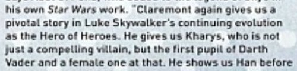
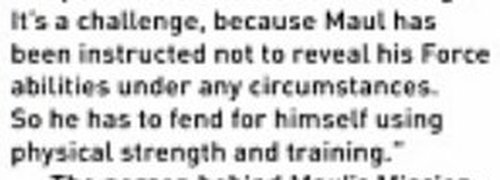
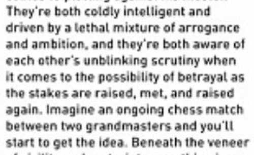
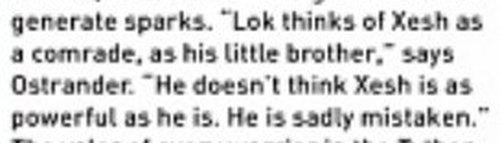
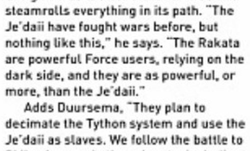

# Owner Material 038 — Star Wars Insider #1–153 plus specials (with The Lucasfilm Fan Club Magazine #1–22): Star Wars Insider #146 (2014)

- **Source:** *Star Wars Insider* magazine (issues 23–153, 1994–2014) and its predecessor *The Lucasfilm Fan Club Magazine* (issues 1–22, 1987–1994), plus seven special editions: articles, interviews, comics and short fiction Secondary source (licensed Legends reference). Scan OCR'd on the box; the scan stays box-only and is **not** published.
- **Method:** every scanned page was OCR'd and machine-screened sentence by sentence for power-relevant statements (fights, kills, defeats, Force feats, rankings, superweapons) that name a character on our roster; each kept sentence is quoted verbatim from the OCR text and has a crop of the printed passage directly under it. Pages with nothing power-relevant are still listed with what is on them.
- **Citation:** "*Star Wars Insider #146* (2014), p.X" by printed page ("scan p.X" where no printed number applies). **Weight:** Licensed magazine: a secondary source. Its short fiction and comics are Legends stories; its articles and interviews sum up or discuss lore and rank below the novels, comics and games they describe.

## scan p.1 (scan page 1)

Page contents: Cover: Boba Fett, "Dressed to Kill: why Boba Fett is still the galaxy's greatest bounty hunter!"; Star Wars Rebels exclusive interview; George Lucas, Chris Claremont, roleplaying games. (hand-read)

## scan p.2 (scan page 2)

Page contents: Kotobukiya ARTFX+ Sandtrooper two-pack ad. (hand-read)

## scan p.3 (scan page 3)

Page contents: Editor's welcome (Jonathan Wilkins), opening with Boba Fett's Holiday Special line "We'll meet again, friends."; Jason Fry on Fett; Athena Portillo and Greg Weisman on Rebels. Masthead. (hand-read)

## scan p.4 (scan page 4)

Page contents: Contents: Lucas (Splinter part 2), RPGs (final part), Rebels/Weisman, McQuarrie snowtroopers, Chris Claremont, "Bug Hunt" (Joe Schreiber, art John VanFleet), Edwin Catmull. (hand-read)

## scan p.5 (scan page 5)

Page contents: Contents, departments: Launch Pad, My Star Wars (Aaron Allston), Rogues Gallery (Hoth rebel pilots), Classic Moment (arrival on Coruscant, TPM), Books (Maul: Lockdown), Comics (Dawn of the Jedi: Force War), Incoming, Bounty Hunters, Bantha Tracks. (hand-read)

## scan p.6 (scan page 6)

Page contents: Launch Pad: The Star Wars comic (Rinzler/Mayhew) tops the advance-orders chart; Kasdan and Abrams take over the Episode VII screenplay from Michael Arndt; crew list; shooting spring 2014 at Pinewood for 2015. (hand-read)

## scan p.7 (scan page 7)

Page contents: Launch Pad: holiday viewing picks (DVD/Blu-ray sets, TCW Seasons 1–5, The Yoda Chronicles); Athena Portillo's Rebels "Frontline Update" (between Episodes III and IV, closer to ANH). (hand-read)

## scan p.8 (scan page 8)

Page contents: Launch Pad: Rebels update continued (Filoni, Kinberg, Weisman); Hasbro Rebels figure packaging; "2013 Year in Review" January–March: Zahn's Scoundrels, "The Wrong Jedi", the end of TCW announced, Stuart Freeborn dies aged 98 (OCR "78" corrected), The Last Jedi (Reaves/Bohnhoff), Abrams named Episode VII director, Legacy: Prisoner of the Floating World #1, Apocalypse in paperback. (hand-read)

## scan p.9 (scan page 9)

Page contents: Launch Pad: 2013 Year in Review, April–November (LucasArts closed and 1313 cancelled; Richard LeParmentier dies aged 66; Vader's Little Princess; Into the Void; Rebels announced; ROTJ 30th; Clone Wars Episode Guide; Star Wars Weekends; William Shakespeare's Star Wars; Denning's Crucible; Celebration Europe and Celebration Anaheim announced; Gilbert Taylor dies; Miller's Kenobi; The Star Wars #1; Wells' Razor's Edge; Making of ROTJ; Death Star Owner's Workshop Manual). One personal-life item about Lucas omitted per rules. (hand-read)

## scan p.10 (scan page 10)

Page contents: Celebration Europe hosts MC Mark Daniel and DJ Elliot on their highlights (R4-CE2 voice, ROTJ screening at Grugapark, 501st gala with Fett actors, panels with McDiarmid, Hamill/Fisher/Davis, Kathleen Kennedy). Guests' family and the hosts' personal details omitted. (hand-read)

## scan p.11 (scan page 11)

Page contents: Brian's Toys ad. (hand-read)

## scan p.12 (scan page 12)

Page contents: Cover feature "The Man in the Dented Mask" by Jason Fry: Fett's 1978 parade debut, the Holiday Special, the Kenner rocket-firing mail-away, and his limited screen time in ESB/ROTJ. (hand-read)

## scan p.13 (scan page 13)

Page contents: Full-page Boba Fett art by Chris Trevas (no text). (hand-read)

## scan p.14 (scan page 14)

Page contents: 285 words, 36 paragraphs | headings/entries: SINISTER PURPOSE; Mysterious symbols adorn Fett's armor,; Jeremy Bulloch, who played Fett; Millennium Fatcon, the brief glance exchanged; Jabba's throne room, offering Boushh a; This stillness and sense of purpose made; Fett's bursts of action—snapping his rifle up; But the Fett of Empive and Jedi

### Stat block notes (game mechanics, not feats)

- Fett's presence: Fett's armor "isn't glossy and pristine, like that of Vader and his stormtroopers—it's battered and dinged... Every gouge and dent feels like it has a tale to tell, one that begins with 'you should see the other guy.'" Bulloch's Fett has "an air of implacable calm"; "This stillness and sense of purpose made Fett's bursts of action—snapping his rifle up to aim at Chewbacca, or igniting his jetpack to fly from Jabba's sail barge—all the more striking." (Feature, Star Wars Insider 146, p. 14) (Source: *Star Wars Insider #146* (2014), scan p.14)

## scan p.15 (scan page 15)

Page contents: Also: Marvel resurrects Fett from the Sarlacc; Dark Horse brings him back in Dark Empire in 1991 (OCR "1971" corrected); Special Edition additions; Greatest Hits also lists Moran's "The Last One Standing" (1996, OCR "1976" corrected; Fett and Han in combat with the outcome undetermined), Death, Lies and Treachery, and "Agent of Doom" (Fett pursues an Imperial death ship's crew). (hand-read)

### Stat block notes (game mechanics, not feats)

- "Bounty" (TCW): "this 2012 tale sees Fett leading a crew of hunters – including Dengar, Asajj Ventress and the cooler-than-cool C-21 Highsinger—through the caverns of Quarzite aboard a speeding hover-train. The young hunter is capable enough that we see what he'll become, but still inexperienced enough to need more lessons." (Fett's Greatest Hits, Star Wars Insider 146, p. 15) (Source: *Star Wars Insider #146* (2014), scan p.15)
- "Twin Engines of Destruction": "Mangels' Fett does a lot while saying little, making every word count. And while Jodo Kast may wear Fett's armor, he's no match for his rival's ruthlessness." (Fett's Greatest Hits, Star Wars Insider 146, p. 15) (Source: *Star Wars Insider #146* (2014), scan p.15)
- Enemy of the Empire: The 1999 Dark Horse series "is the stuff of fanboy dreams, sending Fett up against Darth Vader himself on a forlorn world. It works: Wagner's Fett is pitiless and resourceful." (Fett's Greatest Hits, Star Wars Insider 146, p. 15) (Source: *Star Wars Insider #146* (2014), scan p.15)
- The Mandalorian Armor: "Fett and a gang of hunters, including the unforgettable D'harhan, arrive on the planet Circumtore for a confrontation with the Shell Hutts. Jeter ratchets the tension sky-high before releasing it in a bravura showdown." (Fett's Greatest Hits, Star Wars Insider 146, p. 15) (Source: *Star Wars Insider #146* (2014), scan p.15)

## scan p.16 (scan page 16)

Page contents: Also: a 1994 trading card's helmetless Fett (an artist's what-if) and the 1997 comic with a bandaged, Sarlacc-scarred Fett. (hand-read)

### Stat block notes (game mechanics, not feats)

- Old backstory: "He was born Jaster Mereel, became a Journeyman Protector on the planet Concord Dawn, then was forced into exile and acquired a suit of Mandalorian battle armor and a new identity, becoming the galaxy's most feared bounty hunter." (Feature, Star Wars Insider 146, p. 16) (Source: *Star Wars Insider #146* (2014), scan p.16)

## scan p.17 (scan page 17)

Page contents: "Tweets on Fett" fan sidebar (handles omitted). (hand-read)

### Stat block notes (game mechanics, not feats)

- A new history: Boba is Jango's unaltered clone; TCW "revealed his grim apprenticeship with the assassin Aurra Sing... We saw Fett become the leader of the Mandalorians, train Jedi, fight the Yuuzhan Vong, and attempt a halting reconciliation with a daughter and granddaughter"; The Essential Guide to Warfare "recounts a tense meeting between Fett and the arachnid information broker Balancesheet." (Feature, Star Wars Insider 146, p. 17) (Source: *Star Wars Insider #146* (2014), scan p.17)
- "This is my face": The 1997 Mangels comic "shows Fett doing away with Jodo Kast, an impersonator in Mandalorian armor. When fellow bounty hunter Dengar suggests Fett rarely shows his face because of his Sarlacc scars, Fett turns his helmet in Dengar's direction. 'This is my face,' he growls." (Feature, Star Wars Insider 146, p. 17) (Source: *Star Wars Insider #146* (2014), scan p.17)

## scan p.18 (scan page 18)

Page contents: My Star Wars: Aaron Allston interview (Mark Newbold): first saw Star Wars in 1977, Flash Gordon, first autograph at GenCon, Galoob X-wing. (hand-read)

## scan p.19 (scan page 19)

Page contents: My Star Wars continued (Allston): his favorite film is ESB, the one with the most character development and story advancement, plus Leigh Brackett's contribution. Art spread. (hand-read)

## scan p.20 (scan page 20)

Page contents: "The Conversation" part 2 (J. W. Rinzler): the October 20, 1976 Lucas/Foster/Lippincott story conference for Splinter of the Mind's Eye. Real-world development material (Luke fights a tribal chief; the Wookiees can't talk); S only. (hand-read)

## scan p.21 (scan page 21)

Page contents: Full-page Splinter painting (Luke and Leia floating, by Fregedo), labeled "Exclusive" (no text). (hand-read)

## scan p.22 (scan page 22)

Page contents: Conversation continued: Han left out of the story; the "clear monster" becomes Mimban's lake spirit; the Gaga Zoormi temple "time lock"; the temple duel imagined as "a fight between two extrasensory giants" in which Vader throws objects. Development discussion, not canon feats; S only. (hand-read)

## scan p.23 (scan page 23)

Page contents: Dark Horse Splinter adaptation comic panels and captions (Vader/Luke duel cover art). (hand-read)

## scan p.24 (scan page 24)

Page contents: Conversation continued: "Building up Vader". Lucas: "I haven't killed anybody in this stuff yet. Oh, I guess I killed Ben"; Lippincott wants Vader to kill someone sympathetic; Vader beats up Leia in the proposed draft. Development material; S only. (hand-read)

## scan p.25 (scan page 25)

Page contents: Conversation concluded: Luke kills Vader in the draft, the crystal heals Leia, and the "Frank Frazetta moment". Development material; S only. (hand-read)

## scan p.26 (scan page 26)

Page contents: RPG history final part: Fantasy Flight's Steve Horvath on gaining the license after Wizards of the Coast; X-Wing Miniatures and the card game. Real-world. (hand-read)

## scan p.27 (scan page 27)

Page contents: RPG feature art and captions (Fantasy Flight ship miniatures; Edge of the Empire interior art). (hand-read)

## scan p.28 (scan page 28)

Page contents: RPG feature continued: Edge of the Empire (2013), a Rebellion-focused book in 2014, and a Force-user book in 2015; Horvath quotes. Real-world. (hand-read)

## scan p.29 (scan page 29)

Page contents: RPG feature: Edge of the Empire talent card ("Smooth Talker") art. (hand-read)

## scan p.30 (scan page 30)

Page contents: RPG feature concluded: Pablo Hidalgo on the 1987 game's "dos and don'ts"; a core-book quote on keeping the Star Wars spirit; FFG's legacy (Slavicsek, Costikyan, Zahn). Real-world. (hand-read)

## scan p.31 (scan page 31)

Page contents: Dark Horse Digital ad. (hand-read)

## scan p.32 (scan page 32)

Page contents: Rogues Gallery "Clearance for Immediate Launch": ESB Echo Base pilot-briefing screenshot with 18 numbered figures (printed sideways). (hand-read)

## scan p.33 (scan page 33)

Page contents: "Rebels in Retreat": Rogue Flight, Blue and Green Squadrons formed Rogue Group on Hoth; the GR-75 transports run Death Squadron's blockade under cover of the v-150 ion cannon. Page printed sideways; read rotated. Sic: both Dak Ralter and Hobbie are labeled Rogue 4. (hand-read)

### Stat block notes (game mechanics, not feats)

- Hoth: "7. Wedge Antilles (Rogue Three)—Corellia: A survivor of the Battle of Yavin, Antilles and his gunner, Wes Janson, successfully managed to trip the Imperial Walker Blizzard 2." (Rogues Gallery, Star Wars Insider 146, p. 33) (Source: *Star Wars Insider #146* (2014), scan p.33)
- Hoth evacuation: "14. Tarrin Datch (Rogue 10)—Duro: Datch joined the Rebel Alliance after helping the wounded rebel agent Jan Ors. Datch was able to pilot the GR-75 Medium Transport, Thon's Orchard, past the Imperial blockade." (Rogues Gallery, Star Wars Insider 146, p. 33) (Source: *Star Wars Insider #146* (2014), scan p.33)
- Hoth/Endor: "16. Gemmer Sojan (Blue 4)—Circarpous V: After successfully piloting the Bearing Lifter away from Hoth, Sojan helped to establish Haven Base at Arbra and flew an A-wing starfighter during the Battle of Endor." (Rogues Gallery, Star Wars Insider 146, p. 33) (Source: *Star Wars Insider #146* (2014), scan p.33)
- Hoth rescue: "4. Zev Senesca (Rogue 2) – Kestic Station: Senesca led the patrol that discovered Han Solo and Luke Skywalker, who was suffering from dormo-shock." (Rogues Gallery, Star Wars Insider 146, p. 33) (Source: *Star Wars Insider #146* (2014), scan p.33)
- Hoth pilots: Rogues Gallery bios (research Tim Veekhoven, Kevin Beentjes, Sander de Lange; names from Jason Fry's Essential Guide to Warfare): Nichos Panib (Green 4, Virujansi) painted his helmet in honor of Garven Dreis; Vekozev Kabir (Rogue 8, Ahakista), an older pilot from the resistance; Beryann Raleg (Blue 8, Tiisheraan) joined with Bren Derlin after Senator Galen Derlin's assassination; Jek Pugilio (Rogue 11, Glova) was asked by General Rieekan to help Lenso; Kulbart Zamoon (Blue 12, Erilnar); Adam Swiftgale (Green 3, Manda), "A former Rockhopper jockey whose experience proved very useful when taming and riding tauntauns"; Major Bren Derlin, Head of Security & Operations of Echo Base; Habeer Zignean (Green 5, Ord Mirit); Dak Ralter (listed "Rogue 4" [sic], Coruscant) escaped an Imperial penal colony and served with the Tierfon Yellow Aces before becoming Luke's gunner; Hobbie Klivian (Rogue 4, Ralltiir), Biggs's friend at Prefsbelt; Nala Hetsime (Rogue 7, Pa Tho); Will Scotian (Blue 3, Brentaal IV) flew as Rogue Two at the Battle of Gall; Tenk Lenso (Rogue 11, Glova), "A survivor of the Deretta Destroyers who suffered from flashbacks and who could no longer function as a gunner." (Rogues Gallery, Star Wars Insider 146, p. 33) (Source: *Star Wars Insider #146* (2014), scan p.33)

## scan p.34 (scan page 34)

Page contents: Rebels feature opening spread "Reigniting the Rebellion!" (Inquisitor art; Disney-era canon, S only). (hand-read)

## scan p.35 (scan page 35)

Page contents: Rebels feature: Greg Weisman interview by Jonathan Wilkins (title spread). (hand-read)

## scan p.36 (scan page 36)

Page contents: Rebels: Greg Weisman interview (fan since 1977; rewatched the six films and TCW; Ahsoka episodes his favorites; McQuarrie designs inspire the show; set between Episodes III and IV). Disney-era canon/production; S only. Family detail omitted. (hand-read)

## scan p.37 (scan page 37)

Page contents: Rebels concept art captions (the Ghost, an Imperial speeder bike, AT-DP pilot, Lothal, TIE fighter; art by Andre Kirk, Chris Glenn, Amy Beth Christenson, Pat Presley; Weisman story notes). (hand-read)

## scan p.38 (scan page 38)

Page contents: Weisman interview continued: the origins of the rebellion; working with Filoni and Kinberg; two strong female leads. More concept-art captions. S only. (hand-read)

## scan p.39 (scan page 39)

Page contents: Weisman on humor in Star Wars (the Death Star brig "We're fine; how are you?" banter), Joss Whedon, and "I am your father" as the scene he wishes he'd written. S only. (hand-read)

## scan p.40 (scan page 40)

Page contents: McQuarrie Revisited opening spread: Paul Bateman painting of snowtroopers, a snowtrooper general (samurai-style concept), and an armored ground vehicle advancing on Echo Base. (hand-read)

## scan p.41 (scan page 41)

Page contents: McQuarrie Revisited intro text (painting by Paul Bateman based on Ralph's original work). (hand-read)

## scan p.42 (scan page 42)

Page contents: McQuarrie Revisited text: ESB snowtrooper designs with Joe Johnston; the samurai snowtrooper general evolved into Boba Fett; Imperial armored ground vehicle thumbnails; dedicated to the 501st. About Paul Bateman. (hand-read)

## scan p.43 (scan page 43)

Page contents: Titan Comics ad. (hand-read)

## scan p.44 (scan page 44)

Page contents: Authors of the Expanded Universe: Chris Claremont (Michael Kogge). X-Men career, British comics, Eagle and Dan Dare. Family details omitted. (hand-read)

## scan p.45 (scan page 45)

Page contents: Claremont continued: first sale "Psimed" (1972), Marvel career, seeing Star Wars on May 25, 1977 at the Astor Plaza Loews; Logan's Run comic ran seven issues. (hand-read)

## scan p.46 (scan page 46)

Page contents: Also: Claremont's first credit, the plot of Star Wars #17 "Crucible" (Nov 1978, Luke reminisces about Tatooine); Claremont on comics' advantage in depicting aliens. (hand-read)

- **Kharys; Darth Vader (Anakin Skywalker); Luke Skywalker** — entry/section: Kharys, Vader's first pupil: ""Claremont again gives us a pivotal story in Luke Skywalker's continuing evolution as the Hero of Heroes. He gives us Kharys, who is not just a compelling villain, but the first pupil of Darth Vader and a female one at that." —Abel G. Peña, Star Wars Insider 146, p. 46" Source: *Star Wars Insider #146* (2014), scan p.46
  

### Stat block notes (game mechanics, not feats)

- "The Long Hunt" (Annual #1): The story pits "Han, Luke, and Leia against an old enemy of Han's: the bat-winged Kharys, the 'Majestrix' of Skye... he reveal[s] another piece of Han's past—a former flame named Katya—but the world of Skye had a unique connection to Darth Vader." (Authors of the EU, Star Wars Insider 146, p. 46) (Source: *Star Wars Insider #146* (2014), scan p.46)

## scan p.47 (scan page 47)

Page contents: Also: UK Star Wars Weekly "World of Fire" (#107–115); Willow's Chronicles of the Shadow War with Lucas (April 1, 1994); Claremont as a fan; bibliography. (hand-read)

### Stat block notes (game mechanics, not feats)

- Star Wars #53–54: Claremont rewrote an unused John Carter annual as Star Wars #53–54, "turning bare-chested John Carter into 'Aron Peacebringer,' a noble warlord on Shiva IV who rescues Princess Leia." (Authors of the EU, Star Wars Insider 146, p. 47) (Source: *Star Wars Insider #146* (2014), scan p.47)

## scan p.48 (scan page 48)

Page contents: Exclusive fiction "The Syrox Redemption" by Joe Schreiber, art by John VanFleet (title page; Maul: Lockdown tie-in set in Cog Hive Seven). (hand-read)

## scan p.49 (scan page 49)

Page contents: 1146 words, 41 paragraphs | headings/entries: That sort of thing."; Nerves, | thought,; INSIDE

### Stat block notes (game mechanics, not feats)

- Cog Hive Seven: The narrator Zero is the prison's smuggler; "every convict here in Cog Hive Seven, all five hundred twenty-two of us, represented the scum of the galaxy—murderers, mercenaries and psychopaths of every stripe and species"; warden Sadiki Blirr pits inmates "against one another in daily gladiatorial matches," and every inmate has "a microscopic electrostatic charge injected directly into their heart." ("The Syrox Redemption", Star Wars Insider 146, p. 49) (Source: *Star Wars Insider #146* (2014), scan p.49)

## scan p.50 (scan page 50)

Page contents: 751 words, 32 paragraphs | headings/entries: He shook his head. "Twan't."; INSIDER

### Stat block notes (game mechanics, not feats)

- Bone Kings: The Rodian Skagway is killed and "deboned" by Bone Kings; "The one in charge was a mass murderer named Vas Nailhead, known especially for making weapons from the sharpened femurs and ribs of his kills." Zero backs Nailhead off with his plexisteel-lined prison boots. ("The Syrox Redemption", Star Wars Insider 146, p. 50) (Source: *Star Wars Insider #146* (2014), scan p.50)
- The Syrox: Nagma, from Monsolar (Alzoc system), carries the Syrox, the Wolf Worm: "It's an alpha species, native to my home planet... An ectomorphic life-form, evolved in some way but not in others—a highly efficient, brainless predator. Feeds on blood." ("The Syrox Redemption", Star Wars Insider 146, p. 50) (Source: *Star Wars Insider #146* (2014), scan p.50)

## scan p.51 (scan page 51)

Page contents: Story continued: Monsolar's tribes and the snot-garlic folk remedy; Nagma wants to die "Clean"; the guard Voystock summons Zero. (hand-read)

## scan p.52 (scan page 52)

Page contents: 661 words, 26 paragraphs | headings/entries: 

### Stat block notes (game mechanics, not feats)

- Killing the Worm: The Syrox, "several meters long at least," emerges with "a perfectly round mouth, perhaps half a meter across, lined with rows of inward facing teeth"; "Springing forward, I lifted my foot, encased in the heavy prison-issue boot, and brought my heel down as hard as I could on the worm's head." ("The Syrox Redemption", Star Wars Insider 146, p. 52) (Source: *Star Wars Insider #146* (2014), scan p.52)

## scan p.53 (scan page 53)

Page contents: Story concluded: two weeks later Nagma is matched and killed within minutes; Zero suspects part of the Worm survived in the Hive. Maul: Lockdown on sale January 21, 2014. (hand-read)

## scan p.54 (scan page 54)

Page contents: "Digital Age!" Edwin Catmull interview opening (Pixar pioneer, head of Lucasfilm's computer division). (hand-read)

## scan p.55 (scan page 55)

Page contents: Catmull interview (Thomas G. Smith, 1985): Utah, Boeing, NYIT, joining Lucas in 1979; the Pixar computer. OCR "1935/19736/1785" read as 1985/1986/1985. Real-world. (hand-read)

## scan p.56 (scan page 56)

Page contents: Catmull interview continued: chips, flight simulators, Young Sherlock Holmes stained-glass knight, Pixar computer specs. Real-world. (hand-read)

## scan p.57 (scan page 57)

Page contents: Catmull interview concluded; Academy awards (1993, 1996, 2001). Real-world. (hand-read)

## scan p.58 (scan page 58)

Page contents: Subscription offer ad. (hand-read)

## scan p.59 (scan page 59)

Page contents: Subscription offer ad continued. (hand-read)

## scan p.60 (scan page 60)

Page contents: Classic Moment: Arrival on Coruscant (TPM script, Doug Chiang quote, trivia: Coruscant first named in Heir to the Empire; ROTJ capital "Had Abbadon" (crop-verified; OCR "Mad")). No feat content. (hand-read)

## scan p.61 (scan page 61)

Page contents: Section opener for Books / Comics / Incoming / Bounty Hunters / Bantha Tracks. (hand-read)

## scan p.62 (scan page 62)

Page contents: 281 words, 9 paragraphs | headings/entries: MAUL BEHIND BARS; Star Wars: The Clone Wars,; Darth Maul has demonstrated

- **Darth Maul** — entry/section: Maul hides his Force powers in Lockdown: ""It's a challenge, because Maul has been instructed not to reveal his Force abilities under any circumstances. So he has to fend for himself using physical strength and training." —Joe Schreiber, Star Wars Insider 146, p. 62" Source: *Star Wars Insider #146* (2014), scan p.62
  

### Stat block notes (game mechanics, not feats)

- Darth Maul: Lockdown: Maul is sent to Cog Hive Seven "to locate Iram Radique, a reclusive and incredibly powerful galactic arms dealer"; set in 33 BBY while Sidious is "still the dark side apprentice of Darth Plagueis." (Books, Star Wars Insider 146, p. 62) (Source: *Star Wars Insider #146* (2014), scan p.62)

## scan p.63 (scan page 63)

Page contents: Also: Cog Hive Seven description (warden, cannibal gang, gladiatorial matches); cameos by Jabba and Komari Vosa; paperback releases of The Old Republic: Annihilation (Theron Shan and Teff'ith, crop-verified) and Scoundrels. (hand-read)

- **Palpatine (Darth Sidious); Darth Plagueis** — entry/section: Sidious vs Plagueis: ""They're both coldly intelligent and driven by a lethal mixture of arrogance and ambition, and they're both aware of each other's unblinking scrutiny when it comes to the possibility of betrayal as the stakes are raised, met, and raised again. Imagine an ongoing chess match between two grandmasters and you'll start to get the idea." —Joe Schreiber, Star Wars Insider 146, p. 63" Source: *Star Wars Insider #146* (2014), scan p.63
  

## scan p.64 (scan page 64)

Page contents: 499 words, 12 paragraphs | headings/entries: THE FIRST BATTLE; INSIDER; Interior art, jan Duursena

- **Daegen Lok; Xesh** — entry/section: Lok vs Xesh: ""Lok thinks of Xesh as a comrade, as his little brother. He doesn't think Xesh is as powerful as he is. He is sadly mistaken." —John Ostrander, Star Wars Insider 146, p. 64" Source: *Star Wars Insider #146* (2014), scan p.64
  
- **none** — entry/section: Rakata vs Je'daii: ""The Je'daii have fought wars before, but nothing like this. The Rakata are powerful Force users, relying on the dark side, and they are as powerful, or more, than the Je'daii." —John Ostrander, Star Wars Insider 146, p. 64" Source: *Star Wars Insider #146* (2014), scan p.64
  

### Stat block notes (game mechanics, not feats)

- Dawn of the Jedi: Force War: "The Rakata use Force-sensitive slaves and torture them so they're in constant pain, generating the dark side which their technology can siphon... The best hope the Je'daii have are the forcesabers which they have stolen from the Rakata, via Xesh." (Comics, Star Wars Insider 146, p. 64) (Source: *Star Wars Insider #146* (2014), scan p.64)

## scan p.65 (scan page 65)

Page contents: Full-page Force War art (Jan Duursema), viewed; no text. (hand-read)

## scan p.66 (scan page 66)

Page contents: Also: embittered clone trooper POV character; Ninth Assassin hardcover blurb. (hand-read)

### Stat block notes (game mechanics, not feats)

- Darth Vader and the Cry of Shadows: Set a few months after ROTS: "He's not the calm, cool Vader we know... He's more impulsive and cocksure, and maybe—after some of his stunning early successes—he's at the peak of his Anakin arrogance." (Comics, Star Wars Insider 146, p. 66) (Source: *Star Wars Insider #146* (2014), scan p.66)

## scan p.67 (scan page 67)

Page contents: Full-page Cry of Shadows cover art (Vader), viewed; no text. (hand-read)

## scan p.68 (scan page 68)

Page contents: Incoming (merch): Her Universe Boba Fett dresses, Gentle Giant jumbo Hoth Rebel and life-size stormtrooper. (hand-read)

## scan p.69 (scan page 69)

Page contents: Incoming: Angry Birds Star Wars Telepods. (hand-read)

## scan p.70 (scan page 70)

Page contents: Incoming: FFG Card Game Balance of the Force; We Love Fine apparel. (hand-read)

## scan p.71 (scan page 71)

Page contents: Incoming: Kotobukiya sandtrooper ARTFX+ statues. (hand-read)

## scan p.72 (scan page 72)

Page contents: Bounty Hunters (reader celebrity encounters: J.J. Abrams, Sam Witwer, Kathleen Kennedy). Reader names omitted. (hand-read)

## scan p.73 (scan page 73)

Page contents: Bounty Hunters continued (Filoni, Eckstein, Windham, Luceno; Carrie Fisher's dog Gary); submission call. Reader names omitted. (hand-read)

## scan p.74 (scan page 74)

Page contents: Bantha Tracks: Celebration Europe favorite-memory photobook intro (Essen, July 2013). (hand-read)

## scan p.75 (scan page 75)

Page contents: Bantha Tracks: fan photos and reports (costumers, fan clubs, trivia challenge, Willrow Hood run). Fan names omitted. (hand-read)

## scan p.76 (scan page 76)

Page contents: Bantha Tracks: Mission Orange charity, fan photos; submission guidelines. Fan names omitted. (hand-read)

## scan p.77 (scan page 77)

Page contents: Bantha Tracks: fan photos incl. the four Boba/Jango Fett actors panel. Fan names omitted. (hand-read)

## scan p.78 (scan page 78)

Page contents: Bantha Tracks: outdoor ROTJ screening, fan photos. Fan names omitted. (hand-read)

## scan p.79 (scan page 79)

Page contents: Bantha Tracks: fan costume and encounter photos (Anthony Daniels, Ashley Eckstein, Insider editor). Fan names omitted. (hand-read)

## scan p.80 (scan page 80)

Page contents: Bantha Tracks: fan Bad Robot costume meeting Kathleen Kennedy and Ben Burtt. Fan name omitted. (hand-read)

## scan p.81 (scan page 81)

Page contents: Bantha Tracks: editor Mary Franklin's postscript photos (Fett actors, Warwick Davis & Carrie Fisher, Kennedy's first Celebration tour). Fan names omitted. (hand-read)

## scan p.82 (scan page 82)

Page contents: Next issue preview (Rebels, prequel appreciation, Kevin J. Anderson) — OCR "2074" = 2014. (hand-read)

## scan p.83 (scan page 83)

Page contents: Star Wars Insider special edition ad (Big Three interviews). (hand-read)

## scan p.84 (scan page 84)

Page contents: DK books ad. (hand-read)

