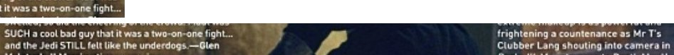
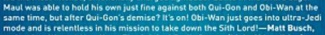
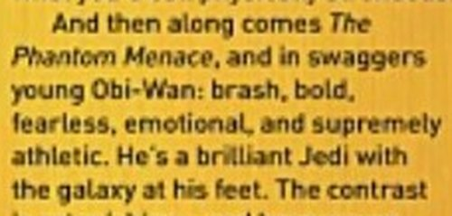
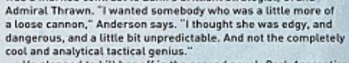
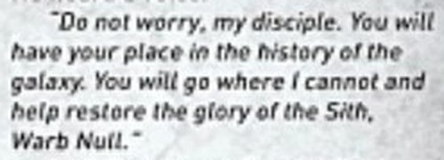
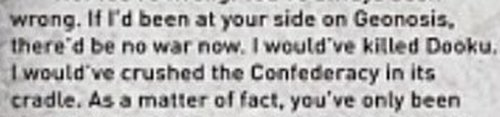

# Owner Material 038 — Star Wars Insider #1–153 plus specials (with The Lucasfilm Fan Club Magazine #1–22): Star Wars Insider #147 (2014)

- **Source:** *Star Wars Insider* magazine (issues 23–153, 1994–2014) and its predecessor *The Lucasfilm Fan Club Magazine* (issues 1–22, 1987–1994), plus seven special editions: articles, interviews, comics and short fiction Secondary source (licensed Legends reference). Scan OCR'd on the box; the scan stays box-only and is **not** published.
- **Method:** every scanned page was OCR'd and machine-screened sentence by sentence for power-relevant statements (fights, kills, defeats, Force feats, rankings, superweapons) that name a character on our roster; each kept sentence is quoted verbatim from the OCR text and has a crop of the printed passage directly under it. Pages with nothing power-relevant are still listed with what is on them.
- **Citation:** "*Star Wars Insider #147* (2014), p.X" by printed page ("scan p.X" where no printed number applies). **Weight:** Licensed magazine: a secondary source. Its short fiction and comics are Legends stories; its articles and interviews sum up or discuss lore and rank below the novels, comics and games they describe.

## scan p.1 (scan page 1)

Page contents: Cover: Rebels revelations, 50 Greatest Reasons to Love the Prequels, Imperial officer (Milton Johns), Bib Fortuna (Michael Carter). (hand-read)

## scan p.2 (scan page 2)

Page contents: The Walking Dead magazine subscription ad. (hand-read)

## scan p.3 (scan page 3)

Page contents: Editor's welcome (Jonathan Wilkins: 50 prequel nominations, Jar Jar) and staff credits; Feb/Mar 2014. OCR "7014" = 2014. (hand-read)

## scan p.4 (scan page 4)

Page contents: Contents: features (Prequel 50, Camille Paglia on ROTS, Milton Johns, Kevin J. Anderson, McQuarrie Mos Eisley, Bib Fortuna, Ederlac fiction 'Hammer Time', Jon Berg). (hand-read)

## scan p.5 (scan page 5)

Page contents: Contents: departments (Gerald Home, Neimoidians Rogues Gallery, Classic Moment Vong invasion, Corey Han Solo novel, comics, Incoming, Bounty Hunters, Bantha Tracks). (hand-read)

## scan p.6 (scan page 6)

Page contents: Launch Pad: Episode VII open-casting notes ("Rachel", "Thomas"); release date December 18, 2015 (Alan Horn). (hand-read)

## scan p.7 (scan page 7)

Page contents: Launch Pad: Bristol and Chicago auditions; R2-D2 confirmed for Episode VII; two fan droid builders hired (names omitted, non-staff news). (hand-read)

## scan p.8 (scan page 8)

Page contents: Launch Pad: Annie Award nominations for The Clone Wars season 5; ILM VES/Annie nominations. Real-world. (hand-read)

## scan p.9 (scan page 9)

Page contents: Launch Pad: Disney acquires Indiana Jones distribution rights; Rebels production update (Athena Portillo, line producer). Real-world. (hand-read)

## scan p.10 (scan page 10)

Page contents: Launch Pad: Star Wars Identities to Paris (Lucas quote on character identity); Jedi-Con 2014 Dusseldorf; USPS statement of ownership. (hand-read)

## scan p.11 (scan page 11)

Page contents: Brian's Toys ad. (hand-read)

## scan p.12 (scan page 12)

Page contents: "50 Greatest Reasons to Love the Prequels" opener; #1 (Mark Newbold) mythical concepts made real. Opinion feature. (hand-read)

## scan p.13 (scan page 13)

Page contents: Also #2 Qui-Gon as maverick Jedi (Jason Fry), #4 Episode I: Racer (Wilkins), #5 CGI (Tom Kane). Opinion; OCR "learsome/woot" corrected in the crop-verified T line. (hand-read)

### Stat block notes (game mechanics, not feats)

- Political Intrigue (Eric Geller): "Darth Vader is fearsome in Episode IV, V, and VI because of his armor, his voice, and his Force choke, but Palpatine is fearsome in the prequels because of how masterfully he pulls the wool over everyone's eyes. This senator-turned-chancellor-turned-emperor is the classic Machiavellian mastermind, pulling the strings on both sides of a massive war and playing countless factions against each other." (50 Reasons to Love the Prequels, Star Wars Insider 147, p. 13) (Source: *Star Wars Insider #147* (2014), scan p.13)
- The Handmaidens (Tricia Barr): "these young women are no mere attendants; they are politically astute, protectors of a world leader, and skilled warriors. The handmaidens are critical to the queen's plan to capture Nute Gunray and retake Theed. Not only do they take down battle droids with blasters, but they use ascension guns to scale the high palace walls." (50 Reasons to Love the Prequels, Star Wars Insider 147, p. 13) (Source: *Star Wars Insider #147* (2014), scan p.13)

## scan p.14 (scan page 14)

Page contents: #7 Obi-Wan/Jango apartment showdown (Schreiber), #8 Qui-Gon/Obi-Wan vs Maul duel, #9 fashion (Eckstein), #10 death-sticks mind trick (John Jackson Miller), #11 a starting point (Filoni, Amy Beth Christenson, James Arnold Taylor). Opinion; no feat content beyond film events. (hand-read)

## scan p.15 (scan page 15)

Page contents: #12 Coruscant (Kilian Plunkett), #13 lunch with Anthony Daniels (Veronica Segura), #14 Mustafar duel (Catherine Taber), #15 battle droids (Jeffrey Brown), #16 the music (David W. Collins, Timothy Zahn), #17 "The Saga Begins" parody (Drew Karpyshyn). Opinion. (hand-read)

## scan p.16 (scan page 16)

Page contents: #18 new ships, ROTS opening battle (Erich Schoeneweiss), #19 Watto (Grant Gould), #20 deleted Anakin vs Greedo scene (Warwick Davis as Wald), #21 story (J.W. Rinzler). Opinion. (hand-read)

## scan p.17 (scan page 17)

Page contents: Also #22 a new kind of menace (Jeremy Bulloch, Jesse Jensen), #24 death scenes (Paul Blake), surprises (Pablo Hidalgo), #25 enduring tales (Ian Liston). Opinion. (hand-read)

- **Darth Maul; Qui-Gon Jinn; Obi-Wan Kenobi** — entry/section: Maul 2-on-1: ""Maul was SUCH a cool bad guy that it was a two-on-one fight... and the Jedi STILL felt like the underdogs." —Glen McIntosh, ILM animation supervisor, Star Wars Insider 147, p. 17" Source: *Star Wars Insider #147* (2014), scan p.17
  

## scan p.18 (scan page 18)

Page contents: Also #26 working with George (Danny Wagner, Lucas's Baron Papanoida makeup), #27 anticipation (Darren Hayes), #29 Obi-Wan (Randy Martinez). Opinion. (hand-read)

- **Darth Maul; Obi-Wan Kenobi; Qui-Gon Jinn** — entry/section: Obi-Wan goes ballistic on Maul: ""Maul was able to hold his own just fine against both Qui-Gon and Obi-Wan at the same time, but after Qui-Gon's demise? It's on! Obi-Wan just goes into ultra-Jedi mode and is relentless in his mission to take down the Sith Lord!" —Matt Busch, artist, Star Wars Insider 147, p. 18" Source: *Star Wars Insider #147* (2014), scan p.18
  
- **Obi-Wan Kenobi** — entry/section: Young Obi-Wan: ""And then along comes The Phantom Menace, and in swaggers young Obi-Wan: brash, bold, fearless, emotional, and supremely athletic. He's a brilliant Jedi with the galaxy at his feet." —Karen Miller, author, Star Wars Insider 147, p. 18" Source: *Star Wars Insider #147* (2014), scan p.18
  

## scan p.19 (scan page 19)

Page contents: #30 The Clone Wars (fan-site contributor, name omitted), #31 TPM model shop (Steve Gawley), #32 Sebulba sound (Howie Weed), #33 Anakin/Padmé reunion (Lin Zy). Real-world/opinion. (hand-read)

## scan p.20 (scan page 20)

Page contents: #34 shockwave (John Coppinger, Graxol Kelvyyn; Thrust SSC), #35 little Anakin (Robert Watts), #36 new worlds (Ryan Church), #37 ROTS ending (Stephen Stanton), #38 Maul pacing like a caged tiger (Nick Gillard). Real-world/opinion. (hand-read)

## scan p.21 (scan page 21)

Page contents: #39 Yoda vs Dooku (Tom Taylor), #40 opera scene (Sam Witwer), #41 Poggle the Lesser joke tribute (Michael Price; "Creator of both the B2 Battle Droid and General Grievous! Architect of the Death Star!" is comic hyperbole, not logged as fact), #42 lightsaber as a tool (Troy Denning), #43 introducing the Jedi (Adrienne Wilkinson). Opinion. (hand-read)

## scan p.22 (scan page 22)

Page contents: #44 building the myth (Joe Corroney), #46 emotional climax (Steve Sansweet), #47 Jedi emerge from poison gas (Jo Duffy), retro design (Chris Trevas). Opinion; film events only. (hand-read)

## scan p.23 (scan page 23)

Page contents: Also #48 brothers in the Force (Brian Rood), #50 people power (Jerome Blake). Opinion. (hand-read)

### Stat block notes (game mechanics, not feats)

- Episode III (JAKe): "from the moment when Yoda dispatches two of Palpatine's Royal Guards with a casual flick of the Force, it suddenly feels to me like the Star Wars of my childhood again." (50 Reasons to Love the Prequels, Star Wars Insider 147, p. 23) (Source: *Star Wars Insider #147* (2014), scan p.23)

## scan p.24 (scan page 24)

Page contents: My Star Wars: Gerald Home (Tessek, Mon Calamari officer) Q&A (Mark Newbold); Spanish-narrated charity concert. Personal draft-registration detail omitted. (hand-read)

## scan p.25 (scan page 25)

Page contents: Gerald Home Q&A continued: recognized at Celebration by his body movements. (hand-read)

## scan p.26 (scan page 26)

Page contents: "The Art of Wars": Camille Paglia (Glittering Images) interview by Tricia Barr, real-world art history; OCR empty (text over flame art), page viewed. (hand-read)

## scan p.27 (scan page 27)

Page contents: Paglia interview cont.: calls Lucas "the world's greatest living artist"; viewed. (hand-read)

## scan p.28 (scan page 28)

Page contents: Paglia interview cont.: Lucasfilm workshop compared to Renaissance studios; viewed. (hand-read)

## scan p.29 (scan page 29)

Page contents: Paglia interview ends: Revenge of the Sith volcano-planet climax as a masterpiece; viewed. (hand-read)

## scan p.30 (scan page 30)

Page contents: "Assistant of the Empire": Milton Johns (Imperial Officer Bewil, ESB) interview by Calum Waddell; production anecdotes. Family details omitted. (hand-read)

## scan p.31 (scan page 31)

Page contents: Johns cont.: six-week shoot for a short carbon-freezing chamber scene (steam pipes ruined costumes). Personal details omitted. (hand-read)

## scan p.32 (scan page 32)

Page contents: 154 words, 20 paragraphs | headings/entries: ALMAY; Naboo system; Led the Trade Federation; Found companionship with the Neimoidian

### Stat block notes (game mechanics, not feats)

- Lott Dod: "Representative in the Galactic Senate of the Trade Federation and its territories." (Rogues Gallery: The Devious Neimoidians Revealed, Star Wars Insider 147, p. 32) (Source: *Star Wars Insider #147* (2014), scan p.32)
- Viff Almay: "Chronicler of the Occupation Council who won the Golden Pylat Award for her biography on Trade Baron Uunos Gooru." (Rogues Gallery, Star Wars Insider 147, p. 32) (Source: *Star Wars Insider #147* (2014), scan p.32)
- Aito Laff: "Served on the Invisible Hand's main bridge. After escaping, he oversaw logistics in the Confederacy bunker on Mustafar." (Rogues Gallery, Star Wars Insider 147, p. 32) (Source: *Star Wars Insider #147* (2014), scan p.32)
- Daultay Dofine: "In command of the Trade Federation's blockade forces. Perished aboard the Vuutun Palaa." (Rogues Gallery, Star Wars Insider 147, p. 32) (Source: *Star Wars Insider #147* (2014), scan p.32)
- Nute Gunray: "Led the Trade Federation during the Clone Wars as a valuable leader of the Confederacy of Independent Systems." (Rogues Gallery, Star Wars Insider 147, p. 32) (Source: *Star Wars Insider #147* (2014), scan p.32)
- Sil Unch: "Accompanied Tey How to the Droid Control Ship, the Vuutun Palaa. Specialized in droid control programming." (Rogues Gallery, Star Wars Insider 147, p. 32) (Source: *Star Wars Insider #147* (2014), scan p.32)
- Tey How: "Pilot and Communications Officer assigned to the Vuutun Palaa by Gunray when the Saak'ak left the Naboo system." (Rogues Gallery, Star Wars Insider 147, p. 32) (Source: *Star Wars Insider #147* (2014), scan p.32)
- Lushros Dofine: "The cousin of the late Daultay Dofine was one of the few Neimoidians respected by General Grievous." (Rogues Gallery, Star Wars Insider 147, p. 32) (Source: *Star Wars Insider #147* (2014), scan p.32)
- Yee Moh: "Found companionship with the Neimoidian sisters Rina and Ko Itub in the Outlander after losing his job." (Rogues Gallery, Star Wars Insider 147, p. 32) (Source: *Star Wars Insider #147* (2014), scan p.32)

## scan p.33 (scan page 33)

Page contents: 141 words, 15 paragraphs | headings/entries: SETTLEMENT OFFICER; Atter the Battle of Moorja,; ARUTEOUS "RUTE' GUNNAY MIK REGRA; BY TIM VEEKHOVEN KEVIN BEENTJES AND SANDER; DE LANGE WITH LELAND CHEE; LIEUTENANT FAME DRIMAL

### Stat block notes (game mechanics, not feats)

- Rune Haako: "Always privy to Viceroy Gunray's plans as his loyal lieutenant and diplomatic attaché." (Rogues Gallery, Star Wars Insider 147, p. 33) (Source: *Star Wars Insider #147* (2014), scan p.33)
- Aruteous 'Rute' Gunnay: "Expert on biochemical warfare who was transferred to Gunray's staff after escaping from Nod Kartha." (Rogues Gallery, Star Wars Insider 147, p. 33) (Source: *Star Wars Insider #147* (2014), scan p.33)
- Mik Regrap: "As a mathematician, she would always find the most profitable way to deal with parliamentary motions." (Rogues Gallery, Star Wars Insider 147, p. 33) (Source: *Star Wars Insider #147* (2014), scan p.33)
- Fame Drimal: "Stationed near Plagen until ordered to guard the Separatist Council on Mustafar." (Rogues Gallery, Star Wars Insider 147, p. 33) (Source: *Star Wars Insider #147* (2014), scan p.33)
- Gap Nox: "After the Battle of Moorja, this officer of the Neimoidian Gunnery Battalion became a bodyguard of Viceroy Gunray." (Rogues Gallery, Star Wars Insider 147, p. 33) (Source: *Star Wars Insider #147* (2014), scan p.33)
- Zill Kartay: "Arrested by Panaka along with his fellow Occupation Council members Magistrate Kund Ekorr and Treasurer Hap Brehg." (Rogues Gallery, Star Wars Insider 147, p. 33) (Source: *Star Wars Insider #147* (2014), scan p.33)
- Jull Dremon: "Chief Gunner who followed Gunray's command and ordered OWO-3 to destroy the Radiant VII." (Rogues Gallery, Star Wars Insider 147, p. 33) (Source: *Star Wars Insider #147* (2014), scan p.33)
- Lufa Danak: "A former defense attorney who claimed to know every loophole in the Senate's by-laws." (Rogues Gallery, Star Wars Insider 147, p. 33) (Source: *Star Wars Insider #147* (2014), scan p.33)

## scan p.34 (scan page 34)

Page contents: Authors of the EU: Kevin J. Anderson profile by Michael Kogge; early life. OCR "1942" is 1962 per crop. Parents' and family details omitted. (hand-read)

## scan p.35 (scan page 35)

Page contents: Anderson: Lawrence Livermore technical writer; first novel sales; collaborators Doug Beason and Rebecca Moesta (co-author; family detail omitted). (hand-read)

## scan p.36 (scan page 36)

Page contents: Anderson hired for the Jedi Academy trilogy after Heir to the Empire; memories of seeing Star Wars in 1977. (hand-read)

## scan p.37 (scan page 37)

Page contents: Also: 1993 letter from Karen Anderson on naming the Jedi Academy/Praxeum; Daala planned to die in Dark Apprentice, kept alive at test readers' insistence. (hand-read)

- **Admiral Daala; Grand Admiral Thrawn** — entry/section: Anderson on Daala: ""I wanted somebody who was a little more of a loose cannon. I thought she was edgy, and dangerous, and a little bit unpredictable. And not the completely cool and analytical tactical genius." —Kevin J. Anderson, Star Wars Insider 147, p. 37" Source: *Star Wars Insider #147* (2014), scan p.37
  

### Stat block notes (game mechanics, not feats)

- Jedi-reader: "Anderson created a Jedi-reader device that allowed Luke to detect and measure a being's strength in the Force." (Authors of the Expanded Universe: Kevin J. Anderson, Star Wars Insider 147, p. 37) (Source: *Star Wars Insider #147* (2014), scan p.37)

## scan p.38 (scan page 38)

Page contents: Anderson and Tom Veitch: Dark Empire tie-ins; Anderson scripted Dark Lords of the Sith onward, making Exar Kun central; Young Jedi Knights covers. (hand-read)

## scan p.39 (scan page 39)

Page contents: Anderson cont.: The Illustrated Star Wars Universe with McQuarrie; bibliography sidebar; Twitter handles are the subjects' own (staff), not logged. (hand-read)

## scan p.40 (scan page 40)

Page contents: McQuarrie Revisited: Mos Eisley street scene art (title page, viewed). (hand-read)

## scan p.41 (scan page 41)

Page contents: McQuarrie Revisited: Paul Bateman's production illustration from McQuarrie's Mos Eisley sketches (intro). (hand-read)

## scan p.42 (scan page 42)

Page contents: Bateman on McQuarrie's Mos Eisley sketches and the evolution of the C-3PO/R2-D2 designs. Production. (hand-read)

## scan p.43 (scan page 43)

Page contents: Ad: Dark Horse Digital comics. (hand-read)

## scan p.44 (scan page 44)

Page contents: "Bib Fortuna" actor Michael Carter interview (Calum Waddell): casting by Richard Marquand. Family details omitted. (hand-read)

## scan p.45 (scan page 45)

Page contents: Carter cont.: offered the part blind; "Revenge of the Jedi" secrecy. Family anecdote omitted. (hand-read)

## scan p.46 (scan page 46)

Page contents: Carter cont.: makeup casts, the Revenge of the Jedi crew sweatshirt, lifting Carrie Fisher toward Jabba. Family detail omitted. (hand-read)

## scan p.47 (scan page 47)

Page contents: Carter cont.: An American Werewolf in London anecdote (illness details omitted as medical); still gets fan mail. (hand-read)

## scan p.48 (scan page 48)

Page contents: Exclusive fiction "Hammer" by Edward M. Erdelac, art by Joe Corroney and Brian Miller (title page; armored figure with a green two-handed saber). (hand-read)

## scan p.49 (scan page 49)

Page contents: 1143 words, 44 paragraphs | headings/entries: STC; ERS; AND

### Stat block notes (game mechanics, not feats)

- Hammer: "Master Ryelli had lost those fingers in the Petranaki Arena on Geonosis three years ago, just as he had lost his Padawan, Lumas Etima." (Hammer, Star Wars Insider 147, p. 49) (Source: *Star Wars Insider #147* (2014), scan p.49)
- Hammer: "Although Telloti had dueled and bested Lumas and most of the other Initiates during the Apprentice Trials—before finally succumbing to Woltwi Enan, a girl from Berchest—Master Ryelli had selected Lumas as his Padawan learner." (Hammer, Star Wars Insider 147, p. 49) (Source: *Star Wars Insider #147* (2014), scan p.49)
- Hammer: "His race had a gift for astrogational computation which his latent Force ability enhanced." / "He had plotted the course here to the remote world of Nicht Ka almost without the aid of the navicomputer." (Hammer, Star Wars Insider 147, p. 49) (Source: *Star Wars Insider #147* (2014), scan p.49)
- Hammer: "A droideka had done that on Geonosis, blown the lightsaber from his grasp." (Hammer, Star Wars Insider 147, p. 49) (Source: *Star Wars Insider #147* (2014), scan p.49)

## scan p.50 (scan page 50)

Page contents: 340 words, 17 paragraphs | headings/entries: It was an archaic, twohanded lightsaber; Peo? GS eh

### Stat block notes (game mechanics, not feats)

- Hammer: Warb Null's armor on Nicht Ka: "Strange, that metal. He had made tracks across millennia worth of dust on the chamber floor, but the surface of that giant figure shone undimmed, as though nothing would settle on it." Also an "archaic, two-handed lightsaber." (Hammer, Star Wars Insider 147, p. 50) (Source: *Star Wars Insider #147* (2014), scan p.50)

## scan p.51 (scan page 51)

Page contents: 651 words, 27 paragraphs | headings/entries: Warb Null."; He shrieked; He whirled

- **Warb Null** — entry/section: Hammer: ""Do not worry, my disciple. You will have your place in the history of the galaxy. You will go where I cannot and help restore the glory of the Sith, Warb Null." —unnamed voice in vision, Hammer, Star Wars Insider 147, p. 51" Source: *Star Wars Insider #147* (2014), scan p.51
  

### Stat block notes (game mechanics, not feats)

- Hammer (vision): "a single Jedi (Ulic Qel-Droma! his brain screamed) fighting ferociously towards him, cutting away his hand, passing his green blade through his neck." (Hammer, Star Wars Insider 147, p. 51) (Source: *Star Wars Insider #147* (2014), scan p.51)
- Hammer (vision): "He saw a gleaming axe cutting down gray amphibian warriors seven at a time, wielded by his own red hand." (Hammer, Star Wars Insider 147, p. 51; the wielder is a red-skinned Sith in the vision and is not named) (Source: *Star Wars Insider #147* (2014), scan p.51)

## scan p.52 (scan page 52)

Page contents: 416 words, 19 paragraphs | headings/entries: Mo:

- **Telloti Cillmam'n; Count Dooku** — entry/section: Hammer: ""If I'd been at your side on Geonosis, there'd be no war now. I would've killed Dooku. I would've crushed the Confederacy in its cradle." —Telloti Cillmam'n (armor-influenced boast), Hammer, Star Wars Insider 147, p. 52" Source: *Star Wars Insider #147* (2014), scan p.52
  

### Stat block notes (game mechanics, not feats)

- Hammer: "The armor was like a web of conduits. It drew the Force into him. Telloti felt it surging through his blood vessels, contracting muscles, swinging his arms up to defend the downward stroke of Ryelli's lightsaber almost before Telloti could even think it. He was fast. So fast. And strong." (Hammer, Star Wars Insider 147, p. 52) (Source: *Star Wars Insider #147* (2014), scan p.52)
- Hammer: "Ryelli's blade skimmed his shoulder, sending sparks cascading into the air. He laughed. He hadn't even felt it." (Hammer, Star Wars Insider 147, p. 52) (Source: *Star Wars Insider #147* (2014), scan p.52)
- Hammer: "Ryelli forced him back. The Jedi Master with the mangled hand was winning." / "Telloti's left knee buckled and clanged against the stone floor. The archaeologist was stronger." (Hammer, Star Wars Insider 147, p. 52) (Source: *Star Wars Insider #147* (2014), scan p.52)
- Hammer: "Shas Dovos, the man who became Warb Null, had, inspired by the dark teachings of Freedon Nadd and dread King Adas before him" (Hammer, Star Wars Insider 147, pp. 52–53) (Source: *Star Wars Insider #147* (2014), scan p.52)

## scan p.53 (scan page 53)

Page contents: 622 words, 24 paragraphs | headings/entries: Without the resistance of the green blade,; It had to be a lie

### Stat block notes (game mechanics, not feats)

- Hammer: "The extra-long green blade of the ancient lightsaber retracted into the hilt. In the same instant, the butt sprang open like the maw of a sarlacc, revealing a hidden, secondary emitter." / "Telloti shifted his grip and flipped the new red blade over, slicing neatly through the nape of Ryelli's neck." (Hammer, Star Wars Insider 147, p. 53) (Source: *Star Wars Insider #147* (2014), scan p.53)
- Hammer: "He was Malleus. The Hammer of the Dark Side." (Hammer, Star Wars Insider 147, p. 53; after Palpatine's war-is-over message Telloti stands "over the broken body of the astrogator" Staguu) (Source: *Star Wars Insider #147* (2014), scan p.53)

## scan p.54 (scan page 54)

Page contents: Jon Berg (ILM 1980–85) interview by Thomas G. Smith, extended from Industrial Light & Magic: The Art of Special Effects; early stop-motion. Family detail omitted. (hand-read)

## scan p.55 (scan page 55)

Page contents: Jon Berg interview cont.: building armatures as a teen; Santa Monica College. Family details omitted. (hand-read)

## scan p.56 (scan page 56)

Page contents: Berg cont.: Cascade Pictures (Muren, Ralston, Tippett); cantina creatures with Rick Baker; holochess stop-motion; dianoga; ESB workload. Production. (hand-read)

## scan p.57 (scan page 57)

Page contents: Berg cont.: animating the AT-AT models through a trap door; tauntaun "Go Motion" precursor; wampa shot outside ILM; Gorax suit for The Ewok Adventure; credits sidebar. (hand-read)

## scan p.58 (scan page 58)

Page contents: Subscription ad (free Hasbro figure). (hand-read)

## scan p.59 (scan page 59)

Page contents: Subscription ad cont. (hand-read)

## scan p.60 (scan page 60)

Page contents: Also: Essential Trivia (name from the Vong restaurant and Yunnan tea); Colin Wilson "What They Said" quote on Vong design (production). Text spells "Yunan". (hand-read)

### Stat block notes (game mechanics, not feats)

- Pythea crew: "Diverting all of their ship's power to send a warning message, the crew of one Wookiee and one Chiss fight off a boarding party of Yuuzhan Vong before ramming their ship into the Yuuzhan Vong's Miid ro'ik warship." (Classic Moment: Yuuzhan Vong Attack!, Star Wars Insider 147, p. 60; Star Wars Invasion: Refugees, Dark Horse Comics, 2009) (Source: *Star Wars Insider #147* (2014), scan p.60)
- Kaye Galfridian: "young Kaye Galfridian confronted by a Yuuzhan Vong warrior. The towering warrior fills her and our view: a terrifying sight in his spiked armor, with his glowering red eyes, and wielding his deadly amphistaff. Yet it is not the warrior, but Kaye who survives the encounter." (Classic Moment, Star Wars Insider 147, p. 60) (Source: *Star Wars Insider #147* (2014), scan p.60)

## scan p.61 (scan page 61)

Page contents: Contents for part 2: Incoming (68), Bounty Hunters (72), Bantha Tracks (74); Honor Among Thieves, Ania Solo in Legacy. (hand-read)

## scan p.62 (scan page 62)

Page contents: Incoming books (Dan Wallace): Empire and Rebellion: Honor Among Thieves (James S. A. Corey); Han and Chewbacca with Rebel spy Scarlet Hark hunting a cache of Imperial secrets; March 4 release. (hand-read)

## scan p.63 (scan page 63)

Page contents: Incoming: DK Readers (The Adventures of C-3PO, Can You Spot a Jedi?); LEGO Star Wars: The Yoda Chronicles Trilogy book (non-canon). (hand-read)

## scan p.64 (scan page 64)

Page contents: Incoming comics: Star Wars Legacy Vol. II (Bechko/Hardman); Ania Solo, Sauk, AG-37, Imperial Knight Jao Assam; old friend Ramid (OCR "Raid", crop-verified "Ramid") holds a grudge; acid/glass-rain jungle world. Era "more than 130 years after the movies." (hand-read)

## scan p.65 (scan page 65)

Page contents: Legacy Vol. II Book 1: Prisoner of the Floating World cover (art, viewed). (hand-read)

## scan p.66 (scan page 66)

Page contents: Also: The Star Wars #0 companion issue (Rinzler adaptation of the Lucas rough draft; non-canon). (hand-read)

### Stat block notes (game mechanics, not feats)

- Five Days of the Sith: "'Five Days of the Sith' follows up on the events of the previous arc, in which rebel saboteurs nearly destroyed Vader's flagship, the Star Destroyer Devastator. Not only is Vader shamed by the act (he will use the Super Star Destroyer Executor from this point onward), but he's determined to exact revenge" / "The storyline showcases Vader's combat skills as well as his cunning smarts." (Incoming: Vader on a Rampage, Star Wars Insider 147, p. 66; Star Wars #13–14, Brian Wood) (Source: *Star Wars Insider #147* (2014), scan p.66)

## scan p.67 (scan page 67)

Page contents: The Star Wars #0 cover art by Nick Runge (viewed). (hand-read)

## scan p.68 (scan page 68)

Page contents: Incoming merch (James Burns): Cartamundi Story of Darth Vader card deck. (hand-read)

## scan p.69 (scan page 69)

Page contents: Merch: Diamond Darth Maul bust bank, Boba Fett bottle opener; Funko Pop wave 4; Kotobukiya light-up lightsaber chopsticks. (hand-read)

## scan p.70 (scan page 70)

Page contents: Merch: FFG X-Wing Imperial Aces (181st and Royal Guard TIE Interceptors); We Love Fine apparel; Gentle Giant Rebel Alliance bookends. (hand-read)

## scan p.71 (scan page 71)

Page contents: Merch: Sideshow sixth-scale Imperial Probe Droid; Her Universe (Ashley Eckstein) Death Star battle skirt. (hand-read)

## scan p.72 (scan page 72)

Page contents: Bounty Hunters: fan photos with Mark Hamill and Peter Mayhew (fan names and family details omitted); Kotobukiya prize. (hand-read)

## scan p.73 (scan page 73)

Page contents: Bounty Hunters cont.: fan encounters with Billy Dee Williams, Anthony Daniels, Alan Harris (Bossk), Chris Parsons (4-LOM). Fan names omitted. (hand-read)

## scan p.74 (scan page 74)

Page contents: Bantha Tracks Best of the Year: fan photo awards (fan names, children, and family details omitted). (hand-read)

## scan p.75 (scan page 75)

Page contents: Bantha Tracks cont.: R2-KT with Anthony Daniels; costumed pet award (fan and owner names omitted). (hand-read)

## scan p.76 (scan page 76)

Page contents: Bantha Tracks Best of the Year cont.: accessible "Feel the Force Day" event (Warwick Davis supported); Tusken group photo; best envelope; submission guidelines. Fan names omitted. (hand-read)

## scan p.77 (scan page 77)

Page contents: Bantha Tracks cont.: costumed group at Episode VII open casting calls in Detroit; R2-D2 bird feeder. Fan names omitted. (hand-read)

## scan p.78 (scan page 78)

Page contents: Bantha Tracks cont.: fan photo, art and tattoo awards. Fan names and ages omitted. (hand-read)

## scan p.79 (scan page 79)

Page contents: Bantha Tracks cont.: editor's Celebration Europe thanks (volunteer squad names omitted); Kathleen Kennedy touring Celebration Europe; post script on fan clubs. (hand-read)

## scan p.80 (scan page 80)

Page contents: Top 5 Star Wars audio moments from a fan podcast (host names omitted as fan-site/podcast): Yoda's "That is why you fail", R2-D2 sounds, carbon-freezing chamber. Fan opinion. (hand-read)

## scan p.81 (scan page 81)

Page contents: Audio top 5 cont.: Yoda's theme and Binary Sunset, Huttese, tauntaun and krayt dragon call sounds (interview by Mark Newbold). Family detail omitted. (hand-read)

## scan p.82 (scan page 82)

Page contents: Next issue preview (#148): Star Wars Rebels, Al Williamson, Troy Denning on the EU; U.S. newsstands March 11. (hand-read)

## scan p.83 (scan page 83)

Page contents: Ad: Titan Comics Lost Planet: First Colony (non-Star Wars). (hand-read)

## scan p.84 (scan page 84)

Page contents: Ad: Titan Comics sci-fi collections (Snowpiercer etc.; non-Star Wars). (hand-read)

