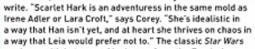

# Owner Material 038 — Star Wars Insider #1–153 plus specials (with The Lucasfilm Fan Club Magazine #1–22): Star Wars Insider #148 (2014)

- **Source:** *Star Wars Insider* magazine (issues 23–153, 1994–2014) and its predecessor *The Lucasfilm Fan Club Magazine* (issues 1–22, 1987–1994), plus seven special editions: articles, interviews, comics and short fiction Secondary source (licensed Legends reference). Scan OCR'd on the box; the scan stays box-only and is **not** published.
- **Method:** every scanned page was OCR'd and machine-screened sentence by sentence for power-relevant statements (fights, kills, defeats, Force feats, rankings, superweapons) that name a character on our roster; each kept sentence is quoted verbatim from the OCR text and has a crop of the printed passage directly under it. Pages with nothing power-relevant are still listed with what is on them.
- **Citation:** "*Star Wars Insider #148* (2014), p.X" by printed page ("scan p.X" where no printed number applies). **Weight:** Licensed magazine: a secondary source. Its short fiction and comics are Legends stories; its articles and interviews sum up or discuss lore and rank below the novels, comics and games they describe.

## scan p.1 (scan page 1)

Page contents: Cover: Star Wars Rebels latest news; photo exclusive, prequels unearthed. (hand-read)

## scan p.2 (scan page 2)

Page contents: Ad: Titan Snowpiercer graphic novels (non-Star Wars). (hand-read)

## scan p.3 (scan page 3)

Page contents: Editor's welcome: Jason Fry stormtrooper guide, 501st; Marvel comics news (OCR "2018"; Marvel publishes from 2015 per p9); staff box. Quote of the issue: "It's them! Blast them!" (stormtrooper, ANH). (hand-read)

## scan p.4 (scan page 4)

Page contents: Contents: features (photo story, A Scarlet Woman? fiction, Ken Ralston, Marvel comics history, McQuarrie Vader castle, Tavoularis storyboards, Phil Tippett, Jedi quiz). Cover line quotes GC-1000, Luke Skywalker and the Shadows of Mindor. (hand-read)

## scan p.5 (scan page 5)

Page contents: Contents: departments (My Star Wars Simon J. Williamson, Cloud City Rogues Gallery, Classic Moment Satine, Shakespeare book, Rebel Heist comic, Incoming, Bantha Tracks, Bounty Hunters). (hand-read)

## scan p.6 (scan page 6)

Page contents: Launch Pad: Star Wars Rebels update (Athena Portillo): Chopper (C1-10P) revealed; Filoni: "If Artoo is the family dog, Chopper is the cat." Disney canon show, so S only. (hand-read)

## scan p.7 (scan page 7)

Page contents: Simon Kinberg on the Rebels tone (Entertainment Weekly quote). Canon show; S only. (hand-read)

## scan p.8 (scan page 8)

Page contents: Letters-page promo (Official Pix signed photo prize). (hand-read)

## scan p.9 (scan page 9)

Page contents: News: Marvel gains the Star Wars comics license from 2015; Dan Buckley and Mike Richardson quotes; The Star Wars wins Licensed Comic of the Year. (hand-read)

## scan p.10 (scan page 10)

Page contents: Launch Pad: Star Wars Tumblr and Instagram photo resources. (hand-read)

## scan p.11 (scan page 11)

Page contents: The Clone Wars Lost Missions (Netflix) episode synopses: Tup/Fives Order 66 chip arc, Clovis arc, Bardotta (Queen Julia, Frangawl Cult), Sifo-Dyas lightsaber, Yoda arc (Five Priestesses, Moraband). Rebels cast rundown. Plot synopses only; auto-cand (OCR "defficult/ihe") dropped. (hand-read)

## scan p.12 (scan page 12)

Page contents: News: Art Spiegelman designed the original 1977 Topps cards (Bryan Young report; Full of Sith podcast quote); Star Wars: Assault Team mobile game. (hand-read)

## scan p.13 (scan page 13)

Page contents: Ad: Brian's Toys (Jocasta Nu exclusive figure). (hand-read)

## scan p.14 (scan page 14)

Page contents: Feature opener: "Stormtroopers" by Jason Fry. (hand-read)

## scan p.15 (scan page 15)

Page contents: Stormtroopers intro: clones vs recruits, droid troopers (Phase Zero dark troopers, Dark Troopers), aliens (Star Wars #53), women (Jes Gistang, Isila Drutch; OCR "Orutch" crop-verified as Drutch). (hand-read)

### Stat block notes (game mechanics, not feats)

- Tantive IV boarding (intro): "Joined by the black-armored Darth Vader, white-armored troops with blasters moved quickly and capably down the ship's hallways, killing or capturing her crew and rounding up its passengers." (Stormtroopers, Star Wars Insider 148, p. 15) (Source: *Star Wars Insider #148* (2014), scan p.15)
- Stormtrooper efficiency (intro): "against lesser foes the stormtroopers were coldly efficient shock troops. Any lack of marksmanship was more than made up for by their numbers" (Stormtroopers, Star Wars Insider 148, p. 15; crop-verified) (Source: *Star Wars Insider #148* (2014), scan p.15)

## scan p.16 (scan page 16)

Page contents: 307 words, 13 paragraphs | headings/entries: THE HAND OF JUDGEMENT STORM COMMANDOS; FAMOUS STORMTROOPERS; DAVIN FELTH; HE insicen; SU-MIL

### Stat block notes (game mechanics, not feats)

- Hand of Judgement: "The five stormtroopers of this rogue unit began as deserters, fleeing the Star Destroyer Reprisal after killing a corrupt major in the Imperial Security Bureau. They wound up as unlikely allies of Luke Skywalker and Han Solo, then of the Imperial agent Mara Jade, and finally of Thrawn." (Stormtroopers, Star Wars Insider 148, p. 16) (Source: *Star Wars Insider #148* (2014), scan p.16)
- Storm Commandos: "One strain of lore says General Madine created them before he joined the Rebels. Notable for their black scout armor and ruthlessness, Storm Commandos are feared insurgents and irregulars." (Stormtroopers, Star Wars Insider 148, p. 16) (Source: *Star Wars Insider #148* (2014), scan p.16)
- Davin Felth: "He warned General Veers that enemies could trip up AT-ATs, found the droids' escape pod on Tatooine, and searched the Mos Eisley cantina. ... at Docking Bay 94 he shot his commanding officer in the back, allowing the Millennium Falcon to escape." (Famous Stormtroopers, Star Wars Insider 148, p. 16) (Source: *Star Wars Insider #148* (2014), scan p.16)
- Su-mil: "A reptilian Eickarie from Kariek, he joined the Empire of the Hand after helping Unit Aurek-Seven liberate his planet. Su-mil earned his stormtrooper commission ... and quickly rose to squad leader. He then fought the Vagaari in the Battle of the Redoubt." (Famous Stormtroopers, Star Wars Insider 148, p. 16) (Source: *Star Wars Insider #148* (2014), scan p.16)

## scan p.17 (scan page 17)

Page contents: Real-life 501st Legion (founded 1997; more than 6,000 members in more than 50 countries); Zahn's Survivor's Quest made it canon in 2004. Founder name omitted (fan). (hand-read)

### Stat block notes (game mechanics, not feats)

- Joker Squad: "This unit served the new Sith Empire that rose generations after Luke Skywalker. The squad ... has a little bit of everything, including a tough, grizzled leader (Sergeant Ran "Hardcase" Harkas), a mysterious Mandalorian conscript (Hondo Karr), and a hard-bitten Corellian woman (Jes Gistang)." (Stormtroopers, Star Wars Insider 148, p. 17) (Source: *Star Wars Insider #148* (2014), scan p.17)
- 501st Legion: "the 501st began as a clone-trooper battalion and was personally assigned to Darth Vader after the rise of the Empire. "Vader's Fist" was disbanded after the Battle of Endor, but the 501st rose again when Thrawn re-created the unit for the Empire of the Hand, and was still around a century later." (Stormtroopers, Star Wars Insider 148, p. 17; verified version of the p17 auto-cand) (Source: *Star Wars Insider #148* (2014), scan p.17)
- The trooper from Alderaan: "he joined the Empire and captured Princess Leia on Yinchorr. When his commanding officer decided to execute the rebel leader, the trooper sacrificed his own life to save hers." (Stormtroopers, Star Wars Insider 148, p. 17; Marvel Star Wars #86, unnamed trooper) (Source: *Star Wars Insider #148* (2014), scan p.17)
- Isila Drutch: "many civilians have probably been a meter from a female stormtrooper and never known it: The armor hides all." (Stormtroopers, Star Wars Insider 148, p. 17) (Source: *Star Wars Insider #148* (2014), scan p.17)

## scan p.18 (scan page 18)

Page contents: Five favourite stormtrooper variants: shadowtroopers (1979 strip "Gambler's World"), Royal Guard field armour (Guardsmen rotate into stormtrooper units), LEGO beach trooper, Imperial Navy commando, and a Force Unleashed design. (hand-read)

## scan p.19 (scan page 19)

Page contents: Stormtrooper moments: Mos Eisley, Hoth "Imperial troops have entered the base!", Order 66 at the Jedi Temple. Author bio (Twitter handle omitted). (hand-read)

### Stat block notes (game mechanics, not feats)

- Tantive IV: "Darth Vader's stormtroopers burn through the hatch of Princess Leia's ship and methodically mow down her defenders. ... here they're chillingly accurate." (Stormtroopers, Star Wars Insider 148, p. 19) (Source: *Star Wars Insider #148* (2014), scan p.19)
- Jedi Search: "Mothma settles in an ingenious way: The troops must remove their helmets. Underneath—and no longer anonymous—are some young cadets." (Stormtroopers, Star Wars Insider 148, p. 19) (Source: *Star Wars Insider #148* (2014), scan p.19)
- Fool's Bargain: "a squad from the 501st strikes an uneasy bargain with an alien tribesman, Su-mil, to fight a warlord ... At the end Su-mil is invited to join the 501st." (Stormtroopers, Star Wars Insider 148, p. 19) (Source: *Star Wars Insider #148* (2014), scan p.19)
- Battlefront II Kamino: "rogue Kaminoans create a new force of clone troopers from Jango Fett's DNA. Sent to eliminate this threat are stormtroopers from the 501st, led by Boba Fett." (Stormtroopers, Star Wars Insider 148, p. 19; as stated by the article) (Source: *Star Wars Insider #148* (2014), scan p.19)

## scan p.20 (scan page 20)

Page contents: My Star Wars: Simon J. Williamson (Max Rebo, a Mon Calamari and a Gamorrean guard in ROTJ), interview by Mark Newbold; bubbles viewed; first saw Star Wars at university in 1977. (hand-read)

## scan p.21 (scan page 21)

Page contents: Williamson cont. (bubbles viewed): costume and earpiece difficulties (medical detail omitted), Gamorrean crouch; recognized at Cannes 2006 (OCR "2004" crop-verified as 2006); favorite character Darth Maul; trivia (Return to Oz body cast). Personal details kept to the career only. (hand-read)

## scan p.22 (scan page 22)

Page contents: Photo story "Prequels Unseen" part 1 (viewed): Ewan McGregor in the Jedi starfighter (Episode II); Jedi children practising with lightsabers (child's family detail omitted). (hand-read)

## scan p.23 (scan page 23)

Page contents: Photo (viewed): Darth Maul (Ray Park) leaps over Qui-Gon (Liam Neeson's stunt double Andrew Lawden) in the Tatooine desert, Episode I. (hand-read)

## scan p.24 (scan page 24)

Page contents: Photo (viewed): Jake Lloyd (Anakin) with a Tatooine droid on the Mos Espa street set, Tunisia, Episode I. (hand-read)

## scan p.25 (scan page 25)

Page contents: Photos (viewed): R2-D2 and C-3PO (Anthony Daniels) on the Tunisia location; Nute Gunray (Silas Carson) with the remote facial-control rig, Episode I. (hand-read)

## scan p.26 (scan page 26)

Page contents: Photo (viewed): Podrace crew member leaning on Sebulba's podracer engines, Mos Espa arena set, Episode I. (hand-read)

## scan p.27 (scan page 27)

Page contents: Photos (viewed): Ahmed Best (Jar Jar) on the Senate set with Jay Laga'aia (Captain Typho) looking on, Episode II; Bruce Spence (Tion Medon) on Stage 1 at Fox Studios Australia, Episode III. (hand-read)

## scan p.28 (scan page 28)

Page contents: Fiction art spread (viewed, OCR empty): Scarlet Hark in black with blaster, L4-3PO-type red droid, Imperial officers. (hand-read)

## scan p.29 (scan page 29)

Page contents: Exclusive fiction "Silver and Scarlet" by James S. A. Corey (art Joe Corroney and Brian Miller): Scarlet Hark, posing as Seddia Chaan, meets General Cascaan in a club in Oolan (Entila system) to buy Star Destroyer plans; droid Elfour (L4-3PO). (hand-read)

## scan p.30 (scan page 30)

Page contents: Imperial interrogator Nuuian Sulannis (name crop-verified; OCR "Nuvian") lands at the club; Cascaan hesitates over betrayal. (hand-read)

### Stat block notes (game mechanics, not feats)

- Next-generation Star Destroyer plans: "If he decided to turn me down, the plans for the next-generation Star Destroyers would fade away from me like smoke in a fist. Also, I'd probably get killed." (Silver and Scarlet, Star Wars Insider 148, p. 30) (Source: *Star Wars Insider #148* (2014), scan p.30)

## scan p.31 (scan page 31)

Page contents: Cascaan fears he will cause thousands of soldiers' deaths and be slaughtered for the betrayal; Hark offers safety money. (hand-read)

## scan p.32 (scan page 32)

Page contents: 1128 words, 45 paragraphs | headings/entries: DIF; Ee

### Stat block notes (game mechanics, not feats)

- General Cascaan, Buruunin: "You know I commanded the assault on Buruunin." ... "The cities were undefended," he said. "As soon as we received the order for the bombardment, I knew I would have to betray my Emperor." (Silver and Scarlet, Star Wars Insider 148, p. 32) (Source: *Star Wars Insider #148* (2014), scan p.32)
- Hark vs Interrogator Sulannis: "He had time to register surprise and I planted a straight kick just above his pelvis. The blow was designed to stagger him back, and it worked. ... Close quarters fighting, especially when the opponent was so much bigger than me, meant grappling techniques. I started with an elbow lock, but he shrugged it off through equal part luck and brute strength. He hit me twice in the ribs, but the cramped lift car made it hard to get much power behind the blows, giving me the opportunity for a leg sweep that took him down. Once I got my arm around his neck, it was over" (Silver and Scarlet, Star Wars Insider 148, p. 32; crop-verified) (Source: *Star Wars Insider #148* (2014), scan p.32)

## scan p.33 (scan page 33)

Page contents: Cascaan leaves the plans and the payment and walks away "ready to die"; Hark gets the plans. Plug for Honor Among Thieves. (hand-read)

### Stat block notes (game mechanics, not feats)

- Aftermath: "stopped the car on the third level, dragged Sulannis to the women's room and propped him in a stall. All in all, it took less than five minutes" (Silver and Scarlet, Star Wars Insider 148, p. 33) (Source: *Star Wars Insider #148* (2014), scan p.33)

## scan p.34 (scan page 34)

Page contents: Rogues Gallery "The Cloud City Wing Guards" by Tim Veekhoven, Kevin Beentjes and Sander de Lange (thanks to Leland Y. Chee and Pablo Hidalgo); bios crop-verified (OCR "Rayne"/"Kebyc" etc. checked). Lando caption: "A cardplayer, gambler, scoundrel, and entrepreneur among the clouds." (hand-read)

### Stat block notes (game mechanics, not feats)

- Jerrol Blendin (Bespin): "One of the few remaining corrupt Wing Guards, Blendin worked in Port Town under Baron Dominic Raynor." (Rogues Gallery: The Cloud City Wing Guards, Star Wars Insider 148, p. 34) (Source: *Star Wars Insider #148* (2014), scan p.34)
- Jann Derem (Uyter): "His fearless attitude made him the perfect bodyguard when Baron Calrissian had to enter a cell containing an angry Wookiee." (Rogues Gallery: The Cloud City Wing Guards, Star Wars Insider 148, p. 34) (Source: *Star Wars Insider #148* (2014), scan p.34)
- Isdam Edian (Bespin): "Edian was assigned by Lobot to learn the whereabouts of Boba Fett's ship while escorting Captain Solo's frozen body." (Rogues Gallery: The Cloud City Wing Guards, Star Wars Insider 148, p. 34) (Source: *Star Wars Insider #148* (2014), scan p.34)
- Gir Endac (Mexeluine): "Endac helped accountant Samara Kebyc track down several corrupt officials within the Cloud City Miner's Guild." (Rogues Gallery: The Cloud City Wing Guards, Star Wars Insider 148, p. 34) (Source: *Star Wars Insider #148* (2014), scan p.34)
- Alec Mard (Zhanox): "Mard became one of the most loyal Wing Guards after participating in arresting the rogue Wing Guard Wilber Flagesso." (Rogues Gallery: The Cloud City Wing Guards, Star Wars Insider 148, p. 34) (Source: *Star Wars Insider #148* (2014), scan p.34)
- Ark Rutendo (Bespin): "Rutendo was a meteorologist who was often found at Kerros Tower, predicting upcoming storms and weather patterns." (Rogues Gallery: The Cloud City Wing Guards, Star Wars Insider 148, p. 34) (Source: *Star Wars Insider #148* (2014), scan p.34)
- Duncan Hikmat (Stobar): "Hikmat featured in Action Tidings and Figg Daily Bulletin after apprehending a group of Moogan art smugglers." (Rogues Gallery: The Cloud City Wing Guards, Star Wars Insider 148, p. 34) (Source: *Star Wars Insider #148* (2014), scan p.34)
- Jell Spiel (Bespin): "Spiel's experience as a Cloud Car prototype test pilot proved very useful during the evacuation of Bespin." (Rogues Gallery: The Cloud City Wing Guards, Star Wars Insider 148, p. 34) (Source: *Star Wars Insider #148* (2014), scan p.34)
- Razell Tameron (Bespin): "Tameron was Warden of the Security Tower and known for his no-nonsense approach towards crime on Cloud City." (Rogues Gallery: The Cloud City Wing Guards, Star Wars Insider 148, p. 34) (Source: *Star Wars Insider #148* (2014), scan p.34)
- Jake Sirrom (Dahvil): "After the dissolution of the Galactic Senate, Sirrom's mother, Gem, took him to Bespin to start a new life." (Rogues Gallery: The Cloud City Wing Guards, Star Wars Insider 148, p. 34) (Source: *Star Wars Insider #148* (2014), scan p.34)
- Pedar Solardo (Taanab): "Former mercenary who relocated to Bespin after witnessing Lando's guile against the Norulac Freebooters." (Rogues Gallery: The Cloud City Wing Guards, Star Wars Insider 148, p. 34) (Source: *Star Wars Insider #148* (2014), scan p.34)

## scan p.35 (scan page 35)

Page contents: 217 words, 14 paragraphs | headings/entries: HELDER SPINOZA (BESPIN) grotoharchinn; Spinoza was an experienced firefighter f Peetts; Casings,

### Stat block notes (game mechanics, not feats)

- Helder Spinoza (Bespin): "Spinoza was an experienced firefighter who represented the Wing Guard in the Parliament of Guilds and in several Guild tribunals." (Rogues Gallery: The Cloud City Wing Guards, Star Wars Insider 148, p. 35) (Source: *Star Wars Insider #148* (2014), scan p.35)
- Fantes Mer'darro (Balosar): "Hidden under his cap, Mer'darro's antenna palps helped him sense suspicious people in Cloud City's many casinos." (Rogues Gallery: The Cloud City Wing Guards, Star Wars Insider 148, p. 35) (Source: *Star Wars Insider #148* (2014), scan p.35)
- Allen Neff (Ertegas): "Neff came to Bespin as a six-year old and followed his sister, Atril, serving with the Wing Guard." (Rogues Gallery: The Cloud City Wing Guards, Star Wars Insider 148, p. 35) (Source: *Star Wars Insider #148* (2014), scan p.35)
- Fin Mak'lath (Athallia): "Mak'lath was a police officer from Athallia's capital Kalarcha. He came to Bespin after his wife was killed in food riots." (Rogues Gallery: The Cloud City Wing Guards, Star Wars Insider 148, p. 35) (Source: *Star Wars Insider #148* (2014), scan p.35)
- Corman Jeihn (Calabosh-2): "Jeihn was a security guard with weapons manufacturer Caliban until it was nationalized by Imperial Munitions." (Rogues Gallery: The Cloud City Wing Guards, Star Wars Insider 148, p. 35) (Source: *Star Wars Insider #148* (2014), scan p.35)
- Bialar Selis (Bespin): "Selis was a rising star within the Wing Guard who led the investigation for the stolen Jewel of Yavin." (Rogues Gallery: The Cloud City Wing Guards, Star Wars Insider 148, p. 35) (Source: *Star Wars Insider #148* (2014), scan p.35)
- Bislav Merril (Vorzyd V): "Merril was a tyrannical Wing Guard, disliked by his colleagues. He refused to talk about his time as a Confederacy Clone Wars veteran." (Rogues Gallery: The Cloud City Wing Guards, Star Wars Insider 148, p. 35) (Source: *Star Wars Insider #148* (2014), scan p.35)
- Utris M'toc (Couronne): "Former member of the High King's Guard, M'toc was forced to leave the Imzig homeworld after a bloody coup." (Rogues Gallery: The Cloud City Wing Guards, Star Wars Insider 148, p. 35) (Source: *Star Wars Insider #148* (2014), scan p.35)
- Lobot (Bespin): "Chief Administrative aide to Baron Calrissian. Lobot warned R2-D2 about the deactivation of the Millennium Falcon's hyperdrive." (Rogues Gallery, Star Wars Insider 148, p. 35) (Source: *Star Wars Insider #148* (2014), scan p.35)

## scan p.36 (scan page 36)

Page contents: Feature opener: Ken Ralston interviewed by Thomas G. Smith in 1985 for Industrial Light and Magic: The Art of Special Effects (1986); full interview published for the first time. (hand-read)

## scan p.37 (scan page 37)

Page contents: Ralston on early stop-motion films, Ray Harryhausen, Famous Monsters of Filmland, meeting Forrest J. Ackerman and Jon Berg (family details omitted). (hand-read)

## scan p.38 (scan page 38)

Page contents: Ralston: Cascade Pictures, Dennis Muren, reading the Star Wars script, camera assistant on Star Wars at about 20; joins ILM; becoming a supervisor. (hand-read)

## scan p.39 (scan page 39)

Page contents: Ralston on supervising and the craft of stop-motion ("part-mathematician ... 24 frames per second"); designing Jedi creatures. (hand-read)

## scan p.40 (scan page 40)

Page contents: Ralston: Dragonslayer, Go-Motion (McAlister, Ziff, Leo, Muren, Tippett); Jedi skiff guards he worked on ("Queequeg", a lizard-like guard he recalls as Klaatu). (hand-read)

## scan p.41 (scan page 41)

Page contents: Ralston shot the first ROTJ space battle (Edlund the tunnel run, Muren the ground battle); career box: started 1975 on Star Wars (OCR "1775"), left ILM in 1996 for Sony Pictures Imageworks, five Oscars and five BAFTAs. (hand-read)

## scan p.42 (scan page 42)

Page contents: Subscription ad (free Hasbro figure). (hand-read)

## scan p.43 (scan page 43)

Page contents: Subscription offer details. (hand-read)

## scan p.44 (scan page 44)

Page contents: Authors of the Expanded Universe: "The Big Three" (Al Williamson, Archie Goodwin, Carlos Garzon) by Michael Kogge. (hand-read)

## scan p.45 (scan page 45)

Page contents: Intro: Lucas's love of Williamson's EC art; Williamson declined in 1977 and 1978 (X-9 contract), then accepted the Empire adaptation in 1980 with Garzon and Goodwin. (hand-read)

## scan p.46 (scan page 46)

Page contents: Al Williamson bio (b. 1931, New York; raised in Bogota; Flash Gordon influence; Burne Hogarth; EC, Atlas, Warren; Flash Gordon 1966, X-9) (family details omitted; OCR "1750s" = 1950s). Newspaper-strip panels by Goodwin and Williamson (S only). (hand-read)

## scan p.47 (scan page 47)

Page contents: Archie Goodwin bio (b. 1937, Kansas City; School of Visual Arts); friend's recollection of meeting Williamson; 35-year partnership (family details omitted). Strip panels (1983). (hand-read)

## scan p.48 (scan page 48)

Page contents: Carlos Garzon bio (b. 1945, Bogota; El Dago; assistant to Williamson from 1970); Goodwin's Marvel career and the three-month Empire adaptation deadline. (hand-read)

## scan p.49 (scan page 49)

Page contents: Empire adaptation process (Diana Attias, Valerie Hoffman; Johnston storyboards, McQuarrie paintings); Garzon on drawing walkers; purple Yoda in the paperback redrawn green for the monthly. (hand-read)

## scan p.50 (scan page 50)

Page contents: ROTJ adaptation and the Star Wars newspaper strip, February 1981 to March 1984 (Goodwin, Williamson, Garzon; Ord Mantell bounty hunter retelling, Tanith Shire, Fondor shipyards); collected 1991 and colorized by Dark Horse in 1994 (OCR "1791"/"1794"). Health details omitted. (hand-read)

## scan p.51 (scan page 51)

Page contents: End of an era: Goodwin died in 1998 (medical detail omitted); Williamson inked the Phantom Menace adaptation and died in 2010; Dan Parsons and Garzon quotes; thanks to Ryder Windham. (hand-read)

## scan p.52 (scan page 52)

Page contents: McQuarrie Revisited spread (viewed, OCR empty): Paul Bateman painting of Vader's TIE Advanced approaching an icy mountaintop castle, after Ralph McQuarrie's sketch. (hand-read)

## scan p.53 (scan page 53)

Page contents: McQuarrie Revisited intro: Bateman's "production illustration" based on one of McQuarrie's earliest Empire ideas. (hand-read)

## scan p.54 (scan page 54)

Page contents: Bateman on the commission for Celebration Europe II (lithograph and stein); Vader's castle concept from September 1977: an icy metal fortress with gargoyle-like creatures, later moved to a lava planet and then dropped. Production/concept only (S). Bateman's Twitter handle omitted. (hand-read)

## scan p.55 (scan page 55)

Page contents: Ad: Star Trek Magazine (non-Star Wars). (hand-read)

## scan p.56 (scan page 56)

Page contents: Alex Tavoularis storyboards feature by J. W. Rinzler: first storyboards for "The Star Wars" (second-draft scenes, spring and summer 1975); newly found boards of the rescue of Deak Starkiller (Luke drawn as a girl). Production only. (hand-read)

## scan p.57 (scan page 57)

Page contents: Tavoularis interview: the Coppola/American Zoetrope connection, The Conversation, Little Big Man; early art heroes (family details omitted). (hand-read)

## scan p.58 (scan page 58)

Page contents: Tavoularis: trade school, Art Center College of Design, Virgil Finlay; Disney/Godfather anecdotes (family details omitted); C-3PO drawn "kind of like Metropolis, kind of Art Deco." (hand-read)

## scan p.59 (scan page 59)

Page contents: Tavoularis on working with Lucas at Parkway house, charcoal boards, the Starkiller-draft arm-severing scene, Colin Cantwell's Star Destroyer model. Production only (auto-cand keyed galen-marek dropped: this is the 1975 Starkiller script, not Galen Marek). (hand-read)

## scan p.60 (scan page 60)

Page contents: Tavoularis: Lucas vs Coppola; storyboarding the opening Star Destroyer shot; Flash Gordon and WWII-film influences; the used universe; boards of Vader's shout scattering troopers (not in the film); worked about six weeks before leaving for Apocalypse Now (family details omitted). Production only. (hand-read)

## scan p.61 (scan page 61)

Page contents: Tavoularis on Joe Johnston's boards (about four panels a day himself); Lucas's "dead elephant" remark at a crew party (Lucas's private life and family details omitted); most recent film The Forger (2012); storyboard book plugs. (hand-read)

## scan p.62 (scan page 62)

Page contents: Ad: Titan Comics Bulletproof Coffin-style British comic collection (non-Star Wars). (hand-read)

## scan p.63 (scan page 63)

Page contents: Phil Tippett interview opener by Calum Waddell. (hand-read)

## scan p.64 (scan page 64)

Page contents: Tippett: hired at 25 via friends of Ken Ralston for the cantina reshoots; Lucas felt the England cantina aliens weren't "alien" enough. (hand-read)

## scan p.65 (scan page 65)

Page contents: Tippett: Rick Baker's team made aliens for six weeks and the cantina pick-ups took two days; Lucas saw his puppets, leading to the stop-motion holochess scene. (hand-read)

## scan p.66 (scan page 66)

Page contents: Tippett on CGI vs practical effects (30th-anniversary ROTJ print at Pixar); labour-intensive ESB/ROTJ stop motion (AT-AT, tauntaun). (hand-read)

## scan p.67 (scan page 67)

Page contents: Tippett on the rancor puppet, collaborating with Lucas ("I would really have to beg him to do a second take!"), Temple of Doom, Howard the Duck, and the first cut of Jurassic Park with Kathleen Kennedy and Dennis Muren. (hand-read)

## scan p.68 (scan page 68)

Page contents: Jedi Quiz "Revenge of the Quiz" compiled by Louisa Owen: Know your characters, Admiral Ackbar questions (questions only; auto-cand from quiz text dropped). (hand-read)

## scan p.69 (scan page 69)

Page contents: Quiz cont.: trivia questions (Tatooine desert, Raiders hieroglyphics, Final Fantasy names, Academy Award nomination). (hand-read)

## scan p.70 (scan page 70)

Page contents: Ad: The Walking Dead Magazine (non-Star Wars). (hand-read)

## scan p.71 (scan page 71)

Page contents: Classic Moment: "The Mandalore Plot" (TCW S2E12, first aired January 29, 2010) by Neil Edwards: Obi-Wan and Satine's past; Death Watch bombing of the memorial shrine; Anna Graves quote (Insider #117); Satine based on an Iain McCaig Padme sketch and Cate Blanchett. Character drama only. (hand-read)

## scan p.72 (scan page 72)

Page contents: Ad: Dark Horse Digital. (hand-read)

## scan p.73 (scan page 73)

Page contents: Section opener: books/comics/Incoming/Bantha Tracks/Bounty Hunters; Han quote "There's nothing like a good blaster at your side, kid." (hand-read)

## scan p.74 (scan page 74)

Page contents: Books (Dan Wallace): William Shakespeare's The Empire Striketh Back by Ian Doescher (March 25) and The Jedi Doth Return (July 1). (hand-read)

## scan p.75 (scan page 75)

Page contents: Books: Origami Yoda: Princess Labelmaker to the Rescue (Tom Angleberger, March 4); Honor Among Thieves (Empire and Rebellion #2) with James S. A. Corey interview. (hand-read)

- **Scarlet Hark; Han Solo; Leia Organa Solo** — entry/section: Corey on Scarlet Hark: ""Scarlet Hark is an adventuress in the same mold as Irene Adler or Lara Croft. She's idealistic in a way that Han isn't yet, and at heart she thrives on chaos in a way that Leia would prefer not to." —James S. A. Corey, Star Wars Insider 148, p. 75" Source: *Star Wars Insider #148* (2014), scan p.75
  

### Stat block notes (game mechanics, not feats)

- Honor Among Thieves premise: "Han agrees to extract a Rebel spy from a danger zone, but he gets a big surprise when the spy doesn't need rescuing. Instead, Alliance operative Scarlet Hark leads Han on a caper to retrieve vital military secrets that will shut down the Empire's latest offensive." (Books, Star Wars Insider 148, p. 75) (Source: *Star Wars Insider #148* (2014), scan p.75)

## scan p.76 (scan page 76)

Page contents: Comics (Dan Wallace): Rebel Heist by Matt Kindt (four issues, each from a "regular Joe" POV beside Han, Leia, Chewie, Luke); Kindt: "hanging out next to Han is one of the most dangerous places to be." Cover Adam Hughes, interiors Marco Castiello. (hand-read)

## scan p.77 (scan page 77)

Page contents: Rebel Heist cover art by Adam Hughes (viewed, OCR empty): Han with blaster, Leia, Millennium Falcon. (hand-read)

## scan p.78 (scan page 78)

Page contents: Rebel Heist cont.: Castiello on the Venice-style planet and drawing the classic era; Kindt on the Chewbacca issue and the genre for each issue. (hand-read)

## scan p.79 (scan page 79)

Page contents: Comics: Star Wars Vol. 2: From the Ruins of Alderaan (Brian Wood, Ryan Kelly, Carlos D'Anda; issues 7-12, April 16): Leia sends Wedge and Luke to get captured on purpose. (hand-read)

## scan p.80 (scan page 80)

Page contents: Incoming merch (James Burns): Gentle Giant 2014 Premier Guild membership; Luke Endor mini bust. (hand-read)

## scan p.81 (scan page 81)

Page contents: Merch: Gentle Giant Han Solo (Bespin) jumbo figure; Queen Amidala red Senate gown mini bust. (hand-read)

## scan p.82 (scan page 82)

Page contents: Merch: Gentle Giant 2-1B jumbo Kenner figure; Wedge Antilles mini bust. (hand-read)

## scan p.83 (scan page 83)

Page contents: Merch: FFG Age of Rebellion Beginner Game (Takeover at Whisper Base, Onderon). (hand-read)

## scan p.84 (scan page 84)

Page contents: Merch: Topps Star Wars Chrome Perspectives trading cards (May 14, 2014). (hand-read)

## scan p.85 (scan page 85)

Page contents: Merch: Official Pix autographs (partner names omitted as fans; COA countersigned by Howard Roffman), price list. (hand-read)

## scan p.86 (scan page 86)

Page contents: Merch: Sideshow sixth-scale Han Solo in Hoth gear (blue/brown jacket debate). (hand-read)

## scan p.87 (scan page 87)

Page contents: Merch: WeLoveFine sweaters and tees. (hand-read)

## scan p.88 (scan page 88)

Page contents: Bantha Tracks Art Galaxy edition: fan art submissions (fan artist names omitted). (hand-read)

## scan p.89 (scan page 89)

Page contents: Bantha Tracks fan art (Yoda, Inquisitor piece shared with Dave Filoni, Boba Fett) (fan names and ages omitted). (hand-read)

## scan p.90 (scan page 90)

Page contents: Bantha Tracks fan art (Jabba and rancor, female Royal Guard, C-3PO, Boba Fett) and submission guidelines (fan names omitted). (hand-read)

## scan p.91 (scan page 91)

Page contents: Bantha Tracks fan art (digital Jedi/Sith sketches; fashion-themed Star Wars females) (fan names omitted). (hand-read)

## scan p.92 (scan page 92)

Page contents: Bantha Tracks fan art (droids and Jawas; Brazil Imperio series; "The Padawan") (fan names omitted). (hand-read)

## scan p.93 (scan page 93)

Page contents: Bantha Tracks fan photo art; editor Mary Franklin's column "The Five Things I'm Good At" (private holiday details omitted). (hand-read)

## scan p.94 (scan page 94)

Page contents: Bounty Hunters (Kotobukiya-sponsored) reader encounters with Ashley Eckstein and Harrison Ford (reader names and family omitted). (hand-read)

## scan p.95 (scan page 95)

Page contents: Bounty Hunters: reader encounters with Temuera Morrison, Cathy Munroe, John Simpkin, Garrick Hagon, and Complete Vehicles illustrators Chasemore/Jenssen and Ryder Windham (reader names omitted). (hand-read)

## scan p.96 (scan page 96)

Page contents: Star Wars Moments (interview by Mark Newbold; subject a prop builder): Obi-Wan gives Luke Anakin's lightsaber (flash-handle prop, spinning-dowel effect); the "Star Wars Canyon" Tunisia shot. (hand-read)

## scan p.97 (scan page 97)

Page contents: Star Wars Moments cont.: Luke vs Vader in the carbon-freezing chamber; Falcon rescues Luke (five-foot model retrofitted); Vader protects his son (David Prowse performed the lift). Film commentary only (S). (hand-read)

## scan p.98 (scan page 98)

Page contents: Next issue: General Grievous ("The Sinister Separatist"); quiz answers (partly garbled; not used). On sale US April 22, UK May 1. (hand-read)

## scan p.99 (scan page 99)

Page contents: Ad: back issues. (hand-read)

## scan p.100 (scan page 100)

Page contents: Ad: Titan Comics sci-fi collections (Snowpiercer etc.). (hand-read)

