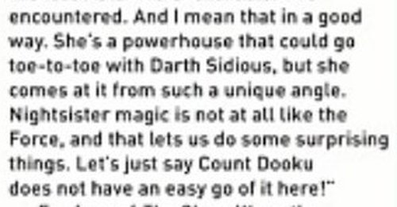

# Owner Material 038 — Star Wars Insider #1–153 plus specials (with The Lucasfilm Fan Club Magazine #1–22): Star Wars Insider #149 (2014)

- **Source:** *Star Wars Insider* magazine (issues 23–153, 1994–2014) and its predecessor *The Lucasfilm Fan Club Magazine* (issues 1–22, 1987–1994), plus seven special editions: articles, interviews, comics and short fiction Secondary source (licensed Legends reference). Scan OCR'd on the box; the scan stays box-only and is **not** published.
- **Method:** every scanned page was OCR'd and machine-screened sentence by sentence for power-relevant statements (fights, kills, defeats, Force feats, rankings, superweapons) that name a character on our roster; each kept sentence is quoted verbatim from the OCR text and has a crop of the printed passage directly under it. Pages with nothing power-relevant are still listed with what is on them.
- **Citation:** "*Star Wars Insider #149* (2014), p.X" by printed page ("scan p.X" where no printed number applies). **Weight:** Licensed magazine: a secondary source. Its short fiction and comics are Legends stories; its articles and interviews sum up or discuss lore and rank below the novels, comics and games they describe.

## scan p.1 (scan page 1)

Page contents: Cover: "Explore the world's biggest Star Wars collection!", Heroes of Star Wars, exclusive Return of the Jedi storyboards revealed. (hand-read)

## scan p.2 (scan page 2)

Page contents: Ad: Star Wars Magazine (comics, Rebels behind the scenes). (hand-read)

## scan p.3 (scan page 3)

Page contents: Editorial (Jonathan Wilkins), May/June 2014: favourite villain General Grievous; next issue celebrates 150 issues. Masthead. Grievous quote from Battlefront II (OCR garbled; not used). (hand-read)

## scan p.4 (scan page 4)

Page contents: Contents image; Grievous quote "Back away! I will deal with this Jedi slime myself!" (ROTS). (hand-read)

## scan p.5 (scan page 5)

Page contents: Contents: Launch Pad, My Star Wars (Ian Liston), Rancho Obi-Wan, Brook Temple storyboards, Rogues Gallery (Ghost crew), Matthew Stover, McQuarrie, Photo Story, B-Wing Assault fiction, Classic Moment, Books, Comics, Incoming, Bounty Hunters, Bantha Tracks. (hand-read)

## scan p.6 (scan page 6)

Page contents: Launch Pad: Star Wars Celebration Anaheim April 16-19, 2015; host James Arnold Taylor (Celebration Stage). (hand-read)

## scan p.7 (scan page 7)

Page contents: Celebration Anaheim hosts for the Behind-the-Scenes and Digital stages; Collecting Track (fan podcaster/collector host names and family details omitted per rule). (hand-read)

## scan p.8 (scan page 8)

Page contents: Celebration fan participation and Art Show submissions (deadline July 21, 2014); Remembering Aaron Allston by Bryan Young (died February 27, 2014, aged 53; medical details omitted; 13 Star Wars books); tributes from Shelly Shapiro and Timothy Zahn. (hand-read)

## scan p.9 (scan page 9)

Page contents: Allston tribute cont. (Stackpole, Ian Liston on Wes Janson; how he was hired for X-Wing; Wraith Squadron 1998); obituaries: Christopher Malcolm (Zev Senesca, aged 67) and Malcolm Tierney (Lt. Shann Childsen, aged 75, February 18); Jedi Academy: Return of the Padawan cover (July 22); Her Universe Geek Couture show (July 24, 2014); correction: Zeb Orrelios spelling. (hand-read)

## scan p.10 (scan page 10)

Page contents: Communications letters page (letter-writer names omitted): Dark Horse to Marvel; who knew Anakin was Vader (editor: Tarkin knows, per ANH dialogue); a child's letter (family details omitted). (hand-read)

## scan p.11 (scan page 11)

Page contents: Ad: Brian's Toys. (hand-read)

## scan p.12 (scan page 12)

Page contents: "General Grievous: Beneath the Armor" by Jason Fry: Lucas's brief for a new iconic villain; Warren Fu's design (white as death in Chinese culture; organic eyes; Lucas added the organ sac); insect/dinosaur design notes. Production (S). (hand-read)

## scan p.13 (scan page 13)

Page contents: Full-page photo (viewed, OCR empty): close-up of Grievous's mask and yellow eye. (hand-read)

## scan p.14 (scan page 14)

Page contents: 211 words, 5 paragraphs | headings/entries: BUILDING A BACKSTORY

### Stat block notes (game mechanics, not feats)

- Grievous on Utapau: "Obi-Wan tracks him down there, standing his ground against a four-lightsaber attack that makes Grievous seem like a crazed combine. Obi-Wan then chases the cyborg through tunnels and down sinkholes, finally picking up a blaster and shooting him dead." (General Grievous: Beneath the Armor, Star Wars Insider 149, p. 14) (Source: *Star Wars Insider #149* (2014), scan p.14)
- Grievous recurring villain: "He then became a recurring villain in the 2008 animated series, battling Obi-Wan multiple times and also tangling with Ahsoka Tano, Kit Fisto, Eeth Koth, and Asajj Ventress." (General Grievous: Beneath the Armor, Star Wars Insider 149, p. 14) (Source: *Star Wars Insider #149* (2014), scan p.14)

## scan p.15 (scan page 15)

Page contents: Grievous's Greatest Hits cont.: Rising Malevolence (October 2008; targets a medical station), Lair of Grievous (December 2008; EV-A4-D), Visionaries "The Eyes of Revolution" by Warren Fu (Grievous as evil's victim). Comic panel with San Hill (OCR garbled). (hand-read)

### Stat block notes (game mechanics, not feats)

- Hypori (micro-series): "Grievous hunts a group of trapped Jedi on Hypori, causing Ki-Adi-Mundi to sweat as he closes in." (Grievous's Greatest Hits, Star Wars Insider 149, p. 15) (Source: *Star Wars Insider #149* (2014), scan p.15)
- General Grievous (Dark Horse 2005): "Grievous is wonderfully evil in this Chuck Dixon-penned story, kidnapping Padawans and plotting to turn them into Force-sensitive cyborgs in his own image." (Grievous's Greatest Hits, Star Wars Insider 149, p. 15) (Source: *Star Wars Insider #149* (2014), scan p.15)

## scan p.16 (scan page 16)

Page contents: The Clone Wars alternate (Lucas) origin: Grievous wanted to be a Jedi, was rejected and arranged his own transformation ("Lair of Grievous" statues; Filoni left it unresolved); comparison with Anakin (OCR column-merged; S only). (hand-read)

### Stat block notes (game mechanics, not feats)

- Qymaen jai Sheelal origin: "In the first version of Grievous's backstory, he was born Qymaen jai Sheelal, a Kaleesh who rose to prominence as a warlord, battling a neighboring species in a war stopped by the Republic and the Jedi. Seeking to help his impoverished people, Grievous became an enforcer for the InterGalactic Banking Clan. He was set up by the IGBC's chairman San Hill, who sabotaged his shuttle, leading to a near-fatal crash. What was left of Grievous was encased in armor and turned into a killing machine for Count Dooku. Dooku taught Grievous lightsaber combat, turning him into a technological parody of the Jedi and a tool to destroy them." (General Grievous: Beneath the Armor, Star Wars Insider 149, p. 16) (Source: *Star Wars Insider #149* (2014), scan p.16)
- Stover: altered emotions: "The cyborg general's brain and even his emotions were altered—in the novelization of Revenge of the Sith, Matthew Stover tells us that Grievous remembered joy, anger, frustration, grief and sorrow, but no longer actually felt those things." (General Grievous: Beneath the Armor, Star Wars Insider 149, p. 16) (Source: *Star Wars Insider #149* (2014), scan p.16)

## scan p.17 (scan page 17)

Page contents: Moby-Dick comparison; Grievous facts: Lucas's "Dracula droid" change after a rough cut; Gary Oldman originally recruited, Matthew Wood voiced him (micro-series: John DiMaggio, Richard McGonagle); Hasbro "Pre-Cyborg Grievous" figure (2007); Kilian Plunkett's saurian Grievous. (hand-read)

### Stat block notes (game mechanics, not feats)

- Grievous's cough explanations: "The reason for Grievous's cough is as complicated as his backstory. It's been variously explained as a behind the scenes joke, a side effect of prototype cybernetic technology, and the result of Mace Windu crushing Grievous's chest armor with the Force." (Grievous Facts, Star Wars Insider 149, p. 17) (Source: *Star Wars Insider #149* (2014), scan p.17)
- N-K Necrosis: "The videogame Star Wars: Galaxies resurrected Grievous—sort of—as N-K Necrosis, a combat droid built from his armor and cybernetic parts." (Grievous Facts, Star Wars Insider 149, p. 17) (Source: *Star Wars Insider #149* (2014), scan p.17)

## scan p.18 (scan page 18)

Page contents: My Star Wars: Ian Liston (Wes Janson), interview by Mark Newbold: first awareness via production stills; earlier worked at Elstree as a runner; first autograph on the Isle of Wight (medical detail omitted). (hand-read)

## scan p.19 (scan page 19)

Page contents: My Star Wars cont. (viewed): favourite character his own Wes Janson as developed by Aaron Allston, otherwise Chewbacca; favourite line R2-D2's beeps. (hand-read)

## scan p.20 (scan page 20)

Page contents: Rancho Obi-Wan feature by Amy Ratcliffe: Steve Sansweet's collection, Guinness-recognized as the largest Star Wars collection (more than 300,000 unique items since 1977). (hand-read)

## scan p.21 (scan page 21)

Page contents: Rancho Obi-Wan: Sansweet's collecting from a 1977 press pamphlet; museum compared to the Raiders warehouse; photo captions (Sam Witwer-signed helmet etc.). (hand-read)

## scan p.22 (scan page 22)

Page contents: Rancho Obi-Wan in Petaluma (1998), non-profit, opened to the public November 2011 (museum staff names omitted); tour opens with Modal Nodes and a screen-worn Vader costume; the 4-LOM crotch story; five fan-made items (maker names omitted). (hand-read)

## scan p.23 (scan page 23)

Page contents: Tours about three hours; over 70,000 pieces catalogued, 2014 Guinness World Records entry; Sansweet on telling stories. (hand-read)

## scan p.24 (scan page 24)

Page contents: Merchandise as Star Wars history; five weird food items (Japanese breadsticks, Chewbacca Icy Pole, gum, Episode I fromage frais). (hand-read)

## scan p.25 (scan page 25)

Page contents: Rancho Obi-Wan's future (virtual presence); quotes from James Arnold Taylor, Sam Witwer and Catherine Taber; Sansweet on giving back to fandom. (hand-read)

## scan p.26 (scan page 26)

Page contents: "The Marker Man": Brook Temple, ROTJ storyboard artist, interview by J. W. Rinzler: identification of his boards; how he approached ILM. (hand-read)

## scan p.27 (scan page 27)

Page contents: Temple got the job with a three-by-six-foot butcher-paper drawing of a space battle cruiser left for Joe Johnston; first day at ILM. (hand-read)

## scan p.28 (scan page 28)

Page contents: Temple's training (Art Center, Stars and Stripes illustrator in the army, School of Visual Arts, Yale under Josef Albers); the "magic toolbox" later used by Ralph McQuarrie; clients and two US postage stamps. (hand-read)

## scan p.29 (scan page 29)

Page contents: Temple ROTJ storyboard panels 68-70 (viewed, OCR empty): Ewoks with spears, speeder bike explosion. (hand-read)

## scan p.30 (scan page 30)

Page contents: Temple boarded the last third of ROTJ (speeder bike chase, Ewok and chicken walker battles) for six to eight weeks; Lucas checked progress every other day. (hand-read)

## scan p.31 (scan page 31)

Page contents: Temple: hourly pay, secretive locked art department, Pentel pens; influences list (family details omitted). (hand-read)

## scan p.32 (scan page 32)

Page contents: Rogues Gallery "Crew of the Ghost": Star Wars Rebels heroes revealed (Chopper, Kanan Jarrus/Freddie Prinze Jr., Sabine Wren/Tiya Sircar, Ezra Bridger/Taylor Gray). Disney-canon Rebels: S only. (hand-read)

## scan p.33 (scan page 33)

Page contents: Crew of the Ghost (viewed): Hera Syndulla (Vanessa Marshall) and Zeb Orrelios (Steve Blum). S only. (hand-read)

## scan p.34 (scan page 34)

Page contents: Authors of the Expanded Universe: Matthew Woodring Stover, by Michael Kogge: Traitor delivered summer 2001 as the 13th of 19 New Jedi Order novels, the paperback that became "the center of the saga." (hand-read)

## scan p.35 (scan page 35)

Page contents: Stover bio: born 1962 in York, Pennsylvania, raised in Danville, Illinois (family details omitted); early reading of Niven, Heinlein, Leiber, Zelazny, Donaldson. (hand-read)

## scan p.36 (scan page 36)

Page contents: Stover: acting at Drake University (Hamlet), bartender and martial arts instructor; Iron Dawn and Schliemann; seeing Star Wars in 1977 ("this is true"); a 1979 screening (Han charging stormtroopers) inspired Heroes Die and questions about violence. (hand-read)

## scan p.37 (scan page 37)

Page contents: Full-page art (viewed): Dave Seeley's cover for Luke Skywalker and the Shadows of Mindor (2008); caption for Traitor. (hand-read)

## scan p.38 (scan page 38)

Page contents: Heroes Die (Del Rey, August 1998) led to Traitor (written in seven months, originally titled Underworld; Anakin Solo's death transforms Jacen); Vergere's Taoist wisdom and ambiguous alignment; Lucas: Star Wars "is not about answers"; Shatterpoint pitched as "Apocalypse Now with Mace Windu"; Shelly Shapiro's 2004 call to write the ROTS novelization. OCR "stranger" crop-verified as "stronger". (hand-read)

### Stat block notes (game mechanics, not feats)

- Traitor: Vergere remakes Jacen: "Jacen Solo travels through the "land of the dead," encountering a former Jedi Knight, Vergere, who is the opposite of Yoda. In this metaphorical hell, Vergere teaches Jacen about her conception of the Force by having him physically, emotionally, and mentally suffer the worst Yuuzhan Vong tortures. At the same time, she makes Jacen stronger, forming him into a new kind of Jedi Knight who is able re-emerge [sic] into the land of the light, betray the World Brain that controls Coruscant, and use his new powers in the service of his people." (Authors of the Expanded Universe: Matthew Stover, Star Wars Insider 149, p. 38) (Source: *Star Wars Insider #149* (2014), scan p.38)

## scan p.39 (scan page 39)

Page contents: Stover bibliography (Traitor 2002, Shatterpoint 2003, ROTS 2005, Shadows of Mindor 2008; "The Tenebrous Way" in Insider #130); text says last SW novel "2003's" Shadows of Mindor (sic; bibliography gives 2008); "I was a fan first." (hand-read)

## scan p.40 (scan page 40)

Page contents: McQuarrie Revisited (viewed, OCR empty): Paul Bateman painting inside Vader's castle: an IG-type assassin droid, a robed armored figure with blaster, an Ithorian-like being and a reptilian alien before a window looking out on a rocky lava landscape. (hand-read)

## scan p.41 (scan page 41)

Page contents: McQuarrie Revisited intro: final part of the series; a sinister meeting inside Vader's castle. (hand-read)

## scan p.42 (scan page 42)

Page contents: McQuarrie Revisited text by Paul Bateman: McQuarrie's ESB-era interior studies for Vader's castle (OCR "Gast Castle" crop-verified as "Bast Castle"); Bateman populated the scene with McQuarrie's rarely seen bounty hunter concepts (sketches shown), imagining Vader plotting to catch Luke Skywalker; Bateman bio (social handle omitted). (hand-read)

### Stat block notes (game mechanics, not feats)

- Bast Castle on Vjun: McQuarrie's castle concept "is an idea that has appeared in the Expanded Universe in the shape of "Bast Castle," Vader's dark retreat, hidden away on the stormy planet of Vjun." (McQuarrie Revisited, Star Wars Insider 149, p. 42) (Source: *Star Wars Insider #149* (2014), scan p.42)

## scan p.43 (scan page 43)

Page contents: Ad: Star Trek Magazine (Titan). (hand-read)

## scan p.44 (scan page 44)

Page contents: "Star Wars: Prequel Snapshots": rare and never-before-published photos from the Lucasfilm Archives of the making of the prequels. (hand-read)

## scan p.45 (scan page 45)

Page contents: Photo (viewed): creature crew with a Rodian in Mos Espa Arena set at Leavesden Studios, Episode I; Anakin-in-tree background image. (hand-read)

## scan p.46 (scan page 46)

Page contents: Photo: Anthony Daniels (C-3PO) on the Naboo cruiser ramp, Stage 3 at Fox Studios Australia, Episode II. (hand-read)

## scan p.47 (scan page 47)

Page contents: Photo: Ray Park (Darth Maul) and Liam Neeson (Qui-Gon Jinn) on the bluescreen set at Leavesden, Episode I. (hand-read)

## scan p.48 (scan page 48)

Page contents: Photos (viewed): Lily Nyamwasa (Stass Allie) and Orli Shoshan (Shaak Ti) on the Geonosis set; extras on Dex's Diner set, Episode II. (hand-read)

## scan p.49 (scan page 49)

Page contents: Photo: Scott McLean's (stunt double, Jango Fett) armor on the bluescreen Geonosis arena set, Episode II. (hand-read)

## scan p.50 (scan page 50)

Page contents: Subscription ad (free Hasbro figure, save 25%). (hand-read)

## scan p.51 (scan page 51)

Page contents: Subscription ad continued (offer terms, prices). (hand-read)

## scan p.52 (scan page 52)

Page contents: Blade Squadron opening art by Chris Trevas (viewed, OCR empty): B-wings in flight, pilot in rotating cockpit. (hand-read)

## scan p.53 (scan page 53)

Page contents: Exclusive fiction "Blade Squadron" Part One by David J. Williams and Mark S. Williams, art by Chris Trevas. Note: published 2014 and later treated as Disney-canon; T lines below are tagged [canon-era story]. OCR "Brayten" crop-verified as "Braylen" Stramm. Moonsong breaks formation in a drone exercise; Fox's force-multiplier doctrine; Ackbar's orders. (hand-read)

### Stat block notes (game mechanics, not feats)

- [canon-era story] Moonsong breaks formation: "Sir, we scored three hits on the Star Destroyer. Sir." "Except that wasn't a Star Destroyer. That was a bunch of drones in space simulating the position of a Star Destroyer. And you broke formation to score those hits. After which you got annihilated." (Blade Squadron, Star Wars Insider 149, p. 53) (Source: *Star Wars Insider #149* (2014), scan p.53)

## scan p.54 (scan page 54)

Page contents: Fleet ordered to Endor; Blade Squadron assigned rearguard; Fox's view of Stramm (ex-Imperial) and Moonsong (self-taught on Coruscant smuggling routes, mentor Barthow Quince); Fox's wife's transport destroyed at Hoth. (hand-read)

### Stat block notes (game mechanics, not feats)

- [canon-era story] Moonsong's piloting: "Moonsong might have a standing aversion to rules and regulations, but there was no denying she was an amazing pilot. Certainly better than himself, maybe almost as good as the legendary Wedge Antilles." (Blade Squadron, Star Wars Insider 149, p. 54) (Source: *Star Wars Insider #149* (2014), scan p.54)
- [canon-era story] Fox at Hoth: "When the Battle of Hoth began, he'd had less than one hundred hours of flight time and yet they expected him to fly his single X-wing as an escort to an escape transport. It looked like a suicide mission, but he'd somehow soldiered on, and survived." (Blade Squadron, Star Wars Insider 149, p. 54) (Source: *Star Wars Insider #149* (2014), scan p.54)

## scan p.55 (scan page 55)

Page contents: Stramm, an Imperial deserter from the Naboo garrison a year earlier, studies Yavin logs; Moonsong visits him; Admiral Jhared Montferrat of the Devastator spaces suspected smugglers. (hand-read)

### Stat block notes (game mechanics, not feats)

- [canon-era story] Montferrat's airlock executions: "He gave the stormtroopers a curt nod; they slammed the airlock door, cutting off the screams. ... The stormtroopers cycled the airlock and the banging stopped." Then: "Set it adrift and let the gun crews use it for target practice. Score the drill and let me know if any gun crew fails to achieve one hundred percent." (Blade Squadron, Star Wars Insider 149, p. 55) (Source: *Star Wars Insider #149* (2014), scan p.55)

## scan p.56 (scan page 56)

Page contents: Montferrat repositions Commander Gradd's interceptors aft; Rebel fleet trapped at Endor; Lando leads the strike; text says Fox's "A-wing's com" (sic; he flies a B-wing). (hand-read)

### Stat block notes (game mechanics, not feats)

- [canon-era story] Vader's Force choke on the Devastator: "Montferrrat [sic] could testify personally to that, having seen Vader Force choke more than one hapless Imperial officer in front of his own eyes. Montferrat had lived in daily fear of that deadly grip when he was subordinate to Vader on board the Devastator" (Blade Squadron, Star Wars Insider 149, p. 56) (Source: *Star Wars Insider #149* (2014), scan p.56)
- [canon-era story] Devastator's record: "The Devastator had witnessed historic battles—it had served on the blockade at Hoth, and it had even once captured Princess Leia Organa." (Blade Squadron, Star Wars Insider 149, p. 56) (Source: *Star Wars Insider #149* (2014), scan p.56)

## scan p.57 (scan page 57)

Page contents: Art (viewed): smugglers spaced from the Devastator airlock. "Blade Squadron... start your attack run!" To be concluded next issue; the authors also wrote "Maze Run" (Insider #131). (hand-read)

### Stat block notes (game mechanics, not feats)

- [canon-era story] Blade Squadron vs two dozen interceptors: "Fox recognized it as the Devastator. The ship that Vader had once commanded. The ship that had killed his family." ... "any hope Fox had for a quick strike against the massive ship disappeared as two dozen TIE Interceptors swept in from the ship's aft and came at them head to head." (Blade Squadron, Star Wars Insider 149, p. 57) (Source: *Star Wars Insider #149* (2014), scan p.57)

## scan p.58 (scan page 58)

Page contents: Ad: Dark Horse Digital (over 500 Star Wars comics and graphic novels). (hand-read)

## scan p.59 (scan page 59)

Page contents: Classic Moment (Neil Edwards), "Evil Empire!": Death Troopers, Joe Schreiber novel (2009). OCR header "70091" crop-verified as 2009; the Schreiber quote is cited to Insider #112, October 2009. Why it's a classic: Star Wars horror after TCW's "Legacy of Terror"/"Brain Invaders"; Keith Clayton (Del Rey) pitched the idea. Trivia: Purge also appears in Maul: Lockdown (2014), about 32 years earlier in the ship's service history. Next issue: "Luke's just not a farmer, Owen." (hand-read)

### Stat block notes (game mechanics, not feats)

- Death Troopers: the Purge outbreak: "An Imperial prison barge, Purge, carrying 500 hardened criminals and rebels, is heading for an isolated prison planet—when it comes upon a drifting Star Destroyer that won't answer its hails. ... they bring back a disease that sweeps through the prisoners and guards, leaving only a handful of survivors—including a certain scoundrel of a smuggler and his Wookiee companion. As the dead become something much worse, it's left to the six survivors to battle a terrifying threat" ... "Having faced the living dead on Purge, he and Chewie have looked into the heart of darkness and survived." (Classic Moment, Star Wars Insider 149, p. 59) (Source: *Star Wars Insider #149* (2014), scan p.59)

## scan p.60 (scan page 60)

Page contents: Back issues ad. (hand-read)

## scan p.61 (scan page 61)

Page contents: Section contents: Darth Maul: Son of Dathomir; What Makes a Monster? and Into the Void; Bounty Hunters; Bantha Tracks; Red Five by John Jackson Miller. (hand-read)

## scan p.62 (scan page 62)

Page contents: Books: DK Adventures "What Makes a Monster?" by Adam Bray (128 pages; acklays, banthas, wampas, the Sarlacc); LEGO Star Wars Classic Trilogy DK Readers (levels 1-3, June). (hand-read)

## scan p.63 (scan page 63)

Page contents: Into the Void by Tim Lebbon, more than 25,000 years before the movies; her Force-blind brother leads the cult; includes John Ostrander's "Eruption" and a Prisoner of Bogan excerpt. OCR "Grock" crop-verified as Brock. (hand-read)

### Stat block notes (game mechanics, not feats)

- Lanoree Brock, Je'daii: "Dawn of the Jedi: Into the Void follows the adventures of Lanoree Brock—one of the most powerful Je'daii disciples to emerge on the ancient world of Tython" ... "Lanoree Brock is a Je'daii Ranger, keeping order on the worlds of the Tython system. A Force-strong bloodline flows through her veins" ... "the Je'daii Council has ordered Lanoree to stop a cult's plans to use dark matter and rip open a space warp, which could set off a chain reaction and swallow the entire planetary system." (Books, Star Wars Insider 149, p. 63) (Source: *Star Wars Insider #149* (2014), scan p.63)

## scan p.64 (scan page 64)

Page contents: Comics (Dan Wallace): Darth Maul: Son of Dathomir, four-issue adaptation of an unproduced TCW arc by Jeremy Barlow, Juan Frigeri and Mauro Vargas, covers by Chris Scalf; Maul and Sidious lead opposing armies; Mandalorian Super Commandos Gar Saxon and Rook Kast. (hand-read)

## scan p.65 (scan page 65)

Page contents: Son of Dathomir: Shadow Collective (Pyke, Black Sun), Nightbrothers under Brother Viscus, Grievous and MagnaGuards, Dooku's secret; Stygeon prison break, shatterax gladiator pit; Barlow on Maul as "the ultimate underdog." KOTOR Omnibus Volume 3 (issues #38-54 plus KOTOR: War, 416 pages; Zayne Carrick, Jarael, Mandalorian Wars). Dark Times Vol. 7: A Spark Remains (Dass Jennir and the Uhumele crew target Vader; Randy Stradley, Doug Wheatley). (hand-read)

- **Mother Talzin; Palpatine (Darth Sidious); Count Dooku** — entry/section: Barlow on Talzin's power: ""She's a powerhouse that could go toe-to-toe with Darth Sidious, but she comes at it from such a unique angle. Nightsister magic is not at all like the Force, and that lets us do some surprising things. Let's just say Count Dooku does not have an easy go of it here!" —Jeremy Barlow (writer), Star Wars Insider 149, p. 65" Source: *Star Wars Insider #149* (2014), scan p.65
  

## scan p.66 (scan page 66)

Page contents: Incoming (James Burns): Hasbro Star Wars Rebels 3.75" Saga Legends figures (Ezra, Kanan, Chopper, the Inquisitor, Agent Kallus, stormtrooper; $5.99) and Mission Series two-packs ($9.99). (hand-read)

## scan p.67 (scan page 67)

Page contents: Hasbro Black Series 6" (ROTS Anakin-as-Vader with swappable heads, clone trooper, sandtrooper, Chewbacca, ROTJ Vader, ROTJ Luke) and 6" Deluxe (speeder bike with biker scout, Jabba). (hand-read)

## scan p.68 (scan page 68)

Page contents: QMx ship replica key-chains (Falcon, Star Destroyer, Slave I); Diamond Select TIE bottle opener; Comic Images plush (Jabba, dewback, Y-wing, Star Destroyer); Mimoco BatteryBot (Vader, R2-D2). (hand-read)

## scan p.69 (scan page 69)

Page contents: Fantasy Flight X-Wing Wave 4 (Z-95 Headhunter, TIE defender, E-wing, TIE phantom; game blurbs only, S); Official Pix autographs of Peter Mayhew and David Prowse. (hand-read)

## scan p.70 (scan page 70)

Page contents: Gentle Giant Darth Vader & Son and Vader's Little Princess maquette box sets with Jeffrey Brown books (humor, non-canon). (hand-read)

## scan p.71 (scan page 71)

Page contents: LEGO Star Wars Microfighters (six vehicles) and free LEGO Star Wars mobile games. (hand-read)

## scan p.72 (scan page 72)

Page contents: Bounty Hunters: reader photos with stars (Carrie Fisher and Ian McDiarmid at Fan Expo Toronto 2013; Tom Kane and Daniel Logan at a 2013 Illinois festival). Reader names omitted. (hand-read)

## scan p.73 (scan page 73)

Page contents: Bounty Hunters continued: a reader met Steve Sansweet at Star Wars Weekends; Rusty Goffe (a Jawa and the gonk droid) signing in Somerset, UK, 2013. Reader names omitted. (hand-read)

## scan p.74 (scan page 74)

Page contents: Bantha Tracks: Star Wars as a multi-generational phenomenon, focus on young fans; family cherry-blossom photoshoot (fan names omitted). (hand-read)

## scan p.75 (scan page 75)

Page contents: Bantha Tracks fan photos: R2-D2 photos 12 years apart, Kashyyyk birthday cake, toddler Vader, a Vader-themed birthday party, baby Yoda costume (fan and family names omitted). (hand-read)

## scan p.76 (scan page 76)

Page contents: Bantha Tracks fan photos and art: a homemade Leia costume contest win, parent-and-child Yoda's-home paintings, a child meeting R2-D2 (names omitted). (hand-read)

## scan p.77 (scan page 77)

Page contents: Bantha Tracks: kids' homemade TCW-inspired Halloween characters; a 501st biker scout with a young fan; a youth football team called The Jedi (plays such as "Order 64" [sic], "Sith Choke"); submission guidelines c/o Mary Franklin (names of fans omitted). (hand-read)

## scan p.78 (scan page 78)

Page contents: Bantha Tracks "Inspiring Generations": a Spanish fan's sons drawn into Star Wars through The Force Unleashed II and LEGO games (Starkiller drawings, R2-D2 art); a kindergartener's trooper obsession (names omitted). (hand-read)

## scan p.79 (scan page 79)

Page contents: Bantha Tracks: a young Jawa costumer and the 501st's Galactic Academy (names omitted); "Kids Unleashed": the Celebration Family Room run by Lucasfilm's Kristen Hidalgo; Celebration Europe (Essen) moved the Family Room and Jedi Training onto the show floor; Mary Franklin, editor. (hand-read)

## scan p.80 (scan page 80)

Page contents: Red Five: John Jackson Miller's five favorite EU characters (interview by Mark Newbold). 1 Valance, created by Archie Goodwin in Marvel #16 (OCR "416" crop-verified as #16); "best bounty hunter we'd met before Boba Fett." 2 Borsk Fey'lya, the poster child for political shenanigans in Zahn's Heir to the Empire era. (hand-read)

### Stat block notes (game mechanics, not feats)

- Valance vs Vader (Dark Encounter): "An injured Imperial officer whose cybernetic prosthetics both ended his career and made him a formidable bounty hunter" ... ""Dark Encounter" in Star Wars #29, arguably the strongest issue from the Marvel run, found one cybernetic warrior dueling another as Valance fought Darth Vader to protect Luke's identity. He paid the ultimate price for that" (Red Five: John Jackson Miller, Star Wars Insider 149, p. 80) (Source: *Star Wars Insider #149* (2014), scan p.80)

## scan p.81 (scan page 81)

Page contents: Red Five continued: 3 Mosep Binneed, the Nimbanel "Monkey Jabba" stand-in from the ANH novelization and Marvel adaptation (Howard Chaykin), later established as Jabba's accountant and used in Miller's Kenobi; 4 Lumiya; 5 Marn "The Gryph" Hierogryph, Miller's own KOTOR comics con man (fake modern art, stolen fleek eels, Trandoshan flatcakes, planets). (hand-read)

### Stat block notes (game mechanics, not feats)

- Lumiya (Shira Brie): "Lumiya, the Emperor's Hand who first appeared many years earlier as Shira Brie, created by David Micheline for the comics of 1981-82. ... she was the Empire's mole in the Rebellion ... Her "death" sparked a whodunit that temporarily drove Luke from the Alliance—and set in motion the later stories in which she threatened the New Jedi Order as Lumiya. After her countless terrible acts, Luke put a stop to her menace" (Red Five: John Jackson Miller, Star Wars Insider 149, p. 81) (Source: *Star Wars Insider #149* (2014), scan p.81)

## scan p.82 (scan page 82)

Page contents: Next issue: TCW The Lost Missions episode guide; LEGO Star Wars at 15; Tales of the Jedi making-of. On sale June 10 (US) / June 19 (UK). (hand-read)

## scan p.83 (scan page 83)

Page contents: Ad: Titan Comics, Dr. Grordbort's Triumph (quotes from Stephen Fry and Andy Serkis). (hand-read)

## scan p.84 (scan page 84)

Page contents: Ad: Titan Comics sci-fi collections (Snowpiercer vols. 1-2, Numbercruncher, Devil May Cry, Lost Planet). (hand-read)

