# Dark Empire (#1–6, 1991–92): daily-image candidates

- Added 2026-11-03. These are panel crops (≤600 px on the long side, never full pages) for the daily image post, so it can draw on Dark Empire as well as Legacy.
- Source: the Dark Horse single issues, digital scans. Page numbers follow the notes here (p1 = cover set, story p4–27). Captions quote the lettering verbatim.
- The full hand-read is in `de1-01.md` … `de1-06.md` and `de1-summary.md`.

| # | Crop | Issue / page | What it shows | Verbatim text in crop |
|---|---|---|---|---|
| 1 | 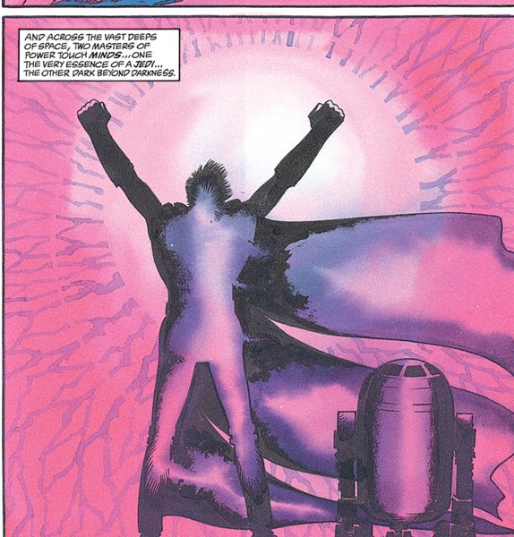 | DE #1 p26 | Luke, arms raised, in the storm's glow beside R2 | "AND ACROSS THE VAST DEEPS OF SPACE, TWO MASTERS OF POWER TOUCH MINDS...ONE THE VERY ESSENCE OF A JEDI... THE OTHER DARK BEYOND DARKNESS." |
| 2 | 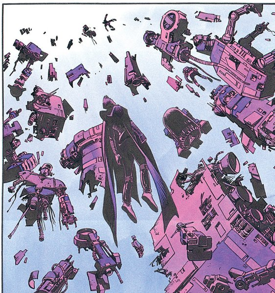 | DE #1 p27 | The Emperor's storm lifts Luke along with walker and ship wreckage | (no lettering) |
| 3 | 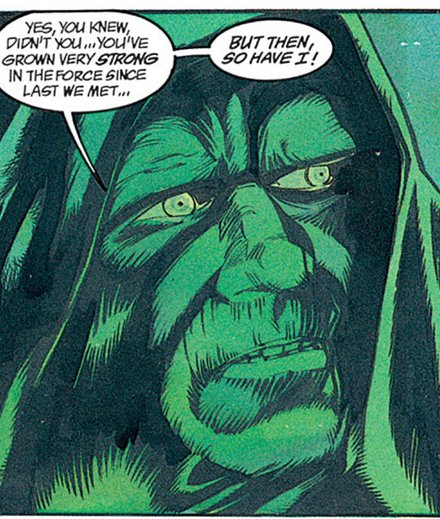 | DE #2 p20 | The reborn Emperor's first close-up | "YES, YOU KNEW, DIDN'T YOU...YOU'VE GROWN VERY STRONG IN THE FORCE SINCE LAST WE MET..." / "BUT THEN, SO HAVE I!" |
| 4 | 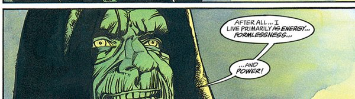 | DE #2 p21 | The Emperor explains what he is | "AFTER ALL... I LIVE PRIMARILY AS ENERGY... FORMLESSNESS..." / "...AND POWER!" |
| 5 | 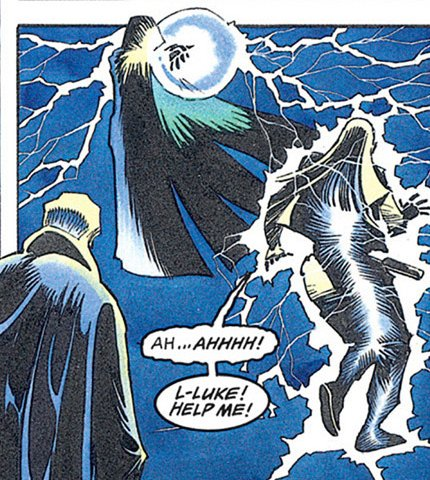 | DE #4 p26 | The Emperor (old clone) lightnings Leia while dark Luke looks on | "AH...AHHHH!" / "L-LUKE! HELP ME!" |
| 6 | 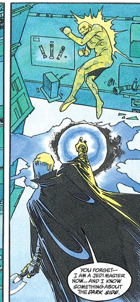 | DE #5 p25 | Luke Force-blasts the new clone across the lab | "YOU FORGET-- I AM A JEDI MASTER NOW... AND I KNOW SOMETHING ABOUT THE DARK SIDE." |
| 7 | 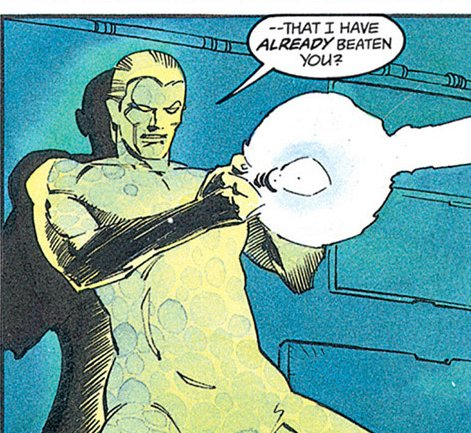 | DE #5 p25 | The fresh clone ignites a lightsaber | "--THAT I HAVE ALREADY BEATEN YOU?" |
| 8 | 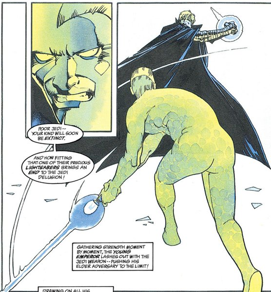 | DE #5 p26 | The young clone attacks Luke with a saber | "POOR JEDI-- YOUR KIND WILL SOON BE EXTINCT." / "GATHERING STRENGTH MOMENT BY MOMENT, THE YOUNG EMPEROR LASHES OUT WITH THE JEDI WEAPON--PUSHING HIS ELDER ADVERSARY TO THE LIMIT!" |
| 9 | 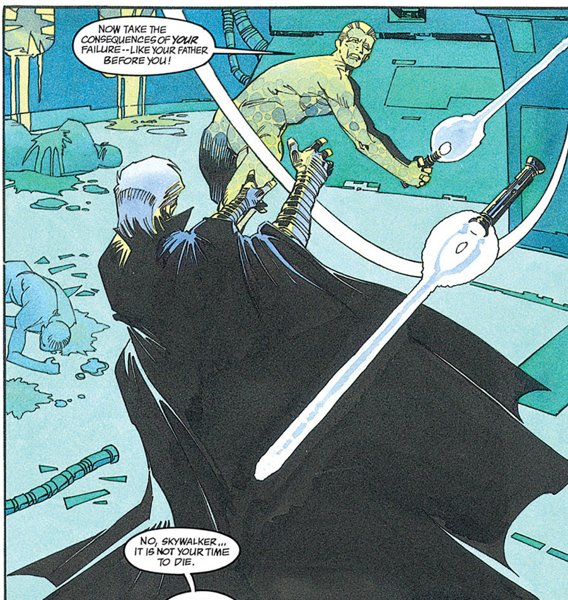 | DE #5 p27 | The clone disarms Luke | "NOW TAKE THE CONSEQUENCES OF YOUR FAILURE--LIKE YOUR FATHER BEFORE YOU!" / "NO, SKYWALKER... IT IS NOT YOUR TIME TO DIE." |
| 10 | 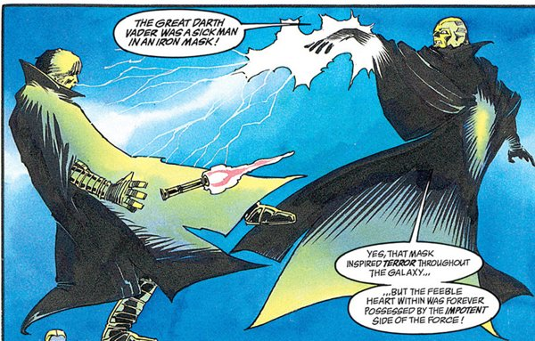 | DE #6 p22 | The Emperor's lightning on Luke aboard the flagship | "THE GREAT DARTH VADER WAS A SICK MAN IN AN IRON MASK!" / "...BUT THE FEEBLE HEART WITHIN WAS FOREVER POSSESSED BY THE IMPOTENT SIDE OF THE FORCE!" |
| 11 | 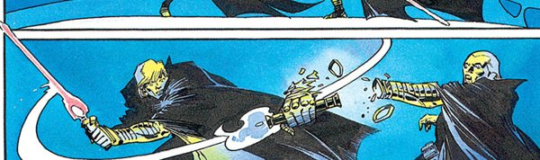 | DE #6 p23 | Luke's saber shatters the Emperor's hilt | (no lettering) |
| 12 | 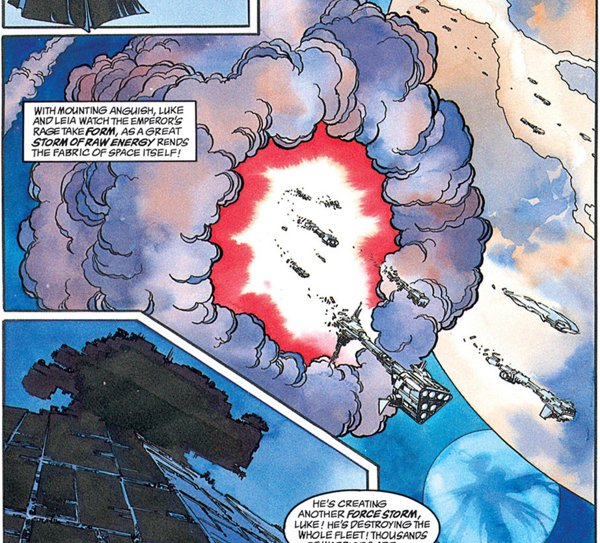 | DE #6 p24 | The Force storm opens over the Pinnacle Moon fleet | "WITH MOUNTING ANGUISH, LUKE AND LEIA WATCH THE EMPEROR'S RAGE TAKE FORM, AS A GREAT STORM OF RAW ENERGY RENDS THE FABRIC OF SPACE ITSELF!" / "HE'S CREATING ANOTHER FORCE STORM, LUKE! HE'S DESTROYING THE WHOLE FLEET! THOUSANDS OF WARRIORS ARE DYING!" |
| 13 | 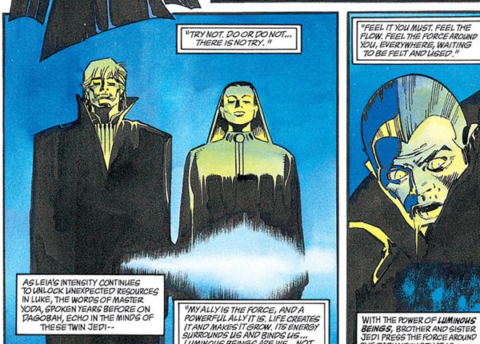 | DE #6 p25 | The twins join their power against the Emperor | "WITH THE POWER OF LUMINOUS BEINGS, BROTHER AND SISTER JEDI PRESS THE FORCE AROUND THE DARK NEXUS THAT IS EMPEROR PALPATINE..." |
| 14 | 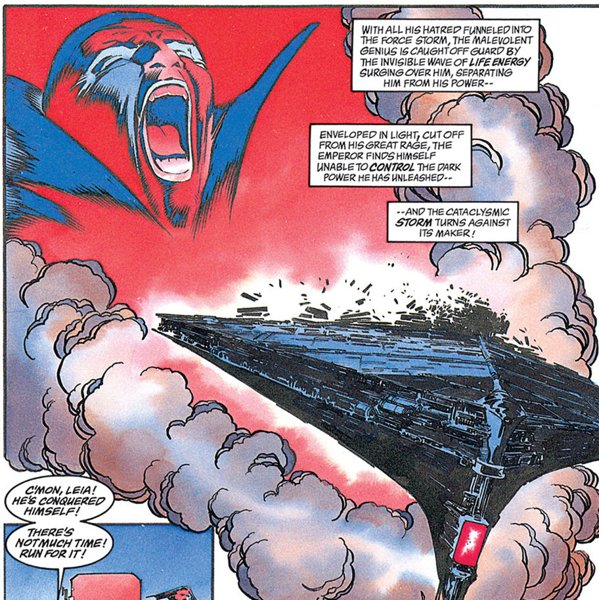 | DE #6 p26 | The storm turns on the Emperor and devours his flagship | "WITH ALL HIS HATRED FUNNELED INTO THE FORCE STORM, THE MALEVOLENT GENIUS IS CAUGHT OFF GUARD BY THE INVISIBLE WAVE OF LIFE ENERGY SURGING OVER HIM, SEPARATING HIM FROM HIS POWER--" / "--AND THE CATACLYSMIC STORM TURNS AGAINST ITS MAKER!" |
| 15 | 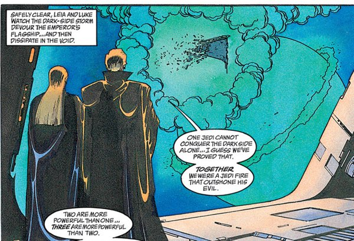 | DE #6 p27 | The twins watch the flagship go | "ONE JEDI CANNOT CONQUER THE DARK SIDE ALONE... I GUESS WE'VE PROVED THAT." / "TWO ARE MORE POWERFUL THAN ONE... THREE ARE MORE POWERFUL THAN TWO." |

## Further candidates (listed, not yet cropped)
- DE #1: Luke Force-pushes the crippled AT-AT over, and Leia's Force-guided cannon shot takes the head off an AT-AT (see `de1-01.md`).
- DE #3: Luke's projection reaches Da Soocha V and the Emperor overshadows it (see `de1-03.md`).
- DE II #3 p24–26: Ood Bnar against Sedriss, a mutual disintegration. DE II #5 p25–27: the Galaxy Gun destroys Pinnacle Moon.
- Empire's End #1 p16–17: the Galaxy Gun takes out Nespis VIII. EE #2 p18: Leia's Force blast and the Emperor's lightning.
