# Darth Vader and the Lost Command: daily-image candidates

New non-Legacy art for the daily upload rotation. Crops come from the issue scans (#1–#5, 2011, Dark Horse; script Blackman, pencils Leonardi, inks Green, colors Dzioba; covers Tsuneo Sanda; TPB front cover Michael Kutsche). Every image is a single-panel or partial crop, max 600 px. No full pages.

Top picks for the daily slot: LC#3 p. 06 (leap), LC#4 p. 18 (leap into ambush), LC#5 p. 05 (breaks bonds), LC#5 p. 21 (cathedral collapse), LC#5 p. 24 (final page), LC#1 p. 24 (Saro on water).

Count: 35 crops in `panels/`.

## LC#1 p. 07: Vader strides between the Royal Guards to the Emperor
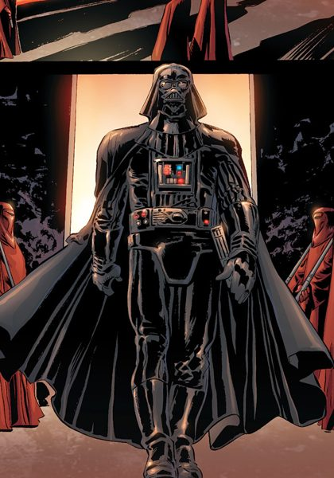

## LC#1 p. 08: Helmet close-up: "What is thy bidding…"
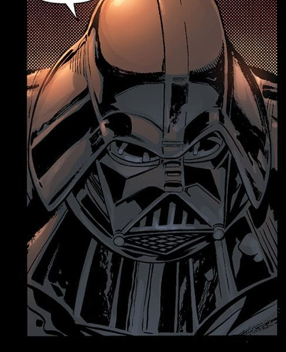

## LC#1 p. 12: "501st! Move out!": clones advance in the snow
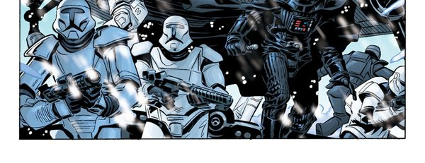

## LC#1 p. 18: FWOOSH! Two-handed Force push through the snow wall
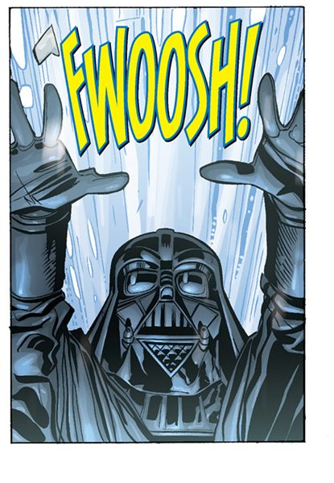

## LC#1 p. 21: WHAM! A door Force-blasted open
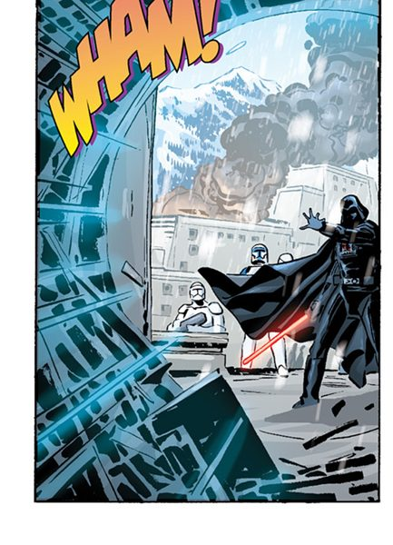

## LC#1 p. 24: Lady Saro, High Priestess of Atoa, walks on water to Vader
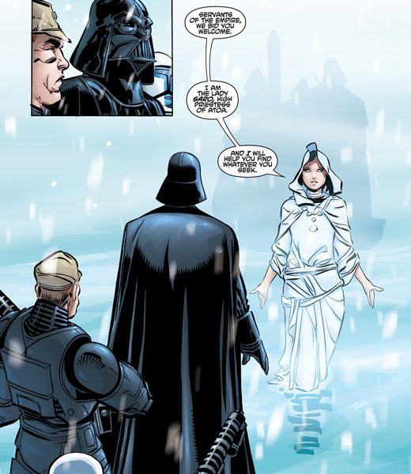

## LC#2 p. 07: Force choke of Captain Shale: "This is MY command!"
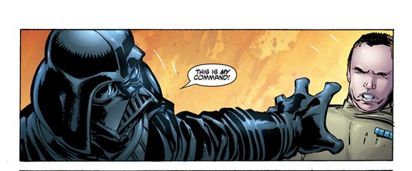

## LC#2 p. 09: Dream: Padmé as Supreme Chancellor
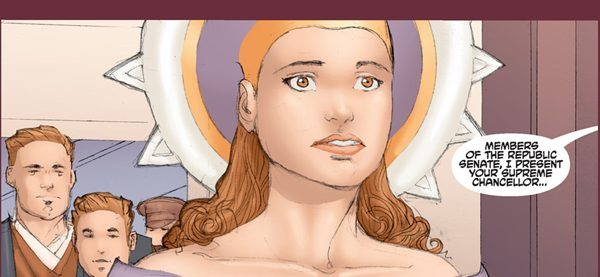

## LC#2 p. 21: Zero-g boarding: "I only need ONE of you alive."
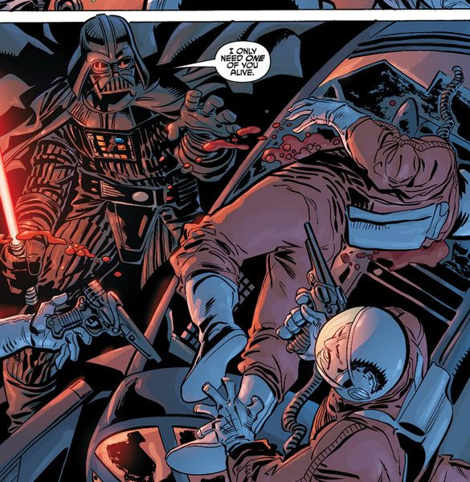

## LC#2 p. 24: Vader with the shadow troopers: "A stealth attack."
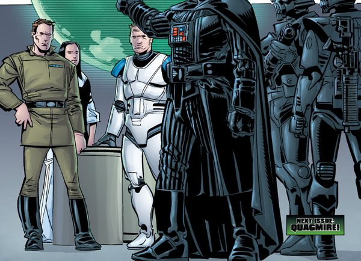

## LC#3 p. 06: Vader leaps unaided from the gunship onto the moving tar city
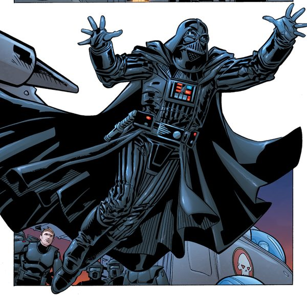

## LC#3 p. 15: BA-BOOOM! The droid's "gift" bomb
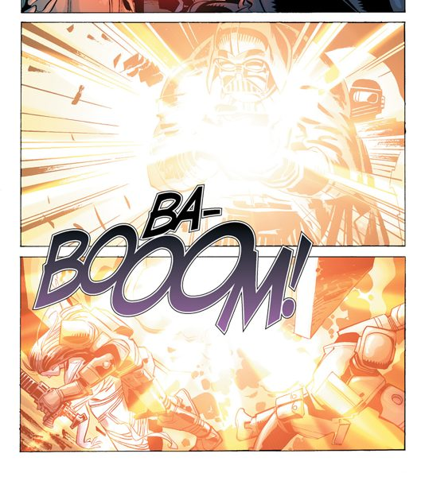

## LC#3 p. 23: Unmasked Vader: "I know who sent you… and he dies next."
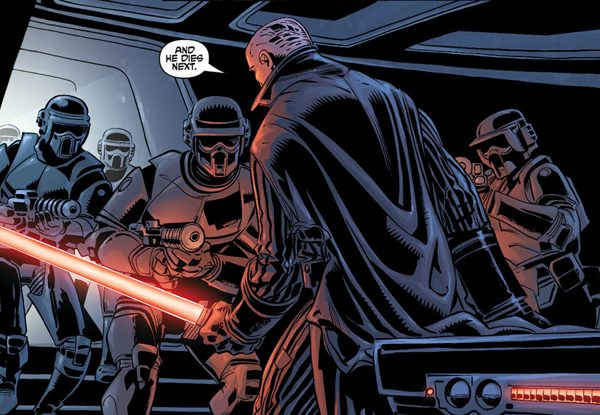

## LC#4 p. 03: Unmasked Vader vs Shale's storm commandos
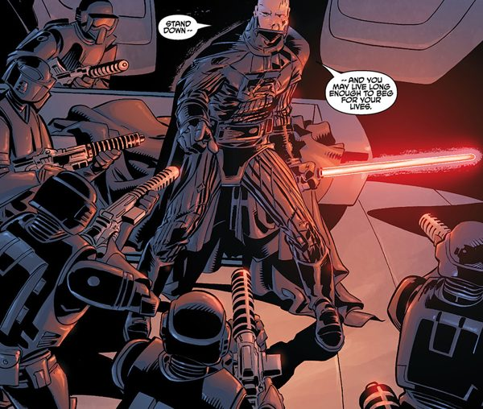

## LC#4 p. 04: "Then meet your fate."
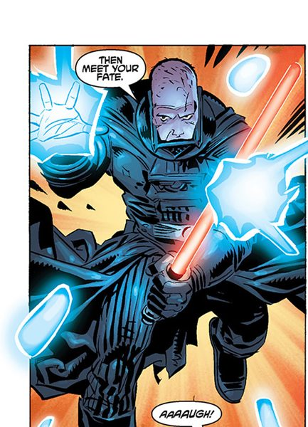

## LC#4 p. 07: Vader cuts down the mutineers on the bridge
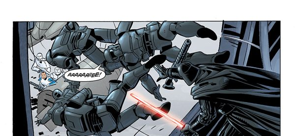

## LC#4 p. 12: Vader walks out of the hangar fire
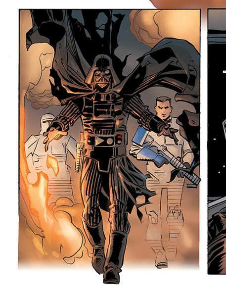

## LC#4 p. 16: "No. An execution." over the dead commandos
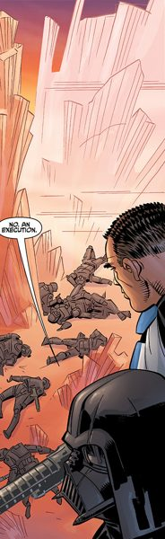

## LC#4 p. 17: "Ambush!": "Find cover. I will deal with this."
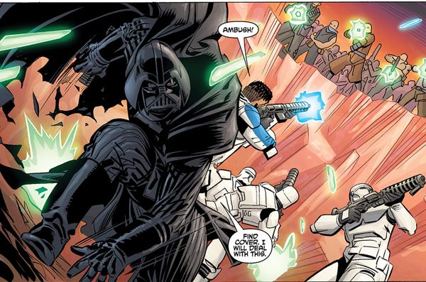

## LC#4 p. 18: Vader leaps into the ambush, saber raised
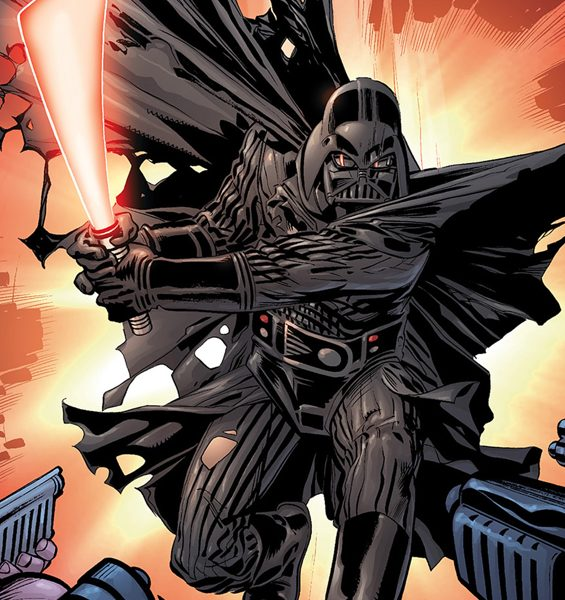

## LC#4 p. 19: "I am a Dark Lord of the Sith." (surrounded)
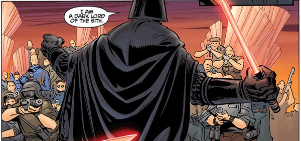

## LC#4 p. 21: Vader engulfed by flamethrowers
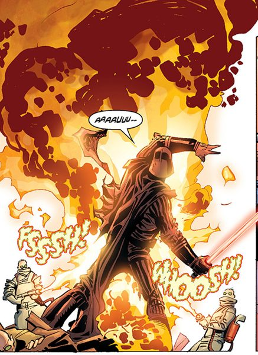

## LC#4 p. 22: Bound Vader and Garoche Tarkin: "willed yourself back from the dead"
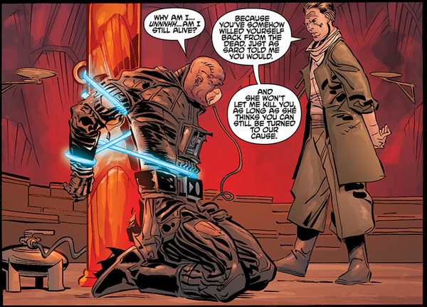

## LC#4 p. 24: Padmé vision: "I knew that one day, you would destroy us both."
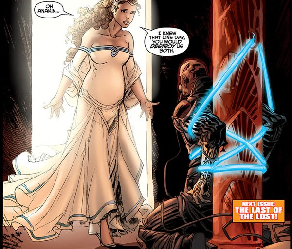

## LC#5 p. 01: Sanda cover: "VADER WILL NOT BE CHALLENGED!"
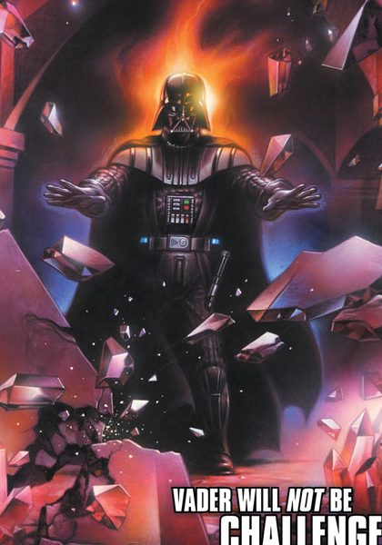

## LC#5 p. 03: "Oh, Anakin... look at you."
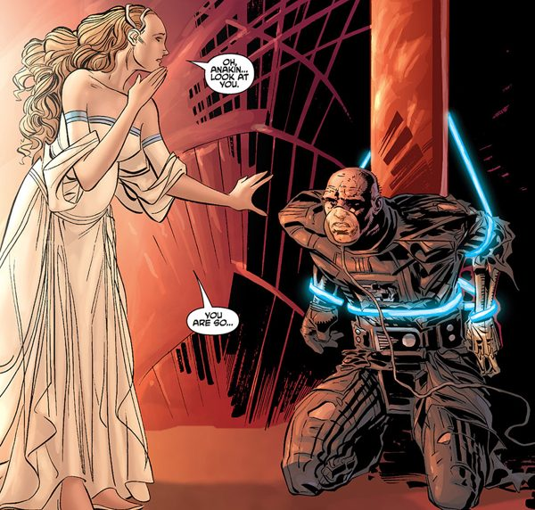

## LC#5 p. 05: "COME BACK!": Vader bursts the energy bonds and the crystal pillar
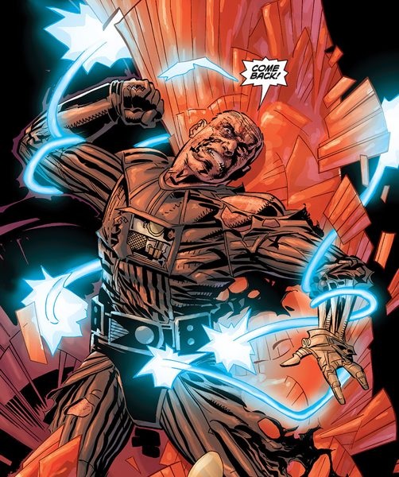

## LC#5 p. 09: "Where is my WIFE?!"
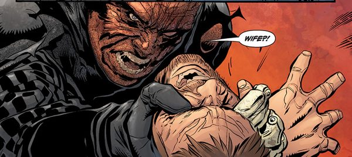

## LC#5 p. 12: Vader braced in Shale's suicide blast
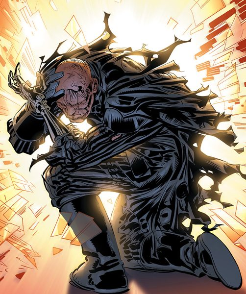

## LC#5 p. 14: Unmasked Vader with a red saber in the catacombs
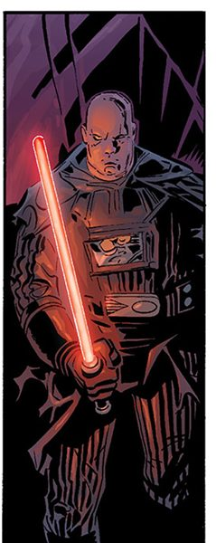

## LC#5 p. 16: A tear on Vader's scarred face ("I forgive you")
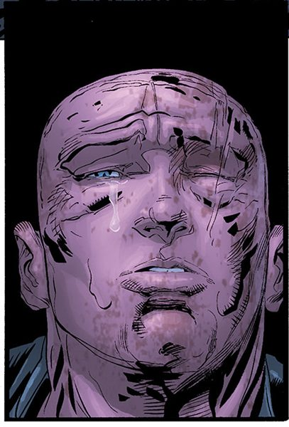

## LC#5 p. 21: Vader brings down the crystal cathedral
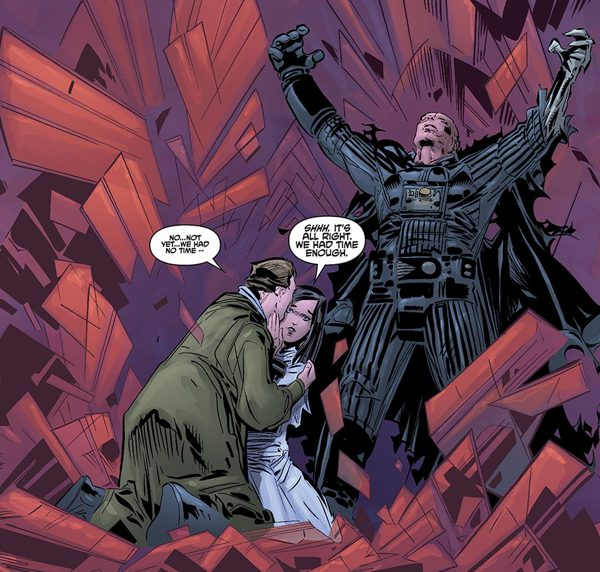

## LC#5 p. 22: Suit refit: "The dark side gave me all I needed."
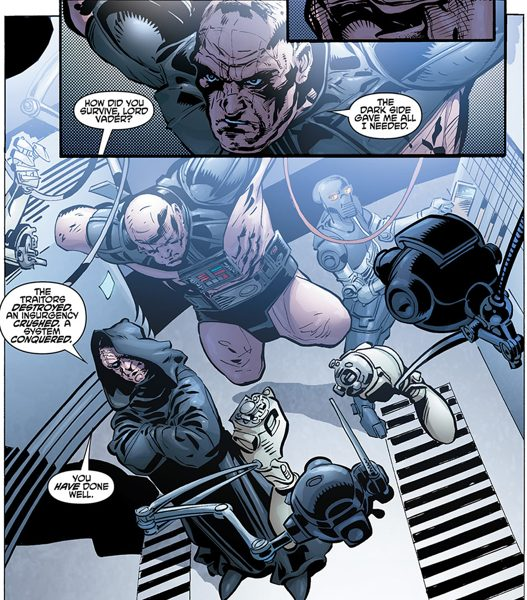

## LC#5 p. 23: Palpatine: "Hatred gnaws at him…"
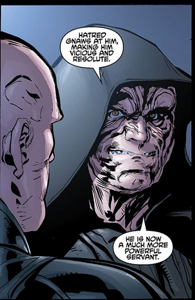

## LC#5 p. 24: "What is thy bidding... my master?" (final page)
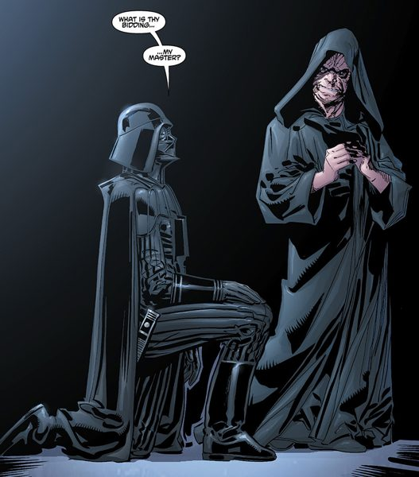

## Further candidates (listed, not yet cropped)
- LC#1 p. 11 panel 1: Venator over Atoa · LC#1 p. 15 panel 2: saber vs Atoan soldiers
- LC#2 p. 01: Sanda cockpit cover · LC#2 p. 04 panel 4: "crush them between my fingers" · LC#2 p. 10 panel 2: unmasked WHAM console smash · LC#2 p. 12: derelict Star Destroyer splash
- LC#3 p. 01: Sanda cover · LC#3 p. 04 (spread) top: AT-TE explosion · LC#3 p. 11 panel 1: emerging from the steam · LC#3 p. 14 panel 1: saber-cut circle in the vault door · LC#3 p. 16 panel 2: damaged chest panel · LC#3 p. 20 panel 2: Force-hurled prisoner
- LC#4 p. 01: cover · LC#4 p. 08: Star Destroyer BOOOOOM · LC#4 p. 14: shuttle crash among the crystal spires
