# Star Wars: Obsession: daily-image candidates

New non-Legacy art for the daily upload rotation: Clone Wars-era Dark Horse art by Brian Ching (colors Sno Cone Studios; covers Ching and Brad Anderson), 2004–2005. Every image is a single-panel or partial crop, max 600 px. No full pages.

Top picks for the daily slot: `ob4-p13-blockade-battle`, `ob5-p05-ventress-awakens`, `ob5-p22-pieta`, `ob4-p20-grievous-ambush`, `ob4-p15-crash-site`, `ob5-p24-ventress-alive`.

Count: 30 crops in `panels/`.

## Ob#1 p08: Masked, armored rider (Obi-Wan in disguise) leaps a swoop over the Trigalis river
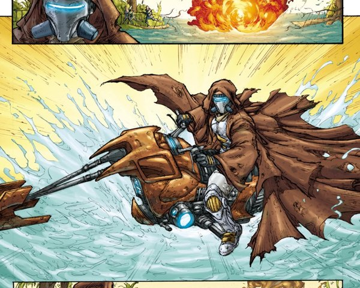

## Ob#1 p10: Visor close-up: "Let's find out."
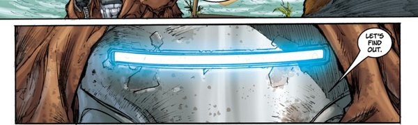

## Ob#1 p14: Anakin and Padmé on Naboo; Anakin's new facial scar
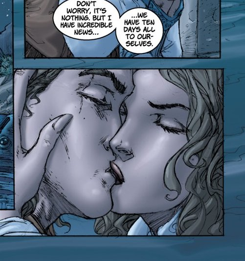

## Ob#1 p24: Obi-Wan leaves New Coronet in Aayla Secura's borrowed Delta-7
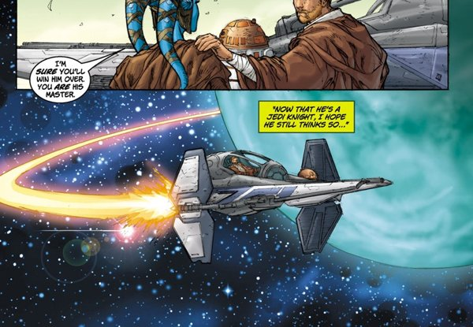

## Ob#2 p03: Naboo lake retreat at sunset (no dialogue)
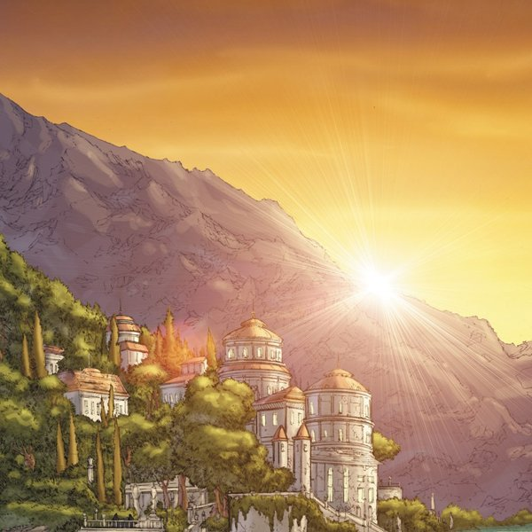

## Ob#2 p12: Drama Korr's space yacht drops out of hyperspace
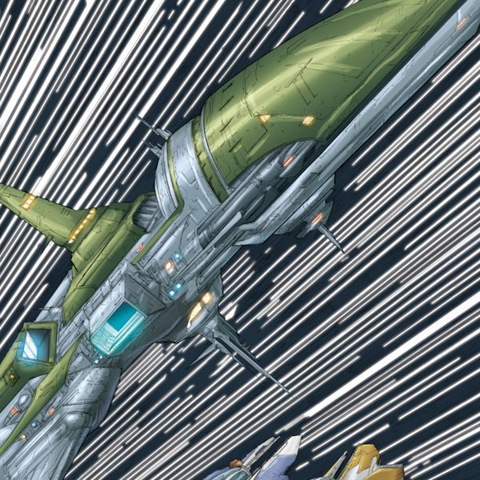

## Ob#2 p21: Durge rises from the wreckage: "you will not kill me!"
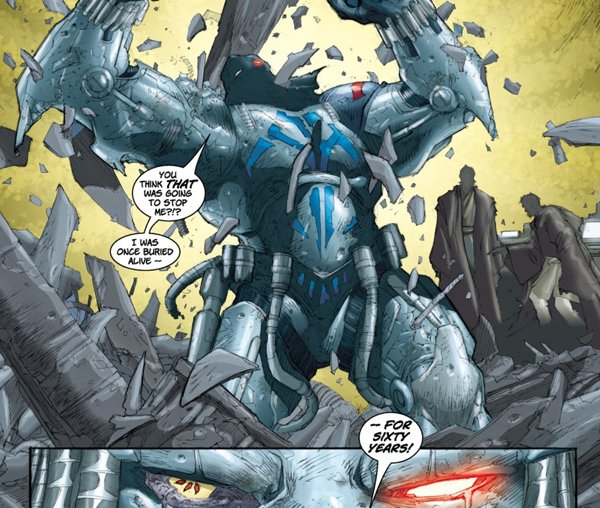

## Ob#3 p12: Durge's Gen'Dai face exposed
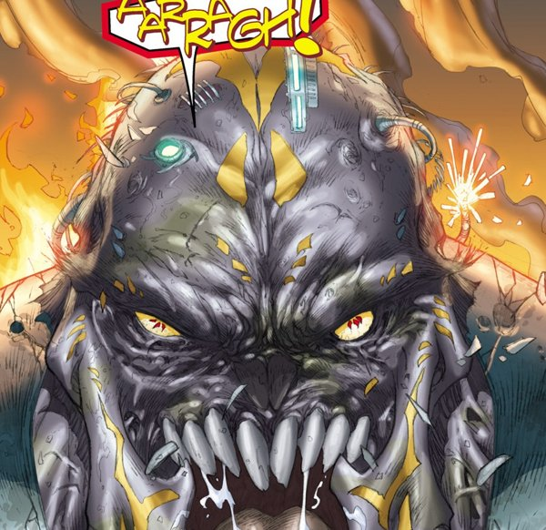

## Ob#3 p16: Durge's escape pod, Force-launched by Anakin, burns up in the star
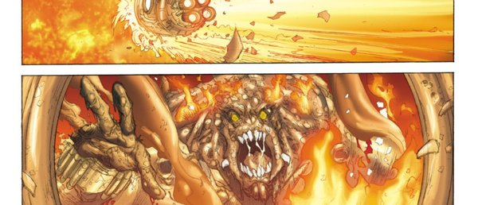

## Ob#3 p24: Separatist fleet over Boz Pity, "the graveyard world"
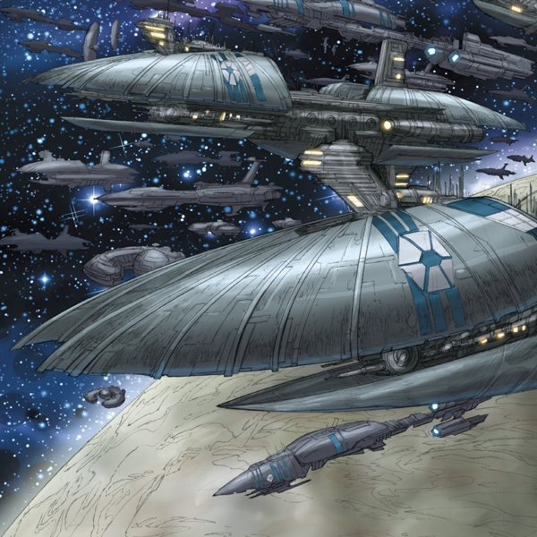

## Ob#4 p06: Double-page spread: Jedi, Bail and the ARC trooper Alpha around the briefing hologram
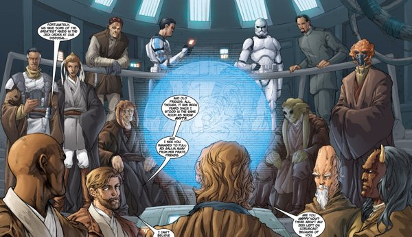

## Ob#4 p08: The Republic warship Intervention in hyperspace
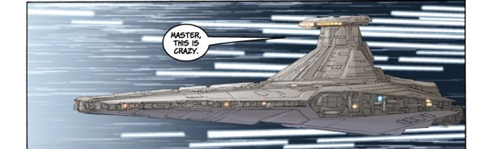

## Ob#4 p13: Double-page spread: battle at the Boz Pity blockade
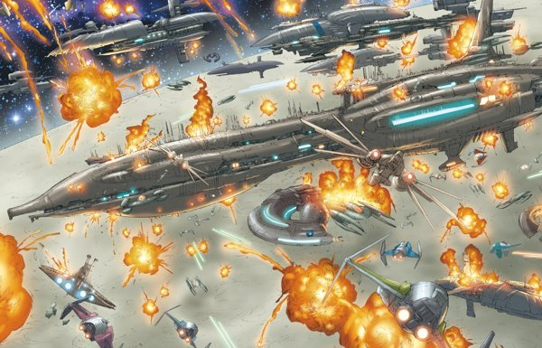

## Ob#4 p14: The Intervention burns through the atmosphere
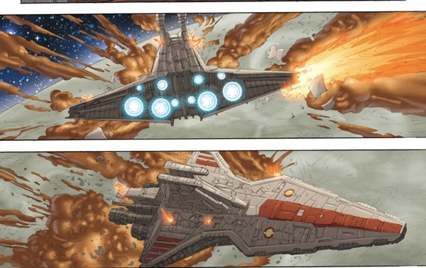

## Ob#4 p15: The wrecked Intervention among giant broken statues: "Sorry about that landing."
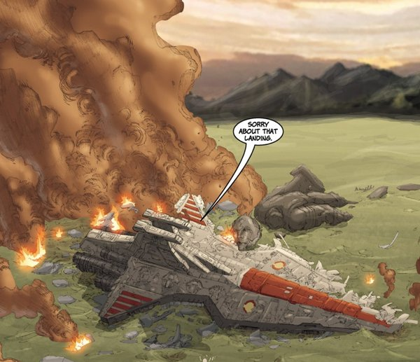

## Ob#4 p19: Grievous's eye: his first appearance in the story
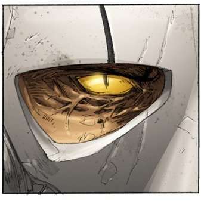

## Ob#4 p20: Grievous ambushes Adi Gallia and Soon Bayts
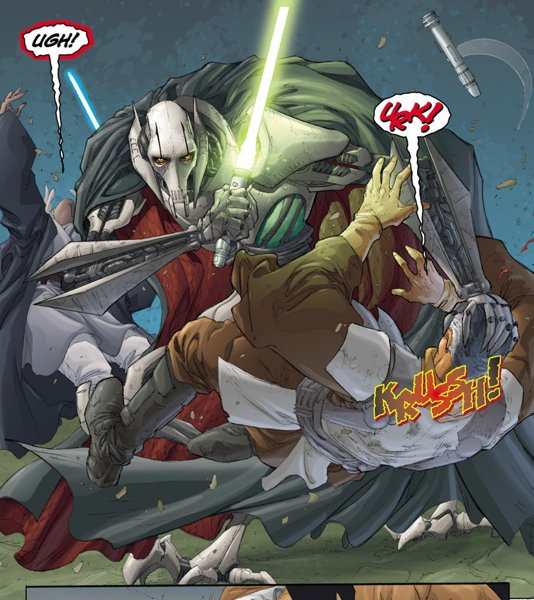

## Ob#4 p22: Ventress in a Separatist medical tank: "By the Force..."
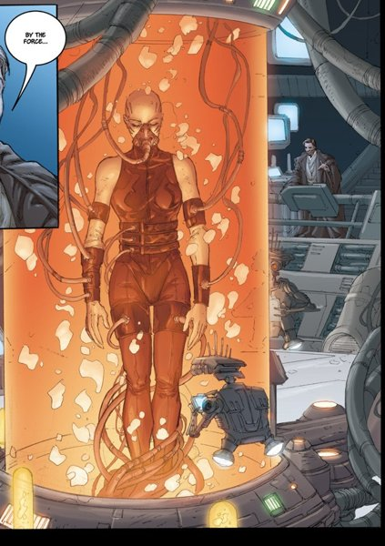

## Ob#5 p01: #5 cover (Ching/Anderson): "Ventress Reborn!"
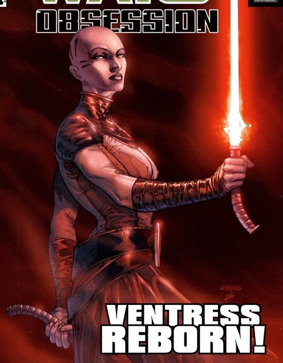

## Ob#5 p03: Count Dooku with two MagnaGuards
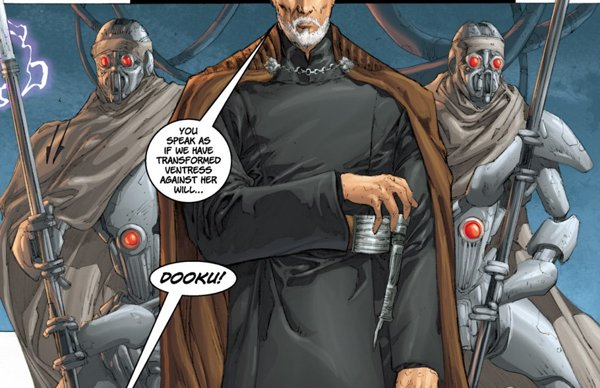

## Ob#5 p05: Ventress breaks out of the tank: "I am fear."
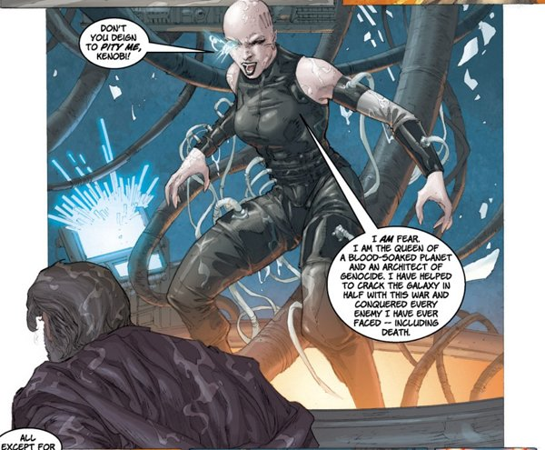

## Ob#5 p08: Grievous vs Adi Gallia: "I was built to kill your kind."
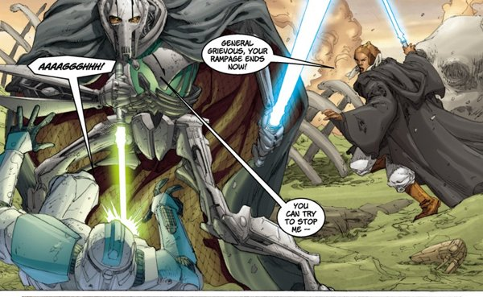

## Ob#5 p09: Mace Windu on a giant skull faces Grievous over Gallia's body
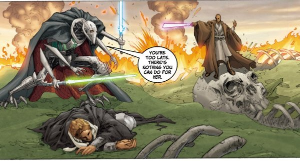

## Ob#5 p11: Ventress leaps in silhouette with twin red sabers
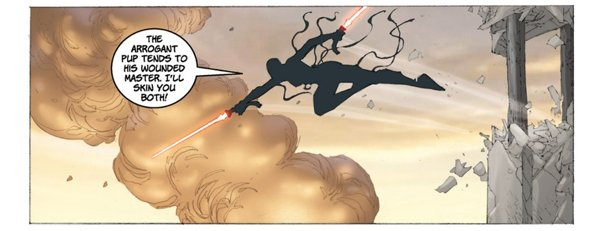

## Ob#5 p12: Ventress charges: "Your blind faith sickens me."
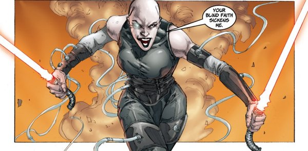

## Ob#5 p14: A bone-filled valley on Boz Pity: Dooku, "I am just one cog"
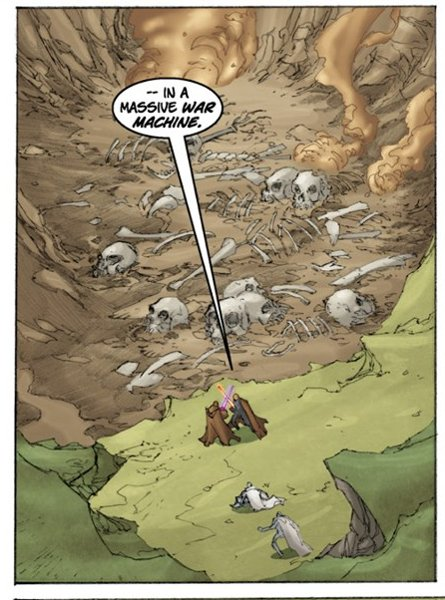

## Ob#5 p17: Dooku orders "finish her"; a MagnaGuard shoots Ventress
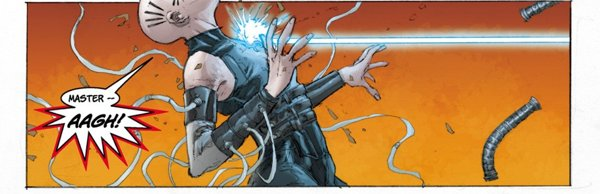

## Ob#5 p20: Anakin strikes Ventress down from behind
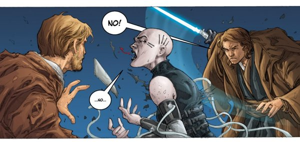

## Ob#5 p22: Obi-Wan holds the dying Ventress
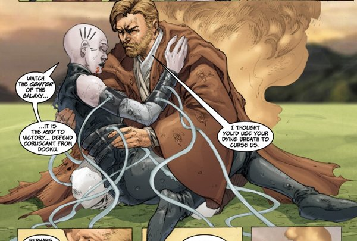

## Ob#5 p24: Epilogue: Ventress, alive, takes over the frigate Bright Flight
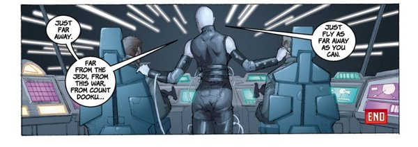

